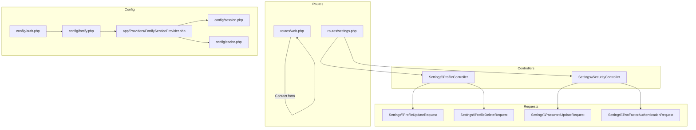
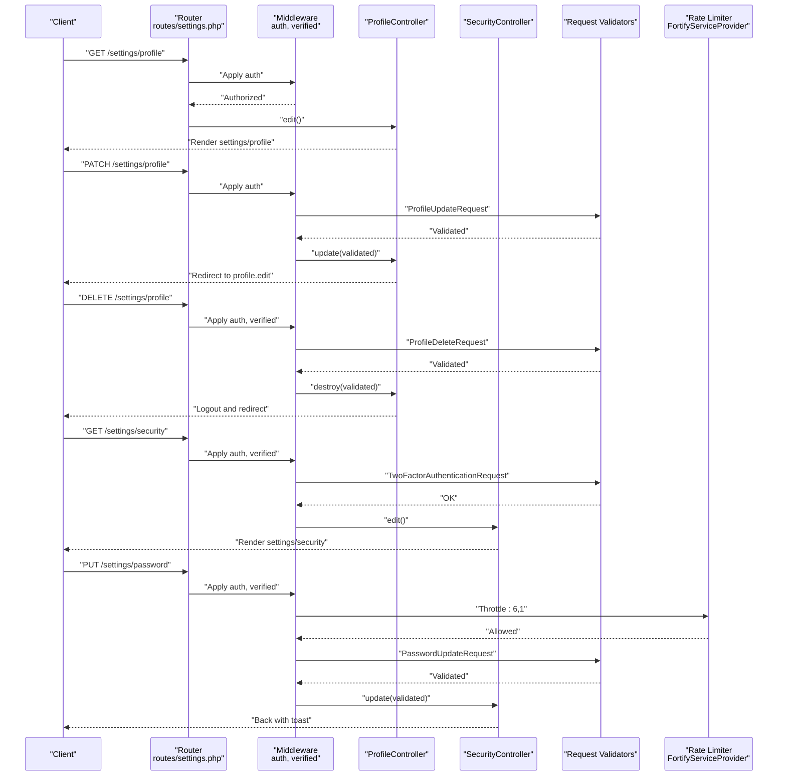
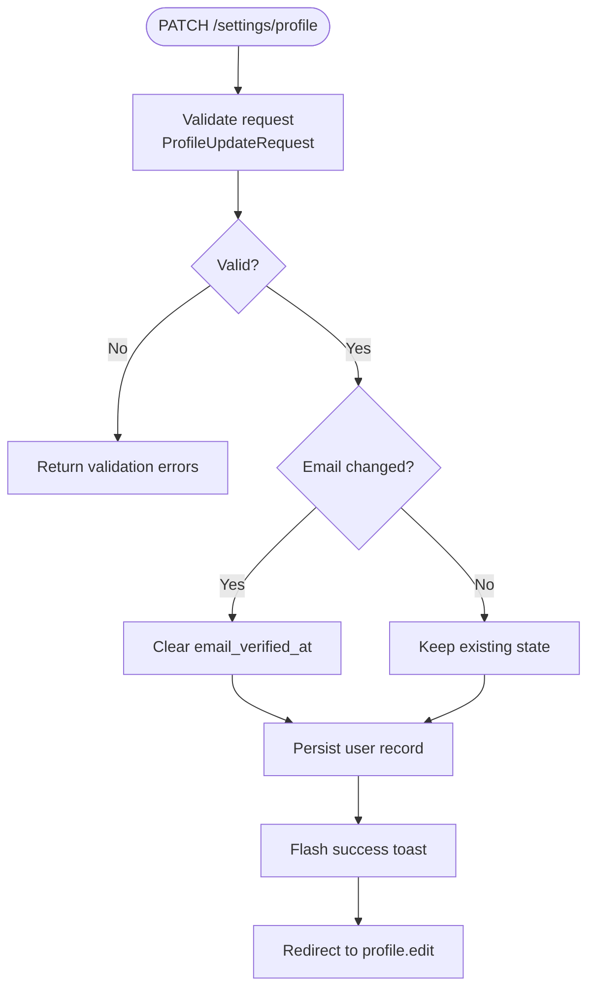
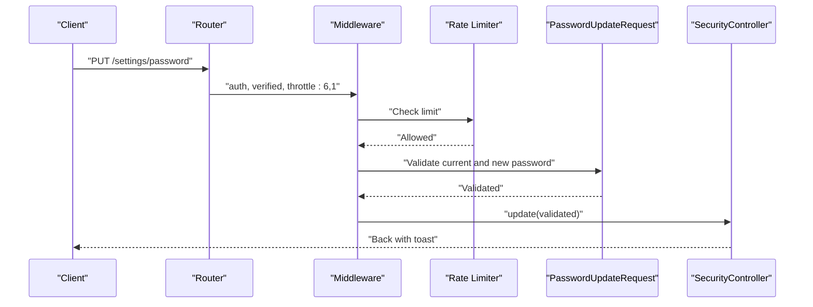
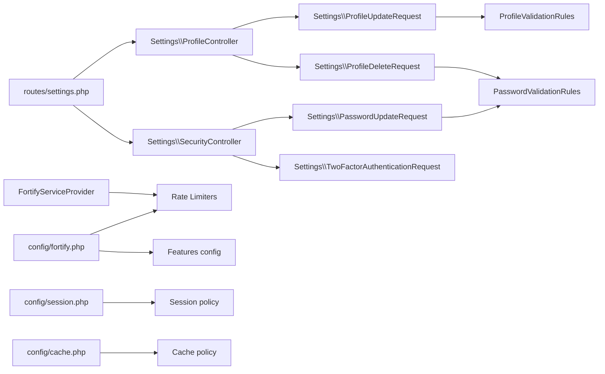

# API Documentation

<cite>
**Referenced Files in This Document**
- [routes/settings.php](file://routes/settings.php)
- [routes/web.php](file://routes/web.php)
- [app/Http/Controllers/Settings/ProfileController.php](file://app/Http/Controllers/Settings/ProfileController.php)
- [app/Http/Controllers/Settings/SecurityController.php](file://app/Http/Controllers/Settings/SecurityController.php)
- [app/Http/Requests/Settings/ProfileUpdateRequest.php](file://app/Http/Requests/Settings/ProfileUpdateRequest.php)
- [app/Http/Requests/Settings/PasswordUpdateRequest.php](file://app/Http/Requests/Settings/PasswordUpdateRequest.php)
- [app/Http/Requests/Settings/TwoFactorAuthenticationRequest.php](file://app/Http/Requests/Settings/TwoFactorAuthenticationRequest.php)
- [app/Http/Requests/Settings/ProfileDeleteRequest.php](file://app/Http/Requests/Settings/ProfileDeleteRequest.php)
- [app/Concerns/ProfileValidationRules.php](file://app/Concerns/ProfileValidationRules.php)
- [app/Concerns/PasswordValidationRules.php](file://app/Concerns/PasswordValidationRules.php)
- [config/fortify.php](file://config/fortify.php)
- [config/session.php](file://config/session.php)
- [config/cache.php](file://config/cache.php)
- [app/Providers/FortifyServiceProvider.php](file://app/Providers/FortifyServiceProvider.php)
- [config/auth.php](file://config/auth.php)
</cite>

## Table of Contents
1. [Introduction](#introduction)
2. [Project Structure](#project-structure)
3. [Core Components](#core-components)
4. [Architecture Overview](#architecture-overview)
5. [Detailed Component Analysis](#detailed-component-analysis)
6. [Dependency Analysis](#dependency-analysis)
7. [Performance Considerations](#performance-considerations)
8. [Troubleshooting Guide](#troubleshooting-guide)
9. [Conclusion](#conclusion)
10. [Appendices](#appendices)

## Introduction
This document describes the public HTTP endpoints exposed by the SmartExam web application related to settings management, authentication-related flows, and security operations. It focuses on:
- Authentication routes and middleware gating
- Settings endpoints for profile updates and deletion
- Security endpoints for password updates and two-factor/passkey management
- Request/response schemas, validation rules, and authentication requirements
- Error handling, status codes, rate limiting, and security considerations

Where applicable, endpoints are presented with HTTP methods, URL patterns, request/response schemas, and authentication requirements. Practical examples and client integration guidelines are included.

## Project Structure
The API surface is primarily defined by:
- Route files that declare endpoints and middleware
- Controller classes that implement business logic
- Request validation classes that enforce schemas
- Configuration files that define rate limits, features, and session/security policies

**Diagram sources**
- [routes/settings.php:1-41](file://routes/settings.php#L1-L41)
- [routes/web.php:1-26](file://routes/web.php#L1-L26)
- [app/Http/Controllers/Settings/ProfileController.php:1-63](file://app/Http/Controllers/Settings/ProfileController.php#L1-L63)
- [app/Http/Controllers/Settings/SecurityController.php:1-73](file://app/Http/Controllers/Settings/SecurityController.php#L1-L73)
- [app/Http/Requests/Settings/ProfileUpdateRequest.php:1-23](file://app/Http/Requests/Settings/ProfileUpdateRequest.php#L1-L23)
- [app/Http/Requests/Settings/ProfileDeleteRequest.php:1-25](file://app/Http/Requests/Settings/ProfileDeleteRequest.php#L1-L25)
- [app/Http/Requests/Settings/PasswordUpdateRequest.php:1-26](file://app/Http/Requests/Settings/PasswordUpdateRequest.php#L1-L26)
- [app/Http/Requests/Settings/TwoFactorAuthenticationRequest.php:1-23](file://app/Http/Requests/Settings/TwoFactorAuthenticationRequest.php#L1-L23)
- [config/fortify.php:1-192](file://config/fortify.php#L1-L192)
- [config/session.php:1-234](file://config/session.php#L1-L234)
- [config/cache.php:1-137](file://config/cache.php#L1-L137)
- [app/Providers/FortifyServiceProvider.php:1-118](file://app/Providers/FortifyServiceProvider.php#L1-L118)
- [config/auth.php:1-118](file://config/auth.php#L1-L118)

**Section sources**
- [routes/settings.php:1-41](file://routes/settings.php#L1-L41)
- [routes/web.php:1-26](file://routes/web.php#L1-L26)

## Core Components
- Authentication and session middleware:
  - Authenticated routes require an authenticated session.
  - Verified email routes additionally require email verification.
  - Password confirmation middleware may be applied for sensitive operations.
- Settings controllers:
  - ProfileController: edit, update, and delete user profile.
  - SecurityController: render security settings, update password, and manage two-factor and passkeys.
- Request validators:
  - Enforce field presence, type, length, uniqueness, and password strength.
- Rate limiting:
  - Configured via Fortify and custom rate limiters for login, two-factor, and passkeys.

**Section sources**
- [routes/settings.php:10-31](file://routes/settings.php#L10-L31)
- [app/Http/Controllers/Settings/ProfileController.php:15-62](file://app/Http/Controllers/Settings/ProfileController.php#L15-L62)
- [app/Http/Controllers/Settings/SecurityController.php:14-72](file://app/Http/Controllers/Settings/SecurityController.php#L14-L72)
- [app/Http/Requests/Settings/ProfileUpdateRequest.php:9-22](file://app/Http/Requests/Settings/ProfileUpdateRequest.php#L9-L22)
- [app/Http/Requests/Settings/PasswordUpdateRequest.php:9-25](file://app/Http/Requests/Settings/PasswordUpdateRequest.php#L9-L25)
- [app/Http/Requests/Settings/TwoFactorAuthenticationRequest.php:9-22](file://app/Http/Requests/Settings/TwoFactorAuthenticationRequest.php#L9-L22)
- [app/Http/Requests/Settings/ProfileDeleteRequest.php:9-24](file://app/Http/Requests/Settings/ProfileDeleteRequest.php#L9-L24)
- [config/fortify.php:117-125](file://config/fortify.php#L117-L125)
- [app/Providers/FortifyServiceProvider.php:95-116](file://app/Providers/FortifyServiceProvider.php#L95-L116)

## Architecture Overview
The settings endpoints are served by dedicated controllers and validated by request classes. Fortify and custom rate limiters govern authentication and throttling behavior. Session and cache configurations influence performance and security.

**Diagram sources**
- [routes/settings.php:10-31](file://routes/settings.php#L10-L31)
- [app/Http/Controllers/Settings/ProfileController.php:20-61](file://app/Http/Controllers/Settings/ProfileController.php#L20-L61)
- [app/Http/Controllers/Settings/SecurityController.php:19-71](file://app/Http/Controllers/Settings/SecurityController.php#L19-L71)
- [app/Http/Requests/Settings/ProfileUpdateRequest.php:9-22](file://app/Http/Requests/Settings/ProfileUpdateRequest.php#L9-L22)
- [app/Http/Requests/Settings/PasswordUpdateRequest.php:9-25](file://app/Http/Requests/Settings/PasswordUpdateRequest.php#L9-L25)
- [app/Http/Requests/Settings/TwoFactorAuthenticationRequest.php:9-22](file://app/Http/Requests/Settings/TwoFactorAuthenticationRequest.php#L9-L22)
- [app/Http/Requests/Settings/ProfileDeleteRequest.php:9-24](file://app/Http/Requests/Settings/ProfileDeleteRequest.php#L9-L24)
- [app/Providers/FortifyServiceProvider.php:95-116](file://app/Providers/FortifyServiceProvider.php#L95-L116)

## Detailed Component Analysis

### Authentication and Authorization
- Authenticated routes:
  - Require a valid session (authenticated user).
- Verified email routes:
  - Require both authentication and email verification.
- Password confirmation:
  - Optional middleware enforced on specific routes for sensitive operations.

Practical implications:
- Clients must maintain a valid session cookie.
- For endpoints requiring verified email, clients must handle redirects to verification prompts if not yet verified.

**Section sources**
- [routes/settings.php:10-31](file://routes/settings.php#L10-L31)
- [config/auth.php:18-21](file://config/auth.php#L18-L21)

### Settings: Profile Endpoints
- GET /settings/profile
  - Purpose: Load profile settings UI.
  - Authentication: auth
  - Response: Renders settings/profile with props indicating email verification requirement and optional status messages.
  - Notes: Returns HTML via Inertia renderer.

- PATCH /settings/profile
  - Purpose: Update user profile (name, email).
  - Authentication: auth
  - Request body:
    - name: string, required, max length constraint
    - email: string, required, valid email, unique per user
  - Validation: ProfileUpdateRequest delegates to ProfileValidationRules.
  - Behavior:
    - On email change, clears email verification status.
    - Saves user record.
    - Flashes a success toast via Inertia.
  - Response: Redirect to profile.edit.

- DELETE /settings/profile
  - Purpose: Delete user account.
  - Authentication: auth, verified
  - Request body:
    - password: string, required, must match current password
  - Validation: ProfileDeleteRequest enforces current password rule.
  - Behavior:
    - Logs out the user.
    - Deletes the user record.
    - Invalidates session and regenerates CSRF token.
  - Response: Redirect to home.

**Diagram sources**
- [app/Http/Controllers/Settings/ProfileController.php:31-44](file://app/Http/Controllers/Settings/ProfileController.php#L31-L44)
- [app/Http/Requests/Settings/ProfileUpdateRequest.php:9-22](file://app/Http/Requests/Settings/ProfileUpdateRequest.php#L9-L22)
- [app/Concerns/ProfileValidationRules.php:16-50](file://app/Concerns/ProfileValidationRules.php#L16-L50)

**Section sources**
- [routes/settings.php:13-18](file://routes/settings.php#L13-L18)
- [app/Http/Controllers/Settings/ProfileController.php:20-61](file://app/Http/Controllers/Settings/ProfileController.php#L20-L61)
- [app/Http/Requests/Settings/ProfileUpdateRequest.php:9-22](file://app/Http/Requests/Settings/ProfileUpdateRequest.php#L9-L22)
- [app/Http/Requests/Settings/ProfileDeleteRequest.php:9-24](file://app/Http/Requests/Settings/ProfileDeleteRequest.php#L9-L24)
- [app/Concerns/ProfileValidationRules.php:16-50](file://app/Concerns/ProfileValidationRules.php#L16-L50)

### Settings: Security Endpoints
- GET /settings/security
  - Purpose: Load security settings UI.
  - Authentication: auth, verified
  - Additional middleware: optional password confirmation depending on configuration.
  - Response: Renders settings/security with props:
    - Two-factor capability and state (when enabled)
    - Passkeys list and metadata (when enabled)
    - Password rules string for client-side hints
  - Notes: Uses TwoFactorAuthenticationRequest for state checks.

- PUT /settings/password
  - Purpose: Change user password.
  - Authentication: auth, verified
  - Throttling: 6 requests per 1 minute window.
  - Request body:
    - current_password: string, required, must match user’s current password
    - password: string, required, meets password strength rules, confirmed
  - Validation: PasswordUpdateRequest enforces current password and new password rules.
  - Behavior:
    - Updates the user’s password.
    - Flashes a success toast via Inertia.
  - Response: Back to previous page with toast.

- GET /.well-known/passkey-endpoints
  - Purpose: Expose passkey enrollment and management endpoints for WebAuthn discovery.
  - Response: JSON with enroll and manage route names.

**Diagram sources**
- [routes/settings.php:26-28](file://routes/settings.php#L26-L28)
- [app/Http/Controllers/Settings/SecurityController.php:62-71](file://app/Http/Controllers/Settings/SecurityController.php#L62-L71)
- [app/Http/Requests/Settings/PasswordUpdateRequest.php:9-25](file://app/Http/Requests/Settings/PasswordUpdateRequest.php#L9-L25)
- [app/Providers/FortifyServiceProvider.php:103-107](file://app/Providers/FortifyServiceProvider.php#L103-L107)

**Section sources**
- [routes/settings.php:20-31](file://routes/settings.php#L20-L31)
- [routes/settings.php:34-39](file://routes/settings.php#L34-L39)
- [app/Http/Controllers/Settings/SecurityController.php:19-71](file://app/Http/Controllers/Settings/SecurityController.php#L19-L71)
- [app/Http/Requests/Settings/PasswordUpdateRequest.php:9-25](file://app/Http/Requests/Settings/PasswordUpdateRequest.php#L9-L25)
- [app/Http/Requests/Settings/TwoFactorAuthenticationRequest.php:9-22](file://app/Http/Requests/Settings/TwoFactorAuthenticationRequest.php#L9-L22)
- [config/fortify.php:117-125](file://config/fortify.php#L117-L125)
- [app/Providers/FortifyServiceProvider.php:95-116](file://app/Providers/FortifyServiceProvider.php#L95-L116)

### Additional Public Endpoints
- POST /contact
  - Purpose: Submit a contact form.
  - Authentication: none
  - Request body:
    - name: string, required, max length
    - email: string, required, valid email
    - institution: string, required, max length
    - whatsapp: string, required, max length
    - message: string, optional, max length
  - Response: Redirect back with a success message.

**Section sources**
- [routes/web.php:8-19](file://routes/web.php#L8-L19)

## Dependency Analysis
- Route-to-controller mapping:
  - Settings routes map to ProfileController and SecurityController.
- Controller-to-request dependencies:
  - ProfileController relies on ProfileUpdateRequest and ProfileDeleteRequest.
  - SecurityController relies on PasswordUpdateRequest and TwoFactorAuthenticationRequest.
- Validation rule composition:
  - ProfileValidationRules centralizes name and email rules.
  - PasswordValidationRules centralizes current and new password rules.
- Rate limiting:
  - FortifyServiceProvider defines rate limiters for login, two-factor, and passkeys.
  - Fortify configuration exposes limiters keyed by names.
- Session and cache:
  - Session configuration affects cookie attributes and lifetime.
  - Cache configuration influences caching behavior across the app.

**Diagram sources**
- [routes/settings.php:1-41](file://routes/settings.php#L1-L41)
- [app/Http/Controllers/Settings/ProfileController.php:1-63](file://app/Http/Controllers/Settings/ProfileController.php#L1-L63)
- [app/Http/Controllers/Settings/SecurityController.php:1-73](file://app/Http/Controllers/Settings/SecurityController.php#L1-L73)
- [app/Http/Requests/Settings/ProfileUpdateRequest.php:1-23](file://app/Http/Requests/Settings/ProfileUpdateRequest.php#L1-L23)
- [app/Http/Requests/Settings/ProfileDeleteRequest.php:1-25](file://app/Http/Requests/Settings/ProfileDeleteRequest.php#L1-L25)
- [app/Http/Requests/Settings/PasswordUpdateRequest.php:1-26](file://app/Http/Requests/Settings/PasswordUpdateRequest.php#L1-L26)
- [app/Http/Requests/Settings/TwoFactorAuthenticationRequest.php:1-23](file://app/Http/Requests/Settings/TwoFactorAuthenticationRequest.php#L1-L23)
- [app/Concerns/ProfileValidationRules.php:1-52](file://app/Concerns/ProfileValidationRules.php#L1-L52)
- [app/Concerns/PasswordValidationRules.php:1-30](file://app/Concerns/PasswordValidationRules.php#L1-L30)
- [app/Providers/FortifyServiceProvider.php:1-118](file://app/Providers/FortifyServiceProvider.php#L1-L118)
- [config/fortify.php:1-192](file://config/fortify.php#L1-L192)
- [config/session.php:1-234](file://config/session.php#L1-L234)
- [config/cache.php:1-137](file://config/cache.php#L1-L137)

**Section sources**
- [app/Concerns/ProfileValidationRules.php:16-50](file://app/Concerns/ProfileValidationRules.php#L16-L50)
- [app/Concerns/PasswordValidationRules.php:15-28](file://app/Concerns/PasswordValidationRules.php#L15-L28)
- [app/Providers/FortifyServiceProvider.php:95-116](file://app/Providers/FortifyServiceProvider.php#L95-L116)
- [config/fortify.php:117-125](file://config/fortify.php#L117-L125)
- [config/session.php:130-202](file://config/session.php#L130-L202)
- [config/cache.php:121](file://config/cache.php#L121)

## Performance Considerations
- Rate limiting:
  - Login attempts are limited per email+IP.
  - Two-factor challenge attempts are limited per authenticated user session.
  - Passkeys operations are limited per credential ID or session+IP.
- Session lifetime:
  - Adjust session lifetime to balance usability and security.
- Cache:
  - Centralized cache configuration supports scalable caching strategies.

Recommendations:
- Tune rate limiter windows and keys according to deployment scale.
- Monitor session storage backend performance.
- Use appropriate cache stores for high-traffic environments.

**Section sources**
- [app/Providers/FortifyServiceProvider.php:95-116](file://app/Providers/FortifyServiceProvider.php#L95-L116)
- [config/fortify.php:117-125](file://config/fortify.php#L117-L125)
- [config/session.php:35](file://config/session.php#L35)
- [config/cache.php:18](file://config/cache.php#L18)

## Troubleshooting Guide
Common issues and resolutions:
- Validation errors on PATCH /settings/profile:
  - Ensure name and email meet constraints; email must be unique.
  - On invalid input, expect validation errors returned by the framework.
- Validation errors on PUT /settings/password:
  - current_password must match the user’s current password.
  - new password must satisfy strength rules and confirmation.
- Account deletion failures:
  - Requires verified email; ensure user is email-verified.
  - password must match current password.
- Rate limiting:
  - PUT /settings/password is throttled; retry after the window elapses.
- Session and CSRF:
  - Maintain a valid session cookie; after deletion, client must re-authenticate.

Error handling patterns:
- Validation failures return structured errors.
- Successful operations flash messages via Inertia; clients should observe UI feedback.

**Section sources**
- [app/Http/Controllers/Settings/ProfileController.php:31-61](file://app/Http/Controllers/Settings/ProfileController.php#L31-L61)
- [app/Http/Controllers/Settings/SecurityController.php:62-71](file://app/Http/Controllers/Settings/SecurityController.php#L62-L71)
- [app/Http/Requests/Settings/ProfileUpdateRequest.php:18-21](file://app/Http/Requests/Settings/ProfileUpdateRequest.php#L18-L21)
- [app/Http/Requests/Settings/PasswordUpdateRequest.php:18-24](file://app/Http/Requests/Settings/PasswordUpdateRequest.php#L18-L24)
- [app/Http/Requests/Settings/ProfileDeleteRequest.php:19-23](file://app/Http/Requests/Settings/ProfileDeleteRequest.php#L19-L23)
- [app/Providers/FortifyServiceProvider.php:103-107](file://app/Providers/FortifyServiceProvider.php#L103-L107)

## Conclusion
The SmartExam settings API provides a focused set of endpoints for profile management and security operations, secured by robust authentication and verification middleware, validated by dedicated request classes, and throttled by configurable rate limiters. Clients should adhere to request schemas, maintain authenticated sessions, and handle UI flashes and redirects appropriately.

## Appendices

### Endpoint Reference

- GET /settings/profile
  - Authentication: auth
  - Response: settings/profile view
  - Notes: UI-only endpoint

- PATCH /settings/profile
  - Authentication: auth
  - Request:
    - name: string, required, max length
    - email: string, required, valid email, unique
  - Response: redirect to profile.edit

- DELETE /settings/profile
  - Authentication: auth, verified
  - Request:
    - password: string, required, matches current password
  - Response: logout and redirect to home

- GET /settings/security
  - Authentication: auth, verified
  - Response: settings/security view with security props

- PUT /settings/password
  - Authentication: auth, verified
  - Throttle: 6 per 1 minute
  - Request:
    - current_password: string, required, matches current
    - password: string, required, strong, confirmed
  - Response: back with success toast

- GET /.well-known/passkey-endpoints
  - Authentication: none
  - Response: JSON with enroll/manage route names

- POST /contact
  - Authentication: none
  - Request:
    - name: string, required, max length
    - email: string, required, valid email
    - institution: string, required, max length
    - whatsapp: string, required, max length
    - message: string, optional, max length
  - Response: redirect back with success message

### Request Schemas

- PATCH /settings/profile
  - name: string, required, max length
  - email: string, required, valid email, unique

- DELETE /settings/profile
  - password: string, required, matches current password

- PUT /settings/password
  - current_password: string, required, matches current
  - password: string, required, strong, confirmed

- POST /contact
  - name: string, required, max length
  - email: string, required, valid email
  - institution: string, required, max length
  - whatsapp: string, required, max length
  - message: string, optional, max length

### Response Behaviors
- Successful operations:
  - Flash messages via Inertia for UI feedback.
  - Redirects to appropriate routes.
- Validation failures:
  - Structured validation errors returned by the framework.
- Rate limiting:
  - 429 responses when thresholds exceeded.

### Security and CORS
- Session security:
  - Secure, HTTP-only, SameSite cookie attributes are configurable.
- CSRF protection:
  - Laravel session-based CSRF applies to state-changing requests.
- CORS:
  - No explicit CORS configuration is present; cross-origin behavior follows defaults.

**Section sources**
- [config/session.php:130-202](file://config/session.php#L130-L202)
- [routes/settings.php:27](file://routes/settings.php#L27)
- [routes/web.php:8-19](file://routes/web.php#L8-L19)