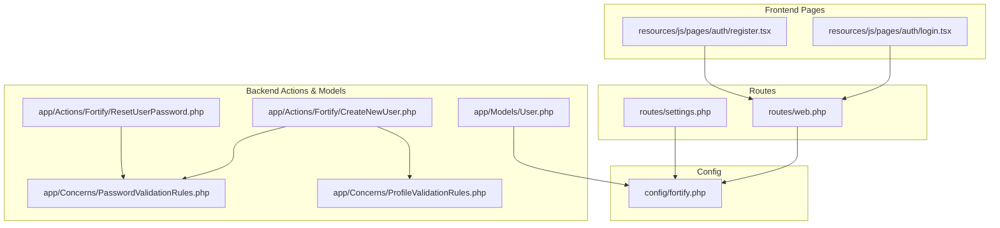
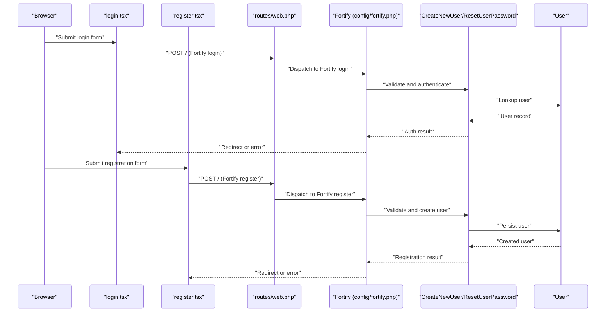
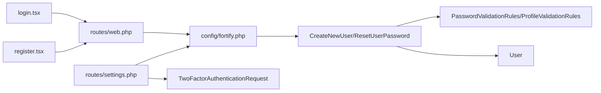

# Authentication Endpoints

<cite>
**Referenced Files in This Document**
- [web.php](file://routes/web.php)
- [settings.php](file://routes/settings.php)
- [fortify.php](file://config/fortify.php)
- [CreateNewUser.php](file://app/Actions/Fortify/CreateNewUser.php)
- [ResetUserPassword.php](file://app/Actions/Fortify/ResetUserPassword.php)
- [PasswordValidationRules.php](file://app/Concerns/PasswordValidationRules.php)
- [ProfileValidationRules.php](file://app/Concerns/ProfileValidationRules.php)
- [User.php](file://app/Models/User.php)
- [login.tsx](file://resources/js/pages/auth/login.tsx)
- [register.tsx](file://resources/js/pages/auth/register.tsx)
- [TwoFactorAuthenticationRequest.php](file://app/Http/Requests/Settings/TwoFactorAuthenticationRequest.php)
</cite>

## Table of Contents
1. [Introduction](#introduction)
2. [Project Structure](#project-structure)
3. [Core Components](#core-components)
4. [Architecture Overview](#architecture-overview)
5. [Detailed Component Analysis](#detailed-component-analysis)
6. [Dependency Analysis](#dependency-analysis)
7. [Performance Considerations](#performance-considerations)
8. [Troubleshooting Guide](#troubleshooting-guide)
9. [Conclusion](#conclusion)

## Introduction
This document provides API documentation for authentication endpoints in the SmartExam web application. It covers login, registration, logout, password reset, email verification, and two-factor authentication (2FA) flows. The documentation specifies HTTP methods, URL patterns, request/response schemas, authentication requirements, validation rules, error handling, status codes, and security considerations. Practical examples, client implementation guidelines, and integration patterns are included, along with rate limiting, CSRF protection, and session management notes.

## Project Structure
Authentication in SmartExam leverages Laravel Fortify for backend endpoints and Inertia.js pages for frontend flows. Key configuration and routing are centralized in the configuration and routes directories, while validation and user actions are encapsulated in dedicated classes and traits.

**Diagram sources**
- [web.php:1-26](file://routes/web.php#L1-L26)
- [settings.php:1-41](file://routes/settings.php#L1-L41)
- [fortify.php:1-192](file://config/fortify.php#L1-L192)
- [login.tsx:1-126](file://resources/js/pages/auth/login.tsx#L1-L126)
- [register.tsx:1-121](file://resources/js/pages/auth/register.tsx#L1-L121)
- [CreateNewUser.php:1-34](file://app/Actions/Fortify/CreateNewUser.php#L1-L34)
- [ResetUserPassword.php:1-30](file://app/Actions/Fortify/ResetUserPassword.php#L1-L30)
- [PasswordValidationRules.php:1-30](file://app/Concerns/PasswordValidationRules.php#L1-L30)
- [ProfileValidationRules.php:1-52](file://app/Concerns/ProfileValidationRules.php#L1-L52)
- [User.php:1-53](file://app/Models/User.php#L1-L53)

**Section sources**
- [web.php:1-26](file://routes/web.php#L1-L26)
- [settings.php:1-41](file://routes/settings.php#L1-L41)
- [fortify.php:1-192](file://config/fortify.php#L1-L192)

## Core Components
- Fortify configuration controls endpoint prefixes, middleware, rate limiters, and enabled features such as registration, password reset, email verification, and 2FA.
- Backend actions handle user creation and password resets with validation rules from traits.
- Frontend pages render login and registration forms and submit them via Inertia.js to Fortify endpoints.

Key capabilities:
- Registration with validated name, email, and password.
- Login with email/username and password, optionally with remember-me.
- Password reset initiated by email and completed with a new password.
- Email verification workflow.
- Two-Factor Authentication with confirmation and recovery options.
- Optional passkey/WebAuthn support.

**Section sources**
- [fortify.php:117-125](file://config/fortify.php#L117-L125)
- [fortify.php:169-189](file://config/fortify.php#L169-L189)
- [CreateNewUser.php:20-32](file://app/Actions/Fortify/CreateNewUser.php#L20-L32)
- [ResetUserPassword.php:19-28](file://app/Actions/Fortify/ResetUserPassword.php#L19-L28)
- [PasswordValidationRules.php:15-28](file://app/Concerns/PasswordValidationRules.php#L15-L28)
- [ProfileValidationRules.php:16-50](file://app/Concerns/ProfileValidationRules.php#L16-L50)
- [login.tsx:33-98](file://resources/js/pages/auth/login.tsx#L33-L98)
- [register.tsx:20-101](file://resources/js/pages/auth/register.tsx#L20-L101)

## Architecture Overview
The authentication architecture integrates Fortify-managed endpoints with Inertia.js-driven UI. Requests originate from frontend pages, are validated and processed by Fortify, and return either redirects or JSON responses depending on the client’s capability.

**Diagram sources**
- [login.tsx:33-98](file://resources/js/pages/auth/login.tsx#L33-L98)
- [register.tsx:20-101](file://resources/js/pages/auth/register.tsx#L20-L101)
- [web.php:1-26](file://routes/web.php#L1-L26)
- [fortify.php:89-104](file://config/fortify.php#L89-L104)
- [CreateNewUser.php:20-32](file://app/Actions/Fortify/CreateNewUser.php#L20-L32)
- [ResetUserPassword.php:19-28](file://app/Actions/Fortify/ResetUserPassword.php#L19-L28)
- [User.php:32-35](file://app/Models/User.php#L32-L35)

## Detailed Component Analysis

### Login Endpoint
- Method: POST
- URL Pattern: Root path (/) handled by Fortify
- Authentication Requirements: None (public)
- Request Schema:
  - email: string, required, must be a valid email
  - password: string, required
  - remember: boolean, optional
- Response: Redirects to configured home path after successful authentication; otherwise returns the login page with validation errors.
- Validation Rules:
  - email: required, string, email format
  - password: required, string
  - remember: optional boolean
- Status Codes:
  - 302 Found (redirect) on success
  - 422 Unprocessable Entity on validation failure
  - 401 Unauthorized on failed authentication
- Security Considerations:
  - Rate limiting controlled by Fortify limiter keys.
  - CSRF protection via Laravel middleware stack.
  - Session management handled by Laravel.
- Practical Example:
  - Submit email and password; on success, user is redirected to the dashboard.

**Section sources**
- [web.php:1-26](file://routes/web.php#L1-L26)
- [fortify.php:117-125](file://config/fortify.php#L117-L125)
- [login.tsx:42-77](file://resources/js/pages/auth/login.tsx#L42-L77)

### Registration Endpoint
- Method: POST
- URL Pattern: Root path (/) handled by Fortify
- Authentication Requirements: None (public)
- Request Schema:
  - name: string, required, max length 255
  - email: string, required, unique, email format, max length 255
  - password: string, required, confirmed, meets password policy
  - password_confirmation: string, matches password
- Response: Redirects to dashboard after successful registration; otherwise returns the registration page with validation errors.
- Validation Rules:
  - name: required, string, max 255
  - email: required, string, email, unique
  - password: required, string, password policy, confirmed
- Status Codes:
  - 302 Found (redirect) on success
  - 422 Unprocessable Entity on validation failure
- Security Considerations:
  - Rate limiting via Fortify.
  - Unique email constraint prevents duplicates.
- Practical Example:
  - Submit name, email, and password; on success, user is redirected to dashboard.

**Section sources**
- [CreateNewUser.php:20-32](file://app/Actions/Fortify/CreateNewUser.php#L20-L32)
- [ProfileValidationRules.php:16-50](file://app/Concerns/ProfileValidationRules.php#L16-L50)
- [PasswordValidationRules.php:15-18](file://app/Concerns/PasswordValidationRules.php#L15-L18)
- [register.tsx:28-91](file://resources/js/pages/auth/register.tsx#L28-L91)

### Logout Endpoint
- Method: POST
- URL Pattern: Root path (/) handled by Fortify
- Authentication Requirements: Requires authentication
- Request Schema: None (form submission)
- Response: Redirects to home; invalidates current session.
- Status Codes:
  - 302 Found (redirect) on success
  - 401 Unauthorized if not authenticated
- Security Considerations:
  - CSRF protection via middleware.
  - Session invalidated server-side.

**Section sources**
- [web.php:1-26](file://routes/web.php#L1-L26)
- [fortify.php:104-104](file://config/fortify.php#L104-L104)

### Password Reset (Initiate)
- Method: POST
- URL Pattern: Root path (/) handled by Fortify
- Authentication Requirements: None (public)
- Request Schema:
  - email: string, required, must exist in users table
- Response: Returns to the initiating page with a status message indicating the reset email was sent.
- Validation Rules:
  - email: required, string, email, exists in users
- Status Codes:
  - 302 Found (redirect) on success
  - 422 Unprocessable Entity on validation failure
- Security Considerations:
  - Rate limiting via Fortify.
  - Token-based reset flow occurs separately.

**Section sources**
- [web.php:1-26](file://routes/web.php#L1-L26)
- [fortify.php:117-125](file://config/fortify.php#L117-L125)

### Password Reset (Complete)
- Method: POST
- URL Pattern: Root path (/) handled by Fortify
- Authentication Requirements: Requires a valid reset token (not authenticated)
- Request Schema:
  - token: string, required
  - email: string, required, must match token recipient
  - password: string, required, confirmed, meets policy
  - password_confirmation: string, matches password
- Response: Redirects to dashboard after successful reset; otherwise returns the reset page with validation errors.
- Validation Rules:
  - token: required
  - email: required, string, email
  - password: required, string, password policy, confirmed
- Status Codes:
  - 302 Found (redirect) on success
  - 422 Unprocessable Entity on validation failure
- Security Considerations:
  - Token binding to email.
  - Rate limiting via Fortify.

**Section sources**
- [ResetUserPassword.php:19-28](file://app/Actions/Fortify/ResetUserPassword.php#L19-L28)
- [PasswordValidationRules.php:15-18](file://app/Concerns/PasswordValidationRules.php#L15-L18)
- [web.php:1-26](file://routes/web.php#L1-L26)

### Email Verification (Initiate)
- Method: POST
- URL Pattern: Root path (/) handled by Fortify
- Authentication Requirements: Requires authentication
- Request Schema: None (form submission)
- Response: Returns to the verification page with a status message indicating a new verification email was sent.
- Status Codes:
  - 302 Found (redirect) on success
  - 401 Unauthorized if not authenticated
- Security Considerations:
  - Requires verified middleware for subsequent protected routes.

**Section sources**
- [web.php:1-26](file://routes/web.php#L1-L26)
- [fortify.php:174-176](file://config/fortify.php#L174-L176)

### Email Verification (Complete)
- Method: GET/POST
- URL Pattern: Fortify verification routes (configured by Fortify)
- Authentication Requirements: Requires unverified email
- Request Schema:
  - id: integer, required, user identifier
  - hash: string, required, verification hash
  - expires: integer, required, expiration timestamp
  - signature: string, required, signed hash
- Response: Marks email as verified and redirects to dashboard.
- Status Codes:
  - 302 Found (redirect) on success
  - 400 Bad Request on invalid/expired token
- Security Considerations:
  - Signed, expiring tokens prevent replay attacks.

**Section sources**
- [fortify.php:174-176](file://config/fortify.php#L174-L176)

### Two-Factor Authentication (2FA)
- Methods:
  - Enable/Disable 2FA: GET/PUT to settings route (requires authentication and verified email)
  - Challenge: GET/POST to 2FA challenge route (requires session)
- URL Patterns:
  - Enable 2FA: GET /settings/security (requires password confirmation)
  - Complete 2FA setup: PUT /settings/password (throttled)
  - Challenge: GET /two-factor-challenge, POST /two-factor-challenge
- Authentication Requirements:
  - Enable/Disable: auth, verified
  - Challenge: session-bound
- Request Schemas:
  - Enable 2FA: none (UI action)
  - Complete 2FA setup: password update request (throttled)
  - Challenge: code (6 digits)
- Response:
  - Enable/Disable: redirect to security settings
  - Challenge: redirect to dashboard on success; otherwise returns challenge page with errors
- Validation Rules:
  - Challenge code: required, numeric, 6 digits
- Status Codes:
  - 302 Found (redirect) on success
  - 422 Unprocessable Entity on validation failure
  - 401 Unauthorized if not authenticated
- Security Considerations:
  - Rate limiting via Fortify limiter keys.
  - Recovery codes generated upon enabling 2FA.

**Section sources**
- [settings.php:17-31](file://routes/settings.php#L17-L31)
- [TwoFactorAuthenticationRequest.php:18-21](file://app/Http/Requests/Settings/TwoFactorAuthenticationRequest.php#L18-L21)
- [fortify.php:117-125](file://config/fortify.php#L117-L125)
- [User.php:32-35](file://app/Models/User.php#L32-L35)

### Passkeys (WebAuthn) Support
- Discovery Endpoint:
  - GET /.well-known/passkey-endpoints
  - Response: JSON with enrollment and management endpoints
- Authentication:
  - Frontend passkey verification component integrated into login page.
- Security Considerations:
  - Relaying Party ID and allowed origins configured.
  - User handle secret and timeout configurable.

**Section sources**
- [settings.php:33-39](file://routes/settings.php#L33-L39)
- [login.tsx:29-31](file://resources/js/pages/auth/login.tsx#L29-L31)
- [fortify.php:150-155](file://config/fortify.php#L150-L155)

## Dependency Analysis
The authentication flow depends on Fortify configuration, backend actions, and frontend pages. Validation rules are shared via traits and applied in actions and requests.

**Diagram sources**
- [login.tsx:1-126](file://resources/js/pages/auth/login.tsx#L1-L126)
- [register.tsx:1-121](file://resources/js/pages/auth/register.tsx#L1-L121)
- [web.php:1-26](file://routes/web.php#L1-L26)
- [settings.php:1-41](file://routes/settings.php#L1-L41)
- [fortify.php:1-192](file://config/fortify.php#L1-L192)
- [CreateNewUser.php:1-34](file://app/Actions/Fortify/CreateNewUser.php#L1-L34)
- [ResetUserPassword.php:1-30](file://app/Actions/Fortify/ResetUserPassword.php#L1-L30)
- [PasswordValidationRules.php:1-30](file://app/Concerns/PasswordValidationRules.php#L1-L30)
- [ProfileValidationRules.php:1-52](file://app/Concerns/ProfileValidationRules.php#L1-L52)
- [User.php:1-53](file://app/Models/User.php#L1-L53)
- [TwoFactorAuthenticationRequest.php:1-23](file://app/Http/Requests/Settings/TwoFactorAuthenticationRequest.php#L1-L23)

**Section sources**
- [CreateNewUser.php:1-34](file://app/Actions/Fortify/CreateNewUser.php#L1-L34)
- [ResetUserPassword.php:1-30](file://app/Actions/Fortify/ResetUserPassword.php#L1-L30)
- [PasswordValidationRules.php:1-30](file://app/Concerns/PasswordValidationRules.php#L1-L30)
- [ProfileValidationRules.php:1-52](file://app/Concerns/ProfileValidationRules.php#L1-L52)
- [User.php:1-53](file://app/Models/User.php#L1-L53)
- [TwoFactorAuthenticationRequest.php:1-23](file://app/Http/Requests/Settings/TwoFactorAuthenticationRequest.php#L1-L23)

## Performance Considerations
- Rate Limiting:
  - Fortify applies per-minute throttling for login, 2FA, and passkeys via limiter keys.
  - Adjust limiter configuration in Fortify settings for production tuning.
- Validation Overhead:
  - Centralized validation rules minimize duplication and improve maintainability.
- Session Efficiency:
  - Use appropriate session lifetime and driver configuration for optimal performance.

[No sources needed since this section provides general guidance]

## Troubleshooting Guide
Common issues and resolutions:
- Validation Failures (422):
  - Ensure request payloads meet validation rules (email format, password policy, uniqueness).
  - Check frontend form bindings and error rendering.
- Authentication Failures (401):
  - Verify credentials and that the user account is not locked or pending verification.
- Rate Limit Exceeded:
  - Implement exponential backoff on the client; review Fortify limiter configuration.
- 2FA Challenges:
  - Confirm the device clock is synchronized; ensure recovery codes are stored securely.
- Passkeys:
  - Verify browser support and origin configuration; check discovery endpoint response.

**Section sources**
- [PasswordValidationRules.php:15-18](file://app/Concerns/PasswordValidationRules.php#L15-L18)
- [ProfileValidationRules.php:39-50](file://app/Concerns/ProfileValidationRules.php#L39-L50)
- [fortify.php:117-125](file://config/fortify.php#L117-L125)

## Conclusion
SmartExam’s authentication system combines Laravel Fortify for robust backend endpoints with Inertia.js for responsive frontend flows. The documented endpoints cover login, registration, logout, password reset, email verification, and 2FA, with clear validation rules, rate limiting, and security considerations. Clients should adhere to the provided schemas and error handling patterns for reliable integration.