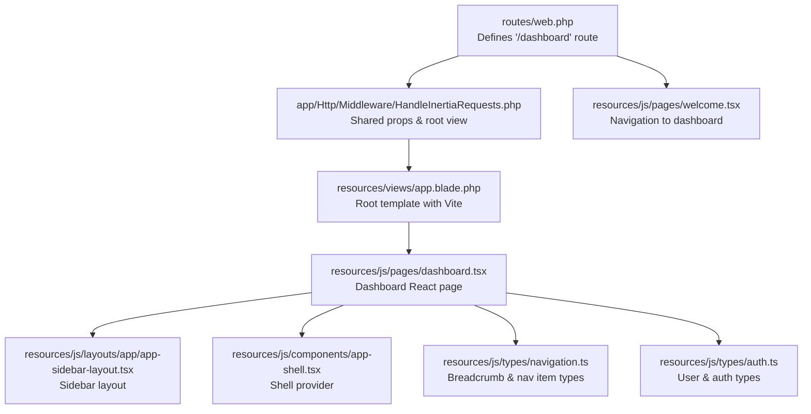
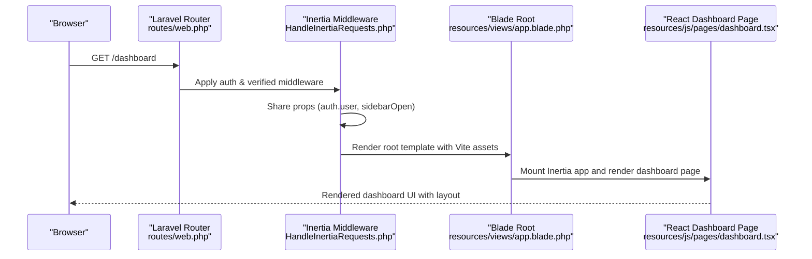
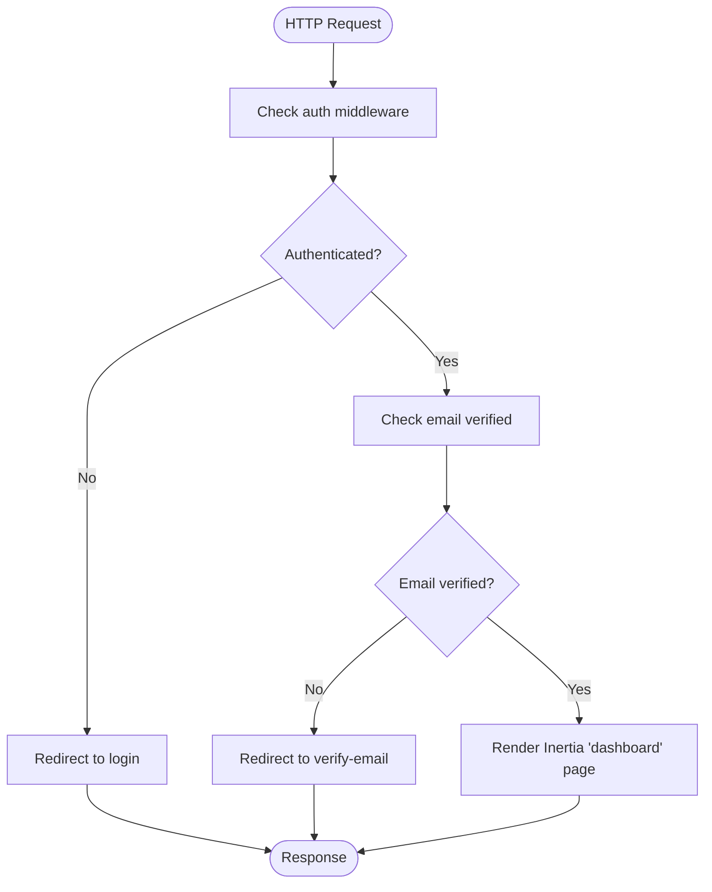
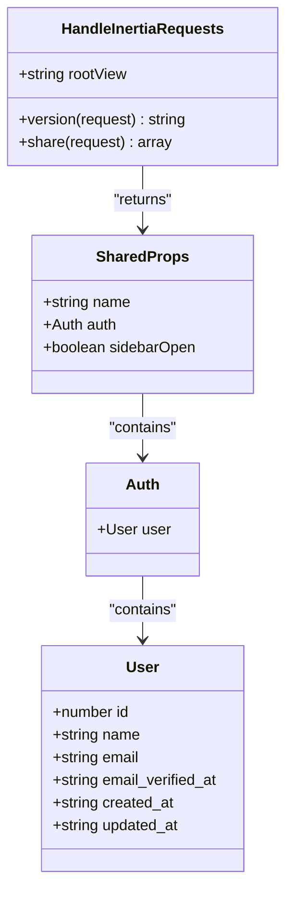
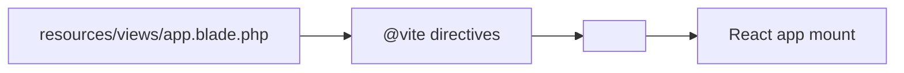
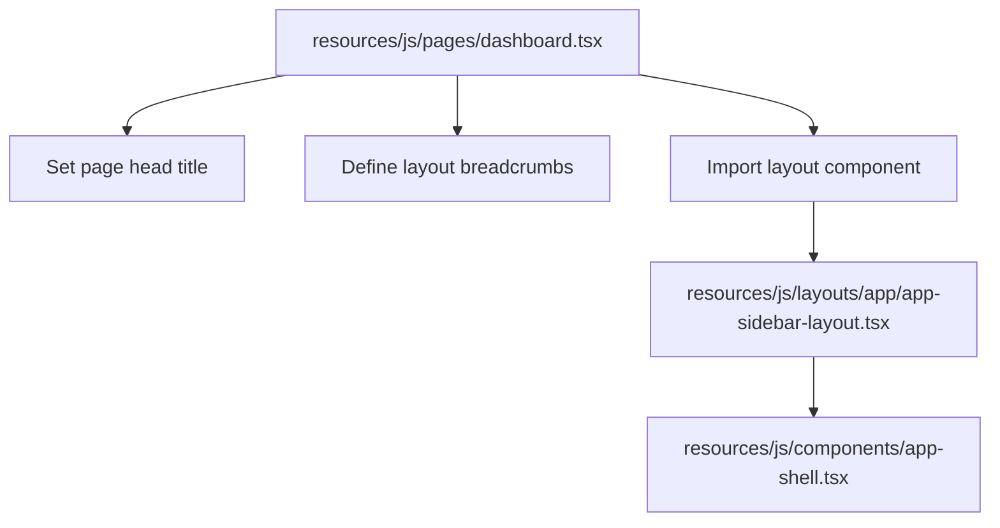
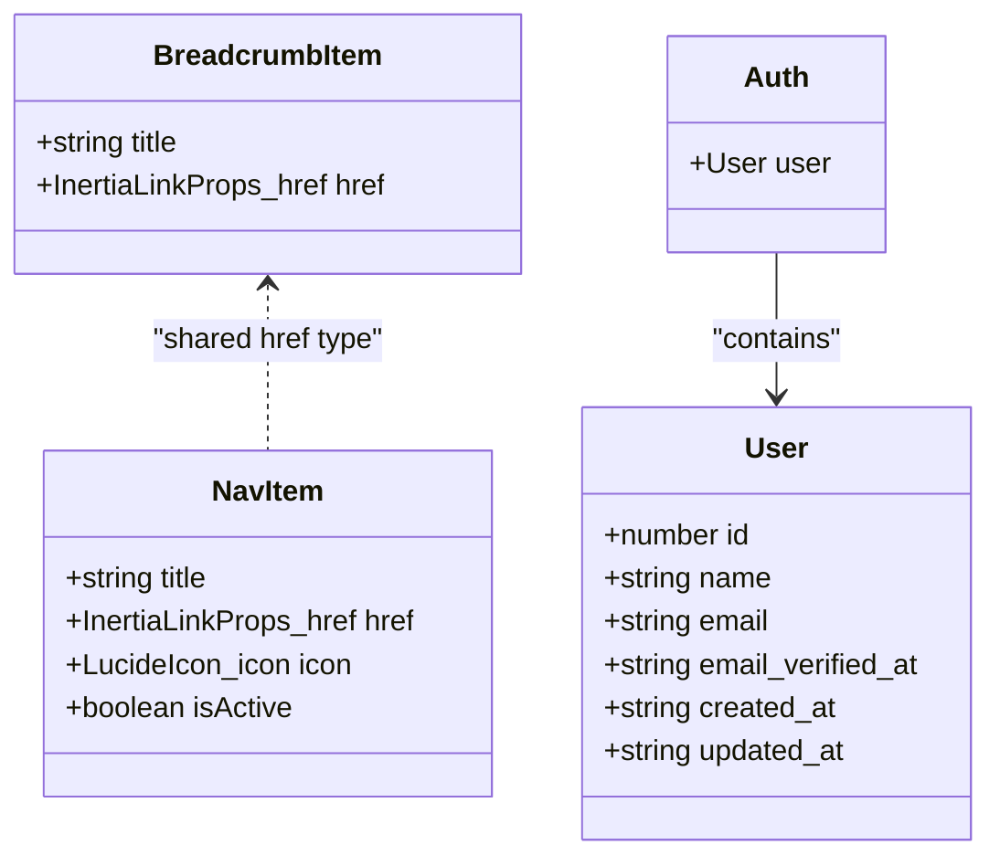
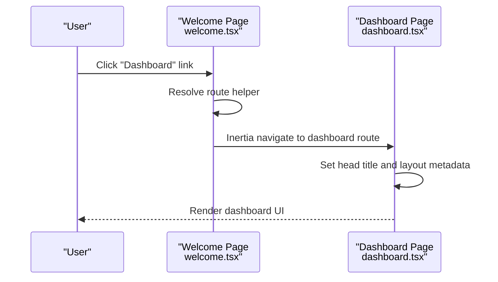
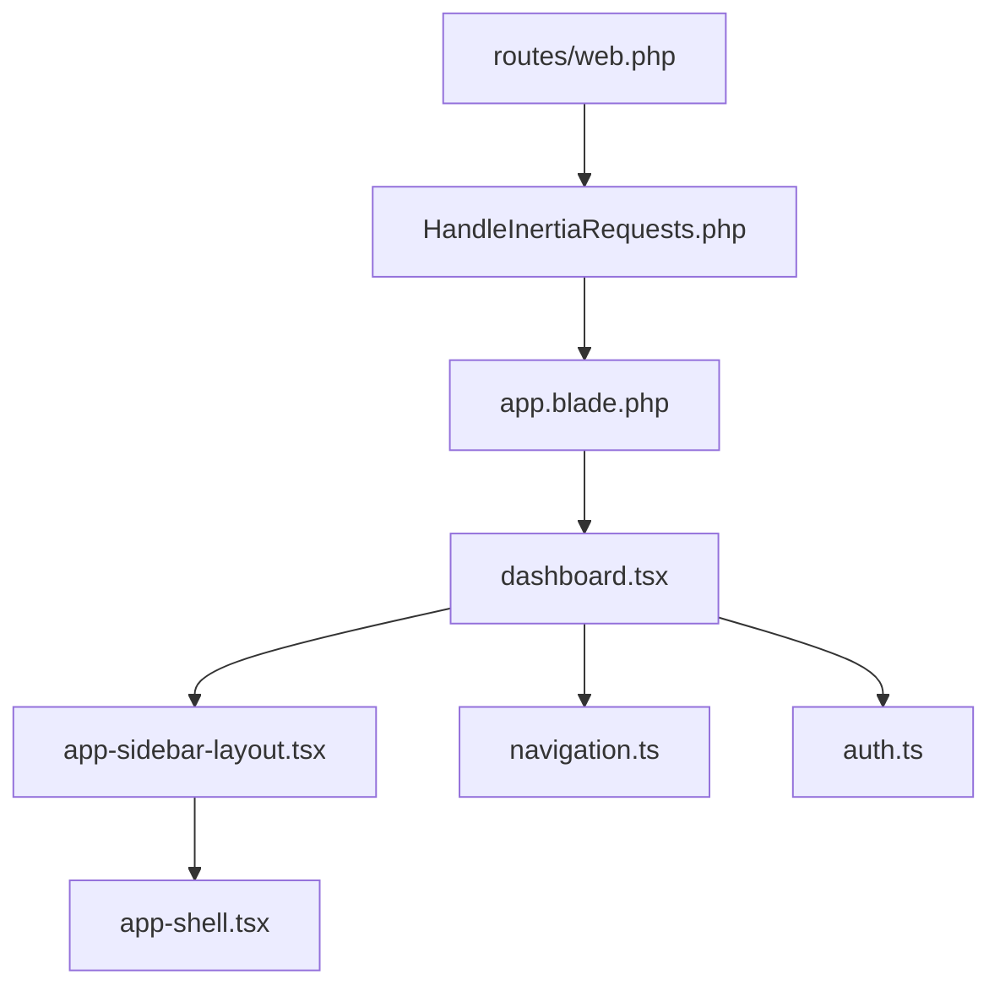

# Dashboard Endpoints

<cite>
**Referenced Files in This Document**
- [web.php](file://routes/web.php)
- [dashboard.tsx](file://resources/js/pages/dashboard.tsx)
- [HandleInertiaRequests.php](file://app/Http/Middleware/HandleInertiaRequests.php)
- [app.blade.php](file://resources/views/app.blade.php)
- [app-sidebar-layout.tsx](file://resources/js/layouts/app/app-sidebar-layout.tsx)
- [app-shell.tsx](file://resources/js/components/app-shell.tsx)
- [welcome.tsx](file://resources/js/pages/welcome.tsx)
- [navigation.ts](file://resources/js/types/navigation.ts)
- [auth.ts](file://resources/js/types/auth.ts)
</cite>

## Table of Contents
1. [Introduction](#introduction)
2. [Project Structure](#project-structure)
3. [Core Components](#core-components)
4. [Architecture Overview](#architecture-overview)
5. [Detailed Component Analysis](#detailed-component-analysis)
6. [Dependency Analysis](#dependency-analysis)
7. [Performance Considerations](#performance-considerations)
8. [Troubleshooting Guide](#troubleshooting-guide)
9. [Conclusion](#conclusion)

## Introduction
This document provides API documentation for the authenticated dashboard endpoints in the SmartExam web application. It focuses on the dashboard route definition, Inertia.js integration patterns, authentication and authorization requirements, and the client-side rendering pipeline. It also documents the dashboard page structure, component hierarchy, and data sharing mechanisms used by the dashboard interface.

## Project Structure
The dashboard functionality spans Laravel routes, Inertia middleware, Blade templates, and React components. The key elements are:
- Route registration for the authenticated dashboard
- Inertia middleware for shared data and root template
- Blade root template for Vite-powered React rendering
- React dashboard page with layout composition
- Shared navigation and authentication types

**Diagram sources**
- [web.php:21-23](file://routes/web.php#L21-L23)
- [HandleInertiaRequests.php:17](file://app/Http/Middleware/HandleInertiaRequests.php#L17)
- [app.blade.php:40-46](file://resources/views/app/app.blade.php#L40-L46)
- [dashboard.tsx:5-37](file://resources/js/pages/dashboard.tsx#L5-L37)
- [app-sidebar-layout.tsx:7-20](file://resources/js/layouts/app/app-sidebar-layout.tsx#L7-L20)
- [app-shell.tsx:11-21](file://resources/js/components/app-shell.tsx#L11-L21)
- [navigation.ts:4-14](file://resources/js/types/navigation.ts#L4-L14)
- [auth.ts:15-17](file://resources/js/types/auth.ts#L15-L17)
- [welcome.tsx:88-126](file://resources/js/pages/welcome.tsx#L88-L126)

**Section sources**
- [web.php:21-23](file://routes/web.php#L21-L23)
- [HandleInertiaRequests.php:36-46](file://app/Http/Middleware/HandleInertiaRequests.php#L36-L46)
- [app.blade.php:40-46](file://resources/views/app.blade.php#L40-L46)
- [dashboard.tsx:5-37](file://resources/js/pages/dashboard.tsx#L5-L37)
- [app-sidebar-layout.tsx:7-20](file://resources/js/layouts/app/app-sidebar-layout.tsx#L7-L20)
- [app-shell.tsx:11-21](file://resources/js/components/app-shell.tsx#L11-L21)
- [navigation.ts:4-14](file://resources/js/types/navigation.ts#L4-L14)
- [auth.ts:15-17](file://resources/js/types/auth.ts#L15-L17)
- [welcome.tsx:88-126](file://resources/js/pages/welcome.tsx#L88-L126)

## Core Components
- Dashboard route: Protected by authentication and email verification middleware, renders the dashboard page via Inertia.
- Inertia middleware: Sets the root template and shares application-wide data (including authentication state and UI preferences).
- Root template: Loads Vite assets and renders the Inertia app shell.
- Dashboard page: React component with layout composition and breadcrumb metadata.
- Layout and shell: Provide sidebar-aware layout and state management.
- Types: Define shared navigation and authentication structures used across components.

**Section sources**
- [web.php:21-23](file://routes/web.php#L21-L23)
- [HandleInertiaRequests.php:17](file://app/Http/Middleware/HandleInertiaRequests.php#L17)
- [HandleInertiaRequests.php:36-46](file://app/Http/Middleware/HandleInertiaRequests.php#L36-L46)
- [app.blade.php:40-46](file://resources/views/app/app.blade.php#L40-L46)
- [dashboard.tsx:5-37](file://resources/js/pages/dashboard.tsx#L5-L37)
- [app-sidebar-layout.tsx:7-20](file://resources/js/layouts/app/app-sidebar-layout.tsx#L7-L20)
- [app-shell.tsx:11-21](file://resources/js/components/app-shell.tsx#L11-L21)
- [navigation.ts:4-14](file://resources/js/types/navigation.ts#L4-L14)
- [auth.ts:15-17](file://resources/js/types/auth.ts#L15-L17)

## Architecture Overview
The dashboard follows an authenticated Inertia.js pattern:
- HTTP request hits the Laravel route for "/dashboard".
- Middleware enforces authentication and email verification.
- Inertia middleware prepares shared props and loads the root Blade template.
- Blade template initializes Vite and renders the Inertia app shell.
- The React dashboard page mounts and composes layout components.

**Diagram sources**
- [web.php:21-23](file://routes/web.php#L21-L23)
- [HandleInertiaRequests.php:36-46](file://app/Http/Middleware/HandleInertiaRequests.php#L36-L46)
- [app.blade.php:40-46](file://resources/views/app/app.blade.php#L40-L46)
- [dashboard.tsx:5-37](file://resources/js/pages/dashboard.tsx#L5-L37)

## Detailed Component Analysis

### Dashboard Route Definition
- Method: GET
- URL Pattern: /dashboard
- Protection: Requires authenticated user and verified email
- Rendering: Inertia renders the "dashboard" page component

**Diagram sources**
- [web.php:21-23](file://routes/web.php#L21-L23)

**Section sources**
- [web.php:21-23](file://routes/web.php#L21-L23)

### Inertia Middleware and Shared Data
- Root template: Configured to load Blade root template
- Shared props:
  - Application name
  - Authentication user object
  - Sidebar open state derived from cookie

**Diagram sources**
- [HandleInertiaRequests.php:17](file://app/Http/Middleware/HandleInertiaRequests.php#L17)
- [HandleInertiaRequests.php:36-46](file://app/Http/Middleware/HandleInertiaRequests.php#L36-L46)
- [auth.ts:15-17](file://resources/js/types/auth.ts#L15-L17)
- [auth.ts:1-13](file://resources/js/types/auth.ts#L1-L13)

**Section sources**
- [HandleInertiaRequests.php:17](file://app/Http/Middleware/HandleInertiaRequests.php#L17)
- [HandleInertiaRequests.php:36-46](file://app/Http/Middleware/HandleInertiaRequests.php#L36-L46)
- [auth.ts:15-17](file://resources/js/types/auth.ts#L15-L17)
- [auth.ts:1-13](file://resources/js/types/auth.ts#L1-L13)

### Root Template and Asset Loading
- The root Blade template integrates Vite for React assets and renders the Inertia app shell.
- Ensures the React dashboard page and its dependencies are loaded.

**Diagram sources**
- [app.blade.php:40-46](file://resources/views/app/app.blade.php#L40-L46)

**Section sources**
- [app.blade.php:40-46](file://resources/views/app/app.blade.php#L40-L46)

### Dashboard Page Composition
- React page component sets the page head title and renders placeholder content.
- Defines layout metadata including breadcrumbs pointing to the dashboard route.
- Uses layout composition for sidebar-aware rendering.

**Diagram sources**
- [dashboard.tsx:5-37](file://resources/js/pages/dashboard.tsx#L5-L37)
- [dashboard.tsx:29-36](file://resources/js/pages/dashboard.tsx#L29-L36)
- [app-sidebar-layout.tsx:7-20](file://resources/js/layouts/app/app-sidebar-layout.tsx#L7-L20)
- [app-shell.tsx:11-21](file://resources/js/components/app-shell.tsx#L11-L21)

**Section sources**
- [dashboard.tsx:5-37](file://resources/js/pages/dashboard.tsx#L5-L37)
- [dashboard.tsx:29-36](file://resources/js/pages/dashboard.tsx#L29-L36)
- [app-sidebar-layout.tsx:7-20](file://resources/js/layouts/app/app-sidebar-layout.tsx#L7-L20)
- [app-shell.tsx:11-21](file://resources/js/components/app-shell.tsx#L11-L21)

### Navigation and Authentication Types
- Breadcrumb and navigation item types define structured links for client-side navigation.
- Authentication types define the shape of the user object shared by the middleware.

**Diagram sources**
- [navigation.ts:4-14](file://resources/js/types/navigation.ts#L4-L14)
- [auth.ts:15-17](file://resources/js/types/auth.ts#L15-L17)
- [auth.ts:1-13](file://resources/js/types/auth.ts#L1-L13)

**Section sources**
- [navigation.ts:4-14](file://resources/js/types/navigation.ts#L4-L14)
- [auth.ts:15-17](file://resources/js/types/auth.ts#L15-L17)
- [auth.ts:1-13](file://resources/js/types/auth.ts#L1-L13)

### Client-Side Navigation and Initialization
- The welcome page demonstrates client-side navigation to the dashboard using Inertia link helpers.
- The dashboard page defines its own breadcrumb metadata for navigation consistency.

**Diagram sources**
- [welcome.tsx:88-126](file://resources/js/pages/welcome.tsx#L88-L126)
- [dashboard.tsx:5-37](file://resources/js/pages/dashboard.tsx#L5-L37)

**Section sources**
- [welcome.tsx:88-126](file://resources/js/pages/welcome.tsx#L88-L126)
- [dashboard.tsx:5-37](file://resources/js/pages/dashboard.tsx#L5-L37)

## Dependency Analysis
The dashboard depends on:
- Route protection middleware stack (authentication and email verification)
- Inertia middleware for shared props and root template
- Blade root template for asset loading
- React dashboard page and its layout components
- Shared TypeScript types for navigation and authentication

**Diagram sources**
- [web.php:21-23](file://routes/web.php#L21-L23)
- [HandleInertiaRequests.php:17](file://app/Http/Middleware/HandleInertiaRequests.php#L17)
- [app.blade.php:40-46](file://resources/views/app.blade.php#L40-L46)
- [dashboard.tsx:5-37](file://resources/js/pages/dashboard.tsx#L5-L37)
- [app-sidebar-layout.tsx:7-20](file://resources/js/layouts/app/app-sidebar-layout.tsx#L7-L20)
- [app-shell.tsx:11-21](file://resources/js/components/app-shell.tsx#L11-L21)
- [navigation.ts:4-14](file://resources/js/types/navigation.ts#L4-L14)
- [auth.ts:15-17](file://resources/js/types/auth.ts#L15-L17)

**Section sources**
- [web.php:21-23](file://routes/web.php#L21-L23)
- [HandleInertiaRequests.php:17](file://app/Http/Middleware/HandleInertiaRequests.php#L17)
- [app.blade.php:40-46](file://resources/views/app.blade.php#L40-L46)
- [dashboard.tsx:5-37](file://resources/js/pages/dashboard.tsx#L5-L37)
- [app-sidebar-layout.tsx:7-20](file://resources/js/layouts/app/app-sidebar-layout.tsx#L7-L20)
- [app-shell.tsx:11-21](file://resources/js/components/app-shell.tsx#L11-L21)
- [navigation.ts:4-14](file://resources/js/types/navigation.ts#L4-L14)
- [auth.ts:15-17](file://resources/js/types/auth.ts#L15-L17)

## Performance Considerations
- Keep dashboard data fetching minimal and lazy to reduce initial load time.
- Use Inertia's progressive enhancement to avoid unnecessary full-page reloads.
- Ensure shared props remain lightweight to minimize payload overhead.
- Leverage Vite's hot module replacement during development and optimized builds for production.

## Troubleshooting Guide
- Authentication failures: Verify the user is authenticated and email is verified before accessing the dashboard route.
- Missing shared props: Confirm the Inertia middleware is registered and sharing the expected props (auth.user, sidebarOpen).
- Asset loading issues: Ensure the root Blade template includes Vite directives and the React dashboard page is included in the Vite entry.
- Layout problems: Check that the dashboard page uses the appropriate layout component and that the shell provider is initialized correctly.

**Section sources**
- [web.php:21-23](file://routes/web.php#L21-L23)
- [HandleInertiaRequests.php:36-46](file://app/Http/Middleware/HandleInertiaRequests.php#L36-L46)
- [app.blade.php:40-46](file://resources/views/app/app.blade.php#L40-L46)
- [app-shell.tsx:11-21](file://resources/js/components/app-shell.tsx#L11-L21)

## Conclusion
The SmartExam dashboard leverages Laravel routes, Inertia middleware, and React components to deliver a seamless authenticated experience. The route is protected by authentication and email verification, while the Inertia middleware ensures consistent shared data and a unified root template. The dashboard page composes layout components and defines breadcrumb metadata for navigation, supported by shared TypeScript types for navigation and authentication.