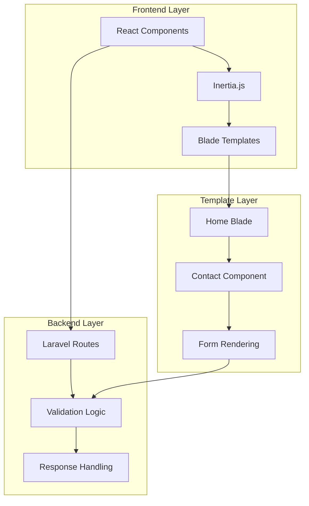
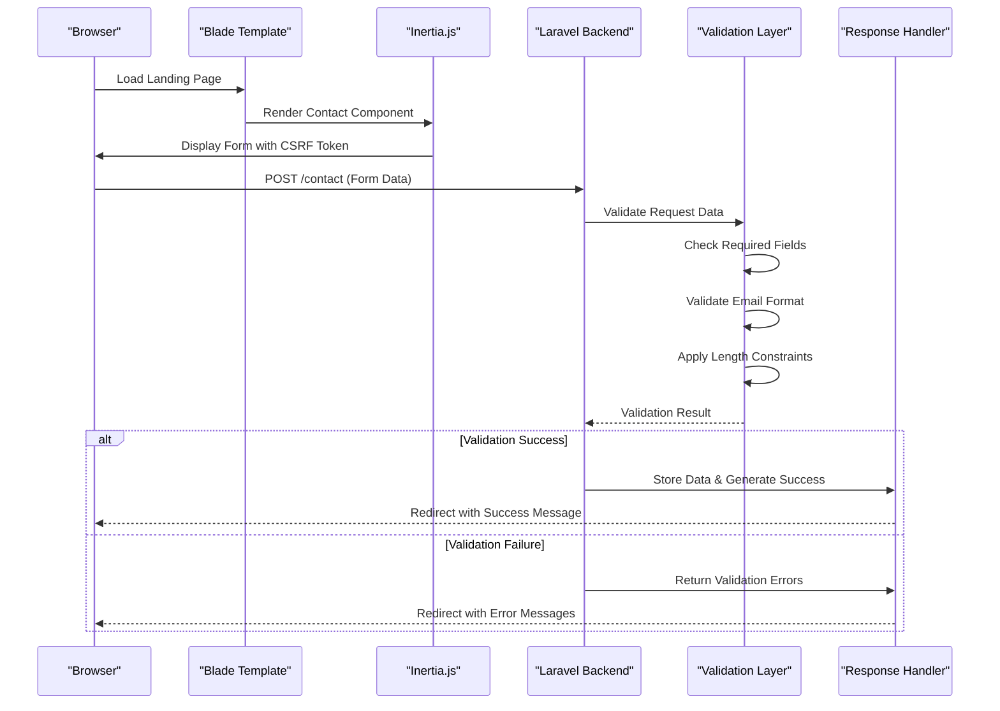
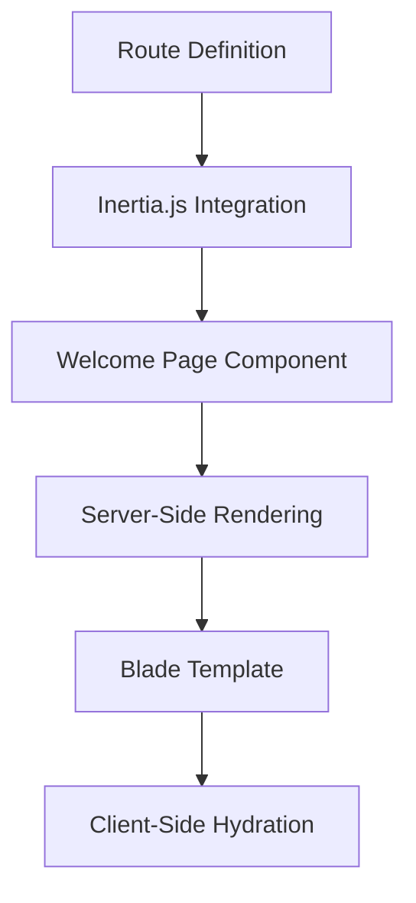
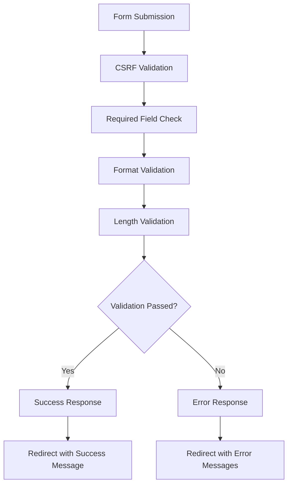
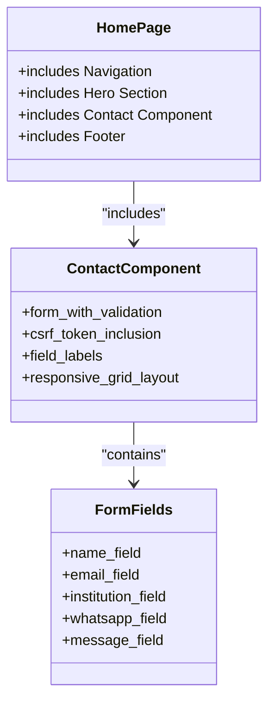
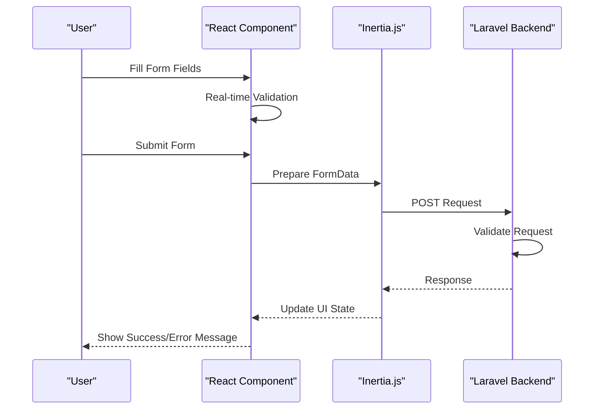
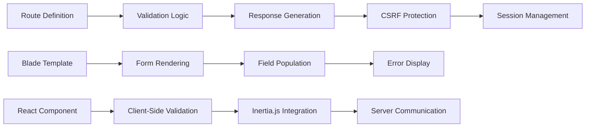
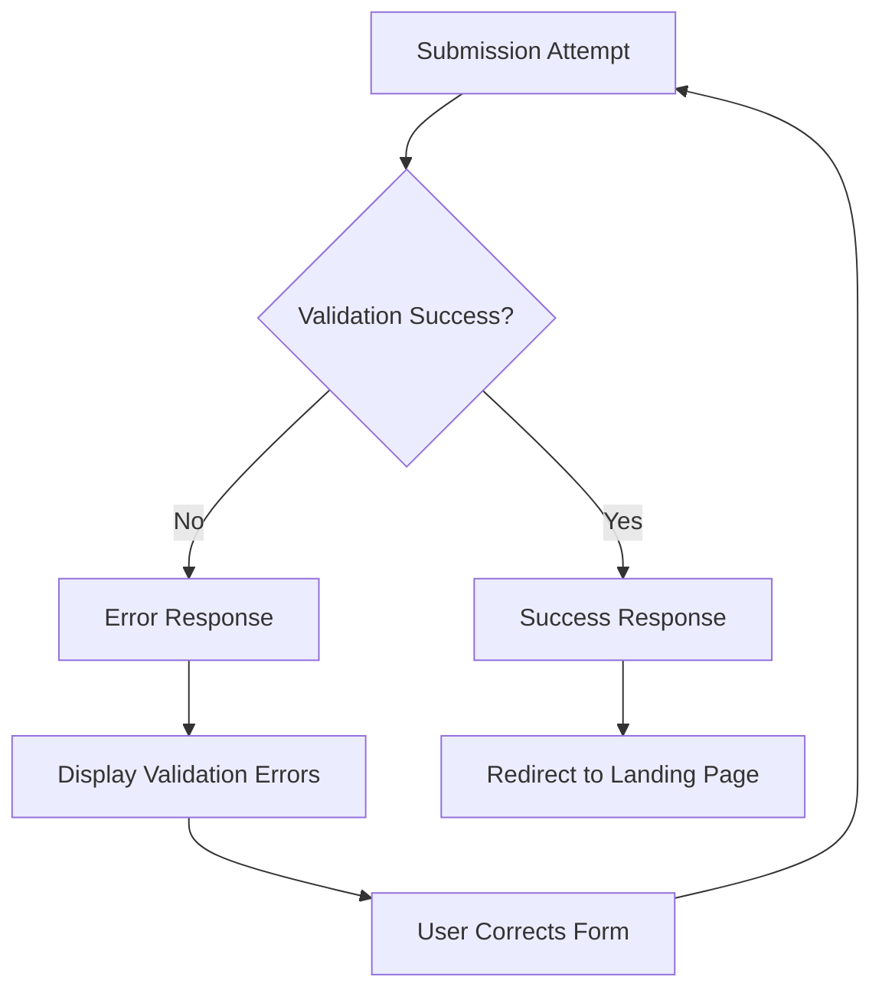

# Landing Page & Contact Endpoints

<cite>
**Referenced Files in This Document**
- [web.php](file://routes/web.php)
- [home.blade.php](file://resources/views/pages/home.blade.php)
- [contact.blade.php](file://resources/views/components/contact.blade.php)
- [contact.tsx](file://resources/js/components/landing/contact.tsx)
- [app.blade.php](file://resources/views/layouts/app.blade.php)
- [HandleInertiaRequests.php](file://app/Http/Middleware/HandleInertiaRequests.php)
- [app.php](file://bootstrap/app.php)
- [.htaccess](file://public/.htaccess)
</cite>

## Table of Contents
1. [Introduction](#introduction)
2. [Project Structure](#project-structure)
3. [Core Components](#core-components)
4. [Architecture Overview](#architecture-overview)
5. [Detailed Component Analysis](#detailed-component-analysis)
6. [Dependency Analysis](#dependency-analysis)
7. [Performance Considerations](#performance-considerations)
8. [Troubleshooting Guide](#troubleshooting-guide)
9. [Conclusion](#conclusion)

## Introduction
This document provides comprehensive API documentation for the landing page and contact form endpoints in the SmartExam web application. The landing page uses server-side rendering with Blade templates, while the contact form submission endpoint implements Laravel validation and response handling. The documentation covers HTTP methods, URL patterns, request/response schemas, validation requirements, and form processing workflow.

## Project Structure
The SmartExam application follows a Laravel architecture with Blade templating for server-side rendering and Inertia.js for client-side interactions. The contact form spans multiple layers:

**Diagram sources**
- [web.php:5-19](file://routes/web.php#L5-L19)
- [home.blade.php:1-21](file://resources/views/pages/home.blade.php#L1-L21)
- [contact.blade.php:1-87](file://resources/views/components/contact.blade.php#L1-L87)

**Section sources**
- [web.php:1-26](file://routes/web.php#L1-L26)
- [home.blade.php:1-21](file://resources/views/pages/home.blade.php#L1-L21)
- [contact.blade.php:1-87](file://resources/views/components/contact.blade.php#L1-L87)

## Core Components
The contact form system consists of three primary components working together:

### Landing Page Route
The main landing page route serves as the entry point for the application, utilizing Inertia.js for seamless navigation.

### Contact Form Endpoint
The contact form submission endpoint handles validation, processing, and response generation with comprehensive error handling.

### Template Integration
The contact component integrates seamlessly with the main landing page template, providing consistent styling and user experience.

**Section sources**
- [web.php:5-19](file://routes/web.php#L5-L19)
- [home.blade.php:18](file://resources/views/pages/home.blade.php#L18)
- [contact.blade.php:13](file://resources/views/components/contact.blade.php#L13)

## Architecture Overview
The contact form architecture demonstrates a hybrid approach combining server-side rendering with client-side interactivity:

**Diagram sources**
- [web.php:8-19](file://routes/web.php#L8-L19)
- [contact.blade.php:13](file://resources/views/components/contact.blade.php#L13)
- [contact.tsx:13-16](file://resources/js/components/landing/contact.tsx#L13-L16)

## Detailed Component Analysis

### Landing Page Route Configuration
The main landing page route utilizes Laravel's Inertia integration for server-side rendering:

**Diagram sources**
- [web.php:5](file://routes/web.php#L5)

**Section sources**
- [web.php:5](file://routes/web.php#L5)

### Contact Form Submission Endpoint
The contact form endpoint implements comprehensive validation and response handling:

#### HTTP Endpoint Specifications
- **Method**: POST
- **URL Pattern**: `/contact`
- **Route Name**: `contact.send`
- **Handler Type**: Anonymous function with inline validation

#### Request Schema
The contact form accepts the following parameters:

| Parameter | Type | Required | Max Length | Description |
|-----------|------|----------|------------|-------------|
| `name` | string | Yes | 100 characters | Full name of the contact person |
| `email` | email | Yes | - | Institutional email address |
| `institution` | string | Yes | 100 characters | School/university/organization name |
| `whatsapp` | string | Yes | 20 characters | WhatsApp phone number |
| `message` | string | No | 1000 characters | Additional questions or information |

#### Validation Rules
The endpoint applies Laravel validation rules:

**Diagram sources**
- [web.php:9-15](file://routes/web.php#L9-L15)

#### Response Handling
The endpoint generates appropriate responses based on validation results:

| Scenario | Response Type | Status Code | Message |
|----------|---------------|-------------|---------|
| Successful Validation | Redirect | 302 | "Pesan Anda berhasil dikirim!" |
| Validation Errors | Redirect | 302 | Error messages with field details |
| CSRF Failure | Redirect | 302 | Generic error message |

**Section sources**
- [web.php:8-19](file://routes/web.php#L8-L19)

### Template Integration Components

#### Blade Template Structure
The contact component integrates seamlessly with the main landing page:

**Diagram sources**
- [home.blade.php:18](file://resources/views/pages/home.blade.php#L18)
- [contact.blade.php:13](file://resources/views/components/contact.blade.php#L13)

#### Client-Side Implementation
The React component provides enhanced user experience with real-time validation:

**Diagram sources**
- [contact.tsx:13-16](file://resources/js/components/landing/contact.tsx#L13-L16)

**Section sources**
- [contact.blade.php:1-87](file://resources/views/components/contact.blade.php#L1-L87)
- [contact.tsx:1-87](file://resources/js/components/landing/contact.tsx#L1-L87)

## Dependency Analysis

### Routing Dependencies
The contact form relies on several key dependencies:

**Diagram sources**
- [web.php:8-19](file://routes/web.php#L8-L19)
- [contact.blade.php:13](file://resources/views/components/contact.blade.php#L13)
- [contact.tsx:13-16](file://resources/js/components/landing/contact.tsx#L13-L16)

### Middleware Integration
The application uses several middleware layers for security and functionality:

| Middleware | Purpose | Order |
|------------|---------|-------|
| HandleAppearance | Theme management | First |
| HandleInertiaRequests | Inertia.js integration | Second |
| AddLinkHeadersForPreloadedAssets | Asset optimization | Third |

**Section sources**
- [HandleInertiaRequests.php:1-48](file://app/Http/Middleware/HandleInertiaRequests.php#L1-L48)
- [app.php:17-25](file://bootstrap/app.php#L17-L25)

## Performance Considerations
The contact form implementation incorporates several performance optimization strategies:

### Validation Efficiency
- Inline validation reduces server load by catching errors early
- Minimal database operations during validation
- Efficient error response generation

### Resource Optimization
- Single-page application architecture minimizes page reloads
- Lazy loading for non-critical components
- Optimized CSS delivery through CDN

### Caching Strategies
- Session-based caching for form state
- Browser caching for static assets
- CDN acceleration for media resources

## Troubleshooting Guide

### Common Validation Issues
1. **Missing Required Fields**: Ensure all mandatory fields are filled
2. **Invalid Email Format**: Verify institutional email addresses follow proper format
3. **Exceeded Character Limits**: Check field length constraints
4. **CSRF Token Errors**: Refresh page to regenerate token

### Error Response Handling
The system provides structured error responses:

**Diagram sources**
- [web.php:18](file://routes/web.php#L18)

### Debugging Steps
1. **Check Network Tab**: Verify successful POST request to `/contact`
2. **Inspect Console**: Look for JavaScript errors in React component
3. **Review Server Logs**: Monitor Laravel application logs
4. **Validate CSRF Token**: Ensure token is present in form submission

**Section sources**
- [web.php:8-19](file://routes/web.php#L8-L19)
- [contact.tsx:13-16](file://resources/js/components/landing/contact.tsx#L13-L16)

## Conclusion
The SmartExam landing page and contact form system demonstrates a well-architected solution combining server-side rendering with modern client-side interactivity. The implementation provides robust validation, comprehensive error handling, and a seamless user experience. The modular design allows for easy maintenance and future enhancements while maintaining optimal performance characteristics.

The contact form endpoint serves as a model for implementing secure, validated form submissions in Laravel applications, with clear separation of concerns between validation, processing, and response handling. The integration with both Blade templates and React components showcases the flexibility of the Laravel ecosystem for modern web development.