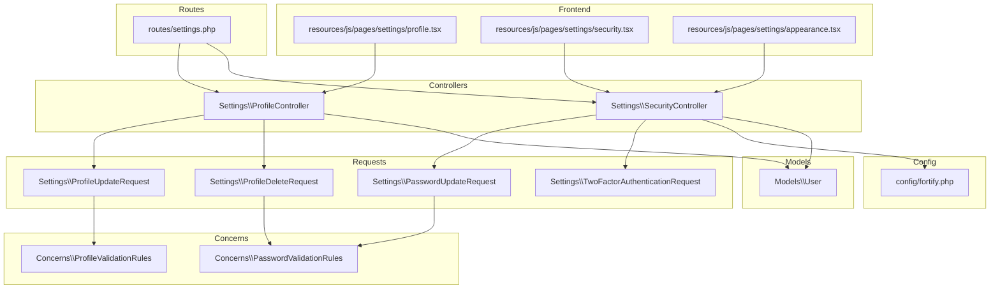
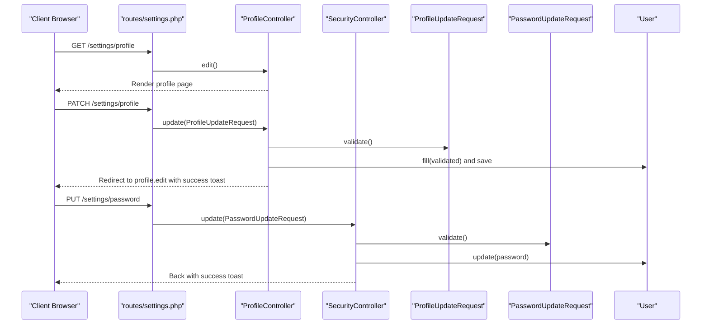
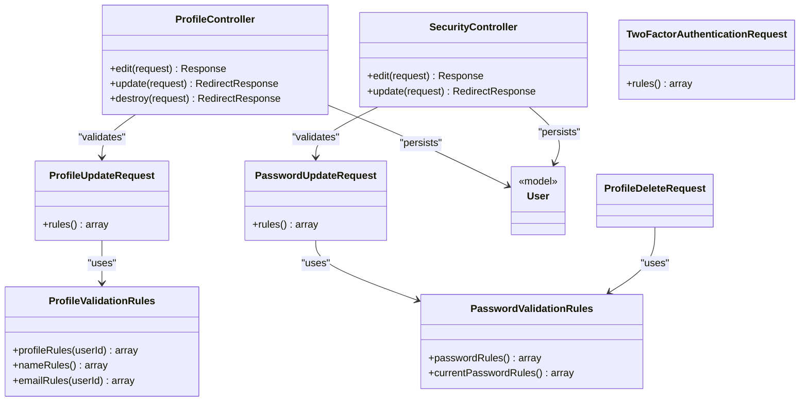

# Settings Management Endpoints

<cite>
**Referenced Files in This Document**
- [settings.php](file://routes/settings.php)
- [ProfileController.php](file://app/Http/Controllers/Settings/ProfileController.php)
- [SecurityController.php](file://app/Http/controllers/Settings/SecurityController.php)
- [ProfileUpdateRequest.php](file://app/Http/Requests/Settings/ProfileUpdateRequest.php)
- [PasswordUpdateRequest.php](file://app/Http/Requests/Settings/PasswordUpdateRequest.php)
- [TwoFactorAuthenticationRequest.php](file://app/Http/Requests/Settings/TwoFactorAuthenticationRequest.php)
- [ProfileValidationRules.php](file://app/Concerns/ProfileValidationRules.php)
- [PasswordValidationRules.php](file://app/Concerns/PasswordValidationRules.php)
- [ProfileDeleteRequest.php](file://app/Http/Requests/Settings/ProfileDeleteRequest.php)
- [User.php](file://app/Models/User.php)
- [fortify.php](file://config/fortify.php)
- [profile.tsx](file://resources/js/pages/settings/profile.tsx)
- [security.tsx](file://resources/js/pages/settings/security.tsx)
- [appearance.tsx](file://resources/js/pages/settings/appearance.tsx)
</cite>

## Table of Contents
1. [Introduction](#introduction)
2. [Project Structure](#project-structure)
3. [Core Components](#core-components)
4. [Architecture Overview](#architecture-overview)
5. [Detailed Component Analysis](#detailed-component-analysis)
6. [Dependency Analysis](#dependency-analysis)
7. [Performance Considerations](#performance-considerations)
8. [Troubleshooting Guide](#troubleshooting-guide)
9. [Conclusion](#conclusion)

## Introduction
This document describes the settings management endpoints in the SmartExam web application. It covers user profile updates, security configurations (password changes, two-factor authentication, and passkey management), and appearance preferences. For each endpoint, we specify HTTP methods, URL patterns, request/response schemas, authentication requirements, validation rules, authorization checks, error handling, and success responses. Practical examples and client implementation guidelines are included to help integrate these settings operations securely and efficiently.

## Project Structure
Settings-related functionality is organized around dedicated controllers and request validators, with routes grouped by authentication and verification requirements. Frontend pages render the settings UI and submit forms via Inertia.js.

**Diagram sources**
- [settings.php:1-41](file://routes/settings.php#L1-L41)
- [ProfileController.php:1-63](file://app/Http/Controllers/Settings/ProfileController.php#L1-L63)
- [SecurityController.php:1-73](file://app/Http/Controllers/Settings/SecurityController.php#L1-L73)
- [ProfileUpdateRequest.php:1-23](file://app/Http/Requests/Settings/ProfileUpdateRequest.php#L1-L23)
- [ProfileDeleteRequest.php:1-25](file://app/Http/Requests/Settings/ProfileDeleteRequest.php#L1-L25)
- [PasswordUpdateRequest.php:1-26](file://app/Http/Requests/Settings/PasswordUpdateRequest.php#L1-L26)
- [TwoFactorAuthenticationRequest.php:1-23](file://app/Http/Requests/Settings/TwoFactorAuthenticationRequest.php#L1-L23)
- [ProfileValidationRules.php:1-52](file://app/Concerns/ProfileValidationRules.php#L1-L52)
- [PasswordValidationRules.php:1-30](file://app/Concerns/PasswordValidationRules.php#L1-L30)
- [User.php:1-53](file://app/Models/User.php#L1-L53)
- [fortify.php:1-192](file://config/fortify.php#L1-L192)
- [profile.tsx:1-149](file://resources/js/pages/settings/profile.tsx#L1-L149)
- [security.tsx:1-156](file://resources/js/pages/settings/security.tsx#L1-L156)
- [appearance.tsx:1-33](file://resources/js/pages/settings/appearance.tsx#L1-L33)

**Section sources**
- [settings.php:1-41](file://routes/settings.php#L1-L41)

## Core Components
- ProfileController: Handles profile editing, updating personal information, and account deletion.
- SecurityController: Renders security settings, manages password updates, and exposes two-factor authentication and passkey capabilities.
- Request validators: Encapsulate validation rules for profile updates, password changes, and two-factor state requests.
- User model: Provides authentication, passkey, and two-factor traits and attributes.
- Fortify configuration: Enables/disables features (two-factor, passkeys) and sets rate limits and options.

Key responsibilities:
- ProfileController.edit: Returns the profile settings page with email verification status and optional status messages.
- ProfileController.update: Validates and persists profile changes; marks email unverified if changed.
- ProfileController.destroy: Requires verified email context, logs out the user, deletes the account, invalidates session, and redirects to home.
- SecurityController.edit: Renders security page with feature flags, passkey list, and password rules; validates two-factor state when enabled.
- SecurityController.update: Updates the user's password after validation and flashes a success toast.

**Section sources**
- [ProfileController.php:15-62](file://app/Http/Controllers/Settings/ProfileController.php#L15-L62)
- [SecurityController.php:14-72](file://app/Http/Controllers/Settings/SecurityController.php#L14-L72)
- [User.php:32-51](file://app/Models/User.php#L32-L51)
- [fortify.php:169-189](file://config/fortify.php#L169-L189)

## Architecture Overview
The settings module follows a layered architecture:
- Routes define endpoints grouped by middleware (authentication, email verification).
- Controllers orchestrate business logic and render Inertia pages.
- Request validators encapsulate validation rules.
- Model integrates authentication, passkeys, and two-factor features.
- Frontend pages bind to controller actions and display feedback.

**Diagram sources**
- [settings.php:10-31](file://routes/settings.php#L10-L31)
- [ProfileController.php:20-44](file://app/Http/Controllers/Settings/ProfileController.php#L20-L44)
- [SecurityController.php:19-71](file://app/Http/Controllers/Settings/SecurityController.php#L19-L71)
- [ProfileUpdateRequest.php:18-21](file://app/Http/Requests/Settings/ProfileUpdateRequest.php#L18-L21)
- [PasswordUpdateRequest.php:18-24](file://app/Http/Requests/Settings/PasswordUpdateRequest.php#L18-L24)
- [User.php:32-51](file://app/Models/User.php#L32-L51)

## Detailed Component Analysis

### Profile Settings Endpoints
- Endpoint: GET /settings/profile
  - Method: GET
  - Authentication: Required
  - Authorization: N/A
  - Purpose: Load profile settings page
  - Response: Inertia render with props:
    - mustVerifyEmail: boolean
    - status: string (optional)
  - Success: 200 OK
  - Error: 401 Unauthorized (not authenticated)

- Endpoint: PATCH /settings/profile
  - Method: PATCH
  - Authentication: Required
  - Authorization: N/A
  - Request body:
    - name: string, required, max length 255
    - email: string, required, unique per user, valid email, max length 255
  - Behavior:
    - On email change, clears email_verified_at
    - Saves validated data
    - Flashes success toast
  - Success: 302 Found to profile.edit
  - Errors: 422 Unprocessable Entity (validation), 401 Unauthorized

- Endpoint: DELETE /settings/profile
  - Method: DELETE
  - Authentication: Required
  - Authorization: Must be verified (verified middleware group)
  - Request body:
    - password: current password confirmation
  - Behavior:
    - Logs out user
    - Deletes user record
    - Invalidates session and regenerates CSRF token
  - Success: 302 Found to /
  - Errors: 422 Unprocessable Entity (validation), 401/403 Unauthorized

Validation rules summary:
- Name: required, string, max 255
- Email: required, string, email, unique per user, max 255
- Current password: required, matches user's current password

**Section sources**
- [settings.php:10-19](file://routes/settings.php#L10-L19)
- [ProfileController.php:20-61](file://app/Http/Controllers/Settings/ProfileController.php#L20-L61)
- [ProfileUpdateRequest.php:18-21](file://app/Http/Requests/Settings/ProfileUpdateRequest.php#L18-L21)
- [ProfileDeleteRequest.php:18-23](file://app/Http/Requests/Settings/ProfileDeleteRequest.php#L18-L23)
- [ProfileValidationRules.php:16-50](file://app/Concerns/ProfileValidationRules.php#L16-L50)
- [PasswordValidationRules.php:25-28](file://app/Concerns/PasswordValidationRules.php#L25-L28)

### Security Settings Endpoints
- Endpoint: GET /settings/security
  - Method: GET
  - Authentication: Required
  - Authorization: Must be verified
  - Middleware: RequirePassword (password confirmation prompt)
  - Response: Inertia render with props:
    - canManageTwoFactor: boolean (feature flag)
    - canManagePasskeys: boolean (feature flag)
    - twoFactorEnabled: boolean (when 2FA is enabled)
    - requiresConfirmation: boolean (when 2FA confirmation is enabled)
    - passkeys: array of objects (id, name, authenticator, created_at_diff, last_used_at_diff)
    - passwordRules: string (password policy)
  - Success: 200 OK
  - Errors: 401/403 Unauthorized

- Endpoint: PUT /settings/password
  - Method: PUT
  - Authentication: Required
  - Authorization: Must be verified
  - Middleware: Throttling (6 per 1 minute)
  - Request body:
    - current_password: required, matches user's current password
    - password: required, strong password policy, confirmed
  - Behavior:
    - Updates hashed password
    - Flashes success toast
  - Success: 302 Found (back)
  - Errors: 422 Unprocessable Entity (validation), 429 Too Many Requests, 401/403 Unauthorized

Two-Factor Authentication (2FA):
- Controlled by Fortify features; when enabled:
  - Feature flags indicate capability and requirement for confirmation
  - State validation ensures consistent UI state
- Passkeys:
  - Managed via Fortify passkeys feature
  - Available when enabled; list includes metadata and human-friendly timestamps

**Section sources**
- [settings.php:17-29](file://routes/settings.php#L17-L29)
- [SecurityController.php:19-71](file://app/Http/Controllers/Settings/SecurityController.php#L19-L71)
- [PasswordUpdateRequest.php:18-24](file://app/Http/Requests/Settings/PasswordUpdateRequest.php#L18-L24)
- [TwoFactorAuthenticationRequest.php:18-21](file://app/Http/Requests/Settings/TwoFactorAuthenticationRequest.php#L18-L21)
- [fortify.php:169-189](file://config/fortify.php#L169-L189)

### Appearance Preferences Endpoint
- Endpoint: INERTIA GET /settings/appearance
  - Method: GET
  - Authentication: Required
  - Authorization: N/A
  - Response: Inertia render with appearance tabs
  - Success: 200 OK
  - Errors: 401 Unauthorized

Note: This endpoint renders the appearance UI and does not expose a dedicated API route; it is handled by the Inertia adapter.

**Section sources**
- [settings.php:30](file://routes/settings.php#L30)
- [appearance.tsx:1-33](file://resources/js/pages/settings/appearance.tsx#L1-L33)

### Passkey Well-Known Endpoint
- Endpoint: GET /.well-known/passkey-endpoints
  - Method: GET
  - Authentication: Optional
  - Response: JSON with passkey endpoints
    - enroll: route to security.edit
    - manage: route to security.edit
  - Success: 200 OK
  - Errors: N/A

This endpoint supports WebAuthn discovery and is useful for passkey registration and management flows.

**Section sources**
- [settings.php:33-39](file://routes/settings.php#L33-L39)

## Dependency Analysis
- Controllers depend on:
  - Request validators for input validation
  - Fortify features for 2FA and passkeys
  - User model for persistence and feature traits
- Routes depend on middleware groups:
  - auth: ensures authentication
  - verified: ensures email verification
  - RequirePassword: prompts for password confirmation on security edits
  - throttle: rate limits password updates
- Frontend pages depend on:
  - Inertia forms bound to controller actions
  - UI components for inputs and feedback

**Diagram sources**
- [ProfileController.php:15-62](file://app/Http/Controllers/Settings/ProfileController.php#L15-L62)
- [SecurityController.php:14-72](file://app/Http/Controllers/Settings/SecurityController.php#L14-L72)
- [ProfileUpdateRequest.php:9-22](file://app/Http/Requests/Settings/ProfileUpdateRequest.php#L9-L22)
- [PasswordUpdateRequest.php:9-25](file://app/Http/Requests/Settings/PasswordUpdateRequest.php#L9-L25)
- [TwoFactorAuthenticationRequest.php:9-22](file://app/Http/Requests/Settings/TwoFactorAuthenticationRequest.php#L9-L22)
- [ProfileValidationRules.php:9-51](file://app/Concerns/ProfileValidationRules.php#L9-L51)
- [PasswordValidationRules.php:8-29](file://app/Concerns/PasswordValidationRules.php#L8-L29)
- [User.php:32-51](file://app/Models/User.php#L32-L51)

**Section sources**
- [settings.php:10-31](file://routes/settings.php#L10-L31)
- [ProfileController.php:15-62](file://app/Http/Controllers/Settings/ProfileController.php#L15-L62)
- [SecurityController.php:14-72](file://app/Http/Controllers/Settings/SecurityController.php#L14-L72)
- [ProfileUpdateRequest.php:9-22](file://app/Http/Requests/Settings/ProfileUpdateRequest.php#L9-L22)
- [PasswordUpdateRequest.php:9-25](file://app/Http/Requests/Settings/PasswordUpdateRequest.php#L9-L25)
- [TwoFactorAuthenticationRequest.php:9-22](file://app/Http/Requests/Settings/TwoFactorAuthenticationRequest.php#L9-L22)
- [ProfileValidationRules.php:9-51](file://app/Concerns/ProfileValidationRules.php#L9-L51)
- [PasswordValidationRules.php:8-29](file://app/Concerns/PasswordValidationRules.php#L8-L29)
- [User.php:32-51](file://app/Models/User.php#L32-L51)

## Performance Considerations
- Throttling: Password updates are rate-limited to 6 per minute to mitigate brute-force attempts.
- Validation overhead: Keep validation rules minimal and reuse shared concerns to reduce duplication.
- Rendering: Inertia pages avoid full page reloads; preserve scroll and focus on form errors to improve UX.
- Feature toggles: Enable/disable 2FA and passkeys based on deployment needs to reduce unnecessary computations.

[No sources needed since this section provides general guidance]

## Troubleshooting Guide
Common issues and resolutions:
- 401 Unauthorized on settings routes:
  - Ensure the user is authenticated; check session and middleware chain.
- 403 Forbidden on profile deletion:
  - Verify the user has completed email verification; the route group enforces verified middleware.
- 422 Validation errors on profile update:
  - Confirm name and email meet constraints; email uniqueness is enforced per user.
- 422 Validation errors on password update:
  - Ensure current password matches; new password meets policy and confirmation matches.
- 429 Too Many Requests on password update:
  - Respect throttling limit; wait before retrying.
- 2FA or passkeys not visible:
  - Verify Fortify features are enabled in configuration; check feature flags returned by the security page.

**Section sources**
- [settings.php:10-31](file://routes/settings.php#L10-L31)
- [SecurityController.php:19-71](file://app/Http/Controllers/Settings/SecurityController.php#L19-L71)
- [ProfileValidationRules.php:16-50](file://app/Concerns/ProfileValidationRules.php#L16-L50)
- [PasswordValidationRules.php:15-28](file://app/Concerns/PasswordValidationRules.php#L15-L28)
- [fortify.php:169-189](file://config/fortify.php#L169-L189)

## Conclusion
The settings management module provides a secure, modular set of endpoints for profile updates, password changes, two-factor authentication, passkey management, and appearance preferences. By leveraging request validators, Fortify features, and Inertia rendering, the system balances usability with strong security practices. Client integrations should respect authentication and verification requirements, handle validation errors gracefully, and observe rate limits to ensure reliable operation.