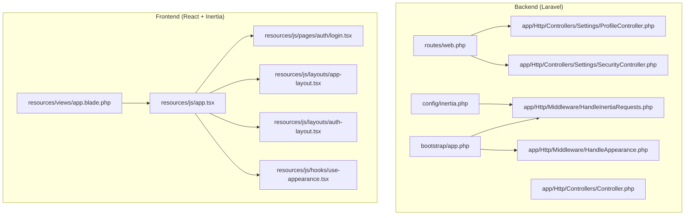
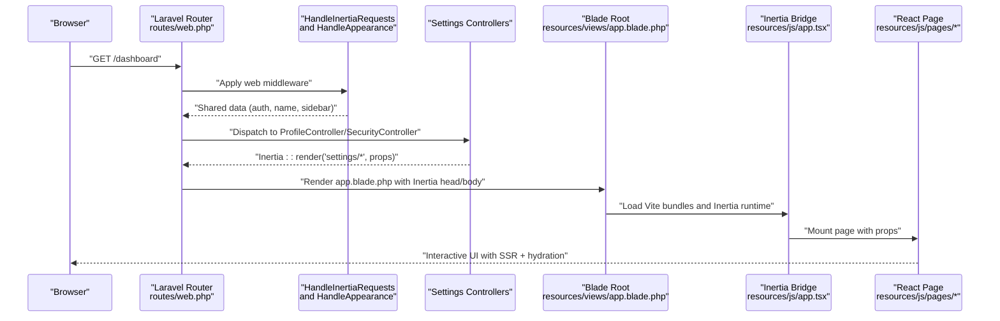
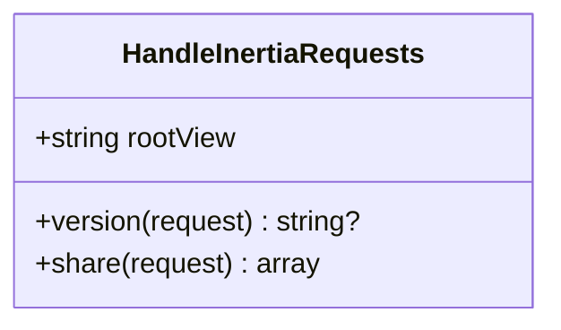
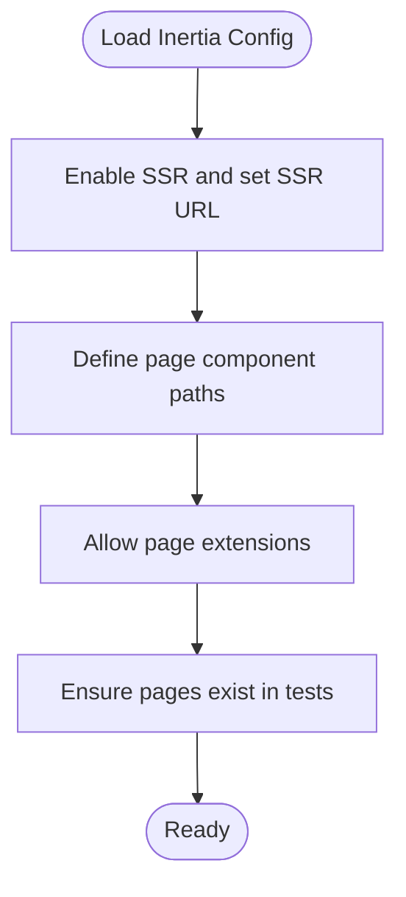
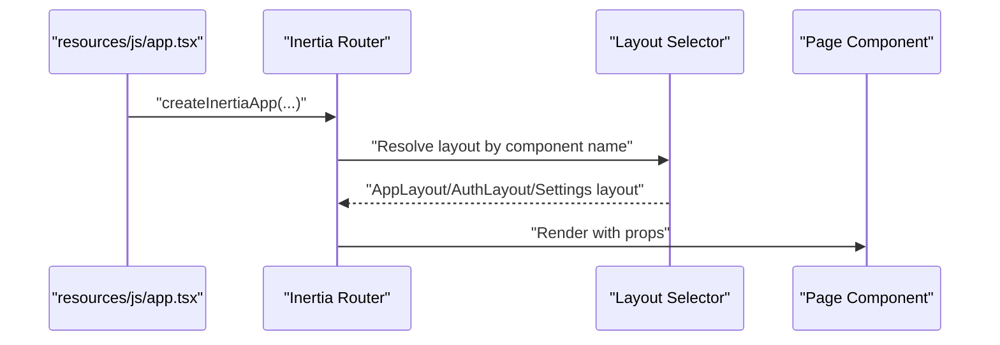
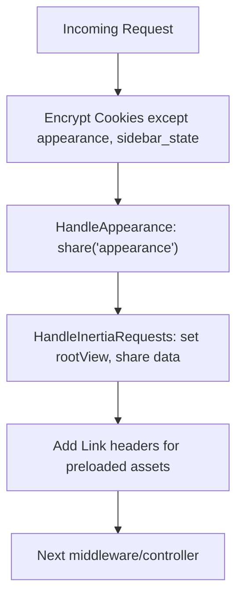
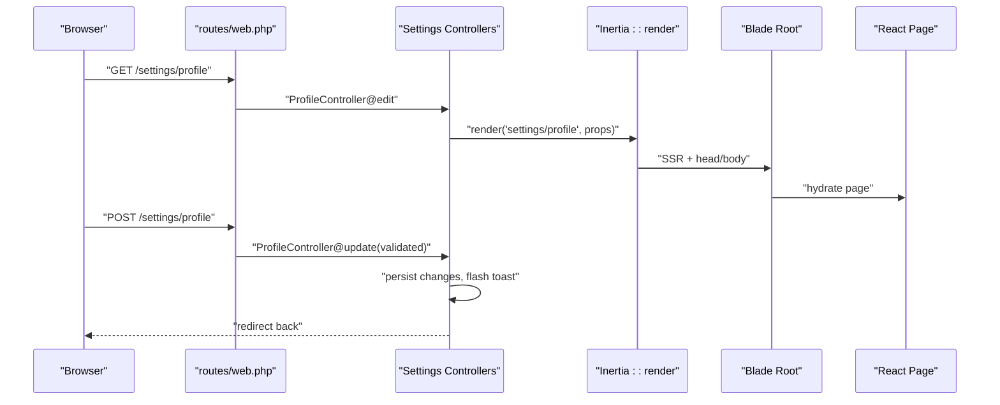
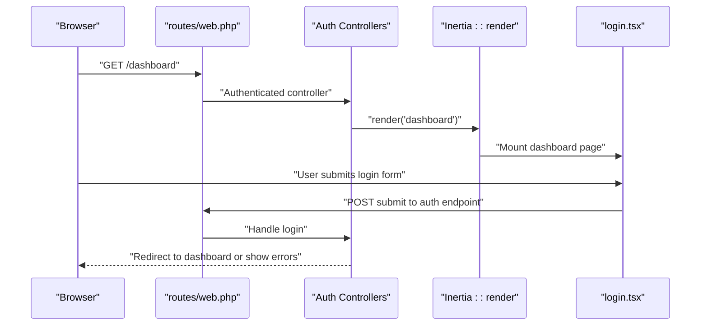
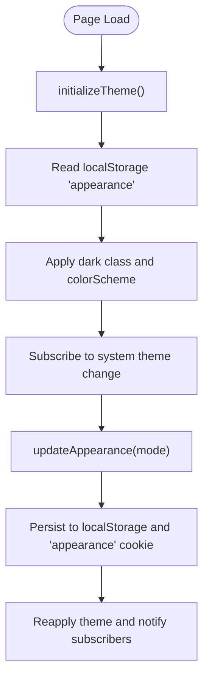
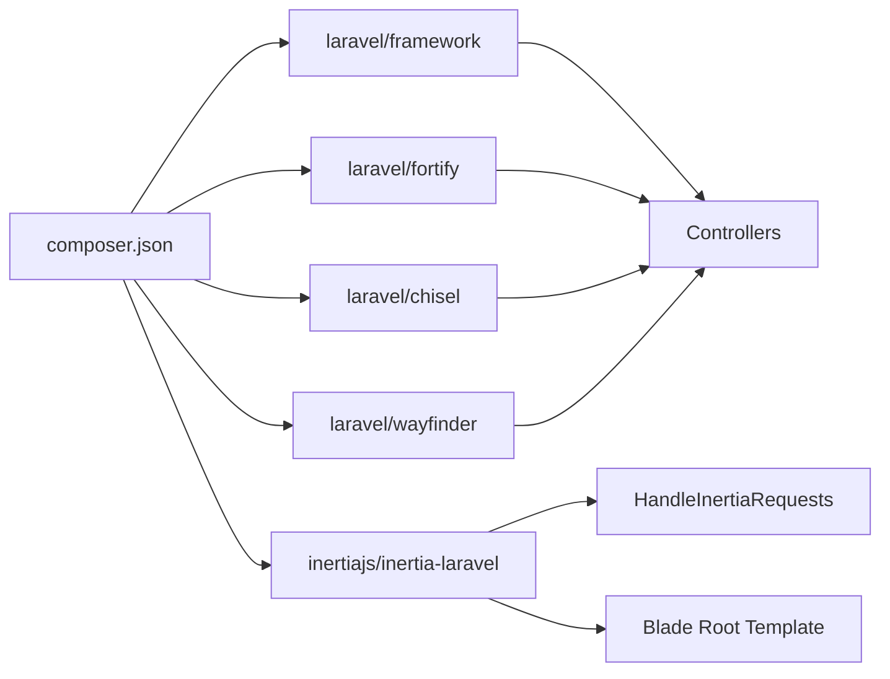

# Architecture & Design

<cite>
**Referenced Files in This Document**
- [HandleInertiaRequests.php](file://app/Http/Middleware/HandleInertiaRequests.php)
- [inertia.php](file://config/inertia.php)
- [app.tsx](file://resources/js/app.tsx)
- [web.php](file://routes/web.php)
- [bootstrap/app.php](file://bootstrap/app.php)
- [Controller.php](file://app/Http/Controllers/Controller.php)
- [ProfileController.php](file://app/Http/Controllers/Settings/ProfileController.php)
- [SecurityController.php](file://app/Http/Controllers/Settings/SecurityController.php)
- [HandleAppearance.php](file://app/Http/Middleware/HandleAppearance.php)
- [app.blade.php](file://resources/views/app.blade.php)
- [app-layout.tsx](file://resources/js/layouts/app-layout.tsx)
- [auth-layout.tsx](file://resources/js/layouts/auth-layout.tsx)
- [login.tsx](file://resources/js/pages/auth/login.tsx)
- [use-appearance.tsx](file://resources/js/hooks/use-appearance.tsx)
- [composer.json](file://composer.json)
</cite>

## Table of Contents
1. [Introduction](#introduction)
2. [Project Structure](#project-structure)
3. [Core Components](#core-components)
4. [Architecture Overview](#architecture-overview)
5. [Detailed Component Analysis](#detailed-component-analysis)
6. [Dependency Analysis](#dependency-analysis)
7. [Performance Considerations](#performance-considerations)
8. [Troubleshooting Guide](#troubleshooting-guide)
9. [Conclusion](#conclusion)
10. [Appendices](#appendices)

## Introduction
This document describes the SmartExam web application architecture that combines Laravel’s Model-View-Controller (MVC) backend with a React frontend powered by Inertia.js. The system leverages Inertia to render React pages server-side via Blade templates while maintaining a cohesive full-stack experience. It documents how PHP controllers and React components interact, how data flows through the Inertia pipeline, and how cross-cutting concerns such as authentication, theming, and responsive design are integrated. Technology stack choices and their impact on system design are also explained.

## Project Structure
SmartExam follows a layered structure:
- Backend: Laravel application bootstrapped in bootstrap/app.php, routing in routes/web.php, controllers under app/Http/Controllers, middleware under app/Http/Middleware, and configuration under config/.
- Frontend: React application bootstrapped via resources/js/app.tsx, with pages under resources/js/pages, reusable UI components under resources/js/components, layouts under resources/js/layouts, and shared hooks under resources/js/hooks.
- Views: Blade templates under resources/views, including a root app.blade.php that renders the Inertia root and injects assets.

**Diagram sources**
- [web.php:1-29](file://routes/web.php#L1-L29)
- [bootstrap/app.php:11-31](file://bootstrap/app.php#L11-L31)
- [Controller.php:1-9](file://app/Http/Controllers/Controller.php#L1-L9)
- [ProfileController.php:1-63](file://app/Http/Controllers/Settings/ProfileController.php#L1-L63)
- [SecurityController.php:1-73](file://app/Http/Controllers/Settings/SecurityController.php#L1-L73)
- [HandleInertiaRequests.php:1-48](file://app/Http/Middleware/HandleInertiaRequests.php#L1-L48)
- [HandleAppearance.php:1-24](file://app/Http/Middleware/HandleAppearance.php#L1-L24)
- [inertia.php:1-71](file://config/inertia.php#L1-L71)
- [app.tsx:1-41](file://resources/js/app.tsx#L1-L41)
- [login.tsx:1-126](file://resources/js/pages/auth/login.tsx#L1-L126)
- [app-layout.tsx:1-17](file://resources/js/layouts/app-layout.tsx#L1-L17)
- [auth-layout.tsx:1-18](file://resources/js/layouts/auth-layout.tsx#L1-L18)
- [use-appearance.tsx:1-116](file://resources/js/hooks/use-appearance.tsx#L1-L116)
- [app.blade.php:1-49](file://resources/views/app.blade.php#L1-L49)

**Section sources**
- [bootstrap/app.php:11-31](file://bootstrap/app.php#L11-L31)
- [web.php:1-29](file://routes/web.php#L1-L29)
- [app.tsx:1-41](file://resources/js/app.tsx#L1-L41)
- [app.blade.php:1-49](file://resources/views/app.blade.php#L1-L49)

## Core Components
- Inertia Bridge and SSR: The Inertia configuration defines discovery paths for page components and enables SSR. The HandleInertiaRequests middleware sets the root view and shares global data such as app name, authenticated user, and sidebar state.
- React Application Bootstrap: app.tsx configures Inertia’s createInertiaApp, including title resolution, layout selection by route name, wrapping the app with providers, and progress bar color.
- Middleware Pipeline: bootstrap/app.php registers cookies encryption exceptions for appearance and sidebar_state, and appends HandleAppearance and HandleInertiaRequests to the web middleware stack. It also configures JSON rendering for API requests.
- Controllers: ProfileController and SecurityController demonstrate Inertia::render and Inertia::flash usage, returning React pages with props and flash messages. They also handle redirects after updates.
- Layouts and Pages: app-layout.tsx and auth-layout.tsx wrap page content with appropriate templates. login.tsx is a concrete React page consuming form helpers and UI components.
- Theming and Appearance: HandleAppearance middleware shares the appearance cookie with Blade. app.blade.php applies dark mode class and inline styles. use-appearance.tsx manages client-side theme persistence and SSR cookie synchronization.

**Section sources**
- [inertia.php:1-71](file://config/inertia.php#L1-L71)
- [HandleInertiaRequests.php:8-47](file://app/Http/Middleware/HandleInertiaRequests.php#L8-L47)
- [app.tsx:11-37](file://resources/js/app.tsx#L11-L37)
- [bootstrap/app.php:17-25](file://bootstrap/app.php#L17-L25)
- [ProfileController.php:20-44](file://app/Http/Controllers/Settings/ProfileController.php#L20-L44)
- [SecurityController.php:19-57](file://app/Http/Controllers/Settings/SecurityController.php#L19-L57)
- [app-layout.tsx:1-17](file://resources/js/layouts/app-layout.tsx#L1-L17)
- [auth-layout.tsx:1-18](file://resources/js/layouts/auth-layout.tsx#L1-L18)
- [login.tsx:24-120](file://resources/js/pages/auth/login.tsx#L24-L120)
- [HandleAppearance.php:17-22](file://app/Http/Middleware/HandleAppearance.php#L17-L22)
- [app.blade.php:1-49](file://resources/views/app.blade.php#L1-L49)
- [use-appearance.tsx:73-116](file://resources/js/hooks/use-appearance.tsx#L73-L116)

## Architecture Overview
The system integrates Laravel MVC with React via Inertia:
- Routes define entry points; some use Route::inertia to render React pages directly.
- Middleware prepares shared data and SSR environment.
- Blade root template renders the Inertia application shell.
- React pages consume props provided by controllers and Inertia middleware.
- Theme and layout are coordinated between server (Blade) and client (React).

**Diagram sources**
- [web.php:24-26](file://routes/web.php#L24-L26)
- [HandleInertiaRequests.php:36-46](file://app/Http/Middleware/HandleInertiaRequests.php#L36-L46)
- [HandleAppearance.php:17-22](file://app/Http/Middleware/HandleAppearance.php#L17-L22)
- [ProfileController.php:20-26](file://app/Http/Controllers/Settings/ProfileController.php#L20-L26)
- [SecurityController.php:19-57](file://app/Http/Controllers/Settings/SecurityController.php#L19-L57)
- [app.blade.php:41-47](file://resources/views/app.blade.php#L41-L47)
- [app.tsx:11-37](file://resources/js/app.tsx#L11-L37)

## Detailed Component Analysis

### Inertia Middleware and Shared Data
- Root template: The middleware defines the root view used for initial page loads.
- Asset versioning: Inherits versioning from Inertia base middleware.
- Shared data: Provides app name, authenticated user, and sidebar open state derived from a cookie.

**Diagram sources**
- [HandleInertiaRequests.php:8-47](file://app/Http/Middleware/HandleInertiaRequests.php#L8-L47)

**Section sources**
- [HandleInertiaRequests.php:17-46](file://app/Http/Middleware/HandleInertiaRequests.php#L17-L46)

### Inertia Configuration and SSR
- SSR enabled with a local SSR server URL.
- Page discovery configured for JS/TS/JSX/TSX/Svelte/Vue under resource_path('js/pages').
- Testing ensures pages exist during assertions.

**Diagram sources**
- [inertia.php:18-51](file://config/inertia.php#L18-L51)

**Section sources**
- [inertia.php:18-69](file://config/inertia.php#L18-L69)

### React Application Bootstrap and Layout Routing
- createInertiaApp sets title composition, layout selection by component name, provider wrapping, and progress bar color.
- Layouts are selected based on route/page names: auth/*, settings/*, and default app layout.

**Diagram sources**
- [app.tsx:11-37](file://resources/js/app.tsx#L11-L37)

**Section sources**
- [app.tsx:11-37](file://resources/js/app.tsx#L11-L37)

### Middleware Pipeline and Cookie Handling
- Encryption exceptions for appearance and sidebar_state cookies prevent encryption overhead for lightweight state.
- Web middleware stack includes theme handling and Inertia request handling.
- JSON rendering is enabled for API routes.

**Diagram sources**
- [bootstrap/app.php:18-24](file://bootstrap/app.php#L18-L24)
- [HandleAppearance.php:17-22](file://app/Http/Middleware/HandleAppearance.php#L17-L22)
- [HandleInertiaRequests.php:17-46](file://app/Http/Middleware/HandleInertiaRequests.php#L17-L46)

**Section sources**
- [bootstrap/app.php:17-30](file://bootstrap/app.php#L17-L30)

### Controllers and Inertia Rendering
- ProfileController.edit returns the settings profile page with verification status and session status.
- ProfileController.update persists validated profile changes, marks email unverified if changed, flashes a toast, and redirects back.
- SecurityController.edit composes props for security settings, including two-factor and passkey capabilities, and returns the security page.
- SecurityController.update persists password changes, flashes a toast, and navigates back.

**Diagram sources**
- [web.php:24-26](file://routes/web.php#L24-L26)
- [ProfileController.php:20-44](file://app/Http/Controllers/Settings/ProfileController.php#L20-L44)
- [SecurityController.php:19-71](file://app/Http/Controllers/Settings/SecurityController.php#L19-L71)
- [app.blade.php:41-47](file://resources/views/app.blade.php#L41-L47)

**Section sources**
- [ProfileController.php:20-61](file://app/Http/Controllers/Settings/ProfileController.php#L20-L61)
- [SecurityController.php:19-71](file://app/Http/Controllers/Settings/SecurityController.php#L19-L71)

### Authentication Flow and Pages
- routes/web.php defines an authenticated group and a dashboard inertia route.
- resources/js/pages/auth/login.tsx demonstrates a form using Inertia form helpers, UI components, and optional passkey verification.
- Layouts wrap auth pages with an auth-specific template.

**Diagram sources**
- [web.php:24-26](file://routes/web.php#L24-L26)
- [login.tsx:33-111](file://resources/js/pages/auth/login.tsx#L33-L111)

**Section sources**
- [web.php:6-26](file://routes/web.php#L6-L26)
- [login.tsx:24-120](file://resources/js/pages/auth/login.tsx#L24-L120)

### Theme Management and Responsive Design
- HandleAppearance shares the appearance cookie with Blade.
- resources/views/app.blade.php applies a dark class based on appearance and includes inline styles for background.
- resources/js/hooks/use-appearance.tsx initializes theme on load, synchronizes with system preference, stores preferences in localStorage and a cookie, and toggles the dark class and color scheme.
- Layouts and pages use Tailwind-based UI components for responsive behavior.

**Diagram sources**
- [HandleAppearance.php:17-22](file://app/Http/Middleware/HandleAppearance.php#L17-L22)
- [app.blade.php:1-49](file://resources/views/app.blade.php#L1-49)
- [use-appearance.tsx:73-116](file://resources/js/hooks/use-appearance.tsx#L73-L116)

**Section sources**
- [HandleAppearance.php:17-22](file://app/Http/Middleware/HandleAppearance.php#L17-L22)
- [app.blade.php:1-49](file://resources/views/app.blade.php#L1-L49)
- [use-appearance.tsx:73-116](file://resources/js/hooks/use-appearance.tsx#L73-L116)

## Dependency Analysis
Key dependencies and their roles:
- Laravel Framework: Core MVC, routing, middleware, and service container.
- Inertia.js (Laravel): Bridges server and client rendering.
- Laravel Fortify: Authentication features (passwords, 2FA, passkeys).
- Laravel Chisel: Optional feature toggles in controllers and pages.
- Blade and Vite: Asset bundling and SSR rendering.

**Diagram sources**
- [composer.json:11-19](file://composer.json#L11-L19)

**Section sources**
- [composer.json:11-19](file://composer.json#L11-L19)

## Performance Considerations
- SSR: Enabled to improve initial load performance and SEO; ensure SSR bundle is built and reachable.
- Asset Preloading: AddLinkHeadersForPreloadedAssets reduces TTFB for assets.
- Minimal Cookie Payload: Exempting appearance and sidebar_state from encryption avoids unnecessary overhead.
- Client-Side Persistence: use-appearance.tsx minimizes reflows by applying theme once and notifying subscribers efficiently.

[No sources needed since this section provides general guidance]

## Troubleshooting Guide
- Inertia SSR not rendering:
  - Verify SSR URL and that the SSR server is running.
  - Confirm page component paths and extensions in Inertia config.
- Theme not applied on first load:
  - Ensure initializeTheme runs and localStorage/cookie are set.
  - Confirm inline script in Blade root applies dark class based on appearance.
- Authentication redirects loop:
  - Check auth middleware stack and verified email requirements.
  - Ensure controllers flash toasts and redirect appropriately after updates.

**Section sources**
- [inertia.php:18-23](file://config/inertia.php#L18-L23)
- [use-appearance.tsx:73-88](file://resources/js/hooks/use-appearance.tsx#L73-L88)
- [app.blade.php:7-20](file://resources/views/app.blade.php#L7-L20)
- [ProfileController.php:41-44](file://app/Http/Controllers/Settings/ProfileController.php#L41-L44)
- [SecurityController.php:68-71](file://app/Http/Controllers/Settings/SecurityController.php#L68-L71)

## Conclusion
SmartExam’s architecture cleanly separates backend concerns (controllers, middleware, configuration) from frontend concerns (React pages, layouts, hooks) while leveraging Inertia to unify the user experience. The middleware pipeline prepares shared data and SSR, controllers render React pages with typed props, and theme management spans both server and client. This design balances maintainability, performance, and developer productivity.

[No sources needed since this section summarizes without analyzing specific files]

## Appendices
- Technology Stack Impact:
  - Laravel MVC provides robust routing, middleware, and ORM integration.
  - Inertia simplifies full-stack development by eliminating separate API endpoints for page navigation.
  - Fortify delivers secure authentication features out-of-the-box.
  - Blade + Vite enable efficient asset bundling and SSR rendering.

[No sources needed since this section provides general guidance]