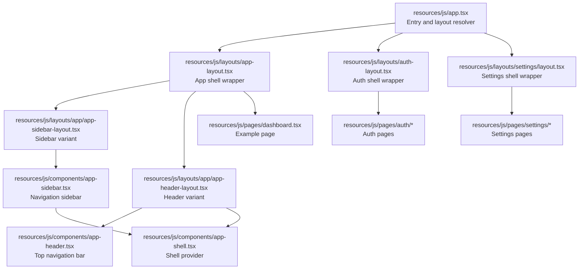
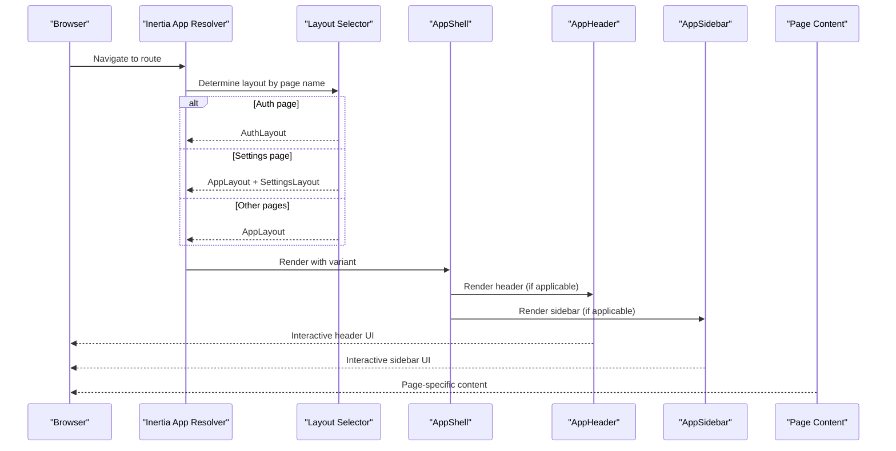
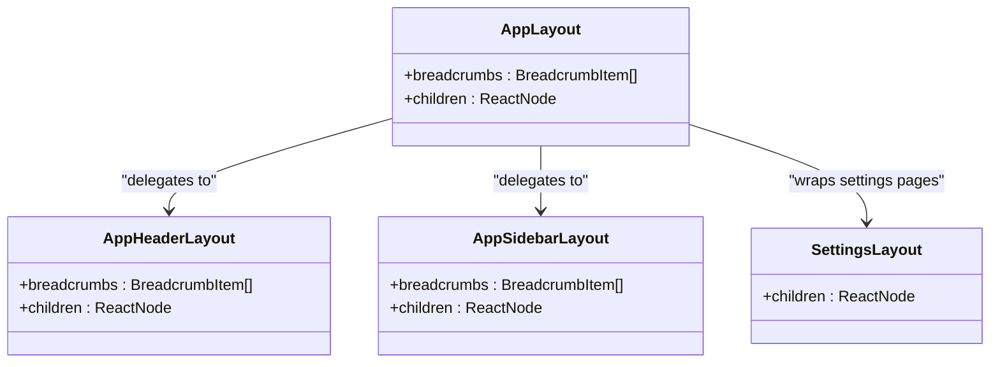
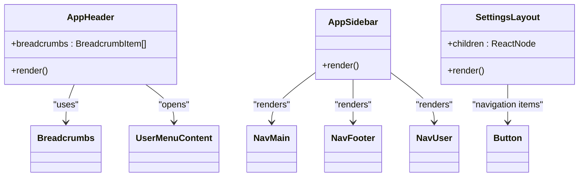
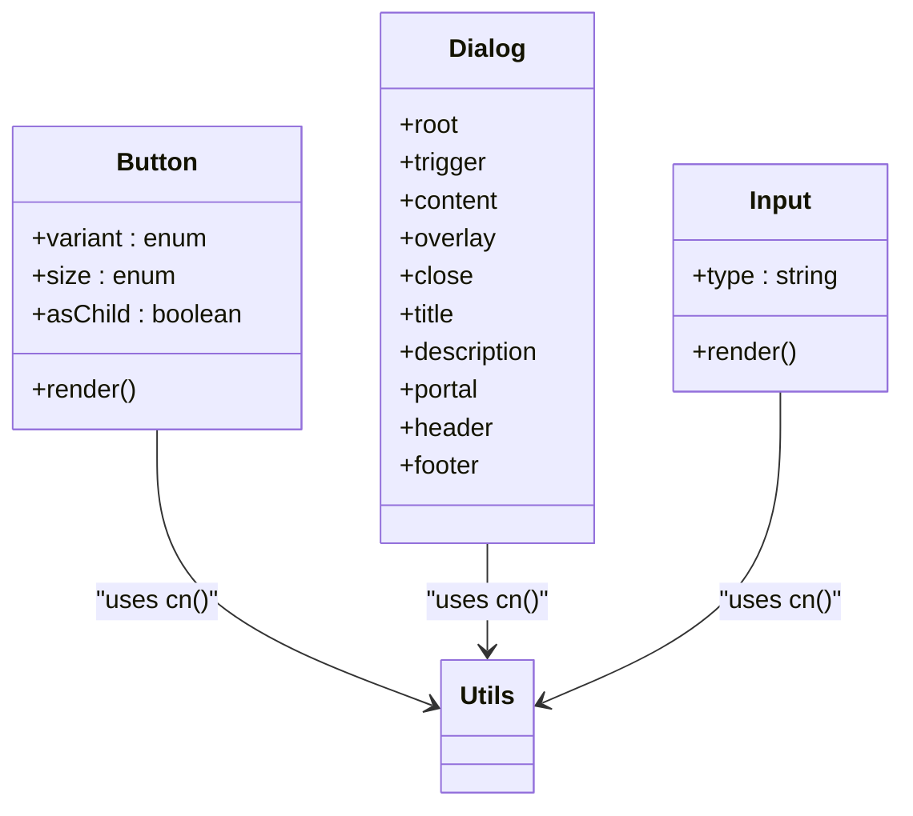
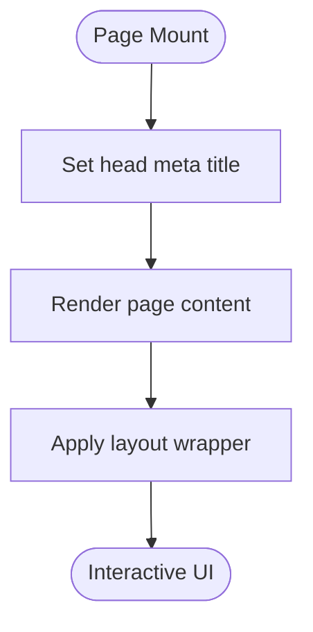
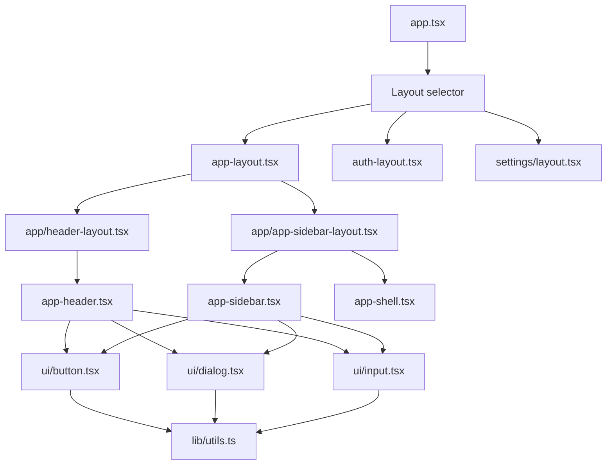

# Component Architecture

<cite>
**Referenced Files in This Document**
- [app.tsx](file://resources/js/app.tsx)
- [app-shell.tsx](file://resources/js/components/app-shell.tsx)
- [app-layout.tsx](file://resources/js/layouts/app-layout.tsx)
- [app-header-layout.tsx](file://resources/js/layouts/app/header-layout.tsx)
- [app-sidebar-layout.tsx](file://resources/js/layouts/app/app-sidebar-layout.tsx)
- [app-header.tsx](file://resources/js/components/app-header.tsx)
- [app-sidebar.tsx](file://resources/js/components/app-sidebar.tsx)
- [auth-layout.tsx](file://resources/js/layouts/auth-layout.tsx)
- [settings/layout.tsx](file://resources/js/layouts/settings/layout.tsx)
- [dashboard.tsx](file://resources/js/pages/dashboard.tsx)
- [button.tsx](file://resources/js/components/ui/button.tsx)
- [dialog.tsx](file://resources/js/components/ui/dialog.tsx)
- [input.tsx](file://resources/js/components/ui/input.tsx)
- [utils.ts](file://resources/js/lib/utils.ts)
</cite>

## Table of Contents
1. [Introduction](#introduction)
2. [Project Structure](#project-structure)
3. [Core Components](#core-components)
4. [Architecture Overview](#architecture-overview)
5. [Detailed Component Analysis](#detailed-component-analysis)
6. [Dependency Analysis](#dependency-analysis)
7. [Performance Considerations](#performance-considerations)
8. [Testing Approaches](#testing-approaches)
9. [Troubleshooting Guide](#troubleshooting-guide)
10. [Conclusion](#conclusion)

## Introduction
This document describes the React frontend architecture for the SmartExam web application. It focuses on the component hierarchy, layout system, and page organization, including how layout components (app, auth, settings), UI components (buttons, forms, dialogs), and page components (dashboard, settings) work together. It also covers state management patterns, prop drilling prevention, reusability strategies, lifecycle considerations, performance optimization, and testing approaches.

## Project Structure
The frontend is organized around three primary layers:
- Application entry and routing integration via Inertia
- Layouts that define page shells and navigation containers
- Pages and reusable UI components

Key entry points and organizational patterns:
- Application bootstrapping and layout resolution occur in the main entry file
- Layouts wrap pages to provide consistent navigation and content areas
- UI components are built with composability and theme-awareness in mind
- Shared utilities centralize cross-cutting concerns like class merging and URL normalization

**Diagram sources**
- [app.tsx:11-37](file://resources/js/app.tsx#L11-L37)
- [app-layout.tsx:1-17](file://resources/js/layouts/app-layout.tsx#L1-L17)
- [app-header-layout.tsx:1-17](file://resources/js/layouts/app/header-layout.tsx#L1-L17)
- [app-sidebar-layout.tsx:1-21](file://resources/js/layouts/app/app-sidebar-layout.tsx#L1-L21)
- [app-header.tsx:1-249](file://resources/js/components/app-header.tsx#L1-L249)
- [app-sidebar.tsx:1-66](file://resources/js/components/app-sidebar.tsx#L1-L66)
- [app-shell.tsx:1-22](file://resources/js/components/app-shell.tsx#L1-L22)
- [dashboard.tsx:1-37](file://resources/js/pages/dashboard.tsx#L1-L37)
- [auth-layout.tsx:1-18](file://resources/js/layouts/auth-layout.tsx#L1-L18)
- [settings/layout.tsx:1-79](file://resources/js/layouts/settings/layout.tsx#L1-L79)

**Section sources**
- [app.tsx:11-37](file://resources/js/app.tsx#L11-L37)
- [app-layout.tsx:1-17](file://resources/js/layouts/app-layout.tsx#L1-L17)
- [app-header-layout.tsx:1-17](file://resources/js/layouts/app/header-layout.tsx#L1-L17)
- [app-sidebar-layout.tsx:1-21](file://resources/js/layouts/app/app-sidebar-layout.tsx#L1-L21)
- [app-header.tsx:1-249](file://resources/js/components/app-header.tsx#L1-L249)
- [app-sidebar.tsx:1-66](file://resources/js/components/app-sidebar.tsx#L1-L66)
- [app-shell.tsx:1-22](file://resources/js/components/app-shell.tsx#L1-L22)
- [dashboard.tsx:1-37](file://resources/js/pages/dashboard.tsx#L1-L37)
- [auth-layout.tsx:1-18](file://resources/js/layouts/auth-layout.tsx#L1-L18)
- [settings/layout.tsx:1-79](file://resources/js/layouts/settings/layout.tsx#L1-L79)

## Core Components
This section documents the foundational building blocks that compose the application.

- AppShell
  - Purpose: Provides a consistent shell container with optional sidebar behavior and theme initialization hook integration
  - Key behavior: Reads sidebar open state from the page props and conditionally renders a sidebar-enabled or header-only layout
  - Reuse: Used by both header and sidebar layout variants

- AppHeader
  - Purpose: Top navigation bar with responsive mobile menu, breadcrumbs area, and user menu
  - Key behavior: Integrates with current URL detection, tooltips, avatars, and navigation menus
  - Composition: Uses UI primitives and layout-aware components

- AppSidebar
  - Purpose: Left navigation sidebar with logo, main navigation items, and user/footer sections
  - Key behavior: Renders collapsible sidebar with inset variant and integrates with navigation items

- SettingsLayout
  - Purpose: Settings page shell with vertical navigation and content area
  - Key behavior: Highlights active settings section and organizes content into a two-column layout

- UI Components (Button, Dialog, Input)
  - Purpose: Reusable, theme-aware UI primitives with consistent styling and accessibility
  - Key behavior: Variants and sizes are standardized; utilities support class merging and URL normalization

- Shared Utilities
  - Purpose: Cross-cutting helpers for class merging and URL normalization
  - Key behavior: Encapsulates Tailwind class composition and Inertia URL handling

**Section sources**
- [app-shell.tsx:1-22](file://resources/js/components/app-shell.tsx#L1-L22)
- [app-header.tsx:1-249](file://resources/js/components/app-header.tsx#L1-L249)
- [app-sidebar.tsx:1-66](file://resources/js/components/app-sidebar.tsx#L1-L66)
- [settings/layout.tsx:1-79](file://resources/js/layouts/settings/layout.tsx#L1-L79)
- [button.tsx:1-59](file://resources/js/components/ui/button.tsx#L1-L59)
- [dialog.tsx:1-134](file://resources/js/components/ui/dialog.tsx#L1-L134)
- [input.tsx:1-22](file://resources/js/components/ui/input.tsx#L1-L22)
- [utils.ts:1-13](file://resources/js/lib/utils.ts#L1-L13)

## Architecture Overview
The application uses Inertia to coordinate server-rendered layouts with client-side React components. The entry file resolves which layout to apply based on the page name, then wraps pages with appropriate shells.

**Diagram sources**
- [app.tsx:13-24](file://resources/js/app.tsx#L13-L24)
- [app-layout.tsx:4-16](file://resources/js/layouts/app-layout.tsx#L4-L16)
- [auth-layout.tsx:3-17](file://resources/js/layouts/auth-layout.tsx#L3-L17)
- [settings/layout.tsx:31-78](file://resources/js/layouts/settings/layout.tsx#L31-L78)
- [app-header-layout.tsx:7-16](file://resources/js/layouts/app/header-layout.tsx#L7-L16)
- [app-sidebar-layout.tsx:7-20](file://resources/js/layouts/app/app-sidebar-layout.tsx#L7-L20)

## Detailed Component Analysis

### Layout System
The layout system composes reusable shells around pages:
- AppLayout delegates to either header or sidebar variants
- AppHeaderLayout provides a header-centric shell with breadcrumbs
- AppSidebarLayout provides a sidebar-centric shell with navigation and content area
- SettingsLayout provides a specialized settings shell with a left-hand navigation

**Diagram sources**
- [app-layout.tsx:4-16](file://resources/js/layouts/app-layout.tsx#L4-L16)
- [app-header-layout.tsx:6-16](file://resources/js/layouts/app/header-layout.tsx#L6-L16)
- [app-sidebar-layout.tsx:7-20](file://resources/js/layouts/app/app-sidebar-layout.tsx#L7-L20)
- [settings/layout.tsx:31-78](file://resources/js/layouts/settings/layout.tsx#L31-L78)

**Section sources**
- [app-layout.tsx:1-17](file://resources/js/layouts/app-layout.tsx#L1-L17)
- [app-header-layout.tsx:1-17](file://resources/js/layouts/app/header-layout.tsx#L1-L17)
- [app-sidebar-layout.tsx:1-21](file://resources/js/layouts/app/app-sidebar-layout.tsx#L1-L21)
- [settings/layout.tsx:1-79](file://resources/js/layouts/settings/layout.tsx#L1-L79)

### Navigation Components
Navigation is composed from smaller building blocks:
- AppHeader provides responsive navigation, breadcrumbs, and user menu
- AppSidebar provides main and footer navigation items
- SettingsLayout provides settings navigation with active-state highlighting

**Diagram sources**
- [app-header.tsx:66-248](file://resources/js/components/app-header.tsx#L66-L248)
- [app-sidebar.tsx:40-65](file://resources/js/components/app-sidebar.tsx#L40-L65)
- [settings/layout.tsx:31-78](file://resources/js/layouts/settings/layout.tsx#L31-L78)

**Section sources**
- [app-header.tsx:1-249](file://resources/js/components/app-header.tsx#L1-L249)
- [app-sidebar.tsx:1-66](file://resources/js/components/app-sidebar.tsx#L1-L66)
- [settings/layout.tsx:1-79](file://resources/js/layouts/settings/layout.tsx#L1-L79)

### UI Primitive Components
Reusable UI primitives encapsulate styling and behavior:
- Button supports multiple variants and sizes with consistent focus and invalid states
- Dialog provides overlay, portal, and close controls with accessible semantics
- Input standardizes focus styles and invalid states

**Diagram sources**
- [button.tsx:37-58](file://resources/js/components/ui/button.tsx#L37-L58)
- [dialog.tsx:7-133](file://resources/js/components/ui/dialog.tsx#L7-L133)
- [input.tsx:5-19](file://resources/js/components/ui/input.tsx#L5-L19)
- [utils.ts:6-8](file://resources/js/lib/utils.ts#L6-L8)

**Section sources**
- [button.tsx:1-59](file://resources/js/components/ui/button.tsx#L1-L59)
- [dialog.tsx:1-134](file://resources/js/components/ui/dialog.tsx#L1-L134)
- [input.tsx:1-22](file://resources/js/components/ui/input.tsx#L1-L22)
- [utils.ts:1-13](file://resources/js/lib/utils.ts#L1-L13)

### Page Organization
Pages are thin wrappers that declare metadata and render content:
- Dashboard demonstrates a responsive grid and placeholder pattern usage
- Settings pages are wrapped by SettingsLayout for consistent navigation and content area

**Diagram sources**
- [dashboard.tsx:5-36](file://resources/js/pages/dashboard.tsx#L5-L36)

**Section sources**
- [dashboard.tsx:1-37](file://resources/js/pages/dashboard.tsx#L1-L37)

## Dependency Analysis
The component graph reveals clear separation of concerns:
- Entry file depends on layout selectors and providers
- Layouts depend on shell and navigation components
- UI components depend on shared utilities
- Pages depend on layouts and UI components

**Diagram sources**
- [app.tsx:11-37](file://resources/js/app.tsx#L11-L37)
- [app-layout.tsx:1-17](file://resources/js/layouts/app-layout.tsx#L1-L17)
- [auth-layout.tsx:1-18](file://resources/js/layouts/auth-layout.tsx#L1-L18)
- [settings/layout.tsx:1-79](file://resources/js/layouts/settings/layout.tsx#L1-L79)
- [app-header-layout.tsx:1-17](file://resources/js/layouts/app/header-layout.tsx#L1-L17)
- [app-sidebar-layout.tsx:1-21](file://resources/js/layouts/app/app-sidebar-layout.tsx#L1-L21)
- [app-header.tsx:1-249](file://resources/js/components/app-header.tsx#L1-L249)
- [app-sidebar.tsx:1-66](file://resources/js/components/app-sidebar.tsx#L1-L66)
- [app-shell.tsx:1-22](file://resources/js/components/app-shell.tsx#L1-L22)
- [button.tsx:1-59](file://resources/js/components/ui/button.tsx#L1-L59)
- [dialog.tsx:1-134](file://resources/js/components/ui/dialog.tsx#L1-L134)
- [input.tsx:1-22](file://resources/js/components/ui/input.tsx#L1-L22)
- [utils.ts:1-13](file://resources/js/lib/utils.ts#L1-L13)

**Section sources**
- [app.tsx:11-37](file://resources/js/app.tsx#L11-L37)
- [app-layout.tsx:1-17](file://resources/js/layouts/app-layout.tsx#L1-L17)
- [auth-layout.tsx:1-18](file://resources/js/layouts/auth-layout.tsx#L1-L18)
- [settings/layout.tsx:1-79](file://resources/js/layouts/settings/layout.tsx#L1-L79)
- [app-header-layout.tsx:1-17](file://resources/js/layouts/app/header-layout.tsx#L1-L17)
- [app-sidebar-layout.tsx:1-21](file://resources/js/layouts/app/app-sidebar-layout.tsx#L1-L21)
- [app-header.tsx:1-249](file://resources/js/components/app-header.tsx#L1-L249)
- [app-sidebar.tsx:1-66](file://resources/js/components/app-sidebar.tsx#L1-L66)
- [app-shell.tsx:1-22](file://resources/js/components/app-shell.tsx#L1-L22)
- [button.tsx:1-59](file://resources/js/components/ui/button.tsx#L1-L59)
- [dialog.tsx:1-134](file://resources/js/components/ui/dialog.tsx#L1-L134)
- [input.tsx:1-22](file://resources/js/components/ui/input.tsx#L1-L22)
- [utils.ts:1-13](file://resources/js/lib/utils.ts#L1-L13)

## Performance Considerations
- Lazy loading and code splitting: Keep page components modular and avoid importing heavy dependencies in shared layouts
- Minimize re-renders: Use memoization for expensive computations and stable callbacks; leverage shallow comparisons for props
- CSS and assets: Prefer CSS-in-JS utilities for deterministic class merging; avoid unnecessary DOM nodes in layouts
- Accessibility: Ensure dialogs and menus are keyboard accessible and screen-reader friendly
- Theme initialization: Initialize theme early to prevent FOUC; avoid layout shifts during hydration

## Testing Approaches
- Unit testing UI components: Test variants, sizes, and state transitions using a testing library that supports React and Inertia-like rendering
- Integration testing layouts: Verify that breadcrumbs, navigation, and shell providers render correctly under different page contexts
- Behavior-driven tests: Validate that navigation items highlight appropriately and that dialogs open/close as expected
- Accessibility tests: Confirm keyboard navigation and ARIA attributes for interactive components

## Troubleshooting Guide
- Layout not applied: Verify the page name and ensure the layout selector returns the intended layout in the entry file
- Sidebar not visible: Confirm that the shell variant matches the layout variant and that sidebar open state is properly initialized
- Navigation highlights incorrect: Check URL matching logic and ensure active state computation is consistent across components
- Styling inconsistencies: Ensure shared utilities are used for class merging and that theme tokens are applied consistently

**Section sources**
- [app.tsx:13-24](file://resources/js/app.tsx#L13-L24)
- [app-shell.tsx:11-21](file://resources/js/components/app-shell.tsx#L11-L21)
- [app-header.tsx:66-248](file://resources/js/components/app-header.tsx#L66-L248)
- [settings/layout.tsx:31-78](file://resources/js/layouts/settings/layout.tsx#L31-L78)

## Conclusion
The React frontend employs a clean, layered architecture:
- Entry and layout resolution via Inertia
- Composable layout shells for app, auth, and settings contexts
- Reusable UI primitives with consistent variants and utilities
- Clear separation between navigation, content, and page-specific logic

This structure promotes maintainability, scalability, and a consistent user experience across pages while minimizing prop drilling and encouraging component reuse.