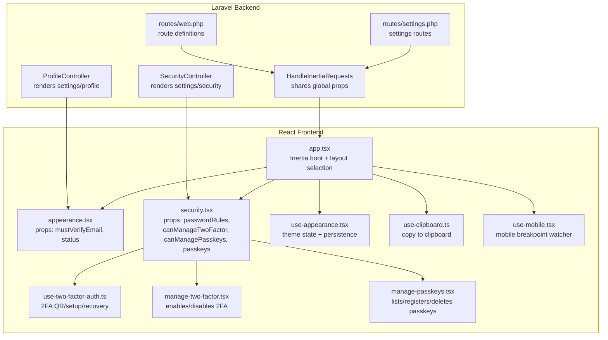
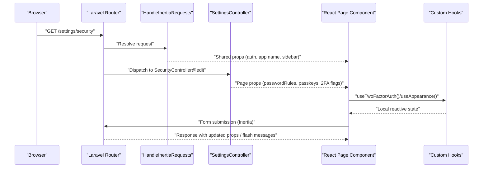
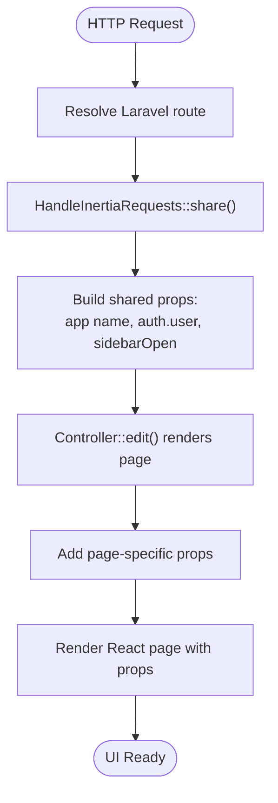
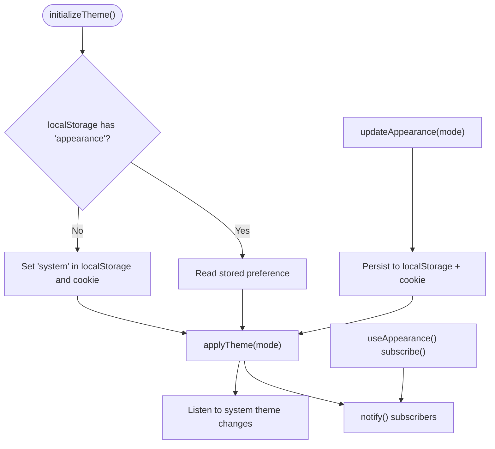
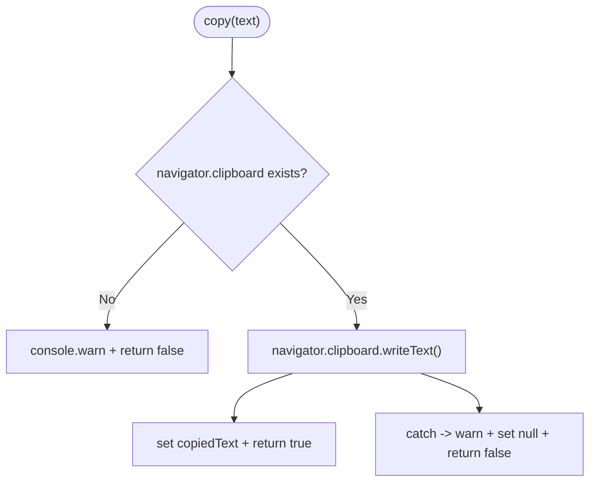
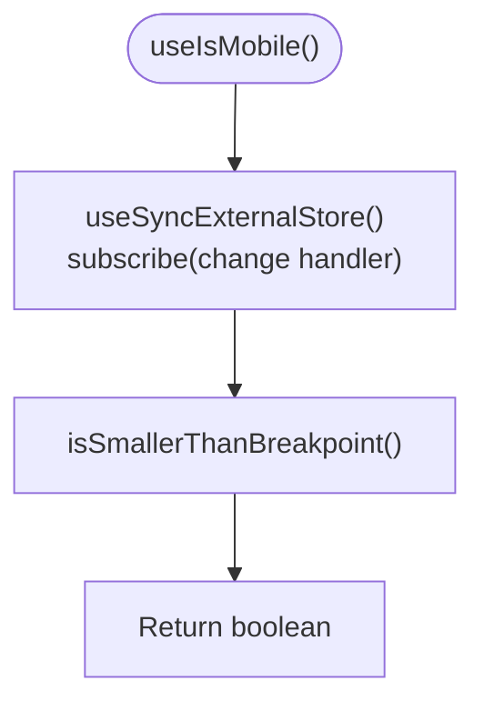
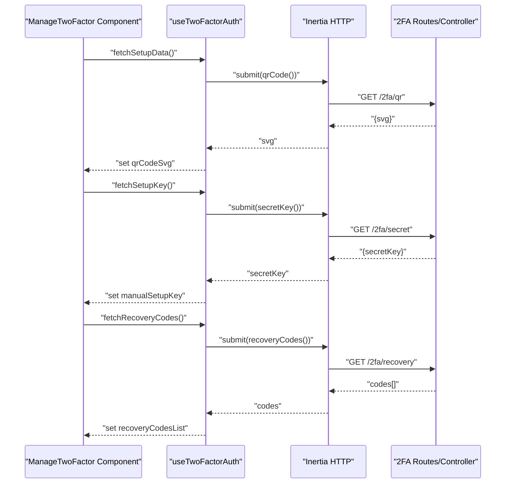
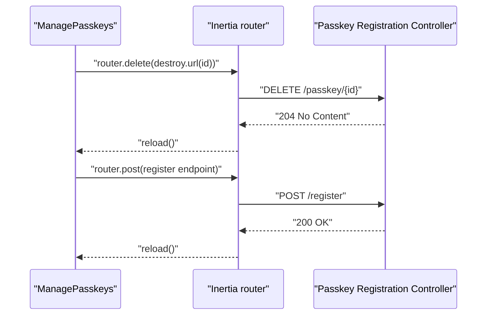
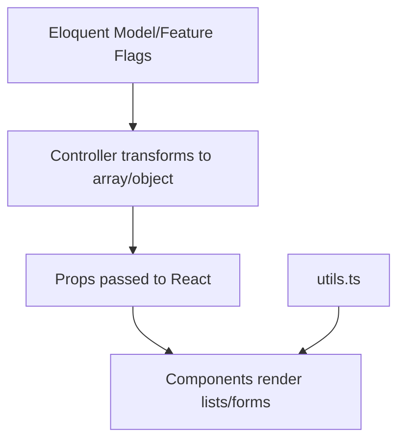
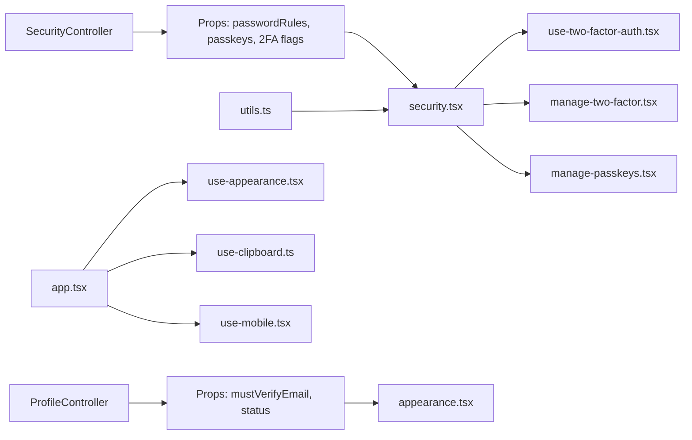

# Data Flow & State Management

<cite>
**Referenced Files in This Document**
- [HandleInertiaRequests.php](file://app/Http/Middleware/HandleInertiaRequests.php)
- [app.tsx](file://resources/js/app.tsx)
- [use-appearance.tsx](file://resources/js/hooks/use-appearance.tsx)
- [use-clipboard.ts](file://resources/js/hooks/use-clipboard.ts)
- [use-mobile.tsx](file://resources/js/hooks/use-mobile.tsx)
- [use-two-factor-auth.ts](file://resources/js/hooks/use-two-factor-auth.ts)
- [web.php](file://routes/web.php)
- [settings.php](file://routes/settings.php)
- [ProfileController.php](file://app/Http/Controllers/Settings/ProfileController.php)
- [SecurityController.php](file://app/Http/Controllers/Settings/SecurityController.php)
- [appearance.tsx](file://resources/js/pages/settings/appearance.tsx)
- [security.tsx](file://resources/js/pages/settings/security.tsx)
- [manage-two-factor.tsx](file://resources/js/components/manage-two-factor.tsx)
- [manage-passkeys.tsx](file://resources/js/components/manage-passkeys.tsx)
- [utils.ts](file://resources/js/lib/utils.ts)
</cite>

## Table of Contents
1. [Introduction](#introduction)
2. [Project Structure](#project-structure)
3. [Core Components](#core-components)
4. [Architecture Overview](#architecture-overview)
5. [Detailed Component Analysis](#detailed-component-analysis)
6. [Dependency Analysis](#dependency-analysis)
7. [Performance Considerations](#performance-considerations)
8. [Troubleshooting Guide](#troubleshooting-guide)
9. [Conclusion](#conclusion)

## Introduction
This document explains how SmartExam manages data flow and state across the Laravel backend and React frontend using Inertia.js. It covers:
- How Laravel controllers render React pages and share props
- How Inertia’s middleware propagates global data to React
- Reactive state updates via custom hooks for appearance, clipboard, mobile detection, and two-factor authentication
- Data transformation patterns, error handling strategies, and performance optimizations
- Client-server communication, caching considerations, and real-time-like updates

## Project Structure
SmartExam uses Inertia to serve React pages from Laravel routes. The middleware defines shared data, while controllers prepare page-specific props. React components consume these props and expose custom hooks for local state and side effects.

**Diagram sources**
- [HandleInertiaRequests.php:36-46](file://app/Http/Middleware/HandleInertiaRequests.php#L36-L46)
- [app.tsx:11-37](file://resources/js/app.tsx#L11-L37)
- [ProfileController.php:20-25](file://app/Http/Controllers/Settings/ProfileController.php#L20-L25)
- [SecurityController.php:19-56](file://app/Http/Controllers/Settings/SecurityController.php#L19-L56)
- [web.php:5-23](file://routes/web.php#L5-L23)
- [settings.php:10-31](file://routes/settings.php#L10-L31)
- [appearance.tsx:6-23](file://resources/js/pages/settings/appearance.tsx#L6-L23)
- [security.tsx:24-146](file://resources/js/pages/settings/security.tsx#L24-L146)
- [use-appearance.tsx:90-115](file://resources/js/hooks/use-appearance.tsx#L90-L115)
- [use-clipboard.ts:8-32](file://resources/js/hooks/use-clipboard.ts#L8-L32)
- [use-mobile.tsx:30-36](file://resources/js/hooks/use-mobile.tsx#L30-L36)
- [use-two-factor-auth.ts:22-111](file://resources/js/hooks/use-two-factor-auth.ts#L22-L111)
- [manage-two-factor.tsx:17-126](file://resources/js/components/manage-two-factor.tsx#L17-L126)
- [manage-passkeys.tsx:28-71](file://resources/js/components/manage-passkeys.tsx#L28-L71)

**Section sources**
- [HandleInertiaRequests.php:36-46](file://app/Http/Middleware/HandleInertiaRequests.php#L36-L46)
- [app.tsx:11-37](file://resources/js/app.tsx#L11-L37)
- [web.php:5-23](file://routes/web.php#L5-L23)
- [settings.php:10-31](file://routes/settings.php#L10-L31)

## Core Components
- Inertia middleware: Shares global props (application name, authenticated user, sidebar state) to all React pages.
- Bootstrapper: Configures Inertia app, layout resolution, progress bar, and initializes theme.
- Controllers: Render pages with page-specific props (e.g., password rules, passkeys, 2FA flags).
- Pages: Consume props and compose UI components.
- Custom hooks: Encapsulate reactive state and side effects for appearance, clipboard, mobile detection, and 2FA.

**Section sources**
- [HandleInertiaRequests.php:36-46](file://app/Http/Middleware/HandleInertiaRequests.php#L36-L46)
- [app.tsx:11-37](file://resources/js/app.tsx#L11-L37)
- [ProfileController.php:20-25](file://app/Http/Controllers/Settings/ProfileController.php#L20-L25)
- [SecurityController.php:19-56](file://app/Http/Controllers/Settings/SecurityController.php#L19-L56)

## Architecture Overview
The data flow follows a unidirectional pattern:
- Laravel routes define entry points and groupings.
- Middleware shares global data to React.
- Controllers transform domain data into page props.
- React components render UI and manage local state via hooks.
- Inertia handles client-server transitions and form submissions.

**Diagram sources**
- [settings.php:20-31](file://routes/settings.php#L20-L31)
- [HandleInertiaRequests.php:36-46](file://app/Http/Middleware/HandleInertiaRequests.php#L36-L46)
- [SecurityController.php:19-56](file://app/Http/Controllers/Settings/SecurityController.php#L19-L56)
- [security.tsx:24-146](file://resources/js/pages/settings/security.tsx#L24-L146)
- [use-two-factor-auth.ts:22-111](file://resources/js/hooks/use-two-factor-auth.ts#L22-L111)
- [use-appearance.tsx:90-115](file://resources/js/hooks/use-appearance.tsx#L90-L115)

## Detailed Component Analysis

### Inertia Data Sharing and Propagation
- Global props: Application name, authenticated user, and sidebar open state are merged into every Inertia response.
- Layout selection: The Inertia bootstrapper selects layouts per page name (auth, settings, default app).
- Progress indicator: A lightweight progress bar is configured globally.

**Diagram sources**
- [HandleInertiaRequests.php:36-46](file://app/Http/Middleware/HandleInertiaRequests.php#L36-L46)
- [app.tsx:11-37](file://resources/js/app.tsx#L11-L37)
- [SecurityController.php:19-56](file://app/Http/Controllers/Settings/SecurityController.php#L19-L56)

**Section sources**
- [HandleInertiaRequests.php:36-46](file://app/Http/Middleware/HandleInertiaRequests.php#L36-L46)
- [app.tsx:11-37](file://resources/js/app.tsx#L11-L37)

### Appearance Management Hook
- Purpose: Centralized theme state with system-aware resolution and persistence.
- Mechanism:
  - Initializes theme on load, reads stored preference, applies class and color-scheme to document element.
  - Subscribes to system theme changes and notifies subscribers.
  - Persists user choice in localStorage and cookies for SSR compatibility.
  - Exposes a function to update appearance and notify subscribers.

**Diagram sources**
- [use-appearance.tsx:73-88](file://resources/js/hooks/use-appearance.tsx#L73-L88)
- [use-appearance.tsx:55-61](file://resources/js/hooks/use-appearance.tsx#L55-L61)
- [use-appearance.tsx:101-112](file://resources/js/hooks/use-appearance.tsx#L101-L112)

**Section sources**
- [use-appearance.tsx:90-115](file://resources/js/hooks/use-appearance.tsx#L90-L115)

### Clipboard Hook
- Purpose: Provides copy-to-clipboard functionality with graceful error handling.
- Mechanism:
  - Uses the Clipboard API when available.
  - Tracks last copied text state.
  - Returns a promise-based copy function indicating success/failure.

**Diagram sources**
- [use-clipboard.ts:11-29](file://resources/js/hooks/use-clipboard.ts#L11-L29)

**Section sources**
- [use-clipboard.ts:8-32](file://resources/js/hooks/use-clipboard.ts#L8-L32)

### Mobile Detection Hook
- Purpose: Reactive detection of mobile viewport using MediaQueryList.
- Mechanism:
  - Uses useSyncExternalStore to subscribe to media query changes.
  - Returns a boolean indicating if the viewport is below the mobile breakpoint.

**Diagram sources**
- [use-mobile.tsx:30-36](file://resources/js/hooks/use-mobile.tsx#L30-L36)

**Section sources**
- [use-mobile.tsx:30-36](file://resources/js/hooks/use-mobile.tsx#L30-L36)

### Two-Factor Authentication Hook and Component
- Purpose: Fetch and manage 2FA setup data, recovery codes, and errors.
- Mechanism:
  - Uses Inertia’s http client to submit requests for QR code, secret key, and recovery codes.
  - Aggregates errors and exposes helpers to clear state.
  - Component orchestrates enabling/disabling 2FA, displays setup modal, and manages recovery codes.

**Diagram sources**
- [use-two-factor-auth.ts:49-95](file://resources/js/hooks/use-two-factor-auth.ts#L49-L95)
- [manage-two-factor.tsx:17-126](file://resources/js/components/manage-two-factor.tsx#L17-L126)

**Section sources**
- [use-two-factor-auth.ts:22-111](file://resources/js/hooks/use-two-factor-auth.ts#L22-L111)
- [manage-two-factor.tsx:17-126](file://resources/js/components/manage-two-factor.tsx#L17-L126)

### Passkeys Management Component
- Purpose: Lists existing passkeys, supports registration, and deletion.
- Mechanism:
  - Renders empty state when no passkeys exist.
  - Delegates deletion to Inertia router with scroll preservation.
  - Reloads the page after successful registration.

**Diagram sources**
- [manage-passkeys.tsx:31-40](file://resources/js/components/manage-passkeys.tsx#L31-L40)

**Section sources**
- [manage-passkeys.tsx:28-71](file://resources/js/components/manage-passkeys.tsx#L28-L71)

### Data Transformation Patterns
- Controller-to-Props: Controllers transform Eloquent models and feature flags into compact arrays suitable for React.
- Utilities: Helper functions normalize Inertia link props and merge Tailwind classes.

**Diagram sources**
- [SecurityController.php:33-42](file://app/Http/Controllers/Settings/SecurityController.php#L33-L42)
- [utils.ts:6-12](file://resources/js/lib/utils.ts#L6-L12)

**Section sources**
- [SecurityController.php:19-56](file://app/Http/Controllers/Settings/SecurityController.php#L19-L56)
- [utils.ts:6-12](file://resources/js/lib/utils.ts#L6-L12)

### Error Handling Strategies
- Controlled forms: The security page preserves scroll and resets fields on error, focusing the first invalid field.
- Hook-level errors: 2FA hook aggregates errors and clears them when appropriate.
- Clipboard fallback: Warns and returns false when Clipboard API is unavailable.

**Section sources**
- [security.tsx:52-61](file://resources/js/pages/settings/security.tsx#L52-L61)
- [use-two-factor-auth.ts:49-95](file://resources/js/hooks/use-two-factor-auth.ts#L49-L95)
- [use-clipboard.ts:11-29](file://resources/js/hooks/use-clipboard.ts#L11-L29)

### Client-Server Communication Protocols
- Inertia rendering: Server renders initial HTML with props; subsequent navigations are handled client-side with minimal network overhead.
- HTTP client: The 2FA hook uses Inertia’s http client for form submissions and GET requests.
- Router actions: Deletions and registrations use Inertia router with options like preserving scroll and reloading on success.

**Section sources**
- [use-two-factor-auth.ts:23-61](file://resources/js/hooks/use-two-factor-auth.ts#L23-L61)
- [manage-two-factor.tsx:63-73](file://resources/js/components/manage-two-factor.tsx#L63-L73)
- [manage-passkeys.tsx:31-40](file://resources/js/components/manage-passkeys.tsx#L31-L40)

### Caching Strategies
- Local storage: Used to persist user preferences (e.g., appearance) for immediate UI updates.
- Cookies: Used to propagate SSR-friendly preferences server-side.
- Inertia progress: Reduces perceived latency by showing progress during navigation.

**Section sources**
- [use-appearance.tsx:23-30](file://resources/js/hooks/use-appearance.tsx#L23-L30)
- [use-appearance.tsx:78-84](file://resources/js/hooks/use-appearance.tsx#L78-L84)
- [app.tsx:34-36](file://resources/js/app.tsx#L34-L36)

### Real-Time Data Updates
- Not implemented in the current codebase. UI reflects server-provided props and local hook state. For real-time updates, consider integrating a WebSocket library or polling endpoints.

## Dependency Analysis
- Controllers depend on Inertia and feature flags to assemble props.
- Pages depend on controllers’ props and custom hooks for interactivity.
- Hooks encapsulate side effects and reduce coupling between components and external APIs.
- Utilities provide cross-cutting concerns (class merging, URL normalization).

**Diagram sources**
- [SecurityController.php:19-56](file://app/Http/Controllers/Settings/SecurityController.php#L19-L56)
- [ProfileController.php:20-25](file://app/Http/Controllers/Settings/ProfileController.php#L20-L25)
- [security.tsx:24-146](file://resources/js/pages/settings/security.tsx#L24-L146)
- [appearance.tsx:6-23](file://resources/js/pages/settings/appearance.tsx#L6-L23)
- [use-two-factor-auth.tsx:22-111](file://resources/js/hooks/use-two-factor-auth.tsx#L22-L111)
- [manage-two-factor.tsx:17-126](file://resources/js/components/manage-two-factor.tsx#L17-L126)
- [manage-passkeys.tsx:28-71](file://resources/js/components/manage-passkeys.tsx#L28-L71)
- [use-appearance.tsx:90-115](file://resources/js/hooks/use-appearance.tsx#L90-L115)
- [use-clipboard.ts:8-32](file://resources/js/hooks/use-clipboard.ts#L8-L32)
- [use-mobile.tsx:30-36](file://resources/js/hooks/use-mobile.tsx#L30-L36)
- [utils.ts:6-12](file://resources/js/lib/utils.ts#L6-L12)

**Section sources**
- [SecurityController.php:19-56](file://app/Http/Controllers/Settings/SecurityController.php#L19-L56)
- [ProfileController.php:20-25](file://app/Http/Controllers/Settings/ProfileController.php#L20-L25)
- [security.tsx:24-146](file://resources/js/pages/settings/security.tsx#L24-L146)
- [appearance.tsx:6-23](file://resources/js/pages/settings/appearance.tsx#L6-L23)
- [use-two-factor-auth.tsx:22-111](file://resources/js/hooks/use-two-factor-auth.tsx#L22-L111)
- [manage-two-factor.tsx:17-126](file://resources/js/components/manage-two-factor.tsx#L17-L126)
- [manage-passkeys.tsx:28-71](file://resources/js/components/manage-passkeys.tsx#L28-L71)
- [use-appearance.tsx:90-115](file://resources/js/hooks/use-appearance.tsx#L90-L115)
- [use-clipboard.ts:8-32](file://resources/js/hooks/use-clipboard.ts#L8-L32)
- [use-mobile.tsx:30-36](file://resources/js/hooks/use-mobile.tsx#L30-L36)
- [utils.ts:6-12](file://resources/js/lib/utils.ts#L6-L12)

## Performance Considerations
- Prefer client-side navigation via Inertia to minimize full-page reloads.
- Use local storage for UI preferences to avoid repeated server round-trips.
- Keep props minimal and flat; transform heavy data on the server.
- Debounce or throttle frequent UI interactions (e.g., clipboard copy).
- Use lazy loading for optional modals and heavy components.

## Troubleshooting Guide
- Theme not applying: Verify initialization runs on load and cookies/local storage keys are present.
- Clipboard fails silently: Check browser permissions and fallback warnings.
- 2FA setup not visible: Ensure feature flags are enabled and server endpoints return expected shapes.
- Passkey deletion does nothing: Confirm router action URL and that the component triggers reload on success.

**Section sources**
- [use-appearance.tsx:73-88](file://resources/js/hooks/use-appearance.tsx#L73-L88)
- [use-clipboard.ts:11-29](file://resources/js/hooks/use-clipboard.ts#L11-L29)
- [use-two-factor-auth.ts:49-95](file://resources/js/hooks/use-two-factor-auth.ts#L49-L95)
- [manage-passkeys.tsx:31-40](file://resources/js/components/manage-passkeys.tsx#L31-L40)

## Conclusion
SmartExam leverages Inertia to deliver a seamless data flow from Laravel controllers to React components, enriched by custom hooks that manage reactive state locally. The design emphasizes predictable prop passing, controlled error handling, and efficient client-server interactions, with clear extension points for advanced features like real-time updates and enhanced caching.