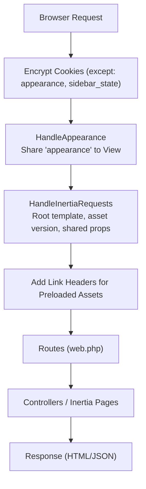
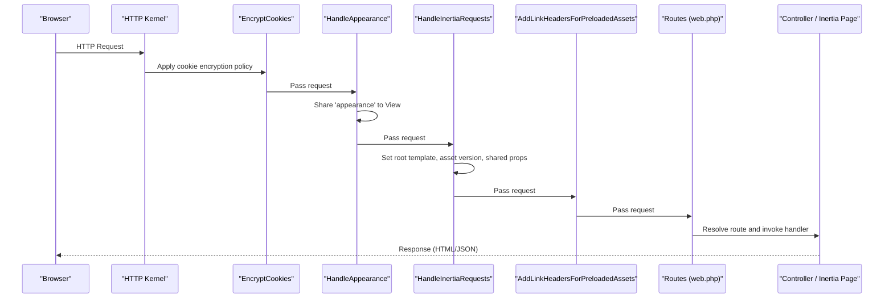
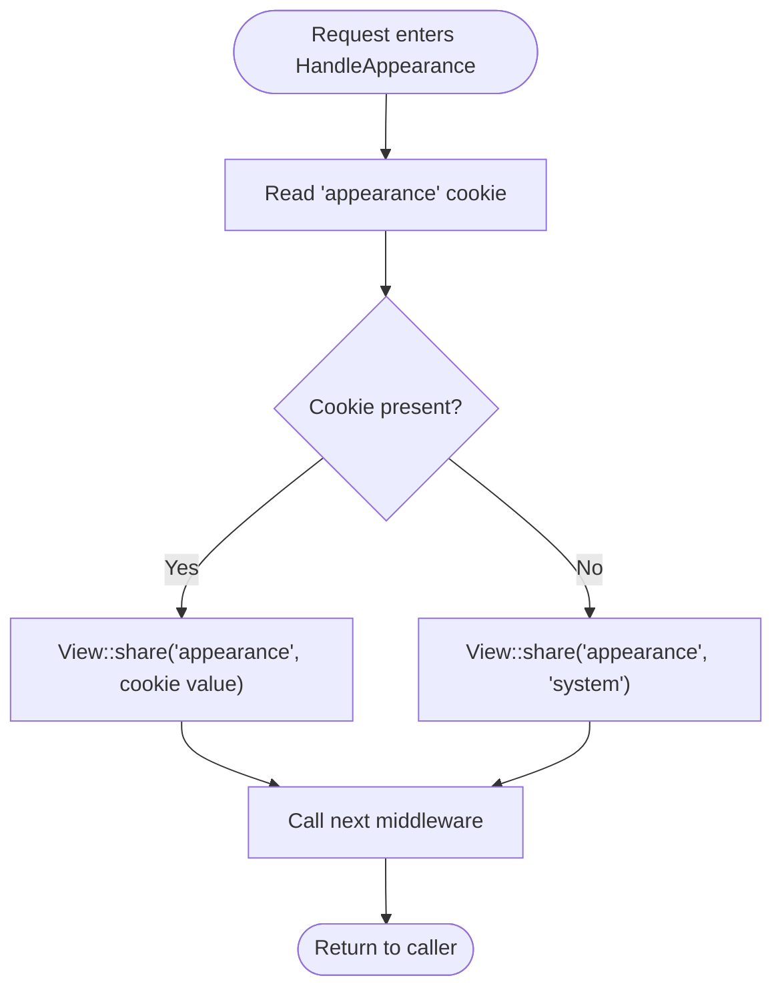
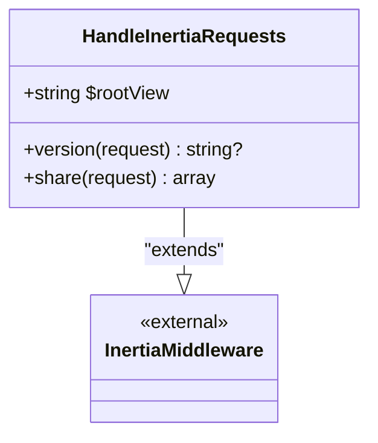
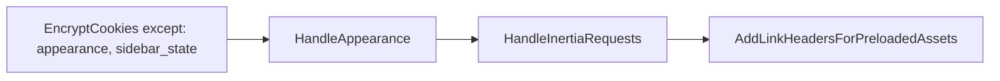
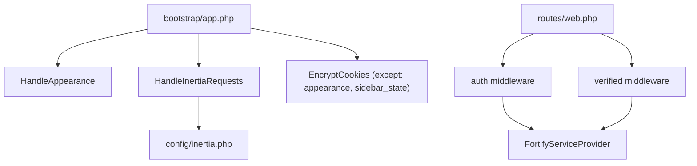

# Middleware Pipeline

<cite>
**Referenced Files in This Document**
- [bootstrap/app.php](file://bootstrap/app.php)
- [app/Http/Middleware/HandleAppearance.php](file://app/Http/Middleware/HandleAppearance.php)
- [app/Http/Middleware/HandleInertiaRequests.php](file://app/Http/Middleware/HandleInertiaRequests.php)
- [config/inertia.php](file://config/inertia.php)
- [routes/web.php](file://routes/web.php)
- [config/auth.php](file://config/auth.php)
- [config/session.php](file://config/session.php)
- [app/Providers/FortifyServiceProvider.php](file://app/Providers/FortifyServiceProvider.php)
- [resources/js/app.tsx](file://resources/js/app.tsx)
- [resources/js/hooks/use-appearance.tsx](file://resources/js/hooks/use-appearance.tsx)
</cite>

## Table of Contents
1. [Introduction](#introduction)
2. [Project Structure](#project-structure)
3. [Core Components](#core-components)
4. [Architecture Overview](#architecture-overview)
5. [Detailed Component Analysis](#detailed-component-analysis)
6. [Dependency Analysis](#dependency-analysis)
7. [Performance Considerations](#performance-considerations)
8. [Troubleshooting Guide](#troubleshooting-guide)
9. [Conclusion](#conclusion)

## Introduction
This document explains the middleware pipeline in the SmartExam application, focusing on how requests flow through the stack and how Inertia.js and theme management are integrated. It covers middleware ordering, execution sequence, data transformation, authentication middleware, session configuration, and practical guidance for configuration, parameter passing, response modification, performance, error handling, and debugging.

## Project Structure
The middleware pipeline is configured in the application bootstrap and applied to the web stack. The Inertia integration and theme handling are implemented as dedicated middleware, while authentication and session behavior are governed by configuration files.

**Diagram sources**
- [bootstrap/app.php:17-24](file://bootstrap/app.php#L17-L24)
- [app/Http/Middleware/HandleAppearance.php:17-22](file://app/Http/Middleware/HandleAppearance.php#L17-L22)
- [app/Http/Middleware/HandleInertiaRequests.php:36-46](file://app/Http/Middleware/HandleInertiaRequests.php#L36-L46)

**Section sources**
- [bootstrap/app.php:17-24](file://bootstrap/app.php#L17-L24)

## Core Components
- HandleAppearance: Shares the current appearance preference with the view layer based on the request cookie, defaulting to a system preference if absent.
- HandleInertiaRequests: Extends the Inertia middleware to define the root template, asset versioning, and shared data (application name, authenticated user, sidebar open state).
- Web stack configuration: Applies the middleware stack to web routes, encrypts cookies except for specific keys, and enables preloading link headers.

Key behaviors:
- Cookie exceptions for appearance and sidebar_state allow client-side persistence without encryption overhead.
- Shared props include application metadata and user context for frontend consumption.
- Inertia SSR configuration is enabled and discoverable page paths are configured.

**Section sources**
- [app/Http/Middleware/HandleAppearance.php:17-22](file://app/Http/Middleware/HandleAppearance.php#L17-L22)
- [app/Http/Middleware/HandleInertiaRequests.php:17-46](file://app/Http/Middleware/HandleInertiaRequests.php#L17-L46)
- [bootstrap/app.php:18-24](file://bootstrap/app.php#L18-L24)
- [config/inertia.php:18-51](file://config/inertia.php#L18-L51)

## Architecture Overview
The middleware pipeline is layered for predictable request processing:
1. Cookie encryption policy is enforced.
2. Theme preference is injected into the view layer.
3. Inertia-specific data and templates are prepared.
4. Preload headers are attached for assets.
5. Routing resolves the handler.

**Diagram sources**
- [bootstrap/app.php:17-24](file://bootstrap/app.php#L17-L24)
- [app/Http/Middleware/HandleAppearance.php:17-22](file://app/Http/Middleware/HandleAppearance.php#L17-L22)
- [app/Http/Middleware/HandleInertiaRequests.php:24-46](file://app/Http/Middleware/HandleInertiaRequests.php#L24-L46)
- [routes/web.php:5-23](file://routes/web.php#L5-L23)

## Detailed Component Analysis

### HandleAppearance Middleware
Purpose:
- Reads the appearance cookie and shares it with the view layer.
- Defaults to a system preference if the cookie is missing.

Execution:
- Runs early in the web stack to ensure downstream components (including Inertia rendering) have access to the appearance context.

Parameters and data transformation:
- Input: Request cookie named appearance.
- Transformation: Shares a scalar value to the view layer for layout/theme decisions.

Response modification:
- Does not modify the response; passes control to the next middleware.

**Diagram sources**
- [app/Http/Middleware/HandleAppearance.php:17-22](file://app/Http/Middleware/HandleAppearance.php#L17-L22)

**Section sources**
- [app/Http/Middleware/HandleAppearance.php:17-22](file://app/Http/Middleware/HandleAppearance.php#L17-L22)

### HandleInertiaRequests Middleware
Purpose:
- Configures the root template for Inertia responses.
- Provides asset versioning.
- Shares application-wide data to the frontend (name, auth.user, sidebarOpen).

Execution:
- Runs after theme handling to ensure shared data includes user context and UI preferences.

Shared data:
- name: Application name from configuration.
- auth.user: Current authenticated user.
- sidebarOpen: Derived from sidebar_state cookie presence and value.

**Diagram sources**
- [app/Http/Middleware/HandleInertiaRequests.php:8-46](file://app/Http/Middleware/HandleInertiaRequests.php#L8-L46)

**Section sources**
- [app/Http/Middleware/HandleInertiaRequests.php:17-46](file://app/Http/Middleware/HandleInertiaRequests.php#L17-L46)
- [config/inertia.php:18-51](file://config/inertia.php#L18-L51)

### Web Stack and Cookie Policy
Configuration highlights:
- Cookie encryption excludes appearance and sidebar_state to support client-side persistence without decryption overhead.
- The web stack appends HandleAppearance, HandleInertiaRequests, and preloading headers.

**Diagram sources**
- [bootstrap/app.php:18-24](file://bootstrap/app.php#L18-L24)

**Section sources**
- [bootstrap/app.php:18-24](file://bootstrap/app.php#L18-L24)

### Authentication and Session Middleware
Authentication defaults:
- Guard: session.
- Provider: Eloquent user provider.
- Password broker configuration is provided.

Session configuration:
- Driver, lifetime, cookie attributes, and security flags are configurable.

Note: Authentication middleware is referenced by route middleware names in routes. The session configuration governs how authentication state is maintained.

**Section sources**
- [config/auth.php:18-44](file://config/auth.php#L18-L44)
- [config/session.php:21-202](file://config/session.php#L21-L202)

### Inertia Views and SSR
Fortify integrates with Inertia to render authentication views server-side. This complements the HandleInertiaRequests middleware by ensuring consistent SSR behavior for auth-related pages.

**Section sources**
- [app/Providers/FortifyServiceProvider.php:56-89](file://app/Providers/FortifyServiceProvider.php#L56-L89)
- [config/inertia.php:18-23](file://config/inertia.php#L18-L23)

### Frontend Integration and Theme Persistence
The frontend initializes theme awareness and persists user preferences in both localStorage and cookies. This aligns with the backend’s view sharing and cookie exceptions.

- Initialization sets default appearance and applies theme classes.
- Updates synchronize localStorage, cookie, and DOM classes.

**Section sources**
- [resources/js/app.tsx:39-41](file://resources/js/app.tsx#L39-L41)
- [resources/js/hooks/use-appearance.tsx:73-88](file://resources/js/hooks/use-appearance.tsx#L73-L88)
- [resources/js/hooks/use-appearance.tsx:101-112](file://resources/js/hooks/use-appearance.tsx#L101-L112)

## Dependency Analysis
The middleware stack depends on:
- Configuration-driven cookie encryption policy.
- Inertia configuration for SSR and page discovery.
- Route groups that apply authentication middleware to protected pages.

**Diagram sources**
- [bootstrap/app.php:17-24](file://bootstrap/app.php#L17-L24)
- [config/inertia.php:18-51](file://config/inertia.php#L18-L51)
- [routes/web.php:21-23](file://routes/web.php#L21-L23)
- [app/Providers/FortifyServiceProvider.php:56-89](file://app/Providers/FortifyServiceProvider.php#L56-L89)

**Section sources**
- [bootstrap/app.php:17-24](file://bootstrap/app.php#L17-L24)
- [config/inertia.php:18-51](file://config/inertia.php#L18-L51)
- [routes/web.php:21-23](file://routes/web.php#L21-L23)
- [app/Providers/FortifyServiceProvider.php:56-89](file://app/Providers/FortifyServiceProvider.php#L56-L89)

## Performance Considerations
- Minimize heavy computation in middleware; both HandleAppearance and HandleInertiaRequests are lightweight.
- Keep shared data scoped to essential props to reduce payload sizes.
- Use cookie exceptions judiciously; appearance and sidebar_state are small and frequently accessed.
- Enable preloading headers to improve asset delivery timing.
- Consider disabling SSR selectively if not needed for specific pages to reduce server work.

## Troubleshooting Guide
Common issues and resolutions:
- Appearance not applying on first load:
  - Verify the default initialization sets the cookie and localStorage.
  - Confirm the cookie is not encrypted by checking the encryption policy.
- Authenticated user not visible in shared props:
  - Ensure the session is active and the user is properly authenticated.
  - Confirm the route group applies the auth middleware.
- Inertia SSR not working:
  - Check SSR configuration and page discovery paths.
  - Verify the root template and shared props are correctly set.

Debugging techniques:
- Inspect request cookies and headers to confirm middleware execution order.
- Log shared props in HandleInertiaRequests to validate data injection.
- Use browser dev tools to inspect cookie values and DOM classes reflecting theme state.

**Section sources**
- [bootstrap/app.php:18-24](file://bootstrap/app.php#L18-L24)
- [app/Http/Middleware/HandleInertiaRequests.php:36-46](file://app/Http/Middleware/HandleInertiaRequests.php#L36-L46)
- [config/inertia.php:18-51](file://config/inertia.php#L18-L51)
- [routes/web.php:21-23](file://routes/web.php#L21-L23)

## Conclusion
The SmartExam middleware pipeline is intentionally minimal and focused. HandleAppearance ensures theme context is available to the view layer, while HandleInertiaRequests prepares the root template, asset versioning, and shared data for Inertia. The web stack configuration enforces cookie policies and attaches preloading headers. Authentication and session behavior are controlled via configuration, and Fortify integrates seamlessly with Inertia for server-side rendering of authentication views. This design balances simplicity, performance, and developer ergonomics.