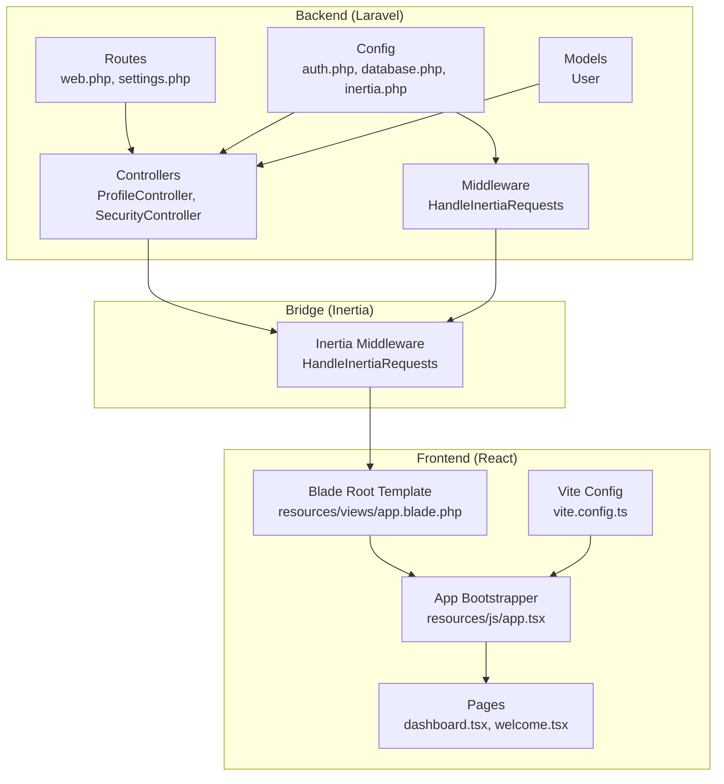
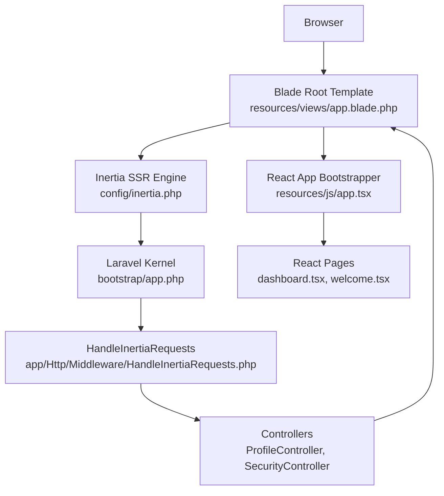
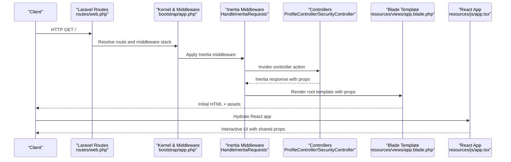
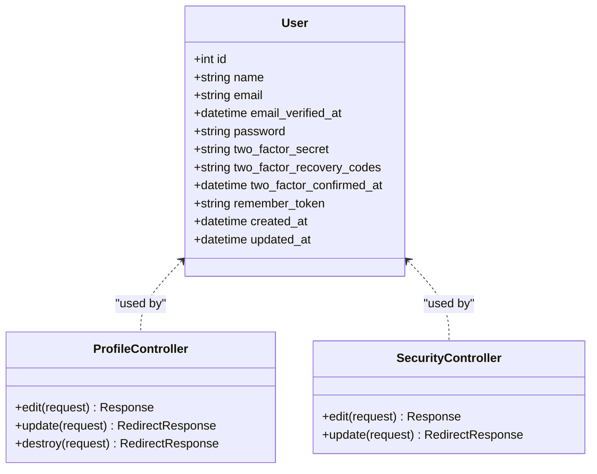
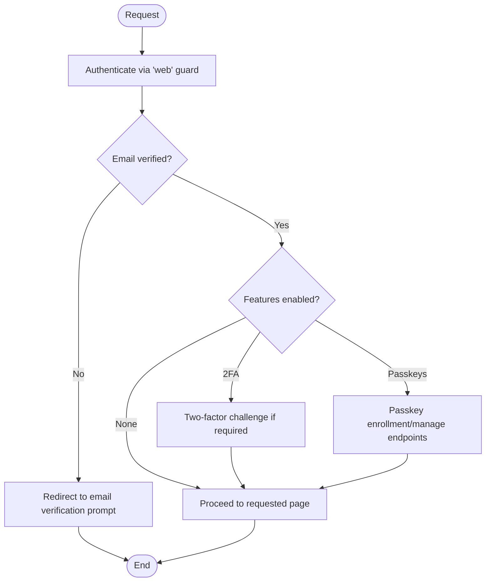
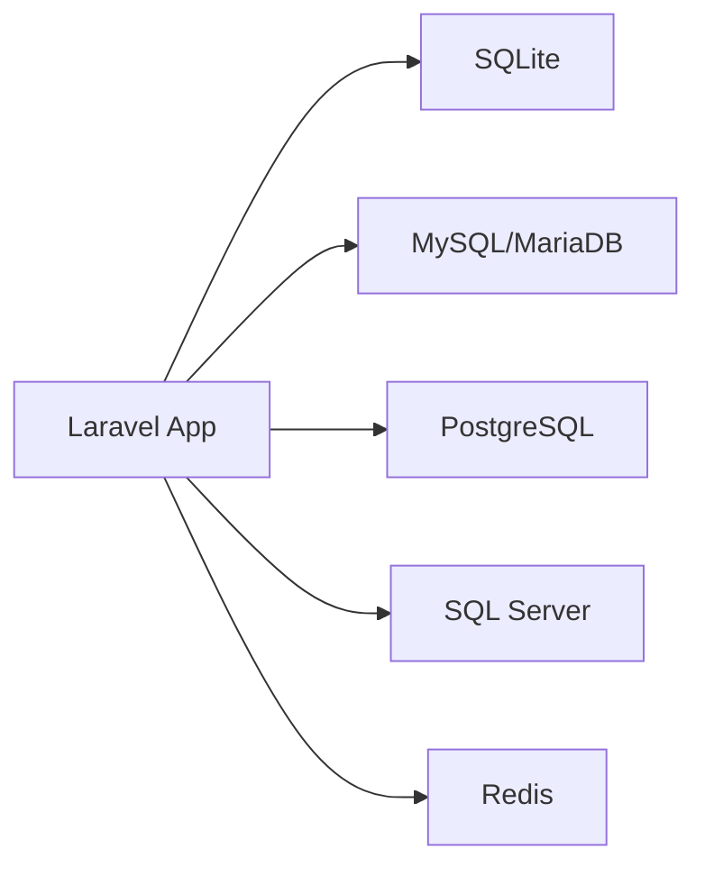
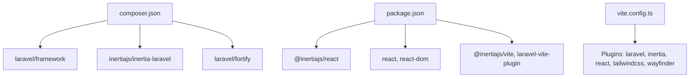

# System Design

<cite>
**Referenced Files in This Document**
- [composer.json](file://composer.json)
- [package.json](file://package.json)
- [bootstrap/app.php](file://bootstrap/app.php)
- [routes/web.php](file://routes/web.php)
- [routes/settings.php](file://routes/settings.php)
- [config/inertia.php](file://config/inertia.php)
- [config/auth.php](file://config/auth.php)
- [config/database.php](file://config/database.php)
- [vite.config.ts](file://vite.config.ts)
- [app/Http/Middleware/HandleInertiaRequests.php](file://app/Http/Middleware/HandleInertiaRequests.php)
- [app/Http/Controllers/Controller.php](file://app/Http/Controllers/Controller.php)
- [app/Http/Controllers/Settings/ProfileController.php](file://app/Http/Controllers/Settings/ProfileController.php)
- [app/Http/Controllers/Settings/SecurityController.php](file://app/Http/Controllers/Settings/SecurityController.php)
- [app/Models/User.php](file://app/Models/User.php)
- [resources/views/app.blade.php](file://resources/views/app.blade.php)
- [resources/js/app.tsx](file://resources/js/app.tsx)
- [resources/js/pages/dashboard.tsx](file://resources/js/pages/dashboard.tsx)
- [resources/js/pages/welcome.tsx](file://resources/js/pages/welcome.tsx)
</cite>

## Table of Contents
1. [Introduction](#introduction)
2. [Project Structure](#project-structure)
3. [Core Components](#core-components)
4. [Architecture Overview](#architecture-overview)
5. [Detailed Component Analysis](#detailed-component-analysis)
6. [Dependency Analysis](#dependency-analysis)
7. [Performance Considerations](#performance-considerations)
8. [Troubleshooting Guide](#troubleshooting-guide)
9. [Conclusion](#conclusion)

## Introduction
This document describes the system design of the SmartExam web application, a modern full-stack platform built with Laravel on the backend and React on the frontend, bridged by Inertia.js. The application follows a hybrid MVC pattern where Laravel handles routing, middleware, and server-side rendering, while React components deliver interactive user experiences. It integrates authentication and security features via Laravel Fortify, supports passkeys and two-factor authentication, and uses a flexible database configuration supporting SQLite, MySQL, MariaDB, PostgreSQL, and SQL Server. The system emphasizes separation of concerns, efficient data flow, and scalable deployment architecture.

## Project Structure
The project is organized into clear layers:
- Backend: Laravel application with routing, middleware, controllers, models, and configuration.
- Frontend: React application with TypeScript, Vite build pipeline, and Tailwind CSS.
- Bridge: Inertia.js enables seamless server-to-client rendering and state sharing.
- Assets: Blade templates render the root HTML and inject Vite bundles.

**Diagram sources**
- [routes/web.php:1-26](file://routes/web.php#L1-L26)
- [routes/settings.php:1-41](file://routes/settings.php#L1-L41)
- [app/Http/Controllers/Settings/ProfileController.php:1-63](file://app/Http/Controllers/Settings/ProfileController.php#L1-L63)
- [app/Http/Controllers/Settings/SecurityController.php:1-73](file://app/Http/Controllers/Settings/SecurityController.php#L1-L73)
- [app/Http/Middleware/HandleInertiaRequests.php:1-48](file://app/Http/Middleware/HandleInertiaRequests.php#L1-L48)
- [config/inertia.php:1-71](file://config/inertia.php#L1-L71)
- [config/auth.php:1-118](file://config/auth.php#L1-L118)
- [config/database.php:1-185](file://config/database.php#L1-L185)
- [vite.config.ts:1-32](file://vite.config.ts#L1-L32)
- [resources/views/app.blade.php:1-49](file://resources/views/app.blade.php#L1-L49)
- [resources/js/app.tsx:1-41](file://resources/js/app.tsx#L1-L41)
- [resources/js/pages/dashboard.tsx:1-37](file://resources/js/pages/dashboard.tsx#L1-L37)
- [resources/js/pages/welcome.tsx:1-394](file://resources/js/pages/welcome.tsx#L1-L394)

**Section sources**
- [composer.json:1-120](file://composer.json#L1-L120)
- [package.json:1-77](file://package.json#L1-L77)
- [bootstrap/app.php:1-31](file://bootstrap/app.php#L1-L31)
- [routes/web.php:1-26](file://routes/web.php#L1-L26)
- [routes/settings.php:1-41](file://routes/settings.php#L1-L41)
- [config/inertia.php:1-71](file://config/inertia.php#L1-L71)
- [config/auth.php:1-118](file://config/auth.php#L1-L118)
- [config/database.php:1-185](file://config/database.php#L1-L185)
- [vite.config.ts:1-32](file://vite.config.ts#L1-L32)
- [resources/views/app.blade.php:1-49](file://resources/views/app.blade.php#L1-L49)
- [resources/js/app.tsx:1-41](file://resources/js/app.tsx#L1-L41)
- [resources/js/pages/dashboard.tsx:1-37](file://resources/js/pages/dashboard.tsx#L1-L37)
- [resources/js/pages/welcome.tsx:1-394](file://resources/js/pages/welcome.tsx#L1-L394)

## Core Components
- Laravel application bootstrap configures routing, middleware stack, and exception handling tailored for JSON responses on API routes.
- Inertia middleware sets the root template, manages asset versioning, and shares global props (application name, authenticated user, sidebar state).
- React app bootstrapper initializes Inertia with layout selection logic, theme initialization, and progress indicators.
- Controllers implement the MVC actions for settings and authentication flows, returning Inertia responses or redirects.
- Blade root template renders the HTML shell, injects Vite assets, and hosts the Inertia application container.
- Configuration files define authentication guards, password reset behavior, database connections, and Inertia SSR settings.

Key implementation references:
- Application bootstrap and middleware registration: [bootstrap/app.php:11-30](file://bootstrap/app.php#L11-L30)
- Inertia middleware root view and shared props: [app/Http/Middleware/HandleInertiaRequests.php:8-47](file://app/Http/Middleware/HandleInertiaRequests.php#L8-L47)
- Inertia SSR configuration: [config/inertia.php:18-23](file://config/inertia.php#L18-L23)
- Authentication defaults and providers: [config/auth.php:18-74](file://config/auth.php#L18-L74)
- Database connections and Redis: [config/database.php:33-117](file://config/database.php#L33-L117), [config/database.php:146-182](file://config/database.php#L146-L182)
- Frontend bootstrapping and layout selection: [resources/js/app.tsx:11-37](file://resources/js/app.tsx#L11-L37)
- Blade root template injection: [resources/views/app.blade.php:39-46](file://resources/views/app.blade.php#L39-L46)

**Section sources**
- [bootstrap/app.php:11-30](file://bootstrap/app.php#L11-L30)
- [app/Http/Middleware/HandleInertiaRequests.php:8-47](file://app/Http/Middleware/HandleInertiaRequests.php#L8-L47)
- [config/inertia.php:18-23](file://config/inertia.php#L18-L23)
- [config/auth.php:18-74](file://config/auth.php#L18-L74)
- [config/database.php:33-117](file://config/database.php#L33-L117)
- [config/database.php:146-182](file://config/database.php#L146-L182)
- [resources/js/app.tsx:11-37](file://resources/js/app.tsx#L11-L37)
- [resources/views/app.blade.php:39-46](file://resources/views/app.blade.php#L39-L46)

## Architecture Overview
SmartExam employs a hybrid full-stack architecture:
- Server-side rendering (SSR) powered by Inertia’s SSR engine for initial page loads.
- Progressive enhancement via React components that hydrate after the initial HTML.
- Shared state through Inertia’s shared props and persistent cookies/session.
- Authentication handled by Laravel Fortify with optional passkeys and two-factor support.

**Diagram sources**
- [resources/views/app.blade.php:1-49](file://resources/views/app.blade.php#L1-L49)
- [config/inertia.php:18-23](file://config/inertia.php#L18-L23)
- [bootstrap/app.php:11-30](file://bootstrap/app.php#L11-L30)
- [app/Http/Middleware/HandleInertiaRequests.php:8-47](file://app/Http/Middleware/HandleInertiaRequests.php#L8-L47)
- [app/Http/Controllers/Settings/ProfileController.php:1-63](file://app/Http/Controllers/Settings/ProfileController.php#L1-L63)
- [app/Http/Controllers/Settings/SecurityController.php:1-73](file://app/Http/Controllers/Settings/SecurityController.php#L1-L73)
- [resources/js/app.tsx:1-41](file://resources/js/app.tsx#L1-L41)
- [resources/js/pages/dashboard.tsx:1-37](file://resources/js/pages/dashboard.tsx#L1-L37)
- [resources/js/pages/welcome.tsx:1-394](file://resources/js/pages/welcome.tsx#L1-L394)

## Detailed Component Analysis

### Request-Response Cycle and Data Flow
The request lifecycle combines Laravel routing, controller actions, Inertia middleware, and React rendering:
1. Client requests a route (e.g., home, dashboard, settings).
2. Laravel resolves the route and applies middleware (including Inertia).
3. Controller action prepares data and returns an Inertia response with props.
4. Blade root template renders the initial HTML with injected assets.
5. React hydrates and mounts the appropriate page component with shared props.

**Diagram sources**
- [routes/web.php:5-23](file://routes/web.php#L5-L23)
- [bootstrap/app.php:17-25](file://bootstrap/app.php#L17-L25)
- [app/Http/Middleware/HandleInertiaRequests.php:36-46](file://app/Http/Middleware/HandleInertiaRequests.php#L36-L46)
- [app/Http/Controllers/Settings/ProfileController.php:20-44](file://app/Http/Controllers/Settings/ProfileController.php#L20-L44)
- [app/Http/Controllers/Settings/SecurityController.php:19-57](file://app/Http/Controllers/Settings/SecurityController.php#L19-L57)
- [resources/views/app.blade.php:39-46](file://resources/views/app.blade.php#L39-L46)
- [resources/js/app.tsx:11-37](file://resources/js/app.tsx#L11-L37)

**Section sources**
- [routes/web.php:5-23](file://routes/web.php#L5-L23)
- [bootstrap/app.php:17-25](file://bootstrap/app.php#L17-L25)
- [app/Http/Middleware/HandleInertiaRequests.php:36-46](file://app/Http/Middleware/HandleInertiaRequests.php#L36-L46)
- [app/Http/Controllers/Settings/ProfileController.php:20-44](file://app/Http/Controllers/Settings/ProfileController.php#L20-L44)
- [app/Http/Controllers/Settings/SecurityController.php:19-57](file://app/Http/Controllers/Settings/SecurityController.php#L19-L57)
- [resources/views/app.blade.php:39-46](file://resources/views/app.blade.php#L39-L46)
- [resources/js/app.tsx:11-37](file://resources/js/app.tsx#L11-L37)

### MVC Pattern Implementation
- Model: Eloquent model representing users with authentication traits and attribute casting.
- View: Blade templates render the root HTML and inject Vite assets; React pages act as dynamic views.
- Controller: Handles user-facing actions (profile updates, security settings) and returns Inertia responses.

**Diagram sources**
- [app/Models/User.php:32-52](file://app/Models/User.php#L32-L52)
- [app/Http/Controllers/Settings/ProfileController.php:15-62](file://app/Http/Controllers/Settings/ProfileController.php#L15-L62)
- [app/Http/Controllers/Settings/SecurityController.php:14-72](file://app/Http/Controllers/Settings/SecurityController.php#L14-L72)

**Section sources**
- [app/Models/User.php:32-52](file://app/Models/User.php#L32-L52)
- [app/Http/Controllers/Settings/ProfileController.php:15-62](file://app/Http/Controllers/Settings/ProfileController.php#L15-L62)
- [app/Http/Controllers/Settings/SecurityController.php:14-72](file://app/Http/Controllers/Settings/SecurityController.php#L14-L72)

### State Management Strategies
- Shared props: Inertia middleware shares application-wide data (e.g., authenticated user, app name, sidebar state) with React components.
- Flash messages: Controllers flash transient notifications for UI feedback.
- Persistent preferences: Cookies store user preferences (e.g., appearance, sidebar state) influencing middleware-provided props.
- Component-local state: React components manage UI state (e.g., forms, modals) independently.

References:
- Shared props definition: [app/Http/Middleware/HandleInertiaRequests.php:36-46](file://app/Http/Middleware/HandleInertiaRequests.php#L36-L46)
- Flash usage in controllers: [app/Http/Controllers/Settings/ProfileController.php:41](file://app/Http/Controllers/Settings/ProfileController.php#L41), [app/Http/Controllers/Settings/SecurityController.php:68](file://app/Http/Controllers/Settings/SecurityController.php#L68)
- Cookie-driven sidebar state: [app/Http/Middleware/HandleInertiaRequests.php:44](file://app/Http/Middleware/HandleInertiaRequests.php#L44)

**Section sources**
- [app/Http/Middleware/HandleInertiaRequests.php:36-46](file://app/Http/Middleware/HandleInertiaRequests.php#L36-L46)
- [app/Http/Controllers/Settings/ProfileController.php:41](file://app/Http/Controllers/Settings/ProfileController.php#L41)
- [app/Http/Controllers/Settings/SecurityController.php:68](file://app/Http/Controllers/Settings/SecurityController.php#L68)

### Authentication and Security Integration
- Authentication guard: Session-based guard with Eloquent user provider.
- Password resets: Configurable broker with token table and throttling.
- Two-factor and passkeys: Optional features enabled via Laravel Fortify features and routes.
- Routes: Protected routes enforce authentication and verification; settings routes include password confirmation middleware.

**Diagram sources**
- [config/auth.php:40-74](file://config/auth.php#L40-L74)
- [config/auth.php:95-102](file://config/auth.php#L95-L102)
- [routes/settings.php:10-31](file://routes/settings.php#L10-L31)
- [app/Http/Controllers/Settings/SecurityController.php:19-57](file://app/Http/Controllers/Settings/SecurityController.php#L19-L57)

**Section sources**
- [config/auth.php:40-74](file://config/auth.php#L40-L74)
- [config/auth.php:95-102](file://config/auth.php#L95-L102)
- [routes/settings.php:10-31](file://routes/settings.php#L10-L31)
- [app/Http/Controllers/Settings/SecurityController.php:19-57](file://app/Http/Controllers/Settings/SecurityController.php#L19-L57)

### Database and External Dependencies
- Database connections: SQLite (default), MySQL, MariaDB, PostgreSQL, SQL Server.
- Redis: Configured for caching and queues.
- Frontend toolchain: Vite, React, TypeScript, Tailwind CSS, Inertia plugins.

**Diagram sources**
- [config/database.php:33-117](file://config/database.php#L33-L117)
- [config/database.php:146-182](file://config/database.php#L146-L182)

**Section sources**
- [config/database.php:33-117](file://config/database.php#L33-L117)
- [config/database.php:146-182](file://config/database.php#L146-L182)
- [composer.json:11-18](file://composer.json#L11-L18)
- [package.json:31-66](file://package.json#L31-L66)

## Dependency Analysis
- Laravel core and Inertia bridge: Composer-managed backend dependencies.
- React and tooling: NPM/Node.js managed frontend dependencies.
- Build pipeline: Vite plugin chain integrates Laravel, Inertia, React compiler, Tailwind, and Wayfinder.

**Diagram sources**
- [composer.json:11-18](file://composer.json#L11-L18)
- [package.json:31-66](file://package.json#L31-L66)
- [vite.config.ts:9-31](file://vite.config.ts#L9-L31)

**Section sources**
- [composer.json:11-18](file://composer.json#L11-L18)
- [package.json:31-66](file://package.json#L31-L66)
- [vite.config.ts:9-31](file://vite.config.ts#L9-L31)

## Performance Considerations
- Server-Side Rendering: Enable and tune Inertia SSR to reduce time-to-first-byte and improve SEO.
- Asset Bundling: Use Vite with React compiler and Tailwind for optimized builds.
- Database Optimization: Choose appropriate drivers and indexes; consider Redis for caching hot data.
- Middleware Efficiency: Keep shared props minimal to reduce payload size.
- Progressive Hydration: Ensure React components mount efficiently post-SSR.

[No sources needed since this section provides general guidance]

## Troubleshooting Guide
- SSR Issues: Verify SSR URL and bundle configuration in Inertia settings.
- Authentication Errors: Confirm guard driver, provider model, and password reset broker settings.
- Database Connectivity: Validate connection credentials and driver compatibility.
- Build Failures: Check Vite plugin order and resolve missing peer dependencies.

**Section sources**
- [config/inertia.php:18-23](file://config/inertia.php#L18-L23)
- [config/auth.php:40-74](file://config/auth.php#L40-L74)
- [config/database.php:33-117](file://config/database.php#L33-L117)
- [vite.config.ts:9-31](file://vite.config.ts#L9-L31)

## Conclusion
SmartExam’s architecture blends Laravel’s robust backend capabilities with React’s interactive frontend through Inertia. The hybrid approach delivers fast initial loads via SSR, smooth navigation, and a cohesive developer experience. With modular controllers, shared props, and configurable authentication and database layers, the system supports scalability and maintainability. Proper SSR tuning, asset optimization, and secure middleware configuration ensure reliable performance and user trust.