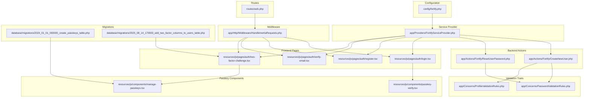
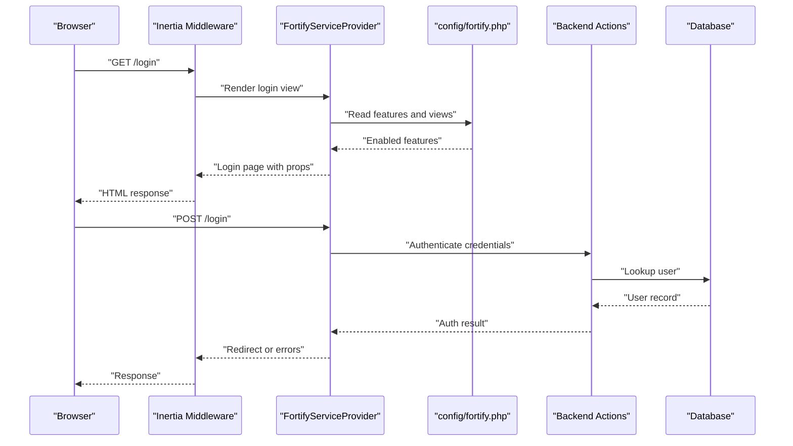
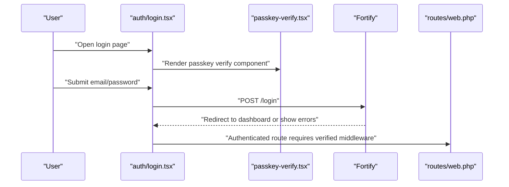
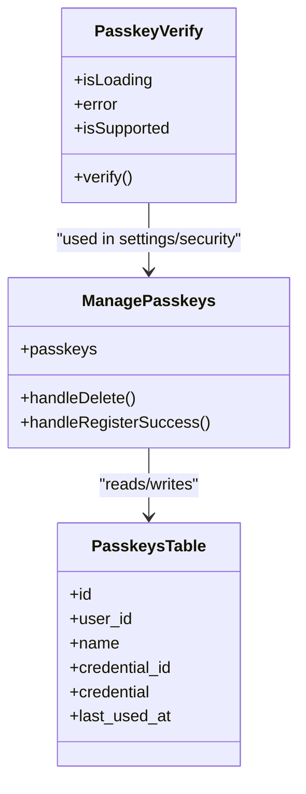
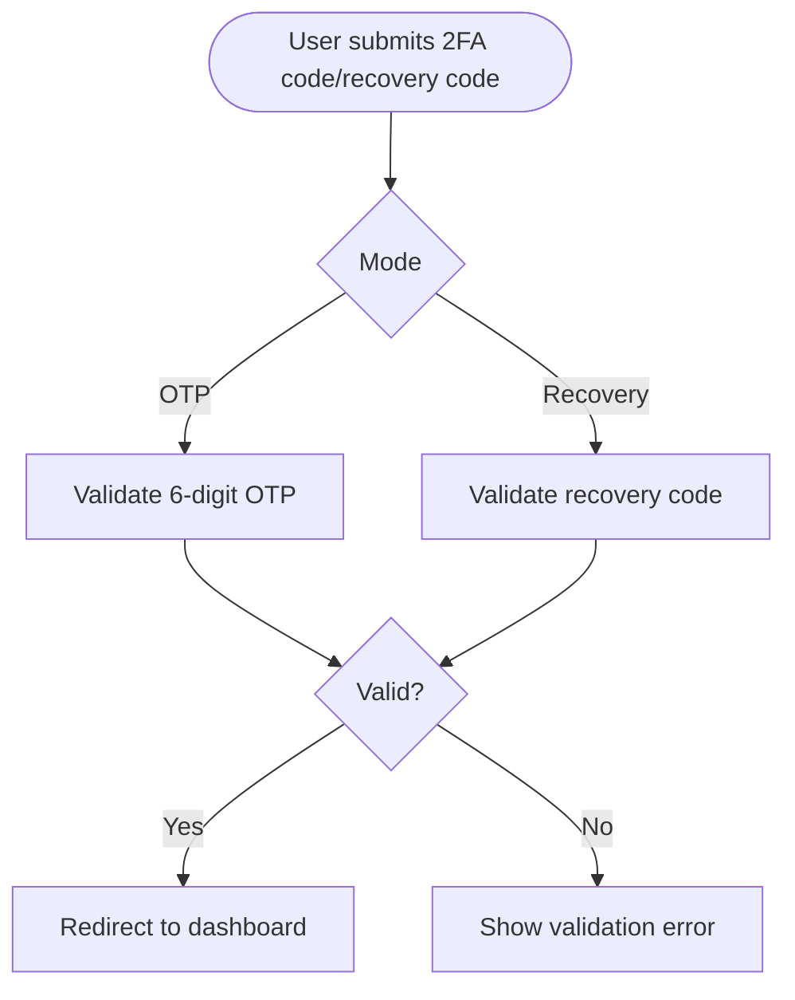
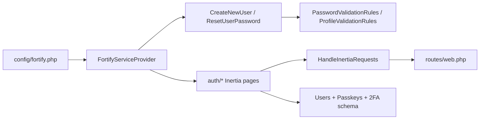

# Authentication Overview

<cite>
**Referenced Files in This Document**
- [config/fortify.php](file://config/fortify.php)
- [app/Providers/FortifyServiceProvider.php](file://app/Providers/FortifyServiceProvider.php)
- [app/Actions/Fortify/CreateNewUser.php](file://app/Actions/Fortify/CreateNewUser.php)
- [app/Actions/Fortify/ResetUserPassword.php](file://app/Actions/Fortify/ResetUserPassword.php)
- [app/Concerns/PasswordValidationRules.php](file://app/Concerns/PasswordValidationRules.php)
- [app/Concerns/ProfileValidationRules.php](file://app/Concerns/ProfileValidationRules.php)
- [resources/js/pages/auth/login.tsx](file://resources/js/pages/auth/login.tsx)
- [resources/js/pages/auth/register.tsx](file://resources/js/pages/auth/register.tsx)
- [resources/js/pages/auth/verify-email.tsx](file://resources/js/pages/auth/verify-email.tsx)
- [resources/js/pages/auth/two-factor-challenge.tsx](file://resources/js/pages/auth/two-factor-challenge.tsx)
- [resources/js/components/passkey-verify.tsx](file://resources/js/components/passkey-verify.tsx)
- [resources/js/components/manage-passkeys.tsx](file://resources/js/components/manage-passkeys.tsx)
- [resources/js/hooks/use-two-factor-auth.ts](file://resources/js/hooks/use-two-factor-auth.ts)
- [routes/web.php](file://routes/web.php)
- [app/Http/Middleware/HandleInertiaRequests.php](file://app/Http/Middleware/HandleInertiaRequests.php)
- [database/migrations/2024_01_01_000000_create_passkeys_table.php](file://database/migrations/2024_01_01_000000_create_passkeys_table.php)
- [database/migrations/2025_08_14_170933_add_two_factor_columns_to_users_table.php](file://database/migrations/2025_08_14_170933_add_two_factor_columns_to_users_table.php)
</cite>

## Table of Contents
1. [Introduction](#introduction)
2. [Project Structure](#project-structure)
3. [Core Components](#core-components)
4. [Architecture Overview](#architecture-overview)
5. [Detailed Component Analysis](#detailed-component-analysis)
6. [Dependency Analysis](#dependency-analysis)
7. [Performance Considerations](#performance-considerations)
8. [Security Considerations and Best Practices](#security-considerations-and-best-practices)
9. [Troubleshooting Guide](#troubleshooting-guide)
10. [Conclusion](#conclusion)

## Introduction
This document provides a comprehensive overview of the SmartExam web application’s authentication system built on Laravel Fortify. It explains how Fortify integrates with Inertia.js to deliver modern authentication flows, including traditional login and registration, email verification, password reset, two-factor authentication (2FA), and passkey/WebAuthn support. The document also details configuration options in fortify.php, the relationship between backend Fortify actions and frontend components, and practical security and performance recommendations.

## Project Structure
Authentication in SmartExam spans configuration, service providers, validation traits, backend actions, database migrations, and frontend pages/components. The Inertia middleware ensures authenticated user data is shared with the frontend, while frontend pages render the user-facing flows.

**Diagram sources**
- [config/fortify.php:1-192](file://config/fortify.php#L1-L192)
- [app/Providers/FortifyServiceProvider.php:1-118](file://app/Providers/FortifyServiceProvider.php#L1-L118)
- [app/Actions/Fortify/CreateNewUser.php:1-34](file://app/Actions/Fortify/CreateNewUser.php#L1-L34)
- [app/Actions/Fortify/ResetUserPassword.php:1-30](file://app/Actions/Fortify/ResetUserPassword.php#L1-L30)
- [app/Concerns/PasswordValidationRules.php:1-30](file://app/Concerns/PasswordValidationRules.php#L1-L30)
- [app/Concerns/ProfileValidationRules.php:1-52](file://app/Concerns/ProfileValidationRules.php#L1-L52)
- [resources/js/pages/auth/login.tsx:1-126](file://resources/js/pages/auth/login.tsx#L1-L126)
- [resources/js/pages/auth/register.tsx:1-121](file://resources/js/pages/auth/register.tsx#L1-L121)
- [resources/js/pages/auth/verify-email.tsx:1-47](file://resources/js/pages/auth/verify-email.tsx#L1-L47)
- [resources/js/pages/auth/two-factor-challenge.tsx:1-134](file://resources/js/pages/auth/two-factor-challenge.tsx#L1-L134)
- [resources/js/components/passkey-verify.tsx:1-75](file://resources/js/components/passkey-verify.tsx#L1-L75)
- [resources/js/components/manage-passkeys.tsx:1-72](file://resources/js/components/manage-passkeys.tsx#L1-L72)
- [app/Http/Middleware/HandleInertiaRequests.php:1-48](file://app/Http/Middleware/HandleInertiaRequests.php#L1-L48)
- [routes/web.php:1-26](file://routes/web.php#L1-L26)
- [database/migrations/2024_01_01_000000_create_passkeys_table.php:1-35](file://database/migrations/2024_01_01_000000_create_passkeys_table.php#L1-L35)
- [database/migrations/2025_08_14_170933_add_two_factor_columns_to_users_table.php:1-35](file://database/migrations/2025_08_14_170933_add_two_factor_columns_to_users_table.php#L1-L35)

**Section sources**
- [config/fortify.php:1-192](file://config/fortify.php#L1-L192)
- [app/Providers/FortifyServiceProvider.php:1-118](file://app/Providers/FortifyServiceProvider.php#L1-L118)
- [routes/web.php:1-26](file://routes/web.php#L1-L26)
- [app/Http/Middleware/HandleInertiaRequests.php:1-48](file://app/Http/Middleware/HandleInertiaRequests.php#L1-L48)

## Core Components
- Fortify configuration: Defines guards, password brokers, username/email fields, lowercase normalization, redirect path, route prefix/domain, middleware, rate limiters, view rendering, passkey settings, and enabled features.
- Fortify service provider: Registers custom actions, configures view rendering via Inertia, and sets up rate limiters for login, 2FA, and passkeys.
- Validation traits: Centralized password and profile validation rules used by creation and reset actions.
- Backend actions: CreateNewUser validates and persists new users; ResetUserPassword validates and updates passwords.
- Frontend pages: Login, registration, email verification, and 2FA challenge pages integrate with Inertia and form submissions.
- Passkey components: Passkey verification and management components integrate with Laravel Passkeys for WebAuthn.
- Middleware: HandleInertiaRequests shares authenticated user data with the frontend.
- Routes: Web routes enforce authentication and verified email middleware for protected areas.

**Section sources**
- [config/fortify.php:1-192](file://config/fortify.php#L1-L192)
- [app/Providers/FortifyServiceProvider.php:1-118](file://app/Providers/FortifyServiceProvider.php#L1-L118)
- [app/Concerns/PasswordValidationRules.php:1-30](file://app/Concerns/PasswordValidationRules.php#L1-L30)
- [app/Concerns/ProfileValidationRules.php:1-52](file://app/Concerns/ProfileValidationRules.php#L1-L52)
- [app/Actions/Fortify/CreateNewUser.php:1-34](file://app/Actions/Fortify/CreateNewUser.php#L1-L34)
- [app/Actions/Fortify/ResetUserPassword.php:1-30](file://app/Actions/Fortify/ResetUserPassword.php#L1-L30)
- [resources/js/pages/auth/login.tsx:1-126](file://resources/js/pages/auth/login.tsx#L1-L126)
- [resources/js/pages/auth/register.tsx:1-121](file://resources/js/pages/auth/register.tsx#L1-L121)
- [resources/js/pages/auth/verify-email.tsx:1-47](file://resources/js/pages/auth/verify-email.tsx#L1-L47)
- [resources/js/pages/auth/two-factor-challenge.tsx:1-134](file://resources/js/pages/auth/two-factor-challenge.tsx#L1-L134)
- [resources/js/components/passkey-verify.tsx:1-75](file://resources/js/components/passkey-verify.tsx#L1-L75)
- [resources/js/components/manage-passkeys.tsx:1-72](file://resources/js/components/manage-passkeys.tsx#L1-L72)
- [app/Http/Middleware/HandleInertiaRequests.php:1-48](file://app/Http/Middleware/HandleInertiaRequests.php#L1-L48)
- [routes/web.php:1-26](file://routes/web.php#L1-L26)

## Architecture Overview
SmartExam uses Laravel Fortify to centralize authentication logic and Inertia.js to render frontend pages without a separate SPA. The flow begins with configuration enabling desired features, followed by service provider wiring for views and rate limiting. Backend actions enforce validation and persistence, while frontend pages submit forms to Fortify endpoints. Optional features like 2FA and passkeys integrate seamlessly through dedicated pages and components.

**Diagram sources**
- [config/fortify.php:1-192](file://config/fortify.php#L1-L192)
- [app/Providers/FortifyServiceProvider.php:1-118](file://app/Providers/FortifyServiceProvider.php#L1-L118)
- [app/Http/Middleware/HandleInertiaRequests.php:1-48](file://app/Http/Middleware/HandleInertiaRequests.php#L1-L48)

## Detailed Component Analysis

### Fortify Configuration (config/fortify.php)
- Guard and password broker: Aligns Fortify with the application’s auth configuration.
- Username/email: Defines the “username” field and email field names.
- Lowercase usernames: Ensures normalized storage for case-sensitive systems.
- Home path: Redirect destination after successful auth or password reset.
- Prefix/domain/middleware: Controls route registration scope and middleware stack.
- Rate limiters: Names for login, 2FA, and passkeys throttling policies.
- Views: Enables Fortify’s default view routes for authentication pages.
- Passkeys: Relying party ID, allowed origins, user handle secret, and timeout.
- Features: Toggles registration, email verification, 2FA (with confirmation), and passkeys (with password confirmation).

**Section sources**
- [config/fortify.php:1-192](file://config/fortify.php#L1-L192)

### Fortify Service Provider (app/Providers/FortifyServiceProvider.php)
- Action configuration: Registers CreateNewUser and ResetUserPassword actions.
- View configuration: Renders Inertia pages for login, reset password, request reset link, verify email, register, 2FA challenge, and password confirmation.
- Rate limiting: Implements login throttling keyed by normalized username and IP; 2FA throttling keyed by session login ID; passkeys throttling keyed by credential ID or session ID and IP.

```mermaid
flowchart TD
Start(["boot()"]) --> Actions["configureActions()"]
Start --> Views["configureViews()"]
Start --> Limits["configureRateLimiting()"]
Actions --> CreateUser["createUsersUsing(CreateNewUser)"]
Actions --> ResetPwd["resetUserPasswordsUsing(ResetUserPassword)"]
Views --> LoginPage["loginView -> auth/login"]
Views --> ResetPage["resetPasswordView -> auth/reset-password"]
Views --> ForgotPage["requestPasswordResetLinkView -> auth/forgot-password"]
Views --> VerifyPage["verifyEmailView -> auth/verify-email"]
Views --> RegisterPage["registerView -> auth/register"]
Views --> ChallengePage["twoFactorChallengeView -> auth/two-factor-challenge"]
Views --> ConfirmPage["confirmPasswordView -> auth/confirm-password"]
Limits --> LoginLimit["limiter 'login' by normalized username|IP"]
Limits --> TwoFactorLimit["limiter 'two-factor' by session login ID"]
Limits --> PasskeyLimit["limiter 'passkeys' by credential.id or session|IP"]
```

**Diagram sources**
- [app/Providers/FortifyServiceProvider.php:1-118](file://app/Providers/FortifyServiceProvider.php#L1-L118)

**Section sources**
- [app/Providers/FortifyServiceProvider.php:1-118](file://app/Providers/FortifyServiceProvider.php#L1-L118)

### Validation Traits (app/Concerns/)
- PasswordValidationRules: Provides password validation rules and current password rules.
- ProfileValidationRules: Provides name and email validation rules, including uniqueness constraints.

**Section sources**
- [app/Concerns/PasswordValidationRules.php:1-30](file://app/Concerns/PasswordValidationRules.php#L1-L30)
- [app/Concerns/ProfileValidationRules.php:1-52](file://app/Concerns/ProfileValidationRules.php#L1-L52)

### Backend Actions (app/Actions/Fortify/)
- CreateNewUser: Validates profile and password rules, then creates a new user.
- ResetUserPassword: Validates new password rules and updates the user’s password.

**Section sources**
- [app/Actions/Fortify/CreateNewUser.php:1-34](file://app/Actions/Fortify/CreateNewUser.php#L1-L34)
- [app/Actions/Fortify/ResetUserPassword.php:1-30](file://app/Actions/Fortify/ResetUserPassword.php#L1-L30)

### Frontend Authentication Pages
- Login page: Presents email, password, remember me, and optional “forgot password” link; integrates passkey verification component.
- Registration page: Collects name, email, password, and confirmation; displays password rules.
- Email verification page: Allows resending verification email and logout.
- Two-factor challenge page: Accepts 6-digit OTP or recovery code; toggles between modes.

**Diagram sources**
- [resources/js/pages/auth/login.tsx:1-126](file://resources/js/pages/auth/login.tsx#L1-L126)
- [resources/js/components/passkey-verify.tsx:1-75](file://resources/js/components/passkey-verify.tsx#L1-L75)
- [routes/web.php:1-26](file://routes/web.php#L1-L26)

**Section sources**
- [resources/js/pages/auth/login.tsx:1-126](file://resources/js/pages/auth/login.tsx#L1-L126)
- [resources/js/pages/auth/register.tsx:1-121](file://resources/js/pages/auth/register.tsx#L1-L121)
- [resources/js/pages/auth/verify-email.tsx:1-47](file://resources/js/pages/auth/verify-email.tsx#L1-L47)
- [resources/js/pages/auth/two-factor-challenge.tsx:1-134](file://resources/js/pages/auth/two-factor-challenge.tsx#L1-L134)

### Passkey/WebAuthn Support
- Passkey verification component: Uses Laravel Passkeys React hook to initiate WebAuthn authentication and redirects upon success.
- Manage passkeys component: Lists existing passkeys and provides registration UI; supports deletion and reload on success.
- Database schema: Passkeys table stores credential identifiers, JSON-formatted credential data, and last used timestamps.

**Diagram sources**
- [resources/js/components/passkey-verify.tsx:1-75](file://resources/js/components/passkey-verify.tsx#L1-L75)
- [resources/js/components/manage-passkeys.tsx:1-72](file://resources/js/components/manage-passkeys.tsx#L1-L72)
- [database/migrations/2024_01_01_000000_create_passkeys_table.php:1-35](file://database/migrations/2024_01_01_000000_create_passkeys_table.php#L1-L35)

**Section sources**
- [resources/js/components/passkey-verify.tsx:1-75](file://resources/js/components/passkey-verify.tsx#L1-L75)
- [resources/js/components/manage-passkeys.tsx:1-72](file://resources/js/components/manage-passkeys.tsx#L1-L72)
- [database/migrations/2024_01_01_000000_create_passkeys_table.php:1-35](file://database/migrations/2024_01_01_000000_create_passkeys_table.php#L1-L35)

### Two-Factor Authentication (2FA)
- Two-factor challenge page: Accepts either OTP or recovery code; toggles between modes dynamically.
- Hook for 2FA: Fetches QR code SVG, manual setup key, and recovery codes; manages state and clears errors/setup data.
- Database schema: Adds two-factor secret, recovery codes, and confirmation timestamp to users table.

**Diagram sources**
- [resources/js/pages/auth/two-factor-challenge.tsx:1-134](file://resources/js/pages/auth/two-factor-challenge.tsx#L1-L134)
- [resources/js/hooks/use-two-factor-auth.ts:1-112](file://resources/js/hooks/use-two-factor-auth.ts#L1-L112)
- [database/migrations/2025_08_14_170933_add_two_factor_columns_to_users_table.php:1-35](file://database/migrations/2025_08_14_170933_add_two_factor_columns_to_users_table.php#L1-L35)

**Section sources**
- [resources/js/pages/auth/two-factor-challenge.tsx:1-134](file://resources/js/pages/auth/two-factor-challenge.tsx#L1-L134)
- [resources/js/hooks/use-two-factor-auth.ts:1-112](file://resources/js/hooks/use-two-factor-auth.ts#L1-L112)
- [database/migrations/2025_08_14_170933_add_two_factor_columns_to_users_table.php:1-35](file://database/migrations/2025_08_14_170933_add_two_factor_columns_to_users_table.php#L1-L35)

## Dependency Analysis
- Fortify depends on configuration for features, rate limiters, and view rendering.
- Service provider depends on actions and Inertia for rendering.
- Actions depend on validation traits and Eloquent models.
- Frontend pages depend on Inertia middleware and route helpers.
- Routes depend on authentication and verified middleware for protected areas.

**Diagram sources**
- [config/fortify.php:1-192](file://config/fortify.php#L1-L192)
- [app/Providers/FortifyServiceProvider.php:1-118](file://app/Providers/FortifyServiceProvider.php#L1-L118)
- [app/Concerns/PasswordValidationRules.php:1-30](file://app/Concerns/PasswordValidationRules.php#L1-L30)
- [app/Concerns/ProfileValidationRules.php:1-52](file://app/Concerns/ProfileValidationRules.php#L1-L52)
- [resources/js/pages/auth/login.tsx:1-126](file://resources/js/pages/auth/login.tsx#L1-L126)
- [app/Http/Middleware/HandleInertiaRequests.php:1-48](file://app/Http/Middleware/HandleInertiaRequests.php#L1-L48)
- [routes/web.php:1-26](file://routes/web.php#L1-L26)
- [database/migrations/2024_01_01_000000_create_passkeys_table.php:1-35](file://database/migrations/2024_01_01_000000_create_passkeys_table.php#L1-L35)
- [database/migrations/2025_08_14_170933_add_two_factor_columns_to_users_table.php:1-35](file://database/migrations/2025_08_14_170933_add_two_factor_columns_to_users_table.php#L1-L35)

**Section sources**
- [config/fortify.php:1-192](file://config/fortify.php#L1-L192)
- [app/Providers/FortifyServiceProvider.php:1-118](file://app/Providers/FortifyServiceProvider.php#L1-L118)
- [routes/web.php:1-26](file://routes/web.php#L1-L26)

## Performance Considerations
- Rate limiting: Default throttling reduces brute-force attempts; adjust limits per environment needs.
- Normalization: Lowercasing usernames avoids redundant entries and improves lookup performance.
- Passkeys: Throttling by credential ID or session reduces repeated attempts.
- 2FA: Session-scoped throttling prevents rapid retries after partial success.
- Rendering: Inertia minimizes round-trips by sharing initial props via middleware.

[No sources needed since this section provides general guidance]

## Security Considerations and Best Practices
- Enforce verified email: Protect sensitive routes with verified middleware to ensure users have confirmed their email.
- Strong password policy: Use centralized validation rules to enforce complexity and confirmation.
- Secure passkey secrets: Store relying party ID and allowed origins according to deployment domain; keep user handle secret strong.
- 2FA confirmation: Enable password confirmation for sensitive operations to reduce risk.
- Session hygiene: Clear sensitive data after successful authentication and avoid storing secrets client-side.
- CORS and origins: Ensure allowed origins match production domains to prevent WebAuthn misuse.
- Recovery codes: Educate users to store recovery codes securely and rotate passkeys periodically.

[No sources needed since this section provides general guidance]

## Troubleshooting Guide
- Login throttled: If login fails repeatedly, check normalized username/IP key and increase rate limit temporarily for legitimate users.
- 2FA failures: Verify OTP length and recovery code validity; ensure session login ID is present for throttling.
- Passkey errors: Confirm browser support, correct relying party ID, allowed origins, and user handle secret; inspect credential ID uniqueness.
- Email verification: Ensure verification link resend works and user receives email; confirm middleware applies to protected routes.
- Frontend redirects: Verify Inertia root view and shared auth data; ensure routes point to correct destinations.

**Section sources**
- [app/Providers/FortifyServiceProvider.php:95-116](file://app/Providers/FortifyServiceProvider.php#L95-L116)
- [config/fortify.php:117-125](file://config/fortify.php#L117-L125)
- [routes/web.php:21-23](file://routes/web.php#L21-L23)

## Conclusion
SmartExam’s authentication system leverages Laravel Fortify for robust, configurable authentication with Inertia.js for a seamless frontend experience. The configuration enables modern features like passkeys and 2FA, while service provider wiring ensures consistent view rendering and rate limiting. Validation traits centralize security rules, and database migrations support advanced capabilities such as passkey storage and 2FA columns. Following the best practices and troubleshooting tips outlined here will help maintain a secure, performant, and user-friendly authentication experience.