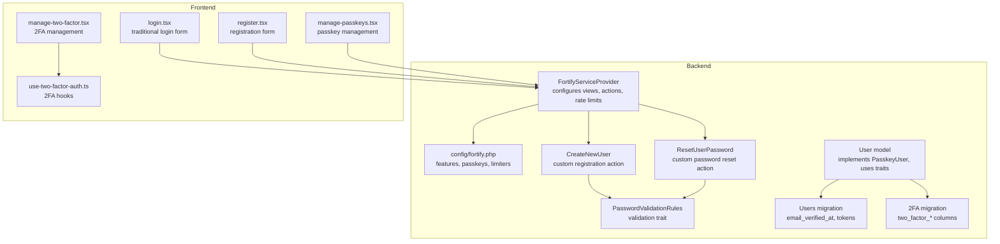
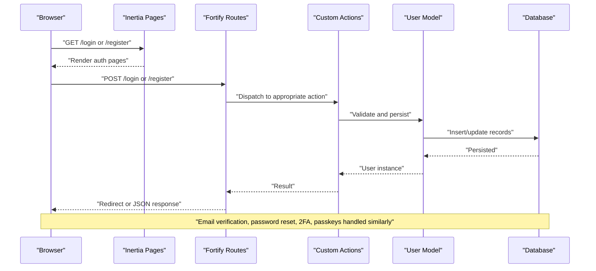
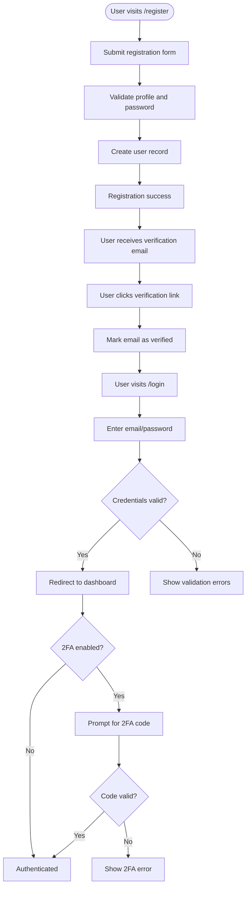
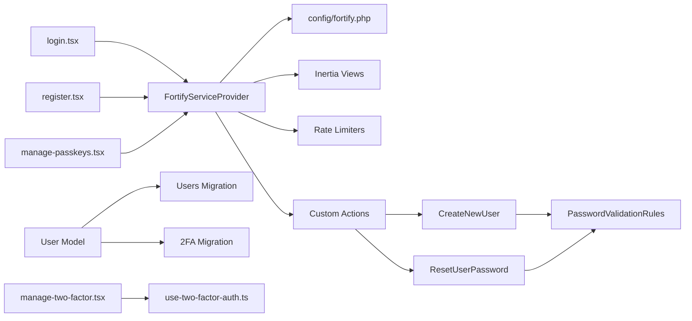

# Authentication System

<cite>
**Referenced Files in This Document**
- [FortifyServiceProvider.php](file://app/Providers/FortifyServiceProvider.php)
- [fortify.php](file://config/fortify.php)
- [CreateNewUser.php](file://app/Actions/Fortify/CreateNewUser.php)
- [ResetUserPassword.php](file://app/Actions/Fortify/ResetUserPassword.php)
- [PasswordValidationRules.php](file://app/Concerns/PasswordValidationRules.php)
- [User.php](file://app/Models/User.php)
- [0001_01_01_000000_create_users_table.php](file://database/migrations/0001_01_01_000000_create_users_table.php)
- [2025_08_14_170933_add_two_factor_columns_to_users_table.php](file://database/migrations/2025_08_14_170933_add_two_factor_columns_to_users_table.php)
- [login.tsx](file://resources/js/pages/auth/login.tsx)
- [register.tsx](file://resources/js/pages/auth/register.tsx)
- [manage-passkeys.tsx](file://resources/js/components/manage-passkeys.tsx)
- [manage-two-factor.tsx](file://resources/js/components/manage-two-factor.tsx)
- [use-two-factor-auth.ts](file://resources/js/hooks/use-two-factor-auth.ts)
- [web.php](file://routes/web.php)
- [HandleInertiaRequests.php](file://app/Http/Middleware/HandleInertiaRequests.php)
</cite>

## Table of Contents
1. [Introduction](#introduction)
2. [Project Structure](#project-structure)
3. [Core Components](#core-components)
4. [Architecture Overview](#architecture-overview)
5. [Detailed Component Analysis](#detailed-component-analysis)
6. [Dependency Analysis](#dependency-analysis)
7. [Performance Considerations](#performance-considerations)
8. [Troubleshooting Guide](#troubleshooting-guide)
9. [Conclusion](#conclusion)

## Introduction
This document describes the SmartExam web application's authentication system built on Laravel Fortify. It covers modern authentication features including traditional login/register, email verification, password reset, two-factor authentication (2FA), and passkey/WebAuthn support. The documentation explains the end-to-end authentication flow from user registration through email verification to secure login with optional 2FA, details custom Fortify actions, password validation rules, and security middleware. Implementation specifics for each authentication method, configuration options, and security best practices are included, along with code references demonstrating setup, validation rules, and frontend integration.

## Project Structure
The authentication system spans backend service providers, configuration, Eloquent models, migrations, and frontend pages/components. Key areas:
- Backend: Fortify service provider, custom actions, model traits, and configuration
- Database: Users table and two-factor columns migration
- Frontend: Inertia pages for login/register and components for passkeys/2FA management

**Diagram sources**
- [FortifyServiceProvider.php:33-117](file://app/Providers/FortifyServiceProvider.php#L33-L117)
- [fortify.php:169-189](file://config/fortify.php#L169-L189)
- [CreateNewUser.php:11-33](file://app/Actions/Fortify/CreateNewUser.php#L11-L33)
- [ResetUserPassword.php:10-29](file://app/Actions/Fortify/ResetUserPassword.php#L10-L29)
- [PasswordValidationRules.php:8-29](file://app/Concerns/PasswordValidationRules.php#L8-L29)
- [User.php:32-52](file://app/Models/User.php#L32-L52)
- [0001_01_01_000000_create_users_table.php:14-37](file://database/migrations/0001_01_01_000000_create_users_table.php#L14-L37)
- [2025_08_14_170933_add_two_factor_columns_to_users_table.php:14-18](file://database/migrations/2025_08_14_170933_add_two_factor_columns_to_users_table.php#L14-L18)
- [login.tsx:24-120](file://resources/js/pages/auth/login.tsx#L24-L120)
- [register.tsx:16-115](file://resources/js/pages/auth/register.tsx#L16-L115)
- [manage-passkeys.tsx:28-71](file://resources/js/components/manage-passkeys.tsx#L28-L71)
- [manage-two-factor.tsx:17-126](file://resources/js/components/manage-two-factor.tsx#L17-L126)
- [use-two-factor-auth.ts:22-111](file://resources/js/hooks/use-two-factor-auth.ts#L22-L111)

**Section sources**
- [FortifyServiceProvider.php:33-117](file://app/Providers/FortifyServiceProvider.php#L33-L117)
- [fortify.php:169-189](file://config/fortify.php#L169-L189)
- [User.php:32-52](file://app/Models/User.php#L32-L52)
- [0001_01_01_000000_create_users_table.php:14-37](file://database/migrations/0001_01_01_000000_create_users_table.php#L14-L37)
- [2025_08_14_170933_add_two_factor_columns_to_users_table.php:14-18](file://database/migrations/2025_08_14_170933_add_two_factor_columns_to_users_table.php#L14-L18)
- [login.tsx:24-120](file://resources/js/pages/auth/login.tsx#L24-L120)
- [register.tsx:16-115](file://resources/js/pages/auth/register.tsx#L16-L115)
- [manage-passkeys.tsx:28-71](file://resources/js/components/manage-passkeys.tsx#L28-L71)
- [manage-two-factor.tsx:17-126](file://resources/js/components/manage-two-factor.tsx#L17-L126)
- [use-two-factor-auth.ts:22-111](file://resources/js/hooks/use-two-factor-auth.ts#L22-L111)

## Core Components
- Fortify service provider: Registers custom actions, configures views for login/register/reset/email verification/two-factor challenge, and sets rate limiters for login, two-factor, and passkeys.
- Fortify configuration: Enables/disables features (registration, email verification, 2FA, passkeys), sets username/email fields, home redirect, middleware, and passkey settings (Relying Party ID, allowed origins, timeout).
- Custom actions:
  - CreateNewUser: Validates profile and password via shared validation rules, then creates a user record.
  - ResetUserPassword: Validates new password using shared rules and updates the user.
- Validation rules: Shared trait provides password and current password validation arrays.
- User model: Implements PasskeyUser interface and uses Fortify traits for passkey and two-factor capabilities; casts include email_verified_at and password hashing.
- Migrations: Users table with email verification and sessions; separate migration adds two-factor columns.

**Section sources**
- [FortifyServiceProvider.php:43-117](file://app/Providers/FortifyServiceProvider.php#L43-L117)
- [fortify.php:18-191](file://config/fortify.php#L18-L191)
- [CreateNewUser.php:11-33](file://app/Actions/Fortify/CreateNewUser.php#L11-L33)
- [ResetUserPassword.php:10-29](file://app/Actions/Fortify/ResetUserPassword.php#L10-L29)
- [PasswordValidationRules.php:8-29](file://app/Concerns/PasswordValidationRules.php#L8-L29)
- [User.php:32-52](file://app/Models/User.php#L32-L52)
- [0001_01_01_000000_create_users_table.php:14-37](file://database/migrations/0001_01_01_000000_create_users_table.php#L14-L37)
- [2025_08_14_170933_add_two_factor_columns_to_users_table.php:14-18](file://database/migrations/2025_08_14_170933_add_two_factor_columns_to_users_table.php#L14-L18)

## Architecture Overview
The authentication architecture integrates Laravel Fortify with Inertia for a seamless SPA-like experience. The flow begins at the frontend pages, which submit forms handled by Fortify routes. Fortify invokes custom actions for creation/reset and applies validation rules. The User model leverages Fortify traits for passkey and two-factor capabilities. Rate limiting protects sensitive endpoints, and middleware ensures authenticated and verified access to protected routes.

**Diagram sources**
- [login.tsx:24-120](file://resources/js/pages/auth/login.tsx#L24-L120)
- [register.tsx:16-115](file://resources/js/pages/auth/register.tsx#L16-L115)
- [FortifyServiceProvider.php:43-117](file://app/Providers/FortifyServiceProvider.php#L43-L117)
- [CreateNewUser.php:20-32](file://app/Actions/Fortify/CreateNewUser.php#L20-L32)
- [ResetUserPassword.php:19-28](file://app/Actions/Fortify/ResetUserPassword.php#L19-L28)
- [User.php:32-52](file://app/Models/User.php#L32-L52)

## Detailed Component Analysis

### Fortify Service Provider
- Configures custom actions for user creation and password reset.
- Provides Inertia views for login, registration, password reset, email verification, two-factor challenge, and password confirmation.
- Sets rate limiters for login, two-factor challenge, and passkeys using request-scoped keys.
- Uses Laravel\Fortify\Features to selectively enable capabilities.

Implementation highlights:
- Action registration: [FortifyServiceProvider.php:45-48](file://app/Providers/FortifyServiceProvider.php#L45-L48)
- View registration: [FortifyServiceProvider.php:56-90](file://app/Providers/FortifyServiceProvider.php#L56-L90)
- Rate limiters: [FortifyServiceProvider.php:98-115](file://app/Providers/FortifyServiceProvider.php#L98-L115)

**Section sources**
- [FortifyServiceProvider.php:43-117](file://app/Providers/FortifyServiceProvider.php#L43-L117)

### Fortify Configuration
- Guard and password broker: [fortify.php:18-31](file://config/fortify.php#L18-L31)
- Username/email fields and case normalization: [fortify.php:48-63](file://config/fortify.php#L48-L63)
- Redirect after auth and route prefix/domain/middleware: [fortify.php:76-104](file://config/fortify.php#L76-L104)
- Rate limiters: [fortify.php:117-125](file://config/fortify.php#L117-L125)
- Features: registration, email verification, two-factor (with confirmation and password confirmation), passkeys (with password confirmation): [fortify.php:169-189](file://config/fortify.php#L169-L189)
- Passkeys settings: relying party ID, allowed origins, user handle secret, timeout: [fortify.php:150-155](file://config/fortify.php#L150-L155)

**Section sources**
- [fortify.php:18-191](file://config/fortify.php#L18-L191)

### Custom Registration Action (CreateNewUser)
- Validates profile fields and password using shared rules.
- Creates a new user with hashed password.
- Returns the persisted User instance.

Key points:
- Validation composition: [CreateNewUser.php:22-25](file://app/Actions/Fortify/CreateNewUser.php#L22-L25)
- Creation logic: [CreateNewUser.php:27-32](file://app/Actions/Fortify/CreateNewUser.php#L27-L32)

**Section sources**
- [CreateNewUser.php:11-33](file://app/Actions/Fortify/CreateNewUser.php#L11-L33)
- [PasswordValidationRules.php:15-18](file://app/Concerns/PasswordValidationRules.php#L15-L18)

### Password Reset Action (ResetUserPassword)
- Validates new password using shared rules.
- Forces password update on the user instance.

Key points:
- Validation: [ResetUserPassword.php:21-23](file://app/Actions/Fortify/ResetUserPassword.php#L21-L23)
- Persistence: [ResetUserPassword.php:25-27](file://app/Actions/Fortify/ResetUserPassword.php#L25-L27)

**Section sources**
- [ResetUserPassword.php:10-29](file://app/Actions/Fortify/ResetUserPassword.php#L10-L29)
- [PasswordValidationRules.php:15-18](file://app/Concerns/PasswordValidationRules.php#L15-L18)

### Password Validation Rules
- Provides reusable password validation rules and current password validation rules.
- Password rules include required, string, default Laravel rules, and confirmation.

Key points:
- Password rules: [PasswordValidationRules.php:15-18](file://app/Concerns/PasswordValidationRules.php#L15-L18)
- Current password rules: [PasswordValidationRules.php:25-28](file://app/Concerns/PasswordValidationRules.php#L25-L28)

**Section sources**
- [PasswordValidationRules.php:8-29](file://app/Concerns/PasswordValidationRules.php#L8-L29)

### User Model and Traits
- Implements PasskeyUser interface and uses Fortify traits for passkey and two-factor capabilities.
- Casts include email_verified_at and password hashing.
- Two-factor columns are defined in a dedicated migration.

Key points:
- Traits and interface: [User.php:35](file://app/Models/User.php#L35)
- Casts: [User.php:42-51](file://app/Models/User.php#L42-L51)
- Two-factor columns: [2025_08_14_170933_add_two_factor_columns_to_users_table.php:14-18](file://database/migrations/2025_08_14_170933_add_two_factor_columns_to_users_table.php#L14-L18)

**Section sources**
- [User.php:32-52](file://app/Models/User.php#L32-L52)
- [2025_08_14_170933_add_two_factor_columns_to_users_table.php:14-18](file://database/migrations/2025_08_14_170933_add_two_factor_columns_to_users_table.php#L14-L18)

### Database Migrations
- Users table includes name, email (unique), email_verified_at, password, rememberToken, timestamps, plus password_reset_tokens and sessions tables.
- Two-factor columns (secret, recovery codes, confirmed timestamp) are added via a separate migration.

Key points:
- Users and tokens/sessions: [0001_01_01_000000_create_users_table.php:14-37](file://database/migrations/0001_01_01_000000_create_users_table.php#L14-L37)
- Two-factor columns: [2025_08_14_170933_add_two_factor_columns_to_users_table.php:14-18](file://database/migrations/2025_08_14_170933_add_two_factor_columns_to_users_table.php#L14-L18)

**Section sources**
- [0001_01_01_000000_create_users_table.php:14-37](file://database/migrations/0001_01_01_000000_create_users_table.php#L14-L37)
- [2025_08_14_170933_add_two_factor_columns_to_users_table.php:14-18](file://database/migrations/2025_08_14_170933_add_two_factor_columns_to_users_table.php#L14-L18)

### Frontend Authentication Pages
- Login page: Renders email, password, remember me, forgot password link, and optional registration link. Integrates passkey verification component.
- Registration page: Renders name, email, password, and password confirmation with shared password rules prop.

Key points:
- Login page: [login.tsx:24-120](file://resources/js/pages/auth/login.tsx#L24-L120)
- Registration page: [register.tsx:16-115](file://resources/js/pages/auth/register.tsx#L16-L115)

**Section sources**
- [login.tsx:24-120](file://resources/js/pages/auth/login.tsx#L24-L120)
- [register.tsx:16-115](file://resources/js/pages/auth/register.tsx#L16-L115)

### Passkeys/WebAuthn Management
- ManagePasskeys component displays passkeys, supports registration, and deletion via controller actions.
- Passkeys rely on Fortify passkey features and rate limiting.

Key points:
- Manage component: [manage-passkeys.tsx:28-71](file://resources/js/components/manage-passkeys.tsx#L28-L71)
- Fortify passkeys configuration: [fortify.php:150-155](file://config/fortify.php#L150-L155)

**Section sources**
- [manage-passkeys.tsx:28-71](file://resources/js/components/manage-passkeys.tsx#L28-L71)
- [fortify.php:150-155](file://config/fortify.php#L150-L155)

### Two-Factor Authentication Management
- ManageTwoFactor component enables/disables 2FA, shows QR code and manual setup key, and manages recovery codes.
- useTwoFactorAuth hook fetches QR code SVG, manual setup key, and recovery codes via HTTP requests.

Key points:
- Manage component: [manage-two-factor.tsx:17-126](file://resources/js/components/manage-two-factor.tsx#L17-L126)
- Hook implementation: [use-two-factor-auth.ts:22-111](file://resources/js/hooks/use-two-factor-auth.ts#L22-L111)

**Section sources**
- [manage-two-factor.tsx:17-126](file://resources/js/components/manage-two-factor.tsx#L17-L126)
- [use-two-factor-auth.ts:22-111](file://resources/js/hooks/use-two-factor-auth.ts#L22-L111)

### Authentication Flow: Registration → Email Verification → Login with Optional 2FA

**Diagram sources**
- [register.tsx:16-115](file://resources/js/pages/auth/register.tsx#L16-L115)
- [CreateNewUser.php:22-32](file://app/Actions/Fortify/CreateNewUser.php#L22-L32)
- [login.tsx:24-120](file://resources/js/pages/auth/login.tsx#L24-L120)
- [FortifyServiceProvider.php:56-90](file://app/Providers/FortifyServiceProvider.php#L56-L90)
- [manage-two-factor.tsx:17-126](file://resources/js/components/manage-two-factor.tsx#L17-L126)

## Dependency Analysis
The authentication system exhibits clear separation of concerns:
- Fortify service provider orchestrates configuration, views, and rate limiting.
- Custom actions encapsulate validation and persistence logic.
- Validation rules are centralized in a shared trait.
- The User model integrates Fortify traits and database columns.
- Frontend pages/components integrate with Inertia and Fortify features.

**Diagram sources**
- [FortifyServiceProvider.php:43-117](file://app/Providers/FortifyServiceProvider.php#L43-L117)
- [fortify.php:169-189](file://config/fortify.php#L169-L189)
- [CreateNewUser.php:11-33](file://app/Actions/Fortify/CreateNewUser.php#L11-L33)
- [ResetUserPassword.php:10-29](file://app/Actions/Fortify/ResetUserPassword.php#L10-L29)
- [PasswordValidationRules.php:8-29](file://app/Concerns/PasswordValidationRules.php#L8-L29)
- [User.php:32-52](file://app/Models/User.php#L32-L52)
- [0001_01_01_000000_create_users_table.php:14-37](file://database/migrations/0001_01_01_000000_create_users_table.php#L14-L37)
- [2025_08_14_170933_add_two_factor_columns_to_users_table.php:14-18](file://database/migrations/2025_08_14_170933_add_two_factor_columns_to_users_table.php#L14-L18)
- [login.tsx:24-120](file://resources/js/pages/auth/login.tsx#L24-L120)
- [register.tsx:16-115](file://resources/js/pages/auth/register.tsx#L16-L115)
- [manage-passkeys.tsx:28-71](file://resources/js/components/manage-passkeys.tsx#L28-L71)
- [manage-two-factor.tsx:17-126](file://resources/js/components/manage-two-factor.tsx#L17-L126)
- [use-two-factor-auth.ts:22-111](file://resources/js/hooks/use-two-factor-auth.ts#L22-L111)

**Section sources**
- [FortifyServiceProvider.php:43-117](file://app/Providers/FortifyServiceProvider.php#L43-L117)
- [CreateNewUser.php:11-33](file://app/Actions/Fortify/CreateNewUser.php#L11-L33)
- [ResetUserPassword.php:10-29](file://app/Actions/Fortify/ResetUserPassword.php#L10-L29)
- [PasswordValidationRules.php:8-29](file://app/Concerns/PasswordValidationRules.php#L8-L29)
- [User.php:32-52](file://app/Models/User.php#L32-L52)
- [login.tsx:24-120](file://resources/js/pages/auth/login.tsx#L24-L120)
- [register.tsx:16-115](file://resources/js/pages/auth/register.tsx#L16-L115)
- [manage-passkeys.tsx:28-71](file://resources/js/components/manage-passkeys.tsx#L28-L71)
- [manage-two-factor.tsx:17-126](file://resources/js/components/manage-two-factor.tsx#L17-L126)
- [use-two-factor-auth.ts:22-111](file://resources/js/hooks/use-two-factor-auth.ts#L22-L111)

## Performance Considerations
- Rate limiting: Fortify provides built-in throttling for login attempts and two-factor challenges. Custom limiters are configured per feature to prevent brute force attacks.
- Validation rules: Centralized validation reduces duplication and improves consistency.
- Hashing: Passwords are hashed automatically via model casting, minimizing overhead.
- Sessions: Session table supports scalable session handling for concurrent users.

[No sources needed since this section provides general guidance]

## Troubleshooting Guide
Common issues and resolutions:
- Login throttled: Excessive failed attempts trigger rate limiting. Wait for the limiter to reset or reduce submission frequency.
- Email verification not received: Ensure email configuration is correct and verify the user's email address matches the one used during registration.
- Password reset failures: Confirm the reset token is valid and not expired; ensure the new password meets validation rules.
- Two-factor setup problems: Verify the QR code generation and manual setup key retrieval succeed; ensure the authenticator app time sync is correct.
- Passkey registration/authentication failures: Confirm passkey settings (Relying Party ID, allowed origins) match the application URL and browser supports WebAuthn.

Security best practices:
- Enforce strong password policies via shared validation rules.
- Keep passkey settings aligned with the production domain and HTTPS.
- Require email verification for new accounts.
- Enable two-factor authentication for enhanced security.
- Protect rate-limited endpoints with appropriate middleware.

**Section sources**
- [FortifyServiceProvider.php:98-115](file://app/Providers/FortifyServiceProvider.php#L98-L115)
- [PasswordValidationRules.php:15-18](file://app/Concerns/PasswordValidationRules.php#L15-L18)
- [fortify.php:150-155](file://config/fortify.php#L150-L155)

## Conclusion
SmartExam’s authentication system leverages Laravel Fortify to deliver a modern, secure, and user-friendly experience. With traditional login/register, email verification, password reset, two-factor authentication, and passkey/WebAuthn support, the system balances usability with robust security. The modular design—custom actions, shared validation rules, configurable features, and Inertia-driven frontend—enables maintainability and scalability. Following the outlined configuration, validation, and security practices ensures reliable operation across environments.