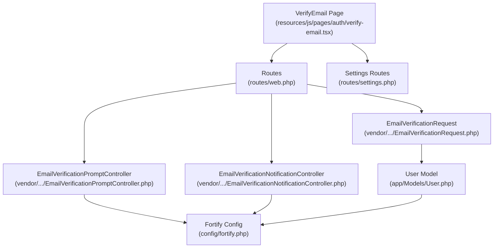
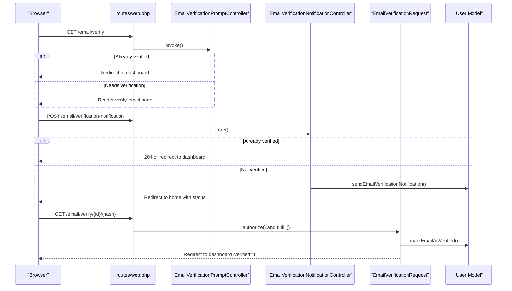
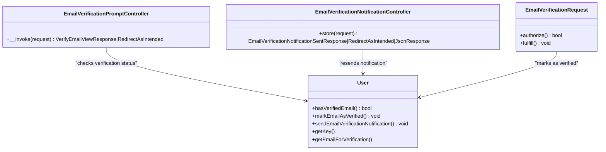
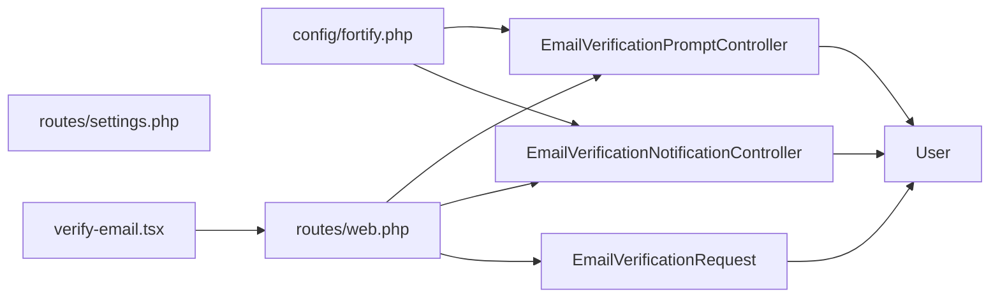

# Email Verification

<cite>
**Referenced Files in This Document**
- [config/fortify.php](file://config/fortify.php)
- [routes/web.php](file://routes/web.php)
- [routes/settings.php](file://routes/settings.php)
- [app/Models/User.php](file://app/Models/User.php)
- [vendor/laravel/fortify/src/Http/Controllers/EmailVerificationPromptController.php](file://vendor/laravel/fortify/src/Http/Controllers/EmailVerificationPromptController.php)
- [vendor/laravel/fortify/src/Http/Controllers/EmailVerificationNotificationController.php](file://vendor/laravel/fortify/src/Http/Controllers/EmailVerificationNotificationController.php)
- [vendor/laravel/framework/src/Illuminate/Foundation/Auth/EmailVerificationRequest.php](file://vendor/laravel/framework/src/Illuminate/Foundation/Auth/EmailVerificationRequest.php)
- [resources/js/pages/auth/verify-email.tsx](file://resources/js/pages/auth/verify-email.tsx)
- [tests/Feature/Auth/EmailVerificationTest.php](file://tests/Feature/Auth/EmailVerificationTest.php)
- [tests/Feature/Auth/VerificationNotificationTest.php](file://tests/Feature/Auth/VerificationNotificationTest.php)
</cite>

## Table of Contents
1. [Introduction](#introduction)
2. [Project Structure](#project-structure)
3. [Core Components](#core-components)
4. [Architecture Overview](#architecture-overview)
5. [Detailed Component Analysis](#detailed-component-analysis)
6. [Dependency Analysis](#dependency-analysis)
7. [Performance Considerations](#performance-considerations)
8. [Troubleshooting Guide](#troubleshooting-guide)
9. [Conclusion](#conclusion)

## Introduction
This document explains the email verification system in SmartExam. It covers how Laravel Fortify’s email verification feature is enabled and integrated with the application, the end-to-end verification workflow (including email dispatch, signed verification links, and user activation), and how the frontend interacts with the backend via Inertia. It also documents customization points for verification emails, deadlines, and resending functionality, along with security considerations such as token validation and rate limiting.

## Project Structure
The email verification feature spans configuration, controllers, models, routes, and frontend components:

- Fortify configuration enables the email verification feature.
- Controllers handle rendering the verification prompt and resending notifications.
- The EmailVerificationRequest validates and fulfills verification.
- The User model supports verification state and notifications.
- Routes protect dashboard access behind verified users and expose verification endpoints.
- The frontend renders the verification prompt and allows resending the verification email.

**Diagram sources**
- [routes/web.php:1-26](file://routes/web.php#L1-L26)
- [routes/settings.php:1-41](file://routes/settings.php#L1-L41)
- [vendor/laravel/fortify/src/Http/Controllers/EmailVerificationPromptController.php:1-25](file://vendor/laravel/fortify/src/Http/Controllers/EmailVerificationPromptController.php#L1-L25)
- [vendor/laravel/fortify/src/Http/Controllers/EmailVerificationNotificationController.php:1-32](file://vendor/laravel/fortify/src/Http/Controllers/EmailVerificationNotificationController.php#L1-L32)
- [vendor/laravel/framework/src/Illuminate/Foundation/Auth/EmailVerificationRequest.php:1-66](file://vendor/laravel/framework/src/Illuminate/Foundation/Auth/EmailVerificationRequest.php#L1-L66)
- [app/Models/User.php:1-53](file://app/Models/User.php#L1-L53)
- [config/fortify.php:169-189](file://config/fortify.php#L169-L189)

**Section sources**
- [config/fortify.php:169-189](file://config/fortify.php#L169-L189)
- [routes/web.php:1-26](file://routes/web.php#L1-L26)
- [routes/settings.php:1-41](file://routes/settings.php#L1-L41)
- [app/Models/User.php:1-53](file://app/Models/User.php#L1-L53)

## Core Components
- Fortify email verification feature flag: Enabled via configuration.
- EmailVerificationPromptController: Renders the verification prompt or redirects if already verified.
- EmailVerificationNotificationController: Resends verification emails and handles redirect behavior.
- EmailVerificationRequest: Validates signed verification URLs and marks the user as verified.
- User model: Provides verification state and notification capability.
- Routes: Expose verification endpoints and enforce verified middleware on protected routes.

Key behaviors:
- Users are redirected to the verification prompt if unverified.
- Verified users bypass the prompt and access protected routes.
- Resending verification emails is supported and guarded against verified users.

**Section sources**
- [config/fortify.php:169-189](file://config/fortify.php#L169-L189)
- [vendor/laravel/fortify/src/Http/Controllers/EmailVerificationPromptController.php:18-23](file://vendor/laravel/fortify/src/Http/Controllers/EmailVerificationPromptController.php#L18-L23)
- [vendor/laravel/fortify/src/Http/Controllers/EmailVerificationNotificationController.php:19-30](file://vendor/laravel/fortify/src/Http/Controllers/EmailVerificationNotificationController.php#L19-L30)
- [vendor/laravel/framework/src/Illuminate/Foundation/Auth/EmailVerificationRequest.php:16-27](file://vendor/laravel/framework/src/Illuminate/Foundation/Auth/EmailVerificationRequest.php#L16-L27)
- [app/Models/User.php:35-51](file://app/Models/User.php#L35-L51)
- [routes/web.php:21-23](file://routes/web.php#L21-L23)

## Architecture Overview
The email verification workflow integrates Fortify controllers, Laravel’s verification request, and the application’s routes and models.

**Diagram sources**
- [routes/web.php:1-26](file://routes/web.php#L1-L26)
- [vendor/laravel/fortify/src/Http/Controllers/EmailVerificationPromptController.php:18-23](file://vendor/laravel/fortify/src/Http/Controllers/EmailVerificationPromptController.php#L18-L23)
- [vendor/laravel/fortify/src/Http/Controllers/EmailVerificationNotificationController.php:19-30](file://vendor/laravel/fortify/src/Http/Controllers/EmailVerificationNotificationController.php#L19-L30)
- [vendor/laravel/framework/src/Illuminate/Foundation/Auth/EmailVerificationRequest.php:46-53](file://vendor/laravel/framework/src/Illuminate/Foundation/Auth/EmailVerificationRequest.php#L46-L53)
- [app/Models/User.php:35-51](file://app/Models/User.php#L35-L51)

## Detailed Component Analysis

### Fortify Configuration
- Enables the email verification feature via the features array.
- Integrates with the application’s authentication guard and middleware stack.

Implementation reference:
- [config/fortify.php:169-189](file://config/fortify.php#L169-L189)

**Section sources**
- [config/fortify.php:169-189](file://config/fortify.php#L169-L189)

### EmailVerificationPromptController
- Decides whether to render the verification prompt or redirect to the intended destination if already verified.

Behavior:
- Checks user verification status.
- Returns appropriate response contract for verification prompt or redirect.

Implementation reference:
- [vendor/laravel/fortify/src/Http/Controllers/EmailVerificationPromptController.php:18-23](file://vendor/laravel/fortify/src/Http/Controllers/EmailVerificationPromptController.php#L18-L23)

**Section sources**
- [vendor/laravel/fortify/src/Http/Controllers/EmailVerificationPromptController.php:18-23](file://vendor/laravel/fortify/src/Http/Controllers/EmailVerificationPromptController.php#L18-L23)

### EmailVerificationNotificationController
- Resends verification emails if the user is not yet verified.
- Handles JSON vs HTML responses and redirects appropriately.

Behavior:
- If already verified, returns empty JSON or redirect to dashboard.
- Otherwise, sends a verification notification and returns a success response.

Implementation reference:
- [vendor/laravel/fortify/src/Http/Controllers/EmailVerificationNotificationController.php:19-30](file://vendor/laravel/fortify/src/Http/Controllers/EmailVerificationNotificationController.php#L19-L30)

**Section sources**
- [vendor/laravel/fortify/src/Http/Controllers/EmailVerificationNotificationController.php:19-30](file://vendor/laravel/fortify/src/Http/Controllers/EmailVerificationNotificationController.php#L19-L30)

### EmailVerificationRequest
- Validates the signed verification URL using secure hash comparison.
- Marks the user as verified and fires the Verified event if not already verified.

Security highlights:
- Uses constant-time comparisons for user ID and hash.
- Only verifies if the user is not already verified.

Implementation reference:
- [vendor/laravel/framework/src/Illuminate/Foundation/Auth/EmailVerificationRequest.php:16-27](file://vendor/laravel/framework/src/Illuminate/Foundation/Auth/EmailVerificationRequest.php#L16-L27)
- [vendor/laravel/framework/src/Illuminate/Foundation/Auth/EmailVerificationRequest.php:46-53](file://vendor/laravel/framework/src/Illuminate/Foundation/Auth/EmailVerificationRequest.php#L46-L53)

**Section sources**
- [vendor/laravel/framework/src/Illuminate/Foundation/Auth/EmailVerificationRequest.php:16-27](file://vendor/laravel/framework/src/Illuminate/Foundation/Auth/EmailVerificationRequest.php#L16-L27)
- [vendor/laravel/framework/src/Illuminate/Foundation/Auth/EmailVerificationRequest.php:46-53](file://vendor/laravel/framework/src/Illuminate/Foundation/Auth/EmailVerificationRequest.php#L46-L53)

### User Model
- Implements notification capability and verification state.
- Includes casting for verification timestamps.

Implementation reference:
- [app/Models/User.php:35-51](file://app/Models/User.php#L35-L51)

**Section sources**
- [app/Models/User.php:35-51](file://app/Models/User.php#L35-L51)

### Frontend: VerifyEmail Page
- Renders the verification prompt and provides a button to resend the verification email.
- Displays a success message after resending.

Implementation reference:
- [resources/js/pages/auth/verify-email.tsx:1-46](file://resources/js/pages/auth/verify-email.tsx#L1-L46)

**Section sources**
- [resources/js/pages/auth/verify-email.tsx:1-46](file://resources/js/pages/auth/verify-email.tsx#L1-L46)

### Routes and Middleware
- Verification prompt and notification endpoints are exposed via web routes.
- Protected routes require both authentication and verified email status.
- Additional settings routes demonstrate throttling patterns applicable to verification flows.

Implementation reference:
- [routes/web.php:1-26](file://routes/web.php#L1-L26)
- [routes/settings.php:17-31](file://routes/settings.php#L17-L31)

**Section sources**
- [routes/web.php:1-26](file://routes/web.php#L1-L26)
- [routes/settings.php:17-31](file://routes/settings.php#L17-L31)

### Verification Workflow: Class Diagram

**Diagram sources**
- [vendor/laravel/fortify/src/Http/Controllers/EmailVerificationPromptController.php:18-23](file://vendor/laravel/fortify/src/Http/Controllers/EmailVerificationPromptController.php#L18-L23)
- [vendor/laravel/fortify/src/Http/Controllers/EmailVerificationNotificationController.php:19-30](file://vendor/laravel/fortify/src/Http/Controllers/EmailVerificationNotificationController.php#L19-L30)
- [vendor/laravel/framework/src/Illuminate/Foundation/Auth/EmailVerificationRequest.php:46-53](file://vendor/laravel/framework/src/Illuminate/Foundation/Auth/EmailVerificationRequest.php#L46-L53)
- [app/Models/User.php:35-51](file://app/Models/User.php#L35-L51)

## Dependency Analysis
- Controllers depend on the User model for verification state and notification sending.
- EmailVerificationRequest depends on the current user and route parameters to validate and fulfill verification.
- Routes bind controllers and verification endpoints to named routes.
- Frontend components rely on Inertia forms and routes to trigger resend actions.

**Diagram sources**
- [config/fortify.php:169-189](file://config/fortify.php#L169-L189)
- [routes/web.php:1-26](file://routes/web.php#L1-L26)
- [routes/settings.php:1-41](file://routes/settings.php#L1-L41)
- [vendor/laravel/fortify/src/Http/Controllers/EmailVerificationPromptController.php:18-23](file://vendor/laravel/fortify/src/Http/Controllers/EmailVerificationPromptController.php#L18-L23)
- [vendor/laravel/fortify/src/Http/Controllers/EmailVerificationNotificationController.php:19-30](file://vendor/laravel/fortify/src/Http/Controllers/EmailVerificationNotificationController.php#L19-L30)
- [vendor/laravel/framework/src/Illuminate/Foundation/Auth/EmailVerificationRequest.php:46-53](file://vendor/laravel/framework/src/Illuminate/Foundation/Auth/EmailVerificationRequest.php#L46-L53)
- [app/Models/User.php:35-51](file://app/Models/User.php#L35-L51)
- [resources/js/pages/auth/verify-email.tsx:1-46](file://resources/js/pages/auth/verify-email.tsx#L1-L46)

**Section sources**
- [config/fortify.php:169-189](file://config/fortify.php#L169-L189)
- [routes/web.php:1-26](file://routes/web.php#L1-L26)
- [routes/settings.php:1-41](file://routes/settings.php#L1-L41)
- [vendor/laravel/fortify/src/Http/Controllers/EmailVerificationPromptController.php:18-23](file://vendor/laravel/fortify/src/Http/Controllers/EmailVerificationPromptController.php#L18-L23)
- [vendor/laravel/fortify/src/Http/Controllers/EmailVerificationNotificationController.php:19-30](file://vendor/laravel/fortify/src/Http/Controllers/EmailVerificationNotificationController.php#L19-L30)
- [vendor/laravel/framework/src/Illuminate/Foundation/Auth/EmailVerificationRequest.php:46-53](file://vendor/laravel/framework/src/Illuminate/Foundation/Auth/EmailVerificationRequest.php#L46-L53)
- [app/Models/User.php:35-51](file://app/Models/User.php#L35-L51)
- [resources/js/pages/auth/verify-email.tsx:1-46](file://resources/js/pages/auth/verify-email.tsx#L1-L46)

## Performance Considerations
- Verification endpoints perform minimal work: checking verification status, sending notifications, and validating signed URLs.
- No heavy computations are involved; performance primarily depends on mail transport throughput and queue configuration.
- Consider enabling queued mailables for verification emails to avoid blocking requests.

[No sources needed since this section provides general guidance]

## Troubleshooting Guide

Common issues and resolutions:
- Email not received
  - Verify mail driver configuration and credentials.
  - Confirm queue worker is running if using queued notifications.
  - Check spam/junk folders.
  - Reference: [tests/Feature/Auth/VerificationNotificationTest.php:23-34](file://tests/Feature/Auth/VerificationNotificationTest.php#L23-L34)

- Verification link invalid or expired
  - Links are signed with a fixed lifetime; ensure client clicks the link promptly.
  - Confirm server time is synchronized.
  - Reference: [tests/Feature/Auth/EmailVerificationTest.php:39-47](file://tests/Feature/Auth/EmailVerificationTest.php#L39-L47)

- Already verified users stuck on verification prompt
  - Should be redirected automatically; check middleware order and route binding.
  - Reference: [tests/Feature/Auth/EmailVerificationTest.php:89-99](file://tests/Feature/Auth/EmailVerificationTest.php#L89-L99)

- Resend verification email does nothing
  - If the user is already verified, the resend endpoint returns early; ensure user is unverified.
  - Reference: [tests/Feature/Auth/VerificationNotificationTest.php:36-47](file://tests/Feature/Auth/VerificationNotificationTest.php#L36-L47)

- Security: signed URL validation failures
  - Hash mismatch or wrong user ID triggers failure; verify URL parameters and user state.
  - Reference: [vendor/laravel/framework/src/Illuminate/Foundation/Auth/EmailVerificationRequest.php:16-27](file://vendor/laravel/framework/src/Illuminate/Foundation/Auth/EmailVerificationRequest.php#L16-L27)

**Section sources**
- [tests/Feature/Auth/VerificationNotificationTest.php:23-47](file://tests/Feature/Auth/VerificationNotificationTest.php#L23-L47)
- [tests/Feature/Auth/EmailVerificationTest.php:33-52](file://tests/Feature/Auth/EmailVerificationTest.php#L33-L52)
- [vendor/laravel/framework/src/Illuminate/Foundation/Auth/EmailVerificationRequest.php:16-27](file://vendor/laravel/framework/src/Illuminate/Foundation/Auth/EmailVerificationRequest.php#L16-L27)

## Implementation Examples

### Customize Verification Emails
- Use Laravel notifications to customize the verification email template and sender.
- Ensure the User model sends the notification via the built-in method invoked by the notification controller.
- References:
  - [vendor/laravel/fortify/src/Http/Controllers/EmailVerificationNotificationController.php:27](file://vendor/laravel/fortify/src/Http/Controllers/EmailVerificationNotificationController.php#L27)
  - [app/Models/User.php:35-51](file://app/Models/User.php#L35-L51)

### Adjust Verification Link Deadline
- Signed verification URLs are generated with a time limit; adjust the deadline when creating the signed route.
- Reference:
  - [tests/Feature/Auth/EmailVerificationTest.php:39-43](file://tests/Feature/Auth/EmailVerificationTest.php#L39-L43)

### Resend Verification Email
- Call the resend endpoint from the frontend to re-send the verification email.
- Reference:
  - [resources/js/pages/auth/verify-email.tsx:21-37](file://resources/js/pages/auth/verify-email.tsx#L21-L37)
  - [vendor/laravel/fortify/src/Http/Controllers/EmailVerificationNotificationController.php:19-30](file://vendor/laravel/fortify/src/Http/Controllers/EmailVerificationNotificationController.php#L19-L30)

### Enforce Verified Access to Routes
- Protect routes requiring verified emails using the verified middleware group.
- Reference:
  - [routes/web.php:21-23](file://routes/web.php#L21-L23)
  - [routes/settings.php:17-31](file://routes/settings.php#L17-L31)

**Section sources**
- [vendor/laravel/fortify/src/Http/Controllers/EmailVerificationNotificationController.php:27](file://vendor/laravel/fortify/src/Http/Controllers/EmailVerificationNotificationController.php#L27)
- [resources/js/pages/auth/verify-email.tsx:21-37](file://resources/js/pages/auth/verify-email.tsx#L21-L37)
- [routes/web.php:21-23](file://routes/web.php#L21-L23)
- [routes/settings.php:17-31](file://routes/settings.php#L17-L31)

## Security Considerations
- Token validation
  - Uses constant-time string comparisons for user ID and hash to prevent timing attacks.
  - Reference: [vendor/laravel/framework/src/Illuminate/Foundation/Auth/EmailVerificationRequest.php:16-27](file://vendor/laravel/framework/src/Illuminate/Foundation/Auth/EmailVerificationRequest.php#L16-L27)
- Rate limiting
  - Fortify provides configurable rate limiters; consider applying a dedicated limiter for verification resend attempts.
  - Reference: [config/fortify.php:117-125](file://config/fortify.php#L117-L125)
- Verified middleware
  - Protects routes requiring confirmed email addresses.
  - Reference: [routes/web.php:21-23](file://routes/web.php#L21-L23)

**Section sources**
- [vendor/laravel/framework/src/Illuminate/Foundation/Auth/EmailVerificationRequest.php:16-27](file://vendor/laravel/framework/src/Illuminate/Foundation/Auth/EmailVerificationRequest.php#L16-L27)
- [config/fortify.php:117-125](file://config/fortify.php#L117-L125)
- [routes/web.php:21-23](file://routes/web.php#L21-L23)

## Conclusion
SmartExam’s email verification system leverages Laravel Fortify to enable optional email verification, integrate with the application’s authentication guard, and provide a seamless user experience. The workflow is secure, with signed verification links validated via constant-time comparisons, and protected by verified middleware on sensitive routes. The frontend offers a simple interface to resend verification emails, and tests validate core behaviors such as redirection for verified users and proper event dispatching upon successful verification.