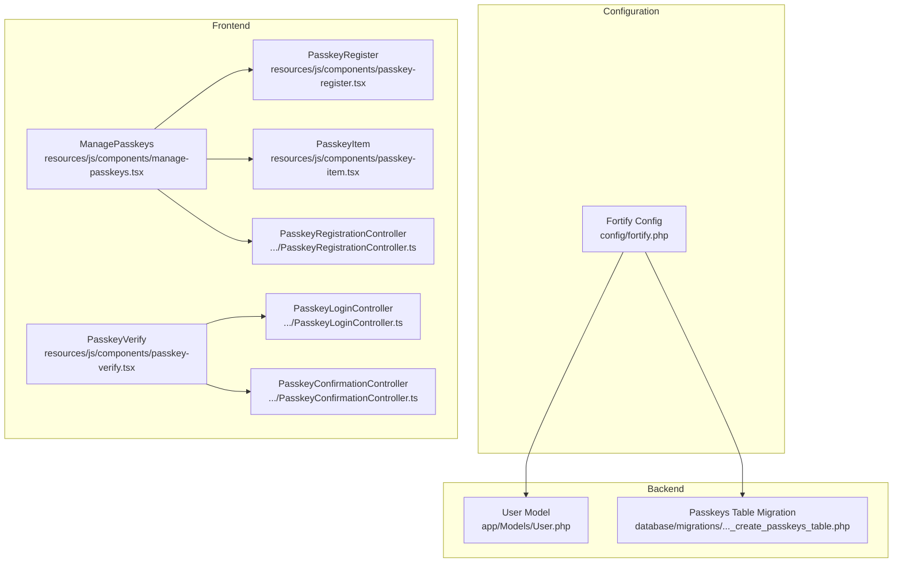
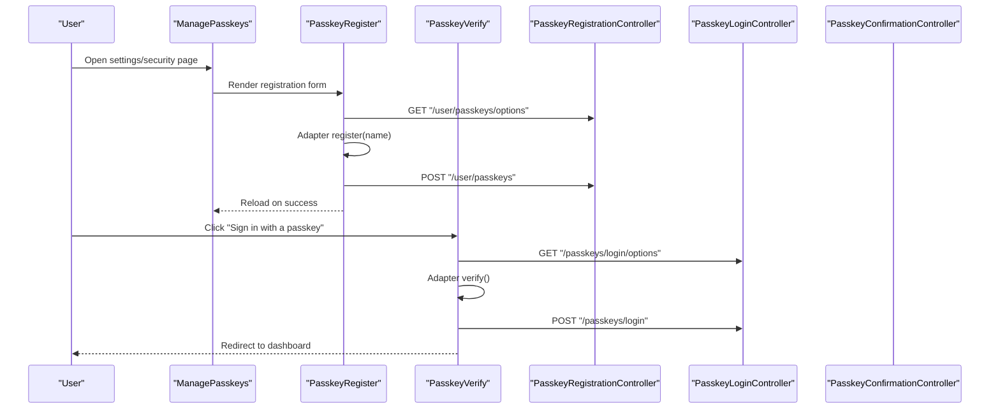
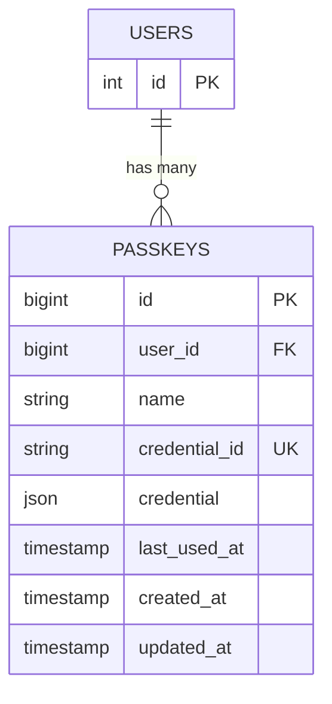
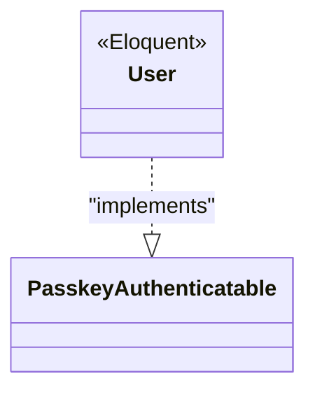
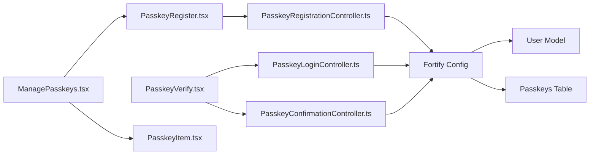

# Passkey & WebAuthn Authentication

<cite>
**Referenced Files in This Document**
- [config/fortify.php](file://config/fortify.php)
- [database/migrations/2024_01_01_000000_create_passkeys_table.php](file://database/migrations/2024_01_01_000000_create_passkeys_table.php)
- [app/Models/User.php](file://app/Models/User.php)
- [resources/js/components/manage-passkeys.tsx](file://resources/js/components/manage-passkeys.tsx)
- [resources/js/components/passkey-register.tsx](file://resources/js/components/passkey-register.tsx)
- [resources/js/components/passkey-verify.tsx](file://resources/js/components/passkey-verify.tsx)
- [resources/js/components/passkey-item.tsx](file://resources/js/components/passkey-item.tsx)
- [resources/js/actions/Laravel/Passkeys/Http/Controllers/PasskeyRegistrationController.ts](file://resources/js/actions/Laravel/Passkeys/Http/Controllers/PasskeyRegistrationController.ts)
- [resources/js/actions/Laravel/Passkeys/Http/Controllers/PasskeyLoginController.ts](file://resources/js/actions/Laravel/Passkeys/Http/Controllers/PasskeyLoginController.ts)
- [resources/js/actions/Laravel/Passkeys/Http/Controllers/PasskeyConfirmationController.ts](file://resources/js/actions/Laravel/Passkeys/Http/Controllers/PasskeyConfirmationController.ts)
- [resources/js/types/auth.ts](file://resources/js/types/auth.ts)
</cite>

## Table of Contents
1. [Introduction](#introduction)
2. [Project Structure](#project-structure)
3. [Core Components](#core-components)
4. [Architecture Overview](#architecture-overview)
5. [Detailed Component Analysis](#detailed-component-analysis)
6. [Dependency Analysis](#dependency-analysis)
7. [Performance Considerations](#performance-considerations)
8. [Troubleshooting Guide](#troubleshooting-guide)
9. [Conclusion](#conclusion)
10. [Appendices](#appendices)

## Introduction
This document explains the passkey and WebAuthn authentication system in SmartExam. It covers the Fortify passkeys configuration, passkey lifecycle (registration, discovery, deletion), and the frontend React components that integrate with the @laravel/passkeys adapter. It also documents the backend routes used by the frontend, the database schema for storing passkeys, and the user model’s integration with passkey authentication. Guidance on browser compatibility, security considerations, and troubleshooting is included, along with recommendations for passkey policy configuration and user experience optimization.

## Project Structure
SmartExam integrates passkeys via:
- Fortify configuration enabling passkeys with relying party settings and a rate limiter
- A dedicated database table to persist passkey credentials
- A user model implementing the passkey-aware trait
- Frontend React components for passkey registration, verification, and management
- Action modules that define the backend routes consumed by the frontend

**Diagram sources**
- [config/fortify.php:140-192](file://config/fortify.php#L140-L192)
- [app/Models/User.php:32-35](file://app/Models/User.php#L32-L35)
- [database/migrations/2024_01_01_000000_create_passkeys_table.php:14-24](file://database/migrations/2024_01_01_000000_create_passkeys_table.php#L14-L24)
- [resources/js/components/manage-passkeys.tsx:28-71](file://resources/js/components/manage-passkeys.tsx#L28-L71)
- [resources/js/components/passkey-register.tsx:12-100](file://resources/js/components/passkey-register.tsx#L12-L100)
- [resources/js/components/passkey-verify.tsx:20-74](file://resources/js/components/passkey-verify.tsx#L20-L74)
- [resources/js/components/passkey-item.tsx:20-93](file://resources/js/components/passkey-item.tsx#L20-L93)
- [resources/js/actions/Laravel/Passkeys/Http/Controllers/PasskeyRegistrationController.ts:7-226](file://resources/js/actions/Laravel/Passkeys/Http/Controllers/PasskeyRegistrationController.ts#L7-L226)
- [resources/js/actions/Laravel/Passkeys/Http/Controllers/PasskeyLoginController.ts:7-137](file://resources/js/actions/Laravel/Passkeys/Http/Controllers/PasskeyLoginController.ts#L7-L137)
- [resources/js/actions/Laravel/Passkeys/Http/Controllers/PasskeyConfirmationController.ts:7-137](file://resources/js/actions/Laravel/Passkeys/Http/Controllers/PasskeyConfirmationController.ts#L7-L137)

**Section sources**
- [config/fortify.php:140-192](file://config/fortify.php#L140-L192)
- [database/migrations/2024_01_01_000000_create_passkeys_table.php:14-24](file://database/migrations/2024_01_01_000000_create_passkeys_table.php#L14-L24)
- [app/Models/User.php:32-35](file://app/Models/User.php#L32-L35)

## Core Components
- Fortify passkeys configuration:
  - Relying Party ID derived from the application URL host
  - Allowed origins set to the application URL
  - User handle secret configurable via environment variable or application key
  - Timeout set to 60 seconds
  - Rate limiter enabled for passkeys
  - Passkeys feature enabled with password confirmation requirement
- Backend routes:
  - Registration: GET and POST to fetch options and submit registration
  - Login: GET and POST to fetch options and submit assertion
  - Confirmation: GET and POST to fetch options and submit confirmation
- Frontend components:
  - ManagePasskeys orchestrates passkey listing and registration
  - PasskeyRegister handles passkey creation with name input and adapter hook
  - PasskeyVerify triggers passkey authentication with adapter hook
  - PasskeyItem renders passkey entries and removal dialog
- Database schema:
  - Stores passkey name, unique credential ID, serialized credential, last-used timestamp, and indices for efficient lookup

**Section sources**
- [config/fortify.php:150-156](file://config/fortify.php#L150-L156)
- [config/fortify.php:122-125](file://config/fortify.php#L122-L125)
- [config/fortify.php:184-188](file://config/fortify.php#L184-L188)
- [resources/js/actions/Laravel/Passkeys/Http/Controllers/PasskeyRegistrationController.ts:7-226](file://resources/js/actions/Laravel/Passkeys/Http/Controllers/PasskeyRegistrationController.ts#L7-L226)
- [resources/js/actions/Laravel/Passkeys/Http/Controllers/PasskeyLoginController.ts:7-137](file://resources/js/actions/Laravel/Passkeys/Http/Controllers/PasskeyLoginController.ts#L7-L137)
- [resources/js/actions/Laravel/Passkeys/Http/Controllers/PasskeyConfirmationController.ts:7-137](file://resources/js/actions/Laravel/Passkeys/Http/Controllers/PasskeyConfirmationController.ts#L7-L137)
- [resources/js/components/manage-passkeys.tsx:28-71](file://resources/js/components/manage-passkeys.tsx#L28-L71)
- [resources/js/components/passkey-register.tsx:12-100](file://resources/js/components/passkey-register.tsx#L12-L100)
- [resources/js/components/passkey-verify.tsx:20-74](file://resources/js/components/passkey-verify.tsx#L20-L74)
- [resources/js/components/passkey-item.tsx:20-93](file://resources/js/components/passkey-item.tsx#L20-L93)
- [database/migrations/2024_01_01_000000_create_passkeys_table.php:14-24](file://database/migrations/2024_01_01_000000_create_passkeys_table.php#L14-L24)

## Architecture Overview
The passkey authentication flow leverages the @laravel/passkeys React adapter to communicate with backend routes. The frontend components call adapter hooks that internally request options from the server and then perform registration or authentication. The backend routes are defined in action modules and map to Laravel controller endpoints.

**Diagram sources**
- [resources/js/components/manage-passkeys.tsx:28-71](file://resources/js/components/manage-passkeys.tsx#L28-L71)
- [resources/js/components/passkey-register.tsx:12-100](file://resources/js/components/passkey-register.tsx#L12-L100)
- [resources/js/components/passkey-verify.tsx:20-74](file://resources/js/components/passkey-verify.tsx#L20-L74)
- [resources/js/actions/Laravel/Passkeys/Http/Controllers/PasskeyRegistrationController.ts:7-226](file://resources/js/actions/Laravel/Passkeys/Http/Controllers/PasskeyRegistrationController.ts#L7-L226)
- [resources/js/actions/Laravel/Passkeys/Http/Controllers/PasskeyLoginController.ts:7-137](file://resources/js/actions/Laravel/Passkeys/Http/Controllers/PasskeyLoginController.ts#L7-L137)
- [resources/js/actions/Laravel/Passkeys/Http/Controllers/PasskeyConfirmationController.ts:7-137](file://resources/js/actions/Laravel/Passkeys/Http/Controllers/PasskeyConfirmationController.ts#L7-L137)

## Detailed Component Analysis

### Fortify Passkeys Configuration
- Relying Party ID: Derived from the application URL host
- Allowed Origins: Single origin set to the application URL
- User Handle Secret: Environment variable or falls back to application key
- Timeout: 60 seconds
- Rate Limiter: Dedicated "passkeys" limiter
- Feature Flags: Passkeys enabled with password confirmation enforced

Implementation references:
- [config/fortify.php:150-156](file://config/fortify.php#L150-L156)
- [config/fortify.php:122-125](file://config/fortify.php#L122-L125)
- [config/fortify.php:184-188](file://config/fortify.php#L184-L188)

**Section sources**
- [config/fortify.php:150-156](file://config/fortify.php#L150-L156)
- [config/fortify.php:122-125](file://config/fortify.php#L122-L125)
- [config/fortify.php:184-188](file://config/fortify.php#L184-L188)

### Database Schema: Passkeys Table
The passkeys table stores:
- Name: Human-readable identifier for the passkey
- Credential ID: Unique identifier for the credential
- Credential: Serialized credential data
- Last Used At: Timestamp of last usage
- Indices: Foreign key on user_id and index on user_id for performance

**Diagram sources**
- [database/migrations/2024_01_01_000000_create_passkeys_table.php:14-24](file://database/migrations/2024_01_01_000000_create_passkeys_table.php#L14-L24)

**Section sources**
- [database/migrations/2024_01_01_000000_create_passkeys_table.php:14-24](file://database/migrations/2024_01_01_000000_create_passkeys_table.php#L14-L24)

### User Model Integration
The User model implements the passkey-aware trait, enabling passkey-based authentication and management.

**Diagram sources**
- [app/Models/User.php:32-35](file://app/Models/User.php#L32-L35)

**Section sources**
- [app/Models/User.php:32-35](file://app/Models/User.php#L32-L35)

### Frontend Components

#### ManagePasskeys
- Renders empty state when no passkeys exist
- Lists existing passkeys with removal dialogs
- Provides a registration component and reloads after successful registration

References:
- [resources/js/components/manage-passkeys.tsx:28-71](file://resources/js/components/manage-passkeys.tsx#L28-L71)

**Section sources**
- [resources/js/components/manage-passkeys.tsx:28-71](file://resources/js/components/manage-passkeys.tsx#L28-L71)

#### PasskeyRegister
- Detects browser support for passkeys
- Collects a friendly name for the passkey
- Uses the adapter hook to register a new passkey via backend routes

References:
- [resources/js/components/passkey-register.tsx:12-100](file://resources/js/components/passkey-register.tsx#L12-L100)

**Section sources**
- [resources/js/components/passkey-register.tsx:12-100](file://resources/js/components/passkey-register.tsx#L12-L100)

#### PasskeyVerify
- Initiates passkey verification with optional custom route endpoints
- Handles success redirection and error display

References:
- [resources/js/components/passkey-verify.tsx:20-74](file://resources/js/components/passkey-verify.tsx#L20-L74)

**Section sources**
- [resources/js/components/passkey-verify.tsx:20-74](file://resources/js/components/passkey-verify.tsx#L20-L74)

#### PasskeyItem
- Displays passkey metadata (name, authenticator type, timestamps)
- Confirms and removes passkeys via backend route

References:
- [resources/js/components/passkey-item.tsx:20-93](file://resources/js/components/passkey-item.tsx#L20-L93)

**Section sources**
- [resources/js/components/passkey-item.tsx:20-93](file://resources/js/components/passkey-item.tsx#L20-L93)

### Backend Routes and Actions

#### Registration Flow
- Options endpoint: GET "/user/passkeys/options"
- Submission endpoint: POST "/user/passkeys"
- Deletion endpoint: DELETE "/user/passkeys/{id}"

References:
- [resources/js/actions/Laravel/Passkeys/Http/Controllers/PasskeyRegistrationController.ts:7-226](file://resources/js/actions/Laravel/Passkeys/Http/Controllers/PasskeyRegistrationController.ts#L7-L226)

**Section sources**
- [resources/js/actions/Laravel/Passkeys/Http/Controllers/PasskeyRegistrationController.ts:7-226](file://resources/js/actions/Laravel/Passkeys/Http/Controllers/PasskeyRegistrationController.ts#L7-L226)

#### Login Flow
- Options endpoint: GET "/passkeys/login/options"
- Submission endpoint: POST "/passkeys/login"

References:
- [resources/js/actions/Laravel/Passkeys/Http/Controllers/PasskeyLoginController.ts:7-137](file://resources/js/actions/Laravel/Passkeys/Http/Controllers/PasskeyLoginController.ts#L7-L137)

**Section sources**
- [resources/js/actions/Laravel/Passkeys/Http/Controllers/PasskeyLoginController.ts:7-137](file://resources/js/actions/Laravel/Passkeys/Http/Controllers/PasskeyLoginController.ts#L7-L137)

#### Confirmation Flow
- Options endpoint: GET "/passkeys/confirm/options"
- Submission endpoint: POST "/passkeys/confirm"

References:
- [resources/js/actions/Laravel/Passkeys/Http/Controllers/PasskeyConfirmationController.ts:7-137](file://resources/js/actions/Laravel/Passkeys/Http/Controllers/PasskeyConfirmationController.ts#L7-L137)

**Section sources**
- [resources/js/actions/Laravel/Passkeys/Http/Controllers/PasskeyConfirmationController.ts:7-137](file://resources/js/actions/Laravel/Passkeys/Http/Controllers/PasskeyConfirmationController.ts#L7-L137)

### Data Types
- Passkey type includes identifiers, human-friendly name, authenticator hint, and relative timestamps for created/last used

References:
- [resources/js/types/auth.ts:20-27](file://resources/js/types/auth.ts#L20-L27)

**Section sources**
- [resources/js/types/auth.ts:20-27](file://resources/js/types/auth.ts#L20-L27)

## Dependency Analysis
The frontend components depend on the @laravel/passkeys React adapter and consume typed route definitions generated from backend controllers. The backend controllers are mapped to Laravel endpoints and rely on Fortify’s passkey feature configuration.

**Diagram sources**
- [resources/js/components/passkey-register.tsx:12-100](file://resources/js/components/passkey-register.tsx#L12-L100)
- [resources/js/components/passkey-verify.tsx:20-74](file://resources/js/components/passkey-verify.tsx#L20-L74)
- [resources/js/components/manage-passkeys.tsx:28-71](file://resources/js/components/manage-passkeys.tsx#L28-L71)
- [resources/js/components/passkey-item.tsx:20-93](file://resources/js/components/passkey-item.tsx#L20-L93)
- [resources/js/actions/Laravel/Passkeys/Http/Controllers/PasskeyRegistrationController.ts:7-226](file://resources/js/actions/Laravel/Passkeys/Http/Controllers/PasskeyRegistrationController.ts#L7-L226)
- [resources/js/actions/Laravel/Passkeys/Http/Controllers/PasskeyLoginController.ts:7-137](file://resources/js/actions/Laravel/Passkeys/Http/Controllers/PasskeyLoginController.ts#L7-L137)
- [resources/js/actions/Laravel/Passkeys/Http/Controllers/PasskeyConfirmationController.ts:7-137](file://resources/js/actions/Laravel/Passkeys/Http/Controllers/PasskeyConfirmationController.ts#L7-L137)
- [config/fortify.php:150-156](file://config/fortify.php#L150-L156)
- [app/Models/User.php:32-35](file://app/Models/User.php#L32-L35)
- [database/migrations/2024_01_01_000000_create_passkeys_table.php:14-24](file://database/migrations/2024_01_01_000000_create_passkeys_table.php#L14-L24)

**Section sources**
- [resources/js/components/passkey-register.tsx:12-100](file://resources/js/components/passkey-register.tsx#L12-L100)
- [resources/js/components/passkey-verify.tsx:20-74](file://resources/js/components/passkey-verify.tsx#L20-L74)
- [resources/js/components/manage-passkeys.tsx:28-71](file://resources/js/components/manage-passkeys.tsx#L28-L71)
- [resources/js/components/passkey-item.tsx:20-93](file://resources/js/components/passkey-item.tsx#L20-L93)
- [resources/js/actions/Laravel/Passkeys/Http/Controllers/PasskeyRegistrationController.ts:7-226](file://resources/js/actions/Laravel/Passkeys/Http/Controllers/PasskeyRegistrationController.ts#L7-L226)
- [resources/js/actions/Laravel/Passkeys/Http/Controllers/PasskeyLoginController.ts:7-137](file://resources/js/actions/Laravel/Passkeys/Http/Controllers/PasskeyLoginController.ts#L7-L137)
- [resources/js/actions/Laravel/Passkeys/Http/Controllers/PasskeyConfirmationController.ts:7-137](file://resources/js/actions/Laravel/Passkeys/Http/Controllers/PasskeyConfirmationController.ts#L7-L137)
- [config/fortify.php:150-156](file://config/fortify.php#L150-L156)
- [app/Models/User.php:32-35](file://app/Models/User.php#L32-L35)
- [database/migrations/2024_01_01_000000_create_passkeys_table.php:14-24](file://database/migrations/2024_01_01_000000_create_passkeys_table.php#L14-L24)

## Performance Considerations
- Use the provided rate limiter for passkeys to prevent abuse.
- Keep passkey names concise to minimize payload sizes.
- Avoid unnecessary re-renders by memoizing passkey lists and using stable keys.
- Ensure proper indexing on user_id in the passkeys table for fast lookups.

## Troubleshooting Guide
Common issues and resolutions:
- Browser not supported:
  - The registration component checks support and displays a message when unsupported.
  - Reference: [resources/js/components/passkey-register.tsx:51-57](file://resources/js/components/passkey-register.tsx#L51-L57)
- Registration fails:
  - Verify allowed origins and relying party ID match the deployment domain.
  - Confirm the rate limiter is not throttling requests.
  - Reference: [config/fortify.php:150-156](file://config/fortify.php#L150-L156)
- Login verification errors:
  - Ensure the login options endpoint is reachable and the submission endpoint receives a valid assertion response.
  - Reference: [resources/js/actions/Laravel/Passkeys/Http/Controllers/PasskeyLoginController.ts:7-137](file://resources/js/actions/Laravel/Passkeys/Http/Controllers/PasskeyLoginController.ts#L7-L137)
- Passkey not appearing after registration:
  - Trigger a page reload after successful registration to refresh the passkey list.
  - Reference: [resources/js/components/manage-passkeys.tsx:38-40](file://resources/js/components/manage-passkeys.tsx#L38-L40)
- Removal confirmation:
  - Use the removal dialog to confirm deletion; ensure network requests succeed.
  - Reference: [resources/js/components/passkey-item.tsx:70-90](file://resources/js/components/passkey-item.tsx#L70-L90)

**Section sources**
- [resources/js/components/passkey-register.tsx:51-57](file://resources/js/components/passkey-register.tsx#L51-L57)
- [config/fortify.php:150-156](file://config/fortify.php#L150-L156)
- [resources/js/actions/Laravel/Passkeys/Http/Controllers/PasskeyLoginController.ts:7-137](file://resources/js/actions/Laravel/Passkeys/Http/Controllers/PasskeyLoginController.ts#L7-L137)
- [resources/js/components/manage-passkeys.tsx:38-40](file://resources/js/components/manage-passkeys.tsx#L38-L40)
- [resources/js/components/passkey-item.tsx:70-90](file://resources/js/components/passkey-item.tsx#L70-L90)

## Conclusion
SmartExam’s passkey and WebAuthn integration is built on Fortify’s passkeys feature, a dedicated passkeys table, and React components powered by the @laravel/passkeys adapter. The configuration establishes secure relying party settings, and the frontend provides intuitive controls for registration, verification, and management. Following the guidance in this document will help maintain robust security and a smooth user experience.

## Appendices

### Implementation Examples

- Passkey Registration
  - Use the registration component to collect a name and trigger the adapter registration flow.
  - References:
    - [resources/js/components/passkey-register.tsx:12-100](file://resources/js/components/passkey-register.tsx#L12-L100)
    - [resources/js/actions/Laravel/Passkeys/Http/Controllers/PasskeyRegistrationController.ts:7-226](file://resources/js/actions/Laravel/Passkeys/Http/Controllers/PasskeyRegistrationController.ts#L7-L226)

- Device Registration and Credential Discovery
  - After registration, passkeys appear in the management list and can be used for discovery and subsequent authentication.
  - References:
    - [resources/js/components/manage-passkeys.tsx:28-71](file://resources/js/components/manage-passkeys.tsx#L28-L71)
    - [resources/js/components/passkey-item.tsx:20-93](file://resources/js/components/passkey-item.tsx#L20-L93)

- Authentication Flow (Assertion Generation and Verification)
  - Initiate verification via the verification component; the adapter fetches options and submits assertions to the backend.
  - References:
    - [resources/js/components/passkey-verify.tsx:20-74](file://resources/js/components/passkey-verify.tsx#L20-L74)
    - [resources/js/actions/Laravel/Passkeys/Http/Controllers/PasskeyLoginController.ts:7-137](file://resources/js/actions/Laravel/Passkeys/Http/Controllers/PasskeyLoginController.ts#L7-L137)

### Browser Compatibility
- The registration component detects passkey support and informs users when unsupported.
- Reference: [resources/js/components/passkey-register.tsx:51-57](file://resources/js/components/passkey-register.tsx#L51-L57)

### Security Considerations
- Ensure relying party ID matches the effective origin and is consistent across environments.
- Configure allowed origins to restrict cross-origin requests.
- Use the rate limiter to mitigate brute-force attempts.
- Store user handle secrets securely and rotate as needed.
- References:
  - [config/fortify.php:150-156](file://config/fortify.php#L150-L156)
  - [config/fortify.php:122-125](file://config/fortify.php#L122-L125)

### Passkey Policy Configuration and UX Optimization
- Policy configuration:
  - Adjust relying party ID and allowed origins according to deployment domains.
  - Tune timeout to balance security and usability.
  - Reference: [config/fortify.php:150-156](file://config/fortify.php#L150-L156)
- UX tips:
  - Pre-fill device/browser hints in the passkey name input.
  - Provide clear error messages and retry affordances.
  - Offer “Sign in with a passkey” prominently alongside traditional login.
  - Reference: [resources/js/components/passkey-register.tsx:13-25](file://resources/js/components/passkey-register.tsx#L13-L25), [resources/js/components/passkey-verify.tsx:45-60](file://resources/js/components/passkey-verify.tsx#L45-L60)