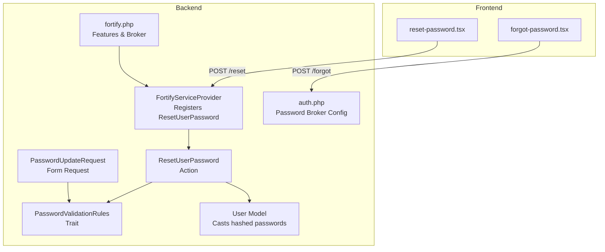
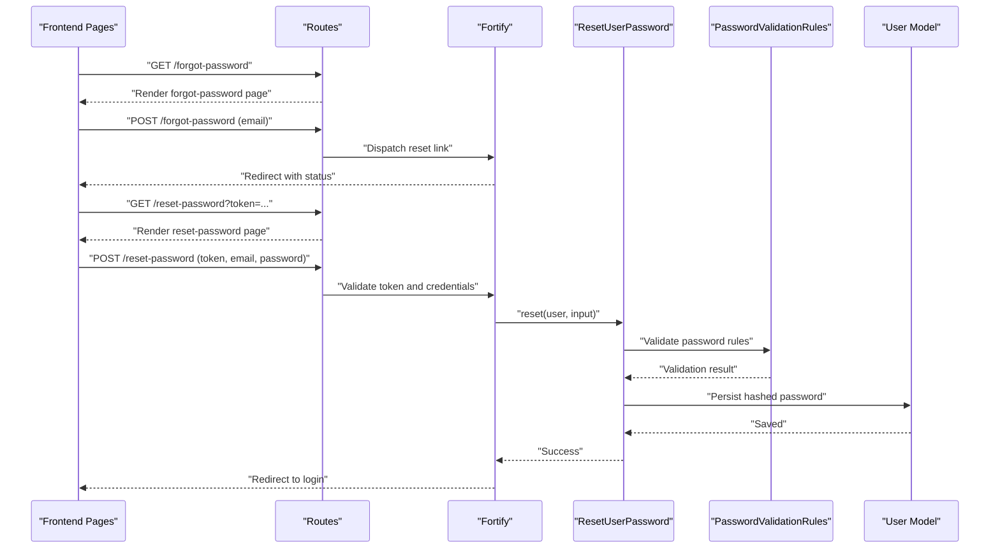
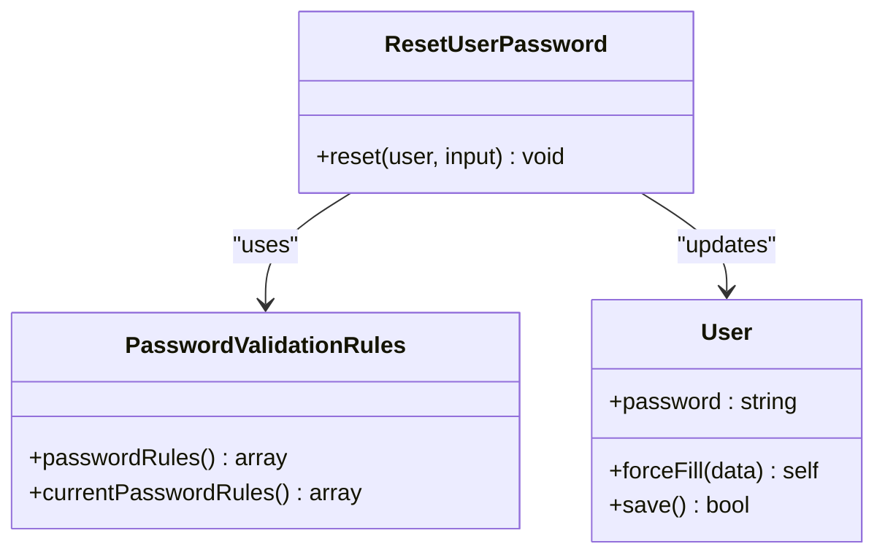
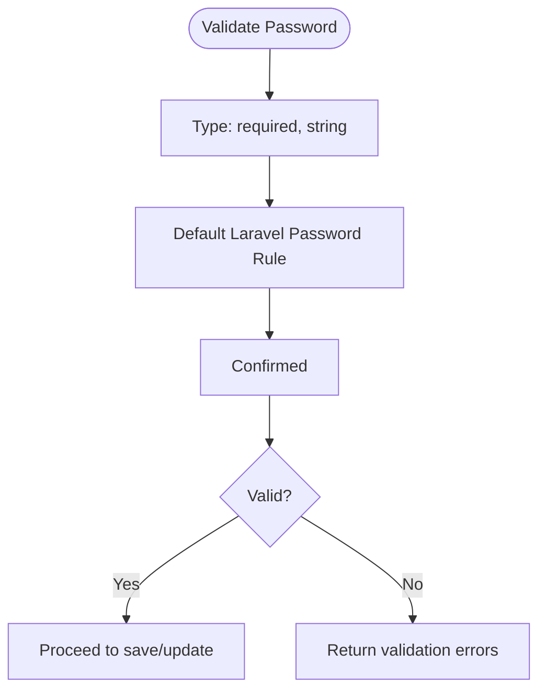
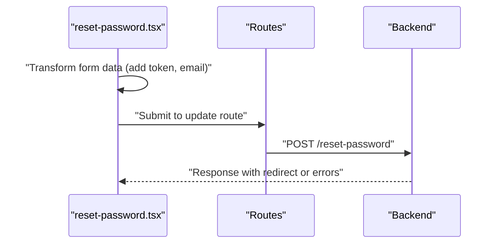
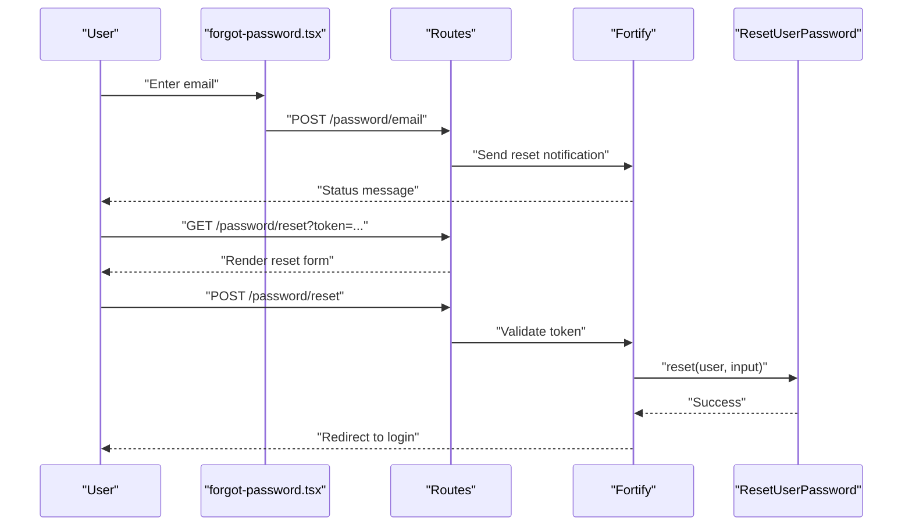
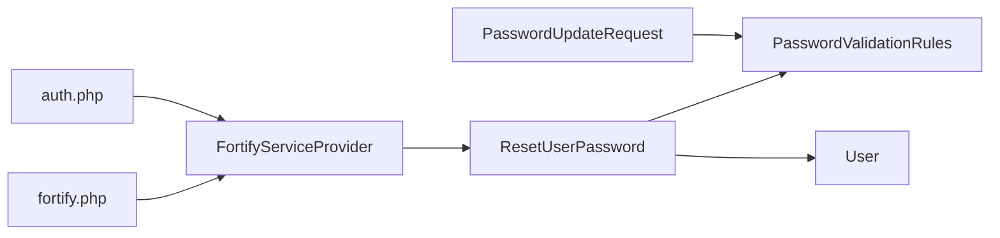

# Password Management

<cite>
**Referenced Files in This Document**
- [ResetUserPassword.php](file://app/Actions/Fortify/ResetUserPassword.php)
- [PasswordValidationRules.php](file://app/Concerns/PasswordValidationRules.php)
- [PasswordUpdateRequest.php](file://app/Http/Requests/Settings/PasswordUpdateRequest.php)
- [FortifyServiceProvider.php](file://app/Providers/FortifyServiceProvider.php)
- [fortify.php](file://config/fortify.php)
- [auth.php](file://config/auth.php)
- [User.php](file://app/Models/User.php)
- [reset-password.tsx](file://resources/js/pages/auth/reset-password.tsx)
- [forgot-password.tsx](file://resources/js/pages/auth/forgot-password.tsx)
- [PasswordResetTest.php](file://tests/Feature/Auth/PasswordResetTest.php)
- [web.php](file://routes/web.php)
</cite>

## Table of Contents
1. [Introduction](#introduction)
2. [Project Structure](#project-structure)
3. [Core Components](#core-components)
4. [Architecture Overview](#architecture-overview)
5. [Detailed Component Analysis](#detailed-component-analysis)
6. [Dependency Analysis](#dependency-analysis)
7. [Performance Considerations](#performance-considerations)
8. [Troubleshooting Guide](#troubleshooting-guide)
9. [Conclusion](#conclusion)
10. [Appendices](#appendices)

## Introduction
This document explains the password management system with a focus on password reset functionality and validation rules. It covers how Laravel’s password broker integrates with the application, the validation rules applied to passwords, the end-to-end reset workflow, and practical guidance for customization and troubleshooting.

## Project Structure
The password management implementation spans backend service providers, validation traits, form requests, and frontend pages. The Laravel Fortify integration wires the reset flow, while custom validation ensures strong, consistent password policies across the application.

**Diagram sources**
- [FortifyServiceProvider.php:43-49](file://app/Providers/FortifyServiceProvider.php#L43-L49)
- [ResetUserPassword.php:19-28](file://app/Actions/Fortify/ResetUserPassword.php#L19-L28)
- [PasswordValidationRules.php:15-28](file://app/Concerns/PasswordValidationRules.php#L15-L28)
- [PasswordUpdateRequest.php:18-24](file://app/Http/Requests/Settings/PasswordUpdateRequest.php#L18-L24)
- [auth.php:95-102](file://config/auth.php#L95-L102)
- [fortify.php:31](file://config/fortify.php#L31)
- [User.php:42-51](file://app/Models/User.php#L42-L51)
- [forgot-password.tsx:24](file://resources/js/pages/auth/forgot-password.tsx#L24)
- [reset-password.tsx:21-24](file://resources/js/pages/auth/reset-password.tsx#L21-L24)

**Section sources**
- [FortifyServiceProvider.php:33-49](file://app/Providers/FortifyServiceProvider.php#L33-L49)
- [ResetUserPassword.php:10-28](file://app/Actions/Fortify/ResetUserPassword.php#L10-L28)
- [PasswordValidationRules.php:8-29](file://app/Concerns/PasswordValidationRules.php#L8-L29)
- [PasswordUpdateRequest.php:9-25](file://app/Http/Requests/Settings/PasswordUpdateRequest.php#L9-L25)
- [auth.php:95-102](file://config/auth.php#L95-L102)
- [fortify.php:31](file://config/fortify.php#L31)
- [User.php:42-51](file://app/Models/User.php#L42-L51)
- [forgot-password.tsx:24](file://resources/js/pages/auth/forgot-password.tsx#L24)
- [reset-password.tsx:21-24](file://resources/js/pages/auth/reset-password.tsx#L21-L24)

## Core Components
- ResetUserPassword action class: Validates and updates the user’s password using the shared validation rules.
- PasswordValidationRules trait: Centralizes password validation rules and current password rules for reuse.
- PasswordUpdateRequest form request: Applies the same validation rules for password updates in settings.
- FortifyServiceProvider: Registers the ResetUserPassword action with Laravel Fortify.
- Fortify configuration: Enables password reset feature and sets the password broker.
- Authentication configuration: Defines the password reset broker, token table, expiration, and throttling.
- User model: Hashes passwords via casting for secure storage.

**Section sources**
- [ResetUserPassword.php:10-28](file://app/Actions/Fortify/ResetUserPassword.php#L10-L28)
- [PasswordValidationRules.php:8-29](file://app/Concerns/PasswordValidationRules.php#L8-L29)
- [PasswordUpdateRequest.php:9-25](file://app/Http/Requests/Settings/PasswordUpdateRequest.php#L9-L25)
- [FortifyServiceProvider.php:43-49](file://app/Providers/FortifyServiceProvider.php#L43-L49)
- [fortify.php:169-189](file://config/fortify.php#L169-L189)
- [auth.php:95-102](file://config/auth.php#L95-L102)
- [User.php:42-51](file://app/Models/User.php#L42-L51)

## Architecture Overview
The password reset flow leverages Laravel’s built-in password broker and Fortify’s action registration. The frontend triggers requests to backend routes that are handled by Fortify, which delegates to the ResetUserPassword action for validation and persistence.

**Diagram sources**
- [forgot-password.tsx:24](file://resources/js/pages/auth/forgot-password.tsx#L24)
- [reset-password.tsx:21-24](file://resources/js/pages/auth/reset-password.tsx#L21-L24)
- [FortifyServiceProvider.php:43-49](file://app/Providers/FortifyServiceProvider.php#L43-L49)
- [ResetUserPassword.php:19-28](file://app/Actions/Fortify/ResetUserPassword.php#L19-L28)
- [PasswordValidationRules.php:15-18](file://app/Concerns/PasswordValidationRules.php#L15-L18)
- [User.php:42-51](file://app/Models/User.php#L42-L51)

## Detailed Component Analysis

### ResetUserPassword Action
- Purpose: Validates and resets a user’s password upon successful token verification.
- Validation: Uses the shared password rules from the trait to ensure compliance.
- Persistence: Forces a password update and saves the user record.

**Diagram sources**
- [ResetUserPassword.php:10-28](file://app/Actions/Fortify/ResetUserPassword.php#L10-L28)
- [PasswordValidationRules.php:8-29](file://app/Concerns/PasswordValidationRules.php#L8-L29)
- [User.php:42-51](file://app/Models/User.php#L42-L51)

**Section sources**
- [ResetUserPassword.php:19-28](file://app/Actions/Fortify/ResetUserPassword.php#L19-L28)

### Password Validation Rules
- Default password rules: Required, string, default Laravel Password rule, confirmed.
- Current password rules: Required, string, current_password check.
- Reuse: Applied consistently in ResetUserPassword and PasswordUpdateRequest.

**Diagram sources**
- [PasswordValidationRules.php:15-18](file://app/Concerns/PasswordValidationRules.php#L15-L18)
- [PasswordUpdateRequest.php:20-23](file://app/Http/Requests/Settings/PasswordUpdateRequest.php#L20-L23)

**Section sources**
- [PasswordValidationRules.php:15-28](file://app/Concerns/PasswordValidationRules.php#L15-L28)
- [PasswordUpdateRequest.php:18-24](file://app/Http/Requests/Settings/PasswordUpdateRequest.php#L18-L24)

### Frontend Password Reset Page
- Pre-populates email and token from the route parameters.
- Submits to the password reset endpoint with transformed payload.
- Provides feedback for validation errors and loading states.

**Diagram sources**
- [reset-password.tsx:21-24](file://resources/js/pages/auth/reset-password.tsx#L21-L24)

**Section sources**
- [reset-password.tsx:16-88](file://resources/js/pages/auth/reset-password.tsx#L16-L88)

### Password Reset Workflow
- Request reset link: User submits email; notification is sent.
- Reset page: Tokenized link opens the reset form.
- Update password: Backend validates and persists the new password.

**Diagram sources**
- [forgot-password.tsx:24](file://resources/js/pages/auth/forgot-password.tsx#L24)
- [reset-password.tsx:21-24](file://resources/js/pages/auth/reset-password.tsx#L21-L24)
- [FortifyServiceProvider.php:43-49](file://app/Providers/FortifyServiceProvider.php#L43-L49)
- [ResetUserPassword.php:19-28](file://app/Actions/Fortify/ResetUserPassword.php#L19-L28)

**Section sources**
- [PasswordResetTest.php:30-80](file://tests/Feature/Auth/PasswordResetTest.php#L30-L80)

## Dependency Analysis
- FortifyServiceProvider registers ResetUserPassword with Fortify.
- ResetUserPassword depends on PasswordValidationRules for validation.
- PasswordUpdateRequest also consumes PasswordValidationRules for settings updates.
- auth.php configures the password broker, token table, expiration, and throttling.
- fortify.php enables password reset feature and sets the broker name.
- User model casts password to hashed for secure storage.

**Diagram sources**
- [FortifyServiceProvider.php:43-49](file://app/Providers/FortifyServiceProvider.php#L43-L49)
- [ResetUserPassword.php:10-28](file://app/Actions/Fortify/ResetUserPassword.php#L10-L28)
- [PasswordValidationRules.php:8-29](file://app/Concerns/PasswordValidationRules.php#L8-L29)
- [PasswordUpdateRequest.php:9-25](file://app/Http/Requests/Settings/PasswordUpdateRequest.php#L9-L25)
- [auth.php:95-102](file://config/auth.php#L95-L102)
- [fortify.php:31](file://config/fortify.php#L31)

**Section sources**
- [FortifyServiceProvider.php:43-49](file://app/Providers/FortifyServiceProvider.php#L43-L49)
- [auth.php:95-102](file://config/auth.php#L95-L102)
- [fortify.php:31](file://config/fortify.php#L31)

## Performance Considerations
- Password hashing is handled automatically by the User model’s cast, ensuring efficient and secure storage.
- Fortify’s rate limiters protect against brute force attempts on login and related endpoints.
- Keep validation rules aligned with security needs; avoid overly strict rules that could degrade UX without proportionate security gains.

[No sources needed since this section provides general guidance]

## Troubleshooting Guide
Common issues and resolutions:
- Invalid token or expired reset link:
  - Symptom: Session errors on the reset page.
  - Cause: Token mismatch or expired token.
  - Resolution: Ensure the token is fresh and matches the user’s record; verify the password broker configuration and token expiration.
- Password validation failures:
  - Symptom: Errors on password or confirmation fields.
  - Cause: Violation of validation rules (length, complexity, confirmation).
  - Resolution: Review the validation rules and adjust client-side hints accordingly.
- Redirect loops after reset:
  - Symptom: Stuck on the reset page or login.
  - Cause: Incorrect home path or middleware configuration.
  - Resolution: Verify the home path and middleware settings in the configuration.

**Section sources**
- [PasswordResetTest.php:82-94](file://tests/Feature/Auth/PasswordResetTest.php#L82-L94)
- [auth.php:95-102](file://config/auth.php#L95-L102)
- [fortify.php:76](file://config/fortify.php#L76)

## Conclusion
The application implements a robust password reset system by combining Laravel’s password broker, Fortify’s action registration, and centralized validation rules. The design emphasizes security through hashing, token-based resets, and strong validation, while maintaining a clean separation of concerns across backend actions, validation traits, and frontend forms.

[No sources needed since this section summarizes without analyzing specific files]

## Appendices

### Password Policy Configuration Examples
- Enforce minimum length and character variety using the default Laravel Password rule.
- Adjust token expiration and throttling in the authentication configuration to balance usability and security.
- Customize the home path after successful reset to align with application routing.

**Section sources**
- [PasswordValidationRules.php:15-18](file://app/Concerns/PasswordValidationRules.php#L15-L18)
- [auth.php:95-102](file://config/auth.php#L95-L102)
- [fortify.php:76](file://config/fortify.php#L76)