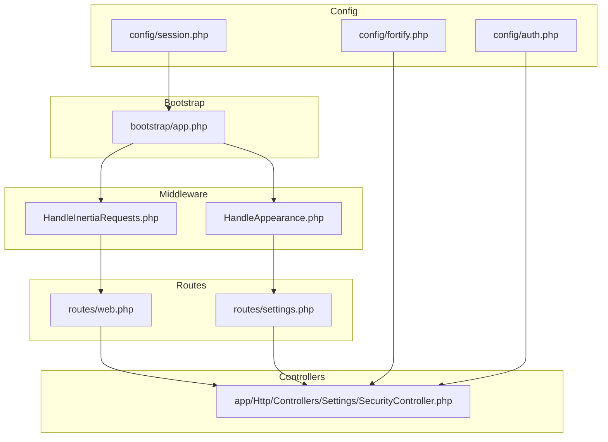
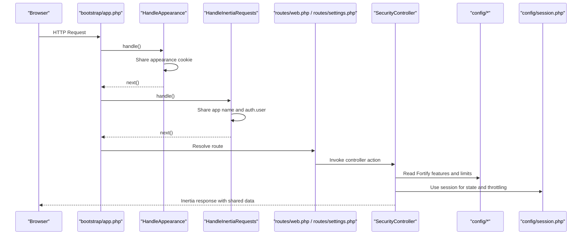
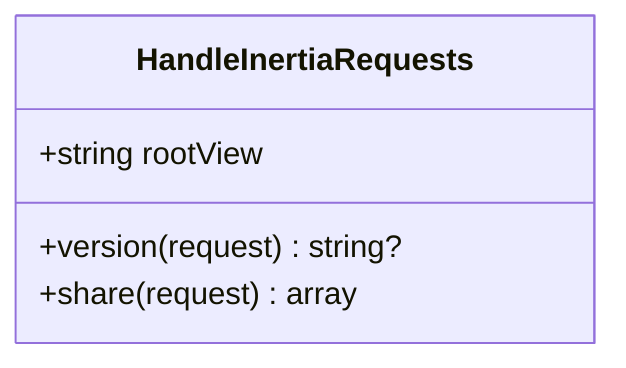
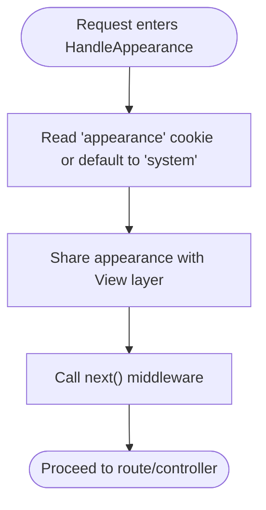
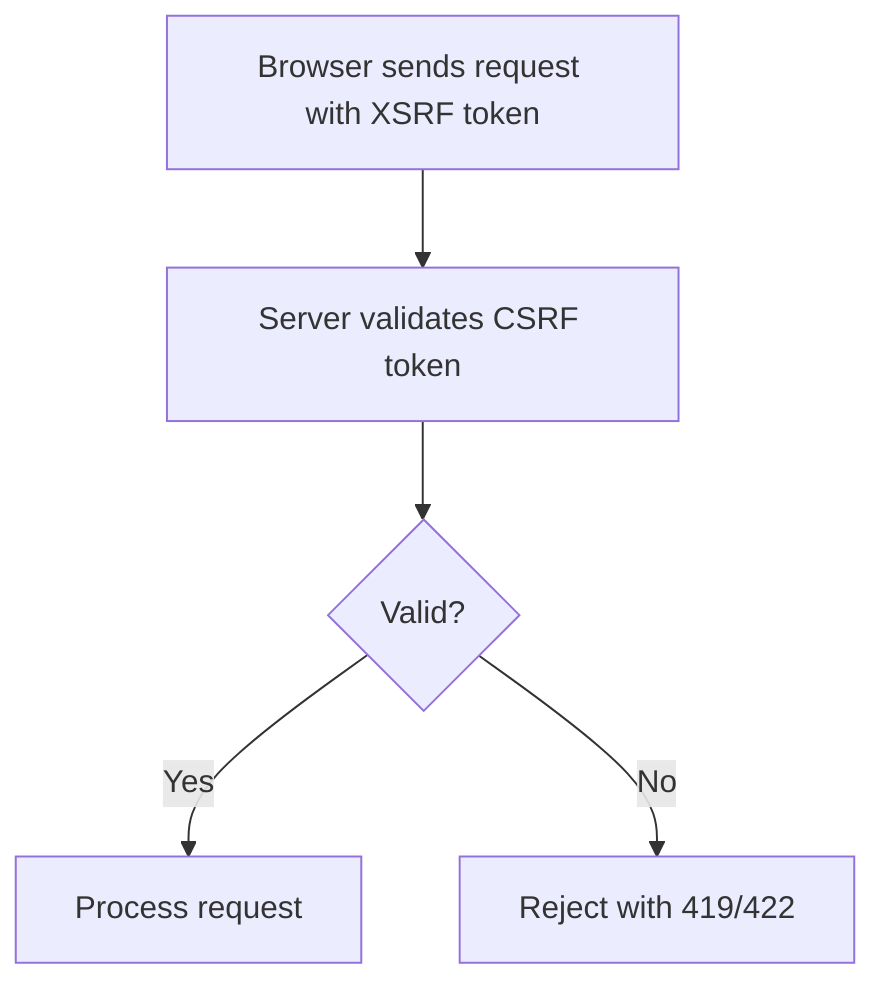
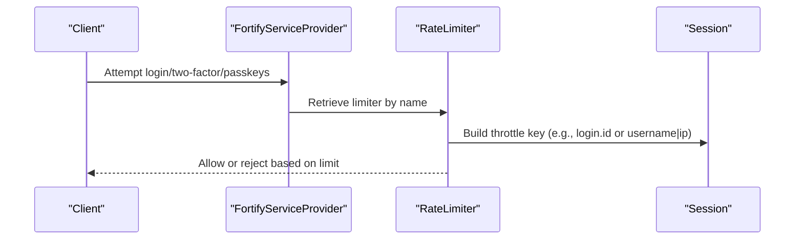
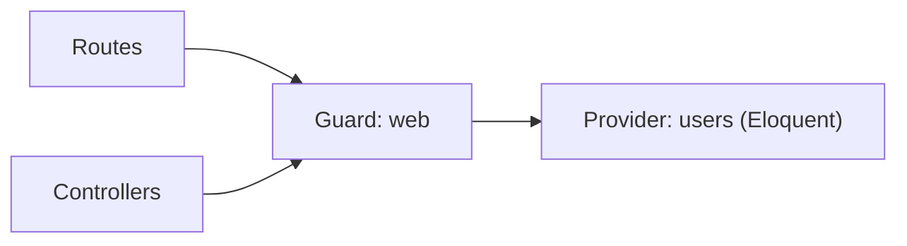
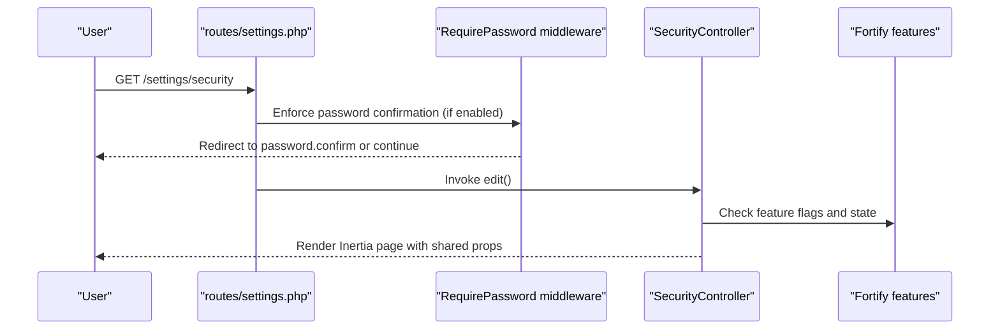
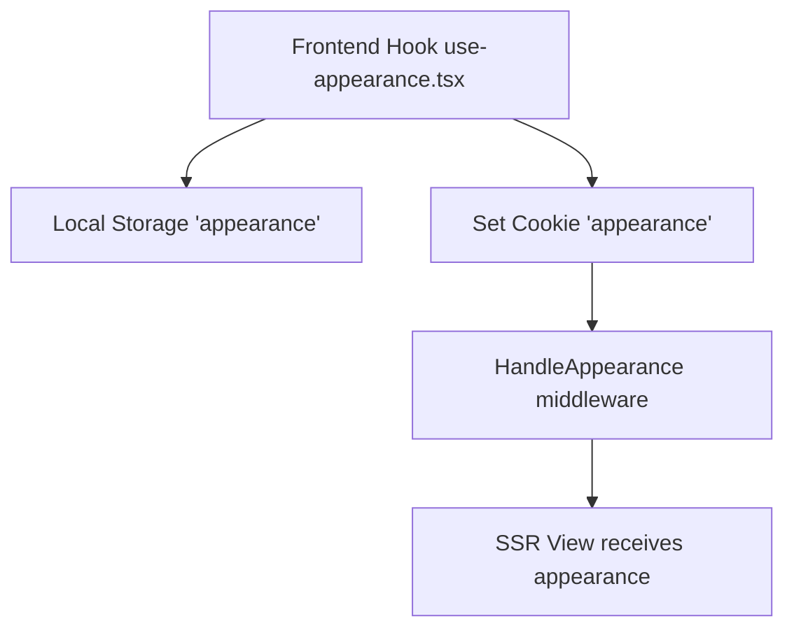
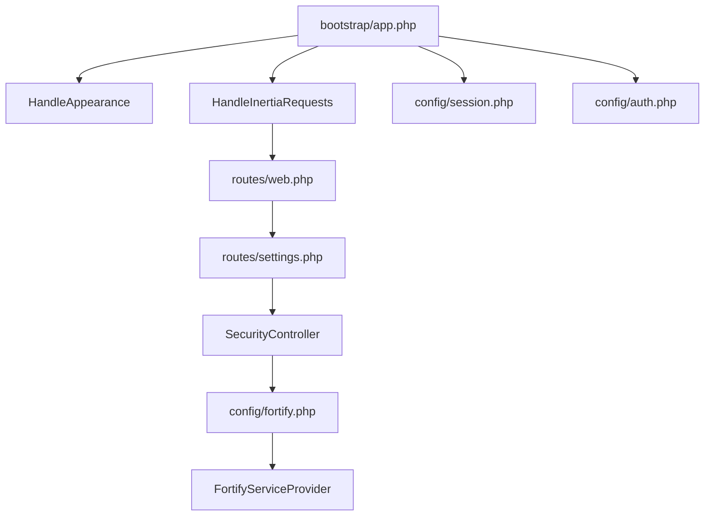

# Security Middleware & Protection

<cite>
**Referenced Files in This Document**
- [HandleInertiaRequests.php](file://app/Http/Middleware/HandleInertiaRequests.php)
- [HandleAppearance.php](file://app/Http/Middleware/HandleAppearance.php)
- [session.php](file://config/session.php)
- [auth.php](file://config/auth.php)
- [fortify.php](file://config/fortify.php)
- [app.php](file://bootstrap/app.php)
- [FortifyServiceProvider.php](file://app/Providers/FortifyServiceProvider.php)
- [web.php](file://routes/web.php)
- [settings.php](file://routes/settings.php)
- [SecurityController.php](file://app/Http/Controllers/Settings/SecurityController.php)
- [security.tsx](file://resources/js/pages/settings/security.tsx)
- [use-appearance.tsx](file://resources/js/hooks/use-appearance.tsx)
- [.htaccess](file://public/.htaccess)
</cite>

## Table of Contents
1. [Introduction](#introduction)
2. [Project Structure](#project-structure)
3. [Core Components](#core-components)
4. [Architecture Overview](#architecture-overview)
5. [Detailed Component Analysis](#detailed-component-analysis)
6. [Dependency Analysis](#dependency-analysis)
7. [Performance Considerations](#performance-considerations)
8. [Troubleshooting Guide](#troubleshooting-guide)
9. [Conclusion](#conclusion)
10. [Appendices](#appendices)

## Introduction
This document explains the security middleware and protections implemented in the SmartExam authentication system. It focuses on how middleware maintains authentication state across frontend requests, how appearance preferences integrate into the authentication flow, and how session management, CSRF considerations, and rate limiting are configured. It also documents authentication guards, request/response handling patterns, and provides security best practices tailored to this codebase.

## Project Structure
Security middleware and authentication are integrated at the framework bootstrap level and applied globally to web routes. The Inertia middleware shares authentication state with the frontend, while a dedicated middleware sets appearance preferences for SSR. Fortify handles authentication views and rate limiting, and session configuration governs cookie security and lifetime.

**Diagram sources**
- [app.php:17-25](file://bootstrap/app.php#L17-L25)
- [HandleInertiaRequests.php:8-47](file://app/Http/Middleware/HandleInertiaRequests.php#L8-L47)
- [HandleAppearance.php:10-23](file://app/Http/Middleware/HandleAppearance.php#L10-L23)
- [auth.php:18-45](file://config/auth.php#L18-L45)
- [session.php:21-232](file://config/session.php#L21-L232)
- [fortify.php:18-125](file://config/fortify.php#L18-L125)
- [web.php:5-23](file://routes/web.php#L5-L23)
- [settings.php:10-31](file://routes/settings.php#L10-L31)
- [SecurityController.php:19-49](file://app/Http/Controllers/Settings/SecurityController.php#L19-L49)

**Section sources**
- [app.php:17-25](file://bootstrap/app.php#L17-L25)
- [HandleInertiaRequests.php:8-47](file://app/Http/Middleware/HandleInertiaRequests.php#L8-L47)
- [HandleAppearance.php:10-23](file://app/Http/Middleware/HandleAppearance.php#L10-L23)
- [auth.php:18-45](file://config/auth.php#L18-L45)
- [session.php:21-232](file://config/session.php#L21-L232)
- [fortify.php:18-125](file://config/fortify.php#L18-L125)
- [web.php:5-23](file://routes/web.php#L5-L23)
- [settings.php:10-31](file://routes/settings.php#L10-L31)
- [SecurityController.php:19-49](file://app/Http/Controllers/Settings/SecurityController.php#L19-L49)

## Core Components
- HandleInertiaRequests: Shares application-wide data (including authentication state) with the frontend on initial page loads and subsequent Inertia requests.
- HandleAppearance: Sets a shared appearance preference for server-rendered pages, influencing theme selection and cookie handling.
- Session configuration: Controls driver, lifetime, cookie attributes, and serialization for secure session storage.
- Fortify rate limiting: Enforces throttling for login, two-factor challenge, and passkeys flows.
- Authentication guards: Defines the session-based guard used by the application.

**Section sources**
- [HandleInertiaRequests.php:36-46](file://app/Http/Middleware/HandleInertiaRequests.php#L36-L46)
- [HandleAppearance.php:17-22](file://app/Http/Middleware/HandleAppearance.php#L17-L22)
- [session.php:21-232](file://config/session.php#L21-L232)
- [FortifyServiceProvider.php:95-116](file://app/Providers/FortifyServiceProvider.php#L95-L116)
- [auth.php:18-45](file://config/auth.php#L18-L45)

## Architecture Overview
The security middleware pipeline integrates with the Inertia stack to maintain authentication state and appearance preferences across requests. Session cookies are selectively encrypted, and rate limiting is enforced for authentication endpoints. The frontend consumes shared data from the backend to render authenticated UI and manage theme preferences.

**Diagram sources**
- [app.php:17-25](file://bootstrap/app.php#L17-L25)
- [HandleAppearance.php:17-22](file://app/Http/Middleware/HandleAppearance.php#L17-L22)
- [HandleInertiaRequests.php:36-46](file://app/Http/Middleware/HandleInertiaRequests.php#L36-L46)
- [web.php:5-23](file://routes/web.php#L5-L23)
- [settings.php:10-31](file://routes/settings.php#L10-L31)
- [SecurityController.php:19-49](file://app/Http/Controllers/Settings/SecurityController.php#L19-L49)
- [session.php:21-232](file://config/session.php#L21-L232)

## Detailed Component Analysis

### HandleInertiaRequests Middleware
Responsibilities:
- Defines the root template for Inertia responses.
- Extends shared data to the frontend, including application name and the authenticated user object.
- Shares UI state (e.g., sidebar open/closed) derived from cookies.

Impact on authentication state:
- By sharing the authenticated user object, the frontend can conditionally render authenticated UI and protect routes accordingly.
- Ensures the frontend has access to the current user identity without requiring additional API calls.

**Diagram sources**
- [HandleInertiaRequests.php:8-47](file://app/Http/Middleware/HandleInertiaRequests.php#L8-L47)

**Section sources**
- [HandleInertiaRequests.php:17](file://app/Http/Middleware/HandleInertiaRequests.php#L17)
- [HandleInertiaRequests.php:24-27](file://app/Http/Middleware/HandleInertiaRequests.php#L24-L27)
- [HandleInertiaRequests.php:36-46](file://app/Http/Middleware/HandleInertiaRequests.php#L36-L46)

### HandleAppearance Middleware
Responsibilities:
- Reads the appearance cookie (defaulting to system) and shares it with the view layer.
- Enables consistent theme rendering across server-side and client-side hydration.

Impact on authentication flows:
- While not directly enforcing authentication, it influences UI behavior for authenticated users and ensures consistent experience after login.

**Diagram sources**
- [HandleAppearance.php:17-22](file://app/Http/Middleware/HandleAppearance.php#L17-L22)

**Section sources**
- [HandleAppearance.php:17-22](file://app/Http/Middleware/HandleAppearance.php#L17-L22)

### Session Management and CSRF Protection
Session configuration:
- Driver, lifetime, encryption, cookie name/path/domain, secure flag, http-only, same-site, partitioned cookies, and serialization strategy are configurable.
- CSRF protection is implicitly handled by Laravel’s built-in CSRF middleware (applied via the web middleware group), which validates XSRF tokens for state-changing requests.

CSRF handling in practice:
- The frontend sends the XSRF token via headers and cookies; the server validates it for protected actions.
- The Apache configuration forwards the XSRF token header to the application.

**Diagram sources**
- [session.php:130-202](file://config/session.php#L130-L202)
- [.htaccess:13-14](file://public/.htaccess#L13-L14)

**Section sources**
- [session.php:21-232](file://config/session.php#L21-L232)
- [.htaccess:13-14](file://public/.htaccess#L13-L14)

### Rate Limiting Implementation
Fortify-driven throttling:
- Login attempts are limited per email+IP combination.
- Two-factor challenges and passkeys operations have dedicated limiters.
- The Fortify service provider registers these limiters and associates them with named keys derived from session and request data.

**Diagram sources**
- [FortifyServiceProvider.php:95-116](file://app/Providers/FortifyServiceProvider.php#L95-L116)
- [fortify.php:117-125](file://config/fortify.php#L117-L125)

**Section sources**
- [FortifyServiceProvider.php:95-116](file://app/Providers/FortifyServiceProvider.php#L95-L116)
- [fortify.php:117-125](file://config/fortify.php#L117-L125)

### Authentication Guards Setup
- The application defaults to a session-based guard named “web”.
- The provider is “users”, backed by the Eloquent model.
- This guard is used by routes and controllers to enforce authentication.

**Diagram sources**
- [auth.php:18-45](file://config/auth.php#L18-L45)

**Section sources**
- [auth.php:18-45](file://config/auth.php#L18-L45)

### Request/Response Handling Patterns
- Web routes are protected using middleware stacks that include authentication and verification checks.
- Inertia responses receive shared data (including auth state) from the Inertia middleware.
- Security settings page requires password confirmation when enabled by Fortify features.

**Diagram sources**
- [settings.php:20-28](file://routes/settings.php#L20-L28)
- [SecurityController.php:19-49](file://app/Http/Controllers/Settings/SecurityController.php#L19-L49)

**Section sources**
- [settings.php:20-28](file://routes/settings.php#L20-L28)
- [SecurityController.php:19-49](file://app/Http/Controllers/Settings/SecurityController.php#L19-L49)

### Frontend Integration and Theme Handling
- The frontend reads the appearance preference and applies it to the document element.
- Appearance updates are persisted to both local storage and a cookie for SSR compatibility.
- The HandleAppearance middleware reads the cookie to align server-rendered views with client preferences.

**Diagram sources**
- [use-appearance.tsx:32-88](file://resources/js/hooks/use-appearance.tsx#L32-L88)
- [HandleAppearance.php:17-22](file://app/Http/Middleware/HandleAppearance.php#L17-L22)

**Section sources**
- [use-appearance.tsx:32-88](file://resources/js/hooks/use-appearance.tsx#L32-L88)
- [HandleAppearance.php:17-22](file://app/Http/Middleware/HandleAppearance.php#L17-L22)

## Dependency Analysis
- Middleware registration ties HandleAppearance and HandleInertiaRequests into the web middleware stack.
- Session configuration affects cookie behavior and encryption.
- Fortify configuration and service provider define rate limiting and authentication features.
- Routes apply authentication and password confirmation policies to security endpoints.

**Diagram sources**
- [app.php:17-25](file://bootstrap/app.php#L17-L25)
- [HandleInertiaRequests.php:8-47](file://app/Http/Middleware/HandleInertiaRequests.php#L8-L47)
- [HandleAppearance.php:10-23](file://app/Http/Middleware/HandleAppearance.php#L10-L23)
- [web.php:5-23](file://routes/web.php#L5-L23)
- [settings.php:10-31](file://routes/settings.php#L10-L31)
- [SecurityController.php:19-49](file://app/Http/Controllers/Settings/SecurityController.php#L19-L49)
- [fortify.php:18-125](file://config/fortify.php#L18-L125)
- [FortifyServiceProvider.php:95-116](file://app/Providers/FortifyServiceProvider.php#L95-L116)
- [session.php:21-232](file://config/session.php#L21-L232)
- [auth.php:18-45](file://config/auth.php#L18-L45)

**Section sources**
- [app.php:17-25](file://bootstrap/app.php#L17-L25)
- [HandleInertiaRequests.php:8-47](file://app/Http/Middleware/HandleInertiaRequests.php#L8-L47)
- [HandleAppearance.php:10-23](file://app/Http/Middleware/HandleAppearance.php#L10-L23)
- [web.php:5-23](file://routes/web.php#L5-L23)
- [settings.php:10-31](file://routes/settings.php#L10-L31)
- [SecurityController.php:19-49](file://app/Http/Controllers/Settings/SecurityController.php#L19-L49)
- [fortify.php:18-125](file://config/fortify.php#L18-L125)
- [FortifyServiceProvider.php:95-116](file://app/Providers/FortifyServiceProvider.php#L95-L116)
- [session.php:21-232](file://config/session.php#L21-L232)
- [auth.php:18-45](file://config/auth.php#L18-L45)

## Performance Considerations
- Keep session lifetime reasonable to reduce idle session overhead.
- Prefer database or Redis drivers for distributed environments to avoid file I/O bottlenecks.
- Use HTTP caching headers judiciously for static assets; rely on Inertia’s asset versioning for cache busting.
- Monitor rate limiter thresholds to balance security and usability.

## Troubleshooting Guide
Common issues and resolutions:
- Authentication state not visible in the frontend:
  - Verify that the Inertia middleware is registered in the web stack and that the auth guard is correctly configured.
  - Ensure the authenticated user is attached to the request before the Inertia middleware runs.
- Appearance preference not applied on SSR:
  - Confirm the appearance cookie is set and readable by the HandleAppearance middleware.
  - Check that the cookie SameSite and domain/path settings are appropriate for your deployment.
- CSRF failures on state-changing requests:
  - Ensure the XSRF token is included in headers and that the server forwards the relevant headers.
  - Verify session cookie attributes (Secure, HttpOnly, SameSite) match your deployment environment.
- Excessive rate limiting:
  - Review Fortify rate limiter configurations and adjust thresholds as needed.
  - Consider increasing limits for trusted clients or implementing adaptive throttling.

**Section sources**
- [HandleInertiaRequests.php:36-46](file://app/Http/Middleware/HandleInertiaRequests.php#L36-L46)
- [HandleAppearance.php:17-22](file://app/Http/Middleware/HandleAppearance.php#L17-L22)
- [session.php:130-202](file://config/session.php#L130-L202)
- [FortifyServiceProvider.php:95-116](file://app/Providers/FortifyServiceProvider.php#L95-L116)
- [.htaccess:13-14](file://public/.htaccess#L13-L14)

## Conclusion
The SmartExam authentication system leverages middleware to propagate authentication state to the frontend and to standardize appearance preferences for SSR. Session configuration and CSRF protections are handled through Laravel’s built-in mechanisms, while Fortify provides robust rate limiting and feature toggles. Together, these components create a secure, maintainable authentication pipeline aligned with modern best practices.

## Appendices

### Security Best Practices for This Codebase
- Secure session cookies:
  - Enable HTTPS-only cookies in production and set SameSite to a strict value where feasible.
  - Avoid storing sensitive data in cookies; rely on session-backed state.
- Authentication timeouts:
  - Align session lifetime with organizational policy; consider shorter lifetimes for higher-risk operations.
  - Use password confirmation middleware for sensitive actions.
- CSRF protection:
  - Ensure XSRF tokens are forwarded and validated for all state-changing requests.
- Rate limiting:
  - Monitor and tune rate limiter thresholds based on traffic patterns and threat modeling.
- Cookie hygiene:
  - Encrypt sessions when using file or cookie drivers in production.
  - Use partitioned cookies for cross-site contexts when applicable.

[No sources needed since this section provides general guidance]