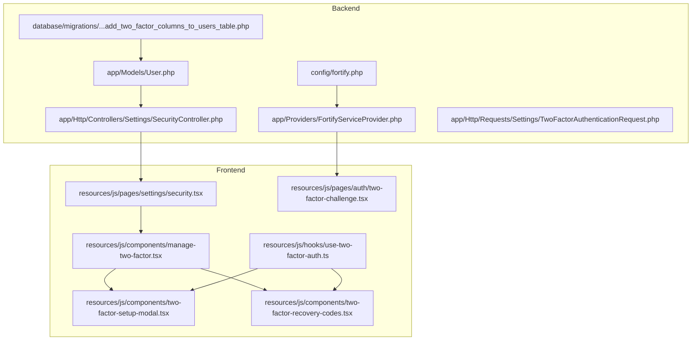
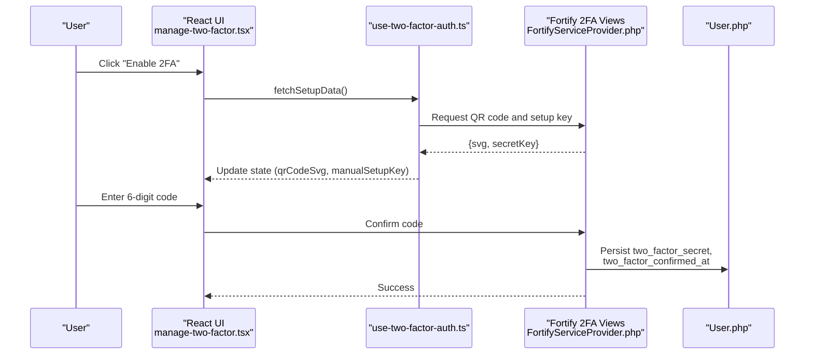
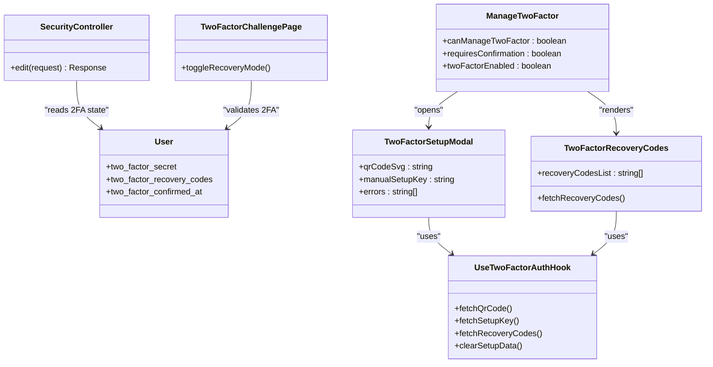
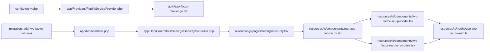
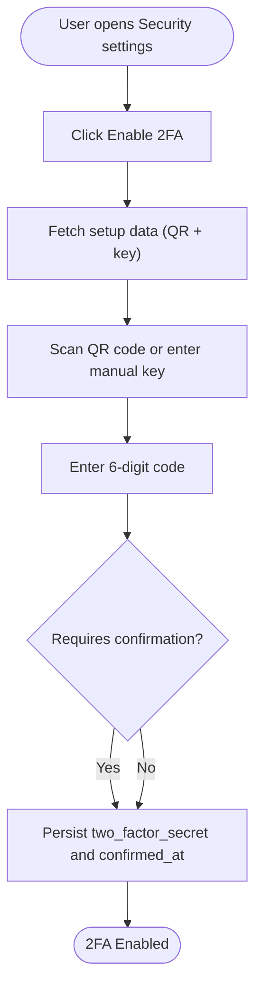

# Two-Factor Authentication

<cite>
**Referenced Files in This Document**
- [fortify.php](file://config/fortify.php)
- [FortifyServiceProvider.php](file://app/Providers/FortifyServiceProvider.php)
- [User.php](file://app/Models/User.php)
- [SecurityController.php](file://app/Http/Controllers/Settings/SecurityController.php)
- [TwoFactorAuthenticationRequest.php](file://app/Http/Requests/Settings/TwoFactorAuthenticationRequest.php)
- [2025_08_14_170933_add_two_factor_columns_to_users_table.php](file://database/migrations/2025_08_14_170933_add_two_factor_columns_to_users_table.php)
- [security.tsx](file://resources/js/pages/settings/security.tsx)
- [manage-two-factor.tsx](file://resources/js/components/manage-two-factor.tsx)
- [two-factor-setup-modal.tsx](file://resources/js/components/two-factor-setup-modal.tsx)
- [two-factor-recovery-codes.tsx](file://resources/js/components/two-factor-recovery-codes.tsx)
- [two-factor-challenge.tsx](file://resources/js/pages/auth/two-factor-challenge.tsx)
- [use-two-factor-auth.ts](file://resources/js/hooks/use-two-factor-auth.ts)
- [TwoFactorChallengeTest.php](file://tests/Feature/Auth/TwoFactorChallengeTest.php)
</cite>

## Table of Contents
1. [Introduction](#introduction)
2. [Project Structure](#project-structure)
3. [Core Components](#core-components)
4. [Architecture Overview](#architecture-overview)
5. [Detailed Component Analysis](#detailed-component-analysis)
6. [Dependency Analysis](#dependency-analysis)
7. [Performance Considerations](#performance-considerations)
8. [Troubleshooting Guide](#troubleshooting-guide)
9. [Conclusion](#conclusion)
10. [Appendices](#appendices)

## Introduction
This document explains SmartExam’s two-factor authentication (2FA) implementation powered by Laravel Fortify. It covers configuration, setup flow, QR code and backup code handling, login challenge behavior, and frontend integration with React components. It also documents how to manage 2FA settings, disable 2FA, regenerate recovery codes, customize behavior, and address failure scenarios. Security considerations and best practices are included to guide safe deployment and operation.

## Project Structure
SmartExam integrates 2FA across backend configuration, model attributes, controller rendering, and frontend React components. The Fortify configuration enables 2FA with confirmation and rate limiting. The User model includes 2FA-related columns. Frontend pages and components render the 2FA challenge and management UI.

**Diagram sources**
- [fortify.php:177-183](file://config/fortify.php#L177-L183)
- [FortifyServiceProvider.php:83-85](file://app/Providers/FortifyServiceProvider.php#L83-L85)
- [User.php:23-25](file://app/Models/User.php#L23-L25)
- [SecurityController.php:19-56](file://app/Http/Controllers/Settings/SecurityController.php#L19-L56)
- [2025_08_14_170933_add_two_factor_columns_to_users_table.php:14-17](file://database/migrations/2025_08_14_170933_add_two_factor_columns_to_users_table.php#L14-L17)
- [security.tsx:130-136](file://resources/js/pages/settings/security.tsx#L130-L136)
- [manage-two-factor.tsx:17-126](file://resources/js/components/manage-two-factor.tsx#L17-L126)
- [two-factor-setup-modal.tsx:244-352](file://resources/js/components/two-factor-setup-modal.tsx#L244-L352)
- [two-factor-recovery-codes.tsx:21-165](file://resources/js/components/two-factor-recovery-codes.tsx#L21-L165)
- [two-factor-challenge.tsx:15-134](file://resources/js/pages/auth/two-factor-challenge.tsx#L15-L134)
- [use-two-factor-auth.ts:22-112](file://resources/js/hooks/use-two-factor-auth.ts#L22-L112)

**Section sources**
- [fortify.php:177-183](file://config/fortify.php#L177-L183)
- [FortifyServiceProvider.php:83-85](file://app/Providers/FortifyServiceProvider.php#L83-L85)
- [User.php:23-25](file://app/Models/User.php#L23-L25)
- [SecurityController.php:19-56](file://app/Http/Controllers/Settings/SecurityController.php#L19-L56)
- [2025_08_14_170933_add_two_factor_columns_to_users_table.php:14-17](file://database/migrations/2025_08_14_170933_add_two_factor_columns_to_users_table.php#L14-L17)
- [security.tsx:130-136](file://resources/js/pages/settings/security.tsx#L130-L136)
- [manage-two-factor.tsx:17-126](file://resources/js/components/manage-two-factor.tsx#L17-L126)
- [two-factor-setup-modal.tsx:244-352](file://resources/js/components/two-factor-setup-modal.tsx#L244-L352)
- [two-factor-recovery-codes.tsx:21-165](file://resources/js/components/two-factor-recovery-codes.tsx#L21-L165)
- [two-factor-challenge.tsx:15-134](file://resources/js/pages/auth/two-factor-challenge.tsx#L15-L134)
- [use-two-factor-auth.ts:22-112](file://resources/js/hooks/use-two-factor-auth.ts#L22-L112)

## Core Components
- Fortify 2FA configuration with confirmation and rate limiting
- User model with 2FA columns and trait
- Security settings controller exposing 2FA capability and state
- Frontend pages and components for 2FA management and challenge
- Hook for fetching QR code, setup key, and recovery codes

Key implementation highlights:
- Confirmation requirement and password confirmation are enabled for 2FA.
- Rate limiter enforces throttling for 2FA attempts.
- User model includes two_factor_secret, two_factor_recovery_codes, and two_factor_confirmed_at.
- Frontend components render enable/disable flows, QR code scanning/manual setup, and recovery code management.

**Section sources**
- [fortify.php:177-183](file://config/fortify.php#L177-L183)
- [fortify.php:117-125](file://config/fortify.php#L117-L125)
- [User.php:23-25](file://app/Models/User.php#L23-L25)
- [User.php:48-49](file://app/Models/User.php#L48-L49)
- [SecurityController.php:48-54](file://app/Http/Controllers/Settings/SecurityController.php#L48-L54)
- [use-two-factor-auth.ts:22-112](file://resources/js/hooks/use-two-factor-auth.ts#L22-L112)

## Architecture Overview
SmartExam’s 2FA architecture combines Fortify’s backend capabilities with Inertia-rendered React pages. The flow begins with enabling 2FA via the settings page, generating QR code and a manual setup key, verifying the code, and storing 2FA data on the user record. During login, users are challenged with a 6-digit OTP or a recovery code.

**Diagram sources**
- [manage-two-factor.tsx:98-109](file://resources/js/components/manage-two-factor.tsx#L98-L109)
- [use-two-factor-auth.ts:87-95](file://resources/js/hooks/use-two-factor-auth.ts#L87-L95)
- [FortifyServiceProvider.php:83-85](file://app/Providers/FortifyServiceProvider.php#L83-L85)
- [User.php:23-25](file://app/Models/User.php#L23-L25)

## Detailed Component Analysis

### Fortify 2FA Configuration
- Features::twoFactorAuthentication is enabled with confirm and confirmPassword options.
- A dedicated rate limiter “two-factor” is registered to throttle 2FA attempts per authenticated session ID.
- The two-factor challenge view is mapped to the Inertia page for the challenge flow.

Implementation details:
- Confirmation ensures the user re-confirms 2FA during certain operations.
- Password confirmation adds an extra security layer before managing 2FA.
- Rate limiting prevents brute-force attempts on 2FA challenges.

**Section sources**
- [fortify.php:177-183](file://config/fortify.php#L177-L183)
- [fortify.php:117-125](file://config/fortify.php#L117-L125)
- [FortifyServiceProvider.php:83-85](file://app/Providers/FortifyServiceProvider.php#L83-L85)
- [FortifyServiceProvider.php:97-101](file://app/Providers/FortifyServiceProvider.php#L97-L101)

### User Model and Database Columns
- The User model uses the TwoFactorAuthenticatable trait and exposes 2FA-related attributes.
- The migration adds three columns to the users table:
  - two_factor_secret: stores the TOTP secret
  - two_factor_recovery_codes: stores backup codes
  - two_factor_confirmed_at: marks when 2FA was confirmed

These columns persist the 2FA state and recovery mechanisms.

**Section sources**
- [User.php:35](file://app/Models/User.php#L35)
- [User.php:23-25](file://app/Models/User.php#L23-L25)
- [2025_08_14_170933_add_two_factor_columns_to_users_table.php:14-17](file://database/migrations/2025_08_14_170933_add_two_factor_columns_to_users_table.php#L14-L17)

### Security Settings Page and Controller
- The SecurityController prepares props for the settings page, including:
  - canManageTwoFactor: whether 2FA management is enabled
  - requiresConfirmation: whether confirmation is required
  - twoFactorEnabled: current 2FA status
- It validates state using TwoFactorAuthenticationRequest to ensure proper session state before rendering.

This ensures the frontend receives accurate flags to render enable/disable flows.

**Section sources**
- [SecurityController.php:19-56](file://app/Http/Controllers/Settings/SecurityController.php#L19-L56)
- [TwoFactorAuthenticationRequest.php:9-22](file://app/Http/Requests/Settings/TwoFactorAuthenticationRequest.php#L9-L22)

### Frontend: 2FA Management Component
- Renders enable/disable buttons depending on twoFactorEnabled.
- Integrates TwoFactorSetupModal for QR code scanning/manual setup and verification.
- Displays recovery codes via TwoFactorRecoveryCodes component.
- Uses use-two-factor-auth hook to fetch QR code, setup key, and recovery codes.

Behavior:
- On enable, if requiresConfirmation is true, the modal proceeds to a verification step.
- On disable, clears stored 2FA data.

**Section sources**
- [manage-two-factor.tsx:17-126](file://resources/js/components/manage-two-factor.tsx#L17-L126)
- [security.tsx:130-136](file://resources/js/pages/settings/security.tsx#L130-L136)

### Frontend: Setup Modal and Verification
- TwoFactorSetupModal orchestrates:
  - Step 1: QR code display and manual setup key
  - Step 2: 6-digit code verification
- Uses InputOTP for 6-digit entry and enforces digit-only input.
- Supports toggling between QR code and manual setup.

Flow:
- If requiresConfirmation is true, after scanning/manual setup, the user enters the 6-digit code to confirm.
- Otherwise, the modal closes automatically upon completion.

**Section sources**
- [two-factor-setup-modal.tsx:244-352](file://resources/js/components/two-factor-setup-modal.tsx#L244-L352)
- [two-factor-setup-modal.tsx:141-230](file://resources/js/components/two-factor-setup-modal.tsx#L141-L230)

### Frontend: Recovery Codes Management
- TwoFactorRecoveryCodes allows viewing and regenerating recovery codes.
- Visibility toggles securely reveal codes.
- Regeneration triggers a form submission and refreshes the list.

Best practice:
- Encourage users to store recovery codes in a secure password manager.

**Section sources**
- [two-factor-recovery-codes.tsx:21-165](file://resources/js/components/two-factor-recovery-codes.tsx#L21-L165)

### Frontend: Login Challenge Flow
- two-factor-challenge.tsx presents:
  - OTP input (6 digits) when not using recovery mode
  - Recovery code input when toggled
- Provides a toggle to switch between OTP and recovery code modes.
- Uses InputOTP with digit-only pattern and fixed length.

Failure handling:
- Displays validation errors and supports clearing on success or error.

**Section sources**
- [two-factor-challenge.tsx:15-134](file://resources/js/pages/auth/two-factor-challenge.tsx#L15-L134)

### Hook: use-two-factor-auth
- Centralizes fetching and clearing 2FA data:
  - fetchQrCode, fetchSetupKey, fetchRecoveryCodes
  - clearSetupData, clearTwoFactorAuthData
- Tracks errors and setup state (hasSetupData).

**Section sources**
- [use-two-factor-auth.ts:22-112](file://resources/js/hooks/use-two-factor-auth.ts#L22-L112)

### Class Diagram: 2FA-Related Components

**Diagram sources**
- [User.php:23-25](file://app/Models/User.php#L23-L25)
- [SecurityController.php:19-56](file://app/Http/Controllers/Settings/SecurityController.php#L19-L56)
- [manage-two-factor.tsx:17-126](file://resources/js/components/manage-two-factor.tsx#L17-L126)
- [two-factor-setup-modal.tsx:244-352](file://resources/js/components/two-factor-setup-modal.tsx#L244-L352)
- [two-factor-recovery-codes.tsx:21-165](file://resources/js/components/two-factor-recovery-codes.tsx#L21-L165)
- [two-factor-challenge.tsx:15-134](file://resources/js/pages/auth/two-factor-challenge.tsx#L15-L134)
- [use-two-factor-auth.ts:22-112](file://resources/js/hooks/use-two-factor-auth.ts#L22-L112)

## Dependency Analysis
- Fortify configuration depends on:
  - Features::twoFactorAuthentication with confirm and confirmPassword
  - RateLimiter “two-factor”
  - TwoFactorChallengeView mapped to the Inertia page
- The User model depends on:
  - TwoFactorAuthenticatable trait
  - Database columns for secrets and recovery codes
- Frontend components depend on:
  - Inertia forms and routes
  - use-two-factor-auth hook for data fetching

**Diagram sources**
- [fortify.php:177-183](file://config/fortify.php#L177-L183)
- [FortifyServiceProvider.php:83-85](file://app/Providers/FortifyServiceProvider.php#L83-L85)
- [SecurityController.php:19-56](file://app/Http/Controllers/Settings/SecurityController.php#L19-L56)
- [security.tsx:130-136](file://resources/js/pages/settings/security.tsx#L130-L136)
- [manage-two-factor.tsx:17-126](file://resources/js/components/manage-two-factor.tsx#L17-L126)
- [two-factor-setup-modal.tsx:244-352](file://resources/js/components/two-factor-setup-modal.tsx#L244-L352)
- [two-factor-recovery-codes.tsx:21-165](file://resources/js/components/two-factor-recovery-codes.tsx#L21-L165)
- [use-two-factor-auth.ts:22-112](file://resources/js/hooks/use-two-factor-auth.ts#L22-L112)
- [User.php:23-25](file://app/Models/User.php#L23-L25)
- [2025_08_14_170933_add_two_factor_columns_to_users_table.php:14-17](file://database/migrations/2025_08_14_170933_add_two_factor_columns_to_users_table.php#L14-L17)

**Section sources**
- [fortify.php:177-183](file://config/fortify.php#L177-L183)
- [FortifyServiceProvider.php:83-85](file://app/Providers/FortifyServiceProvider.php#L83-L85)
- [SecurityController.php:19-56](file://app/Http/Controllers/Settings/SecurityController.php#L19-L56)
- [security.tsx:130-136](file://resources/js/pages/settings/security.tsx#L130-L136)
- [manage-two-factor.tsx:17-126](file://resources/js/components/manage-two-factor.tsx#L17-L126)
- [two-factor-setup-modal.tsx:244-352](file://resources/js/components/two-factor-setup-modal.tsx#L244-L352)
- [two-factor-recovery-codes.tsx:21-165](file://resources/js/components/two-factor-recovery-codes.tsx#L21-L165)
- [use-two-factor-auth.ts:22-112](file://resources/js/hooks/use-two-factor-auth.ts#L22-L112)
- [User.php:23-25](file://app/Models/User.php#L23-L25)
- [2025_08_14_170933_add_two_factor_columns_to_users_table.php:14-17](file://database/migrations/2025_08_14_170933_add_two_factor_columns_to_users_table.php#L14-L17)

## Performance Considerations
- Rate limiting: The “two-factor” limiter restricts attempts per authenticated session, reducing brute-force risk.
- UI responsiveness: use-two-factor-auth batches QR code and setup key retrieval to minimize round trips.
- Rendering: The challenge page uses lightweight OTP input with digit-only validation to reduce parsing overhead.

Recommendations:
- Keep rate limits appropriate for your environment; adjust per-minute allowance if needed.
- Cache QR code SVGs server-side only if necessary, otherwise rely on client-side caching.
- Avoid excessive polling for recovery codes; fetch on visibility toggle or demand.

**Section sources**
- [FortifyServiceProvider.php:97-101](file://app/Providers/FortifyServiceProvider.php#L97-L101)
- [use-two-factor-auth.ts:87-95](file://resources/js/hooks/use-two-factor-auth.ts#L87-L95)

## Troubleshooting Guide
Common issues and resolutions:
- Challenge page redirects to login when not authenticated:
  - Ensure the user is logged in before accessing the 2FA challenge route.
  - Verify session state and that the challenge view is registered.
- 2FA setup fails to load QR code or setup key:
  - Confirm the enable action fetched setup data and that the modal is opened when hasSetupData is true.
  - Check network errors and ensure the hook’s fetch methods are invoked.
- Recovery codes not visible:
  - Toggle visibility to trigger fetch if empty.
  - Ensure regenerate form is submitted and onSuccess refreshes the list.
- OTP input issues:
  - Enforce 6-digit length and numeric-only input.
  - Clear errors on success or when switching modes.

Validation and tests:
- The test suite verifies that the challenge page renders correctly when 2FA is enabled and the user is authenticated.

**Section sources**
- [FortifyServiceProvider.php:83-85](file://app/Providers/FortifyServiceProvider.php#L83-L85)
- [manage-two-factor.tsx:98-109](file://resources/js/components/manage-two-factor.tsx#L98-L109)
- [use-two-factor-auth.ts:49-95](file://resources/js/hooks/use-two-factor-auth.ts#L49-L95)
- [two-factor-recovery-codes.tsx:30-51](file://resources/js/components/two-factor-recovery-codes.tsx#L30-L51)
- [two-factor-challenge.tsx:63-129](file://resources/js/pages/auth/two-factor-challenge.tsx#L63-L129)
- [TwoFactorChallengeTest.php:29-48](file://tests/Feature/Auth/TwoFactorChallengeTest.php#L29-L48)

## Conclusion
SmartExam’s 2FA implementation leverages Laravel Fortify’s robust features with a clean Inertia/React frontend. Users can enable 2FA with QR code scanning or manual setup, confirm codes, and manage recovery codes. The system enforces confirmation and rate limiting for security. The modular frontend components provide a smooth UX for setup, verification, and recovery code handling.

## Appendices

### 2FA Setup Flow (End-to-End)

**Diagram sources**
- [manage-two-factor.tsx:98-109](file://resources/js/components/manage-two-factor.tsx#L98-L109)
- [two-factor-setup-modal.tsx:272-287](file://resources/js/components/two-factor-setup-modal.tsx#L272-L287)
- [User.php:23-25](file://app/Models/User.php#L23-L25)

### Managing 2FA Settings
- Enable/Disable:
  - Use the “Enable 2FA” and “Disable 2FA” controls in the management component.
- QR Code Generation:
  - The setup modal displays a QR code and a manual setup key fetched via the hook.
- Backup Code Creation/Regeneration:
  - View and regenerate recovery codes using the recovery codes component.

**Section sources**
- [manage-two-factor.tsx:54-81](file://resources/js/components/manage-two-factor.tsx#L54-L81)
- [two-factor-setup-modal.tsx:333-347](file://resources/js/components/two-factor-setup-modal.tsx#L333-L347)
- [two-factor-recovery-codes.tsx:68-100](file://resources/js/components/two-factor-recovery-codes.tsx#L68-L100)

### Challenge Flow During Login
- After successful credentials, the user is directed to the 2FA challenge page.
- Choose between OTP or recovery code mode.
- Submit the code to proceed to the dashboard.

**Section sources**
- [FortifyServiceProvider.php:83-85](file://app/Providers/FortifyServiceProvider.php#L83-L85)
- [two-factor-challenge.tsx:15-134](file://resources/js/pages/auth/two-factor-challenge.tsx#L15-L134)

### Security Benefits of 2FA
- Adds a second factor (time-based token or recovery code) to authentication.
- Reduces risk from compromised passwords.
- Recovery codes provide access continuity when devices are unavailable.

### Customization Examples
- Adjust confirmation behavior:
  - Modify the confirm option in Features::twoFactorAuthentication to require confirmation on sensitive actions.
- Customize rate limiting:
  - Change the perMinute limit for the “two-factor” limiter to balance security and usability.
- Multi-device scenarios:
  - Encourage users to enroll multiple authenticator apps and store recovery codes securely.
  - Use recovery codes for initial device enrollment when the primary device is unavailable.

**Section sources**
- [fortify.php:177-183](file://config/fortify.php#L177-L183)
- [FortifyServiceProvider.php:97-101](file://app/Providers/FortifyServiceProvider.php#L97-L101)

### Best Practices
- Always require confirmation for sensitive operations.
- Educate users to store recovery codes securely.
- Monitor rate limiter thresholds and adjust based on traffic patterns.
- Ensure the challenge view is accessible only when authenticated.