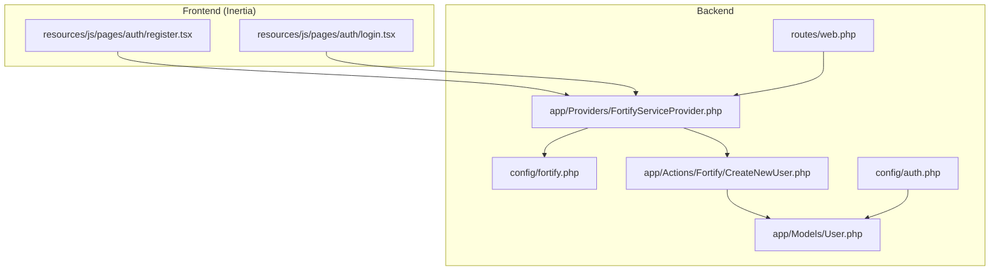
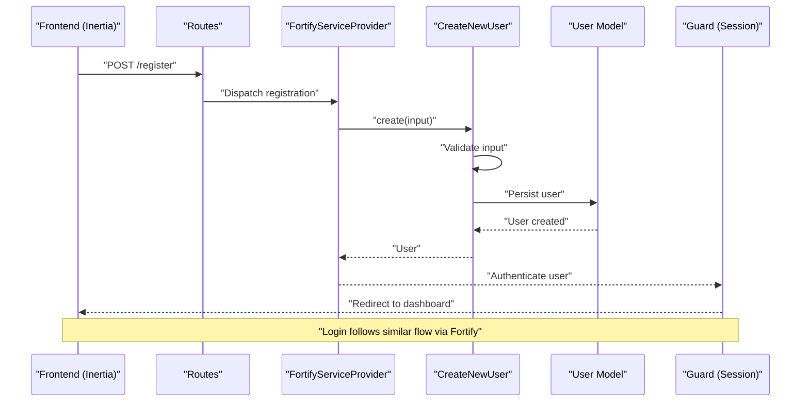
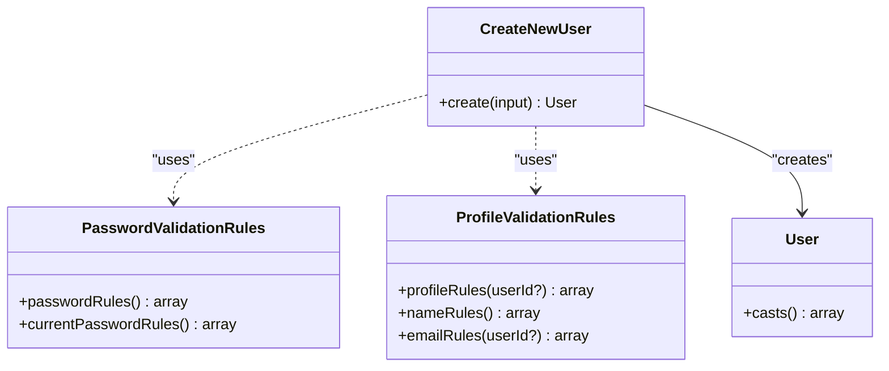
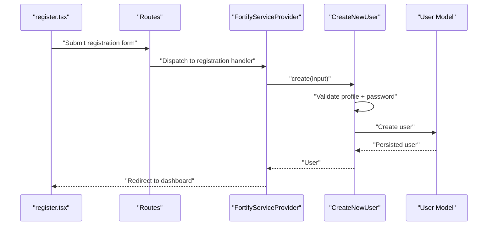
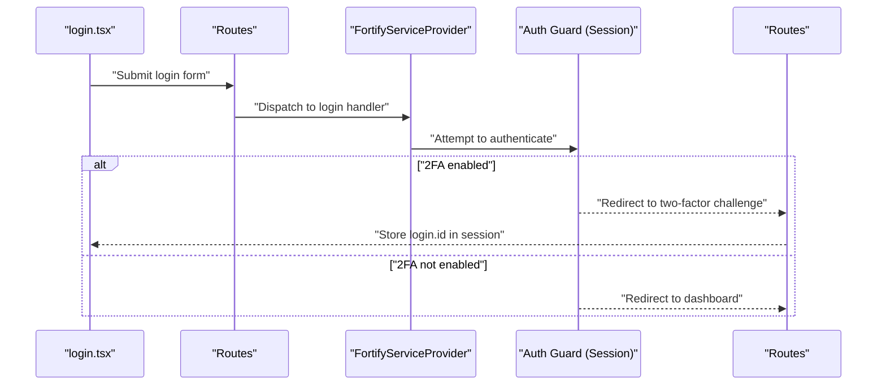
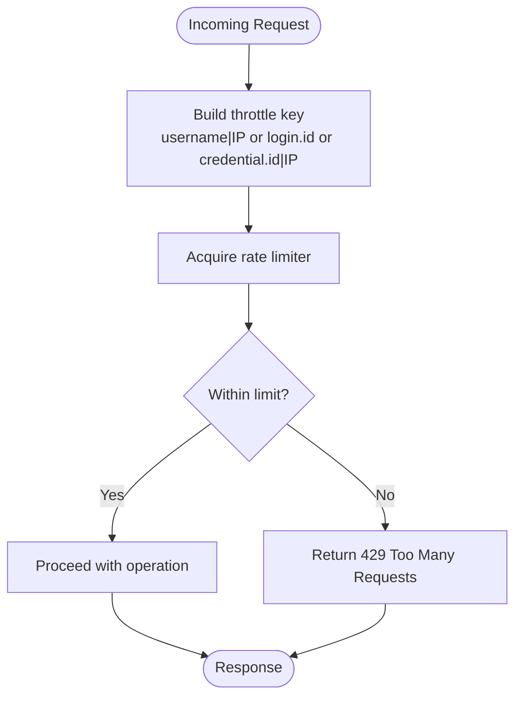
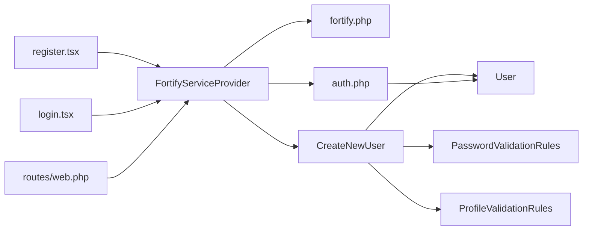

# User Registration & Login

<cite>
**Referenced Files in This Document**
- [CreateNewUser.php](file://app/Actions/Fortify/CreateNewUser.php)
- [PasswordValidationRules.php](file://app/Concerns/PasswordValidationRules.php)
- [ProfileValidationRules.php](file://app/Concerns/ProfileValidationRules.php)
- [User.php](file://app/Models/User.php)
- [FortifyServiceProvider.php](file://app/Providers/FortifyServiceProvider.php)
- [fortify.php](file://config/fortify.php)
- [auth.php](file://config/auth.php)
- [register.tsx](file://resources/js/pages/auth/register.tsx)
- [login.tsx](file://resources/js/pages/auth/login.tsx)
- [web.php](file://routes/web.php)
- [RegistrationTest.php](file://tests/Feature/Auth/RegistrationTest.php)
- [AuthenticationTest.php](file://tests/Feature/Auth/AuthenticationTest.php)
</cite>

## Table of Contents
1. [Introduction](#introduction)
2. [Project Structure](#project-structure)
3. [Core Components](#core-components)
4. [Architecture Overview](#architecture-overview)
5. [Detailed Component Analysis](#detailed-component-analysis)
6. [Dependency Analysis](#dependency-analysis)
7. [Performance Considerations](#performance-considerations)
8. [Troubleshooting Guide](#troubleshooting-guide)
9. [Conclusion](#conclusion)

## Introduction
This document explains the user registration and login functionality in SmartExam. It focuses on the CreateNewUser action class, the registration flow (form validation, password hashing, and email verification), the login process (username/email handling, authentication guards, and session management), and the supporting configuration and frontend components. It also covers custom validation rules, user creation callbacks, middleware integration, error handling, rate limiting, and security measures.

## Project Structure
SmartExam integrates Laravel Fortify for authentication features and Inertia.js for frontend rendering. The backend handles registration and login via Fortify actions and providers, while the frontend renders forms and submits them to backend routes.

**Diagram sources**
- [register.tsx:1-121](file://resources/js/pages/auth/register.tsx#L1-L121)
- [login.tsx:1-126](file://resources/js/pages/auth/login.tsx#L1-L126)
- [FortifyServiceProvider.php:1-118](file://app/Providers/FortifyServiceProvider.php#L1-L118)
- [fortify.php:1-192](file://config/fortify.php#L1-L192)
- [auth.php:1-118](file://config/auth.php#L1-L118)
- [CreateNewUser.php:1-34](file://app/Actions/Fortify/CreateNewUser.php#L1-L34)
- [User.php:1-53](file://app/Models/User.php#L1-L53)
- [web.php:1-26](file://routes/web.php#L1-L26)

**Section sources**
- [register.tsx:1-121](file://resources/js/pages/auth/register.tsx#L1-L121)
- [login.tsx:1-126](file://resources/js/pages/auth/login.tsx#L1-L126)
- [FortifyServiceProvider.php:1-118](file://app/Providers/FortifyServiceProvider.php#L1-L118)
- [fortify.php:1-192](file://config/fortify.php#L1-L192)
- [auth.php:1-118](file://config/auth.php#L1-L118)
- [CreateNewUser.php:1-34](file://app/Actions/Fortify/CreateNewUser.php#L1-L34)
- [User.php:1-53](file://app/Models/User.php#L1-L53)
- [web.php:1-26](file://routes/web.php#L1-L26)

## Core Components
- CreateNewUser action: Validates and creates new users using centralized validation traits and persists them via the User model.
- Validation traits: Provide reusable validation rules for passwords and user profiles.
- FortifyServiceProvider: Registers Fortify actions, views, and rate limiters.
- Fortify configuration: Defines guards, username handling, rate limiting keys, and enabled features.
- Authentication configuration: Defines the session-based guard and user provider.
- Frontend pages: Provide registration and login forms rendered via Inertia.

**Section sources**
- [CreateNewUser.php:1-34](file://app/Actions/Fortify/CreateNewUser.php#L1-L34)
- [PasswordValidationRules.php:1-30](file://app/Concerns/PasswordValidationRules.php#L1-L30)
- [ProfileValidationRules.php:1-52](file://app/Concerns/ProfileValidationRules.php#L1-L52)
- [FortifyServiceProvider.php:1-118](file://app/Providers/FortifyServiceProvider.php#L1-L118)
- [fortify.php:1-192](file://config/fortify.php#L1-L192)
- [auth.php:1-118](file://config/auth.php#L1-L118)
- [register.tsx:1-121](file://resources/js/pages/auth/register.tsx#L1-L121)
- [login.tsx:1-126](file://resources/js/pages/auth/login.tsx#L1-L126)

## Architecture Overview
The registration and login flows are orchestrated by Fortify. The frontend sends forms to backend routes handled by Fortify, which invokes action classes and applies rate limiting. Authentication uses a session guard backed by the Eloquent user provider.

**Diagram sources**
- [FortifyServiceProvider.php:43-49](file://app/Providers/FortifyServiceProvider.php#L43-L49)
- [CreateNewUser.php:20-32](file://app/Actions/Fortify/CreateNewUser.php#L20-L32)
- [User.php:32-51](file://app/Models/User.php#L32-L51)
- [auth.php:40-45](file://config/auth.php#L40-L45)
- [fortify.php:17-18](file://config/fortify.php#L17-L18)

## Detailed Component Analysis

### CreateNewUser Action Class
The CreateNewUser action validates incoming user data using shared validation traits and creates a new User record. It composes profile and password rules and delegates persistence to the User model.

**Diagram sources**
- [CreateNewUser.php:11-34](file://app/Actions/Fortify/CreateNewUser.php#L11-L34)
- [PasswordValidationRules.php:8-29](file://app/Concerns/PasswordValidationRules.php#L8-L29)
- [ProfileValidationRules.php:9-51](file://app/Concerns/ProfileValidationRules.php#L9-L51)
- [User.php:32-51](file://app/Models/User.php#L32-L51)

Implementation highlights:
- Validation composition: The action merges profile rules and password rules before validating.
- Persistence: Uses the User model’s factory to create records.
- Password hashing: Delegated to the model’s cast configuration.

**Section sources**
- [CreateNewUser.php:20-32](file://app/Actions/Fortify/CreateNewUser.php#L20-L32)
- [PasswordValidationRules.php:15-18](file://app/Concerns/PasswordValidationRules.php#L15-L18)
- [ProfileValidationRules.php:16-22](file://app/Concerns/ProfileValidationRules.php#L16-L22)
- [User.php:42-51](file://app/Models/User.php#L42-L51)

### Registration Flow
End-to-end registration flow:
- Frontend form submission: The registration page posts to the backend route.
- Fortify dispatch: The Fortify service provider registers the CreateNewUser action.
- Validation: Profile and password rules are applied.
- Creation: A new User is persisted.
- Redirect: On success, users are redirected to the configured home path.

**Diagram sources**
- [register.tsx:20-24](file://resources/js/pages/auth/register.tsx#L20-L24)
- [FortifyServiceProvider.php:46-48](file://app/Providers/FortifyServiceProvider.php#L46-L48)
- [CreateNewUser.php:22-31](file://app/Actions/Fortify/CreateNewUser.php#L22-L31)
- [User.php:32-51](file://app/Models/User.php#L32-L51)

Custom validation rules:
- Password rules: Enforce minimum strength and confirmation.
- Profile rules: Enforce presence, string types, max length, and uniqueness of email.

User creation callback:
- The Fortify service provider registers the CreateNewUser action globally via Fortify.

Email verification:
- Enabled via Fortify features; the service provider registers the verification view.

**Section sources**
- [register.tsx:16-115](file://resources/js/pages/auth/register.tsx#L16-L115)
- [FortifyServiceProvider.php:77-81](file://app/Providers/FortifyServiceProvider.php#L77-L81)
- [FortifyServiceProvider.php:103-107](file://app/Providers/FortifyServiceProvider.php#L103-L107)
- [fortify.php:169-189](file://config/fortify.php#L169-L189)
- [PasswordValidationRules.php:15-18](file://app/Concerns/PasswordValidationRules.php#L15-L18)
- [ProfileValidationRules.php:16-50](file://app/Concerns/ProfileValidationRules.php#L16-L50)

### Login Process
Login flow:
- Frontend form submission: The login page posts credentials.
- Fortify authentication: Fortify authenticates against the configured guard.
- Session management: Successful authentication stores session data.
- Redirect: Redirects to the configured home path.
- Two-factor challenge: If enabled, redirects to the two-factor challenge page and stores the login session ID.

**Diagram sources**
- [login.tsx:33-37](file://resources/js/pages/auth/login.tsx#L33-L37)
- [FortifyServiceProvider.php:56-59](file://app/Providers/FortifyServiceProvider.php#L56-L59)
- [AuthenticationTest.php:35-54](file://tests/Feature/Auth/AuthenticationTest.php#L35-L54)
- [auth.php:40-45](file://config/auth.php#L40-L45)

Username/email handling:
- Fortify configuration sets the username field to email and enforces lowercase normalization.

Authentication guards:
- Session-based guard with Eloquent user provider.

Session management:
- After successful login, the session is established and protected by middleware.

**Section sources**
- [login.tsx:24-120](file://resources/js/pages/auth/login.tsx#L24-L120)
- [FortifyServiceProvider.php:56-59](file://app/Providers/FortifyServiceProvider.php#L56-L59)
- [fortify.php:48-63](file://config/fortify.php#L48-L63)
- [auth.php:40-45](file://config/auth.php#L40-L45)
- [AuthenticationTest.php:22-33](file://tests/Feature/Auth/AuthenticationTest.php#L22-L33)

### Rate Limiting Implementation
SmartExam implements rate limiting for login attempts and other Fortify features:
- Login limiter: Throttles by a composite key of normalized username and client IP.
- Two-factor limiter: Throttles by the login session ID.
- Passkeys limiter: Throttles by credential ID or session ID and IP.

**Diagram sources**
- [FortifyServiceProvider.php:103-107](file://app/Providers/FortifyServiceProvider.php#L103-L107)
- [FortifyServiceProvider.php:97-101](file://app/Providers/FortifyServiceProvider.php#L97-L101)
- [FortifyServiceProvider.php:109-115](file://app/Providers/FortifyServiceProvider.php#L109-L115)

**Section sources**
- [FortifyServiceProvider.php:103-115](file://app/Providers/FortifyServiceProvider.php#L103-L115)
- [fortify.php:117-125](file://config/fortify.php#L117-L125)

### Security Measures
- Password hashing: The User model casts the password attribute to be hashed upon save.
- Two-factor authentication: Optional, with confirmation and password confirmation toggles.
- Passkeys support: Configured with relying party ID, allowed origins, and timeouts.
- Email verification: Optional feature enabled via Fortify features.

**Section sources**
- [User.php:42-51](file://app/Models/User.php#L42-L51)
- [fortify.php:177-188](file://config/fortify.php#L177-L188)
- [fortify.php:150-156](file://config/fortify.php#L150-L156)

## Dependency Analysis
The following diagram shows how components depend on each other in the registration and login flows.

**Diagram sources**
- [register.tsx:1-121](file://resources/js/pages/auth/register.tsx#L1-L121)
- [login.tsx:1-126](file://resources/js/pages/auth/login.tsx#L1-L126)
- [FortifyServiceProvider.php:1-118](file://app/Providers/FortifyServiceProvider.php#L1-L118)
- [fortify.php:1-192](file://config/fortify.php#L1-L192)
- [auth.php:1-118](file://config/auth.php#L1-L118)
- [CreateNewUser.php:1-34](file://app/Actions/Fortify/CreateNewUser.php#L1-L34)
- [PasswordValidationRules.php:1-30](file://app/Concerns/PasswordValidationRules.php#L1-L30)
- [ProfileValidationRules.php:1-52](file://app/Concerns/ProfileValidationRules.php#L1-L52)
- [User.php:1-53](file://app/Models/User.php#L1-L53)
- [web.php:1-26](file://routes/web.php#L1-L26)

**Section sources**
- [FortifyServiceProvider.php:43-49](file://app/Providers/FortifyServiceProvider.php#L43-L49)
- [CreateNewUser.php:11-34](file://app/Actions/Fortify/CreateNewUser.php#L11-L34)
- [auth.php:40-45](file://config/auth.php#L40-L45)
- [fortify.php:18-18](file://config/fortify.php#L18-L18)

## Performance Considerations
- Prefer server-side validation to reduce client retries and network overhead.
- Keep rate limits balanced to prevent abuse without overly impacting legitimate users.
- Use efficient database indexing on email for uniqueness checks.
- Minimize frontend re-renders by leveraging Inertia’s optimistic updates where appropriate.

## Troubleshooting Guide
Common registration issues:
- Validation failures: Ensure name, email, and password meet the defined rules. The frontend displays validation errors returned from the backend.
- Duplicate email: The email uniqueness rule triggers if the address is already taken.
- Redirect after registration: Verify the configured home path and that the user is authenticated post-registration.

Common login issues:
- Incorrect credentials: Authentication fails and the user remains unauthenticated.
- Two-factor enabled: If enabled, login redirects to the two-factor challenge and stores the login session ID.
- Rate limiting: Excessive failed attempts trigger throttling; adjust client retry behavior accordingly.

Security tips:
- Confirm password hashing is applied by the model.
- Enable and enforce email verification if required.
- Review Fortify feature toggles to align with deployment needs.

**Section sources**
- [RegistrationTest.php:20-38](file://tests/Feature/Auth/RegistrationTest.php#L20-L38)
- [AuthenticationTest.php:15-33](file://tests/Feature/Auth/AuthenticationTest.php#L15-L33)
- [AuthenticationTest.php:35-54](file://tests/Feature/Auth/AuthenticationTest.php#L35-L54)
- [AuthenticationTest.php:79-91](file://tests/Feature/Auth/AuthenticationTest.php#L79-L91)
- [FortifyServiceProvider.php:103-107](file://app/Providers/FortifyServiceProvider.php#L103-L107)
- [User.php:42-51](file://app/Models/User.php#L42-L51)

## Conclusion
SmartExam’s authentication stack leverages Laravel Fortify and Inertia.js to deliver a secure and configurable registration and login experience. The CreateNewUser action centralizes validation and persistence, while Fortify configuration and rate limiting provide robust security controls. The frontend forms integrate seamlessly with backend handlers, ensuring a smooth user experience with proper feedback and redirects.