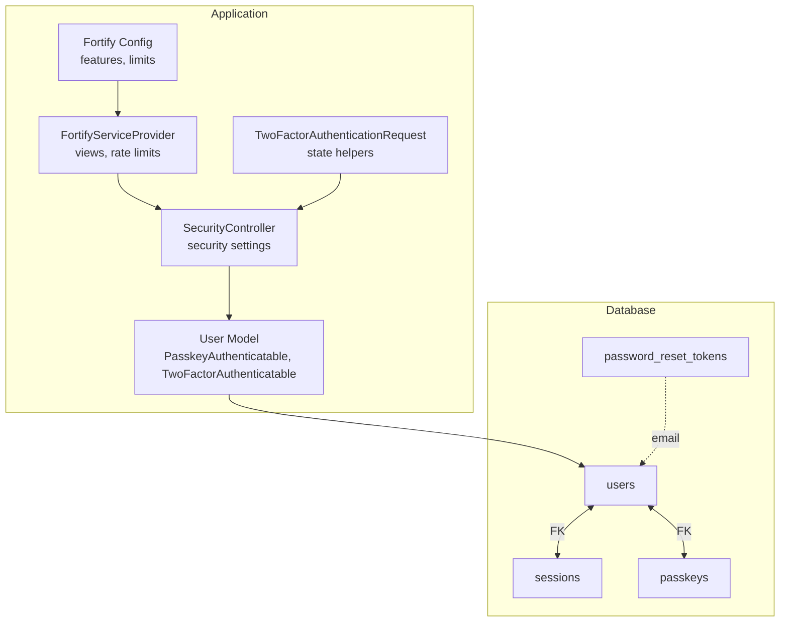
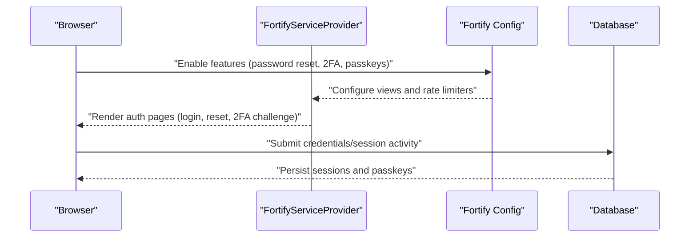
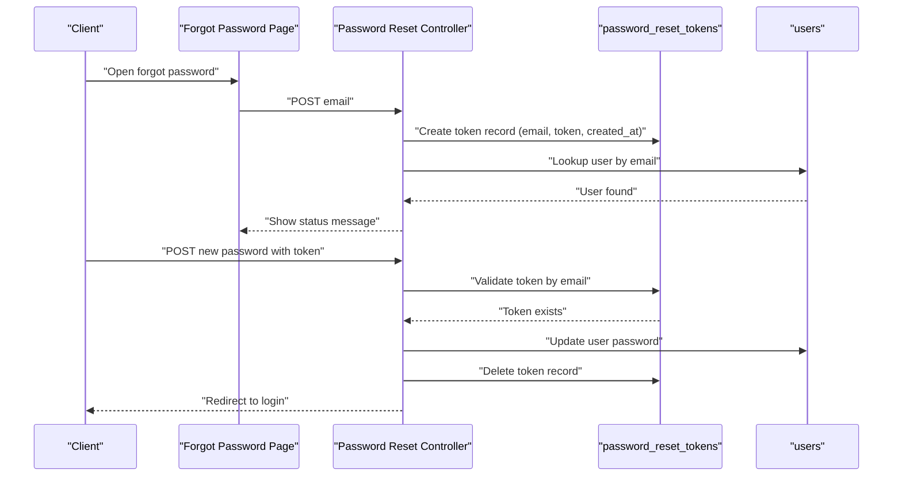
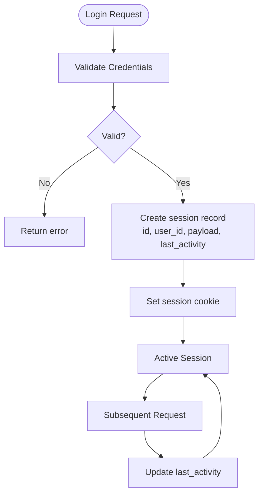
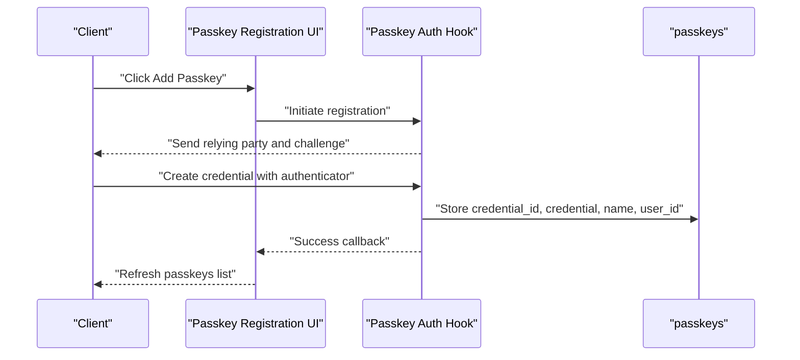
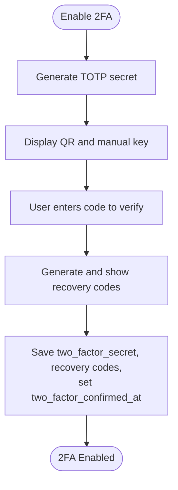
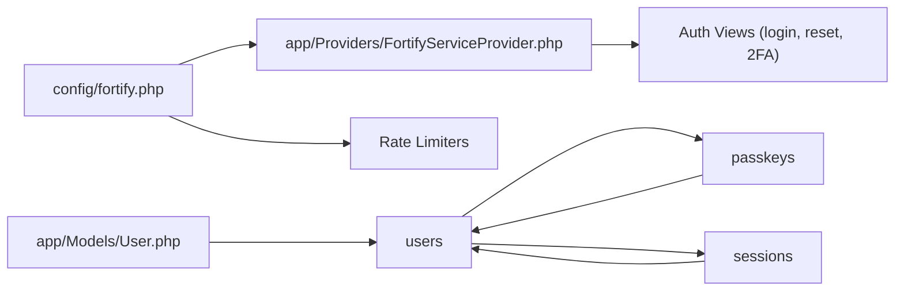

# Authentication Tables

<cite>
**Referenced Files in This Document**
- [0001_01_01_000000_create_users_table.php](file://database/migrations/0001_01_01_000000_create_users_table.php)
- [2024_01_01_000000_create_passkeys_table.php](file://database/migrations/2024_01_01_000000_create_passkeys_table.php)
- [2025_08_14_170933_add_two_factor_columns_to_users_table.php](file://database/migrations/2025_08_14_170933_add_two_factor_columns_to_users_table.php)
- [User.php](file://app/Models/User.php)
- [fortify.php](file://config/fortify.php)
- [FortifyServiceProvider.php](file://app/Providers/FortifyServiceProvider.php)
- [SecurityController.php](file://app/Http/Controllers/Settings/SecurityController.php)
- [TwoFactorAuthenticationRequest.php](file://app/Http/Requests/Settings/TwoFactorAuthenticationRequest.php)
- [reset-password.tsx](file://resources/js/pages/auth/reset-password.tsx)
- [PasswordResetTest.php](file://tests/Feature/Auth/PasswordResetTest.php)
- [passkey-register.tsx](file://resources/js/components/passkey-register.tsx)
- [manage-passkeys.tsx](file://resources/js/components/manage-passkeys.tsx)
- [passkey-item.tsx](file://resources/js/components/passkey-item.tsx)
</cite>

## Table of Contents
1. [Introduction](#introduction)
2. [Project Structure](#project-structure)
3. [Core Components](#core-components)
4. [Architecture Overview](#architecture-overview)
5. [Detailed Component Analysis](#detailed-component-analysis)
6. [Dependency Analysis](#dependency-analysis)
7. [Performance Considerations](#performance-considerations)
8. [Troubleshooting Guide](#troubleshooting-guide)
9. [Conclusion](#conclusion)

## Introduction
This document explains the authentication-related database tables in SmartExam and how they support the application's authentication mechanisms. It covers:
- Password reset tokens for secure password recovery
- Sessions for managing user login state
- Passkeys for WebAuthn/FIDO2 passwordless authentication
- Two-factor authentication columns added to the users table
It also documents the relationships among these tables, typical flows for token generation, session handling, and passkey registration, and provides security considerations and best practices.

## Project Structure
The authentication schema is defined via Laravel migrations and integrated with Laravel Fortify for authentication features. The relevant files include:
- Migrations that create and modify the authentication tables
- The User model implementing Fortify traits for passkeys and two-factor authentication
- Fortify configuration enabling password reset, two-factor, and passkeys
- Frontend components for password reset and passkey registration
- Backend controllers and requests supporting security settings and two-factor state

**Diagram sources**
- [0001_01_01_000000_create_users_table.php:24-37](file://database/migrations/0001_01_01_000000_create_users_table.php#L24-L37)
- [2024_01_01_000000_create_passkeys_table.php:14-24](file://database/migrations/2024_01_01_000000_create_passkeys_table.php#L14-L24)
- [2025_08_14_170933_add_two_factor_columns_to_users_table.php:14-18](file://database/migrations/2025_08_14_170933_add_two_factor_columns_to_users_table.php#L14-L18)
- [User.php:32-35](file://app/Models/User.php#L32-L35)
- [fortify.php:169-189](file://config/fortify.php#L169-L189)
- [FortifyServiceProvider.php:33-49](file://app/Providers/FortifyServiceProvider.php#L33-L49)
- [SecurityController.php:19-56](file://app/Http/Controllers/Settings/SecurityController.php#L19-L56)
- [TwoFactorAuthenticationRequest.php:9-11](file://app/Http/Requests/Settings/TwoFactorAuthenticationRequest.php#L9-L11)

**Section sources**
- [0001_01_01_000000_create_users_table.php:12-48](file://database/migrations/0001_01_01_000000_create_users_table.php#L12-L48)
- [2024_01_01_000000_create_passkeys_table.php:12-33](file://database/migrations/2024_01_01_000000_create_passkeys_table.php#L12-L33)
- [2025_08_14_170933_add_two_factor_columns_to_users_table.php:12-33](file://database/migrations/2025_08_14_170933_add_two_factor_columns_to_users_table.php#L12-L33)
- [User.php:32-51](file://app/Models/User.php#L32-L51)
- [fortify.php:169-189](file://config/fortify.php#L169-L189)
- [FortifyServiceProvider.php:33-49](file://app/Providers/FortifyServiceProvider.php#L33-L49)
- [SecurityController.php:19-56](file://app/Http/Controllers/Settings/SecurityController.php#L19-L56)
- [TwoFactorAuthenticationRequest.php:9-11](file://app/Http/Requests/Settings/TwoFactorAuthenticationRequest.php#L9-L11)

## Core Components
This section documents the authentication tables and their roles.

- Users table
  - Purpose: Stores user account information and authentication credentials
  - Key columns: id, name, email (unique), email_verified_at, password, remember_token, timestamps
  - Additional two-factor columns added: two_factor_secret, two_factor_recovery_codes, two_factor_confirmed_at
  - Relationships: referenced by sessions and passkeys; password reset tokens keyed by email

- Password reset tokens table
  - Purpose: Stores temporary tokens for password reset flows
  - Key columns: email (PK), token, created_at
  - Relationship: links to users by email

- Sessions table
  - Purpose: Manages user login sessions using Laravel's database session driver
  - Key columns: id (PK), user_id (FK to users), ip_address, user_agent, payload, last_activity (indexed)
  - Relationship: belongs to users

- Passkeys table
  - Purpose: Stores WebAuthn/FIDO2 passkey credentials linked to users
  - Key columns: id, user_id (FK), name, credential_id (unique), credential (JSON), last_used_at, timestamps
  - Indexes: user_id
  - Relationship: belongs to users

- User model enhancements
  - Implements PasskeyUser interface and traits for passkeys and two-factor authentication
  - Casts email_verified_at and password appropriately
  - Exposes two-factor fields for management

**Section sources**
- [0001_01_01_000000_create_users_table.php:14-37](file://database/migrations/0001_01_01_000000_create_users_table.php#L14-L37)
- [2024_01_01_000000_create_passkeys_table.php:14-24](file://database/migrations/2024_01_01_000000_create_passkeys_table.php#L14-L24)
- [2025_08_14_170933_add_two_factor_columns_to_users_table.php:14-18](file://database/migrations/2025_08_14_170933_add_two_factor_columns_to_users_table.php#L14-L18)
- [User.php:32-51](file://app/Models/User.php#L32-L51)

## Architecture Overview
The authentication architecture integrates database tables with Laravel Fortify features and frontend components. The flow supports password reset, session management, and passkey-based authentication.

**Diagram sources**
- [fortify.php:169-189](file://config/fortify.php#L169-L189)
- [FortifyServiceProvider.php:54-90](file://app/Providers/FortifyServiceProvider.php#L54-L90)
- [0001_01_01_000000_create_users_table.php:30-37](file://database/migrations/0001_01_01_000000_create_users_table.php#L30-L37)
- [2024_01_01_000000_create_passkeys_table.php:14-24](file://database/migrations/2024_01_01_000000_create_passkeys_table.php#L14-L24)

## Detailed Component Analysis

### Password Reset Tokens Table
Purpose: Enable secure password resets by generating time-limited tokens associated with a user's email.

- Schema highlights
  - Composite primary key on email
  - Token stored as a string
  - Created timestamp for expiry handling

- Typical flow
  - Request password reset: user submits email
  - Application creates a token record keyed by email
  - Email sent with a link containing the token
  - User follows link and submits new password
  - Application validates token and updates user password
  - Token record is cleaned up after successful reset

**Diagram sources**
- [0001_01_01_000000_create_users_table.php:24-28](file://database/migrations/0001_01_01_000000_create_users_table.php#L24-L28)
- [reset-password.tsx:16-91](file://resources/js/pages/auth/reset-password.tsx#L16-L91)
- [PasswordResetTest.php:58-80](file://tests/Feature/Auth/PasswordResetTest.php#L58-L80)

Security considerations
- Tokens must be cryptographically random and sufficiently long-lived (typical minutes to hours)
- Enforce strict validation of token and email pairing
- Clean up expired tokens periodically
- Rate limit password reset attempts per email/IP

Best practices
- Use HTTPS everywhere
- Store tokens securely and avoid logging
- Invalidate tokens immediately upon use
- Consider adding IP/email checks for extra safety

**Section sources**
- [0001_01_01_000000_create_users_table.php:24-28](file://database/migrations/0001_01_01_000000_create_users_table.php#L24-L28)
- [reset-password.tsx:16-91](file://resources/js/pages/auth/reset-password.tsx#L16-L91)
- [PasswordResetTest.php:58-80](file://tests/Feature/Auth/PasswordResetTest.php#L58-L80)

### Sessions Table
Purpose: Persist user login state using Laravel's database session driver.

- Schema highlights
  - Session id as primary key
  - Optional user_id foreign key
  - IP address and user agent for audit
  - Payload stores serialized session data
  - last_activity indexed for cleanup

- Typical flow
  - Successful login sets session id and binds to user
  - Each request updates last_activity
  - Cleanup process removes expired sessions

**Diagram sources**
- [0001_01_01_000000_create_users_table.php:30-37](file://database/migrations/0001_01_01_000000_create_users_table.php#L30-L37)

Security considerations
- Use secure, httpOnly cookies
- Rotate session ids after privilege changes
- Implement session timeout policies
- Monitor unusual IP/user agent combinations

Best practices
- Use database sessions for horizontal scaling
- Regularly prune expired sessions
- Enforce CSRF protection
- Log suspicious session activities

**Section sources**
- [0001_01_01_000000_create_users_table.php:30-37](file://database/migrations/0001_01_01_000000_create_users_table.php#L30-L37)

### Passkeys Table
Purpose: Store WebAuthn/FIDO2 passkey credentials for passwordless authentication.

- Schema highlights
  - Foreign key to users
  - Unique credential_id
  - JSON credential blob
  - Name for user identification
  - last_used_at timestamp
  - Indexed user_id for queries

- Typical flow
  - Browser initiates passkey registration
  - Server generates challenge and sends to client
  - Client creates credential with authenticator
  - Server verifies and persists passkey record
  - On login, server challenges client with stored credential_id
  - Client authenticates with authenticator
  - Server validates response and updates last_used_at

**Diagram sources**
- [2024_01_01_000000_create_passkeys_table.php:14-24](file://database/migrations/2024_01_01_000000_create_passkeys_table.php#L14-L24)
- [passkey-register.tsx:12-44](file://resources/js/components/passkey-register.tsx#L12-L44)
- [manage-passkeys.tsx:28-69](file://resources/js/components/manage-passkeys.tsx#L28-L69)
- [passkey-item.tsx:20-27](file://resources/js/components/passkey-item.tsx#L20-L27)

Security considerations
- Credential ID uniqueness prevents replay attacks
- Store only the minimal credential data required
- Enforce origin and RP ID checks
- Monitor and alert on unauthorized deletion or creation

Best practices
- Prompt users to name devices for easy management
- Periodically review and prune unused passkeys
- Support authenticator discovery and fallbacks
- Educate users about passkey security benefits

**Section sources**
- [2024_01_01_000000_create_passkeys_table.php:14-24](file://database/migrations/2024_01_01_000000_create_passkeys_table.php#L14-L24)
- [passkey-register.tsx:12-44](file://resources/js/components/passkey-register.tsx#L12-L44)
- [manage-passkeys.tsx:28-69](file://resources/js/components/manage-passkeys.tsx#L28-L69)
- [passkey-item.tsx:20-27](file://resources/js/components/passkey-item.tsx#L20-L27)

### Two-Factor Authentication Columns in Users
Purpose: Enable TOTP-based two-factor authentication with recovery codes.

- Schema highlights
  - two_factor_secret: stores TOTP secret
  - two_factor_recovery_codes: stores backup codes
  - two_factor_confirmed_at: timestamp when 2FA was enabled

- Management flow
  - User enables 2FA via security settings
  - Application generates secret and QR data
  - User scans QR and confirms code
  - Recovery codes are generated and stored
  - Subsequent logins require 2FA challenge

**Diagram sources**
- [2025_08_14_170933_add_two_factor_columns_to_users_table.php:14-18](file://database/migrations/2025_08_14_170933_add_two_factor_columns_to_users_table.php#L14-L18)
- [SecurityController.php:19-56](file://app/Http/Controllers/Settings/SecurityController.php#L19-L56)
- [TwoFactorAuthenticationRequest.php:9-11](file://app/Http/Requests/Settings/TwoFactorAuthenticationRequest.php#L9-L11)

Security considerations
- Keep two_factor_secret confidential
- Treat recovery codes as single-use
- Enforce 2FA for privileged actions
- Log 2FA events for auditing

Best practices
- Require password confirmation before changing 2FA settings
- Provide clear instructions for backup code storage
- Offer QR scanning and manual entry for accessibility
- Allow users to regenerate codes safely

**Section sources**
- [2025_08_14_170933_add_two_factor_columns_to_users_table.php:14-18](file://database/migrations/2025_08_14_170933_add_two_factor_columns_to_users_table.php#L14-L18)
- [SecurityController.php:19-56](file://app/Http/Controllers/Settings/SecurityController.php#L19-L56)
- [TwoFactorAuthenticationRequest.php:9-11](file://app/Http/Requests/Settings/TwoFactorAuthenticationRequest.php#L9-L11)

## Dependency Analysis
The authentication system depends on:
- Fortify configuration enabling features and rate limiting
- Fortify service provider wiring views and rate limiters
- User model implementing passkey and two-factor traits
- Controllers and requests mediating security settings and state
- Frontend components driving password reset and passkey registration

**Diagram sources**
- [fortify.php:169-189](file://config/fortify.php#L169-L189)
- [FortifyServiceProvider.php:54-90](file://app/Providers/FortifyServiceProvider.php#L54-L90)
- [User.php:32-35](file://app/Models/User.php#L32-L35)
- [0001_01_01_000000_create_users_table.php:14-37](file://database/migrations/0001_01_01_000000_create_users_table.php#L14-L37)
- [2024_01_01_000000_create_passkeys_table.php:14-24](file://database/migrations/2024_01_01_000000_create_passkeys_table.php#L14-L24)

**Section sources**
- [fortify.php:169-189](file://config/fortify.php#L169-L189)
- [FortifyServiceProvider.php:54-90](file://app/Providers/FortifyServiceProvider.php#L54-L90)
- [User.php:32-35](file://app/Models/User.php#L32-L35)
- [0001_01_01_000000_create_users_table.php:14-37](file://database/migrations/0001_01_01_000000_create_users_table.php#L14-L37)
- [2024_01_01_000000_create_passkeys_table.php:14-24](file://database/migrations/2024_01_01_000000_create_passkeys_table.php#L14-L24)

## Performance Considerations
- Sessions
  - last_activity is indexed, aiding cleanup efficiency
  - Consider pruning expired sessions regularly to keep table small
- Passkeys
  - Unique credential_id ensures fast lookups
  - JSON column may benefit from indexing selective fields if queried frequently
- Password reset tokens
  - Cleanup expired tokens to prevent bloat
- Two-factor
  - Minimal overhead; ensure QR generation and code verification are efficient

## Troubleshooting Guide
Common issues and resolutions:
- Password reset token invalid
  - Cause: Token mismatch or expired
  - Resolution: Regenerate token; ensure proper email/token pairing; enforce expiry
  - Evidence: Test validates error handling for invalid tokens
- Passkey registration fails
  - Cause: Browser not supported, missing name, or authenticator error
  - Resolution: Check browser support; ensure name is provided; inspect error messages
- Session not persisting
  - Cause: Cookie misconfiguration or session driver issues
  - Resolution: Verify session driver and cookie settings; check last_activity updates
- Two-factor enable/disable problems
  - Cause: Missing password confirmation or invalid state
  - Resolution: Ensure password confirmation; validate state helpers

**Section sources**
- [PasswordResetTest.php:82-94](file://tests/Feature/Auth/PasswordResetTest.php#L82-L94)
- [passkey-register.tsx:51-57](file://resources/js/components/passkey-register.tsx#L51-L57)
- [SecurityController.php:19-56](file://app/Http/Controllers/Settings/SecurityController.php#L19-L56)
- [TwoFactorAuthenticationRequest.php:9-11](file://app/Http/Requests/Settings/TwoFactorAuthenticationRequest.php#L9-L11)

## Conclusion
SmartExam's authentication schema combines robust database tables with Laravel Fortify features to deliver secure password reset, reliable session management, and modern passkey-based authentication. The addition of two-factor authentication columns completes a layered security approach. Proper configuration, rate limiting, and adherence to security best practices ensure a resilient authentication system.