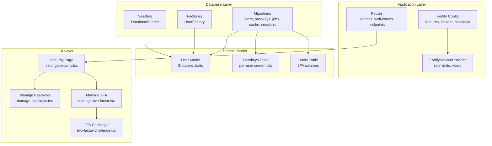
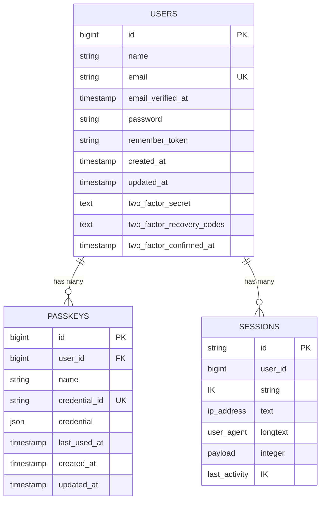
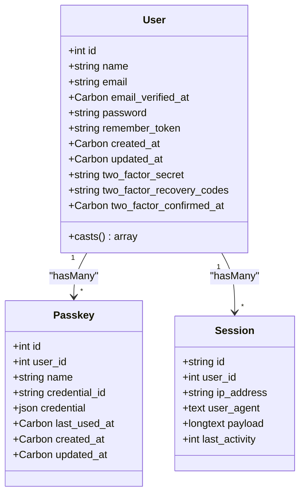
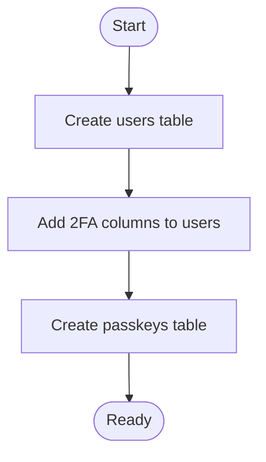
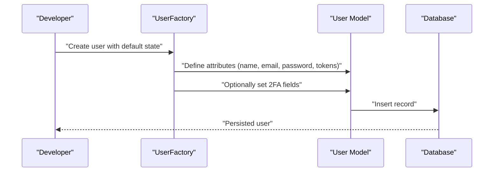
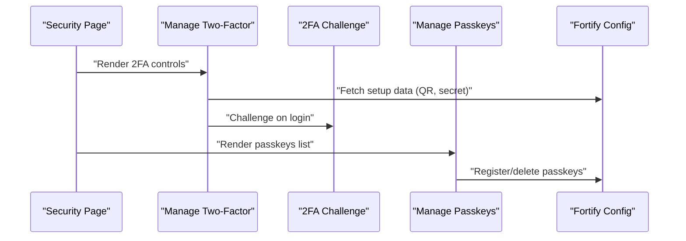
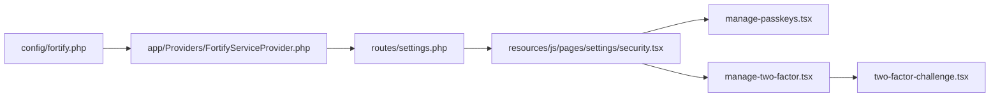

# Database Design

<cite>
**Referenced Files in This Document**
- [0001_01_01_000000_create_users_table.php](file://database/migrations/0001_01_01_000000_create_users_table.php)
- [2024_01_01_000000_create_passkeys_table.php](file://database/migrations/2024_01_01_000000_create_passkeys_table.php)
- [2025_08_14_170933_add_two_factor_columns_to_users_table.php](file://database/migrations/2025_08_14_170933_add_two_factor_columns_to_users_table.php)
- [User.php](file://app/Models/User.php)
- [UserFactory.php](file://database/factories/UserFactory.php)
- [DatabaseSeeder.php](file://database/seeders/DatabaseSeeder.php)
- [fortify.php](file://config/fortify.php)
- [FortifyServiceProvider.php](file://app/Providers/FortifyServiceProvider.php)
- [security.tsx](file://resources/js/pages/settings/security.tsx)
- [manage-passkeys.tsx](file://resources/js/components/manage-passkeys.tsx)
- [manage-two-factor.tsx](file://resources/js/components/manage-two-factor.tsx)
- [two-factor-challenge.tsx](file://resources/js/pages/auth/two-factor-challenge.tsx)
- [use-two-factor-auth.ts](file://resources/js/hooks/use-two-factor-auth.ts)
- [settings.php](file://routes/settings.php)
</cite>

## Table of Contents
1. [Introduction](#introduction)
2. [Project Structure](#project-structure)
3. [Core Components](#core-components)
4. [Architecture Overview](#architecture-overview)
5. [Detailed Component Analysis](#detailed-component-analysis)
6. [Dependency Analysis](#dependency-analysis)
7. [Performance Considerations](#performance-considerations)
8. [Troubleshooting Guide](#troubleshooting-guide)
9. [Conclusion](#conclusion)
10. [Appendices](#appendices)

## Introduction
This document describes the database design for the SmartExam web application with a focus on user identity, WebAuthn passkeys, and two-factor authentication (2FA). It covers schema definitions, relationships, constraints, migrations, factories, seeders, and operational considerations such as indexing, rate limiting, and data lifecycle management. It also outlines model relationships, query patterns, and UI integration points for managing passkeys and 2FA.

## Project Structure
The database design is implemented via Laravel migrations, Eloquent models, factories, and seeders. Fortify configuration enables passkeys and 2FA features, while frontend components integrate these capabilities into the user settings page.

**Diagram sources**
- [0001_01_01_000000_create_users_table.php:14-37](file://database/migrations/0001_01_01_000000_create_users_table.php#L14-L37)
- [2024_01_01_000000_create_passkeys_table.php:14-24](file://database/migrations/2024_01_01_000000_create_passkeys_table.php#L14-L24)
- [2025_08_14_170933_add_two_factor_columns_to_users_table.php:14-18](file://database/migrations/2025_08_14_170933_add_two_factor_columns_to_users_table.php#L14-L18)
- [User.php:32-35](file://app/Models/User.php#L32-L35)
- [fortify.php:177-189](file://config/fortify.php#L177-L189)
- [FortifyServiceProvider.php:98-115](file://app/Providers/FortifyServiceProvider.php#L98-L115)
- [security.tsx:130-143](file://resources/js/pages/settings/security.tsx#L130-L143)
- [manage-passkeys.tsx:28-71](file://resources/js/components/manage-passkeys.tsx#L28-L71)
- [manage-two-factor.tsx:17-126](file://resources/js/components/manage-two-factor.tsx#L17-L126)
- [two-factor-challenge.tsx:1-54](file://resources/js/pages/auth/two-factor-challenge.tsx#L1-L54)
- [settings.php:33-39](file://routes/settings.php#L33-L39)

**Section sources**
- [0001_01_01_000000_create_users_table.php:1-50](file://database/migrations/0001_01_01_000000_create_users_table.php#L1-L50)
- [2024_01_01_000000_create_passkeys_table.php:1-35](file://database/migrations/2024_01_01_000000_create_passkeys_table.php#L1-L35)
- [2025_08_14_170933_add_two_factor_columns_to_users_table.php:1-35](file://database/migrations/2025_08_14_170933_add_two_factor_columns_to_users_table.php#L1-L35)
- [User.php:1-53](file://app/Models/User.php#L1-L53)
- [UserFactory.php:1-65](file://database/factories/UserFactory.php#L1-L65)
- [DatabaseSeeder.php:1-26](file://database/seeders/DatabaseSeeder.php#L1-L26)
- [fortify.php:1-192](file://config/fortify.php#L1-L192)
- [FortifyServiceProvider.php:51-117](file://app/Providers/FortifyServiceProvider.php#L51-L117)
- [security.tsx:1-156](file://resources/js/pages/settings/security.tsx#L1-L156)
- [manage-passkeys.tsx:1-72](file://resources/js/components/manage-passkeys.tsx#L1-L72)
- [manage-two-factor.tsx:1-126](file://resources/js/components/manage-two-factor.tsx#L1-L126)
- [two-factor-challenge.tsx:1-54](file://resources/js/pages/auth/two-factor-challenge.tsx#L1-L54)
- [settings.php:1-41](file://routes/settings.php#L1-L41)

## Core Components
- Users table: core identity with email verification, password hashing, remember tokens, timestamps, and 2FA columns.
- Passkeys table: per-user WebAuthn credentials with foreign key relationship to users and indexing for performance.
- Sessions table: Fortify-managed session storage with user association and activity indexing.
- Jobs and cache tables: background job processing and caching infrastructure.
- Fortify configuration: enables passkeys and 2FA features, sets rate limiters, and defines relying party settings.
- Eloquent model: User integrates Fortify traits for passkeys and 2FA, with attribute casting and hidden fields.
- Factories and seeders: test data generation and initial dataset creation.

**Section sources**
- [0001_01_01_000000_create_users_table.php:14-37](file://database/migrations/0001_01_01_000000_create_users_table.php#L14-L37)
- [2024_01_01_000000_create_passkeys_table.php:14-24](file://database/migrations/2024_01_01_000000_create_passkeys_table.php#L14-L24)
- [2025_08_14_170933_add_two_factor_columns_to_users_table.php:14-18](file://database/migrations/2025_08_14_170933_add_two_factor_columns_to_users_table.php#L14-L18)
- [User.php:32-51](file://app/Models/User.php#L32-L51)
- [UserFactory.php:25-63](file://database/factories/UserFactory.php#L25-L63)
- [DatabaseSeeder.php:16-24](file://database/seeders/DatabaseSeeder.php#L16-L24)
- [fortify.php:140-156](file://config/fortify.php#L140-L156)

## Architecture Overview
The database architecture centers around the users table and its relationships with passkeys and sessions. Two-factor authentication is supported via additional columns on users. Fortify manages passkeys and 2FA flows, with rate limiting enforced at the application level.

**Diagram sources**
- [0001_01_01_000000_create_users_table.php:14-37](file://database/migrations/0001_01_01_000000_create_users_table.php#L14-L37)
- [2024_01_01_000000_create_passkeys_table.php:14-24](file://database/migrations/2024_01_01_000000_create_passkeys_table.php#L14-L24)

## Detailed Component Analysis

### Users Table
- Purpose: Store user identity, authentication credentials, email verification status, and 2FA metadata.
- Columns:
  - id: autoincrement primary key
  - name: string
  - email: unique string
  - email_verified_at: nullable timestamp
  - password: string (hashed)
  - remember_token: string
  - timestamps: created_at, updated_at
  - two_factor_secret: nullable text
  - two_factor_recovery_codes: nullable text
  - two_factor_confirmed_at: nullable timestamp
- Constraints:
  - Unique constraint on email
  - Timestamps are managed automatically
- Indexes:
  - No explicit indexes on users beyond primary key and unique index on email
- Casting:
  - email_verified_at and two_factor_confirmed_at are cast to datetime
  - password is hashed on save
- Hidden fields:
  - password, two_factor_secret, two_factor_recovery_codes, remember_token are hidden by default

**Section sources**
- [0001_01_01_000000_create_users_table.php:14-22](file://database/migrations/0001_01_01_000000_create_users_table.php#L14-L22)
- [2025_08_14_170933_add_two_factor_columns_to_users_table.php:14-18](file://database/migrations/2025_08_14_170933_add_two_factor_columns_to_users_table.php#L14-L18)
- [User.php:42-51](file://app/Models/User.php#L42-L51)

### Passkeys Table
- Purpose: Store WebAuthn passkey credentials per user for passwordless authentication.
- Columns:
  - id: autoincrement primary key
  - user_id: foreign key referencing users.id with cascade delete
  - name: string (display name for the passkey)
  - credential_id: unique string identifier
  - credential: JSON containing passkey credential data
  - last_used_at: nullable timestamp
  - timestamps: created_at, updated_at
- Constraints:
  - Unique constraint on credential_id
  - Foreign key constraint on user_id with cascade delete
- Indexes:
  - Index on user_id for efficient lookups
- Lifecycle:
  - Passkeys are created via Fortify passkeys feature and deleted individually
  - last_used_at can be updated upon successful authentication

**Section sources**
- [2024_01_01_000000_create_passkeys_table.php:14-24](file://database/migrations/2024_01_01_000000_create_passkeys_table.php#L14-L24)

### Sessions Table
- Purpose: Fortify-managed session storage with user association and activity tracking.
- Columns:
  - id: string primary key
  - user_id: nullable foreign key to users.id indexed
  - ip_address: string up to 45 characters
  - user_agent: text
  - payload: longtext
  - last_activity: integer indexed
- Notes:
  - Supports session-based authentication flows
  - user_id is indexed to optimize joins and queries by user

**Section sources**
- [0001_01_01_000000_create_users_table.php:30-37](file://database/migrations/0001_01_01_000000_create_users_table.php#L30-L37)

### Jobs and Cache Tables
- Jobs table: supports queued job processing with queue targeting and failure tracking.
- Job batches table: aggregates batched job metrics.
- Failed jobs table: records failed job details with composite index on connection, queue, and failed_at.
- Cache table: key-value cache with expiration and lock table for distributed locking.
- Notes:
  - These tables are part of the Laravel infrastructure and support background processing and caching.

**Section sources**
- [0001_01_01_000001_create_cache_table.php:14-24](file://database/migrations/0001_01_01_000001_create_cache_table.php#L14-L24)
- [0001_01_01_000002_create_jobs_table.php:14-47](file://database/migrations/0001_01_01_000002_create_jobs_table.php#L14-L47)

### Two-Factor Authentication Columns
- Columns added to users:
  - two_factor_secret: nullable text for TOTP secret
  - two_factor_recovery_codes: nullable text for encrypted recovery codes
  - two_factor_confirmed_at: nullable timestamp indicating confirmation
- Behavior:
  - Fortify handles generation, confirmation, and challenge flows
  - Recovery codes are stored encrypted
  - Confirmation timestamp indicates when 2FA was enabled

**Section sources**
- [2025_08_14_170933_add_two_factor_columns_to_users_table.php:14-18](file://database/migrations/2025_08_14_170933_add_two_factor_columns_to_users_table.php#L14-L18)
- [User.php:23-25](file://app/Models/User.php#L23-L25)

### Model Relationships and Traits
- User model:
  - Uses HasFactory, Notifiable, PasskeyAuthenticatable, TwoFactorAuthenticatable
  - Implements PasskeyUser contract
  - Casts email_verified_at and two_factor_confirmed_at to datetime
  - Hides sensitive fields by default
- Relationships:
  - One-to-many with passkeys via user_id foreign key
  - One-to-many with sessions via user_id foreign key

**Diagram sources**
- [User.php:17-51](file://app/Models/User.php#L17-L51)
- [2024_01_01_000000_create_passkeys_table.php:14-24](file://database/migrations/2024_01_01_000000_create_passkeys_table.php#L14-L24)
- [0001_01_01_000000_create_users_table.php:30-37](file://database/migrations/0001_01_01_000000_create_users_table.php#L30-L37)

**Section sources**
- [User.php:32-51](file://app/Models/User.php#L32-L51)
- [2024_01_01_000000_create_passkeys_table.php:14-24](file://database/migrations/2024_01_01_000000_create_passkeys_table.php#L14-L24)
- [0001_01_01_000000_create_users_table.php:30-37](file://database/migrations/0001_01_01_000000_create_users_table.php#L30-L37)

### Migration Strategy
- Initial users table created with identity and session support.
- Passkeys table added later with foreign key to users and unique credential_id.
- Two-factor columns appended to users table to avoid breaking existing data.
- All migrations are designed to be reversible.

**Diagram sources**
- [0001_01_01_000000_create_users_table.php:12-38](file://database/migrations/0001_01_01_000000_create_users_table.php#L12-L38)
- [2025_08_14_170933_add_two_factor_columns_to_users_table.php:12-33](file://database/migrations/2025_08_14_170933_add_two_factor_columns_to_users_table.php#L12-L33)
- [2024_01_01_000000_create_passkeys_table.php:12-33](file://database/migrations/2024_01_01_000000_create_passkeys_table.php#L12-L33)

**Section sources**
- [0001_01_01_000000_create_users_table.php:12-38](file://database/migrations/0001_01_01_000000_create_users_table.php#L12-L38)
- [2025_08_14_170933_add_two_factor_columns_to_users_table.php:12-33](file://database/migrations/2025_08_14_170933_add_two_factor_columns_to_users_table.php#L12-L33)
- [2024_01_01_000000_create_passkeys_table.php:12-33](file://database/migrations/2024_01_01_000000_create_passkeys_table.php#L12-L33)

### Factory Patterns and Seeding
- UserFactory:
  - Generates default user state with hashed password and optional 2FA configuration
  - Provides unverified state and withTwoFactor state helpers
- DatabaseSeeder:
  - Creates a default test user record

**Diagram sources**
- [UserFactory.php:25-63](file://database/factories/UserFactory.php#L25-L63)
- [DatabaseSeeder.php:16-24](file://database/seeders/DatabaseSeeder.php#L16-L24)
- [User.php:32-35](file://app/Models/User.php#L32-L35)

**Section sources**
- [UserFactory.php:1-65](file://database/factories/UserFactory.php#L1-L65)
- [DatabaseSeeder.php:1-26](file://database/seeders/DatabaseSeeder.php#L1-L26)

### UI Integration and Workflows
- Security page composes passkeys and 2FA management components.
- ManagePasskeys lists registered passkeys and allows registration and deletion.
- ManageTwoFactor handles enabling/disabling 2FA, displaying QR codes, and managing recovery codes.
- Two-factor challenge page supports both TOTP code and recovery code modes.

**Diagram sources**
- [security.tsx:130-143](file://resources/js/pages/settings/security.tsx#L130-L143)
- [manage-two-factor.tsx:17-126](file://resources/js/components/manage-two-factor.tsx#L17-L126)
- [two-factor-challenge.tsx:1-54](file://resources/js/pages/auth/two-factor-challenge.tsx#L1-L54)
- [manage-passkeys.tsx:28-71](file://resources/js/components/manage-passkeys.tsx#L28-L71)
- [fortify.php:177-189](file://config/fortify.php#L177-L189)

**Section sources**
- [security.tsx:1-156](file://resources/js/pages/settings/security.tsx#L1-L156)
- [manage-two-factor.tsx:1-126](file://resources/js/components/manage-two-factor.tsx#L1-L126)
- [two-factor-challenge.tsx:1-54](file://resources/js/pages/auth/two-factor-challenge.tsx#L1-L54)
- [manage-passkeys.tsx:1-72](file://resources/js/components/manage-passkeys.tsx#L1-L72)
- [fortify.php:177-189](file://config/fortify.php#L177-L189)

## Dependency Analysis
- Fortify configuration enables passkeys and 2FA features and defines rate limiters.
- FortifyServiceProvider registers rate limiters for passkeys and 2FA challenges.
- Routes expose passkey well-known endpoints and secure settings endpoints.
- Frontend components depend on backend endpoints for passkey enrollment and 2FA management.

**Diagram sources**
- [fortify.php:117-125](file://config/fortify.php#L117-L125)
- [FortifyServiceProvider.php:98-115](file://app/Providers/FortifyServiceProvider.php#L98-L115)
- [settings.php:33-39](file://routes/settings.php#L33-L39)
- [security.tsx:130-143](file://resources/js/pages/settings/security.tsx#L130-L143)
- [manage-passkeys.tsx:28-71](file://resources/js/components/manage-passkeys.tsx#L28-L71)
- [manage-two-factor.tsx:17-126](file://resources/js/components/manage-two-factor.tsx#L17-L126)
- [two-factor-challenge.tsx:1-54](file://resources/js/pages/auth/two-factor-challenge.tsx#L1-L54)

**Section sources**
- [fortify.php:117-125](file://config/fortify.php#L117-L125)
- [FortifyServiceProvider.php:98-115](file://app/Providers/FortifyServiceProvider.php#L98-L115)
- [settings.php:33-39](file://routes/settings.php#L33-L39)
- [security.tsx:130-143](file://resources/js/pages/settings/security.tsx#L130-L143)

## Performance Considerations
- Indexes:
  - sessions.user_id and sessions.last_activity are indexed to optimize session queries and cleanup.
  - passkeys.user_id is indexed to accelerate per-user credential lookups.
  - users.email is unique and indexed implicitly by the unique constraint.
- Rate limiting:
  - Separate rate limiters for passkeys and 2FA challenge flows reduce contention and protect against abuse.
- Storage:
  - JSON column for passkey credential data allows flexible storage of WebAuthn data.
  - Encrypted storage for 2FA recovery codes protects sensitive data at rest.
- Background processing:
  - Jobs and cache tables support scalable asynchronous workloads and caching strategies.

**Section sources**
- [0001_01_01_000000_create_users_table.php:30-37](file://database/migrations/0001_01_01_000000_create_users_table.php#L30-L37)
- [2024_01_01_000000_create_passkeys_table.php:23-24](file://database/migrations/2024_01_01_000000_create_passkeys_table.php#L23-L24)
- [FortifyServiceProvider.php:98-115](file://app/Providers/FortifyServiceProvider.php#L98-L115)
- [fortify.php:122-124](file://config/fortify.php#L122-L124)

## Troubleshooting Guide
- Authentication failures:
  - Verify email uniqueness and verification status.
  - Check two-factor confirmation timestamp and secret presence.
- Passkey issues:
  - Ensure credential_id uniqueness and proper JSON structure.
  - Confirm relying party configuration matches app URL.
- Session problems:
  - Validate user_id foreign key and last_activity index usage.
- Rate limiting:
  - Review limiters for passkeys and 2FA challenge to prevent throttling.

**Section sources**
- [User.php:23-25](file://app/Models/User.php#L23-L25)
- [2024_01_01_000000_create_passkeys_table.php:18-19](file://database/migrations/2024_01_01_000000_create_passkeys_table.php#L18-L19)
- [fortify.php:150-155](file://config/fortify.php#L150-L155)
- [FortifyServiceProvider.php:98-115](file://app/Providers/FortifyServiceProvider.php#L98-L115)

## Conclusion
The SmartExam database design leverages Laravel’s robust ORM and migration system to support modern authentication patterns. The users table serves as the central identity store, extended with 2FA fields, while the passkeys table enables passwordless authentication through WebAuthn. Fortify’s configuration and rate limiting ensure secure and performant authentication flows, complemented by frontend components that provide intuitive management experiences.

## Appendices

### Field Definitions and Constraints Summary
- Users table:
  - email: unique, string
  - password: string (hashed)
  - two_factor_secret: text (nullable)
  - two_factor_recovery_codes: text (nullable)
  - two_factor_confirmed_at: timestamp (nullable)
- Passkeys table:
  - credential_id: unique, string
  - credential: json
  - user_id: foreign key to users.id with cascade delete
- Sessions table:
  - user_id: indexed foreign key to users.id
  - last_activity: indexed integer

**Section sources**
- [0001_01_01_000000_create_users_table.php:14-37](file://database/migrations/0001_01_01_000000_create_users_table.php#L14-L37)
- [2024_01_01_000000_create_passkeys_table.php:14-24](file://database/migrations/2024_01_01_000000_create_passkeys_table.php#L14-L24)
- [2025_08_14_170933_add_two_factor_columns_to_users_table.php:14-18](file://database/migrations/2025_08_14_170933_add_two_factor_columns_to_users_table.php#L14-L18)