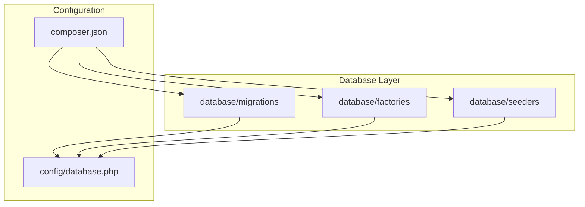
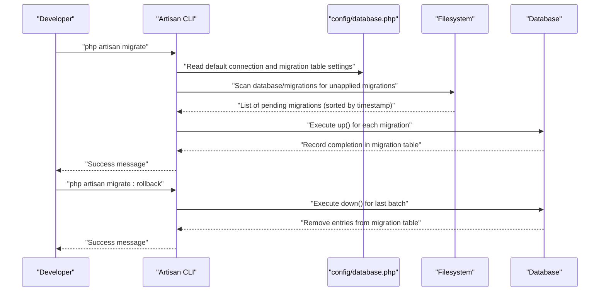
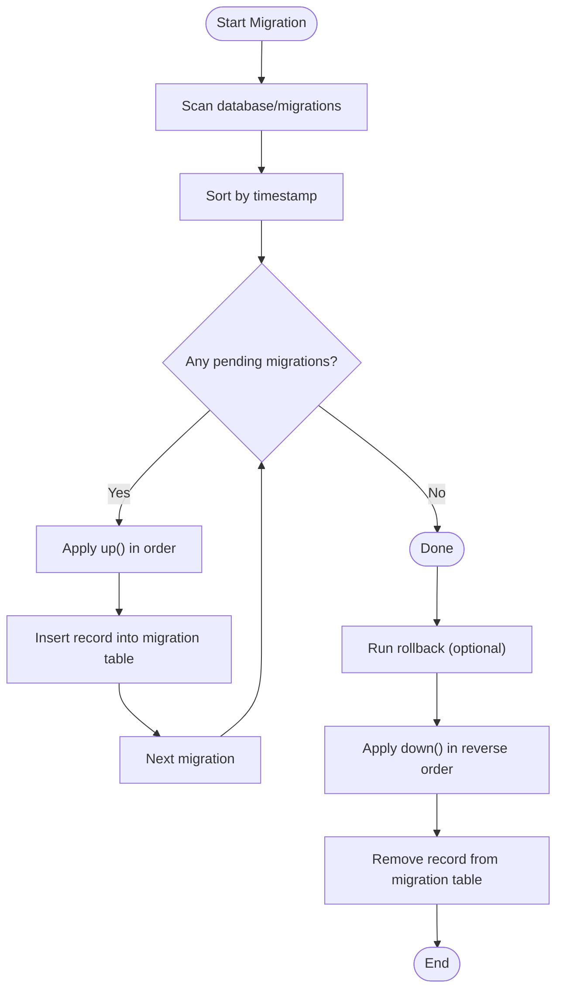
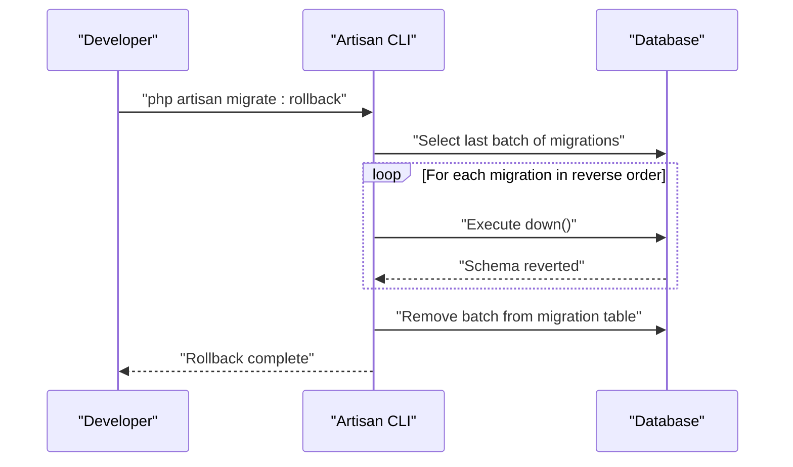
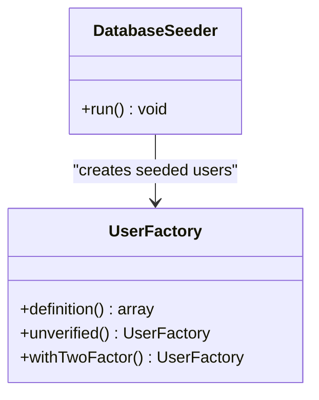
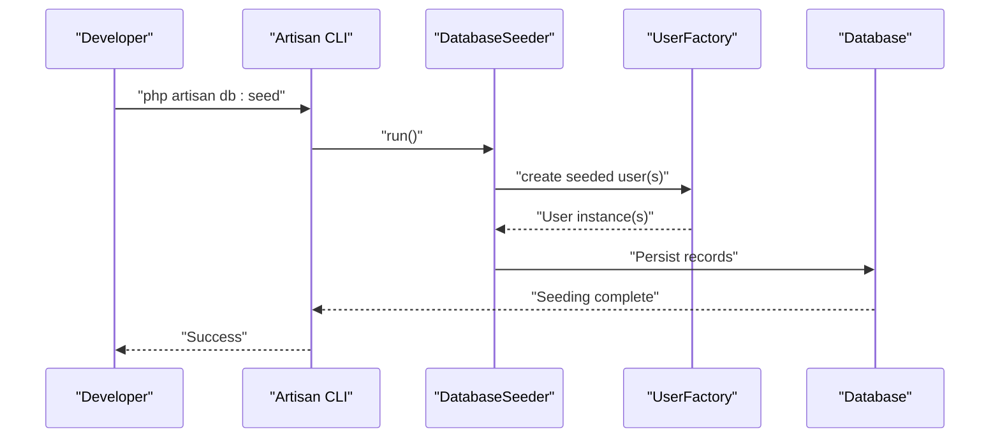
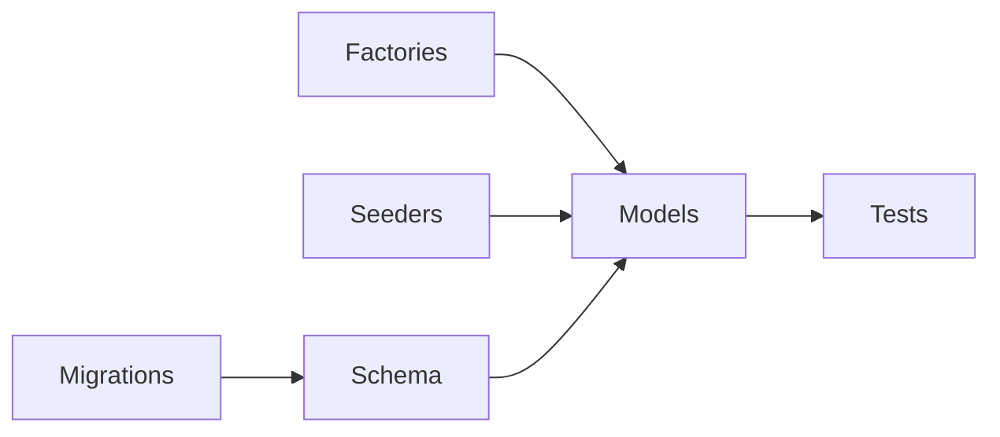
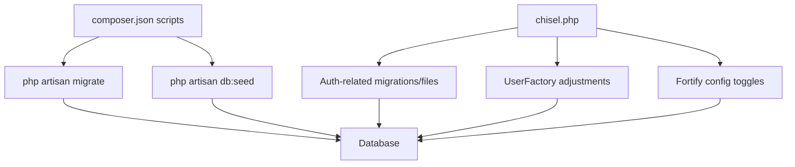

# Migration Strategy

<cite>
**Referenced Files in This Document**
- [0001_01_01_000000_create_users_table.php](file://database/migrations/0001_01_01_000000_create_users_table.php)
- [0001_01_01_000001_create_cache_table.php](file://database/migrations/0001_01_01_000001_create_cache_table.php)
- [0001_01_01_000002_create_jobs_table.php](file://database/migrations/0001_01_01_000002_create_jobs_table.php)
- [2024_01_01_000000_create_passkeys_table.php](file://database/migrations/2024_01_01_000000_create_passkeys_table.php)
- [2025_08_14_170933_add_two_factor_columns_to_users_table.php](file://database/migrations/2025_08_14_170933_add_two_factor_columns_to_users_table.php)
- [UserFactory.php](file://database/factories/UserFactory.php)
- [DatabaseSeeder.php](file://database/seeders/DatabaseSeeder.php)
- [database.php](file://config/database.php)
- [composer.json](file://composer.json)
- [chisel.php](file://chisel.php)
- [InstallFeaturesCommand.php](file://app/Console/Commands/InstallFeaturesCommand.php)
</cite>

## Table of Contents
1. [Introduction](#introduction)
2. [Project Structure](#project-structure)
3. [Core Components](#core-components)
4. [Architecture Overview](#architecture-overview)
5. [Detailed Component Analysis](#detailed-component-analysis)
6. [Dependency Analysis](#dependency-analysis)
7. [Performance Considerations](#performance-considerations)
8. [Troubleshooting Guide](#troubleshooting-guide)
9. [Conclusion](#conclusion)
10. [Appendices](#appendices)

## Introduction
This document describes the database migration strategy and implementation approach used in the project. It covers migration file organization, naming conventions, execution order, rollback semantics, and the role of factories and seeders in development and testing. It also outlines best practices for safe migrations, testing strategies, and production deployment considerations, and explains how migrations, factories, and seeders relate to the development workflow.

## Project Structure
The migration system is organized under the database directory with three primary areas:
- database/migrations: Timestamped migration files defining schema changes
- database/factories: Eloquent Factories for generating test data
- database/seeders: Seeder classes for initial dataset population

**Diagram sources**
- [database.php:130-133](file://config/database.php#L130-L133)
- [composer.json:31-36](file://composer.json#L31-L36)

**Section sources**
- [database.php:130-133](file://config/database.php#L130-L133)
- [composer.json:31-36](file://composer.json#L31-L36)

## Core Components
- Migrations: Each migration file defines a single logical change to the schema. They are executed in timestamp order and include up/down methods for forward and reverse operations.
- Factories: Eloquent factories produce model instances for testing and seeding, with convenient state methods to simulate real-world scenarios.
- Seeders: Seeder classes orchestrate initial data creation, often leveraging factories to populate the database with realistic records.

Key characteristics:
- Naming convention: Timestamp-based filenames ensure deterministic execution order.
- Rollback tracking: The framework tracks executed migrations via a dedicated migration table.
- Environment-driven connections: Database connection settings are configurable per environment.

**Section sources**
- [0001_01_01_000000_create_users_table.php:12-48](file://database/migrations/0001_01_01_000000_create_users_table.php#L12-L48)
- [2025_08_14_170933_add_two_factor_columns_to_users_table.php:12-33](file://database/migrations/2025_08_14_170933_add_two_factor_columns_to_users_table.php#L12-L33)
- [UserFactory.php:25-63](file://database/factories/UserFactory.php#L25-L63)
- [DatabaseSeeder.php:16-24](file://database/seeders/DatabaseSeeder.php#L16-L24)
- [database.php:130-133](file://config/database.php#L130-L133)

## Architecture Overview
The migration lifecycle integrates CLI commands, configuration, and the filesystem to apply and track schema changes safely.

**Diagram sources**
- [database.php:130-133](file://config/database.php#L130-L133)
- [composer.json:48-96](file://composer.json#L48-L96)

## Detailed Component Analysis

### Migration File Organization and Execution Order
- Organization: Migrations are stored under database/migrations with timestamp prefixes ensuring chronological ordering.
- Execution order: Laravel executes migrations in ascending timestamp order. The migration table tracks which migrations have been applied.
- Rollback strategy: Each migration’s down() method reverses the up() changes. Batch-based rollbacks remove the latest set of applied migrations.

**Diagram sources**
- [database.php:130-133](file://config/database.php#L130-L133)

**Section sources**
- [0001_01_01_000000_create_users_table.php:12-48](file://database/migrations/0001_01_01_000000_create_users_table.php#L12-L48)
- [0001_01_01_000001_create_cache_table.php:12-34](file://database/migrations/0001_01_01_000001_create_cache_table.php#L12-L34)
- [0001_01_01_000002_create_jobs_table.php:12-58](file://database/migrations/0001_01_01_000002_create_jobs_table.php#L12-L58)
- [2024_01_01_000000_create_passkeys_table.php:12-33](file://database/migrations/2024_01_01_000000_create_passkeys_table.php#L12-L33)
- [2025_08_14_170933_add_two_factor_columns_to_users_table.php:12-33](file://database/migrations/2025_08_14_170933_add_two_factor_columns_to_users_table.php#L12-L33)

### Naming Conventions
- Timestamp-based filenames: Ensures deterministic ordering and avoids conflicts.
- Descriptive suffixes: Suffixes like _create_*_table.php and *_to_*_table.php clarify intent.
- Consistency: All migrations follow the same pattern, simplifying discovery and maintenance.

Examples of files in this project:
- [0001_01_01_000000_create_users_table.php](file://database/migrations/0001_01_01_000000_create_users_table.php)
- [0001_01_01_000001_create_cache_table.php](file://database/migrations/0001_01_01_000001_create_cache_table.php)
- [0001_01_01_000002_create_jobs_table.php](file://database/migrations/0001_01_01_000002_create_jobs_table.php)
- [2024_01_01_000000_create_passkeys_table.php](file://database/migrations/2024_01_01_000000_create_passkeys_table.php)
- [2025_08_14_170933_add_two_factor_columns_to_users_table.php](file://database/migrations/2025_08_14_170933_add_two_factor_columns_to_users_table.php)

**Section sources**
- [0001_01_01_000000_create_users_table.php:1-50](file://database/migrations/0001_01_01_000000_create_users_table.php#L1-L50)
- [0001_01_01_000001_create_cache_table.php:1-36](file://database/migrations/0001_01_01_000001_create_cache_table.php#L1-L36)
- [0001_01_01_000002_create_jobs_table.php:1-60](file://database/migrations/0001_01_01_000002_create_jobs_table.php#L1-L60)
- [2024_01_01_000000_create_passkeys_table.php:1-35](file://database/migrations/2024_01_01_000000_create_passkeys_table.php#L1-L35)
- [2025_08_14_170933_add_two_factor_columns_to_users_table.php:1-35](file://database/migrations/2025_08_14_170933_add_two_factor_columns_to_users_table.php#L1-L35)

### Rollback Strategy and Versioning
- Rollback semantics: down() reverts the schema changes introduced by up(). For table additions, this typically drops tables or removes columns.
- Batch-based rollbacks: Laravel supports rolling back the last batch of migrations, aligning with CI/CD practices.
- Migration table: Tracks applied migrations to prevent re-running and to enable accurate rollbacks.

**Diagram sources**
- [database.php:130-133](file://config/database.php#L130-L133)
- [2025_08_14_170933_add_two_factor_columns_to_users_table.php:24-33](file://database/migrations/2025_08_14_170933_add_two_factor_columns_to_users_table.php#L24-L33)

**Section sources**
- [2025_08_14_170933_add_two_factor_columns_to_users_table.php:24-33](file://database/migrations/2025_08_14_170933_add_two_factor_columns_to_users_table.php#L24-L33)
- [database.php:130-133](file://config/database.php#L130-L133)

### Factory Pattern Implementation for Test Data Generation
- Purpose: Factories encapsulate realistic default attributes and common variations for models.
- Extensibility: Factories expose state methods to quickly create specialized variants (e.g., verified/unverified emails, or users with two-factor enabled).
- Integration: Factories are autoloaded and used by seeders and tests to generate reproducible datasets.

**Diagram sources**
- [UserFactory.php:25-63](file://database/factories/UserFactory.php#L25-L63)
- [DatabaseSeeder.php:16-24](file://database/seeders/DatabaseSeeder.php#L16-L24)

**Section sources**
- [UserFactory.php:25-63](file://database/factories/UserFactory.php#L25-L63)
- [DatabaseSeeder.php:16-24](file://database/seeders/DatabaseSeeder.php#L16-L24)

### Seeder Classes for Initial Data Setup
- Orchestration: Seeders coordinate initial data creation. They can leverage factories to produce realistic records.
- Control: Seeders can be run independently or integrated into setup scripts.

**Diagram sources**
- [DatabaseSeeder.php:16-24](file://database/seeders/DatabaseSeeder.php#L16-L24)
- [UserFactory.php:25-63](file://database/factories/UserFactory.php#L25-L63)

**Section sources**
- [DatabaseSeeder.php:16-24](file://database/seeders/DatabaseSeeder.php#L16-L24)

### Relationship Between Migrations, Factories, and Seeders
- Migrations define schema changes and are the authoritative source of database structure.
- Factories generate model instances for testing and seeding.
- Seeders use factories to populate initial data sets, ensuring consistency with schema.

[No sources needed since this diagram shows conceptual workflow, not actual code structure]

## Dependency Analysis
- Autoload configuration ensures factories and seeders are discoverable by the framework.
- Composer scripts automate setup tasks, including migrations and asset builds.
- Chisel integration dynamically toggles authentication-related features and associated migrations and files.

**Diagram sources**
- [composer.json:48-96](file://composer.json#L48-L96)
- [chisel.php:140-176](file://chisel.php#L140-L176)
- [UserFactory.php:54-63](file://database/factories/UserFactory.php#L54-L63)

**Section sources**
- [composer.json:48-96](file://composer.json#L48-L96)
- [chisel.php:140-176](file://chisel.php#L140-L176)
- [UserFactory.php:54-63](file://database/factories/UserFactory.php#L54-L63)

## Performance Considerations
- Minimize long-running transactions in migrations to reduce lock contention.
- Prefer lightweight schema changes and avoid expensive data transformations where possible.
- Use indexes judiciously; add them in separate migrations if altering large tables.
- Batch operations: When seeding large datasets, consider chunked inserts to reduce memory pressure.

[No sources needed since this section provides general guidance]

## Troubleshooting Guide
Common issues and remedies:
- Migration conflicts: Ensure timestamps are unique and ordered. Re-run failed migrations individually after fixing errors.
- Rollback failures: Verify foreign key constraints and cascading deletes; adjust down() to respect referential integrity.
- Seeding errors: Confirm factories are autoloaded and that default values satisfy constraints.
- Environment mismatches: Validate database connection settings and migration table configuration.

**Section sources**
- [database.php:130-133](file://config/database.php#L130-L133)
- [composer.json:31-36](file://composer.json#L31-L36)

## Conclusion
The project employs a robust, timestamp-based migration system with clear rollback semantics and a complementary factory/seeder ecosystem. By adhering to naming conventions, isolating breaking changes, and leveraging factories for deterministic test data, teams can maintain a reliable and repeatable database evolution process across environments.

[No sources needed since this section summarizes without analyzing specific files]

## Appendices

### Best Practices for Migration Safety
- Keep migrations small and focused on a single concern.
- Always write down() alongside up() to ensure reversible changes.
- Use transactions for destructive operations when supported by the underlying database engine.
- Validate migrations against staging before applying to production.

[No sources needed since this section provides general guidance]

### Testing Strategies
- Use factories to generate varied test fixtures.
- Seed minimal representative data for integration tests.
- Isolate environment-specific migrations and conditionally enable features via configuration or tooling.

[No sources needed since this section provides general guidance]

### Production Deployment Considerations
- Review pending migrations before deployment.
- Prefer zero-downtime schema changes where possible.
- Back up the database prior to applying migrations in production.
- Monitor migration logs and rollback plans.

[No sources needed since this section provides general guidance]

### Examples Index
- Creating a new migration: Use the framework’s migration generator to create a timestamped file under database/migrations.
- Modifying an existing table: Add a new migration that alters the target table in up(), and revert it in down().
- Handling data transformations: For large datasets, split the operation across multiple migrations (schema change + data update + cleanup).

[No sources needed since this section provides general guidance]