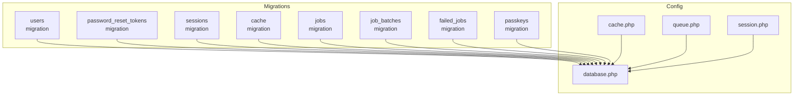
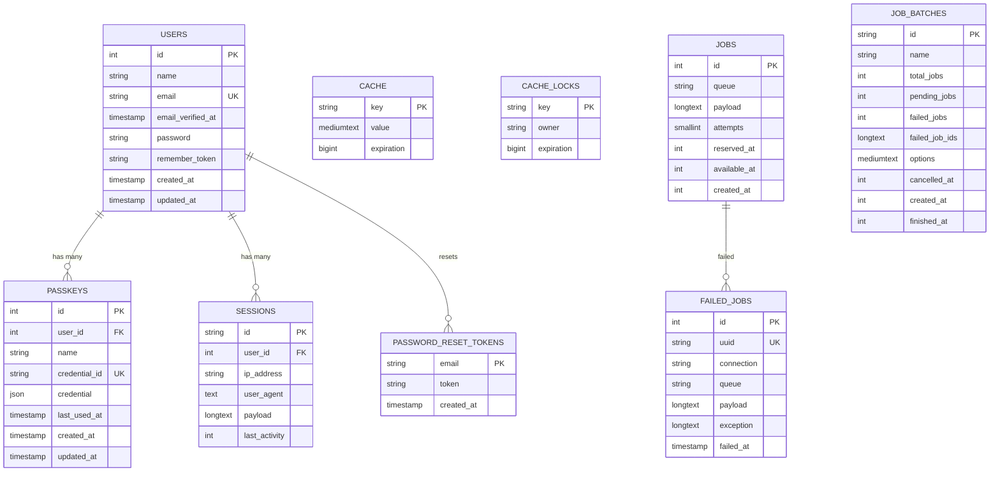
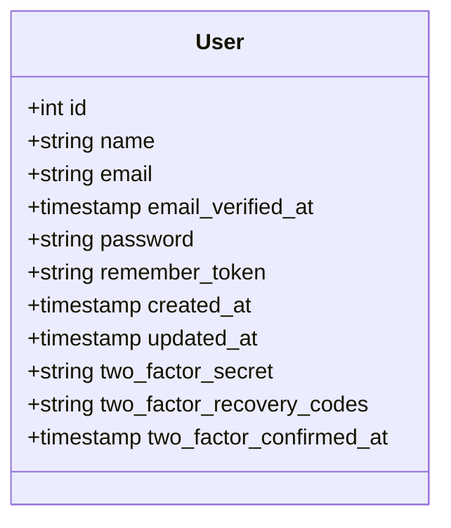
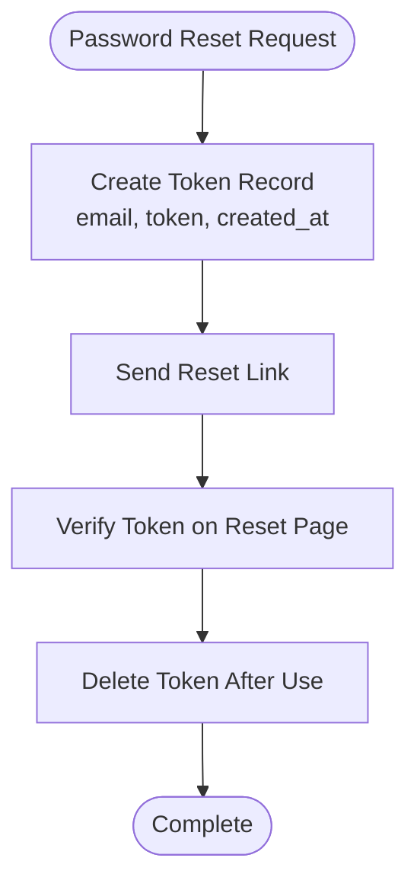
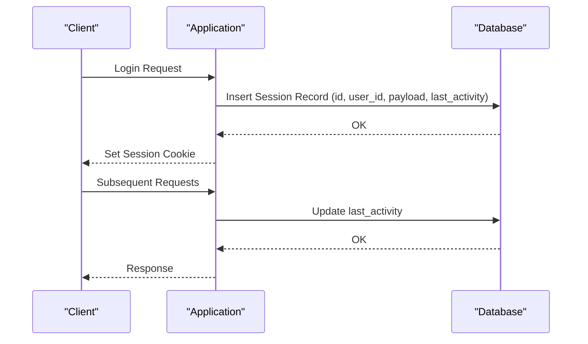
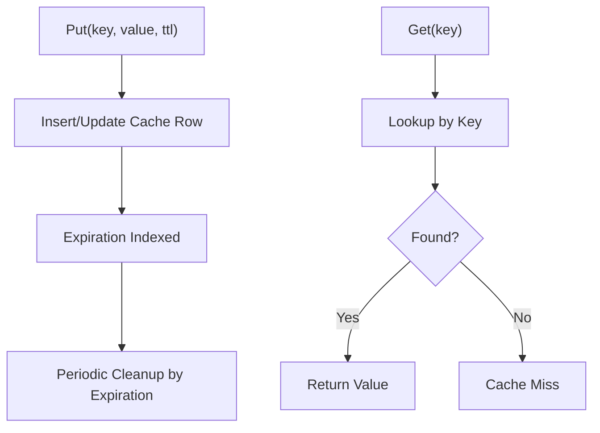
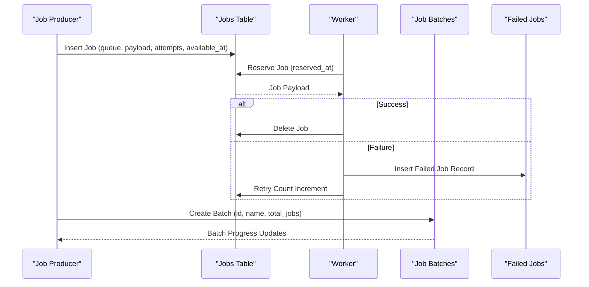
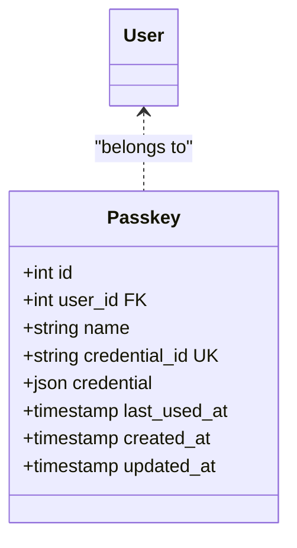
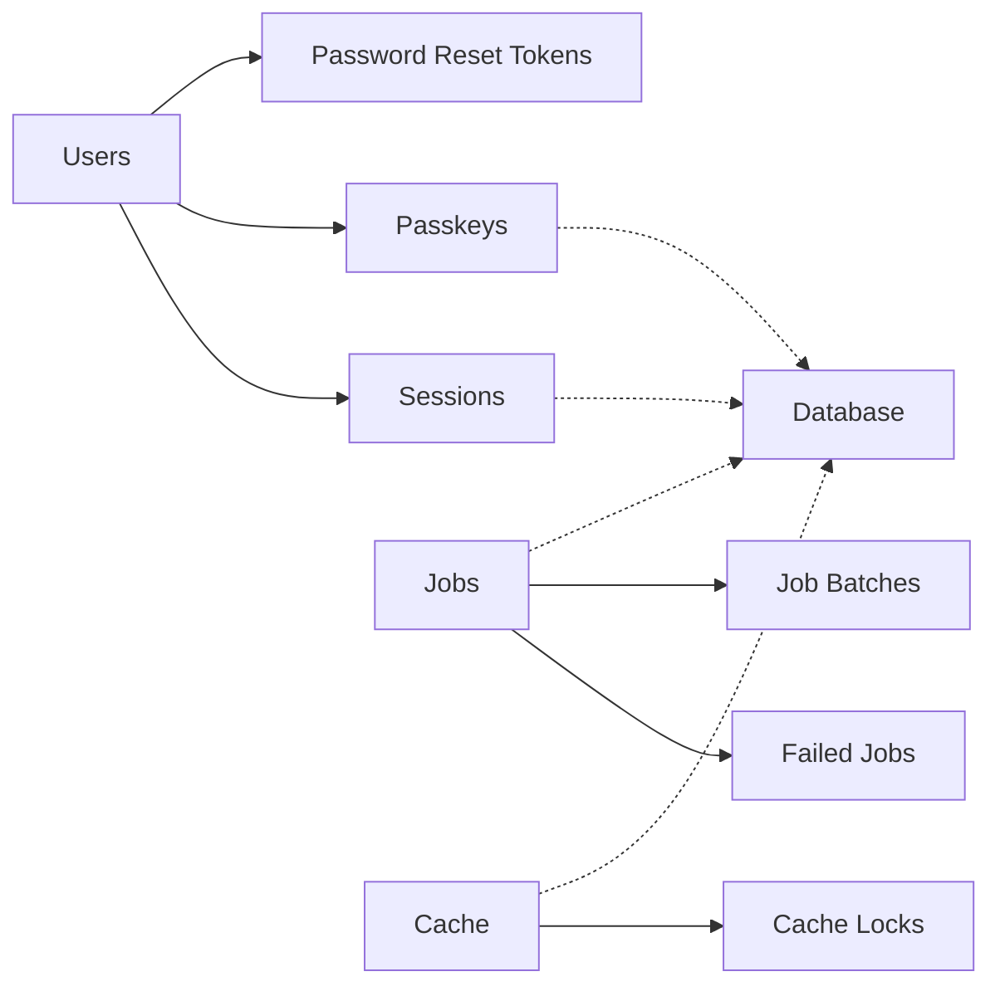

# Schema Overview

<cite>
**Referenced Files in This Document**
- [0001_01_01_000000_create_users_table.php](file://database/migrations/0001_01_01_000000_create_users_table.php)
- [0001_01_01_000001_create_cache_table.php](file://database/migrations/0001_01_01_000001_create_cache_table.php)
- [0001_01_01_000002_create_jobs_table.php](file://database/migrations/0001_01_01_000002_create_jobs_table.php)
- [2025_08_14_170933_add_two_factor_columns_to_users_table.php](file://database/migrations/2025_08_14_170933_add_two_factor_columns_to_users_table.php)
- [2024_01_01_000000_create_passkeys_table.php](file://database/migrations/2024_01_01_000000_create_passkeys_table.php)
- [database.php](file://config/database.php)
- [cache.php](file://config/cache.php)
- [queue.php](file://config/queue.php)
- [session.php](file://config/session.php)
- [User.php](file://app/Models/User.php)
</cite>

## Table of Contents
1. [Introduction](#introduction)
2. [Project Structure](#project-structure)
3. [Core Components](#core-components)
4. [Architecture Overview](#architecture-overview)
5. [Detailed Component Analysis](#detailed-component-analysis)
6. [Dependency Analysis](#dependency-analysis)
7. [Performance Considerations](#performance-considerations)
8. [Troubleshooting Guide](#troubleshooting-guide)
9. [Conclusion](#conclusion)

## Introduction
This document provides a comprehensive schema overview of the SmartExam database design. It focuses on the main database tables: users, password_reset_tokens, sessions, cache, jobs, job_batches, failed_jobs, and passkeys. For each table, we describe its purpose, primary keys, foreign key relationships, indexing strategy, and normalization rationale. We also explain the overall database architecture, how tables interact, and provide performance considerations and optimization strategies.

## Project Structure
The database schema is primarily defined through Laravel migrations located under the database/migrations directory. Configuration files in config/ define how the application connects to the database and how caching, queuing, and sessions are handled.

**Diagram sources**
- [0001_01_01_000000_create_users_table.php:1-50](file://database/migrations/0001_01_01_000000_create_users_table.php#L1-L50)
- [0001_01_01_000001_create_cache_table.php:1-36](file://database/migrations/0001_01_01_000001_create_cache_table.php#L1-L36)
- [0001_01_01_000002_create_jobs_table.php:1-60](file://database/migrations/0001_01_01_000002_create_jobs_table.php#L1-L60)
- [2024_01_01_000000_create_passkeys_table.php:1-35](file://database/migrations/2024_01_01_000000_create_passkeys_table.php#L1-L35)
- [database.php:1-185](file://config/database.php#L1-L185)
- [cache.php:1-137](file://config/cache.php#L1-L137)
- [queue.php:1-130](file://config/queue.php#L1-L130)
- [session.php:1-234](file://config/session.php#L1-L234)

**Section sources**
- [database.php:1-185](file://config/database.php#L1-L185)
- [cache.php:1-137](file://config/cache.php#L1-L137)
- [queue.php:1-130](file://config/queue.php#L1-L130)
- [session.php:1-234](file://config/session.php#L1-L234)

## Core Components
This section documents the main database tables and their roles in the SmartExam application.

- Users
  - Purpose: Stores user account information, authentication credentials, and optional two-factor authentication fields.
  - Primary key: id (auto-incrementing integer).
  - Additional notable columns: email (unique), password, remember_token, timestamps.
  - Indexes: email is unique; timestamps are commonly indexed by Laravel.
  - Notes: Two-factor authentication columns were added via a separate migration.

- Password Reset Tokens
  - Purpose: Stores tokens used for password reset flows.
  - Primary key: email (string).
  - Indexes: none explicitly defined; relies on primary key uniqueness.
  - Notes: Used during password reset workflows.

- Sessions
  - Purpose: Stores session data for authenticated users.
  - Primary key: id (string).
  - Foreign key: user_id references users.id with cascade delete behavior.
  - Indexes: user_id is indexed; last_activity is indexed.
  - Notes: Configured as the default session driver in session.php.

- Cache
  - Purpose: Provides a relational cache store backed by database tables.
  - Primary key: key (string).
  - Indexes: expiration is indexed.
  - Notes: Separate cache_locks table supports distributed locking.

- Jobs
  - Purpose: Queues asynchronous jobs for processing.
  - Primary key: id (auto-incrementing integer).
  - Indexes: queue is indexed; attempts, reserved_at, available_at, created_at are numeric fields.
  - Notes: Supports batched job processing via job_batches and failure tracking via failed_jobs.

- Job Batches
  - Purpose: Tracks groups of jobs processed together.
  - Primary key: id (string).
  - Notes: Maintains counts and status of batched jobs.

- Failed Jobs
  - Purpose: Records failures from job processing.
  - Primary key: id (auto-incrementing integer).
  - Unique key: uuid.
  - Indexes: composite index on connection, queue, failed_at.
  - Notes: Used for monitoring and retry strategies.

- Passkeys
  - Purpose: Stores WebAuthn passkey credentials linked to users.
  - Primary key: id (auto-incrementing integer).
  - Foreign key: user_id references users.id with cascade delete.
  - Indexes: user_id is indexed; credential_id is unique.
  - Notes: Supports modern passwordless authentication.

**Section sources**
- [0001_01_01_000000_create_users_table.php:14-37](file://database/migrations/0001_01_01_000000_create_users_table.php#L14-L37)
- [0001_01_01_000001_create_cache_table.php:14-24](file://database/migrations/0001_01_01_000001_create_cache_table.php#L14-L24)
- [0001_01_01_000002_create_jobs_table.php:14-47](file://database/migrations/0001_01_01_000002_create_jobs_table.php#L14-L47)
- [2024_01_01_000000_create_passkeys_table.php:14-24](file://database/migrations/2024_01_01_000000_create_passkeys_table.php#L14-L24)
- [2025_08_14_170933_add_two_factor_columns_to_users_table.php:14-18](file://database/migrations/2025_08_14_170933_add_two_factor_columns_to_users_table.php#L14-L18)
- [session.php:21-89](file://config/session.php#L21-L89)
- [cache.php:42-48](file://config/cache.php#L42-L48)
- [queue.php:38-45](file://config/queue.php#L38-L45)

## Architecture Overview
The SmartExam database architecture integrates several core subsystems:
- Authentication and session management via users and sessions.
- Password reset via password_reset_tokens.
- Application caching via cache and cache_locks.
- Background job processing via jobs, job_batches, and failed_jobs.
- Modern authentication via passkeys.

**Diagram sources**
- [0001_01_01_000000_create_users_table.php:14-37](file://database/migrations/0001_01_01_000000_create_users_table.php#L14-L37)
- [0001_01_01_000001_create_cache_table.php:14-24](file://database/migrations/0001_01_01_000001_create_cache_table.php#L14-L24)
- [0001_01_01_000002_create_jobs_table.php:14-47](file://database/migrations/0001_01_01_000002_create_jobs_table.php#L14-L47)
- [2024_01_01_000000_create_passkeys_table.php:14-24](file://database/migrations/2024_01_01_000000_create_passkeys_table.php#L14-L24)

## Detailed Component Analysis

### Users Table
- Purpose: Central identity and authentication store.
- Primary key: id.
- Notable constraints: email is unique.
- Normalization: Separates authentication (email/password) from optional 2FA fields, reducing duplication and improving security.
- Indexing: email is unique; timestamps are commonly indexed by Laravel.
- Two-factor fields: Added via a dedicated migration to support TOTP-based 2FA.

**Diagram sources**
- [0001_01_01_000000_create_users_table.php:14-22](file://database/migrations/0001_01_01_000000_create_users_table.php#L14-L22)
- [2025_08_14_170933_add_two_factor_columns_to_users_table.php:14-18](file://database/migrations/2025_08_14_170933_add_two_factor_columns_to_users_table.php#L14-L18)

**Section sources**
- [0001_01_01_000000_create_users_table.php:14-22](file://database/migrations/0001_01_01_000000_create_users_table.php#L14-L22)
- [2025_08_14_170933_add_two_factor_columns_to_users_table.php:14-18](file://database/migrations/2025_08_14_170933_add_two_factor_columns_to_users_table.php#L14-L18)

### Password Reset Tokens
- Purpose: Temporary token storage for password reset workflows.
- Primary key: email.
- Design rationale: Uses email as the primary key to enforce one active reset token per email address.
- Indexing: No explicit indexes; relies on primary key.

**Diagram sources**
- [0001_01_01_000000_create_users_table.php:24-28](file://database/migrations/0001_01_01_000000_create_users_table.php#L24-L28)

**Section sources**
- [0001_01_01_000000_create_users_table.php:24-28](file://database/migrations/0001_01_01_000000_create_users_table.php#L24-L28)

### Sessions
- Purpose: Store session data for authenticated users.
- Primary key: id.
- Foreign key: user_id references users.id with cascade delete.
- Indexing: user_id is indexed; last_activity is indexed for cleanup.
- Integration: Default session driver configured in session.php.

**Diagram sources**
- [0001_01_01_000000_create_users_table.php:30-37](file://database/migrations/0001_01_01_000000_create_users_table.php#L30-L37)
- [session.php:21-89](file://config/session.php#L21-L89)

**Section sources**
- [0001_01_01_000000_create_users_table.php:30-37](file://database/migrations/0001_01_01_000000_create_users_table.php#L30-L37)
- [session.php:21-89](file://config/session.php#L21-L89)

### Cache
- Purpose: Relational cache store with expiration-based cleanup.
- Primary key: key.
- Indexing: expiration is indexed for efficient cleanup.
- Locking: cache_locks table provides distributed locking primitives.
- Integration: Default cache driver configured in cache.php.

**Diagram sources**
- [0001_01_01_000001_create_cache_table.php:14-24](file://database/migrations/0001_01_01_000001_create_cache_table.php#L14-L24)
- [cache.php:42-48](file://config/cache.php#L42-L48)

**Section sources**
- [0001_01_01_000001_create_cache_table.php:14-24](file://database/migrations/0001_01_01_000001_create_cache_table.php#L14-L24)
- [cache.php:42-48](file://config/cache.php#L42-L48)

### Jobs, Job Batches, and Failed Jobs
- Purpose: Asynchronous job processing with batching and failure tracking.
- Jobs: queue is indexed; attempts, reserved_at, available_at, created_at are numeric fields.
- Job Batches: tracks batch metadata and progress.
- Failed Jobs: records failures with composite index on connection, queue, failed_at.
- Integration: Default queue driver configured in queue.php.

**Diagram sources**
- [0001_01_01_000002_create_jobs_table.php:14-47](file://database/migrations/0001_01_01_000002_create_jobs_table.php#L14-L47)
- [queue.php:38-45](file://config/queue.php#L38-L45)

**Section sources**
- [0001_01_01_000002_create_jobs_table.php:14-47](file://database/migrations/0001_01_01_000002_create_jobs_table.php#L14-L47)
- [queue.php:38-45](file://config/queue.php#L38-L45)

### Passkeys
- Purpose: Store WebAuthn passkey credentials for passwordless authentication.
- Primary key: id.
- Foreign key: user_id references users.id with cascade delete.
- Indexing: user_id is indexed; credential_id is unique.
- Integration: Implemented via Laravel Fortify’s PasskeyAuthenticatable trait.

**Diagram sources**
- [2024_01_01_000000_create_passkeys_table.php:14-24](file://database/migrations/2024_01_01_000000_create_passkeys_table.php#L14-L24)
- [User.php](file://app/Models/User.php#L35)

**Section sources**
- [2024_01_01_000000_create_passkeys_table.php:14-24](file://database/migrations/2024_01_01_000000_create_passkeys_table.php#L14-L24)
- [User.php](file://app/Models/User.php#L35)

## Dependency Analysis
This section maps dependencies among tables and external integrations.

**Diagram sources**
- [0001_01_01_000000_create_users_table.php:30-37](file://database/migrations/0001_01_01_000000_create_users_table.php#L30-L37)
- [0001_01_01_000001_create_cache_table.php:14-24](file://database/migrations/0001_01_01_000001_create_cache_table.php#L14-L24)
- [0001_01_01_000002_create_jobs_table.php:14-47](file://database/migrations/0001_01_01_000002_create_jobs_table.php#L14-L47)
- [2024_01_01_000000_create_passkeys_table.php:14-24](file://database/migrations/2024_01_01_000000_create_passkeys_table.php#L14-L24)

Key observations:
- Sessions depends on Users via user_id with cascade delete.
- Passkeys depends on Users via user_id with cascade delete.
- Jobs and Failed Jobs form a producer-consumer pair with failure tracking.
- Cache and Cache Locks are tightly coupled for atomic cache operations.

**Section sources**
- [0001_01_01_000000_create_users_table.php:30-37](file://database/migrations/0001_01_01_000000_create_users_table.php#L30-L37)
- [0001_01_01_000002_create_jobs_table.php:14-47](file://database/migrations/0001_01_01_000002_create_jobs_table.php#L14-L47)
- [0001_01_01_000001_create_cache_table.php:14-24](file://database/migrations/0001_01_01_000001_create_cache_table.php#L14-L24)
- [2024_01_01_000000_create_passkeys_table.php:14-24](file://database/migrations/2024_01_01_000000_create_passkeys_table.php#L14-L24)

## Performance Considerations
- Indexing strategy
  - Sessions: user_id and last_activity are indexed to enable fast lookups and periodic cleanup.
  - Cache: expiration is indexed to efficiently purge expired entries.
  - Jobs: queue is indexed to distribute workloads across queues; composite index on connection, queue, failed_at optimizes failure reporting.
  - Users: email is unique; consider adding indexes on frequently filtered columns (e.g., email_verified_at) if used in queries.
  - Passkeys: credential_id is unique; user_id is indexed for user-centric lookups.

- Query optimization strategies
  - Use targeted selects to avoid loading unnecessary columns (e.g., exclude sensitive fields in non-admin contexts).
  - Leverage indexes for joins (Sessions.user_id -> Users.id, Passkeys.user_id -> Users.id).
  - Batch operations for cache writes and reads to reduce round-trips.
  - Monitor queue backlog and adjust worker concurrency based on queue index utilization.

- Storage and connection considerations
  - Default connection is SQLite; production deployments should use MySQL/MariaDB/PostgreSQL with appropriate charset/collation settings.
  - Configure strict mode and foreign key constraints for data integrity.

- Session and cache sizing
  - Tune session lifetime and cache TTL to balance performance and resource usage.
  - Consider Redis for cache and session backends in high-throughput scenarios.

[No sources needed since this section provides general guidance]

## Troubleshooting Guide
Common issues and resolutions:
- Session not persisting
  - Verify session driver is set to database and table name is correct.
  - Confirm user_id foreign key constraint and cascade delete behavior.
  - Check last_activity index for cleanup scripts.

- Cache misses or stale data
  - Ensure expiration index is present and cleanup jobs are running.
  - Validate cache key prefixes and store configuration.

- Job failures
  - Inspect failed_jobs table for exceptions and retry policies.
  - Review queue index utilization and worker availability.

- Passkey registration/authentication errors
  - Confirm credential_id uniqueness and user_id indexing.
  - Validate passkey credential JSON structure and last_used_at updates.

**Section sources**
- [session.php:21-89](file://config/session.php#L21-L89)
- [cache.php:42-48](file://config/cache.php#L42-L48)
- [queue.php:38-45](file://config/queue.php#L38-L45)
- [0001_01_000001_create_cache_table.php:14-24](file://database/migrations/0001_01_01_000001_create_cache_table.php#L14-L24)
- [0001_01_01_000002_create_jobs_table.php:14-47](file://database/migrations/0001_01_01_000002_create_jobs_table.php#L14-L47)
- [2024_01_01_000000_create_passkeys_table.php:14-24](file://database/migrations/2024_01_01_000000_create_passkeys_table.php#L14-L24)

## Conclusion
The SmartExam database schema is designed around core application needs: robust user authentication, session management, caching, background job processing, and modern passwordless authentication. The schema emphasizes normalization, explicit indexing for hot paths, and clear foreign key relationships. With proper configuration and monitoring, these tables provide a solid foundation for scalable application performance.