# User Table Design

<cite>
**Referenced Files in This Document**
- [User.php](file://app/Models/User.php)
- [create_users_table.php](file://database/migrations/0001_01_01_000000_create_users_table.php)
- [add_two_factor_columns_to_users_table.php](file://database/migrations/2025_08_14_170933_add_two_factor_columns_to_users_table.php)
- [UserFactory.php](file://database/factories/UserFactory.php)
- [auth.php](file://config/auth.php)
- [fortify.php](file://config/fortify.php)
- [FortifyServiceProvider.php](file://app/Providers/FortifyServiceProvider.php)
- [ProfileController.php](file://app/Http/Controllers/Settings/ProfileController.php)
- [SecurityController.php](file://app/Http/Controllers/Settings/SecurityController.php)
- [ProfileValidationRules.php](file://app/Concerns/ProfileValidationRules.php)
- [PasswordValidationRules.php](file://app/Concerns/PasswordValidationRules.php)
- [ProfileUpdateRequest.php](file://app/Http/Requests/Settings/ProfileUpdateRequest.php)
- [PasswordUpdateRequest.php](file://app/Http/Requests/Settings/PasswordUpdateRequest.php)
- [DatabaseSeeder.php](file://database/seeders/DatabaseSeeder.php)
</cite>

## Table of Contents
1. [Introduction](#introduction)
2. [Project Structure](#project-structure)
3. [Core Components](#core-components)
4. [Architecture Overview](#architecture-overview)
5. [Detailed Component Analysis](#detailed-component-analysis)
6. [Dependency Analysis](#dependency-analysis)
7. [Performance Considerations](#performance-considerations)
8. [Troubleshooting Guide](#troubleshooting-guide)
9. [Conclusion](#conclusion)

## Introduction
This document provides comprehensive documentation for the user table design and implementation. It covers the database schema, model definition, validation rules, factory and seeder patterns, authentication configuration, and security considerations for password storage and user authentication fields. The goal is to enable developers to understand, extend, and maintain the user management system effectively.

## Project Structure
The user-related components are organized across several layers:
- Database schema: migrations define the users table and related tables
- Model: the User Eloquent model with casts, fillable, hidden attributes, and traits
- Factories and Seeders: for generating test data
- Configuration: authentication and Fortify settings
- Controllers and Requests: for profile updates, password changes, and security settings
- Validation concerns and form requests: for consistent validation logic

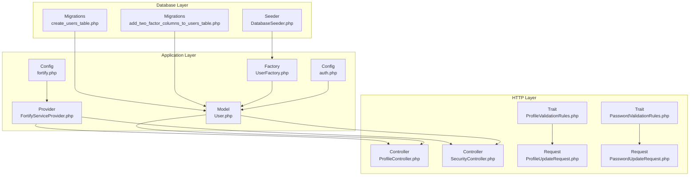

**Diagram sources**
- [create_users_table.php:1-50](file://database/migrations/0001_01_01_000000_create_users_table.php#L1-L50)
- [add_two_factor_columns_to_users_table.php:1-35](file://database/migrations/2025_08_14_170933_add_two_factor_columns_to_users_table.php#L1-L35)
- [User.php:1-53](file://app/Models/User.php#L1-L53)
- [UserFactory.php:1-65](file://database/factories/UserFactory.php#L1-L65)
- [auth.php:1-118](file://config/auth.php#L1-L118)
- [fortify.php:1-192](file://config/fortify.php#L1-L192)
- [FortifyServiceProvider.php:87-117](file://app/Providers/FortifyServiceProvider.php#L87-L117)
- [ProfileController.php:1-63](file://app/Http/Controllers/Settings/ProfileController.php#L1-L63)
- [SecurityController.php:1-73](file://app/Http/Controllers/Settings/SecurityController.php#L1-L73)
- [ProfileUpdateRequest.php:1-23](file://app/Http/Requests/Settings/ProfileUpdateRequest.php#L1-L23)
- [PasswordUpdateRequest.php:1-26](file://app/Http/Requests/Settings/PasswordUpdateRequest.php#L1-L26)
- [ProfileValidationRules.php:1-52](file://app/Concerns/ProfileValidationRules.php#L1-L52)
- [PasswordValidationRules.php:1-29](file://app/Concerns/PasswordValidationRules.php#L1-L29)
- [DatabaseSeeder.php:1-25](file://database/seeders/DatabaseSeeder.php#L1-L25)

**Section sources**
- [User.php:1-53](file://app/Models/User.php#L1-L53)
- [create_users_table.php:1-50](file://database/migrations/0001_01_01_000000_create_users_table.php#L1-L50)
- [add_two_factor_columns_to_users_table.php:1-35](file://database/migrations/2025_08_14_170933_add_two_factor_columns_to_users_table.php#L1-L35)
- [UserFactory.php:1-65](file://database/factories/UserFactory.php#L1-L65)
- [auth.php:1-118](file://config/auth.php#L1-L118)
- [fortify.php:1-192](file://config/fortify.php#L1-L192)
- [FortifyServiceProvider.php:87-117](file://app/Providers/FortifyServiceProvider.php#L87-L117)
- [ProfileController.php:1-63](file://app/Http/Controllers/Settings/ProfileController.php#L1-L63)
- [SecurityController.php:1-73](file://app/Http/Controllers/Settings/SecurityController.php#L1-L73)
- [ProfileUpdateRequest.php:1-23](file://app/Http/Requests/Settings/ProfileUpdateRequest.php#L1-L23)
- [PasswordUpdateRequest.php:1-26](file://app/Http/Requests/Settings/PasswordUpdateRequest.php#L1-L26)
- [ProfileValidationRules.php:1-52](file://app/Concerns/ProfileValidationRules.php#L1-L52)
- [PasswordValidationRules.php:1-29](file://app/Concerns/PasswordValidationRules.php#L1-L29)
- [DatabaseSeeder.php:1-25](file://database/seeders/DatabaseSeeder.php#L1-L25)

## Core Components
This section documents the user table schema, model attributes, validation rules, and factory/seeder patterns.

- Database schema
  - Users table: includes id, name, email (unique), email_verified_at (nullable), password, remember_token, and timestamps
  - Additional tables: password_reset_tokens and sessions
  - Two-factor authentication columns are conditionally added via a separate migration

- Model definition
  - Uses Eloquent traits for factory generation, notifications, passkey authentication, and two-factor authentication
  - Fillable attributes: name, email, password
  - Hidden attributes: password, two_factor_secret, two_factor_recovery_codes, remember_token
  - Casts: email_verified_at and two_factor_confirmed_at as datetime; password as hashed

- Validation rules
  - Profile updates: name and email with uniqueness constraints
  - Password updates: current password and new password with confirmation

- Factory and seeder patterns
  - Factory generates realistic default user data with hashed passwords and optional two-factor configuration
  - Seeder creates a predefined test user

**Section sources**
- [create_users_table.php:14-22](file://database/migrations/0001_01_01_000000_create_users_table.php#L14-L22)
- [add_two_factor_columns_to_users_table.php:14-18](file://database/migrations/2025_08_14_170933_add_two_factor_columns_to_users_table.php#L14-L18)
- [User.php:30-51](file://app/Models/User.php#L30-L51)
- [ProfileValidationRules.php:16-50](file://app/Concerns/ProfileValidationRules.php#L16-L50)
- [PasswordValidationRules.php:15-28](file://app/Concerns/PasswordValidationRules.php#L15-L28)
- [UserFactory.php:25-63](file://database/factories/UserFactory.php#L25-L63)
- [DatabaseSeeder.php:20-23](file://database/seeders/DatabaseSeeder.php#L20-L23)

## Architecture Overview
The user management architecture integrates database migrations, Eloquent model, validation, authentication configuration, and controller actions.

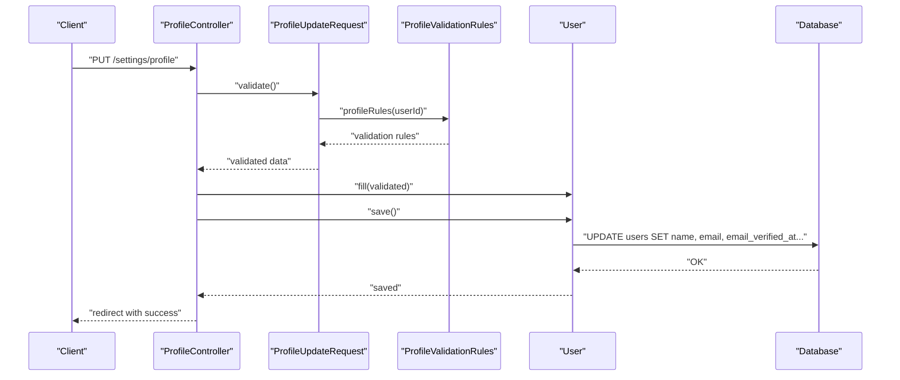

**Diagram sources**
- [ProfileController.php:31-44](file://app/Http/Controllers/Settings/ProfileController.php#L31-L44)
- [ProfileUpdateRequest.php:18-21](file://app/Http/Requests/Settings/ProfileUpdateRequest.php#L18-L21)
- [ProfileValidationRules.php:16-50](file://app/Concerns/ProfileValidationRules.php#L16-L50)
- [User.php:30-51](file://app/Models/User.php#L30-L51)

**Section sources**
- [ProfileController.php:1-63](file://app/Http/Controllers/Settings/ProfileController.php#L1-L63)
- [ProfileUpdateRequest.php:1-23](file://app/Http/Requests/Settings/ProfileUpdateRequest.php#L1-L23)
- [ProfileValidationRules.php:1-52](file://app/Concerns/ProfileValidationRules.php#L1-L52)
- [User.php:1-53](file://app/Models/User.php#L1-L53)

## Detailed Component Analysis

### Database Schema: Users Table
- Fields and constraints
  - id: auto-incrementing primary key
  - name: string, required
  - email: string, unique, required
  - email_verified_at: timestamp, nullable
  - password: string, required
  - remember_token: string, provided by rememberToken()
  - timestamps: created_at and updated_at
- Related tables
  - password_reset_tokens: stores reset tokens for password resets
  - sessions: stores session metadata for authentication

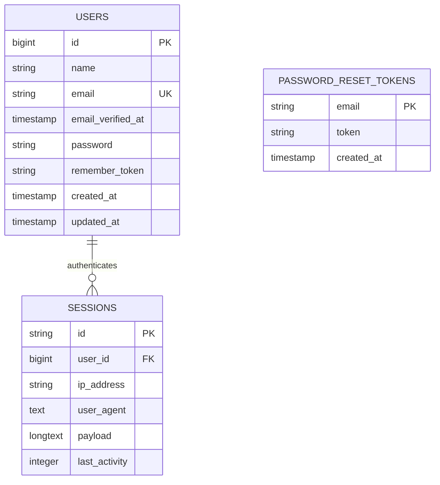

**Diagram sources**
- [create_users_table.php:14-37](file://database/migrations/0001_01_01_000000_create_users_table.php#L14-L37)

**Section sources**
- [create_users_table.php:14-37](file://database/migrations/0001_01_01_000000_create_users_table.php#L14-L37)

### Two-Factor Authentication Columns
- Conditional addition via migration
  - two_factor_secret: text, nullable
  - two_factor_recovery_codes: text, nullable
  - two_factor_confirmed_at: timestamp, nullable

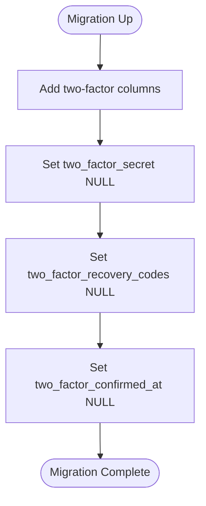

**Diagram sources**
- [add_two_factor_columns_to_users_table.php:14-18](file://database/migrations/2025_08_14_170933_add_two_factor_columns_to_users_table.php#L14-L18)

**Section sources**
- [add_two_factor_columns_to_users_table.php:1-35](file://database/migrations/2025_08_14_170933_add_two_factor_columns_to_users_table.php#L1-L35)

### User Model: Attributes, Casting, and Traits
- Fillable attributes: name, email, password
- Hidden attributes: password, two_factor_secret, two_factor_recovery_codes, remember_token
- Casts: email_verified_at and two_factor_confirmed_at as datetime; password as hashed
- Traits: HasFactory, Notifiable, PasskeyAuthenticatable, TwoFactorAuthenticatable

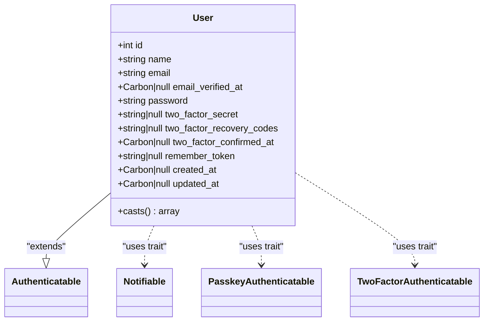

**Diagram sources**
- [User.php:17-51](file://app/Models/User.php#L17-L51)

**Section sources**
- [User.php:1-53](file://app/Models/User.php#L1-L53)

### Validation Rules: Profile and Password Updates
- Profile update rules
  - Name: required, string, max length
  - Email: required, string, email format, unique constraint with ignore for existing users
- Password update rules
  - Current password: required, must match user's current password
  - New password: required, follows default password rules, confirmation required

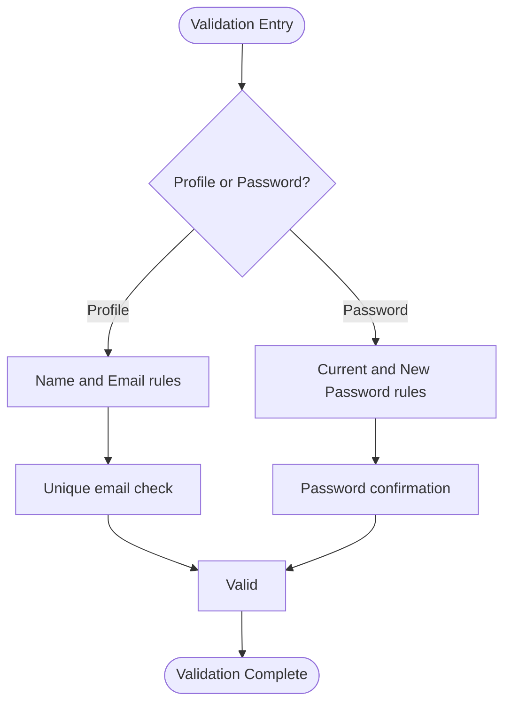

**Diagram sources**
- [ProfileValidationRules.php:16-50](file://app/Concerns/ProfileValidationRules.php#L16-L50)
- [PasswordValidationRules.php:15-28](file://app/Concerns/PasswordValidationRules.php#L15-L28)
- [ProfileUpdateRequest.php:18-21](file://app/Http/Requests/Settings/ProfileUpdateRequest.php#L18-L21)
- [PasswordUpdateRequest.php:18-24](file://app/Http/Requests/Settings/PasswordUpdateRequest.php#L18-L24)

**Section sources**
- [ProfileValidationRules.php:1-52](file://app/Concerns/ProfileValidationRules.php#L1-L52)
- [PasswordValidationRules.php:1-29](file://app/Concerns/PasswordValidationRules.php#L1-L29)
- [ProfileUpdateRequest.php:1-23](file://app/Http/Requests/Settings/ProfileUpdateRequest.php#L1-L23)
- [PasswordUpdateRequest.php:1-26](file://app/Http/Requests/Settings/PasswordUpdateRequest.php#L1-L26)

### Factory Pattern: Generating Test User Data
- Default state includes realistic name, unique email, verified email timestamp, hashed password, and remember token
- Optional states:
  - Unverified email: sets email_verified_at to null
  - With two-factor: sets encrypted secret, recovery codes, and confirmed timestamp

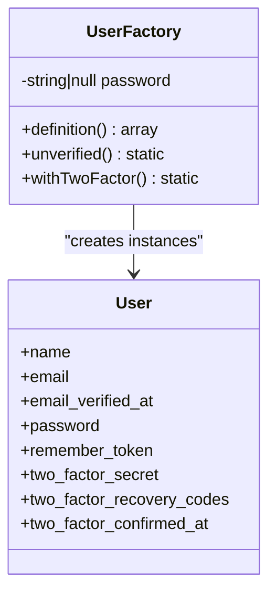

**Diagram sources**
- [UserFactory.php:13-63](file://database/factories/UserFactory.php#L13-L63)
- [User.php:17-51](file://app/Models/User.php#L17-L51)

**Section sources**
- [UserFactory.php:1-65](file://database/factories/UserFactory.php#L1-L65)

### Seeding Strategies: Creating Initial Users
- The seeder demonstrates creating a single test user with predefined name and email
- Factories can be used to create multiple users in automated tests

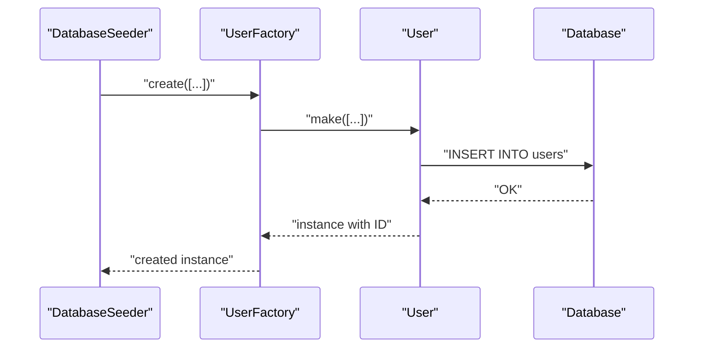

**Diagram sources**
- [DatabaseSeeder.php:20-23](file://database/seeders/DatabaseSeeder.php#L20-L23)
- [UserFactory.php:25-38](file://database/factories/UserFactory.php#L25-L38)

**Section sources**
- [DatabaseSeeder.php:1-25](file://database/seeders/DatabaseSeeder.php#L1-L25)
- [UserFactory.php:1-65](file://database/factories/UserFactory.php#L1-L65)

### Authentication and Security Configuration
- Authentication guard and provider
  - Guard: session-based web guard
  - Provider: Eloquent model User
- Password reset configuration
  - Token table: password_reset_tokens
  - Expiry and throttling settings
- Fortify features
  - Registration, password reset, email verification, two-factor authentication, and passkeys
  - Rate limiters for login, two-factor, and passkeys
- Provider configuration
  - Configures rate limiters and view rendering for Fortify

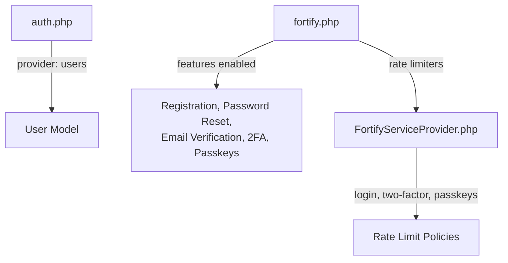

**Diagram sources**
- [auth.php:64-102](file://config/auth.php#L64-L102)
- [fortify.php:169-189](file://config/fortify.php#L169-L189)
- [FortifyServiceProvider.php:95-116](file://app/Providers/FortifyServiceProvider.php#L95-L116)

**Section sources**
- [auth.php:1-118](file://config/auth.php#L1-L118)
- [fortify.php:1-192](file://config/fortify.php#L1-L192)
- [FortifyServiceProvider.php:87-117](file://app/Providers/FortifyServiceProvider.php#L87-L117)

### Common Queries and Operations
- Retrieving users
  - Find by email: leverages unique index on email
  - Paginate users: use Eloquent pagination helpers
- Updating profile
  - Update name and email; if email changes, reset email_verified_at
- Changing password
  - Validate current password, then set new password
- Managing two-factor authentication
  - Enable/disable, regenerate recovery codes, confirm setup
- Deleting account
  - Logout, invalidate session, regenerate CSRF token, delete user

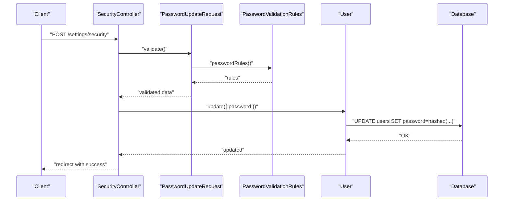

**Diagram sources**
- [SecurityController.php:62-71](file://app/Http/Controllers/Settings/SecurityController.php#L62-L71)
- [PasswordUpdateRequest.php:18-24](file://app/Http/Requests/Settings/PasswordUpdateRequest.php#L18-L24)
- [PasswordValidationRules.php:15-28](file://app/Concerns/PasswordValidationRules.php#L15-L28)
- [User.php:42-51](file://app/Models/User.php#L42-L51)

**Section sources**
- [ProfileController.php:31-44](file://app/Http/Controllers/Settings/ProfileController.php#L31-L44)
- [SecurityController.php:62-71](file://app/Http/Controllers/Settings/SecurityController.php#L62-L71)
- [PasswordUpdateRequest.php:1-26](file://app/Http/Requests/Settings/PasswordUpdateRequest.php#L1-L26)
- [PasswordValidationRules.php:1-29](file://app/Concerns/PasswordValidationRules.php#L1-L29)
- [User.php:42-51](file://app/Models/User.php#L42-L51)

### Security Considerations
- Password storage
  - Passwords are hashed via model casting; avoid storing plaintext
  - Use strong hashing and keep default password policies
- Authentication fields
  - remember_token is hidden and auto-generated
  - email_verified_at is reset when email changes to enforce re-verification
- Two-factor authentication
  - Secrets and recovery codes are stored encrypted; ensure secure storage and rotation
  - Confirm timestamps track when 2FA was enabled
- Rate limiting
  - Login, two-factor, and passkey attempts are rate-limited to prevent brute force
- Session management
  - Sessions table supports centralized session handling and cleanup

**Section sources**
- [User.php:30-51](file://app/Models/User.php#L30-L51)
- [ProfileController.php:35-37](file://app/Http/Controllers/Settings/ProfileController.php#L35-L37)
- [UserFactory.php:57-61](file://database/factories/UserFactory.php#L57-L61)
- [FortifyServiceProvider.php:97-115](file://app/Providers/FortifyServiceProvider.php#L97-L115)
- [create_users_table.php:30-37](file://database/migrations/0001_01_01_000000_create_users_table.php#L30-L37)

## Dependency Analysis
The user system exhibits clear separation of concerns across layers:
- Database migrations define schema and constraints
- Eloquent model encapsulates casting, visibility, and authentication traits
- Validation concerns and requests enforce business rules
- Controllers orchestrate operations and integrate with the model
- Configuration files centralize authentication and feature toggles

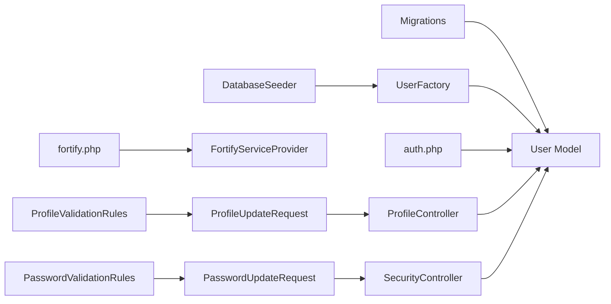

**Diagram sources**
- [create_users_table.php:1-50](file://database/migrations/0001_01_01_000000_create_users_table.php#L1-L50)
- [User.php:1-53](file://app/Models/User.php#L1-L53)
- [UserFactory.php:1-65](file://database/factories/UserFactory.php#L1-L65)
- [DatabaseSeeder.php:1-25](file://database/seeders/DatabaseSeeder.php#L1-L25)
- [auth.php:64-102](file://config/auth.php#L64-L102)
- [fortify.php:169-189](file://config/fortify.php#L169-L189)
- [FortifyServiceProvider.php:95-116](file://app/Providers/FortifyServiceProvider.php#L95-L116)
- [ProfileValidationRules.php:1-52](file://app/Concerns/ProfileValidationRules.php#L1-L52)
- [PasswordValidationRules.php:1-29](file://app/Concerns/PasswordValidationRules.php#L1-L29)
- [ProfileUpdateRequest.php:1-23](file://app/Http/Requests/Settings/ProfileUpdateRequest.php#L1-L23)
- [PasswordUpdateRequest.php:1-26](file://app/Http/Requests/Settings/PasswordUpdateRequest.php#L1-L26)
- [ProfileController.php:1-63](file://app/Http/Controllers/Settings/ProfileController.php#L1-L63)
- [SecurityController.php:1-73](file://app/Http/Controllers/Settings/SecurityController.php#L1-L73)

**Section sources**
- [User.php:1-53](file://app/Models/User.php#L1-L53)
- [ProfileController.php:1-63](file://app/Http/Controllers/Settings/ProfileController.php#L1-L63)
- [SecurityController.php:1-73](file://app/Http/Controllers/Settings/SecurityController.php#L1-L73)
- [ProfileUpdateRequest.php:1-23](file://app/Http/Requests/Settings/ProfileUpdateRequest.php#L1-L23)
- [PasswordUpdateRequest.php:1-26](file://app/Http/Requests/Settings/PasswordUpdateRequest.php#L1-L26)
- [ProfileValidationRules.php:1-52](file://app/Concerns/ProfileValidationRules.php#L1-L52)
- [PasswordValidationRules.php:1-29](file://app/Concerns/PasswordValidationRules.php#L1-L29)
- [auth.php:1-118](file://config/auth.php#L1-L118)
- [fortify.php:1-192](file://config/fortify.php#L1-L192)
- [FortifyServiceProvider.php:87-117](file://app/Providers/FortifyServiceProvider.php#L87-L117)
- [create_users_table.php:1-50](file://database/migrations/0001_01_01_000000_create_users_table.php#L1-L50)
- [add_two_factor_columns_to_users_table.php:1-35](file://database/migrations/2025_08_14_170933_add_two_factor_columns_to_users_table.php#L1-L35)
- [UserFactory.php:1-65](file://database/factories/UserFactory.php#L1-L65)
- [DatabaseSeeder.php:1-25](file://database/seeders/DatabaseSeeder.php#L1-L25)

## Performance Considerations
- Indexes
  - Email is unique; ensure queries filtering by email leverage this index
- Casting
  - Using datetime casts avoids manual parsing overhead
  - Hashed password casting ensures secure storage without manual hashing
- Two-factor encryption
  - Encrypting secrets and recovery codes adds security but may impact performance; consider caching decrypted values in memory for active sessions
- Rate limiting
  - Configure appropriate limits to balance security and user experience
- Sessions
  - Monitor sessions table size and prune expired entries periodically

## Troubleshooting Guide
- Email uniqueness violations
  - Occur when attempting to insert/update with an existing email; ensure validation runs before persistence
- Password hash mismatch
  - Ensure password updates use the model's casting and avoid manual hashing
- Two-factor state inconsistencies
  - Verify that two_factor_confirmed_at is set when enabling 2FA and cleared when disabling
- Session issues
  - Clear expired sessions and ensure last_activity indexing supports efficient cleanup
- Rate limit exceeded
  - Adjust rate limiter configurations for login, two-factor, and passkeys based on deployment needs

**Section sources**
- [ProfileValidationRules.php:46-49](file://app/Concerns/ProfileValidationRules.php#L46-L49)
- [User.php:42-51](file://app/Models/User.php#L42-L51)
- [UserFactory.php:57-61](file://database/factories/UserFactory.php#L57-L61)
- [create_users_table.php:30-37](file://database/migrations/0001_01_01_000000_create_users_table.php#L30-L37)
- [FortifyServiceProvider.php:97-115](file://app/Providers/FortifyServiceProvider.php#L97-L115)

## Conclusion
The user table design integrates robust schema constraints, secure model casting, comprehensive validation, and flexible factory/seeder patterns. Authentication and Fortify configurations provide layered security, while controllers and requests ensure consistent business logic. Following the outlined practices will help maintain a secure, scalable, and maintainable user management system.