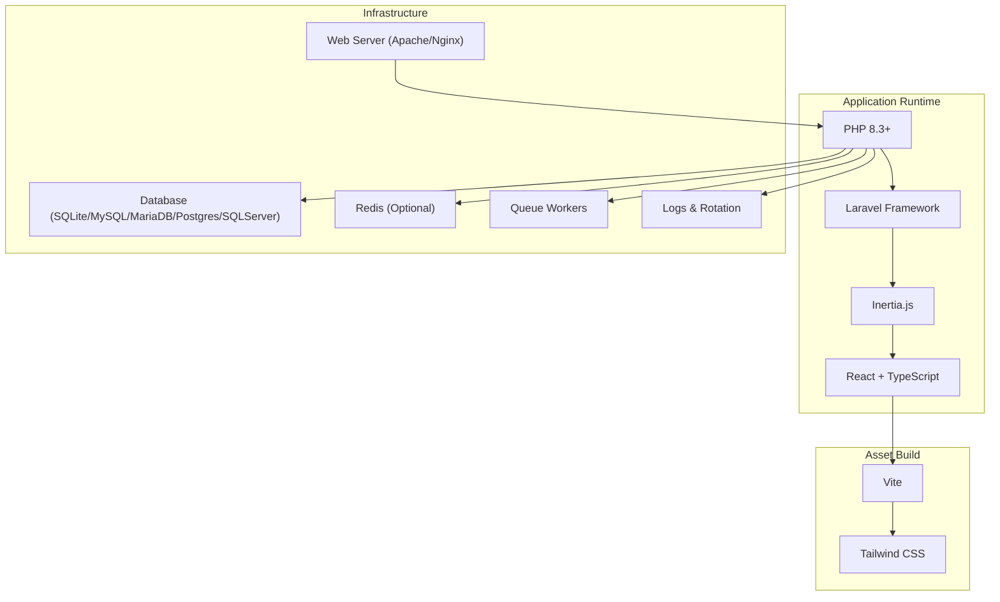
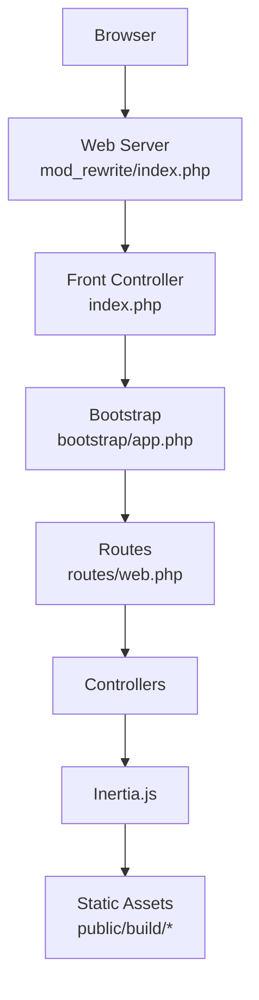
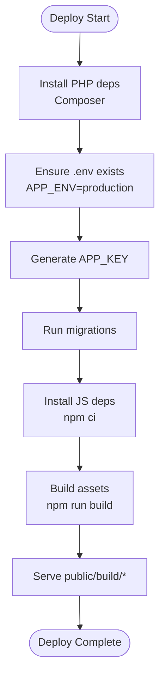
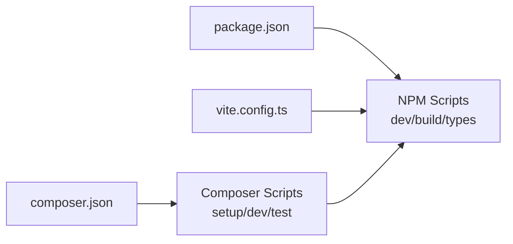

# Deployment Guide

<cite>
**Referenced Files in This Document**
- [composer.json](file://composer.json)
- [package.json](file://package.json)
- [vite.config.ts](file://vite.config.ts)
- [public/.htaccess](file://public/.htaccess)
- [config/app.php](file://config/app.php)
- [config/database.php](file://config/database.php)
- [config/cache.php](file://config/cache.php)
- [config/session.php](file://config/session.php)
- [config/queue.php](file://config/queue.php)
- [config/logging.php](file://config/logging.php)
- [config/mail.php](file://config/mail.php)
- [config/services.php](file://config/services.php)
- [bootstrap/app.php](file://bootstrap/app.php)
- [bootstrap/providers.php](file://bootstrap/providers.php)
- [.github/workflows](file://.github/workflows)
- [database/migrations](file://database/migrations)
- [database/seeders](file://database/seeders)
</cite>

## Table of Contents
1. [Introduction](#introduction)
2. [Project Structure](#project-structure)
3. [Core Components](#core-components)
4. [Architecture Overview](#architecture-overview)
5. [Detailed Component Analysis](#detailed-component-analysis)
6. [Dependency Analysis](#dependency-analysis)
7. [Performance Considerations](#performance-considerations)
8. [Troubleshooting Guide](#troubleshooting-guide)
9. [Conclusion](#conclusion)
10. [Appendices](#appendices)

## Introduction
This deployment guide provides a production-ready blueprint for the SmartExam web application. It covers environment setup, security hardening, asset compilation, database migrations, caching, queueing, logging, and operational procedures. It also documents CI/CD integration points, monitoring, backups, and rollback strategies tailored to the application’s Laravel and React/Vite stack.

## Project Structure
SmartExam is a Laravel application with Inertia.js and React front-end assets built via Vite. Production deployment requires:
- PHP runtime and Composer dependencies
- Node.js and npm for asset builds
- Web server rewrite rules for the front controller
- Database connectivity and migrations
- Cache and session backends
- Queue workers for background tasks
- Logging and log rotation
- Environment variables for secrets and configuration

**Diagram sources**
- [bootstrap/app.php:11-31](file://bootstrap/app.php#L11-L31)
- [vite.config.ts:1-32](file://vite.config.ts#L1-L32)
- [config/database.php:20-185](file://config/database.php#L20-L185)
- [config/queue.php:16-130](file://config/queue.php#L16-L130)
- [config/logging.php:21-133](file://config/logging.php#L21-L133)

**Section sources**
- [composer.json:11-19](file://composer.json#L11-L19)
- [package.json:15-77](file://package.json#L15-L77)
- [vite.config.ts:1-32](file://vite.config.ts#L1-L32)
- [public/.htaccess:1-26](file://public/.htaccess#L1-L26)

## Core Components
- Application kernel and middleware pipeline
- Asset pipeline (Vite, React, Tailwind)
- Database abstraction with multiple drivers
- Cache and session backends
- Queue backends and failed job handling
- Logging channels and rotation
- Mail transport configuration
- Environment-driven configuration

Key production configuration touchpoints:
- Application name, environment, debug, URL, timezone, locales, encryption key, maintenance driver
- Database connections (SQLite, MySQL/MariaDB, PostgreSQL, SQL Server), SSL/TLS options, Redis
- Cache stores (database, file, redis, dynamodb, octane), failover, prefix
- Sessions (file, cookie, database, redis), lifetime, secure flags, SameSite, serialization
- Queues (sync, database, beanstalkd, sqs, redis), batching, failed jobs
- Logging (stack, daily, slack, syslog, stderr), deprecations
- Mailers (smtp, ses, postmark, resend, sendmail, log), global sender
- Services (SES, Postmark, Resend, Slack)

**Section sources**
- [config/app.php:16-127](file://config/app.php#L16-L127)
- [config/database.php:20-185](file://config/database.php#L20-L185)
- [config/cache.php:18-137](file://config/cache.php#L18-L137)
- [config/session.php:21-234](file://config/session.php#L21-L234)
- [config/queue.php:16-130](file://config/queue.php#L16-L130)
- [config/logging.php:21-133](file://config/logging.php#L21-L133)
- [config/mail.php:17-119](file://config/mail.php#L17-L119)
- [config/services.php:17-38](file://config/services.php#L17-L38)

## Architecture Overview
Production runtime architecture integrates the web server, PHP application, asset pipeline, and infrastructure services.

**Diagram sources**
- [public/.htaccess:1-26](file://public/.htaccess#L1-L26)
- [bootstrap/app.php:11-31](file://bootstrap/app.php#L11-L31)

## Detailed Component Analysis

### Environment and Secrets Management
- Required environment variables are read via the config files. Ensure the following are set in production:
  - Application: APP_ENV, APP_DEBUG, APP_URL, APP_KEY, APP_NAME, LOCALE, TIMEZONE
  - Database: DB_CONNECTION, DB_HOST, DB_PORT, DB_DATABASE, DB_USERNAME, DB_PASSWORD, DB_CHARSET, DB_COLLATION, DB_URL, optional SSL/TLS
  - Redis: REDIS_* for client, host, port, db, prefix, max retries, backoff
  - Cache: CACHE_STORE, DB_CACHE_* for table/locks, REDIS_CACHE_* for connection
  - Session: SESSION_DRIVER, SESSION_LIFETIME, SESSION_SECURE_COOKIE, SESSION_SAME_SITE, SESSION_DOMAIN, SESSION_COOKIE
  - Queue: QUEUE_CONNECTION, DB_QUEUE_*, REDIS_QUEUE_*
  - Logging: LOG_CHANNEL, LOG_LEVEL, LOG_STACK, LOG_DAILY_DAYS, SLACK/PAPERTRAIL/STDERR settings
  - Mail: MAIL_MAILER, MAIL_HOST, MAIL_PORT, MAIL_USERNAME, MAIL_PASSWORD, MAIL_FROM_ADDRESS, MAIL_FROM_NAME
  - Services: AWS_ACCESS_KEY_ID, AWS_SECRET_ACCESS_KEY, AWS_DEFAULT_REGION, POSTMARK_API_KEY, RESEND_API_KEY, SLACK_BOT_USER_OAUTH_TOKEN

Best practices:
- Store secrets in OS-level secret managers or deployment-specific secret stores
- Rotate APP_KEY periodically and use APP_PREVIOUS_KEYS during key rotation
- Disable APP_DEBUG in production
- Enforce HTTPS and secure cookies for session and auth

**Section sources**
- [config/app.php:29-127](file://config/app.php#L29-L127)
- [config/database.php:20-185](file://config/database.php#L20-L185)
- [config/cache.php:18-137](file://config/cache.php#L18-L137)
- [config/session.php:21-234](file://config/session.php#L21-L234)
- [config/queue.php:16-130](file://config/queue.php#L16-L130)
- [config/logging.php:21-133](file://config/logging.php#L21-L133)
- [config/mail.php:17-119](file://config/mail.php#L17-L119)
- [config/services.php:17-38](file://config/services.php#L17-L38)

### Database and Migrations
Supported drivers: sqlite, mysql, mariadb, pgsql, sqlsrv. Production-grade recommendations:
- Use managed databases (e.g., RDS/Aurora for MySQL/MariaDB, Cloud SQL for PostgreSQL, Azure SQL DB)
- Enable SSL/TLS where applicable (MySQL/MariaDB ATTR_SSL_CA)
- Use dedicated migrations table and keep update_date_on_publish enabled
- For SQLite in production, prefer external managed DB engines

Migration strategy:
- Run migrations in a controlled deploy window
- Use graceful migration flags during setup scripts
- Keep migrations idempotent and backward compatible where possible

**Section sources**
- [config/database.php:20-185](file://config/database.php#L20-L185)
- [composer.json:48](file://composer.json#L48)
- [database/migrations/0001_01_01_000000_create_users_table.php](file://database/migrations/0001_01_01_000000_create_users_table.php)
- [database/migrations/0001_01_01_000001_create_cache_table.php](file://database/migrations/0001_01_01_000001_create_cache_table.php)
- [database/migrations/0001_01_01_000002_create_jobs_table.php](file://database/migrations/0001_01_01_000002_create_jobs_table.php)
- [database/migrations/2024_01_01_000000_create_passkeys_table.php](file://database/migrations/2024_01_01_000000_create_passkeys_table.php)
- [database/migrations/2025_08_14_170933_add_two_factor_columns_to_users_table.php](file://database/migrations/2025_08_14_170933_add_two_factor_columns_to_users_table.php)

### Caching and Sessions
- Cache store defaults to database; production should consider redis for performance and scalability
- Use CACHE_PREFIX to isolate environments
- Sessions default to database; enable encryption and secure/SameSite flags
- For distributed deployments, prefer redis or database-backed stores

**Section sources**
- [config/cache.php:18-137](file://config/cache.php#L18-L137)
- [config/session.php:21-234](file://config/session.php#L21-L234)

### Queues and Background Jobs
- Default queue driver is database; production should use redis or managed SQS
- Configure retry_after and block_for appropriately
- Monitor failed_jobs and set up alerts
- Use queue workers with process supervisors

**Section sources**
- [config/queue.php:16-130](file://config/queue.php#L16-L130)
- [composer.json:48](file://composer.json#L48)

### Logging and Monitoring
- Use daily rotation with configurable retention
- Integrate Slack, Papertrail, or stderr for centralized logging
- Set appropriate log levels per environment
- Monitor application health endpoint

**Section sources**
- [config/logging.php:21-133](file://config/logging.php#L21-L133)
- [bootstrap/app.php:15](file://bootstrap/app.php#L15)

### Asset Compilation and Delivery
- Build assets with Vite for production
- Serve compiled assets from public/build via web server
- Ensure proper MIME types and cache headers

Build and serve flow:

**Diagram sources**
- [composer.json:44-51](file://composer.json#L44-L51)
- [package.json:5-14](file://package.json#L5-L14)
- [vite.config.ts:1-32](file://vite.config.ts#L1-L32)

**Section sources**
- [composer.json:44-51](file://composer.json#L44-L51)
- [package.json:5-14](file://package.json#L5-L14)
- [vite.config.ts:1-32](file://vite.config.ts#L1-L32)

### Web Server Configuration (Apache)
Enable mod_rewrite and ensure the front controller pattern is applied. The .htaccess handles Authorization/XSRF headers and routing to index.php.

Recommended directives:
- RewriteEngine On
- SetEnvIf Authorization . XAUTH="true"
- SetEnvIf x-xsrf-token . XXSRFT="true"
- RedirectTrailingSlashes
- Route non-files/dirs to index.php

**Section sources**
- [public/.htaccess:1-26](file://public/.htaccess#L1-L26)

### Security Hardening
- Disable debug mode in production
- Enforce HTTPS, secure cookies, httpOnly, SameSite=Lax/Strict
- Use strong APP_KEY and rotate with previous keys
- Restrict file/directory permissions
- Validate and sanitize inputs; leverage Fortify features
- Rate-limit sensitive endpoints

**Section sources**
- [config/app.php:42](file://config/app.php#L42)
- [config/session.php:172-202](file://config/session.php#L172-L202)
- [config/session.php:231](file://config/session.php#L231)

### Backup and Rollback
- Database backups: schedule regular logical dumps; retain rotation windows
- Application code: maintain git tags and immutable artifacts
- Rollback procedure:
  - Stop new traffic
  - Rollback artifact to last known good version
  - Restore DB from recent backup
  - Restart services and health-check
  - Monitor metrics and logs

[No sources needed since this section provides general guidance]

### Monitoring and Alerting
- Health endpoint: use the built-in /up route
- Metrics: monitor queue backlog, cache hit rates, DB latency
- Logs: centralize via stderr or external systems
- Uptime: integrate synthetic checks

**Section sources**
- [bootstrap/app.php:15](file://bootstrap/app.php#L15)

### CI/CD Integration
- GitHub Workflows: define build, test, and deploy jobs
- Build steps: composer install (optimized), npm ci, npm run build
- Deploy steps: upload artifacts, run migrations, restart services
- Rollout: blue/green or rolling updates

**Section sources**
- [.github/workflows](file://.github/workflows)

## Dependency Analysis
Runtime and build dependencies are declared in composer.json and package.json. Composer scripts orchestrate setup, development, and CI checks.

**Diagram sources**
- [composer.json:43-96](file://composer.json#L43-L96)
- [package.json:5-14](file://package.json#L5-L14)
- [vite.config.ts:1-32](file://vite.config.ts#L1-L32)

**Section sources**
- [composer.json:43-96](file://composer.json#L43-L96)
- [package.json:5-14](file://package.json#L5-L14)

## Performance Considerations
- PHP: use OPcache, opcache.enable=1, opcache.validate_timestamps=0 in production
- Web server: enable gzip/brotli, static asset caching, and index preloading
- Database: connection pooling, read replicas, query caching
- Cache: redis cluster, TTL tuning, prefix isolation
- Queue: worker scaling, dead letter queues, retry policies
- Assets: minification, code splitting, CDN delivery

[No sources needed since this section provides general guidance]

## Troubleshooting Guide
Common production issues and remedies:
- 500 errors after deploy: check APP_KEY, .env correctness, storage permissions
- Assets missing: rebuild with npm run build, verify public/build/*
- Database connection failures: validate DB_* variables, SSL/TLS settings
- Queue not processing: confirm worker processes, queue connection, failed_jobs
- Excessive logs: adjust LOG_LEVEL and retention, switch to daily rotation

**Section sources**
- [config/app.php:100](file://config/app.php#L100)
- [config/logging.php:68-74](file://config/logging.php#L68-L74)
- [config/queue.php:124-127](file://config/queue.php#L124-L127)

## Conclusion
This guide outlines a robust, repeatable deployment process for SmartExam. By enforcing strict environment management, optimizing caching and queues, securing sessions and cookies, automating builds and deploys, and establishing monitoring and backups, teams can operate SmartExam reliably in production.

## Appendices

### Step-by-Step Deployment (Traditional Hosting)
- Provision servers with PHP 8.3+, Composer, Node.js, and a web server
- Clone repository and install PHP dependencies (optimized)
- Copy .env.example to .env and set production values
- Generate APP_KEY and run migrations
- Install and build frontend assets
- Configure web server to route non-file/dirs to index.php
- Start queue workers and supervisord
- Point DNS to servers and monitor health

**Section sources**
- [composer.json:44-51](file://composer.json#L44-L51)
- [package.json:5-14](file://package.json#L5-L14)
- [public/.htaccess:1-26](file://public/.htaccess#L1-L26)

### Containerized Deployment (Docker)
- Multi-stage Dockerfile: build assets, install PHP deps, optimize autoloader
- Separate services: app, web, db, redis, queue worker
- Mount persistent volumes for storage/framework and storage/app/public
- Use environment files or secrets for sensitive values

[No sources needed since this section provides general guidance]

### CI/CD (GitHub Actions)
- Jobs: setup (composer/npm), lint/types/tests, build
- Deploy: artifact upload, DB migrations, asset sync, service restart
- Rollback: reverse artifact deployment, DB rollback to known good

**Section sources**
- [.github/workflows](file://.github/workflows)