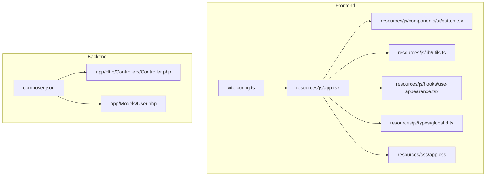
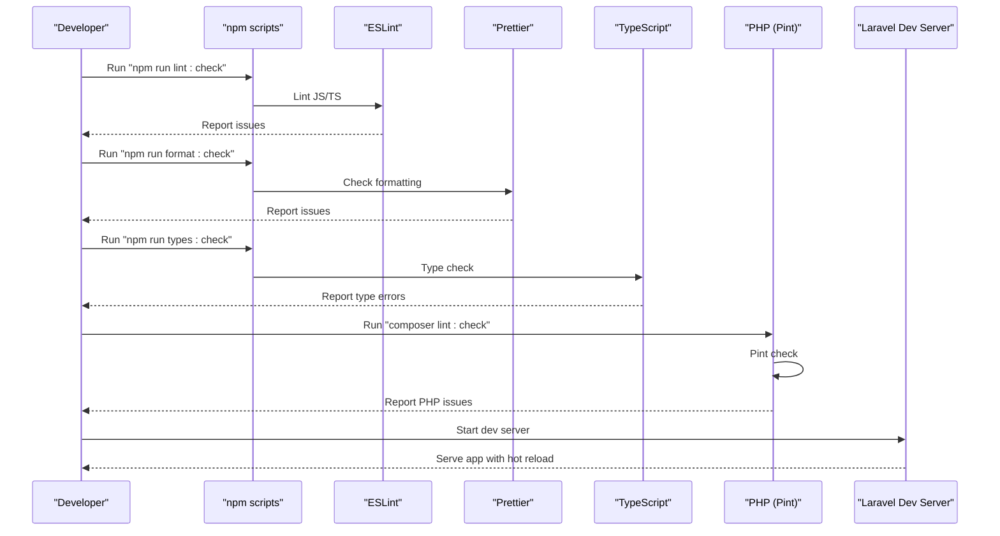
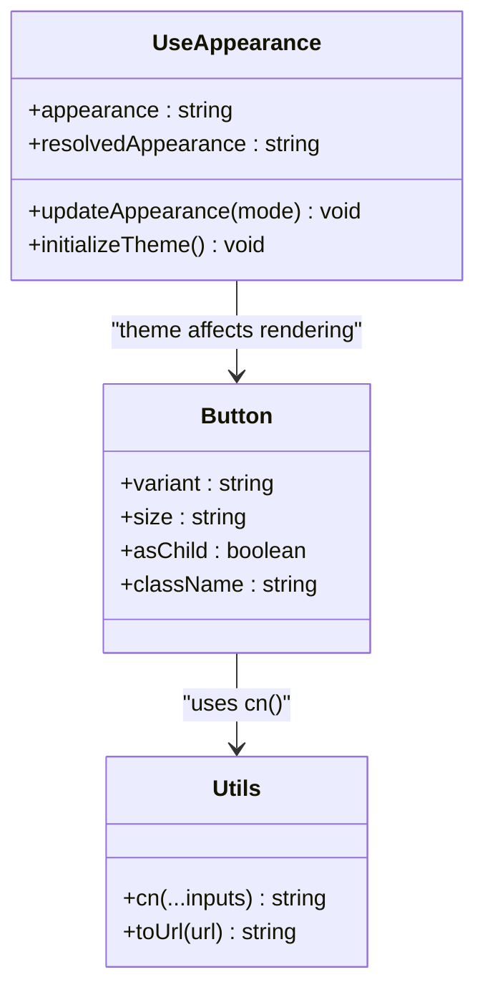
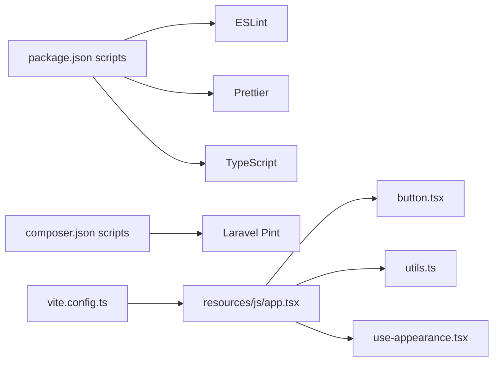

# Development Guidelines

<cite>
**Referenced Files in This Document**
- [.editorconfig](file://.editorconfig)
- [.prettierrc](file://.prettierrc)
- [.prettierignore](file://.prettierignore)
- [package.json](file://package.json)
- [tsconfig.json](file://tsconfig.json)
- [vite.config.ts](file://vite.config.ts)
- [composer.json](file://composer.json)
- [eslint.config.js](file://eslint.config.js)
- [pint.json](file://pint.json)
- [resources/js/app.tsx](file://resources/js/app.tsx)
- [resources/js/lib/utils.ts](file://resources/js/lib/utils.ts)
- [resources/js/components/ui/button.tsx](file://resources/js/components/ui/button.tsx)
- [resources/js/hooks/use-appearance.tsx](file://resources/js/hooks/use-appearance.tsx)
- [resources/js/types/global.d.ts](file://resources/js/types/global.d.ts)
- [resources/css/app.css](file://resources/css/app.css)
- [app/Http/Controllers/Controller.php](file://app/Http/Controllers/Controller.php)
- [app/Models/User.php](file://app/Models/User.php)
</cite>

## Table of Contents
1. [Introduction](#introduction)
2. [Project Structure](#project-structure)
3. [Core Components](#core-components)
4. [Architecture Overview](#architecture-overview)
5. [Detailed Component Analysis](#detailed-component-analysis)
6. [Dependency Analysis](#dependency-analysis)
7. [Performance Considerations](#performance-considerations)
8. [Troubleshooting Guide](#troubleshooting-guide)
9. [Conclusion](#conclusion)
10. [Appendices](#appendices)

## Introduction
This document defines development standards and conventions for the SmartExam web application. It consolidates formatting rules enforced by Prettier and PHP-CS-Fixer, ESLint configuration, and TypeScript strict mode settings. It also outlines commit message conventions, branch naming strategies, pull request guidelines, component development best practices, debugging techniques, performance optimization guidelines, and code review processes. The goal is to ensure consistent, readable, maintainable, and secure code across PHP (Laravel), JavaScript/TypeScript, and CSS layers.

## Project Structure
SmartExam follows a modern full-stack architecture combining Laravel (PHP) on the backend and React (TypeScript) on the frontend, with Vite for asset bundling and Tailwind CSS for styling. Key conventions:
- Frontend assets live under resources/js and resources/css.
- UI primitives and shared utilities are centralized in resources/js/components and resources/js/lib.
- Layouts and pages are organized by feature and route namespace.
- Backend controllers and models reside under app/Http/Controllers and app/Models respectively.
- Formatting and linting are configured via .prettierrc, eslint.config.js, tsconfig.json, and PHP-CS-Fixer via composer scripts.

**Diagram sources**
- [resources/js/app.tsx:1-41](file://resources/js/app.tsx#L1-L41)
- [resources/js/components/ui/button.tsx:1-59](file://resources/js/components/ui/button.tsx#L1-L59)
- [resources/js/lib/utils.ts:1-13](file://resources/js/lib/utils.ts#L1-L13)
- [resources/js/hooks/use-appearance.tsx:1-116](file://resources/js/hooks/use-appearance.tsx#L1-L116)
- [resources/js/types/global.d.ts:1-20](file://resources/js/types/global.d.ts#L1-L20)
- [resources/css/app.css:1-367](file://resources/css/app.css#L1-L367)
- [vite.config.ts:1-32](file://vite.config.ts#L1-L32)
- [app/Http/Controllers/Controller.php:1-9](file://app/Http/Controllers/Controller.php#L1-L9)
- [app/Models/User.php:1-53](file://app/Models/User.php#L1-L53)
- [composer.json:1-120](file://composer.json#L1-L120)

**Section sources**
- [resources/js/app.tsx:1-41](file://resources/js/app.tsx#L1-L41)
- [vite.config.ts:1-32](file://vite.config.ts#L1-L32)
- [composer.json:1-120](file://composer.json#L1-L120)

## Core Components
This section documents the primary formatting and linting configurations used across the stack.

- EditorConfig (.editorconfig)
  - Enforces UTF-8 encoding, LF line endings, 4-space indentation for most files, trailing whitespace removal, and special handling for Markdown and YAML files.
  - Ensures consistent editor behavior across contributors.

- Prettier (.prettierrc)
  - Uses semicolons, single quotes, print width 80, tab width 4, and Tailwind-aware formatting with clsx, cn, and cva recognized tailwindFunctions.
  - Applies a dedicated Tailwind stylesheet path and plugin for Tailwind CSS.
  - Includes overrides for YAML files to use 2-space indentation.

- ESLint (eslint.config.js)
  - Centralized configuration file for linting JavaScript/TypeScript.
  - Integrates stylistic rules, import/resolver plugins, React and React Hooks rules, and TypeScript ESLint.
  - Complementary to Prettier via eslint-config-prettier to avoid conflicts.

- TypeScript (tsconfig.json)
  - Strict mode enabled with noImplicitAny and strictNullChecks implicitly activated via strict.
  - Isolated modules enabled for safer transpilation.
  - Path aliases (@/*) mapped to resources/js/*.
  - NoEmit enabled to enforce type checks without emitting JS.
  - JSX emits configured for react-jsx.

- PHP-CS-Fixer (via composer scripts)
  - PHP linting and auto-fixing orchestrated by Laravel Pint with a preset aligned to Laravel conventions.
  - Parallel linting supported via composer scripts.

- Vite (vite.config.ts)
  - Plugins include laravel-vite-plugin, @inertiajs/vite, @vitejs/plugin-react with babel-plugin-react-compiler, @tailwindcss/vite, and @laravel/vite-plugin-wayfinder.
  - Fonts served via bunny integration.

**Section sources**
- [.editorconfig:1-19](file://.editorconfig#L1-L19)
- [.prettierrc:1-26](file://.prettierrc#L1-L26)
- [eslint.config.js](file://eslint.config.js)
- [tsconfig.json:1-122](file://tsconfig.json#L1-L122)
- [pint.json:1-4](file://pint.json#L1-L4)
- [composer.json:56-71](file://composer.json#L56-L71)
- [vite.config.ts:1-32](file://vite.config.ts#L1-L32)

## Architecture Overview
SmartExam uses Inertia.js to render React pages server-rendered by Laravel. The frontend bootstraps layouts and providers, while the backend provides controllers and models. Formatting and linting are integrated into developer workflows via npm scripts and Composer scripts.

**Diagram sources**
- [package.json:5-14](file://package.json#L5-L14)
- [composer.json:56-71](file://composer.json#L56-L71)
- [vite.config.ts:1-32](file://vite.config.ts#L1-L32)

## Detailed Component Analysis

### PHP Coding Standards and Conventions
- PHP linting and fixing are handled by Laravel Pint with a Laravel preset.
- Scripts:
  - composer lint: runs Pint in parallel.
  - composer lint:check: runs Pint in test mode (no fix).
  - composer ci:check: orchestrates CI checks including PHP linting.
- Best practices:
  - Keep controllers thin; delegate business logic to services or models.
  - Use strict typing and explicit return types where possible.
  - Prefer immutable operations and validated requests.
  - Group related routes and keep controllers cohesive.

**Section sources**
- [pint.json:1-4](file://pint.json#L1-L4)
- [composer.json:56-71](file://composer.json#L56-L71)
- [app/Http/Controllers/Controller.php:1-9](file://app/Http/Controllers/Controller.php#L1-L9)
- [app/Models/User.php:1-53](file://app/Models/User.php#L1-L53)

### JavaScript/TypeScript Coding Standards and Conventions
- ESLint configuration:
  - Centralized in eslint.config.js with stylistic rules, import plugin, React and React Hooks rules, TypeScript ESLint, and Prettier integration.
- TypeScript strict mode:
  - Enabled via tsconfig.json with strict, noImplicitAny, isolatedModules, esModuleInterop, forceConsistentCasingInFileNames, skipLibCheck, and path aliases.
  - NoEmit ensures type-only checks.
- React and Inertia integration:
  - app.tsx sets up Inertia with layout resolution, strict mode, providers, and progress bar.
  - Global types extend Inertia config and React InputHTMLAttributes.
- Utilities and patterns:
  - cn combines Tailwind classes with clsx and twMerge for safe merging.
  - Variadic class composition via class-variance-authority (cva) in UI components.
  - Appearance hook manages theme persistence and SSR-safe updates.

**Diagram sources**
- [resources/js/components/ui/button.tsx:1-59](file://resources/js/components/ui/button.tsx#L1-L59)
- [resources/js/lib/utils.ts:1-13](file://resources/js/lib/utils.ts#L1-L13)
- [resources/js/hooks/use-appearance.tsx:1-116](file://resources/js/hooks/use-appearance.tsx#L1-L116)

**Section sources**
- [eslint.config.js](file://eslint.config.js)
- [tsconfig.json:86-114](file://tsconfig.json#L86-L114)
- [resources/js/app.tsx:1-41](file://resources/js/app.tsx#L1-L41)
- [resources/js/lib/utils.ts:1-13](file://resources/js/lib/utils.ts#L1-L13)
- [resources/js/components/ui/button.tsx:1-59](file://resources/js/components/ui/button.tsx#L1-L59)
- [resources/js/hooks/use-appearance.tsx:1-116](file://resources/js/hooks/use-appearance.tsx#L1-L116)
- [resources/js/types/global.d.ts:1-20](file://resources/js/types/global.d.ts#L1-L20)

### CSS and Styling Conventions
- Tailwind CSS v4 with custom theme tokens and dark mode variants.
- Shared CSS variables and color palettes defined in resources/css/app.css.
- Utility-first approach with class-variance-authority for component variants.
- Prettier Tailwind integration recognizes clsx, cn, and cva for consistent formatting.

**Section sources**
- [resources/css/app.css:1-367](file://resources/css/app.css#L1-L367)
- [.prettierrc:10-15](file://.prettierrc#L10-L15)
- [resources/js/components/ui/button.tsx:7-35](file://resources/js/components/ui/button.tsx#L7-L35)

### Commit Message Conventions
Recommended format:
- feat(scope): summary sentence
- fix(scope): summary sentence
- docs(scope): summary sentence
- style(scope): summary sentence (formatting changes)
- refactor(scope): summary sentence
- perf(scope): summary sentence
- test(scope): summary sentence
- chore(scope): summary sentence

Examples:
- feat(auth): add two-factor challenge page
- fix(ui): resolve button disabled state bug
- docs(readme): update setup instructions
- style(components): align spacing with design system
- refactor(settings): extract appearance hook
- perf(pages): lazy-load heavy components
- test(auth): add password reset tests
- chore(deps): update dependencies

[No sources needed since this section provides general guidance]

### Branch Naming Strategies
- feature/short-description
- fix/short-description
- docs/short-description
- refactor/short-description
- perf/short-description
- test/short-description
- chore/short-description
- hotfix/short-description

[No sources needed since this section provides general guidance]

### Pull Request Guidelines
- Title: concise and prefixed with type and scope.
- Description: problem statement, solution approach, and testing steps.
- Review: ensure all checks pass (lint, format, types, tests).
- Squash and merge: keep history clean.

[No sources needed since this section provides general guidance]

### Component Development Best Practices
- Reusable UI components:
  - Use class-variance-authority for consistent variants and sizes.
  - Accept className prop and merge with cn for predictable overrides.
  - Prefer radix-ui primitives for accessibility and composability.
- Layouts and pages:
  - Centralize layout selection in app.tsx with clear conditions.
  - Keep pages focused and delegate state to hooks or stores.
- Utilities:
  - Use cn for safe class merging and to avoid duplicates.
  - Provide small, composable helpers in lib/utils.ts.

**Section sources**
- [resources/js/components/ui/button.tsx:1-59](file://resources/js/components/ui/button.tsx#L1-L59)
- [resources/js/lib/utils.ts:1-13](file://resources/js/lib/utils.ts#L1-L13)
- [resources/js/app.tsx:11-37](file://resources/js/app.tsx#L11-L37)

### Architectural Patterns
- Inertia-driven SPA with server-rendered layouts.
- React functional components with hooks for state and effects.
- TypeScript interfaces for props and shared types.
- Tailwind utilities with theme tokens for consistent design.

**Section sources**
- [resources/js/app.tsx:1-41](file://resources/js/app.tsx#L1-L41)
- [resources/js/types/global.d.ts:1-20](file://resources/js/types/global.d.ts#L1-L20)
- [resources/css/app.css:18-72](file://resources/css/app.css#L18-L72)

## Dependency Analysis
The project’s formatting and linting dependencies are declared in package.json and composer.json. They integrate with Vite and Laravel scripts to provide a unified developer experience.

**Diagram sources**
- [package.json:5-14](file://package.json#L5-L14)
- [composer.json:56-71](file://composer.json#L56-L71)
- [vite.config.ts:1-32](file://vite.config.ts#L1-L32)
- [resources/js/app.tsx:1-41](file://resources/js/app.tsx#L1-L41)
- [resources/js/components/ui/button.tsx:1-59](file://resources/js/components/ui/button.tsx#L1-L59)
- [resources/js/lib/utils.ts:1-13](file://resources/js/lib/utils.ts#L1-L13)
- [resources/js/hooks/use-appearance.tsx:1-116](file://resources/js/hooks/use-appearance.tsx#L1-L116)

**Section sources**
- [package.json:1-77](file://package.json#L1-L77)
- [composer.json:1-120](file://composer.json#L1-L120)
- [vite.config.ts:1-32](file://vite.config.ts#L1-L32)

## Performance Considerations
- Use React Compiler via Babel for optimized component rendering.
- Prefer lazy loading heavy components and images.
- Minimize unnecessary re-renders by memoizing props and using appropriate state scopes.
- Keep CSS modular and scoped; avoid global style bloat.
- Leverage Tailwind utilities efficiently; remove unused styles regularly.

[No sources needed since this section provides general guidance]

## Troubleshooting Guide
- Formatting issues:
  - Run npm run format:check and npm run format to auto-fix.
  - Ensure .prettierrc and .prettierignore are respected.
- Lint errors:
  - Run npm run lint:check and npm run lint to auto-fix where possible.
  - Verify eslint.config.js and plugin versions.
- Type errors:
  - Run npm run types:check to validate TypeScript strictness.
- PHP issues:
  - Run composer lint:check for PHP linting.
- Build issues:
  - Confirm vite.config.ts plugins and aliases in tsconfig.json.
  - Clear caches and reinstall dependencies if needed.

**Section sources**
- [.prettierrc:1-26](file://.prettierrc#L1-L26)
- [package.json:9-13](file://package.json#L9-L13)
- [eslint.config.js](file://eslint.config.js)
- [tsconfig.json:86-114](file://tsconfig.json#L86-L114)
- [composer.json:56-71](file://composer.json#L56-L71)
- [vite.config.ts:1-32](file://vite.config.ts#L1-L32)

## Conclusion
By adhering to these development guidelines—consistent formatting with Prettier and PHP-CS-Fixer, strict TypeScript settings, centralized ESLint configuration, and disciplined component architecture—you ensure a scalable, maintainable, and high-quality SmartExam codebase. Integrate checks into your workflow using the provided scripts and follow the recommended conventions for commits, branches, and pull requests.

[No sources needed since this section summarizes without analyzing specific files]

## Appendices

### Formatting Rules Summary
- PHP: Laravel Pint with preset.
- JavaScript/TypeScript: ESLint + TypeScript strict mode.
- CSS: Tailwind + Prettier with Tailwind plugin and functions.

**Section sources**
- [pint.json:1-4](file://pint.json#L1-L4)
- [eslint.config.js](file://eslint.config.js)
- [tsconfig.json:86-114](file://tsconfig.json#L86-L114)
- [.prettierrc:1-26](file://.prettierrc#L1-L26)