# Component System

<cite>
**Referenced Files in This Document**
- [button.tsx](file://resources/js/components/ui/button.tsx)
- [input.tsx](file://resources/js/components/ui/input.tsx)
- [dialog.tsx](file://resources/js/components/ui/dialog.tsx)
- [avatar.tsx](file://resources/js/components/ui/avatar.tsx)
- [card.tsx](file://resources/js/components/ui/card.tsx)
- [select.tsx](file://resources/js/components/ui/select.tsx)
- [sheet.tsx](file://resources/js/components/ui/sheet.tsx)
- [sidebar.tsx](file://resources/js/components/ui/sidebar.tsx)
- [app-shell.tsx](file://resources/js/components/app-shell.tsx)
- [app-sidebar.tsx](file://resources/js/components/app-sidebar.tsx)
- [nav-user.tsx](file://resources/js/components/nav-user.tsx)
- [user-menu-content.tsx](file://resources/js/components/user-menu-content.tsx)
- [utils.ts](file://resources/js/lib/utils.ts)
- [ui.ts](file://resources/js/types/ui.ts)
- [navigation.ts](file://resources/js/types/navigation.ts)
</cite>

## Table of Contents
1. [Introduction](#introduction)
2. [Project Structure](#project-structure)
3. [Core Components](#core-components)
4. [Architecture Overview](#architecture-overview)
5. [Detailed Component Analysis](#detailed-component-analysis)
6. [Dependency Analysis](#dependency-analysis)
7. [Performance Considerations](#performance-considerations)
8. [Troubleshooting Guide](#troubleshooting-guide)
9. [Conclusion](#conclusion)
10. [Appendices](#appendices)

## Introduction
This document describes SmartExam’s React component library, focusing on UI primitives and composite components that form the application shell and navigation system. It explains component composition patterns, prop interfaces, TypeScript integration, styling approaches, accessibility, and best practices for building reusable UI.

## Project Structure
The component library is organized under resources/js/components, with a dedicated ui folder for primitives and a set of composite components for layout and navigation. Utility helpers and shared types support consistent styling and typing across components.

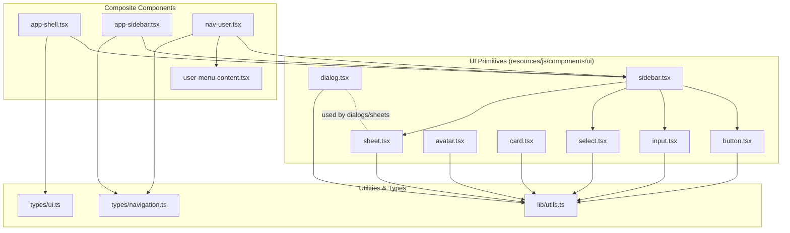

**Diagram sources**
- [button.tsx:1-59](file://resources/js/components/ui/button.tsx#L1-L59)
- [input.tsx:1-22](file://resources/js/components/ui/input.tsx#L1-L22)
- [dialog.tsx:1-134](file://resources/js/components/ui/dialog.tsx#L1-L134)
- [avatar.tsx:1-52](file://resources/js/components/ui/avatar.tsx#L1-L52)
- [card.tsx:1-69](file://resources/js/components/ui/card.tsx#L1-L69)
- [select.tsx:1-194](file://resources/js/components/ui/select.tsx#L1-L194)
- [sheet.tsx:1-138](file://resources/js/components/ui/sheet.tsx#L1-L138)
- [sidebar.tsx:1-720](file://resources/js/components/ui/sidebar.tsx#L1-L720)
- [app-shell.tsx:1-22](file://resources/js/components/app-shell.tsx#L1-L22)
- [app-sidebar.tsx:1-66](file://resources/js/components/app-sidebar.tsx#L1-L66)
- [nav-user.tsx:1-59](file://resources/js/components/nav-user.tsx#L1-L59)
- [user-menu-content.tsx:1-64](file://resources/js/components/user-menu-content.tsx#L1-L64)
- [utils.ts:1-13](file://resources/js/lib/utils.ts#L1-L13)
- [ui.ts:1-22](file://resources/js/types/ui.ts#L1-L22)
- [navigation.ts:1-15](file://resources/js/types/navigation.ts#L1-L15)

**Section sources**
- [button.tsx:1-59](file://resources/js/components/ui/button.tsx#L1-L59)
- [input.tsx:1-22](file://resources/js/components/ui/input.tsx#L1-L22)
- [dialog.tsx:1-134](file://resources/js/components/ui/dialog.tsx#L1-L134)
- [avatar.tsx:1-52](file://resources/js/components/ui/avatar.tsx#L1-L52)
- [card.tsx:1-69](file://resources/js/components/ui/card.tsx#L1-L69)
- [select.tsx:1-194](file://resources/js/components/ui/select.tsx#L1-L194)
- [sheet.tsx:1-138](file://resources/js/components/ui/sheet.tsx#L1-L138)
- [sidebar.tsx:1-720](file://resources/js/components/ui/sidebar.tsx#L1-L720)
- [app-shell.tsx:1-22](file://resources/js/components/app-shell.tsx#L1-L22)
- [app-sidebar.tsx:1-66](file://resources/js/components/app-sidebar.tsx#L1-L66)
- [nav-user.tsx:1-59](file://resources/js/components/nav-user.tsx#L1-L59)
- [user-menu-content.tsx:1-64](file://resources/js/components/user-menu-content.tsx#L1-L64)
- [utils.ts:1-13](file://resources/js/lib/utils.ts#L1-L13)
- [ui.ts:1-22](file://resources/js/types/ui.ts#L1-L22)
- [navigation.ts:1-15](file://resources/js/types/navigation.ts#L1-L15)

## Core Components
This section documents the primary UI primitives and their composition patterns.

- Button
  - Purpose: Unified action control with variants and sizes.
  - Props: Inherits base button props plus variant, size, and asChild.
  - Variants: default, destructive, outline, secondary, ghost, link.
  - Sizes: default, sm, lg, icon.
  - Accessibility: Focus-visible rings, aria-invalid integration, slot-based composition.
  - Styling: Uses class variance authority and a shared cn utility.

- Input
  - Purpose: Text input with consistent focus states and invalid feedback.
  - Props: Inherits base input props; integrates focus-visible and aria-invalid states.
  - Accessibility: Proper focus management and screen-reader-friendly states.

- Dialog
  - Purpose: Modal overlay with header, footer, title, and description slots.
  - Composition: Root, Trigger, Portal, Close, Overlay, Content, Header, Footer, Title, Description.
  - Accessibility: Uses Radix UI primitives; includes sr-only close label.

- Select
  - Purpose: Accessible dropdown with trigger, content, item, label, separators, and scroll buttons.
  - Props: Supports size, positioning, alignment, and viewport sizing.
  - Accessibility: Controlled via Radix Select; includes icons and indicators.

- Sheet
  - Purpose: Slide-out panel from a side with overlay and close controls.
  - Props: Side orientation (top/right/bottom/left), content composition.
  - Accessibility: Portal-based rendering with overlay and close semantics.

- Card
  - Purpose: Content container with header, title, description, content, and footer segments.
  - Composition: Card, CardHeader, CardTitle, CardDescription, CardContent, CardFooter.

- Avatar
  - Purpose: User identity with image and fallback.
  - Composition: Avatar, AvatarImage, AvatarFallback.

- Sidebar
  - Purpose: Responsive navigation sidebar with provider, menu system, and actions.
  - Features: Collapsible modes, mobile offcanvas, keyboard shortcut, cookie persistence, tooltips, skeleton placeholders, submenus, and badges.
  - Composition: Provider, Sidebar, Header/Footer/Content, Menu/Button/Item/Sub, Group/Label/Action/Content/Badge/Skeleton, Rail, Inset, Trigger/Input/Separator.

- App Shell
  - Purpose: Application shell wrapper supporting header-only and sidebar variants.
  - Props: variant determines layout mode; manages sidebar open state.

- App Sidebar
  - Purpose: Complete sidebar layout composed from primitives and navigation helpers.
  - Composition: Header with logo, main navigation, footer links, and user menu.

- Navigation User
  - Purpose: User menu trigger integrated with sidebar and dropdown.
  - Composition: Uses SidebarMenuButton, DropdownMenu, and UserMenuContent.

- User Menu Content
  - Purpose: User menu items with settings and logout actions.
  - Composition: Dropdown groups, labels, separators, and navigational items.

**Section sources**
- [button.tsx:1-59](file://resources/js/components/ui/button.tsx#L1-L59)
- [input.tsx:1-22](file://resources/js/components/ui/input.tsx#L1-L22)
- [dialog.tsx:1-134](file://resources/js/components/ui/dialog.tsx#L1-L134)
- [select.tsx:1-194](file://resources/js/components/ui/select.tsx#L1-L194)
- [sheet.tsx:1-138](file://resources/js/components/ui/sheet.tsx#L1-L138)
- [card.tsx:1-69](file://resources/js/components/ui/card.tsx#L1-L69)
- [avatar.tsx:1-52](file://resources/js/components/ui/avatar.tsx#L1-L52)
- [sidebar.tsx:1-720](file://resources/js/components/ui/sidebar.tsx#L1-L720)
- [app-shell.tsx:1-22](file://resources/js/components/app-shell.tsx#L1-L22)
- [app-sidebar.tsx:1-66](file://resources/js/components/app-sidebar.tsx#L1-L66)
- [nav-user.tsx:1-59](file://resources/js/components/nav-user.tsx#L1-L59)
- [user-menu-content.tsx:1-64](file://resources/js/components/user-menu-content.tsx#L1-L64)

## Architecture Overview
The component system follows a layered architecture:
- Utilities: Shared cn merging and URL helpers.
- Types: Strongly typed props for layouts and navigation.
- UI Primitives: Reusable, accessible, and theme-aware components.
- Composite Components: Higher-order components that orchestrate primitives for shell and navigation.

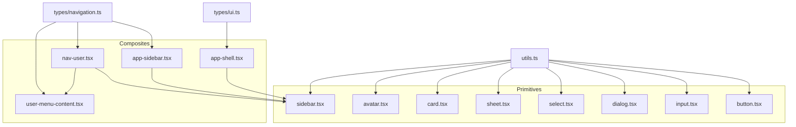

**Diagram sources**
- [utils.ts:1-13](file://resources/js/lib/utils.ts#L1-L13)
- [ui.ts:1-22](file://resources/js/types/ui.ts#L1-L22)
- [navigation.ts:1-15](file://resources/js/types/navigation.ts#L1-L15)
- [button.tsx:1-59](file://resources/js/components/ui/button.tsx#L1-L59)
- [input.tsx:1-22](file://resources/js/components/ui/input.tsx#L1-L22)
- [dialog.tsx:1-134](file://resources/js/components/ui/dialog.tsx#L1-L134)
- [select.tsx:1-194](file://resources/js/components/ui/select.tsx#L1-L194)
- [sheet.tsx:1-138](file://resources/js/components/ui/sheet.tsx#L1-L138)
- [card.tsx:1-69](file://resources/js/components/ui/card.tsx#L1-L69)
- [avatar.tsx:1-52](file://resources/js/components/ui/avatar.tsx#L1-L52)
- [sidebar.tsx:1-720](file://resources/js/components/ui/sidebar.tsx#L1-L720)
- [app-shell.tsx:1-22](file://resources/js/components/app-shell.tsx#L1-L22)
- [app-sidebar.tsx:1-66](file://resources/js/components/app-sidebar.tsx#L1-L66)
- [nav-user.tsx:1-59](file://resources/js/components/nav-user.tsx#L1-L59)
- [user-menu-content.tsx:1-64](file://resources/js/components/user-menu-content.tsx#L1-L64)

## Detailed Component Analysis

### Button Component
- Composition pattern: Accepts asChild to render any element; variant/size via class variance authority; integrates focus-visible and invalid states.
- Prop interface: Extends native button props with variant, size, asChild.
- Styling: Uses cn for merging Tailwind classes; supports SVG sizing and focus-visible ring.
- Accessibility: Focus-visible ring, aria-invalid integration, proper role semantics.

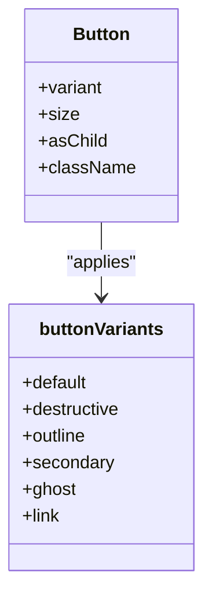

**Diagram sources**
- [button.tsx:7-35](file://resources/js/components/ui/button.tsx#L7-L35)

**Section sources**
- [button.tsx:1-59](file://resources/js/components/ui/button.tsx#L1-L59)

### Input Component
- Composition pattern: Wraps native input with consistent focus and invalid states.
- Prop interface: Extends native input props; integrates focus-visible and aria-invalid.
- Styling: Merges base input styles with focus and invalid feedback classes.

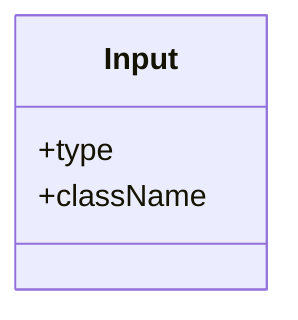

**Diagram sources**
- [input.tsx:5-19](file://resources/js/components/ui/input.tsx#L5-L19)

**Section sources**
- [input.tsx:1-22](file://resources/js/components/ui/input.tsx#L1-L22)

### Dialog Component Family
- Composition pattern: Root, Trigger, Portal, Close, Overlay, Content, Header/Footer, Title/Description.
- Accessibility: Uses Radix UI; includes sr-only close label; animates in/out.
- Styling: Overlay and content classes define backdrop and modal geometry.

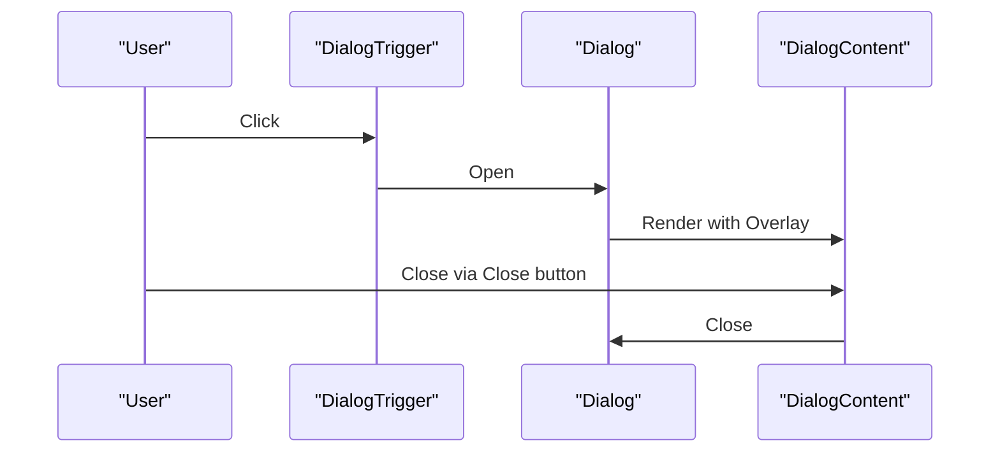

**Diagram sources**
- [dialog.tsx:7-71](file://resources/js/components/ui/dialog.tsx#L7-L71)

**Section sources**
- [dialog.tsx:1-134](file://resources/js/components/ui/dialog.tsx#L1-L134)

### Select Component Family
- Composition pattern: Root, Trigger, Content (with popper positioning), Item, Label, Separator, ScrollUp/Down buttons.
- Prop interface: Trigger supports size; Content supports position, side, align, offsets.
- Accessibility: Controlled via Radix Select; includes icons and indicators.

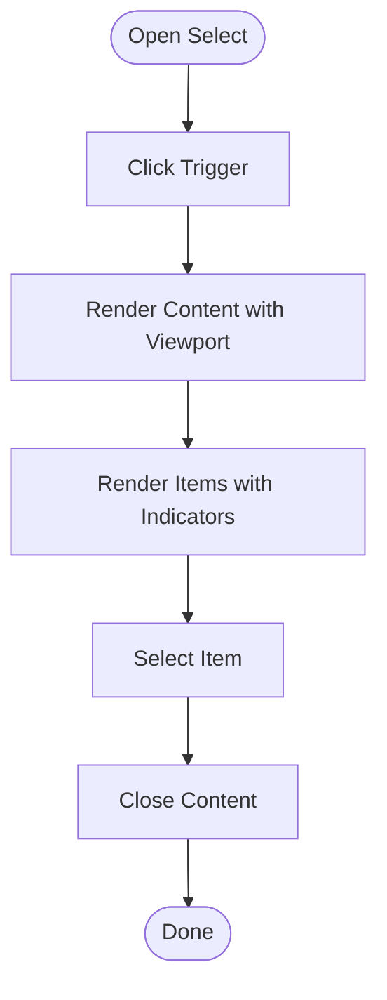

**Diagram sources**
- [select.tsx:25-91](file://resources/js/components/ui/select.tsx#L25-L91)

**Section sources**
- [select.tsx:1-194](file://resources/js/components/ui/select.tsx#L1-L194)

### Sheet Component Family
- Composition pattern: Root, Trigger, Portal, Close, Overlay, Content (supports side), Header/Footer, Title/Description.
- Prop interface: Content accepts side orientation; includes close button with sr-only label.

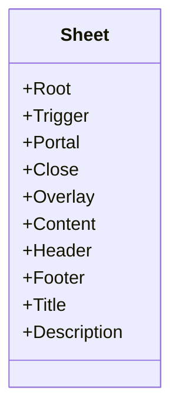

**Diagram sources**
- [sheet.tsx:7-137](file://resources/js/components/ui/sheet.tsx#L7-L137)

**Section sources**
- [sheet.tsx:1-138](file://resources/js/components/ui/sheet.tsx#L1-L138)

### Card Component Family
- Composition pattern: Card with header/title/description/content/footer segments.
- Styling: Segment-specific classes for spacing and typography.

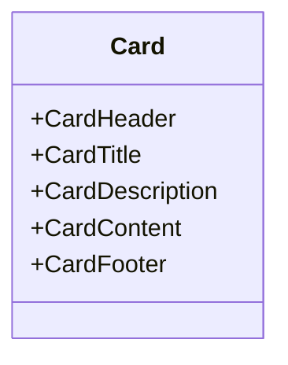

**Diagram sources**
- [card.tsx:5-68](file://resources/js/components/ui/card.tsx#L5-L68)

**Section sources**
- [card.tsx:1-69](file://resources/js/components/ui/card.tsx#L1-L69)

### Avatar Component Family
- Composition pattern: Root, Image, Fallback.
- Styling: Ensures rounded-full overflow-hidden image container with fallback visuals.

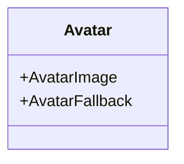

**Diagram sources**
- [avatar.tsx:6-51](file://resources/js/components/ui/avatar.tsx#L6-L51)

**Section sources**
- [avatar.tsx:1-52](file://resources/js/components/ui/avatar.tsx#L1-L52)

### Sidebar Component System
- Composition pattern: Provider manages open/collapsed state, cookies, keyboard shortcuts; Sidebar renders desktop/floating/inset variants; Menu system includes buttons, actions, badges, submenus, skeletons.
- Props: Provider supports defaultOpen/onOpenChange; Sidebar supports side, variant, collapsible; MenuButton supports variant/size/tooltip; Sub components support size/active state.
- Accessibility: Tooltips, focus-visible states, keyboard toggles, screen-reader labels in related components.

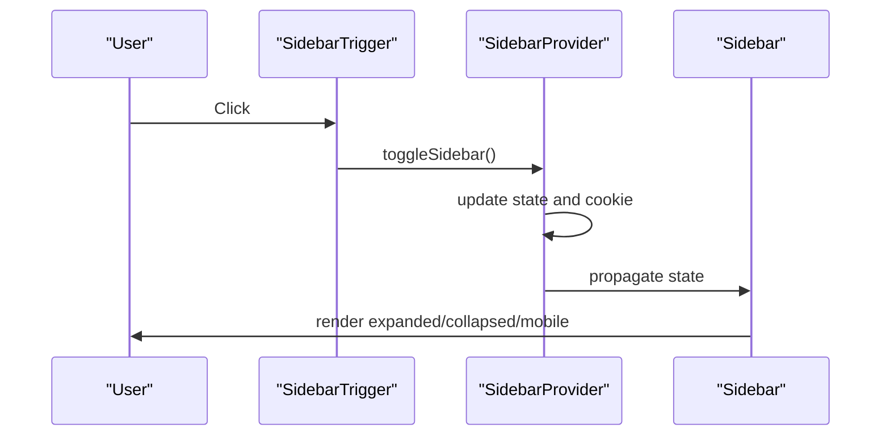

**Diagram sources**
- [sidebar.tsx:54-148](file://resources/js/components/ui/sidebar.tsx#L54-L148)
- [sidebar.tsx:249-273](file://resources/js/components/ui/sidebar.tsx#L249-L273)

**Section sources**
- [sidebar.tsx:1-720](file://resources/js/components/ui/sidebar.tsx#L1-L720)

### App Shell and App Sidebar
- App Shell: Switches between header-only and sidebar variants; reads sidebarOpen from page props; wraps children with SidebarProvider when applicable.
- App Sidebar: Composes Sidebar with Header (logo), Content (main nav), Footer (external links), and Footer/User (user menu).

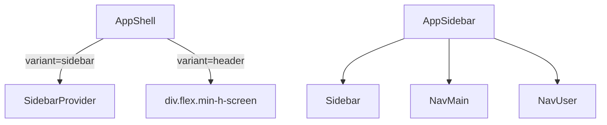

**Diagram sources**
- [app-shell.tsx:11-21](file://resources/js/components/app-shell.tsx#L11-L21)
- [app-sidebar.tsx:40-65](file://resources/js/components/app-sidebar.tsx#L40-L65)

**Section sources**
- [app-shell.tsx:1-22](file://resources/js/components/app-shell.tsx#L1-L22)
- [app-sidebar.tsx:1-66](file://resources/js/components/app-sidebar.tsx#L1-L66)

### Navigation User and User Menu Content
- NavUser: Integrates SidebarMenu with DropdownMenu; triggers asChild; aligns content based on mobile and sidebar state.
- UserMenuContent: Renders user info, settings link, and logout link; cleans up navigation state on logout.

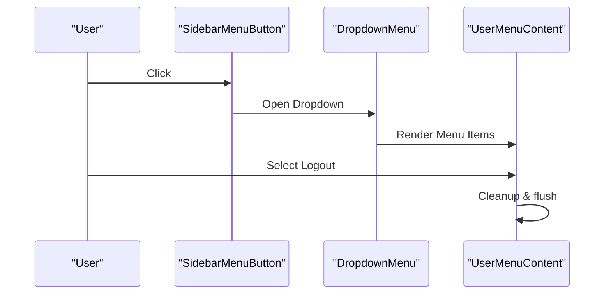

**Diagram sources**
- [nav-user.tsx:27-57](file://resources/js/components/nav-user.tsx#L27-L57)
- [user-menu-content.tsx:19-63](file://resources/js/components/user-menu-content.tsx#L19-L63)

**Section sources**
- [nav-user.tsx:1-59](file://resources/js/components/nav-user.tsx#L1-L59)
- [user-menu-content.tsx:1-64](file://resources/js/components/user-menu-content.tsx#L1-L64)

## Dependency Analysis
- Utilities: cn merges clsx and tailwind-merge; toUrl normalizes Inertia link href.
- Types: ui.ts defines AppVariant and layout props; navigation.ts defines NavItem and BreadcrumbItem.
- Components depend on:
  - Radix UI primitives for dialogs/selects/sheets.
  - Lucide icons for visual affordances.
  - Inertia for routing and page props.
  - Tailwind classes via cn.

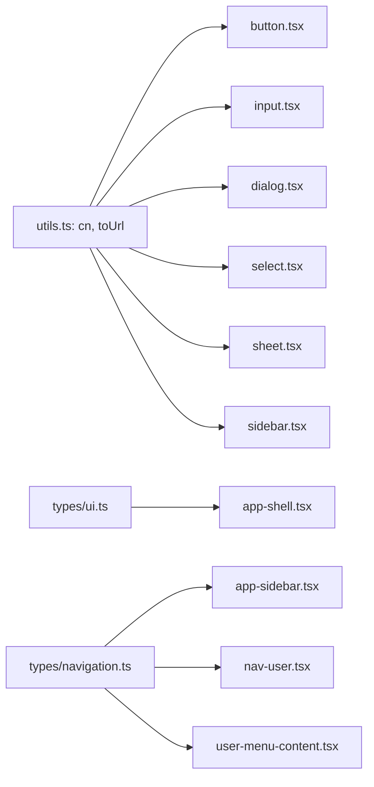

**Diagram sources**
- [utils.ts:6-12](file://resources/js/lib/utils.ts#L6-L12)
- [ui.ts:4-21](file://resources/js/types/ui.ts#L4-L21)
- [navigation.ts:4-14](file://resources/js/types/navigation.ts#L4-L14)
- [button.tsx:5-5](file://resources/js/components/ui/button.tsx#L5-L5)
- [input.tsx:3-3](file://resources/js/components/ui/input.tsx#L3-L3)
- [dialog.tsx:5-5](file://resources/js/components/ui/dialog.tsx#L5-L5)
- [select.tsx:5-5](file://resources/js/components/ui/select.tsx#L5-L5)
- [sheet.tsx:5-5](file://resources/js/components/ui/sheet.tsx#L5-L5)
- [sidebar.tsx:24-24](file://resources/js/components/ui/sidebar.tsx#L24-L24)
- [app-shell.tsx:3-4](file://resources/js/components/app-shell.tsx#L3-L4)
- [app-sidebar.tsx:16-17](file://resources/js/components/app-sidebar.tsx#L16-L17)
- [nav-user.tsx:1-1](file://resources/js/components/nav-user.tsx#L1-L1)
- [user-menu-content.tsx:1-1](file://resources/js/components/user-menu-content.tsx#L1-L1)

**Section sources**
- [utils.ts:1-13](file://resources/js/lib/utils.ts#L1-L13)
- [ui.ts:1-22](file://resources/js/types/ui.ts#L1-L22)
- [navigation.ts:1-15](file://resources/js/types/navigation.ts#L1-L15)

## Performance Considerations
- Prefer variant/size props over ad-hoc className overrides to leverage class variance authority and reduce style churn.
- Use asChild patterns to minimize DOM nodes and preserve semantic roles.
- Memoize context values in providers to avoid unnecessary re-renders (already implemented via useMemo in SidebarProvider).
- Defer heavy content inside Sheet/Dialog portals until opened to reduce initial bundle impact.
- Keep icon sizes consistent to avoid layout shifts; rely on className normalization in primitives.

## Troubleshooting Guide
- Focus rings not visible:
  - Ensure focus-visible ring classes are applied and not overridden by global resets.
  - Verify that interactive elements receive focus via keyboard navigation.
- Dialog/Sheet not closing:
  - Confirm Close button is present and accessible; check Portal and Overlay wiring.
- Select items not selectable:
  - Ensure SelectItem is rendered within SelectContent and SelectPrimitive.Viewport.
- Sidebar not toggling:
  - Verify SidebarProvider wraps children and keyboard shortcut handler is attached.
- Mobile layout issues:
  - Check useIsMobile hook and Sheet-based mobile sidebar rendering.
- Type errors:
  - Align props with NavItem and AppVariant types; ensure href conforms to InertiaLinkProps.

**Section sources**
- [sidebar.tsx:95-108](file://resources/js/components/ui/sidebar.tsx#L95-L108)
- [dialog.tsx:53-70](file://resources/js/components/ui/dialog.tsx#L53-L70)
- [sheet.tsx:54-79](file://resources/js/components/ui/sheet.tsx#L54-L79)
- [select.tsx:78-88](file://resources/js/components/ui/select.tsx#L78-L88)
- [nav-user.tsx:44-50](file://resources/js/components/nav-user.tsx#L44-L50)

## Conclusion
SmartExam’s component system emphasizes composability, accessibility, and consistency through:
- Primitive-first design with strong TypeScript integration.
- Provider-based state management for responsive navigation.
- Shared utilities and types ensuring predictable styling and behavior.
Adhering to the documented patterns and best practices will help maintain a scalable, accessible, and cohesive UI.

## Appendices

### Component Naming Conventions and File Organization
- UI primitives live under ui/ with kebab-case filenames (e.g., button.tsx, dialog.tsx).
- Composite components reside alongside ui/ (e.g., app-shell.tsx, app-sidebar.tsx).
- Utilities and types are colocated under lib/ and types/.

### Prop Interfaces Summary
- Button: variant, size, asChild, className.
- Input: type, className.
- Dialog: Root, Trigger, Portal, Close, Overlay, Content, Header/Footer, Title/Description.
- Select: Root, Trigger (size), Content (position, side, align, offsets), Item, Label, Separator, ScrollUp/Down buttons.
- Sheet: Root, Trigger, Portal, Close, Overlay, Content (side), Header/Footer, Title/Description.
- Card: Card, CardHeader, CardTitle, CardDescription, CardContent, CardFooter.
- Avatar: Avatar, AvatarImage, AvatarFallback.
- Sidebar: Provider, Sidebar (side, variant, collapsible), Menu system components, Rail, Inset, Trigger, Input, Separator.

### Accessibility Considerations
- Focus management: Focus-visible rings and outline-none patterns.
- Screen readers: sr-only labels for close buttons; proper heading order.
- Keyboard navigation: Toggle shortcuts, focus trapping in overlays.
- Semantic roles: asChild usage preserves native semantics; Dropdown/Select/Sheet use Radix primitives.