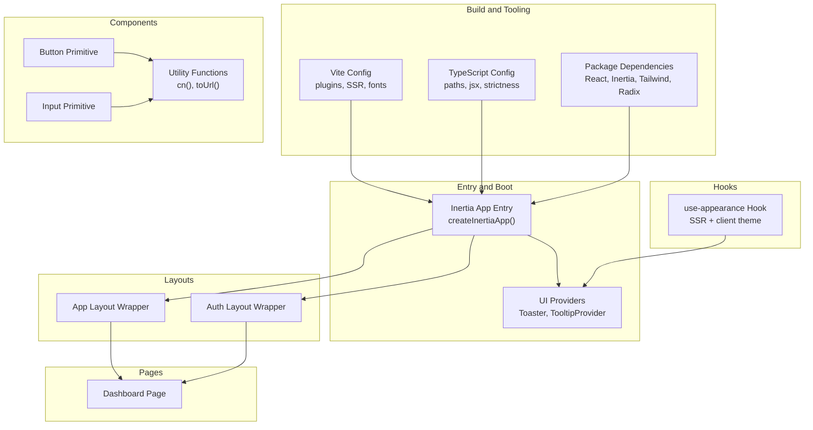
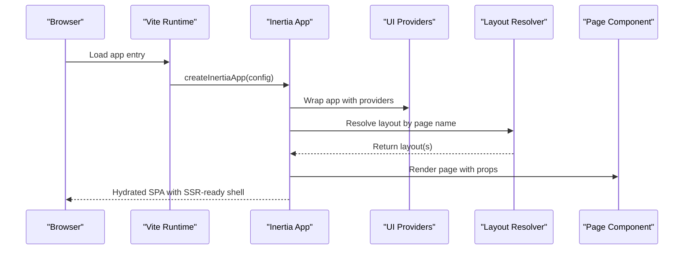
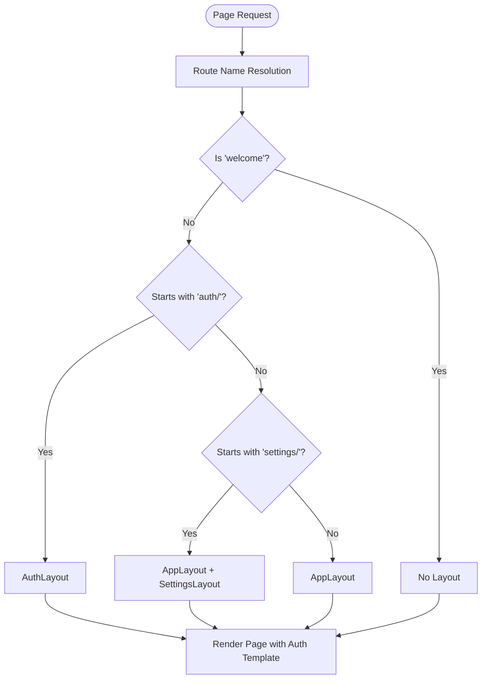
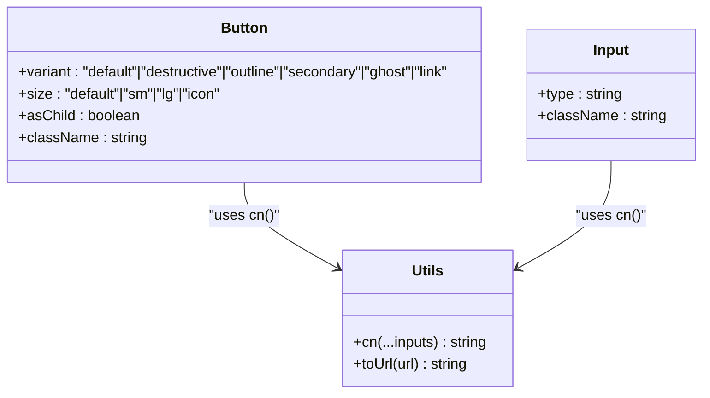
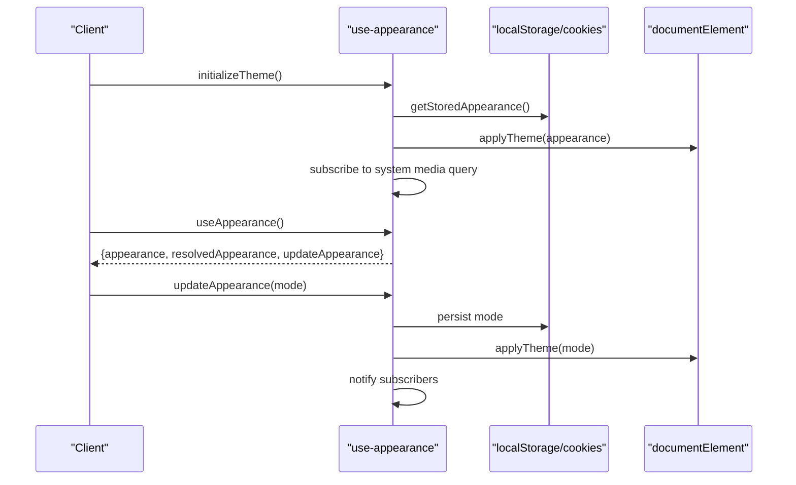
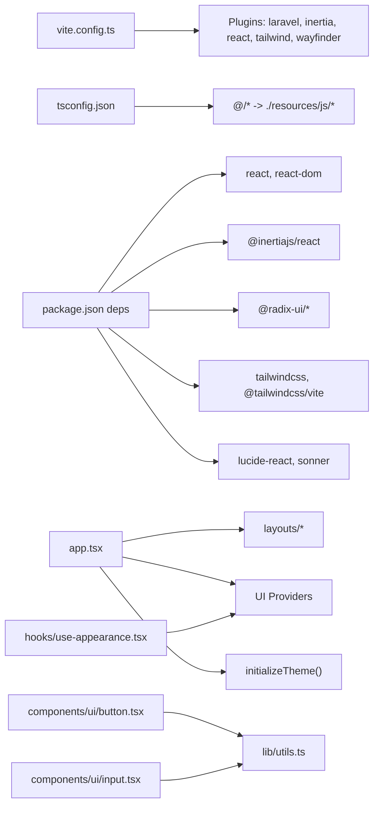

# Frontend Architecture

<cite>
**Referenced Files in This Document**
- [app.tsx](file://resources/js/app.tsx)
- [tsconfig.json](file://tsconfig.json)
- [package.json](file://package.json)
- [vite.config.ts](file://vite.config.ts)
- [utils.ts](file://resources/js/lib/utils.ts)
- [app-layout.tsx](file://resources/js/layouts/app-layout.tsx)
- [auth-layout.tsx](file://resources/js/layouts/auth-layout.tsx)
- [button.tsx](file://resources/js/components/ui/button.tsx)
- [input.tsx](file://resources/js/components/ui/input.tsx)
- [index.ts](file://resources/js/types/index.ts)
- [navigation.ts](file://resources/js/types/navigation.ts)
- [ui.ts](file://resources/js/types/ui.ts)
- [use-appearance.tsx](file://resources/js/hooks/use-appearance.tsx)
- [dashboard.tsx](file://resources/js/pages/dashboard.tsx)
</cite>

## Table of Contents
1. [Introduction](#introduction)
2. [Project Structure](#project-structure)
3. [Core Components](#core-components)
4. [Architecture Overview](#architecture-overview)
5. [Detailed Component Analysis](#detailed-component-analysis)
6. [Dependency Analysis](#dependency-analysis)
7. [Performance Considerations](#performance-considerations)
8. [Troubleshooting Guide](#troubleshooting-guide)
9. [Conclusion](#conclusion)
10. [Appendices](#appendices)

## Introduction
This document describes the frontend architecture of the SmartExam web application. It focuses on the React application built with TypeScript, Inertia.js integration, component library design, layout patterns, hooks for reusable logic, type safety, styling via Tailwind CSS, and SSR considerations. The goal is to help developers understand how the frontend is structured, how components are composed, and how to extend or maintain the system effectively.

## Project Structure
The frontend is organized around a Vite-powered React application with TypeScript and Inertia.js for full-page navigation. Key areas:
- Application entry and Inertia bootstrapping
- Layouts for authenticated and unauthenticated flows
- UI primitive components and composition utilities
- Hooks for cross-cutting concerns like appearance/theme
- Types for navigation, UI props, and shared interfaces
- Pages for routes and SSR rendering

**Diagram sources**
- [vite.config.ts:1-32](file://vite.config.ts#L1-L32)
- [tsconfig.json:1-122](file://tsconfig.json#L1-L122)
- [package.json:1-77](file://package.json#L1-L77)
- [app.tsx:1-41](file://resources/js/app.tsx#L1-L41)
- [app-layout.tsx:1-17](file://resources/js/layouts/app-layout.tsx#L1-L17)
- [auth-layout.tsx:1-18](file://resources/js/layouts/auth-layout.tsx#L1-L18)
- [button.tsx:1-59](file://resources/js/components/ui/button.tsx#L1-L59)
- [input.tsx:1-22](file://resources/js/components/ui/input.tsx#L1-L22)
- [utils.ts:1-13](file://resources/js/lib/utils.ts#L1-L13)
- [use-appearance.tsx:1-116](file://resources/js/hooks/use-appearance.tsx#L1-L116)
- [dashboard.tsx:1-37](file://resources/js/pages/dashboard.tsx#L1-L37)

**Section sources**
- [vite.config.ts:1-32](file://vite.config.ts#L1-L32)
- [tsconfig.json:1-122](file://tsconfig.json#L1-L122)
- [package.json:1-77](file://package.json#L1-L77)
- [app.tsx:1-41](file://resources/js/app.tsx#L1-L41)

## Core Components
- Inertia App Entry: Initializes the React app, sets the document title, selects layouts per route, wraps the app with UI providers, and configures progress indicators. It also initializes theme on load.
- Layout Wrappers: Thin wrappers that delegate to template layouts and pass props like breadcrumbs or title/description.
- UI Primitives: Reusable components (Button, Input) with variant and size systems, built with Radix UI and styled via Tailwind.
- Utilities: Composition helpers (cn) and URL normalization for Inertia links.
- Hooks: Centralized logic for appearance/theme handling with SSR support.
- Types: Shared interfaces for navigation items, breadcrumbs, and layout props.

Key implementation references:
- Inertia app initialization and layout selection
  - [resources/js/app.tsx:11-37](file://resources/js/app.tsx#L11-L37)
- Layout wrappers
  - [resources/js/layouts/app-layout.tsx:4-16](file://resources/js/layouts/app-layout.tsx#L4-L16)
  - [resources/js/layouts/auth-layout.tsx:3-17](file://resources/js/layouts/auth-layout.tsx#L3-L17)
- UI primitives
  - [resources/js/components/ui/button.tsx:37-58](file://resources/js/components/ui/button.tsx#L37-L58)
  - [resources/js/components/ui/input.tsx:5-21](file://resources/js/components/ui/input.tsx#L5-L21)
- Utilities
  - [resources/js/lib/utils.ts:6-12](file://resources/js/lib/utils.ts#L6-L12)
- Appearance hook
  - [resources/js/hooks/use-appearance.tsx:90-115](file://resources/js/hooks/use-appearance.tsx#L90-L115)
- Types
  - [resources/js/types/index.ts:1-4](file://resources/js/types/index.ts#L1-L4)
  - [resources/js/types/navigation.ts:4-14](file://resources/js/types/navigation.ts#L4-L14)
  - [resources/js/types/ui.ts:4-21](file://resources/js/types/ui.ts#L4-L21)

**Section sources**
- [app.tsx:11-37](file://resources/js/app.tsx#L11-L37)
- [app-layout.tsx:4-16](file://resources/js/layouts/app-layout.tsx#L4-L16)
- [auth-layout.tsx:3-17](file://resources/js/layouts/auth-layout.tsx#L3-L17)
- [button.tsx:37-58](file://resources/js/components/ui/button.tsx#L37-L58)
- [input.tsx:5-21](file://resources/js/components/ui/input.tsx#L5-L21)
- [utils.ts:6-12](file://resources/js/lib/utils.ts#L6-L12)
- [use-appearance.tsx:90-115](file://resources/js/hooks/use-appearance.tsx#L90-L115)
- [index.ts:1-4](file://resources/js/types/index.ts#L1-L4)
- [navigation.ts:4-14](file://resources/js/types/navigation.ts#L4-L14)
- [ui.ts:4-21](file://resources/js/types/ui.ts#L4-L21)

## Architecture Overview
The frontend uses Inertia.js to bridge Laravel backend and React frontend. The entry point configures:
- Title transformation and layout resolution based on the page name
- A provider wrapper that installs global UI behaviors (tooltips, toast notifications)
- Progress bar color and strict mode
- Initial theme application

**Diagram sources**
- [app.tsx:11-37](file://resources/js/app.tsx#L11-L37)

**Section sources**
- [app.tsx:11-37](file://resources/js/app.tsx#L11-L37)

## Detailed Component Analysis

### Inertia App Entry and Providers
- Purpose: Initialize Inertia, configure title transformation, layout selection, provider wrapping, progress indicator, and SSR-friendly theme initialization.
- Layout selection logic:
  - No layout for specific pages
  - Auth layout for pages under the auth namespace
  - Combined app + settings layouts for settings pages
  - Default app layout otherwise
- Provider wrapping:
  - Tooltip provider with zero delay
  - Global toast container

Implementation references:
- [resources/js/app.tsx:11-37](file://resources/js/app.tsx#L11-L37)

**Section sources**
- [app.tsx:11-37](file://resources/js/app.tsx#L11-L37)

### Layout System
- App Layout Wrapper: Accepts breadcrumbs and children, delegates to a template layout.
- Auth Layout Wrapper: Accepts title, description, and children, delegates to an auth template layout.

Implementation references:
- [resources/js/layouts/app-layout.tsx:4-16](file://resources/js/layouts/app-layout.tsx#L4-L16)
- [resources/js/layouts/auth-layout.tsx:3-17](file://resources/js/layouts/auth-layout.tsx#L3-L17)

**Diagram sources**
- [app.tsx:13-24](file://resources/js/app.tsx#L13-L24)

**Section sources**
- [app-layout.tsx:4-16](file://resources/js/layouts/app-layout.tsx#L4-L16)
- [auth-layout.tsx:3-17](file://resources/js/layouts/auth-layout.tsx#L3-L17)
- [app.tsx:13-24](file://resources/js/app.tsx#L13-L24)

### UI Primitive Components
- Button:
  - Variants: default, destructive, outline, secondary, ghost, link
  - Sizes: default, sm, lg, icon
  - Uses Radix UI Slot for composition, class variance authority for variants, and cn for class merging
- Input:
  - Focus, invalid, and responsive styles integrated via Tailwind
  - Supports arbitrary props from native input elements

Implementation references:
- [resources/js/components/ui/button.tsx:37-58](file://resources/js/components/ui/button.tsx#L37-L58)
- [resources/js/components/ui/input.tsx:5-21](file://resources/js/components/ui/input.tsx#L5-L21)

**Diagram sources**
- [button.tsx:37-58](file://resources/js/components/ui/button.tsx#L37-L58)
- [input.tsx:5-21](file://resources/js/components/ui/input.tsx#L5-L21)
- [utils.ts:6-12](file://resources/js/lib/utils.ts#L6-L12)

**Section sources**
- [button.tsx:37-58](file://resources/js/components/ui/button.tsx#L37-L58)
- [input.tsx:5-21](file://resources/js/components/ui/input.tsx#L5-L21)
- [utils.ts:6-12](file://resources/js/lib/utils.ts#L6-L12)

### Hook System: Appearance and Theme
- Purpose: Manage light/dark/appearance modes with persistence and SSR support.
- Features:
  - Reads stored preference from localStorage and cookies
  - Applies theme to document element and color-scheme meta
  - Subscribes to system theme changes and notifies subscribers
  - Exposes a hook for components to read and update appearance

Implementation references:
- [resources/js/hooks/use-appearance.tsx:90-115](file://resources/js/hooks/use-appearance.tsx#L90-L115)
- [resources/js/hooks/use-appearance.tsx:73-88](file://resources/js/hooks/use-appearance.tsx#L73-L88)

**Diagram sources**
- [use-appearance.tsx:73-115](file://resources/js/hooks/use-appearance.tsx#L73-L115)

**Section sources**
- [use-appearance.tsx:73-115](file://resources/js/hooks/use-appearance.tsx#L73-L115)

### Types and Interfaces
- Navigation types:
  - BreadcrumbItem: title and Inertia link-compatible href
  - NavItem: title, href, optional icon, optional active state
- UI layout types:
  - AppLayoutProps: children and optional breadcrumbs
  - AppVariant: header or sidebar
  - FlashToast: severity and message
  - AuthLayoutProps: children, name, title, description
- Index re-exports for centralized type access

Implementation references:
- [resources/js/types/navigation.ts:4-14](file://resources/js/types/navigation.ts#L4-L14)
- [resources/js/types/ui.ts:4-21](file://resources/js/types/ui.ts#L4-L21)
- [resources/js/types/index.ts:1-4](file://resources/js/types/index.ts#L1-L4)

**Section sources**
- [navigation.ts:4-14](file://resources/js/types/navigation.ts#L4-L14)
- [ui.ts:4-21](file://resources/js/types/ui.ts#L4-L21)
- [index.ts:1-4](file://resources/js/types/index.ts#L1-L4)

### Example Page: Dashboard
- Demonstrates:
  - Head management for SEO/title
  - Layout assignment via static layout property
  - Responsive grid and placeholder patterns
  - Breadcrumb configuration for navigation

Implementation references:
- [resources/js/pages/dashboard.tsx:5-37](file://resources/js/pages/dashboard.tsx#L5-L37)

**Section sources**
- [dashboard.tsx:5-37](file://resources/js/pages/dashboard.tsx#L5-L37)

## Dependency Analysis
- Build and Tooling:
  - Vite plugin stack includes Laravel Vite plugin, Inertia plugin, React compiler, Tailwind CSS, and Wayfinder for form variants.
  - TypeScript configured with strict checks, path aliases, and JSX via React JSX.
  - Package dependencies include React, Inertia, Radix UI primitives, Tailwind utilities, Sonner, and Lucide icons.
- Runtime Dependencies:
  - Inertia app entry depends on layout wrappers and UI providers.
  - UI primitives depend on utility functions for class merging and URL normalization.
  - Hooks integrate with DOM and browser APIs for SSR-safe behavior.

**Diagram sources**
- [vite.config.ts:1-32](file://vite.config.ts#L1-L32)
- [tsconfig.json:111-114](file://tsconfig.json#L111-L114)
- [package.json:31-66](file://package.json#L31-L66)
- [app.tsx:11-37](file://resources/js/app.tsx#L11-L37)
- [button.tsx:1-59](file://resources/js/components/ui/button.tsx#L1-L59)
- [input.tsx:1-22](file://resources/js/components/ui/input.tsx#L1-L22)
- [utils.ts:1-13](file://resources/js/lib/utils.ts#L1-L13)
- [use-appearance.tsx:1-116](file://resources/js/hooks/use-appearance.tsx#L1-L116)

**Section sources**
- [vite.config.ts:1-32](file://vite.config.ts#L1-L32)
- [tsconfig.json:111-114](file://tsconfig.json#L111-L114)
- [package.json:31-66](file://package.json#L31-L66)
- [app.tsx:11-37](file://resources/js/app.tsx#L11-L37)
- [button.tsx:1-59](file://resources/js/components/ui/button.tsx#L1-L59)
- [input.tsx:1-22](file://resources/js/components/ui/input.tsx#L1-L22)
- [utils.ts:1-13](file://resources/js/lib/utils.ts#L1-L13)
- [use-appearance.tsx:1-116](file://resources/js/hooks/use-appearance.tsx#L1-L116)

## Performance Considerations
- React Compiler: Enabled via Vite and Babel plugin to optimize component rendering.
- Strict Mode: Enabled in Inertia app for early detection of unsafe lifecycles.
- Tailwind Merge and CLX: Efficient class merging minimizes CSS bloat.
- SSR Progress: Inertia progress indicator helps users perceive navigation latency.
- Media Query Subscription: Appearance hook subscribes to system theme changes to keep UI consistent.

Recommendations:
- Keep component variants minimal to reduce CSS output.
- Prefer composition primitives (Radix UI Slot) to avoid unnecessary DOM nodes.
- Use responsive utilities sparingly; consolidate breakpoints in shared components.

**Section sources**
- [vite.config.ts:21-25](file://vite.config.ts#L21-L25)
- [app.tsx:25-36](file://resources/js/app.tsx#L25-L36)
- [utils.ts:6-8](file://resources/js/lib/utils.ts#L6-L8)
- [use-appearance.tsx:63-69](file://resources/js/hooks/use-appearance.tsx#L63-L69)

## Troubleshooting Guide
Common issues and resolutions:
- Theme not applying on initial load:
  - Ensure the appearance is initialized on the client and persisted in localStorage/cookies.
  - Verify the document element receives the dark class and color-scheme meta updates.
  - Reference: [resources/js/hooks/use-appearance.tsx:73-88](file://resources/js/hooks/use-appearance.tsx#L73-L88)
- Layout not applied:
  - Confirm the page name matches the expected prefixes for layout resolution.
  - Verify the layout wrapper receives the correct props (breadcrumbs, title, description).
  - References:
    - [resources/js/app.tsx:13-24](file://resources/js/app.tsx#L13-L24)
    - [resources/js/layouts/app-layout.tsx:4-16](file://resources/js/layouts/app-layout.tsx#L4-L16)
    - [resources/js/layouts/auth-layout.tsx:3-17](file://resources/js/layouts/auth-layout.tsx#L3-L17)
- Class conflicts or missing styles:
  - Use the cn utility to merge classes and avoid duplicates.
  - Reference: [resources/js/lib/utils.ts:6-8](file://resources/js/lib/utils.ts#L6-L8)
- Inertia link href handling:
  - Normalize href using the toUrl utility to accept both string and object forms.
  - Reference: [resources/js/lib/utils.ts:10-12](file://resources/js/lib/utils.ts#L10-L12)

**Section sources**
- [use-appearance.tsx:73-88](file://resources/js/hooks/use-appearance.tsx#L73-L88)
- [app.tsx:13-24](file://resources/js/app.tsx#L13-L24)
- [app-layout.tsx:4-16](file://resources/js/layouts/app-layout.tsx#L4-L16)
- [auth-layout.tsx:3-17](file://resources/js/layouts/auth-layout.tsx#L3-L17)
- [utils.ts:6-12](file://resources/js/lib/utils.ts#L6-L12)

## Conclusion
The SmartExam frontend leverages a clean separation of concerns:
- Inertia.js coordinates server-rendered shells with React client hydration.
- A thin layout wrapper system composes templates and passes typed props.
- UI primitives are modular, variant-driven, and styled with Tailwind.
- Utility functions and hooks centralize cross-cutting concerns like class merging and theme management.
- TypeScript and Vite tooling enforce quality and performance.

This architecture supports scalable development, consistent UX, and efficient maintenance.

## Appendices

### SSR and Hydration Notes
- The app initializes theme on load to prevent FOUC and ensure SSR-ready visuals.
- Providers wrap the app to enable global UI behaviors during hydration.
- References:
  - [resources/js/app.tsx:26-33](file://resources/js/app.tsx#L26-L33)
  - [resources/js/app.tsx:39-41](file://resources/js/app.tsx#L39-L41)

**Section sources**
- [app.tsx:26-33](file://resources/js/app.tsx#L26-L33)
- [app.tsx:39-41](file://resources/js/app.tsx#L39-L41)