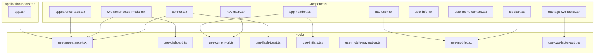
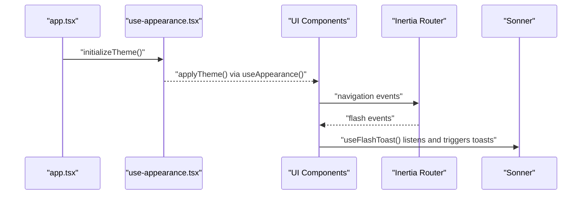
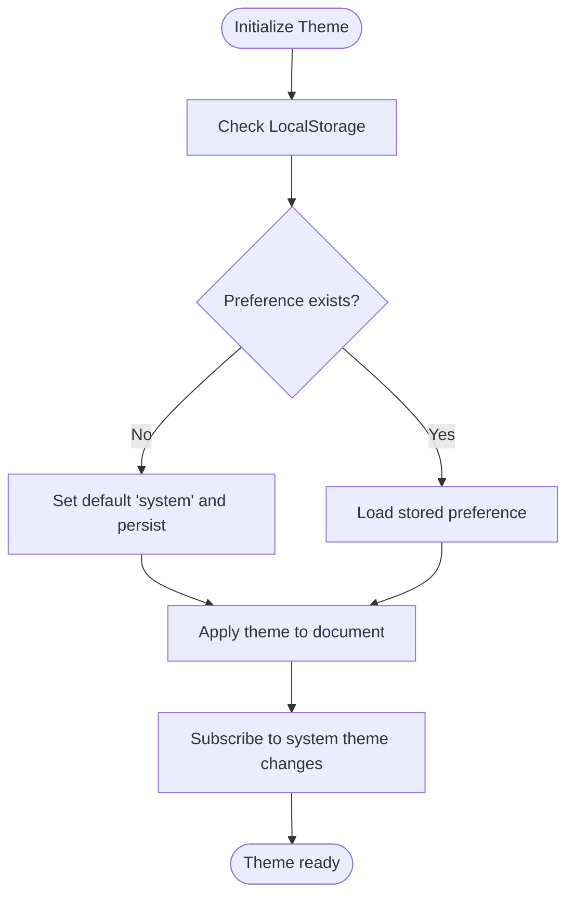
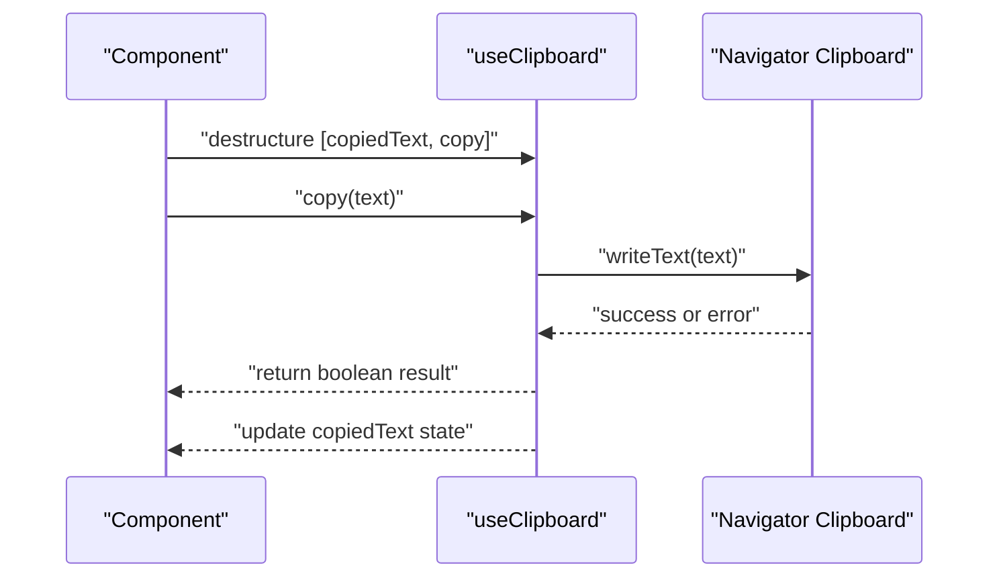
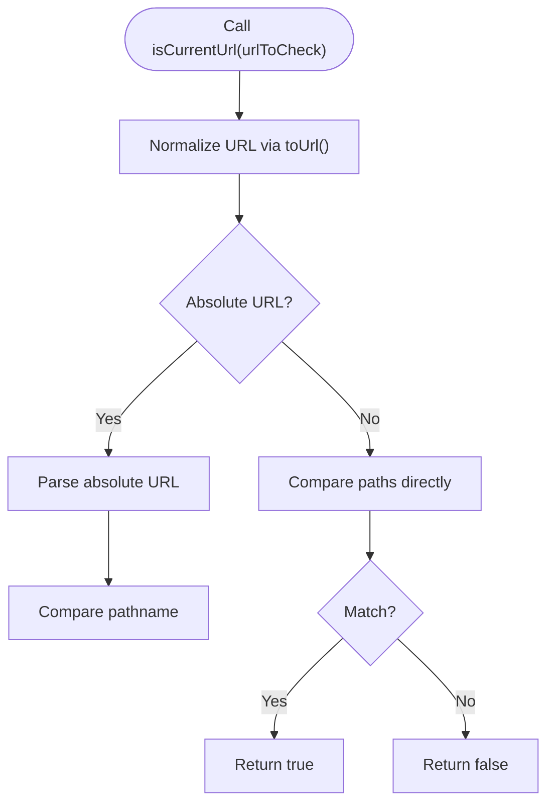
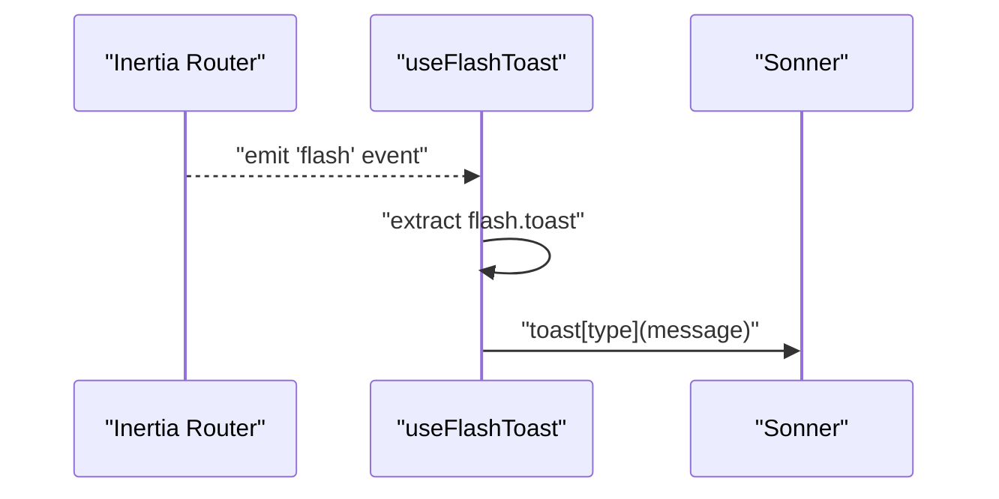
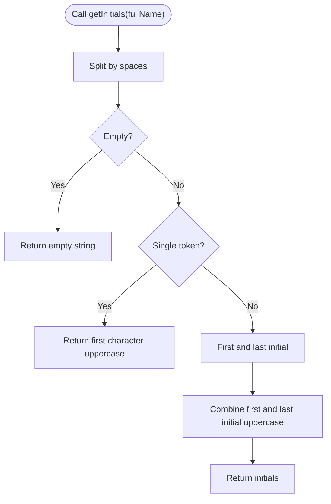
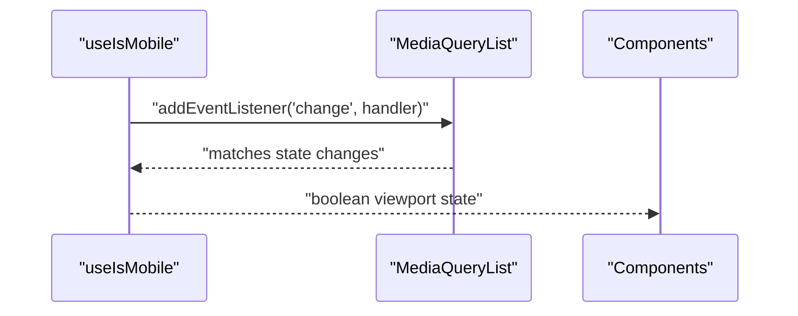
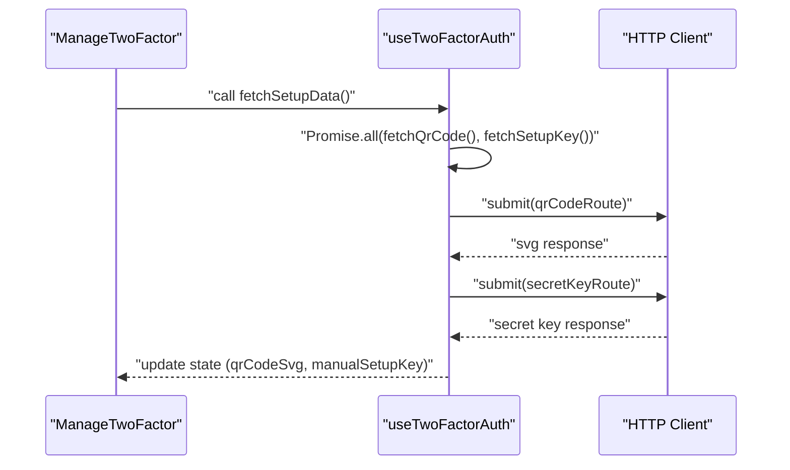
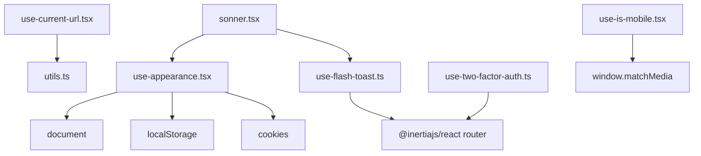

# Hooks System

<cite>
**Referenced Files in This Document**
- [use-appearance.tsx](file://resources/js/hooks/use-appearance.tsx)
- [use-clipboard.ts](file://resources/js/hooks/use-clipboard.ts)
- [use-current-url.ts](file://resources/js/hooks/use-current-url.ts)
- [use-flash-toast.ts](file://resources/js/hooks/use-flash-toast.ts)
- [use-initials.tsx](file://resources/js/hooks/use-initials.tsx)
- [use-mobile-navigation.ts](file://resources/js/hooks/use-mobile-navigation.ts)
- [use-mobile.tsx](file://resources/js/hooks/use-mobile.tsx)
- [use-two-factor-auth.ts](file://resources/js/hooks/use-two-factor-auth.ts)
- [app.tsx](file://resources/js/app.tsx)
- [utils.ts](file://resources/js/lib/utils.ts)
- [appearance-tabs.tsx](file://resources/js/components/appearance-tabs.tsx)
- [two-factor-setup-modal.tsx](file://resources/js/components/two-factor-setup-modal.tsx)
- [manage-two-factor.tsx](file://resources/js/components/manage-two-factor.tsx)
- [app-header.tsx](file://resources/js/components/app-header.tsx)
- [nav-main.tsx](file://resources/js/components/nav-main.tsx)
- [nav-user.tsx](file://resources/js/components/nav-user.tsx)
- [user-info.tsx](file://resources/js/components/user-info.tsx)
- [user-menu-content.tsx](file://resources/js/components/user-menu-content.tsx)
- [sidebar.tsx](file://resources/js/components/ui/sidebar.tsx)
- [sonner.tsx](file://resources/js/components/ui/sonner.tsx)
</cite>

## Table of Contents
1. [Introduction](#introduction)
2. [Project Structure](#project-structure)
3. [Core Components](#core-components)
4. [Architecture Overview](#architecture-overview)
5. [Detailed Component Analysis](#detailed-component-analysis)
6. [Dependency Analysis](#dependency-analysis)
7. [Performance Considerations](#performance-considerations)
8. [Troubleshooting Guide](#troubleshooting-guide)
9. [Conclusion](#conclusion)

## Introduction
This document provides comprehensive documentation for the custom React hooks used throughout the application. It covers the purpose, parameters, return values, and usage patterns of each hook, categorizing them into state management hooks, UI interaction hooks, and utility hooks. The guide also explains hook composition, dependency management, performance considerations, naming conventions, implementation patterns, and best practices for creating new hooks.

## Project Structure
The hooks are located under the `resources/js/hooks` directory and are consumed by various components across the application. The main application bootstraps theme initialization and wraps the app with UI providers.

**Diagram sources**
- [app.tsx:1-41](file://resources/js/app.tsx#L1-L41)
- [use-appearance.tsx:1-116](file://resources/js/hooks/use-appearance.tsx#L1-L116)
- [use-clipboard.ts:1-33](file://resources/js/hooks/use-clipboard.ts#L1-L33)
- [use-current-url.ts:1-84](file://resources/js/hooks/use-current-url.ts#L1-L84)
- [use-flash-toast.ts:1-20](file://resources/js/hooks/use-flash-toast.ts#L1-L20)
- [use-initials.tsx:1-23](file://resources/js/hooks/use-initials.tsx#L1-L23)
- [use-mobile-navigation.ts:1-11](file://resources/js/hooks/use-mobile-navigation.ts#L1-L11)
- [use-mobile.tsx:1-37](file://resources/js/hooks/use-mobile.tsx#L1-L37)
- [use-two-factor-auth.ts:1-112](file://resources/js/hooks/use-two-factor-auth.ts#L1-L112)
- [appearance-tabs.tsx:1-46](file://resources/js/components/appearance-tabs.tsx#L1-L46)
- [two-factor-setup-modal.tsx](file://resources/js/components/two-factor-setup-modal.tsx)
- [manage-two-factor.tsx:1-127](file://resources/js/components/manage-two-factor.tsx#L1-L127)
- [app-header.tsx:1-249](file://resources/js/components/app-header.tsx#L1-L249)
- [nav-main.tsx](file://resources/js/components/nav-main.tsx)
- [nav-user.tsx:1-37](file://resources/js/components/nav-user.tsx#L1-L37)
- [user-info.tsx](file://resources/js/components/user-info.tsx)
- [user-menu-content.tsx](file://resources/js/components/user-menu-content.tsx)
- [sidebar.tsx:1-720](file://resources/js/components/ui/sidebar.tsx#L1-L720)
- [sonner.tsx](file://resources/js/components/ui/sonner.tsx)

**Section sources**
- [app.tsx:1-41](file://resources/js/app.tsx#L1-L41)

## Core Components
This section documents each custom hook, including purpose, parameters, return values, and typical usage patterns.

- useAppearance
  - Purpose: Manages theme preference (light, dark, system) with persistence and system preference detection.
  - Parameters: None (initialization via `initializeTheme()` in app bootstrap).
  - Returns: Object containing current appearance, resolved appearance, and update function.
  - Usage pattern: Initialize theme on app load; consume in UI components to reflect and update theme.
  - Implementation pattern: Uses `useSyncExternalStore` for external store subscription and applies DOM class toggles.
  - Performance considerations: Subscriptions are efficient; avoid unnecessary re-renders by using memoized callbacks where appropriate.

- useClipboard
  - Purpose: Provides clipboard copy functionality with promise-based result.
  - Parameters: None.
  - Returns: Tuple with copied text state and copy function.
  - Usage pattern: Destructure `[copiedText, copy]` and call `copy(text)` to write to clipboard.
  - Implementation pattern: Uses browser Clipboard API with fallback warnings on failure.
  - Performance considerations: Minimal overhead; ensure proper error handling and avoid repeated writes.

- useCurrentUrl
  - Purpose: Determines if the current route matches a given URL, supports absolute and relative URLs.
  - Parameters: URL to check, optional current URL override, and flag for parent/startsWith comparison.
  - Returns: Object with current URL string and helper functions for matching and conditional rendering.
  - Usage pattern: Use `isCurrentUrl(href)` for active state checks; use `whenCurrentUrl(href, ifTrue, ifFalse)` for conditional rendering.
  - Implementation pattern: Normalizes URLs via utility and compares paths; handles absolute URLs with URL parsing.
  - Performance considerations: Efficient string comparisons; avoid frequent re-computation by caching computed values.

- useFlashToast
  - Purpose: Listens to Inertia flash events and displays toast notifications.
  - Parameters: None.
  - Returns: Void hook; registers an Inertia event listener.
  - Usage pattern: Call once per app lifecycle to enable flash-to-toast conversion.
  - Implementation pattern: Registers a router event listener and triggers toast based on flash payload.
  - Performance considerations: One-time effect registration; minimal runtime cost.

- useInitials
  - Purpose: Generates user initials from a full name.
  - Parameters: Full name string.
  - Returns: Function that computes initials.
  - Usage pattern: Destructure and call `getInitials(fullName)` for avatar fallbacks.
  - Implementation pattern: Uses `useCallback` to memoize the computation function.
  - Performance considerations: Memoized to prevent recomputation on unrelated renders.

- useMobileNavigation
  - Purpose: Cleans up pointer-events on the document body after mobile navigation interactions.
  - Parameters: None.
  - Returns: Cleanup function to remove inline styles.
  - Usage pattern: Call cleanup after closing mobile navigation overlays.
  - Implementation pattern: Removes a specific inline style from the document body.
  - Performance considerations: Minimal DOM manipulation cost.

- useIsMobile
  - Purpose: Detects if the viewport width is below a mobile breakpoint.
  - Parameters: None.
  - Returns: Boolean indicating mobile viewport.
  - Usage pattern: Used by sidebar and responsive components to adapt behavior.
  - Implementation pattern: Uses `useSyncExternalStore` with MediaQueryList listener.
  - Performance considerations: Efficient media query listener; server snapshot prevents hydration mismatches.

- useTwoFactorAuth
  - Purpose: Manages two-factor authentication setup and recovery codes retrieval.
  - Parameters: None.
  - Returns: Object with state (QR code SVG, manual setup key, recovery codes list), flags, and async action functions.
  - Usage pattern: Destructure state and actions; call fetch functions to populate data; clear data when disabling 2FA.
  - Implementation pattern: Uses HTTP client to submit requests; manages local state and errors; exposes memoized callbacks.
  - Performance considerations: Uses `Promise.all` for concurrent fetches; memoized callbacks reduce re-renders.

**Section sources**
- [use-appearance.tsx:1-116](file://resources/js/hooks/use-appearance.tsx#L1-L116)
- [use-clipboard.ts:1-33](file://resources/js/hooks/use-clipboard.ts#L1-L33)
- [use-current-url.ts:1-84](file://resources/js/hooks/use-current-url.ts#L1-L84)
- [use-flash-toast.ts:1-20](file://resources/js/hooks/use-flash-toast.ts#L1-L20)
- [use-initials.tsx:1-23](file://resources/js/hooks/use-initials.tsx#L1-L23)
- [use-mobile-navigation.ts:1-11](file://resources/js/hooks/use-mobile-navigation.ts#L1-L11)
- [use-mobile.tsx:1-37](file://resources/js/hooks/use-mobile.tsx#L1-L37)
- [use-two-factor-auth.ts:1-112](file://resources/js/hooks/use-two-factor-auth.ts#L1-L112)

## Architecture Overview
The hooks system integrates with the application’s UI components and Inertia routing. Theme initialization occurs at startup, while other hooks support UI interactions, navigation, and authentication flows.

**Diagram sources**
- [app.tsx:39-41](file://resources/js/app.tsx#L39-L41)
- [use-appearance.tsx:73-88](file://resources/js/hooks/use-appearance.tsx#L73-L88)
- [use-appearance.tsx:90-115](file://resources/js/hooks/use-appearance.tsx#L90-L115)
- [use-flash-toast.ts:6-19](file://resources/js/hooks/use-flash-toast.ts#L6-L19)
- [sonner.tsx](file://resources/js/components/ui/sonner.tsx)

## Detailed Component Analysis

### useAppearance Hook
- Purpose: Centralizes theme management with persistence and system preference detection.
- Key functions:
  - `initializeTheme`: Sets default appearance, applies theme, and subscribes to system changes.
  - `useAppearance`: Returns current appearance, resolved appearance, and update function.
- Dependencies: LocalStorage, cookies, and DOM APIs.
- Usage examples:
  - Appearance toggle tab updates theme and persists selection.
  - Toast provider reads resolved appearance for styling.

**Diagram sources**
- [use-appearance.tsx:73-88](file://resources/js/hooks/use-appearance.tsx#L73-L88)
- [use-appearance.tsx:44-53](file://resources/js/hooks/use-appearance.tsx#L44-L53)

**Section sources**
- [use-appearance.tsx:1-116](file://resources/js/hooks/use-appearance.tsx#L1-L116)
- [appearance-tabs.tsx:12-45](file://resources/js/components/appearance-tabs.tsx#L12-L45)
- [two-factor-setup-modal.tsx](file://resources/js/components/two-factor-setup-modal.tsx)
- [sonner.tsx](file://resources/js/components/ui/sonner.tsx)

### useClipboard Hook
- Purpose: Encapsulates clipboard write operations with error handling.
- Usage pattern: Destructure `[copiedText, copy]` and call `copy(text)` to write to clipboard.
- Best practices: Guard against unsupported environments and handle failures gracefully.

**Diagram sources**
- [use-clipboard.ts:8-32](file://resources/js/hooks/use-clipboard.ts#L8-L32)

**Section sources**
- [use-clipboard.ts:1-33](file://resources/js/hooks/use-clipboard.ts#L1-L33)
- [two-factor-setup-modal.tsx](file://resources/js/components/two-factor-setup-modal.tsx)

### useCurrentUrl Hook
- Purpose: Provides helpers to determine active navigation and conditional rendering based on current URL.
- Key functions:
  - `isCurrentUrl`: Compares URL with current path, supports absolute and relative URLs.
  - `isCurrentOrParentUrl`: Checks parent path matches.
  - `whenCurrentUrl`: Conditional render helper.
- Usage patterns: Active link highlighting and conditional UI segments.

**Diagram sources**
- [use-current-url.ts:29-83](file://resources/js/hooks/use-current-url.ts#L29-L83)
- [utils.ts:10-12](file://resources/js/lib/utils.ts#L10-L12)

**Section sources**
- [use-current-url.ts:1-84](file://resources/js/hooks/use-current-url.ts#L1-L84)
- [app-header.tsx:66-176](file://resources/js/components/app-header.tsx#L66-L176)
- [nav-main.tsx](file://resources/js/components/nav-main.tsx)

### useFlashToast Hook
- Purpose: Bridges Inertia flash messages to toast notifications.
- Implementation: Registers a router event listener and triggers toast based on flash payload.

**Diagram sources**
- [use-flash-toast.ts:6-19](file://resources/js/hooks/use-flash-toast.ts#L6-L19)

**Section sources**
- [use-flash-toast.ts:1-20](file://resources/js/hooks/use-flash-toast.ts#L1-L20)
- [sonner.tsx](file://resources/js/components/ui/sonner.tsx)

### useInitials Hook
- Purpose: Computes user initials from a full name with memoization.
- Usage pattern: Destructure and call `getInitials(fullName)` for avatar fallbacks.

**Diagram sources**
- [use-initials.tsx:5-22](file://resources/js/hooks/use-initials.tsx#L5-L22)

**Section sources**
- [use-initials.tsx:1-23](file://resources/js/hooks/use-initials.tsx#L1-L23)
- [app-header.tsx:224-226](file://resources/js/components/app-header.tsx#L224-L226)
- [user-info.tsx](file://resources/js/components/user-info.tsx)

### useMobileNavigation Hook
- Purpose: Cleans up pointer-events style applied to the document body after mobile navigation.
- Usage pattern: Call cleanup after closing mobile navigation overlays.

**Section sources**
- [use-mobile-navigation.ts:1-11](file://resources/js/hooks/use-mobile-navigation.ts#L1-L11)
- [user-menu-content.tsx:9-10](file://resources/js/components/user-menu-content.tsx#L9-L10)

### useIsMobile Hook
- Purpose: Detects mobile viewport using media queries.
- Usage pattern: Consumed by sidebar and responsive components.

**Diagram sources**
- [use-mobile.tsx:30-36](file://resources/js/hooks/use-mobile.tsx#L30-L36)
- [sidebar.tsx:67-92](file://resources/js/components/ui/sidebar.tsx#L67-L92)

**Section sources**
- [use-mobile.tsx:1-37](file://resources/js/hooks/use-mobile.tsx#L1-L37)
- [nav-user.tsx:15-20](file://resources/js/components/nav-user.tsx#L15-L20)
- [sidebar.tsx:23-23](file://resources/js/components/ui/sidebar.tsx#L23-L23)

### useTwoFactorAuth Hook
- Purpose: Manages 2FA setup, QR code generation, manual setup key, and recovery codes retrieval.
- Key functions:
  - Fetch actions: `fetchQrCode`, `fetchSetupKey`, `fetchRecoveryCodes`, `fetchSetupData`.
  - Clear actions: `clearErrors`, `clearSetupData`, `clearTwoFactorAuthData`.
  - State: `qrCodeSvg`, `manualSetupKey`, `recoveryCodesList`, `errors`, `hasSetupData`.
- Usage pattern: Destructure state and actions; call fetch functions on demand; clear data when disabling 2FA.

**Diagram sources**
- [use-two-factor-auth.ts:87-95](file://resources/js/hooks/use-two-factor-auth.ts#L87-L95)
- [use-two-factor-auth.ts:49-61](file://resources/js/hooks/use-two-factor-auth.ts#L49-L61)
- [use-two-factor-auth.ts:63-74](file://resources/js/hooks/use-two-factor-auth.ts#L63-L74)
- [manage-two-factor.tsx:31-31](file://resources/js/components/manage-two-factor.tsx#L31-L31)

**Section sources**
- [use-two-factor-auth.ts:1-112](file://resources/js/hooks/use-two-factor-auth.ts#L1-L112)
- [manage-two-factor.tsx:1-127](file://resources/js/components/manage-two-factor.tsx#L1-L127)

## Dependency Analysis
The hooks rely on React primitives and external libraries. The application initializes theme globally and components consume hooks for UI behavior.

**Diagram sources**
- [use-appearance.tsx:15-53](file://resources/js/hooks/use-appearance.tsx#L15-L53)
- [use-current-url.ts:30-36](file://resources/js/hooks/use-current-url.ts#L30-L36)
- [utils.ts:10-12](file://resources/js/lib/utils.ts#L10-L12)
- [use-flash-toast.ts:1-19](file://resources/js/hooks/use-flash-toast.ts#L1-L19)
- [use-two-factor-auth.ts:23-23](file://resources/js/hooks/use-two-factor-auth.ts#L23-L23)
- [use-mobile.tsx:5-24](file://resources/js/hooks/use-mobile.tsx#L5-L24)
- [sonner.tsx](file://resources/js/components/ui/sonner.tsx)

**Section sources**
- [use-appearance.tsx:1-116](file://resources/js/hooks/use-appearance.tsx#L1-L116)
- [use-current-url.ts:1-84](file://resources/js/hooks/use-current-url.ts#L1-L84)
- [use-flash-toast.ts:1-20](file://resources/js/hooks/use-flash-toast.ts#L1-L20)
- [use-two-factor-auth.ts:1-112](file://resources/js/hooks/use-two-factor-auth.ts#L1-L112)
- [use-mobile.tsx:1-37](file://resources/js/hooks/use-mobile.tsx#L1-L37)
- [sonner.tsx](file://resources/js/components/ui/sonner.tsx)

## Performance Considerations
- Memoization: Use `useCallback` for action functions and `useMemo` for derived values to minimize re-renders.
- Event listeners: Media query listeners and router event handlers are registered once; ensure cleanup where applicable.
- Async operations: Batch concurrent requests using `Promise.all` to reduce latency.
- DOM manipulation: Keep theme and responsive logic minimal; avoid frequent class toggles.
- Storage: Persist preferences efficiently; avoid excessive writes to localStorage and cookies.

## Troubleshooting Guide
- Clipboard not supported: The clipboard hook warns and returns false when the Clipboard API is unavailable. Ensure the app runs in a secure context.
- Flash toasts not appearing: Verify that the flash event payload contains a valid toast object and that the hook is initialized.
- Theme not applying: Confirm that `initializeTheme()` is called during app bootstrap and that the DOM has a `document` context.
- Two-factor fetch failures: Inspect returned errors and ensure network connectivity; clear partial state using provided clear functions.
- Mobile detection issues: Validate media query support and ensure the hook is used within a mounted component.

**Section sources**
- [use-clipboard.ts:11-29](file://resources/js/hooks/use-clipboard.ts#L11-L29)
- [use-flash-toast.ts:8-17](file://resources/js/hooks/use-flash-toast.ts#L8-L17)
- [app.tsx:39-41](file://resources/js/app.tsx#L39-L41)
- [use-two-factor-auth.ts:57-84](file://resources/js/hooks/use-two-factor-auth.ts#L57-L84)

## Conclusion
The hooks system provides a cohesive foundation for state management, UI interactions, and utility functions across the application. By following established patterns—such as memoization, efficient event handling, and clear separation of concerns—developers can extend the system reliably. The documented hooks serve as templates for creating new hooks, ensuring consistency and maintainability.