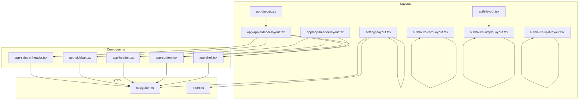
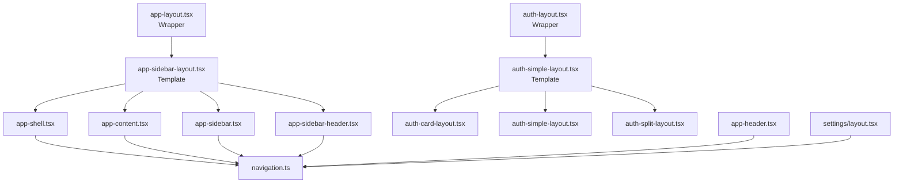
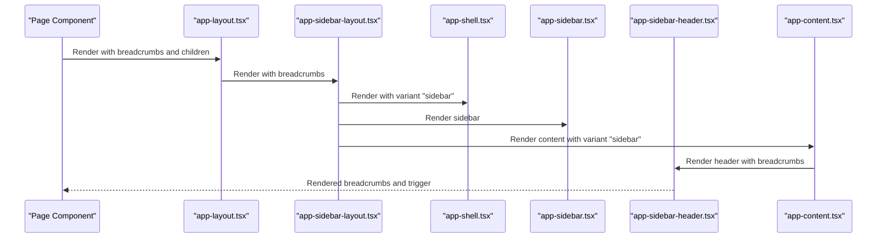
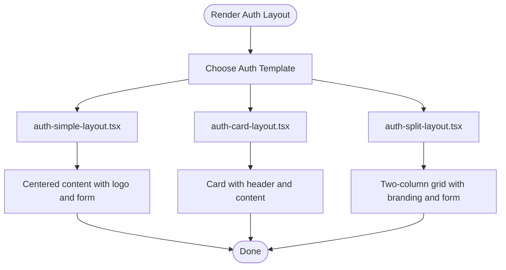
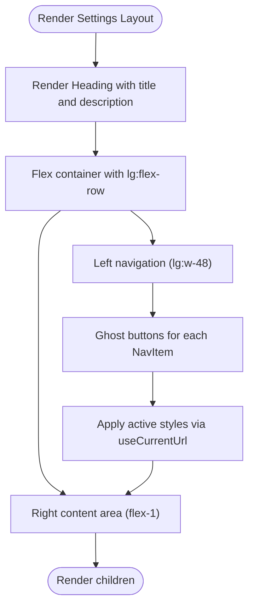
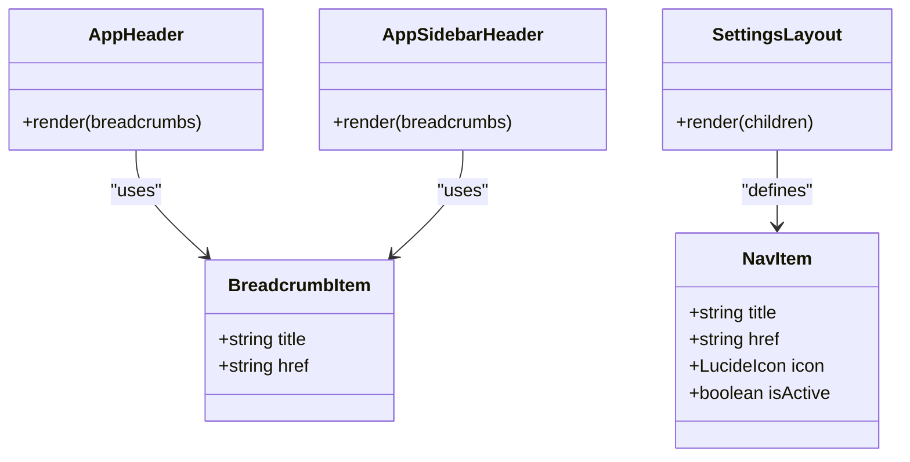
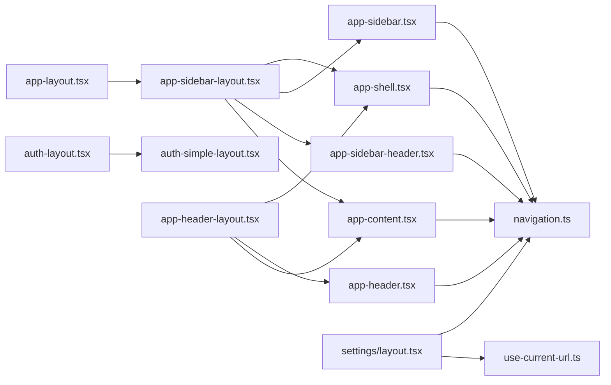

# Layout System

<cite>
**Referenced Files in This Document**
- [app-layout.tsx](file://resources/js/layouts/app-layout.tsx)
- [auth-layout.tsx](file://resources/js/layouts/auth-layout.tsx)
- [settings/layout.tsx](file://resources/js/layouts/settings/layout.tsx)
- [app/app-header-layout.tsx](file://resources/js/layouts/app/app-header-layout.tsx)
- [app/app-sidebar-layout.tsx](file://resources/js/layouts/app/app-sidebar-layout.tsx)
- [auth/auth-card-layout.tsx](file://resources/js/layouts/auth/auth-card-layout.tsx)
- [auth/auth-simple-layout.tsx](file://resources/js/layouts/auth/auth-simple-layout.tsx)
- [auth/auth-split-layout.tsx](file://resources/js/layouts/auth/auth-split-layout.tsx)
- [app-shell.tsx](file://resources/js/components/app-shell.tsx)
- [app-content.tsx](file://resources/js/components/app-content.tsx)
- [app-header.tsx](file://resources/js/components/app-header.tsx)
- [app-sidebar.tsx](file://resources/js/components/app-sidebar.tsx)
- [app-sidebar-header.tsx](file://resources/js/components/app-sidebar-header.tsx)
- [navigation.ts](file://resources/js/types/navigation.ts)
- [index.ts](file://resources/js/types/index.ts)
- [use-current-url.ts](file://resources/js/hooks/use-current-url.ts)
</cite>

## Table of Contents
1. [Introduction](#introduction)
2. [Project Structure](#project-structure)
3. [Core Components](#core-components)
4. [Architecture Overview](#architecture-overview)
5. [Detailed Component Analysis](#detailed-component-analysis)
6. [Dependency Analysis](#dependency-analysis)
7. [Performance Considerations](#performance-considerations)
8. [Troubleshooting Guide](#troubleshooting-guide)
9. [Conclusion](#conclusion)

## Introduction
This document explains the layout system used across the application, focusing on three primary layout families:
- Application layouts for authenticated user areas
- Authentication layouts for login, registration, and related flows
- Settings layouts for user account configuration

It covers layout hierarchy, responsive design implementation, navigation patterns, prop contracts, composition examples, sidebar behavior, header configurations, and mobile-responsive design. It also documents layout switching mechanisms and integration with routing.

## Project Structure
The layout system is organized under resources/js/layouts with subfolders for app, auth, and settings. Each layout composes reusable UI components from resources/js/components and leverages shared types from resources/js/types.

**Diagram sources**
- [app-layout.tsx:1-17](file://resources/js/layouts/app-layout.tsx#L1-L17)
- [auth-layout.tsx:1-18](file://resources/js/layouts/auth-layout.tsx#L1-L18)
- [settings/layout.tsx:1-79](file://resources/js/layouts/settings/layout.tsx#L1-L79)
- [app/app-sidebar-layout.tsx:1-21](file://resources/js/layouts/app/app-sidebar-layout.tsx#L1-L21)
- [app/app-header-layout.tsx:1-17](file://resources/js/layouts/app/app-header-layout.tsx#L1-L17)
- [auth/auth-card-layout.tsx:1-49](file://resources/js/layouts/auth/auth-card-layout.tsx#L1-L49)
- [auth/auth-simple-layout.tsx:1-39](file://resources/js/layouts/auth/auth-simple-layout.tsx#L1-L39)
- [auth/auth-split-layout.tsx:1-45](file://resources/js/layouts/auth/auth-split-layout.tsx#L1-L45)
- [app-shell.tsx:1-22](file://resources/js/components/app-shell.tsx#L1-L22)
- [app-content.tsx:1-23](file://resources/js/components/app-content.tsx#L1-L23)
- [app-header.tsx:1-249](file://resources/js/components/app-header.tsx#L1-L249)
- [app-sidebar.tsx:1-66](file://resources/js/components/app-sidebar.tsx#L1-L66)
- [app-sidebar-header.tsx:1-19](file://resources/js/components/app-sidebar-header.tsx#L1-L19)
- [navigation.ts:1-15](file://resources/js/types/navigation.ts#L1-L15)
- [index.ts:1-4](file://resources/js/types/index.ts#L1-L4)

**Section sources**
- [app-layout.tsx:1-17](file://resources/js/layouts/app-layout.tsx#L1-L17)
- [auth-layout.tsx:1-18](file://resources/js/layouts/auth-layout.tsx#L1-L18)
- [settings/layout.tsx:1-79](file://resources/js/layouts/settings/layout.tsx#L1-L79)
- [app/app-sidebar-layout.tsx:1-21](file://resources/js/layouts/app/app-sidebar-layout.tsx#L1-L21)
- [app/app-header-layout.tsx:1-17](file://resources/js/layouts/app/app-header-layout.tsx#L1-L17)
- [auth/auth-card-layout.tsx:1-49](file://resources/js/layouts/auth/auth-card-layout.tsx#L1-L49)
- [auth/auth-simple-layout.tsx:1-39](file://resources/js/layouts/auth/auth-simple-layout.tsx#L1-L39)
- [auth/auth-split-layout.tsx:1-45](file://resources/js/layouts/auth/auth-split-layout.tsx#L1-L45)
- [app-shell.tsx:1-22](file://resources/js/components/app-shell.tsx#L1-L22)
- [app-content.tsx:1-23](file://resources/js/components/app-content.tsx#L1-L23)
- [app-header.tsx:1-249](file://resources/js/components/app-header.tsx#L1-L249)
- [app-sidebar.tsx:1-66](file://resources/js/components/app-sidebar.tsx#L1-L66)
- [app-sidebar-header.tsx:1-19](file://resources/js/components/app-sidebar-header.tsx#L1-L19)
- [navigation.ts:1-15](file://resources/js/types/navigation.ts#L1-L15)
- [index.ts:1-4](file://resources/js/types/index.ts#L1-L4)

## Core Components
This section outlines the primary layout types and their roles:

- Application Layouts
  - app-layout.tsx: Thin wrapper around app-sidebar-layout.tsx, passing breadcrumbs and children.
  - app/app-sidebar-layout.tsx: Full-page layout with sidebar, content area, and sidebar header.
  - app/app-header-layout.tsx: Full-page layout with top header and content area.
  - app-shell.tsx: Root shell that switches between header and sidebar variants and manages sidebar provider state.
  - app-content.tsx: Content container that adapts to variant and wraps SidebarInset for sidebar mode.
  - app-sidebar.tsx: Collapsible sidebar with main navigation, footer links, and user info.
  - app-sidebar-header.tsx: Header inside the sidebar area containing breadcrumbs and trigger.

- Authentication Layouts
  - auth-layout.tsx: Thin wrapper around auth-simple-layout.tsx, passing title, description, and children.
  - auth-simple-layout.tsx: Minimal centered layout with logo, optional title/description, and form content.
  - auth-card-layout.tsx: Card-based layout with title/description and child form content.
  - auth-split-layout.tsx: Two-column split layout with branding on the left and content on the right.

- Settings Layout
  - settings/layout.tsx: Settings page with a left-hand navigation and content area, responsive breakpoint at lg.

Key props and contracts:
- BreadcrumbItem: title and href for breadcrumb entries.
- NavItem: title, href, optional icon, and optional active state flag.
- AppLayoutProps and AuthLayoutProps: define the shape for layout wrappers.

Responsive design highlights:
- Mobile-first with lg breakpoint for sidebar and settings layout.
- App header uses a sheet-based mobile menu and hides desktop navigation on small screens.
- Settings layout stacks vertically on small screens and uses horizontal spacing on larger screens.

**Section sources**
- [app-layout.tsx:1-17](file://resources/js/layouts/app-layout.tsx#L1-L17)
- [app/app-sidebar-layout.tsx:1-21](file://resources/js/layouts/app/app-sidebar-layout.tsx#L1-L21)
- [app/app-header-layout.tsx:1-17](file://resources/js/layouts/app/app-header-layout.tsx#L1-L17)
- [app-shell.tsx:1-22](file://resources/js/components/app-shell.tsx#L1-L22)
- [app-content.tsx:1-23](file://resources/js/components/app-content.tsx#L1-L23)
- [app-sidebar.tsx:1-66](file://resources/js/components/app-sidebar.tsx#L1-L66)
- [app-sidebar-header.tsx:1-19](file://resources/js/components/app-sidebar-header.tsx#L1-L19)
- [auth-layout.tsx:1-18](file://resources/js/layouts/auth-layout.tsx#L1-L18)
- [auth-simple-layout.tsx:1-39](file://resources/js/layouts/auth/auth-simple-layout.tsx#L1-L39)
- [auth-card-layout.tsx:1-49](file://resources/js/layouts/auth/auth-card-layout.tsx#L1-L49)
- [auth-split-layout.tsx:1-45](file://resources/js/layouts/auth/auth-split-layout.tsx#L1-L45)
- [settings/layout.tsx:1-79](file://resources/js/layouts/settings/layout.tsx#L1-L79)
- [navigation.ts:1-15](file://resources/js/types/navigation.ts#L1-L15)
- [index.ts:1-4](file://resources/js/types/index.ts#L1-L4)

## Architecture Overview
The layout system follows a layered composition pattern:
- Wrapper layouts (app-layout.tsx, auth-layout.tsx) accept props and delegate rendering to template layouts.
- Template layouts (app-sidebar-layout.tsx, app-header-layout.tsx, auth-*-layout.tsx) assemble UI components.
- UI components (app-shell.tsx, app-content.tsx, app-sidebar.tsx, app-header.tsx, app-sidebar-header.tsx) provide structure and behavior.
- Types (navigation.ts, index.ts) define contracts for navigation and breadcrumbs.

**Diagram sources**
- [app-layout.tsx:1-17](file://resources/js/layouts/app-layout.tsx#L1-L17)
- [auth-layout.tsx:1-18](file://resources/js/layouts/auth-layout.tsx#L1-L18)
- [app/app-sidebar-layout.tsx:1-21](file://resources/js/layouts/app/app-sidebar-layout.tsx#L1-L21)
- [auth/auth-simple-layout.tsx:1-39](file://resources/js/layouts/auth/auth-simple-layout.tsx#L1-L39)
- [auth/auth-card-layout.tsx:1-49](file://resources/js/layouts/auth/auth-card-layout.tsx#L1-L49)
- [auth/auth-split-layout.tsx:1-45](file://resources/js/layouts/auth/auth-split-layout.tsx#L1-L45)
- [app-shell.tsx:1-22](file://resources/js/components/app-shell.tsx#L1-L22)
- [app-content.tsx:1-23](file://resources/js/components/app-content.tsx#L1-L23)
- [app-sidebar.tsx:1-66](file://resources/js/components/app-sidebar.tsx#L1-L66)
- [app-sidebar-header.tsx:1-19](file://resources/js/components/app-sidebar-header.tsx#L1-L19)
- [app-header.tsx:1-249](file://resources/js/components/app-header.tsx#L1-L249)
- [settings/layout.tsx:1-79](file://resources/js/layouts/settings/layout.tsx#L1-L79)
- [navigation.ts:1-15](file://resources/js/types/navigation.ts#L1-L15)

## Detailed Component Analysis

### Application Layout Family
Application layouts are used for authenticated areas requiring a persistent sidebar and breadcrumbs.

- app-layout.tsx
  - Purpose: Provide breadcrumbs and wrap the sidebar layout.
  - Props: breadcrumbs (optional), children.
  - Composition: Delegates to app-sidebar-layout.tsx.

- app-sidebar-layout.tsx
  - Purpose: Full-page layout with sidebar, content area, and sidebar header.
  - Props: breadcrumbs (default empty), children.
  - Composition: Uses app-shell.tsx (variant "sidebar"), app-sidebar.tsx, app-sidebar-header.tsx, and app-content.tsx.

- app-header-layout.tsx
  - Purpose: Full-page layout with top header and content area.
  - Props: breadcrumbs, children.
  - Composition: Uses app-shell.tsx (variant "header") and app-header.tsx.

- app-shell.tsx
  - Purpose: Root shell that switches between header and sidebar variants.
  - Behavior: For "header" variant, renders a simple column layout. For "sidebar" variant, wraps children in a SidebarProvider with defaultOpen controlled by page props.

- app-content.tsx
  - Purpose: Content container that adapts to variant.
  - Behavior: For "sidebar" variant, wraps content in SidebarInset. For "header" variant, centers content with max width.

- app-sidebar.tsx
  - Purpose: Collapsible sidebar with main navigation, footer links, and user info.
  - Behavior: Uses inset variant and icon-collapsible mode.

- app-sidebar-header.tsx
  - Purpose: Header inside the sidebar area with breadcrumbs and trigger.
  - Behavior: Includes SidebarTrigger and Breadcrumbs.

**Diagram sources**
- [app-layout.tsx:1-17](file://resources/js/layouts/app-layout.tsx#L1-L17)
- [app/app-sidebar-layout.tsx:1-21](file://resources/js/layouts/app/app-sidebar-layout.tsx#L1-L21)
- [app-shell.tsx:1-22](file://resources/js/components/app-shell.tsx#L1-L22)
- [app-sidebar.tsx:1-66](file://resources/js/components/app-sidebar.tsx#L1-L66)
- [app-sidebar-header.tsx:1-19](file://resources/js/components/app-sidebar-header.tsx#L1-L19)
- [app-content.tsx:1-23](file://resources/js/components/app-content.tsx#L1-L23)

**Section sources**
- [app-layout.tsx:1-17](file://resources/js/layouts/app-layout.tsx#L1-L17)
- [app/app-sidebar-layout.tsx:1-21](file://resources/js/layouts/app/app-sidebar-layout.tsx#L1-L21)
- [app/app-header-layout.tsx:1-17](file://resources/js/layouts/app/app-header-layout.tsx#L1-L17)
- [app-shell.tsx:1-22](file://resources/js/components/app-shell.tsx#L1-L22)
- [app-content.tsx:1-23](file://resources/js/components/app-content.tsx#L1-L23)
- [app-sidebar.tsx:1-66](file://resources/js/components/app-sidebar.tsx#L1-L66)
- [app-sidebar-header.tsx:1-19](file://resources/js/components/app-sidebar-header.tsx#L1-L19)

### Authentication Layout Family
Authentication layouts are used for login, registration, password reset, and verification flows.

- auth-layout.tsx
  - Purpose: Provide title, description, and wrap the simple layout.
  - Props: title (optional), description (optional), children.
  - Composition: Delegates to auth-simple-layout.tsx.

- auth-simple-layout.tsx
  - Purpose: Minimal centered layout with logo, optional title/description, and form content.
  - Props: title, description, children.
  - Responsive: Uses max-w-sm and centers content.

- auth-card-layout.tsx
  - Purpose: Card-based layout with title/description and child form content.
  - Props: title, description, children.
  - Structure: CardHeader with title/description, CardContent for children.

- auth-split-layout.tsx
  - Purpose: Two-column split layout with branding on the left and content on the right.
  - Props: title, description, children.
  - Responsive: Uses grid-cols-2 on large screens and hides left panel on small screens.

**Diagram sources**
- [auth-layout.tsx:1-18](file://resources/js/layouts/auth-layout.tsx#L1-L18)
- [auth-simple-layout.tsx:1-39](file://resources/js/layouts/auth/auth-simple-layout.tsx#L1-L39)
- [auth-card-layout.tsx:1-49](file://resources/js/layouts/auth/auth-card-layout.tsx#L1-L49)
- [auth/auth-split-layout.tsx:1-45](file://resources/js/layouts/auth/auth-split-layout.tsx#L1-L45)

**Section sources**
- [auth-layout.tsx:1-18](file://resources/js/layouts/auth-layout.tsx#L1-L18)
- [auth-simple-layout.tsx:1-39](file://resources/js/layouts/auth/auth-simple-layout.tsx#L1-L39)
- [auth-card-layout.tsx:1-49](file://resources/js/layouts/auth/auth-card-layout.tsx#L1-L49)
- [auth/auth-split-layout.tsx:1-45](file://resources/js/layouts/auth/auth-split-layout.tsx#L1-L45)

### Settings Layout
The settings layout provides a left-hand navigation for profile, security, and appearance sections.

- settings/layout.tsx
  - Purpose: Settings page with navigation and content area.
  - Navigation: Defines sidebarNavItems with title, href, and optional icon.
  - Active state: Uses useCurrentUrl hook to mark current or parent URLs.
  - Responsive: Uses lg:flex-row for horizontal layout and lg:hidden separators.

**Diagram sources**
- [settings/layout.tsx:1-79](file://resources/js/layouts/settings/layout.tsx#L1-L79)
- [use-current-url.ts:1-200](file://resources/js/hooks/use-current-url.ts#L1-L200)

**Section sources**
- [settings/layout.tsx:1-79](file://resources/js/layouts/settings/layout.tsx#L1-L79)
- [use-current-url.ts:1-200](file://resources/js/hooks/use-current-url.ts#L1-L200)

### Navigation Patterns and Breadcrumbs
- BreadcrumbItem and NavItem types define navigation contracts used across layouts.
- app-header.tsx and app-sidebar-header.tsx render breadcrumbs when present.
- Settings layout uses a custom navigation array with Link components and active state detection.

**Diagram sources**
- [navigation.ts:1-15](file://resources/js/types/navigation.ts#L1-L15)
- [app-header.tsx:1-249](file://resources/js/components/app-header.tsx#L1-L249)
- [app-sidebar-header.tsx:1-19](file://resources/js/components/app-sidebar-header.tsx#L1-L19)
- [settings/layout.tsx:1-79](file://resources/js/layouts/settings/layout.tsx#L1-L79)

**Section sources**
- [navigation.ts:1-15](file://resources/js/types/navigation.ts#L1-L15)
- [app-header.tsx:1-249](file://resources/js/components/app-header.tsx#L1-L249)
- [app-sidebar-header.tsx:1-19](file://resources/js/components/app-sidebar-header.tsx#L1-L19)
- [settings/layout.tsx:1-79](file://resources/js/layouts/settings/layout.tsx#L1-L79)

### Sidebar Behavior and Header Configurations
- Sidebar behavior:
  - app-sidebar.tsx uses inset variant and icon-collapsible mode.
  - app-shell.tsx controls defaultOpen via page props for sidebar mode.
  - app-sidebar-header.tsx includes SidebarTrigger for toggling.

- Header configurations:
  - app-header.tsx includes mobile sheet menu, desktop navigation, external links, and user menu.
  - Responsive breakpoints:
    - Mobile: Sheet-based menu on small screens.
    - Desktop: Hidden on small screens, visible on medium-large screens.
    - lg breakpoint for sidebar and settings layout horizontal arrangement.

**Section sources**
- [app-sidebar.tsx:1-66](file://resources/js/components/app-sidebar.tsx#L1-L66)
- [app-shell.tsx:1-22](file://resources/js/components/app-shell.tsx#L1-L22)
- [app-sidebar-header.tsx:1-19](file://resources/js/components/app-sidebar-header.tsx#L1-L19)
- [app-header.tsx:1-249](file://resources/js/components/app-header.tsx#L1-L249)

### Layout Switching Mechanisms and Routing Integration
- Wrapper-to-template switching:
  - app-layout.tsx delegates to app-sidebar-layout.tsx.
  - auth-layout.tsx delegates to auth-simple-layout.tsx.
- Variant selection:
  - app-shell.tsx switches behavior based on variant prop ("sidebar" vs "header").
- Routing integration:
  - Layouts use Link components with route helpers to navigate internally.
  - Settings layout defines NavItem arrays with href values generated by route helpers.
  - useCurrentUrl hook detects active/current URLs for highlighting navigation items.

**Section sources**
- [app-layout.tsx:1-17](file://resources/js/layouts/app-layout.tsx#L1-L17)
- [auth-layout.tsx:1-18](file://resources/js/layouts/auth-layout.tsx#L1-L18)
- [app-shell.tsx:1-22](file://resources/js/components/app-shell.tsx#L1-L22)
- [settings/layout.tsx:1-79](file://resources/js/layouts/settings/layout.tsx#L1-L79)
- [use-current-url.ts:1-200](file://resources/js/hooks/use-current-url.ts#L1-L200)

## Dependency Analysis
The layout system exhibits clear separation of concerns:
- Wrapper layouts depend on template layouts.
- Template layouts depend on UI components.
- UI components depend on shared types.
- Settings layout depends on useCurrentUrl hook for active state.

**Diagram sources**
- [app-layout.tsx:1-17](file://resources/js/layouts/app-layout.tsx#L1-L17)
- [auth-layout.tsx:1-18](file://resources/js/layouts/auth-layout.tsx#L1-L18)
- [app/app-sidebar-layout.tsx:1-21](file://resources/js/layouts/app/app-sidebar-layout.tsx#L1-L21)
- [auth/auth-simple-layout.tsx:1-39](file://resources/js/layouts/auth/auth-simple-layout.tsx#L1-L39)
- [app-shell.tsx:1-22](file://resources/js/components/app-shell.tsx#L1-L22)
- [app-sidebar.tsx:1-66](file://resources/js/components/app-sidebar.tsx#L1-L66)
- [app-sidebar-header.tsx:1-19](file://resources/js/components/app-sidebar-header.tsx#L1-L19)
- [app-content.tsx:1-23](file://resources/js/components/app-content.tsx#L1-L23)
- [app-header.tsx:1-249](file://resources/js/components/app-header.tsx#L1-L249)
- [settings/layout.tsx:1-79](file://resources/js/layouts/settings/layout.tsx#L1-L79)
- [navigation.ts:1-15](file://resources/js/types/navigation.ts#L1-L15)
- [use-current-url.ts:1-200](file://resources/js/hooks/use-current-url.ts#L1-L200)

**Section sources**
- [app-layout.tsx:1-17](file://resources/js/layouts/app-layout.tsx#L1-L17)
- [auth-layout.tsx:1-18](file://resources/js/layouts/auth-layout.tsx#L1-L18)
- [app/app-sidebar-layout.tsx:1-21](file://resources/js/layouts/app/app-sidebar-layout.tsx#L1-L21)
- [auth/auth-simple-layout.tsx:1-39](file://resources/js/layouts/auth/auth-simple-layout.tsx#L1-L39)
- [app-shell.tsx:1-22](file://resources/js/components/app-shell.tsx#L1-L22)
- [app-sidebar.tsx:1-66](file://resources/js/components/app-sidebar.tsx#L1-L66)
- [app-sidebar-header.tsx:1-19](file://resources/js/components/app-sidebar-header.tsx#L1-L19)
- [app-content.tsx:1-23](file://resources/js/components/app-content.tsx#L1-L23)
- [app-header.tsx:1-249](file://resources/js/components/app-header.tsx#L1-L249)
- [settings/layout.tsx:1-79](file://resources/js/layouts/settings/layout.tsx#L1-L79)
- [navigation.ts:1-15](file://resources/js/types/navigation.ts#L1-L15)
- [use-current-url.ts:1-200](file://resources/js/hooks/use-current-url.ts#L1-L200)

## Performance Considerations
- Minimize re-renders by keeping layout wrappers thin and delegating to template layouts.
- Use variant-based branching in app-shell.tsx to avoid unnecessary DOM nodes.
- Leverage responsive utilities (e.g., lg:flex-row) to reduce layout thrashing on small screens.
- Avoid heavy computations in layout components; compute navigation items statically when possible.

## Troubleshooting Guide
Common issues and resolutions:
- Sidebar not opening/closing as expected:
  - Verify defaultOpen state is synchronized with page props in app-shell.tsx.
  - Ensure SidebarProvider is present in sidebar variant.
- Breadcrumbs not visible:
  - Confirm breadcrumbs array has more than one item; visibility is conditional.
- Active navigation items not highlighted:
  - Ensure useCurrentUrl hook is used consistently in navigation components.
- Responsive layout shifts:
  - Check lg breakpoint usage and Tailwind utilities applied to containers.

**Section sources**
- [app-shell.tsx:1-22](file://resources/js/components/app-shell.tsx#L1-L22)
- [app-header.tsx:1-249](file://resources/js/components/app-header.tsx#L1-L249)
- [use-current-url.ts:1-200](file://resources/js/hooks/use-current-url.ts#L1-L200)

## Conclusion
The layout system provides a modular, type-safe foundation for application, authentication, and settings experiences. By composing wrapper layouts with template layouts and reusable UI components, developers can maintain consistent navigation, responsive behavior, and clear layout switching across the application. Adhering to the established contracts and patterns ensures predictable behavior and easier maintenance.