# Page Components

<cite>
**Referenced Files in This Document**
- [dashboard.tsx](file://resources/js/pages/dashboard.tsx)
- [welcome.tsx](file://resources/js/pages/welcome.tsx)
- [login.tsx](file://resources/js/pages/auth/login.tsx)
- [register.tsx](file://resources/js/pages/auth/register.tsx)
- [forgot-password.tsx](file://resources/js/pages/auth/forgot-password.tsx)
- [reset-password.tsx](file://resources/js/pages/auth/reset-password.tsx)
- [profile.tsx](file://resources/js/pages/settings/profile.tsx)
- [security.tsx](file://resources/js/pages/settings/security.tsx)
- [appearance.tsx](file://resources/js/pages/settings/appearance.tsx)
- [app-sidebar-layout.tsx](file://resources/js/layouts/app/app-sidebar-layout.tsx)
- [auth-card-layout.tsx](file://resources/js/layouts/auth/auth-card-layout.tsx)
- [auth-simple-layout.tsx](file://resources/js/layouts/auth/auth-simple-layout.tsx)
- [app-shell.tsx](file://resources/js/components/app-shell.tsx)
- [app-content.tsx](file://resources/js/components/app-content.tsx)
- [navigation.ts](file://resources/js/types/navigation.ts)
</cite>

## Table of Contents
1. [Introduction](#introduction)
2. [Project Structure](#project-structure)
3. [Core Components](#core-components)
4. [Architecture Overview](#architecture-overview)
5. [Detailed Component Analysis](#detailed-component-analysis)
6. [Dependency Analysis](#dependency-analysis)
7. [Performance Considerations](#performance-considerations)
8. [Troubleshooting Guide](#troubleshooting-guide)
9. [Conclusion](#conclusion)

## Introduction
This document describes the page components across the application’s authentication, settings, and main application surfaces. It explains page structure, data fetching patterns via Inertia forms, form handling, user interactions, lifecycle states, loading indicators, and error handling. It also documents the relationship between pages and their layouts, navigation patterns, and route-to-page mapping.

## Project Structure
Pages are organized under resources/js/pages grouped by domain:
- Authentication pages: login, register, forgot-password, reset-password, two-factor challenge, and email verification
- Settings pages: profile, security, and appearance
- Application pages: dashboard and a marketing/welcome page

Layouts are separated by domain:
- Authentication layouts: card and simple variants
- Application layout: sidebar-based shell with content area and breadcrumbs

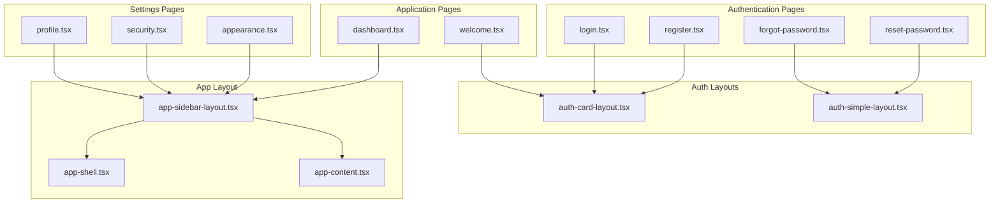

**Diagram sources**
- [login.tsx:24-120](file://resources/js/pages/auth/login.tsx#L24-L120)
- [register.tsx:16-115](file://resources/js/pages/auth/register.tsx#L16-L115)
- [forgot-password.tsx:12-64](file://resources/js/pages/auth/forgot-password.tsx#L12-L64)
- [reset-password.tsx:16-90](file://resources/js/pages/auth/reset-password.tsx#L16-L90)
- [profile.tsx:22-139](file://resources/js/pages/settings/profile.tsx#L22-L139)
- [security.tsx:24-146](file://resources/js/pages/settings/security.tsx#L24-L146)
- [appearance.tsx:6-22](file://resources/js/pages/settings/appearance.tsx#L6-L22)
- [dashboard.tsx:5-27](file://resources/js/pages/dashboard.tsx#L5-L27)
- [welcome.tsx:16-43](file://resources/js/pages/welcome.tsx#L16-L43)
- [auth-card-layout.tsx:13-48](file://resources/js/layouts/auth/auth-card-layout.tsx#L13-L48)
- [auth-simple-layout.tsx:6-38](file://resources/js/layouts/auth/auth-simple-layout.tsx#L6-L38)
- [app-sidebar-layout.tsx:7-20](file://resources/js/layouts/app/app-sidebar-layout.tsx#L7-L20)
- [app-shell.tsx:11-21](file://resources/js/components/app-shell.tsx#L11-L21)
- [app-content.tsx:9-22](file://resources/js/components/app-content.tsx#L9-L22)

**Section sources**
- [dashboard.tsx:1-37](file://resources/js/pages/dashboard.tsx#L1-L37)
- [welcome.tsx:1-437](file://resources/js/pages/welcome.tsx#L1-L437)
- [login.tsx:1-126](file://resources/js/pages/auth/login.tsx#L1-L126)
- [register.tsx:1-121](file://resources/js/pages/auth/register.tsx#L1-L121)
- [forgot-password.tsx:1-70](file://resources/js/pages/auth/forgot-password.tsx#L1-L70)
- [reset-password.tsx:1-97](file://resources/js/pages/auth/reset-password.tsx#L1-L97)
- [profile.tsx:1-149](file://resources/js/pages/settings/profile.tsx#L1-L149)
- [security.tsx:1-156](file://resources/js/pages/settings/security.tsx#L1-L156)
- [appearance.tsx:1-33](file://resources/js/pages/settings/appearance.tsx#L1-L33)
- [app-sidebar-layout.tsx:1-21](file://resources/js/layouts/app/app-sidebar-layout.tsx#L1-L21)
- [auth-card-layout.tsx:1-49](file://resources/js/layouts/auth/auth-card-layout.tsx#L1-L49)
- [auth-simple-layout.tsx:1-39](file://resources/js/layouts/auth/auth-simple-layout.tsx#L1-L39)
- [app-shell.tsx:1-22](file://resources/js/components/app-shell.tsx#L1-L22)
- [app-content.tsx:1-23](file://resources/js/components/app-content.tsx#L1-L23)
- [navigation.ts:1-15](file://resources/js/types/navigation.ts#L1-L15)

## Core Components
- Page-level forms use Inertia’s Form wrapper to handle submission, validation, and state. Examples:
  - Login form with remember, password reset link, and optional passkey verification
  - Registration form with name, email, password, and confirmation
  - Password reset form with token and email pre-filled
  - Profile update form with name/email and optional email verification prompt
  - Security settings form with current/new passwords and confirmation
- Layouts:
  - Auth layouts encapsulate card and simple presentation with title/description
  - App layout composes a sidebar shell with content area and breadcrumbs
- Navigation types define breadcrumb and nav item structures used by layouts

Key patterns:
- Page-level layout metadata defines breadcrumbs and header labels
- Forms support disableWhileProcessing, resetOnSuccess, and preserveScroll options
- Conditional UI blocks for features like passkeys, 2FA, and email verification

**Section sources**
- [login.tsx:24-120](file://resources/js/pages/auth/login.tsx#L24-L120)
- [register.tsx:16-115](file://resources/js/pages/auth/register.tsx#L16-L115)
- [reset-password.tsx:16-90](file://resources/js/pages/auth/reset-password.tsx#L16-L90)
- [profile.tsx:22-139](file://resources/js/pages/settings/profile.tsx#L22-L139)
- [security.tsx:24-146](file://resources/js/pages/settings/security.tsx#L24-L146)
- [auth-card-layout.tsx:13-48](file://resources/js/layouts/auth/auth-card-layout.tsx#L13-L48)
- [auth-simple-layout.tsx:6-38](file://resources/js/layouts/auth/auth-simple-layout.tsx#L6-L38)
- [app-sidebar-layout.tsx:7-20](file://resources/js/layouts/app/app-sidebar-layout.tsx#L7-L20)
- [app-shell.tsx:11-21](file://resources/js/components/app-shell.tsx#L11-L21)
- [app-content.tsx:9-22](file://resources/js/components/app-content.tsx#L9-L22)
- [navigation.ts:4-14](file://resources/js/types/navigation.ts#L4-L14)

## Architecture Overview
The pages integrate with Inertia’s client-server model:
- Pages render React components and bind to route actions via form helpers
- Layouts wrap page content and provide consistent navigation and branding
- Components like AppShell and AppContent manage sidebar state and content insets

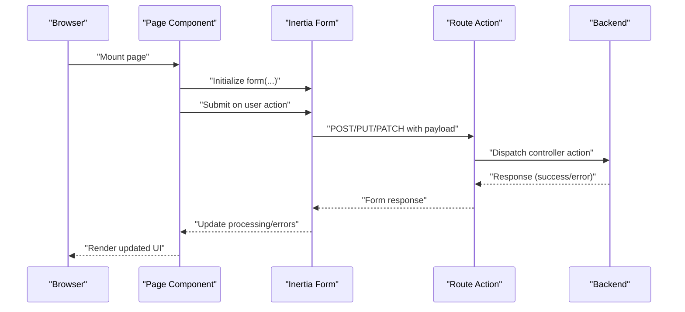

**Diagram sources**
- [login.tsx:33-111](file://resources/js/pages/auth/login.tsx#L33-L111)
- [register.tsx:20-112](file://resources/js/pages/auth/register.tsx#L20-L112)
- [profile.tsx:48-133](file://resources/js/pages/settings/profile.tsx#L48-L133)
- [security.tsx:41-127](file://resources/js/pages/settings/security.tsx#L41-L127)

## Detailed Component Analysis

### Authentication Pages

#### Login Page
- Purpose: Authenticate users with email/password, optional remember, and password reset link
- Features:
  - Inertia Form with resetOnSuccess for password field
  - Optional passkey verification component
  - Status banner for successful actions
  - Conditional registration link
- Lifecycle:
  - Mount → initialize form → submit on button click → process server response → show errors or redirect
- Error handling:
  - Uses InputError for field-level messages
  - Disabled submit while processing
- Route-to-page mapping:
  - Form bound to login store action
  - Password reset link mapped to password request route
  - Registration link mapped to register route

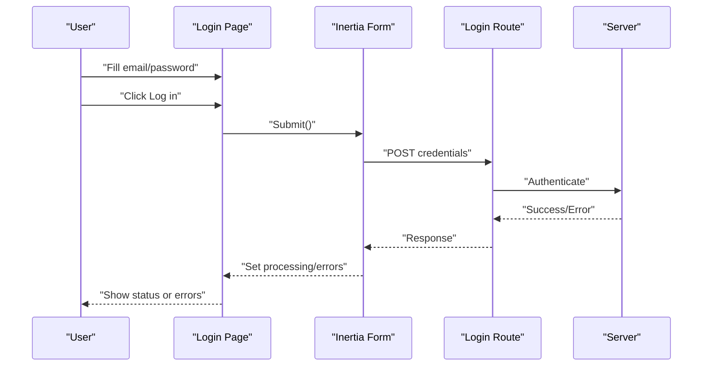

**Diagram sources**
- [login.tsx:33-111](file://resources/js/pages/auth/login.tsx#L33-L111)

**Section sources**
- [login.tsx:1-126](file://resources/js/pages/auth/login.tsx#L1-L126)

#### Registration Page
- Purpose: Create new user accounts with name, email, and password confirmation
- Features:
  - Inertia Form with disableWhileProcessing and resetOnSuccess for password fields
  - Password rules passed to password input
  - Redirect to login after registration
- Lifecycle:
  - Mount → initialize form → submit → server validation → success banner → redirect
- Error handling:
  - Field-level InputError for name, email, password, and confirmation
- Route-to-page mapping:
  - Form bound to register store action
  - Redirect to login route

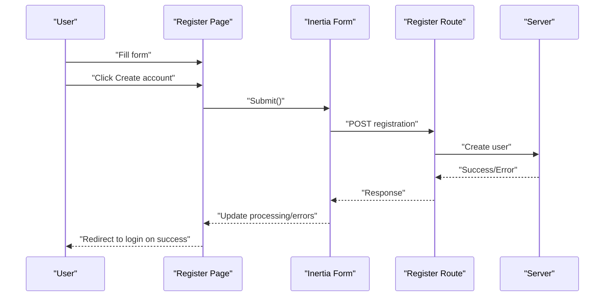

**Diagram sources**
- [register.tsx:20-112](file://resources/js/pages/auth/register.tsx#L20-L112)

**Section sources**
- [register.tsx:1-121](file://resources/js/pages/auth/register.tsx#L1-L121)

#### Forgot Password Page
- Purpose: Request a password reset link via email
- Features:
  - Inertia Form bound to email route
  - Status banner for success feedback
  - Back to login link
- Lifecycle:
  - Mount → submit email → server sends reset link → show status
- Error handling:
  - InputError for email field
- Route-to-page mapping:
  - Form bound to password email route
  - Back to login route

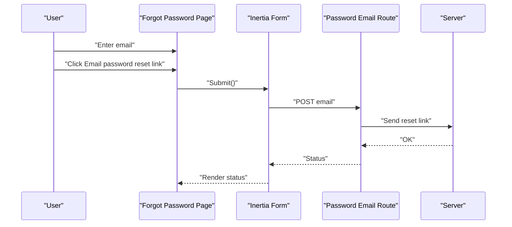

**Diagram sources**
- [forgot-password.tsx:24-55](file://resources/js/pages/auth/forgot-password.tsx#L24-L55)

**Section sources**
- [forgot-password.tsx:1-70](file://resources/js/pages/auth/forgot-password.tsx#L1-L70)

#### Reset Password Page
- Purpose: Allow users to set a new password using token and email
- Features:
  - Inertia Form with transform to inject token and email
  - Reset on success for password fields
  - Password rules passed to inputs
- Lifecycle:
  - Mount with token/email → submit new password → server updates → success
- Error handling:
  - InputError for email, password, and confirmation
- Route-to-page mapping:
  - Form bound to password update route
  - Pre-filled email and token via transform

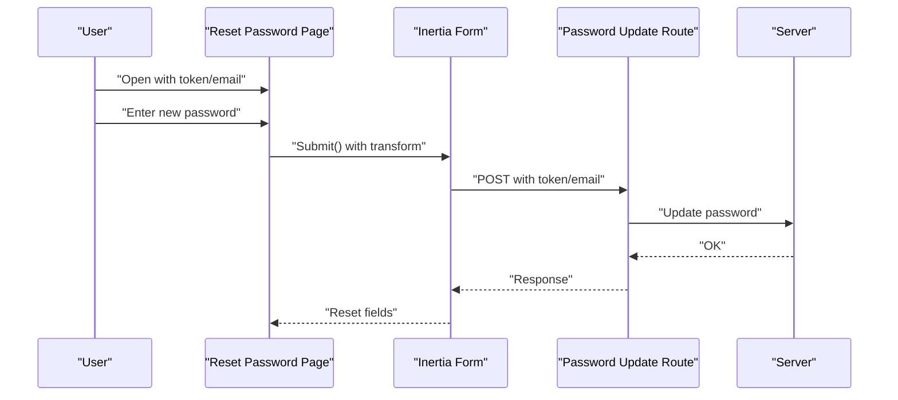

**Diagram sources**
- [reset-password.tsx:21-88](file://resources/js/pages/auth/reset-password.tsx#L21-L88)

**Section sources**
- [reset-password.tsx:1-97](file://resources/js/pages/auth/reset-password.tsx#L1-L97)

### Settings Pages

#### Profile Settings Page
- Purpose: Update user name and email; optionally resend email verification
- Features:
  - Inertia Form bound to profile controller update action
  - preserveScroll option to maintain scroll position
  - Conditional email verification UI and status banner
  - Delete user component included
- Lifecycle:
  - Mount → load defaults from auth → submit → server update → success banner
- Error handling:
  - InputError for name and email
- Route-to-page mapping:
  - Form bound to profile edit route
  - Verification send route for resending emails

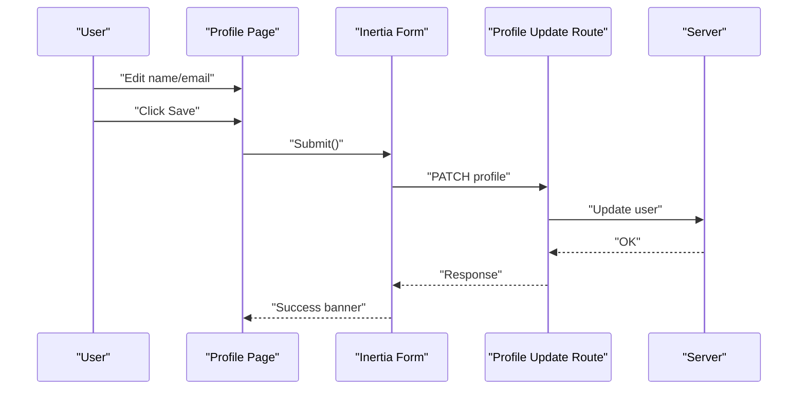

**Diagram sources**
- [profile.tsx:48-133](file://resources/js/pages/settings/profile.tsx#L48-L133)

**Section sources**
- [profile.tsx:1-149](file://resources/js/pages/settings/profile.tsx#L1-L149)

#### Security Settings Page
- Purpose: Change password and manage additional security features
- Features:
  - Inertia Form bound to security controller update action
  - resetOnError for password fields and current password
  - Focus management on validation errors
  - Optional two-factor and passkey management components
- Lifecycle:
  - Mount → submit current/new passwords → server validates current → update → success
- Error handling:
  - InputError for current password, new password, and confirmation
- Route-to-page mapping:
  - Form bound to security edit route
  - Optional 2FA and passkeys managed via dedicated components

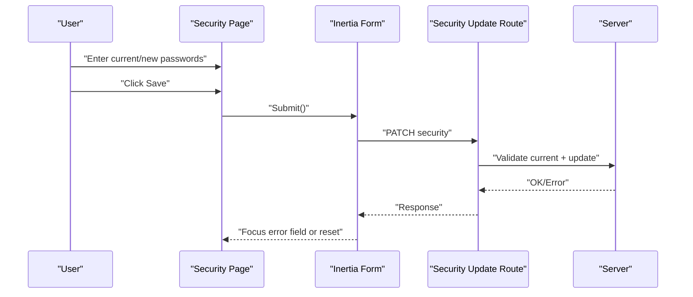

**Diagram sources**
- [security.tsx:41-127](file://resources/js/pages/settings/security.tsx#L41-L127)

**Section sources**
- [security.tsx:1-156](file://resources/js/pages/settings/security.tsx#L1-L156)

#### Appearance Settings Page
- Purpose: Adjust appearance preferences
- Features:
  - Simple page with heading and appearance tabs
- Route-to-page mapping:
  - Breadcrumbs mapped to appearance edit route

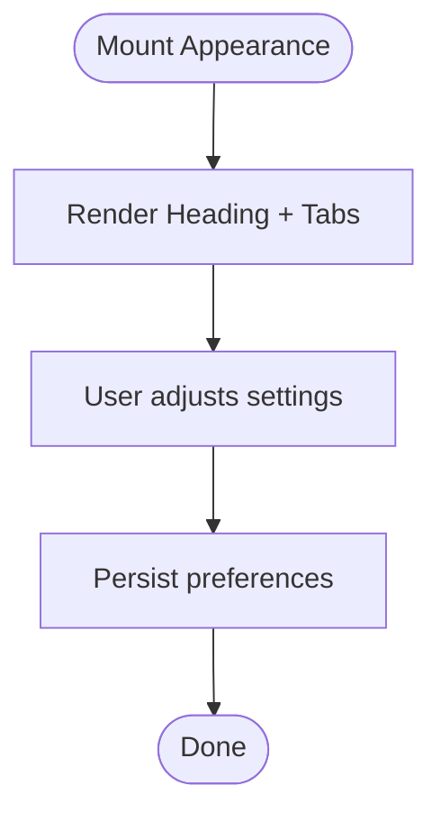

**Diagram sources**
- [appearance.tsx:6-22](file://resources/js/pages/settings/appearance.tsx#L6-L22)

**Section sources**
- [appearance.tsx:1-33](file://resources/js/pages/settings/appearance.tsx#L1-L33)

### Application Pages

#### Dashboard Page
- Purpose: Main application dashboard surface
- Features:
  - Uses layout metadata to define breadcrumbs
  - Placeholder pattern components for grid areas
- Route-to-page mapping:
  - Breadcrumbs mapped to dashboard route

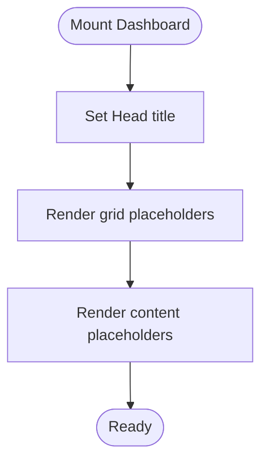

**Diagram sources**
- [dashboard.tsx:5-37](file://resources/js/pages/dashboard.tsx#L5-L37)

**Section sources**
- [dashboard.tsx:1-37](file://resources/js/pages/dashboard.tsx#L1-L37)

#### Welcome Page
- Purpose: Marketing/home page with landing components
- Features:
  - Uses hooks for scroll reveal and stats counter
  - Renders multiple landing sections
  - Conditional navigation links based on auth state
- Route-to-page mapping:
  - Links to dashboard and login depending on auth

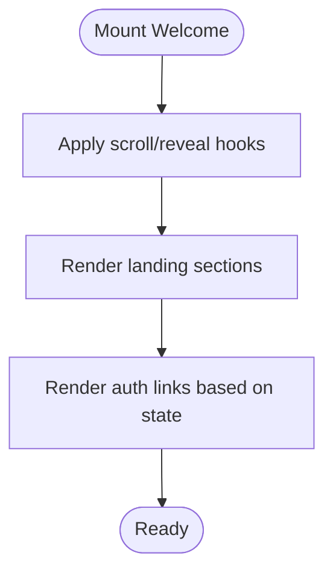

**Diagram sources**
- [welcome.tsx:16-43](file://resources/js/pages/welcome.tsx#L16-L43)

**Section sources**
- [welcome.tsx:1-437](file://resources/js/pages/welcome.tsx#L1-L437)

### Layouts and Navigation

#### Authentication Layouts
- Card layout: centered card with title/description and children
- Simple layout: minimal centered content with title/description and children

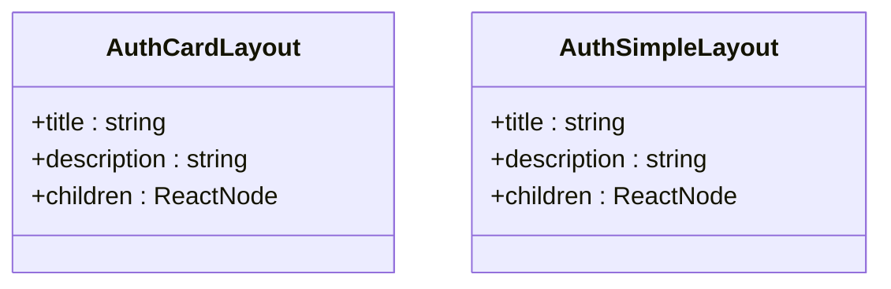

**Diagram sources**
- [auth-card-layout.tsx:13-48](file://resources/js/layouts/auth/auth-card-layout.tsx#L13-L48)
- [auth-simple-layout.tsx:6-38](file://resources/js/layouts/auth/auth-simple-layout.tsx#L6-L38)

**Section sources**
- [auth-card-layout.tsx:1-49](file://resources/js/layouts/auth/auth-card-layout.tsx#L1-L49)
- [auth-simple-layout.tsx:1-39](file://resources/js/layouts/auth/auth-simple-layout.tsx#L1-L39)

#### Application Layout
- App sidebar layout composes AppShell and AppContent, rendering breadcrumbs in AppSidebarHeader
- AppShell manages sidebar open state from props
- AppContent switches between sidebar and header variants

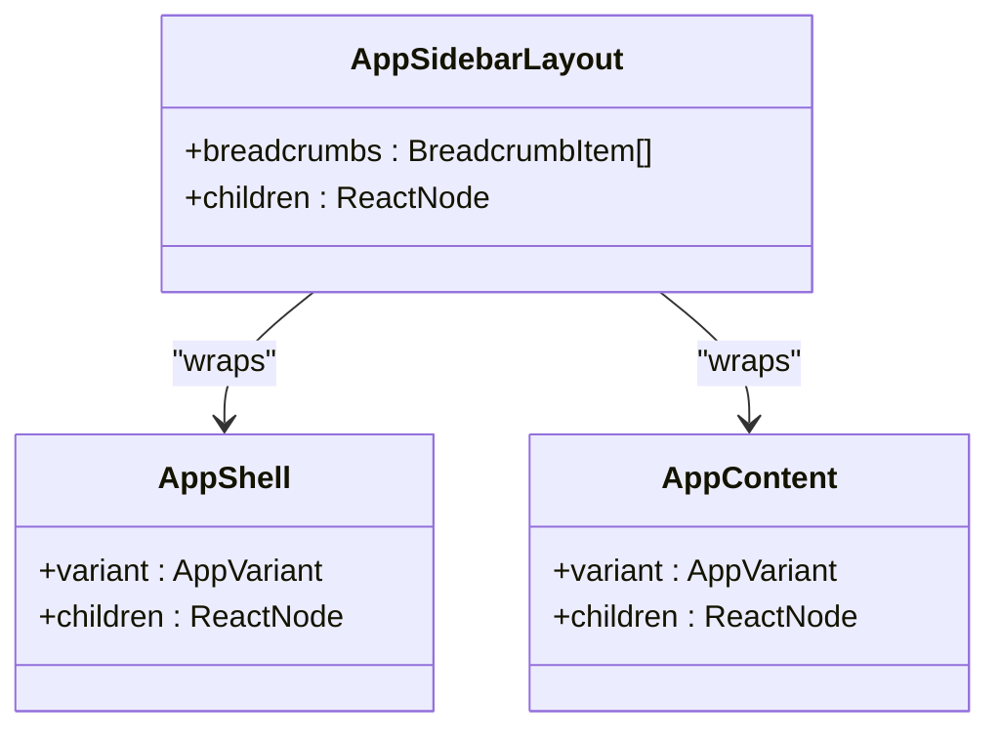

**Diagram sources**
- [app-shell.tsx:11-21](file://resources/js/components/app-shell.tsx#L11-L21)
- [app-content.tsx:9-22](file://resources/js/components/app-content.tsx#L9-L22)
- [app-sidebar-layout.tsx:7-20](file://resources/js/layouts/app/app-sidebar-layout.tsx#L7-L20)

**Section sources**
- [app-sidebar-layout.tsx:1-21](file://resources/js/layouts/app/app-sidebar-layout.tsx#L1-L21)
- [app-shell.tsx:1-22](file://resources/js/components/app-shell.tsx#L1-L22)
- [app-content.tsx:1-23](file://resources/js/components/app-content.tsx#L1-L23)
- [navigation.ts:4-14](file://resources/js/types/navigation.ts#L4-L14)

## Dependency Analysis
- Pages depend on:
  - Inertia Form for data binding and submission
  - Route helpers for navigation and form binding
  - UI components (Button, Input, Label, PasswordInput, Spinner)
  - Layouts for consistent presentation
- Layouts depend on:
  - AppShell and AppContent for structural composition
  - Breadcrumb types for navigation metadata
- No circular dependencies observed among pages and layouts

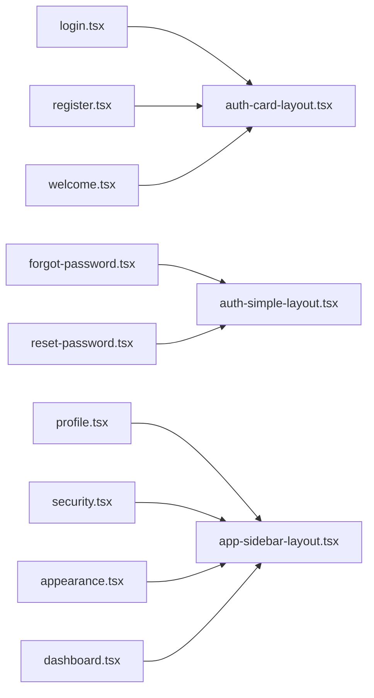

**Diagram sources**
- [login.tsx:1-126](file://resources/js/pages/auth/login.tsx#L1-L126)
- [register.tsx:1-121](file://resources/js/pages/auth/register.tsx#L1-L121)
- [forgot-password.tsx:1-70](file://resources/js/pages/auth/forgot-password.tsx#L1-L70)
- [reset-password.tsx:1-97](file://resources/js/pages/auth/reset-password.tsx#L1-L97)
- [profile.tsx:1-149](file://resources/js/pages/settings/profile.tsx#L1-L149)
- [security.tsx:1-156](file://resources/js/pages/settings/security.tsx#L1-L156)
- [appearance.tsx:1-33](file://resources/js/pages/settings/appearance.tsx#L1-L33)
- [dashboard.tsx:1-37](file://resources/js/pages/dashboard.tsx#L1-L37)
- [welcome.tsx:1-437](file://resources/js/pages/welcome.tsx#L1-L437)
- [auth-card-layout.tsx:1-49](file://resources/js/layouts/auth/auth-card-layout.tsx#L1-L49)
- [auth-simple-layout.tsx:1-39](file://resources/js/layouts/auth/auth-simple-layout.tsx#L1-L39)
- [app-sidebar-layout.tsx:1-21](file://resources/js/layouts/app/app-sidebar-layout.tsx#L1-L21)

**Section sources**
- [login.tsx:1-126](file://resources/js/pages/auth/login.tsx#L1-L126)
- [register.tsx:1-121](file://resources/js/pages/auth/register.tsx#L1-L121)
- [forgot-password.tsx:1-70](file://resources/js/pages/auth/forgot-password.tsx#L1-L70)
- [reset-password.tsx:1-97](file://resources/js/pages/auth/reset-password.tsx#L1-L97)
- [profile.tsx:1-149](file://resources/js/pages/settings/profile.tsx#L1-L149)
- [security.tsx:1-156](file://resources/js/pages/settings/security.tsx#L1-L156)
- [appearance.tsx:1-33](file://resources/js/pages/settings/appearance.tsx#L1-L33)
- [dashboard.tsx:1-37](file://resources/js/pages/dashboard.tsx#L1-L37)
- [welcome.tsx:1-437](file://resources/js/pages/welcome.tsx#L1-L437)
- [auth-card-layout.tsx:1-49](file://resources/js/layouts/auth/auth-card-layout.tsx#L1-L49)
- [auth-simple-layout.tsx:1-39](file://resources/js/layouts/auth/auth-simple-layout.tsx#L1-L39)
- [app-sidebar-layout.tsx:1-21](file://resources/js/layouts/app/app-sidebar-layout.tsx#L1-L21)

## Performance Considerations
- Prefer disableWhileProcessing on forms to prevent duplicate submissions
- Use resetOnSuccess to minimize revalidation churn after successful submits
- preserveScroll in forms reduces layout shifts during updates
- Keep layout wrappers lightweight; avoid heavy computations in AppShell/AppContent
- Lazy-load non-critical sections on the welcome page to improve initial render

## Troubleshooting Guide
Common issues and resolutions:
- Form not submitting:
  - Verify form binding matches route action and method
  - Ensure processing flag disables submit button
- Validation errors not visible:
  - Confirm InputError receives error messages from form.errors
  - Check that resetOnSuccess/resetOnError clears sensitive fields appropriately
- Layout not rendering breadcrumbs:
  - Ensure page layout metadata includes breadcrumbs array with proper href/title
- Redirect loops after login/register:
  - Confirm auth guards and middleware behavior align with route bindings
- Password reset not working:
  - Validate token/email transform and route handler correctness

**Section sources**
- [login.tsx:38-98](file://resources/js/pages/auth/login.tsx#L38-L98)
- [register.tsx:22-101](file://resources/js/pages/auth/register.tsx#L22-L101)
- [profile.tsx:50-130](file://resources/js/pages/settings/profile.tsx#L50-L130)
- [security.tsx:46-124](file://resources/js/pages/settings/security.tsx#L46-L124)
- [app-sidebar-layout.tsx:9-16](file://resources/js/layouts/app/app-sidebar-layout.tsx#L9-L16)

## Conclusion
The page components follow a consistent pattern: Inertia forms for data operations, layout wrappers for structure and navigation, and robust error handling. Authentication and settings pages demonstrate clear separation of concerns, while the application layout ensures cohesive navigation and breadcrumbs. Adhering to the documented patterns will help maintain reliability and usability across the application.