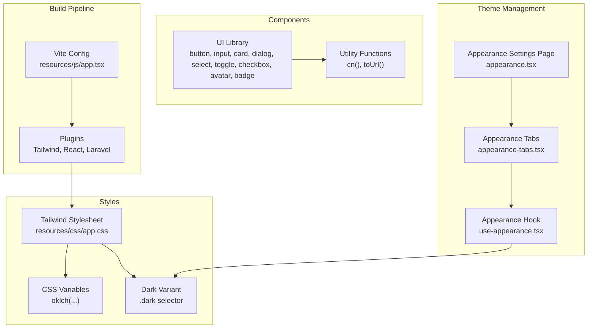
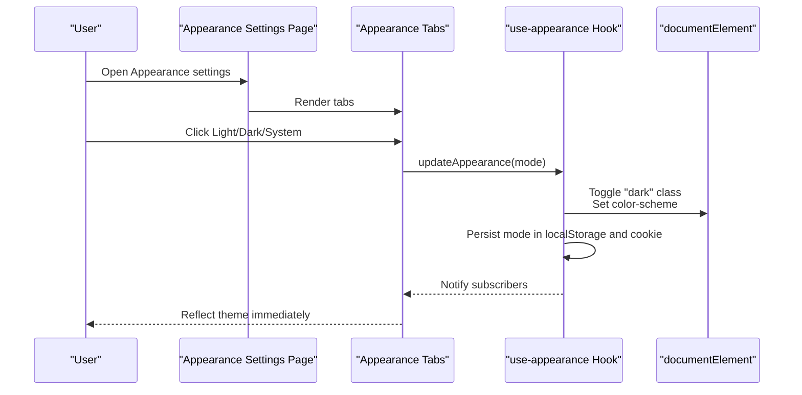
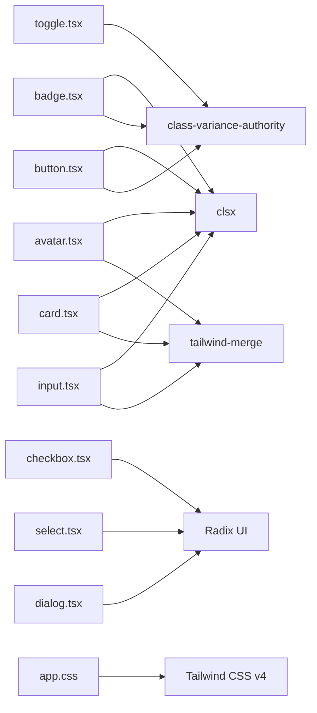

# Styling & Theming

<cite>
**Referenced Files in This Document**
- [app.css](file://resources/css/app.css)
- [utils.ts](file://resources/js/lib/utils.ts)
- [use-appearance.tsx](file://resources/js/hooks/use-appearance.tsx)
- [package.json](file://package.json)
- [vite.config.ts](file://vite.config.ts)
- [button.tsx](file://resources/js/components/ui/button.tsx)
- [input.tsx](file://resources/js/components/ui/input.tsx)
- [card.tsx](file://resources/js/components/ui/card.tsx)
- [dialog.tsx](file://resources/js/components/ui/dialog.tsx)
- [select.tsx](file://resources/js/components/ui/select.tsx)
- [toggle.tsx](file://resources/js/components/ui/toggle.tsx)
- [checkbox.tsx](file://resources/js/components/ui/checkbox.tsx)
- [avatar.tsx](file://resources/js/components/ui/avatar.tsx)
- [badge.tsx](file://resources/js/components/ui/badge.tsx)
- [appearance.tsx](file://resources/js/pages/settings/appearance.tsx)
- [appearance-tabs.tsx](file://resources/js/components/appearance-tabs.tsx)
- [components.json](file://components.json)
</cite>

## Table of Contents
1. [Introduction](#introduction)
2. [Project Structure](#project-structure)
3. [Core Components](#core-components)
4. [Architecture Overview](#architecture-overview)
5. [Detailed Component Analysis](#detailed-component-analysis)
6. [Dependency Analysis](#dependency-analysis)
7. [Performance Considerations](#performance-considerations)
8. [Troubleshooting Guide](#troubleshooting-guide)
9. [Conclusion](#conclusion)
10. [Appendices](#appendices)

## Introduction
This document explains the styling and theming architecture of the SmartExam web application. It covers Tailwind CSS integration, utility-first styling patterns, component styling conventions, responsive design, dark/light mode switching, theme variables, and best practices. It also documents how Radix UI components are styled consistently and how to maintain and extend the styling system effectively.

## Project Structure
The styling system is organized around:
- Tailwind CSS v4 configuration and theme variables in a single stylesheet
- Utility-first component libraries built with class-variance-authority and Radix UI primitives
- A centralized appearance hook for theme switching with persistence
- Vite plugin pipeline integrating Tailwind, React, and Laravel Vite

**Diagram sources**
- [vite.config.ts:1-32](file://vite.config.ts#L1-L32)
- [app.css:1-358](file://resources/css/app.css#L1-L358)
- [button.tsx:1-59](file://resources/js/components/ui/button.tsx#L1-L59)
- [input.tsx:1-22](file://resources/js/components/ui/input.tsx#L1-L22)
- [card.tsx:1-69](file://resources/js/components/ui/card.tsx#L1-L69)
- [dialog.tsx:1-134](file://resources/js/components/ui/dialog.tsx#L1-L134)
- [select.tsx:1-194](file://resources/js/components/ui/select.tsx#L1-L194)
- [toggle.tsx:1-46](file://resources/js/components/ui/toggle.tsx#L1-L46)
- [checkbox.tsx:1-31](file://resources/js/components/ui/checkbox.tsx#L1-L31)
- [avatar.tsx:1-52](file://resources/js/components/ui/avatar.tsx#L1-L52)
- [badge.tsx:1-47](file://resources/js/components/ui/badge.tsx#L1-L47)
- [utils.ts:1-13](file://resources/js/lib/utils.ts#L1-L13)
- [use-appearance.tsx:1-116](file://resources/js/hooks/use-appearance.tsx#L1-L116)
- [appearance-tabs.tsx:1-46](file://resources/js/components/appearance-tabs.tsx#L1-L46)
- [appearance.tsx:1-33](file://resources/js/pages/settings/appearance.tsx#L1-L33)

**Section sources**
- [vite.config.ts:1-32](file://vite.config.ts#L1-L32)
- [app.css:1-358](file://resources/css/app.css#L1-L358)
- [components.json:1-22](file://components.json#L1-L22)

## Core Components
- Tailwind CSS v4 with CSS variables for theme tokens and a custom dark variant
- Utility-first UI library built with class-variance-authority and Radix UI
- Appearance management hook with system preference detection, persistence, and SSR cookie support
- Centralized utility functions for merging classes safely

Key capabilities:
- Theme tokens mapped to oklch color spaces for perceptually uniform lightness and chroma
- Responsive and accessible base styles applied via Tailwind utilities
- Consistent component variants and sizes across UI primitives
- Seamless dark mode toggling with persisted user preference

**Section sources**
- [app.css:1-144](file://resources/css/app.css#L1-L144)
- [use-appearance.tsx:1-116](file://resources/js/hooks/use-appearance.tsx#L1-L116)
- [utils.ts:1-13](file://resources/js/lib/utils.ts#L1-L13)

## Architecture Overview
The styling architecture follows a layered approach:
- Build pipeline integrates Tailwind, React, and Laravel Vite
- Base CSS defines theme variables and dark variant selectors
- UI components consume theme tokens and expose consistent variants/sizes
- Appearance hook toggles the root element’s dark class and color-scheme

**Diagram sources**
- [appearance.tsx:1-33](file://resources/js/pages/settings/appearance.tsx#L1-L33)
- [appearance-tabs.tsx:1-46](file://resources/js/components/appearance-tabs.tsx#L1-L46)
- [use-appearance.tsx:1-116](file://resources/js/hooks/use-appearance.tsx#L1-L116)

## Detailed Component Analysis

### Tailwind CSS Integration and Theme Tokens
- Tailwind is configured via Vite and Laravel Vite Plugin
- Theme variables are defined in CSS using oklch color space for consistent lightness/chroma
- A custom dark variant targets descendants under the .dark class
- Base layer applies border and text colors globally

Implementation highlights:
- Theme variable mapping for backgrounds, foregrounds, cards, popovers, primary/secondary/accent, borders, inputs, rings, and chart colors
- Root and .dark blocks define light and dark palettes
- Base layer sets border and text colors across the app

Best practices:
- Prefer theme variables over hardcoded values
- Use oklch for perceptual color consistency
- Keep radius tokens aligned with component border radii

**Section sources**
- [app.css:1-144](file://resources/css/app.css#L1-L144)
- [vite.config.ts:1-32](file://vite.config.ts#L1-L32)
- [package.json:48-66](file://package.json#L48-L66)

### Utility Functions and Class Merging
- cn() merges and deduplicates class names using clsx and tailwind-merge
- toUrl() normalizes Inertia link props to a string URL

Usage:
- Apply cn() to combine default, variant, size, and custom classes in components
- Use toUrl() when passing URLs to routing helpers

**Section sources**
- [utils.ts:1-13](file://resources/js/lib/utils.ts#L1-L13)

### Button Component
- Uses class-variance-authority to define variants (default, destructive, outline, secondary, ghost, link) and sizes (default, sm, lg, icon)
- Integrates focus-visible ring, shadow, and aria-invalid states
- Supports asChild via Radix UI Slot

Styling patterns:
- Consistent spacing, typography, and transitions across variants
- Focus-visible ring uses theme ring color with alpha blending
- SVG sizing handled uniformly

**Section sources**
- [button.tsx:1-59](file://resources/js/components/ui/button.tsx#L1-L59)

### Input Component
- Applies border, background, placeholder, selection, focus-visible ring, and disabled states
- Uses theme tokens for colors and transitions
- Handles aria-invalid states with destructive ring/opacity

Responsive behavior:
- Base text size with medium breakpoint adjustments

**Section sources**
- [input.tsx:1-22](file://resources/js/components/ui/input.tsx#L1-L22)

### Card Component Family
- Card, CardHeader, CardTitle, CardDescription, CardContent, CardFooter
- Uses theme tokens for background, foreground, border, and shadow
- Maintains consistent padding and spacing across sections

**Section sources**
- [card.tsx:1-69](file://resources/js/components/ui/card.tsx#L1-L69)

### Dialog Component
- Wraps Radix UI Dialog with Tailwind-styled Overlay, Content, Header/Footer, Title/Description
- Uses theme background and popover tokens
- Implements portal rendering and animations

Accessibility:
- Close button with proper focus styles and screen-reader label

**Section sources**
- [dialog.tsx:1-134](file://resources/js/components/ui/dialog.tsx#L1-L134)

### Select Component
- Root, Trigger, Content, Viewport, Item, Label, Separator, ScrollUp/Down Buttons
- Trigger supports size variants and invalid states
- Content uses theme popover tokens and slide/fade animations
- Items integrate indicators and icons

**Section sources**
- [select.tsx:1-194](file://resources/js/components/ui/select.tsx#L1-L194)

### Toggle Component
- Uses class-variance-authority for default and outline variants
- Inherits focus-visible ring and aria-invalid states
- Supports size variants

**Section sources**
- [toggle.tsx:1-46](file://resources/js/components/ui/toggle.tsx#L1-L46)

### Checkbox Component
- Integrates Radix UI Checkbox with theme-aware checked state and focus-visible ring
- Ensures proper indicator sizing and alignment

**Section sources**
- [checkbox.tsx:1-31](file://resources/js/components/ui/checkbox.tsx#L1-L31)

### Avatar Component
- Provides container, image, and fallback slots with theme-aware background
- Ensures aspect-ratio and overflow handling

**Section sources**
- [avatar.tsx:1-52](file://resources/js/components/ui/avatar.tsx#L1-L52)

### Badge Component
- Variants include default, secondary, destructive, and outline
- Supports asChild for semantic wrapping
- Integrates focus-visible ring and transitions

**Section sources**
- [badge.tsx:1-47](file://resources/js/components/ui/badge.tsx#L1-L47)

### Dark/Light Mode Switching
- Appearance hook manages system preference detection and persistence
- Toggles .dark class on documentElement and sets color-scheme
- Tabs component renders Light/Dark/System options and updates the mode

Flow:
- Initialize theme on load, detect system preference if unset
- On user action, persist mode in localStorage and cookie
- Apply theme immediately and notify subscribers

**Section sources**
- [use-appearance.tsx:1-116](file://resources/js/hooks/use-appearance.tsx#L1-L116)
- [appearance-tabs.tsx:1-46](file://resources/js/components/appearance-tabs.tsx#L1-L46)
- [appearance.tsx:1-33](file://resources/js/pages/settings/appearance.tsx#L1-L33)

### Responsive Design Implementation
- Tailwind utilities drive responsive breakpoints and spacing
- Components define base styles with medium breakpoint adjustments where appropriate
- Layouts and pages leverage responsive utilities for consistent scaling

Guidelines:
- Use responsive prefixes (md:, sm:, lg:) for typography, padding, and margins
- Prefer fluid spacing tokens derived from theme variables

**Section sources**
- [input.tsx:1-22](file://resources/js/components/ui/input.tsx#L1-L22)
- [button.tsx:1-59](file://resources/js/components/ui/button.tsx#L1-L59)

### CSS Customization and Radix UI Integration
- Components wrap Radix UI primitives and apply Tailwind classes
- Focus-visible ring and transitions are standardized
- Invalid states use destructive palette with alpha blending for accessibility

Patterns:
- Use data-slot attributes for testability and scoped styling
- Prefer theme tokens for colors, shadows, and borders
- Ensure consistent icon sizing and pointer events handling

**Section sources**
- [dialog.tsx:1-134](file://resources/js/components/ui/dialog.tsx#L1-L134)
- [select.tsx:1-194](file://resources/js/components/ui/select.tsx#L1-L194)
- [button.tsx:1-59](file://resources/js/components/ui/button.tsx#L1-L59)

## Dependency Analysis
The styling system relies on:
- Tailwind CSS v4 for utility generation and theme variable resolution
- class-variance-authority for component variants
- Radix UI for accessible component primitives
- clsx and tailwind-merge for safe class composition
- Vite plugins for build-time integration

**Diagram sources**
- [button.tsx:1-59](file://resources/js/components/ui/button.tsx#L1-L59)
- [input.tsx:1-22](file://resources/js/components/ui/input.tsx#L1-L22)
- [card.tsx:1-69](file://resources/js/components/ui/card.tsx#L1-L69)
- [dialog.tsx:1-134](file://resources/js/components/ui/dialog.tsx#L1-L134)
- [select.tsx:1-194](file://resources/js/components/ui/select.tsx#L1-L194)
- [toggle.tsx:1-46](file://resources/js/components/ui/toggle.tsx#L1-L46)
- [checkbox.tsx:1-31](file://resources/js/components/ui/checkbox.tsx#L1-L31)
- [avatar.tsx:1-52](file://resources/js/components/ui/avatar.tsx#L1-L52)
- [badge.tsx:1-47](file://resources/js/components/ui/badge.tsx#L1-L47)
- [utils.ts:1-13](file://resources/js/lib/utils.ts#L1-L13)
- [app.css:1-358](file://resources/css/app.css#L1-L358)

**Section sources**
- [package.json:31-66](file://package.json#L31-L66)
- [components.json:1-22](file://components.json#L1-L22)

## Performance Considerations
- Minimize custom CSS bloat by leveraging Tailwind utilities and theme variables
- Use class-variance-authority variants to reduce conditional class logic
- Avoid excessive nesting; prefer flat component composition with data-slot attributes
- Keep animations subtle and hardware-accelerated where possible
- Consolidate repeated styles into shared variants and tokens

## Troubleshooting Guide
Common issues and resolutions:
- Theme not applying on initial load
  - Ensure initialization of the appearance hook during hydration
  - Verify .dark class is toggled on documentElement
  - Confirm color-scheme is set appropriately

- Conflicting classes overriding styles
  - Use cn() to merge classes; it deduplicates and prioritizes later values
  - Avoid inline !important overrides; adjust theme variables or component variants instead

- Radix UI focus rings not visible
  - Ensure focus-visible ring classes are present and use theme ring color
  - Check that focus ring alpha values are sufficient for contrast

- Dark mode not persisting across sessions
  - Confirm localStorage and cookie writes succeed
  - Verify server-side rendering respects stored appearance

- Responsive styles not taking effect
  - Validate Tailwind breakpoints and responsive prefixes
  - Ensure viewport meta tag is configured in the application layout

**Section sources**
- [use-appearance.tsx:73-88](file://resources/js/hooks/use-appearance.tsx#L73-L88)
- [utils.ts:6-8](file://resources/js/lib/utils.ts#L6-L8)

## Conclusion
The SmartExam styling and theming system leverages Tailwind CSS v4, CSS variables, and a utility-first component library to deliver a consistent, accessible, and maintainable design system. Radix UI primitives ensure robust accessibility, while the appearance hook provides seamless light/dark mode switching with persistence. By adhering to the documented patterns and best practices, teams can extend the system reliably and scale component styling across the application.

## Appendices

### Theme Variables Reference
- Background and Foreground tokens for surfaces and text
- Primary, Secondary, Muted, Accent, Destructive palettes
- Border, Input, Ring, and Chart color tokens
- Sidebar-specific tokens for navigation surfaces
- Radius tokens for consistent corner radii

**Section sources**
- [app.css:9-63](file://resources/css/app.css#L9-L63)

### Component Styling Conventions
- Use theme tokens for colors, shadows, and borders
- Standardize focus-visible rings with ring color and alpha
- Support aria-invalid states with destructive palette
- Provide consistent padding and typography scales
- Wrap Radix UI roots with Tailwind classes and data-slot attributes

**Section sources**
- [button.tsx:7-35](file://resources/js/components/ui/button.tsx#L7-L35)
- [input.tsx:5-18](file://resources/js/components/ui/input.tsx#L5-L18)
- [dialog.tsx:31-71](file://resources/js/components/ui/dialog.tsx#L31-L71)
- [select.tsx:25-91](file://resources/js/components/ui/select.tsx#L25-L91)
- [toggle.tsx:7-27](file://resources/js/components/ui/toggle.tsx#L7-L27)
- [checkbox.tsx:7-28](file://resources/js/components/ui/checkbox.tsx#L7-L28)
- [avatar.tsx:6-49](file://resources/js/components/ui/avatar.tsx#L6-L49)
- [badge.tsx:7-26](file://resources/js/components/ui/badge.tsx#L7-L26)