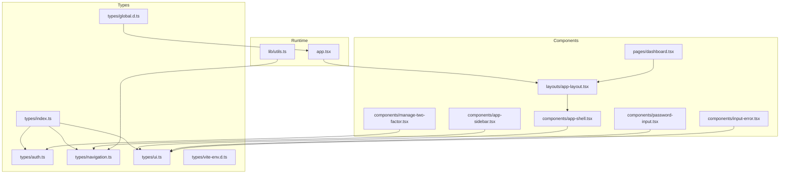
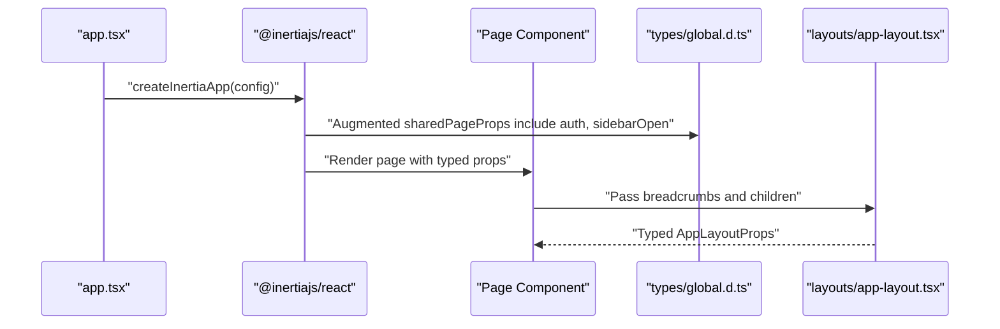
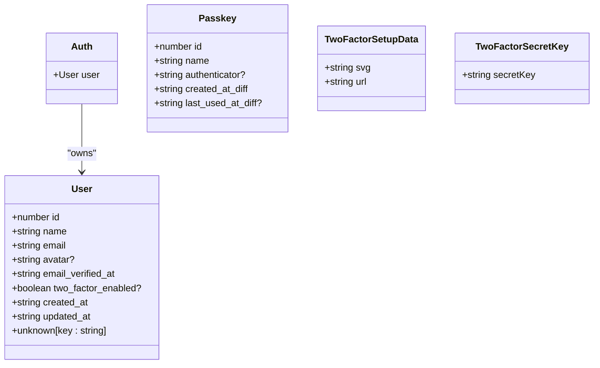
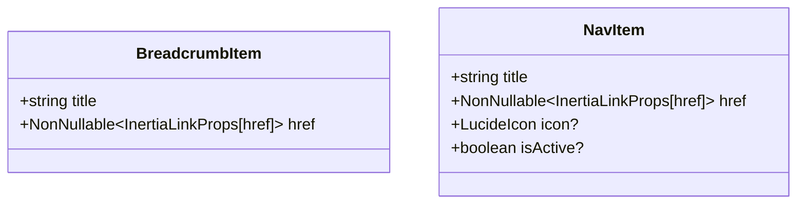
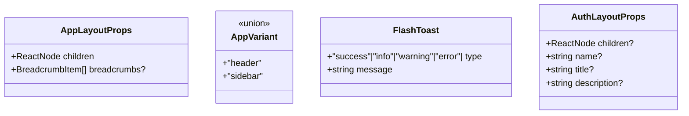
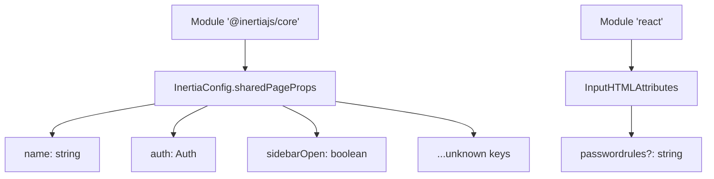
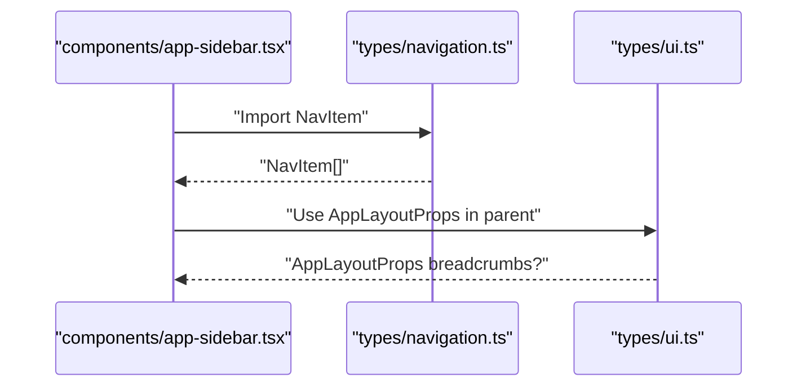
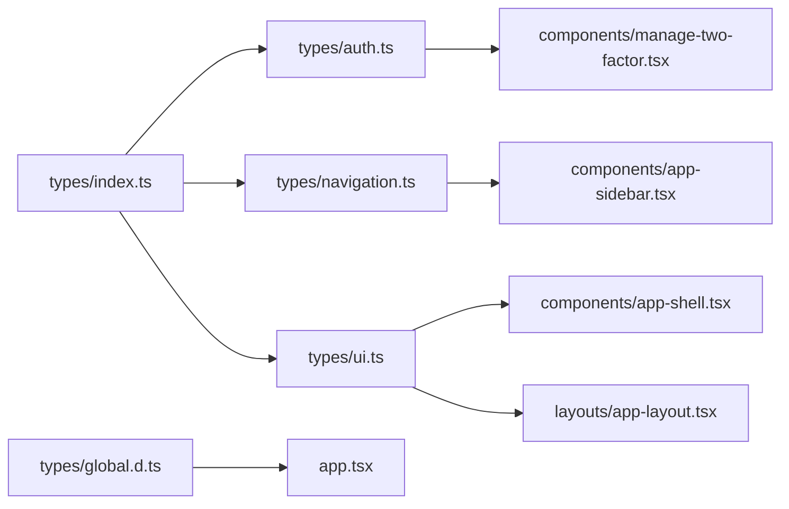

# Type System

<cite>
**Referenced Files in This Document**
- [resources/js/types/index.ts](file://resources/js/types/index.ts)
- [resources/js/types/auth.ts](file://resources/js/types/auth.ts)
- [resources/js/types/navigation.ts](file://resources/js/types/navigation.ts)
- [resources/js/types/ui.ts](file://resources/js/types/ui.ts)
- [resources/js/types/global.d.ts](file://resources/js/types/global.d.ts)
- [resources/js/types/vite-env.d.ts](file://resources/js/types/vite-env.d.ts)
- [resources/js/app.tsx](file://resources/js/app.tsx)
- [resources/js/lib/utils.ts](file://resources/js/lib/utils.ts)
- [resources/js/components/app-shell.tsx](file://resources/js/components/app-shell.tsx)
- [resources/js/components/app-sidebar.tsx](file://resources/js/components/app-sidebar.tsx)
- [resources/js/layouts/app-layout.tsx](file://resources/js/layouts/app-layout.tsx)
- [resources/js/pages/dashboard.tsx](file://resources/js/pages/dashboard.tsx)
- [resources/js/hooks/use-appearance.tsx](file://resources/js/hooks/use-appearance.tsx)
- [resources/js/components/password-input.tsx](file://resources/js/components/password-input.tsx)
- [resources/js/components/input-error.tsx](file://resources/js/components/input-error.tsx)
- [resources/js/components/manage-two-factor.tsx](file://resources/js/components/manage-two-factor.tsx)
</cite>

## Table of Contents
1. [Introduction](#introduction)
2. [Project Structure](#project-structure)
3. [Core Components](#core-components)
4. [Architecture Overview](#architecture-overview)
5. [Detailed Component Analysis](#detailed-component-analysis)
6. [Dependency Analysis](#dependency-analysis)
7. [Performance Considerations](#performance-considerations)
8. [Troubleshooting Guide](#troubleshooting-guide)
9. [Conclusion](#conclusion)

## Introduction
This document describes the TypeScript type system used across the frontend of the application. It covers shared type definitions, domain-specific types, and how they integrate with React components and Inertia-driven page rendering. It also explains the relationship between frontend types and backend-provided page props, and highlights type safety practices such as strict mode, module augmentation, and explicit prop typing.

## Project Structure
The type system is organized under a dedicated types folder and augmented via declaration files. A central index re-exports commonly used types for convenient imports across components and pages.

**Diagram sources**
- [resources/js/types/index.ts:1-4](file://resources/js/types/index.ts#L1-L4)
- [resources/js/types/auth.ts:1-39](file://resources/js/types/auth.ts#L1-L39)
- [resources/js/types/navigation.ts:1-15](file://resources/js/types/navigation.ts#L1-L15)
- [resources/js/types/ui.ts:1-22](file://resources/js/types/ui.ts#L1-L22)
- [resources/js/types/global.d.ts:1-20](file://resources/js/types/global.d.ts#L1-L20)
- [resources/js/types/vite-env.d.ts:1-2](file://resources/js/types/vite-env.d.ts#L1-L2)
- [resources/js/app.tsx:1-41](file://resources/js/app.tsx#L1-L41)
- [resources/js/lib/utils.ts:1-13](file://resources/js/lib/utils.ts#L1-L13)
- [resources/js/components/app-sidebar.tsx:1-66](file://resources/js/components/app-sidebar.tsx#L1-L66)
- [resources/js/components/app-shell.tsx:1-22](file://resources/js/components/app-shell.tsx#L1-L22)
- [resources/js/layouts/app-layout.tsx:1-17](file://resources/js/layouts/app-layout.tsx#L1-L17)
- [resources/js/pages/dashboard.tsx:1-37](file://resources/js/pages/dashboard.tsx#L1-L37)
- [resources/js/components/password-input.tsx:1-38](file://resources/js/components/password-input.tsx#L1-L38)
- [resources/js/components/input-error.tsx:1-18](file://resources/js/components/input-error.tsx#L1-L18)
- [resources/js/components/manage-two-factor.tsx:1-127](file://resources/js/components/manage-two-factor.tsx#L1-L127)

**Section sources**
- [resources/js/types/index.ts:1-4](file://resources/js/types/index.ts#L1-L4)
- [resources/js/types/auth.ts:1-39](file://resources/js/types/auth.ts#L1-L39)
- [resources/js/types/navigation.ts:1-15](file://resources/js/types/navigation.ts#L1-L15)
- [resources/js/types/ui.ts:1-22](file://resources/js/types/ui.ts#L1-L22)
- [resources/js/types/global.d.ts:1-20](file://resources/js/types/global.d.ts#L1-L20)
- [resources/js/types/vite-env.d.ts:1-2](file://resources/js/types/vite-env.d.ts#L1-L2)

## Core Components
This section documents the primary type categories and their roles in the system.

- Shared domain types
  - User: Describes authenticated user identity and metadata, including optional two-factor and passkey-related fields.
  - Auth: Wraps the authenticated user object for top-level access.
  - Passkey: Captures registered passkey attributes for device-based authentication.
  - TwoFactorSetupData and TwoFactorSecretKey: Support 2FA QR and secret key handling.

- Navigation and UI types
  - BreadcrumbItem: Defines breadcrumb entries with a title and a non-null Inertia link target.
  - NavItem: Represents navigable items with title, href, optional icon, and optional active state.
  - AppLayoutProps: Declares layout props including children and optional breadcrumbs.
  - AppVariant: Literal union for layout variants (header, sidebar).
  - FlashToast: Standardized toast notification shape with type and message.
  - AuthLayoutProps: Defines props for authentication layouts with optional branding content.

- Global augmentations
  - Module augmentation extends Inertia’s shared page props to include auth, sidebarOpen, and arbitrary keys.
  - Module augmentation adds a passwordrules attribute to input elements for validation hints.

- Utility types and helpers
  - In utils.ts, a helper converts Inertia link props to a URL string safely.

**Section sources**
- [resources/js/types/auth.ts:1-39](file://resources/js/types/auth.ts#L1-L39)
- [resources/js/types/navigation.ts:1-15](file://resources/js/types/navigation.ts#L1-L15)
- [resources/js/types/ui.ts:1-22](file://resources/js/types/ui.ts#L1-L22)
- [resources/js/types/global.d.ts:1-20](file://resources/js/types/global.d.ts#L1-L20)
- [resources/js/lib/utils.ts:10-12](file://resources/js/lib/utils.ts#L10-L12)

## Architecture Overview
The type system integrates with Inertia’s page rendering pipeline and React components. The application bootstrapper configures layouts per route and enables strict mode. Global declarations ensure page props carry typed auth and UI state. Components consume these types to maintain type-safe interactions.

**Diagram sources**
- [resources/js/app.tsx:11-37](file://resources/js/app.tsx#L11-L37)
- [resources/js/types/global.d.ts:10-19](file://resources/js/types/global.d.ts#L10-L19)
- [resources/js/layouts/app-layout.tsx:4-16](file://resources/js/layouts/app-layout.tsx#L4-L16)

## Detailed Component Analysis

### Domain Types: User, Auth, Passkey, Two-Factor
These types define the core domain model for authentication and security features.

**Diagram sources**
- [resources/js/types/auth.ts:1-39](file://resources/js/types/auth.ts#L1-L39)

**Section sources**
- [resources/js/types/auth.ts:1-39](file://resources/js/types/auth.ts#L1-L39)

### Navigation Types: BreadcrumbItem and NavItem
Navigation types standardize how menus and breadcrumbs are constructed and rendered.

**Diagram sources**
- [resources/js/types/navigation.ts:4-14](file://resources/js/types/navigation.ts#L4-L14)

**Section sources**
- [resources/js/types/navigation.ts:1-15](file://resources/js/types/navigation.ts#L1-L15)

### UI Types: Layouts, Variants, and Toasts
UI types encapsulate layout contracts and reusable UI primitives.

**Diagram sources**
- [resources/js/types/ui.ts:4-22](file://resources/js/types/ui.ts#L4-L22)

**Section sources**
- [resources/js/types/ui.ts:1-22](file://resources/js/types/ui.ts#L1-L22)

### Global Augmentations and Strict Mode
Global declarations ensure type safety across Inertia and React.

**Diagram sources**
- [resources/js/types/global.d.ts:10-19](file://resources/js/types/global.d.ts#L10-L19)
- [resources/js/types/global.d.ts:3-8](file://resources/js/types/global.d.ts#L3-L8)

**Section sources**
- [resources/js/types/global.d.ts:1-20](file://resources/js/types/global.d.ts#L1-L20)
- [resources/js/app.tsx:25-25](file://resources/js/app.tsx#L25-L25)

### Type Usage in Components and Pages
- App shell and layout
  - AppShell consumes AppVariant to choose layout behavior and reads sidebarOpen from page props.
  - AppLayout composes breadcrumbs and children with typed contracts.
- Navigation sidebar
  - AppSidebar defines NavItem arrays for main and footer navigation.
- Dashboard page
  - Uses layout static property to declare breadcrumbs with typed BreadcrumbItem entries.
- Utilities
  - toUrl safely extracts a URL from Inertia link props.

**Diagram sources**
- [resources/js/components/app-sidebar.tsx:17-38](file://resources/js/components/app-sidebar.tsx#L17-L38)
- [resources/js/types/navigation.ts:9-14](file://resources/js/types/navigation.ts#L9-L14)
- [resources/js/types/ui.ts:4-7](file://resources/js/types/ui.ts#L4-L7)

**Section sources**
- [resources/js/components/app-shell.tsx:1-22](file://resources/js/components/app-shell.tsx#L1-L22)
- [resources/js/layouts/app-layout.tsx:1-17](file://resources/js/layouts/app-layout.tsx#L1-L17)
- [resources/js/components/app-sidebar.tsx:1-66](file://resources/js/components/app-sidebar.tsx#L1-L66)
- [resources/js/pages/dashboard.tsx:29-36](file://resources/js/pages/dashboard.tsx#L29-L36)
- [resources/js/lib/utils.ts:10-12](file://resources/js/lib/utils.ts#L10-L12)

### Generic Types and Type Guards
- Generic usage
  - ComponentProps and Omit are used to derive input element props while excluding specific keys, enabling flexible composition.
- Type guards
  - Conditional checks on boolean flags and presence of optional properties guide runtime behavior in components such as two-factor management and password visibility toggles.

Examples of usage patterns:
- Deriving props for a custom input wrapper by omitting a conflicting prop and forwarding others.
- Guarding optional UI states (e.g., two-factor enabled/disabled) to conditionally render modals or forms.

**Section sources**
- [resources/js/components/password-input.tsx:11-21](file://resources/js/components/password-input.tsx#L11-L21)
- [resources/js/components/manage-two-factor.tsx:17-41](file://resources/js/components/manage-two-factor.tsx#L17-L41)

### Type Inference Patterns
- Inertia link conversion
  - The toUrl helper infers whether the href is a string or an object and extracts the URL accordingly.
- Layout selection
  - The application bootstrapper uses a switch expression to infer and apply appropriate layouts based on the page name, ensuring consistent type handling across routes.

**Section sources**
- [resources/js/lib/utils.ts:10-12](file://resources/js/lib/utils.ts#L10-L12)
- [resources/js/app.tsx:13-23](file://resources/js/app.tsx#L13-L23)

### Integration with React Components
- Explicit prop typing ensures that components receive only validated props, reducing runtime errors.
- Global module augmentations extend base React and Inertia types so that page props and inputs align with the defined contracts.

**Section sources**
- [resources/js/components/input-error.tsx:4-17](file://resources/js/components/input-error.tsx#L4-L17)
- [resources/js/types/global.d.ts:10-19](file://resources/js/types/global.d.ts#L10-L19)

## Dependency Analysis
The type system exhibits low coupling and high cohesion:
- Central re-export simplifies imports across the app.
- Domain types are cohesive and reused by UI and layout components.
- Global augmentations unify Inertia and React typings.

**Diagram sources**
- [resources/js/types/index.ts:1-4](file://resources/js/types/index.ts#L1-L4)
- [resources/js/types/auth.ts:1-39](file://resources/js/types/auth.ts#L1-L39)
- [resources/js/types/navigation.ts:1-15](file://resources/js/types/navigation.ts#L1-L15)
- [resources/js/types/ui.ts:1-22](file://resources/js/types/ui.ts#L1-L22)
- [resources/js/types/global.d.ts:1-20](file://resources/js/types/global.d.ts#L1-L20)
- [resources/js/app.tsx:1-41](file://resources/js/app.tsx#L1-L41)
- [resources/js/components/app-sidebar.tsx:1-66](file://resources/js/components/app-sidebar.tsx#L1-L66)
- [resources/js/components/app-shell.tsx:1-22](file://resources/js/components/app-shell.tsx#L1-L22)
- [resources/js/layouts/app-layout.tsx:1-17](file://resources/js/layouts/app-layout.tsx#L1-L17)
- [resources/js/components/manage-two-factor.tsx:1-127](file://resources/js/components/manage-two-factor.tsx#L1-L127)

**Section sources**
- [resources/js/types/index.ts:1-4](file://resources/js/types/index.ts#L1-L4)
- [resources/js/types/global.d.ts:1-20](file://resources/js/types/global.d.ts#L1-L20)

## Performance Considerations
- Prefer literal unions for variants (e.g., AppVariant) to avoid unnecessary branching and improve compile-time checks.
- Keep global augmentations minimal to reduce module resolution overhead.
- Use explicit types for props to leverage tree-shaking and avoid bloated runtime objects.

## Troubleshooting Guide
- If Inertia shared props are missing auth or sidebarOpen, verify the global augmentation is present and imported.
- If navigation items fail type checks, ensure href is non-null and matches InertiaLinkProps expectations.
- If layout breadcrumbs do not render, confirm the page sets the layout breadcrumbs array with typed BreadcrumbItem entries.

**Section sources**
- [resources/js/types/global.d.ts:10-19](file://resources/js/types/global.d.ts#L10-L19)
- [resources/js/types/navigation.ts:6-7](file://resources/js/types/navigation.ts#L6-L7)
- [resources/js/pages/dashboard.tsx:29-36](file://resources/js/pages/dashboard.tsx#L29-L36)

## Conclusion
The type system establishes a robust foundation for type safety across the frontend. It cleanly separates domain, navigation, and UI concerns, augments React and Inertia types globally, and enforces strict prop contracts in components. By leveraging unions, generics, and module augmentation, the system improves developer confidence and reduces runtime errors.