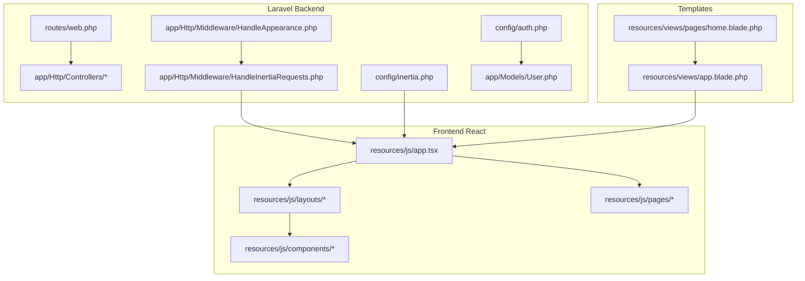
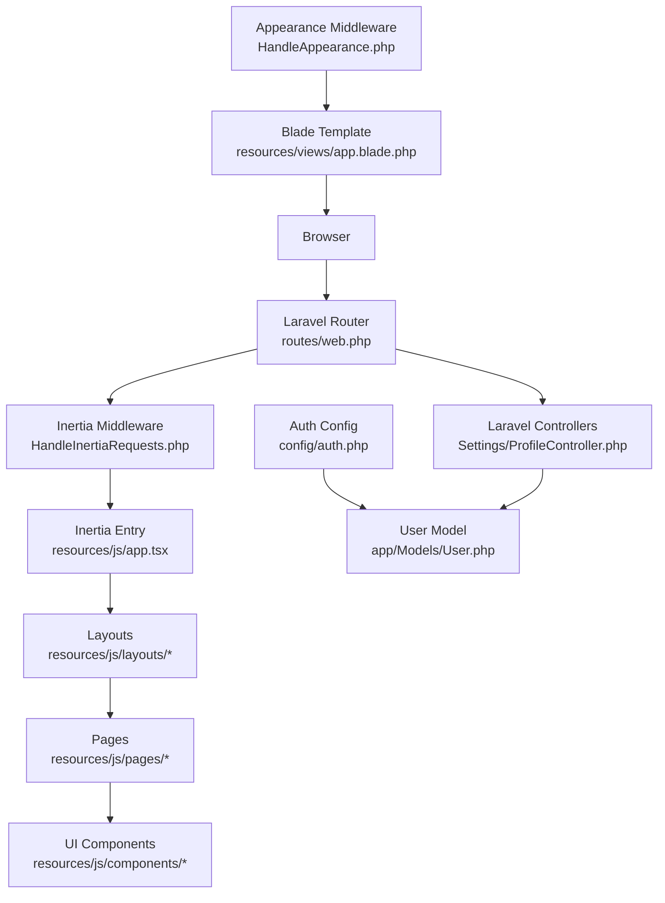
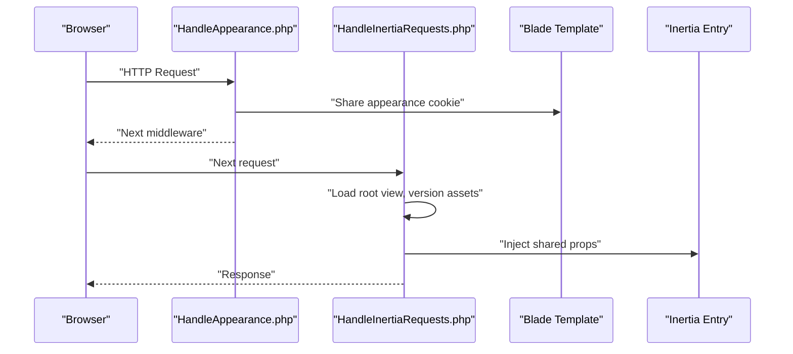
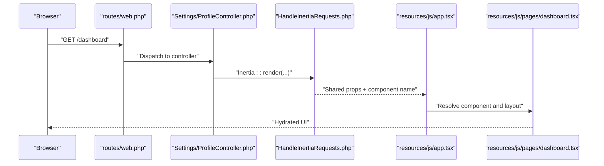
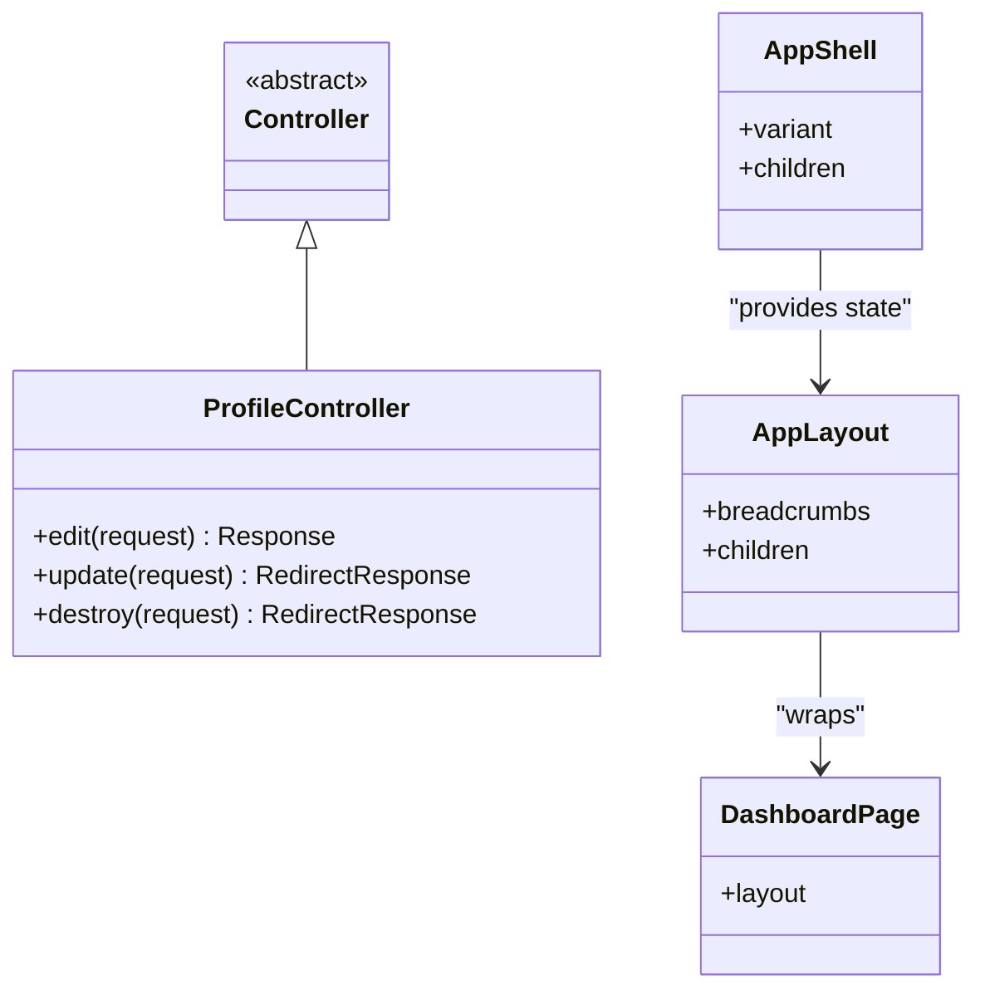
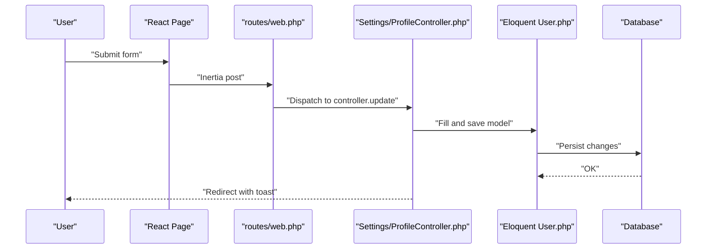
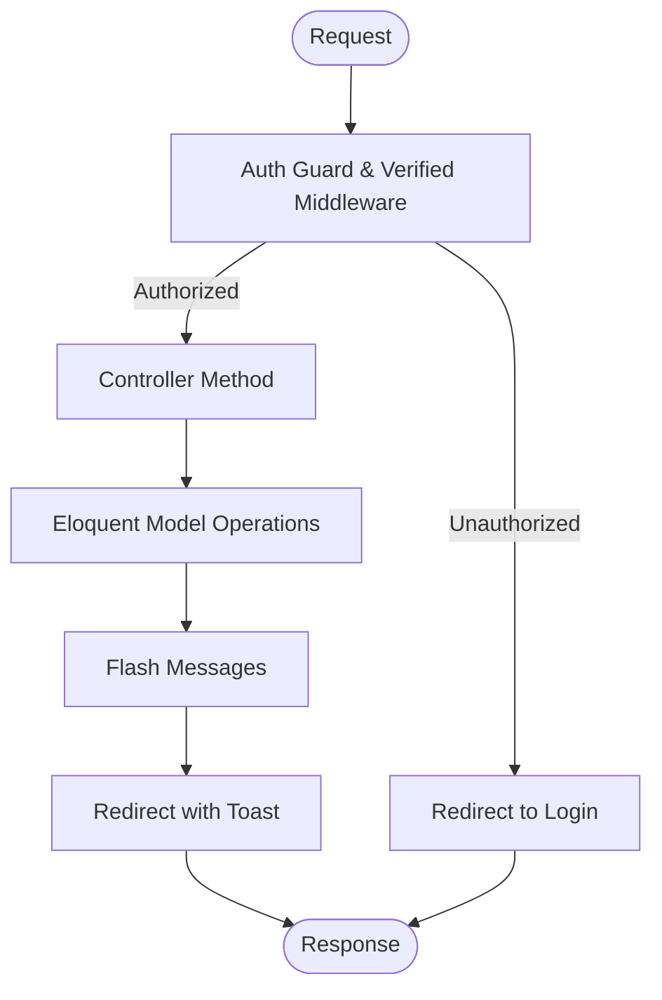
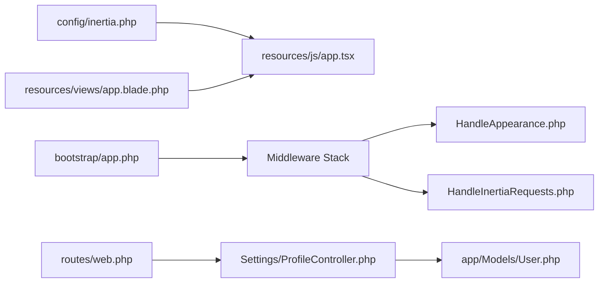

# Architecture Overview

<cite>
**Referenced Files in This Document**
- [HandleInertiaRequests.php](file://app/Http/Middleware/HandleInertiaRequests.php)
- [HandleAppearance.php](file://app/Http/Middleware/HandleAppearance.php)
- [app.tsx](file://resources/js/app.tsx)
- [web.php](file://routes/web.php)
- [inertia.php](file://config/inertia.php)
- [Controller.php](file://app/Http/Controllers/Controller.php)
- [ProfileController.php](file://app/Http/Controllers/Settings/ProfileController.php)
- [app-layout.tsx](file://resources/js/layouts/app-layout.tsx)
- [dashboard.tsx](file://resources/js/pages/dashboard.tsx)
- [app-shell.tsx](file://resources/js/components/app-shell.tsx)
- [app.blade.php](file://resources/views/app.blade.php)
- [home.blade.php](file://resources/views/pages/home.blade.php)
- [auth.php](file://config/auth.php)
- [User.php](file://app/Models/User.php)
- [app.php](file://bootstrap/app.php)
</cite>

## Table of Contents
1. [Introduction](#introduction)
2. [Project Structure](#project-structure)
3. [Core Components](#core-components)
4. [Architecture Overview](#architecture-overview)
5. [Detailed Component Analysis](#detailed-component-analysis)
6. [Dependency Analysis](#dependency-analysis)
7. [Performance Considerations](#performance-considerations)
8. [Troubleshooting Guide](#troubleshooting-guide)
9. [Conclusion](#conclusion)

## Introduction
This document presents the architecture of SmartExam’s full-stack system. It combines Laravel’s Model-View-Controller (MVC) backend with a React-based frontend, bridged seamlessly by Inertia.js. The system emphasizes a cohesive middleware pipeline for request processing, appearance management, and state persistence. The component hierarchy spans controllers, Inertia-rendered pages, shared layouts, and reusable UI components. Data flows from user interactions through React components, Inertia requests, Laravel controllers, Eloquent models, and database queries. Cross-cutting concerns such as authentication, authorization, and state management are integrated across layers.

## Project Structure
SmartExam organizes the backend under the Laravel application structure and the frontend under Vite/React with TypeScript. Key areas:
- Backend routing and controllers under app/Http and routes/.
- Middleware for Inertia and appearance handling under app/Http/Middleware.
- Frontend entry and layout composition under resources/js.
- Blade templates for server-rendered pages under resources/views.
- Authentication and Inertia configuration under config/.

**Diagram sources**
- [web.php:1-26](file://routes/web.php#L1-L26)
- [HandleAppearance.php:1-24](file://app/Http/Middleware/HandleAppearance.php#L1-L24)
- [HandleInertiaRequests.php:1-48](file://app/Http/Middleware/HandleInertiaRequests.php#L1-L48)
- [inertia.php:1-71](file://config/inertia.php#L1-L71)
- [auth.php:1-118](file://config/auth.php#L1-L118)
- [User.php:1-53](file://app/Models/User.php#L1-L53)
- [app.tsx:1-41](file://resources/js/app.tsx#L1-L41)
- [app.blade.php:1-49](file://resources/views/app.blade.php#L1-L49)
- [home.blade.php:1-21](file://resources/views/pages/home.blade.php#L1-L21)

**Section sources**
- [web.php:1-26](file://routes/web.php#L1-L26)
- [app.php:17-25](file://bootstrap/app.php#L17-L25)
- [inertia.php:1-71](file://config/inertia.php#L1-L71)

## Core Components
- Inertia Bridge: The frontend entry initializes Inertia for React, sets per-page layouts, and integrates UI providers. It also configures SSR and asset progress indicators.
- Middleware Pipeline: The appearance middleware shares theme preferences with Blade templates; the Inertia middleware loads the root template, manages asset versioning, and shares global props (application name, auth state, sidebar state).
- Controllers: Laravel controllers render Inertia pages and handle form submissions, returning redirects with flash messages.
- Frontend Pages and Layouts: Pages declare their own breadcrumbs and layouts; layouts wrap content and provide shell-level state (e.g., sidebar open state).
- Authentication and Authorization: Laravel’s auth guard and provider integrate with Eloquent models and Fortify features for passkeys and two-factor authentication.

**Section sources**
- [app.tsx:11-37](file://resources/js/app.tsx#L11-L37)
- [HandleInertiaRequests.php:17-46](file://app/Http/Middleware/HandleInertiaRequests.php#L17-L46)
- [HandleAppearance.php:17-22](file://app/Http/Middleware/HandleAppearance.php#L17-L22)
- [Controller.php:1-9](file://app/Http/Controllers/Controller.php#L1-L9)
- [ProfileController.php:20-61](file://app/Http/Controllers/Settings/ProfileController.php#L20-L61)
- [app-layout.tsx:1-17](file://resources/js/layouts/app-layout.tsx#L1-L17)
- [app-shell.tsx:11-21](file://resources/js/components/app-shell.tsx#L11-L21)
- [auth.php:40-74](file://config/auth.php#L40-L74)
- [User.php:32-35](file://app/Models/User.php#L32-L35)

## Architecture Overview
SmartExam employs a hybrid architecture:
- Backend (Laravel): Routes define entry points; controllers render Inertia pages or process forms; middleware handles appearance and Inertia-specific data sharing.
- Frontend (React via Inertia): Pages and layouts are resolved by Inertia; shared data is injected by the backend; UI components encapsulate reusable behavior.
- Templates (Blade): Server-rendered pages (e.g., marketing) coexist with Inertia-driven SPA-like navigation.

**Diagram sources**
- [web.php:5-23](file://routes/web.php#L5-L23)
- [HandleInertiaRequests.php:8-46](file://app/Http/Middleware/HandleInertiaRequests.php#L8-L46)
- [HandleAppearance.php:10-22](file://app/Http/Middleware/HandleAppearance.php#L10-L22)
- [app.blade.php:1-49](file://resources/views/app.blade.php#L1-L49)
- [app.tsx:11-37](file://resources/js/app.tsx#L11-L37)
- [ProfileController.php:15-61](file://app/Http/Controllers/Settings/ProfileController.php#L15-L61)
- [auth.php:40-74](file://config/auth.php#L40-L74)
- [User.php:32-35](file://app/Models/User.php#L32-L35)

## Detailed Component Analysis

### Middleware Pipeline
The middleware stack orchestrates appearance and Inertia initialization:
- Appearance middleware reads the appearance cookie and shares it with Blade templates for immediate theme application.
- Inertia middleware sets the root view, asset versioning, and shared props (application name, auth user, sidebar state). It also configures SSR and asset loading progress.

**Diagram sources**
- [HandleAppearance.php:17-22](file://app/Http/Middleware/HandleAppearance.php#L17-L22)
- [HandleInertiaRequests.php:17-46](file://app/Http/Middleware/HandleInertiaRequests.php#L17-L46)
- [app.blade.php:10-19](file://resources/views/app.blade.php#L10-L19)
- [app.tsx:26-33](file://resources/js/app.tsx#L26-L33)

**Section sources**
- [HandleAppearance.php:17-22](file://app/Http/Middleware/HandleAppearance.php#L17-L22)
- [HandleInertiaRequests.php:17-46](file://app/Http/Middleware/HandleInertiaRequests.php#L17-L46)
- [app.php:18-24](file://bootstrap/app.php#L18-L24)

### Inertia Bridge and Page Resolution
Inertia bridges the backend and frontend:
- The frontend entry resolves page components and applies layouts based on the page name.
- SSR is enabled and configured to a local SSR server.
- Shared props include application metadata and authentication state.

**Diagram sources**
- [web.php:21-23](file://routes/web.php#L21-L23)
- [ProfileController.php:20-26](file://app/Http/Controllers/Settings/ProfileController.php#L20-L26)
- [HandleInertiaRequests.php:36-46](file://app/Http/Middleware/HandleInertiaRequests.php#L36-L46)
- [app.tsx:13-24](file://resources/js/app.tsx#L13-L24)
- [dashboard.tsx:5-27](file://resources/js/pages/dashboard.tsx#L5-L27)

**Section sources**
- [app.tsx:11-37](file://resources/js/app.tsx#L11-L37)
- [inertia.php:18-23](file://config/inertia.php#L18-L23)
- [HandleInertiaRequests.php:17-46](file://app/Http/Middleware/HandleInertiaRequests.php#L17-L46)

### Component Hierarchy: Controllers to React
- Controllers render Inertia pages and pass contextual data (e.g., verification requirement, status messages).
- Pages declare their own breadcrumbs and optional layout wrappers.
- Layouts compose shell-level state (e.g., sidebar open state) and delegate to underlying templates.

**Diagram sources**
- [Controller.php:5-8](file://app/Http/Controllers/Controller.php#L5-L8)
- [ProfileController.php:20-61](file://app/Http/Controllers/Settings/ProfileController.php#L20-L61)
- [dashboard.tsx:29-36](file://resources/js/pages/dashboard.tsx#L29-L36)
- [app-layout.tsx:4-16](file://resources/js/layouts/app-layout.tsx#L4-L16)
- [app-shell.tsx:11-21](file://resources/js/components/app-shell.tsx#L11-L21)

**Section sources**
- [ProfileController.php:20-61](file://app/Http/Controllers/Settings/ProfileController.php#L20-L61)
- [dashboard.tsx:29-36](file://resources/js/pages/dashboard.tsx#L29-L36)
- [app-layout.tsx:1-17](file://resources/js/layouts/app-layout.tsx#L1-L17)
- [app-shell.tsx:1-22](file://resources/js/components/app-shell.tsx#L1-L22)

### Data Flow: From User Action to Database
End-to-end flow for a typical update action:
- User triggers an action in a React page.
- Inertia sends a request to a Laravel route mapped to a controller method.
- The controller validates input, updates the Eloquent model, flashes feedback, and redirects.
- The response hydrates the new state in the frontend.

**Diagram sources**
- [web.php:21-23](file://routes/web.php#L21-L23)
- [ProfileController.php:31-44](file://app/Http/Controllers/Settings/ProfileController.php#L31-L44)
- [User.php:32-35](file://app/Models/User.php#L32-L35)

**Section sources**
- [ProfileController.php:31-44](file://app/Http/Controllers/Settings/ProfileController.php#L31-L44)
- [User.php:32-35](file://app/Models/User.php#L32-L35)

### Authentication, Authorization, and State Management
- Authentication: Laravel’s session guard with Eloquent provider and Fortify integrations for passkeys and two-factor authentication.
- Authorization: Route-level middleware groups protect authenticated and verified routes; controllers enforce domain logic.
- State Management: Shared props from the Inertia middleware carry user and UI state (e.g., sidebar open); cookies persist appearance and sidebar state.

**Diagram sources**
- [web.php:21-23](file://routes/web.php#L21-L23)
- [auth.php:40-74](file://config/auth.php#L40-L74)
- [HandleInertiaRequests.php:41-44](file://app/Http/Middleware/HandleInertiaRequests.php#L41-L44)
- [app.php:18-24](file://bootstrap/app.php#L18-L24)

**Section sources**
- [auth.php:40-74](file://config/auth.php#L40-L74)
- [User.php:32-35](file://app/Models/User.php#L32-L35)
- [web.php:21-23](file://routes/web.php#L21-L23)
- [HandleInertiaRequests.php:41-44](file://app/Http/Middleware/HandleInertiaRequests.php#L41-L44)

## Dependency Analysis
Key dependencies and integration points:
- Inertia configuration defines SSR and page discovery paths.
- Middleware registration ensures appearance and Inertia are applied in the web stack.
- Blade templates integrate Vite assets and Inertia placeholders for server-rendered pages.
- Controllers depend on Eloquent models and Inertia responses.

**Diagram sources**
- [inertia.php:18-23](file://config/inertia.php#L18-L23)
- [app.php:17-25](file://bootstrap/app.php#L17-L25)
- [HandleAppearance.php:17-22](file://app/Http/Middleware/HandleAppearance.php#L17-L22)
- [HandleInertiaRequests.php:17-46](file://app/Http/Middleware/HandleInertiaRequests.php#L17-L46)
- [web.php:21-23](file://routes/web.php#L21-L23)
- [ProfileController.php:15-61](file://app/Http/Controllers/Settings/ProfileController.php#L15-L61)
- [User.php:32-35](file://app/Models/User.php#L32-L35)
- [app.blade.php:39-46](file://resources/views/app.blade.php#L39-L46)

**Section sources**
- [inertia.php:36-51](file://config/inertia.php#L36-L51)
- [app.php:17-25](file://bootstrap/app.php#L17-L25)
- [app.blade.php:39-46](file://resources/views/app.blade.php#L39-L46)

## Performance Considerations
- SSR: Enabled for initial page loads to improve perceived performance; ensure the SSR server is reachable and tuned.
- Asset Versioning: Inertia middleware computes asset versions to prevent stale caches.
- Cookie Handling: Cookies for appearance and sidebar state are intentionally excluded from encryption to reduce overhead.
- UI Provider Overhead: Minimize unnecessary provider wrapping and limit heavy computations in shared layouts.

[No sources needed since this section provides general guidance]

## Troubleshooting Guide
Common issues and remedies:
- Inertia SSR not working: Verify the SSR server URL and port in configuration and ensure the service is running.
- Missing shared props: Confirm the Inertia middleware is registered and the share method returns required keys.
- Theme not applying: Ensure the appearance cookie is present and the appearance middleware shares it with Blade templates.
- Authentication redirects: Check route middleware groups and controller logic for redirects to login or verification screens.
- Layout not applied: Confirm the Inertia entry layout resolver matches the page namespace and returns the intended layout(s).

**Section sources**
- [inertia.php:18-23](file://config/inertia.php#L18-L23)
- [HandleInertiaRequests.php:36-46](file://app/Http/Middleware/HandleInertiaRequests.php#L36-L46)
- [HandleAppearance.php:19](file://app/Http/Middleware/HandleAppearance.php#L19)
- [web.php:21-23](file://routes/web.php#L21-L23)
- [app.tsx:13-24](file://resources/js/app.tsx#L13-L24)

## Conclusion
SmartExam’s architecture blends Laravel’s robust MVC backend with a modern React frontend powered by Inertia.js. The middleware pipeline ensures consistent appearance and shared state, while controllers and Eloquent models encapsulate business logic. The component hierarchy from controllers to pages and reusable UI components delivers a cohesive user experience. With SSR, cookie-based persistence, and integrated authentication, the system balances performance, maintainability, and user-centric design.