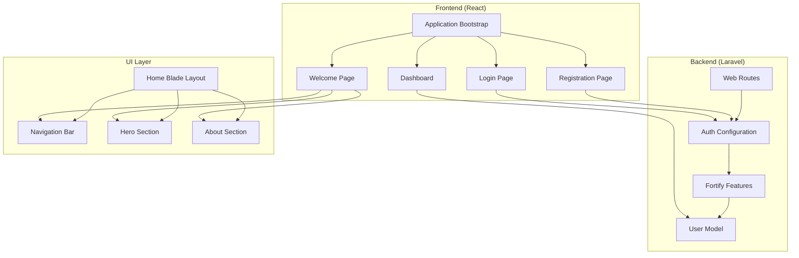
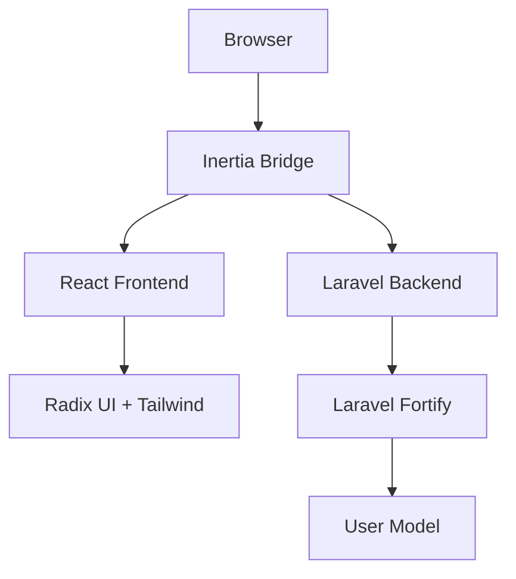
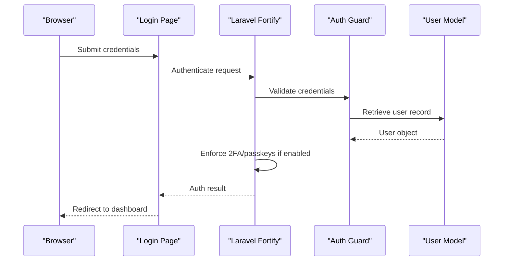
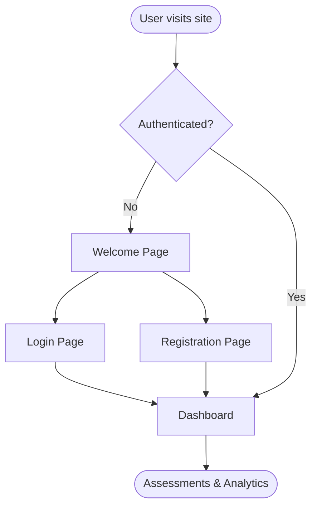
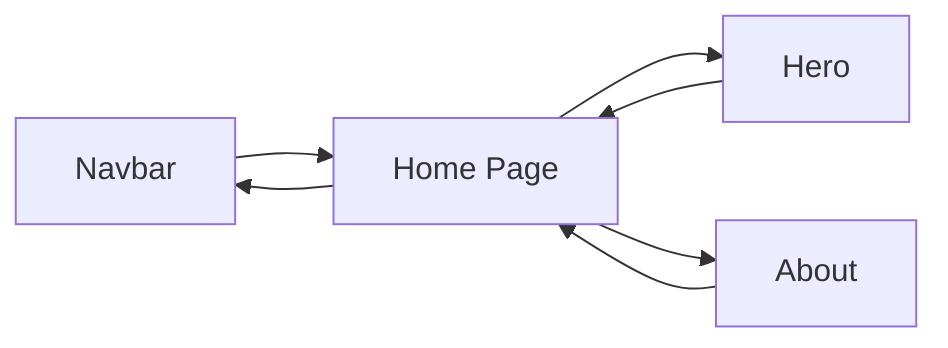
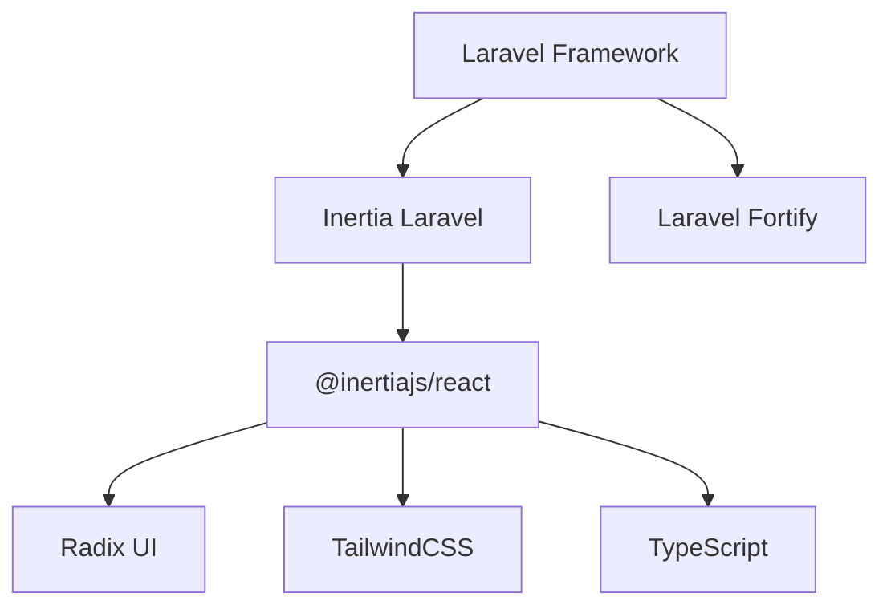

# Introduction & Purpose

<cite>
**Referenced Files in This Document**
- [package.json](file://package.json)
- [composer.json](file://composer.json)
- [resources/views/pages/home.blade.php](file://resources/views/pages/home.blade.php)
- [resources/views/components/about.blade.php](file://resources/views/components/about.blade.php)
- [resources/views/components/hero.blade.php](file://resources/views/components/hero.blade.php)
- [resources/views/components/navbar.blade.php](file://resources/views/components/navbar.blade.php)
- [resources/js/pages/welcome.tsx](file://resources/js/pages/welcome.tsx)
- [resources/js/pages/dashboard.tsx](file://resources/js/pages/dashboard.tsx)
- [resources/js/pages/auth/login.tsx](file://resources/js/pages/auth/login.tsx)
- [resources/js/pages/auth/register.tsx](file://resources/js/pages/auth/register.tsx)
- [resources/js/app.tsx](file://resources/js/app.tsx)
- [config/fortify.php](file://config/fortify.php)
- [config/auth.php](file://config/auth.php)
- [app/Models/User.php](file://app/Models/User.php)
</cite>

## Table of Contents
1. [Introduction](#introduction)
2. [Project Structure](#project-structure)
3. [Core Components](#core-components)
4. [Architecture Overview](#architecture-overview)
5. [Detailed Component Analysis](#detailed-component-analysis)
6. [Dependency Analysis](#dependency-analysis)
7. [Performance Considerations](#performance-considerations)
8. [Troubleshooting Guide](#troubleshooting-guide)
9. [Conclusion](#conclusion)

## Introduction
SmartExam is an integrated exam management platform designed to modernize and streamline assessment processes for educational institutions. Built with a contemporary tech stack combining Laravel and React, SmartExam focuses on delivering a secure, user-friendly, and responsive solution for managing exams digitally. The platform emphasizes modern authentication, intuitive user experiences, and scalable infrastructure to meet the evolving needs of schools, colleges, and training organizations.

### Mission Statement
SmartExam’s mission is to make assessment administration efficient, secure, and accessible for all stakeholders—students, educators, and administrators—by leveraging cutting-edge technology to eliminate traditional bottlenecks such as manual invigilation, paper-based logistics, and delayed result processing.

### Vision
We envision a future where assessments are seamless, transparent, and fair, enabling institutions to focus on learning outcomes rather than administrative overhead. SmartExam aims to be the trusted partner in transforming exam delivery through innovation, security, and usability.

### Target Audience
- Students: Accessible, straightforward exam interfaces with secure authentication and real-time feedback mechanisms.
- Educators: Tools to create, monitor, and grade assessments efficiently, with analytics and reporting capabilities.
- Administrators: Centralized controls for user management, policy enforcement, and system oversight.

### Core Value Propositions
- Modern Authentication: Multi-layered security using Laravel Fortify with passkeys, two-factor authentication, and robust password policies.
- Exceptional User Experience: Intuitive dashboards, guided flows for login and registration, and responsive design principles.
- Responsive Design Capabilities: Consistent performance across devices—from desktops to tablets and mobile phones—ensuring accessibility for diverse user groups.

### Problems Solved
- Reduces cheating risks through secure authentication and monitoring-ready environments.
- Eliminates printing and logistics costs associated with physical exams.
- Accelerates result processing and feedback cycles with automated grading and analytics.
- Provides centralized access to exam resources and progress tracking for all users.

### Educational Technology Landscape Fit
SmartExam occupies a modern niche within EdTech by blending:
- Secure identity management with WebAuthn passkeys and two-factor authentication.
- A reactive frontend powered by React and Inertia for dynamic, SPA-like interactions.
- A Laravel backend optimized for maintainability, scalability, and developer productivity.

This positioning allows SmartExam to serve as both a standalone exam platform and a foundation for broader institutional digital transformation initiatives.

**Section sources**
- [resources/views/components/about.blade.php:15-20](file://resources/views/components/about.blade.php#L15-L20)
- [resources/views/components/hero.blade.php:18-31](file://resources/views/components/hero.blade.php#L18-L31)
- [resources/js/pages/welcome.tsx:14-42](file://resources/js/pages/welcome.tsx#L14-L42)

## Project Structure
SmartExam follows a layered architecture with clear separation between frontend and backend concerns:
- Backend: Laravel application handling routing, authentication, business logic, and data persistence.
- Frontend: React-based Single Page Application (SPA) using Inertia for server-side rendering and seamless navigation.
- Assets and UI: TailwindCSS for styling, Radix UI primitives for accessible components, and TypeScript for type safety.

**Diagram sources**
- [resources/js/app.tsx:11-37](file://resources/js/app.tsx#L11-L37)
- [resources/js/pages/welcome.tsx:7-12](file://resources/js/pages/welcome.tsx#L7-L12)
- [resources/js/pages/auth/login.tsx:24-120](file://resources/js/pages/auth/login.tsx#L24-L120)
- [resources/js/pages/auth/register.tsx:16-121](file://resources/js/pages/auth/register.tsx#L16-L121)
- [resources/js/pages/dashboard.tsx:5-37](file://resources/js/pages/dashboard.tsx#L5-L37)
- [resources/views/pages/home.blade.php:3-20](file://resources/views/pages/home.blade.php#L3-L20)
- [resources/views/components/navbar.blade.php:1-48](file://resources/views/components/navbar.blade.php#L1-L48)
- [resources/views/components/hero.blade.php:1-57](file://resources/views/components/hero.blade.php#L1-L57)
- [resources/views/components/about.blade.php:1-29](file://resources/views/components/about.blade.php#L1-L29)
- [config/auth.php:18-21](file://config/auth.php#L18-L21)
- [config/fortify.php:169-189](file://config/fortify.php#L169-L189)
- [app/Models/User.php:32-52](file://app/Models/User.php#L32-L52)

**Section sources**
- [package.json:31-66](file://package.json#L31-L66)
- [composer.json:11-18](file://composer.json#L11-L18)
- [resources/js/app.tsx:11-37](file://resources/js/app.tsx#L11-L37)

## Core Components
SmartExam’s core components revolve around secure authentication, intuitive user interfaces, and a cohesive navigation experience tailored to different user roles.

- Authentication System
  - Laravel Fortify integrates passkeys, two-factor authentication, email verification, and password resets.
  - The User model implements passkey and two-factor traits, ensuring robust identity handling.
  - Configuration enables granular control over feature toggles and rate limiting.

- Frontend Pages
  - Welcome page provides contextual navigation for logged-in and anonymous users.
  - Login and registration forms offer streamlined onboarding with validation and UX enhancements.
  - Dashboard presents a responsive grid layout for quick access to assessment tools.

- UI and Navigation
  - Navbar supports both desktop and mobile experiences with gradient theming and smooth interactions.
  - Hero and About sections communicate mission, benefits, and platform positioning.

**Section sources**
- [config/fortify.php:140-189](file://config/fortify.php#L140-L189)
- [app/Models/User.php:32-52](file://app/Models/User.php#L32-L52)
- [resources/js/pages/welcome.tsx:14-42](file://resources/js/pages/welcome.tsx#L14-L42)
- [resources/js/pages/auth/login.tsx:24-120](file://resources/js/pages/auth/login.tsx#L24-L120)
- [resources/js/pages/auth/register.tsx:16-121](file://resources/js/pages/auth/register.tsx#L16-L121)
- [resources/js/pages/dashboard.tsx:5-37](file://resources/js/pages/dashboard.tsx#L5-L37)
- [resources/views/components/navbar.blade.php:1-48](file://resources/views/components/navbar.blade.php#L1-L48)
- [resources/views/components/hero.blade.php:18-31](file://resources/views/components/hero.blade.php#L18-L31)
- [resources/views/components/about.blade.php:15-20](file://resources/views/components/about.blade.php#L15-L20)

## Architecture Overview
SmartExam employs a hybrid architecture combining server-rendered views for marketing and landing pages with a client-side SPA for authenticated experiences. Inertia bridges the gap between Laravel and React, enabling rapid development and optimal SEO for public-facing content.

**Diagram sources**
- [resources/js/app.tsx:11-37](file://resources/js/app.tsx#L11-L37)
- [config/auth.php:18-21](file://config/auth.php#L18-L21)
- [config/fortify.php:169-189](file://config/fortify.php#L169-L189)
- [app/Models/User.php:32-52](file://app/Models/User.php#L32-L52)

## Detailed Component Analysis

### Authentication Flow (Modern Identity)
SmartExam leverages Laravel Fortify to deliver modern authentication:
- Passkeys (WebAuthn): Passwordless login with biometric and device-based verification.
- Two-Factor Authentication: Optional confirmation with backup codes and password confirmation.
- Email Verification and Password Resets: Standardized flows for account lifecycle management.

**Diagram sources**
- [resources/js/pages/auth/login.tsx:24-120](file://resources/js/pages/auth/login.tsx#L24-L120)
- [config/fortify.php:140-189](file://config/fortify.php#L140-L189)
- [config/auth.php:18-21](file://config/auth.php#L18-L21)
- [app/Models/User.php:32-52](file://app/Models/User.php#L32-L52)

**Section sources**
- [config/fortify.php:140-189](file://config/fortify.php#L140-L189)
- [config/auth.php:18-21](file://config/auth.php#L18-L21)
- [app/Models/User.php:32-52](file://app/Models/User.php#L32-L52)
- [resources/js/pages/auth/login.tsx:24-120](file://resources/js/pages/auth/login.tsx#L24-L120)

### User Onboarding and Dashboard Experience
- Welcome Page: Contextual navigation for anonymous users and quick access to login/register.
- Registration and Login: Form-driven flows with validation, accessibility labels, and responsive layouts.
- Dashboard: Grid-based layout optimized for assessment tools and analytics.

**Diagram sources**
- [resources/js/pages/welcome.tsx:14-42](file://resources/js/pages/welcome.tsx#L14-L42)
- [resources/js/pages/auth/login.tsx:24-120](file://resources/js/pages/auth/login.tsx#L24-L120)
- [resources/js/pages/auth/register.tsx:16-121](file://resources/js/pages/auth/register.tsx#L16-L121)
- [resources/js/pages/dashboard.tsx:5-37](file://resources/js/pages/dashboard.tsx#L5-L37)

**Section sources**
- [resources/js/pages/welcome.tsx:14-42](file://resources/js/pages/welcome.tsx#L14-L42)
- [resources/js/pages/auth/login.tsx:24-120](file://resources/js/pages/auth/login.tsx#L24-L120)
- [resources/js/pages/auth/register.tsx:16-121](file://resources/js/pages/auth/register.tsx#L16-L121)
- [resources/js/pages/dashboard.tsx:5-37](file://resources/js/pages/dashboard.tsx#L5-L37)

### Marketing and Navigation Components
- Navbar: Transparent design with gradient accents, mobile-responsive menu, and CTA links.
- Hero: Full-bleed layout communicating platform benefits and call-to-action buttons.
- About: Mission-driven storytelling highlighting pain points and solutions.

**Diagram sources**
- [resources/views/components/navbar.blade.php:1-48](file://resources/views/components/navbar.blade.php#L1-L48)
- [resources/views/components/hero.blade.php:1-57](file://resources/views/components/hero.blade.php#L1-L57)
- [resources/views/components/about.blade.php:1-29](file://resources/views/components/about.blade.php#L1-L29)
- [resources/views/pages/home.blade.php:3-20](file://resources/views/pages/home.blade.php#L3-L20)

**Section sources**
- [resources/views/components/navbar.blade.php:1-48](file://resources/views/components/navbar.blade.php#L1-L48)
- [resources/views/components/hero.blade.php:18-31](file://resources/views/components/hero.blade.php#L18-L31)
- [resources/views/components/about.blade.php:15-20](file://resources/views/components/about.blade.php#L15-L20)
- [resources/views/pages/home.blade.php:3-20](file://resources/views/pages/home.blade.php#L3-L20)

## Dependency Analysis
SmartExam’s dependencies reflect a modern full-stack development approach:
- Backend: Laravel framework, Inertia for SSR/SPA bridging, Laravel Fortify for authentication, and supporting packages for routing and discovery.
- Frontend: React with Inertia, Radix UI for accessible components, TailwindCSS for styling, and TypeScript for type safety.

**Diagram sources**
- [composer.json:11-18](file://composer.json#L11-L18)
- [package.json:31-66](file://package.json#L31-L66)

**Section sources**
- [composer.json:11-18](file://composer.json#L11-L18)
- [package.json:31-66](file://package.json#L31-L66)

## Performance Considerations
- Progressive Enhancement: Inertia minimizes initial payload while enabling dynamic navigation.
- Asset Optimization: Vite builds optimize bundle sizes and enable fast local development.
- Accessibility and Responsiveness: Radix UI and TailwindCSS promote efficient rendering and cross-device compatibility.
- Authentication Efficiency: Fortify’s rate limiting and passkey support reduce friction and improve security.

[No sources needed since this section provides general guidance]

## Troubleshooting Guide
Common areas to review when diagnosing issues:
- Authentication Failures: Verify Fortify feature toggles, passkey configuration, and two-factor settings.
- User Model Integrity: Ensure the User model implements required traits and attribute casting.
- Frontend Routing: Confirm Inertia app bootstrapping and layout selection logic.
- Environment Setup: Validate Laravel and React scripts for development and production builds.

**Section sources**
- [config/fortify.php:140-189](file://config/fortify.php#L140-L189)
- [app/Models/User.php:32-52](file://app/Models/User.php#L32-L52)
- [resources/js/app.tsx:11-37](file://resources/js/app.tsx#L11-L37)
- [composer.json:43-96](file://composer.json#L43-L96)
- [package.json:5-14](file://package.json#L5-L14)

## Conclusion
SmartExam is positioned to transform exam administration by combining modern authentication, a responsive and accessible user interface, and a scalable Laravel+React architecture. Its mission-driven design, clear value propositions, and robust security features make it a compelling choice for institutions seeking a reliable, future-ready assessment platform.

[No sources needed since this section summarizes without analyzing specific files]