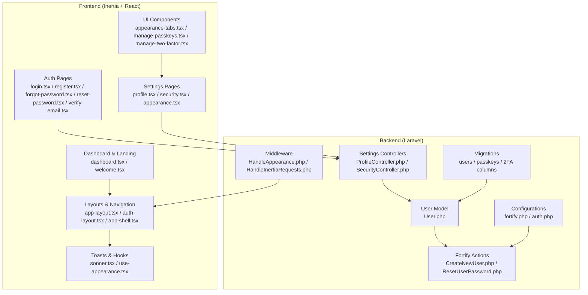
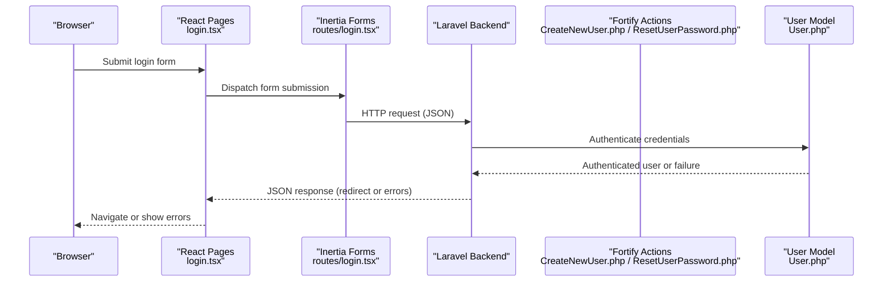
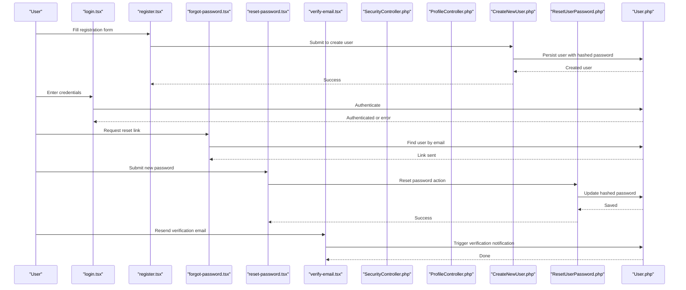
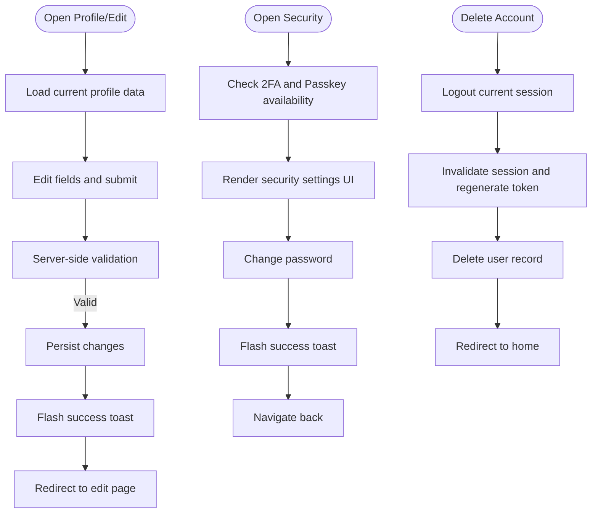
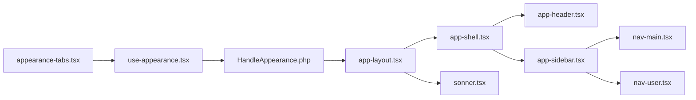
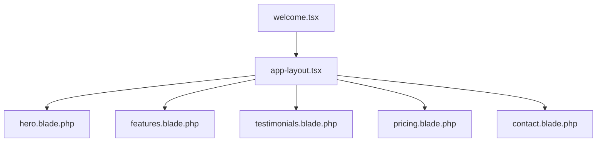
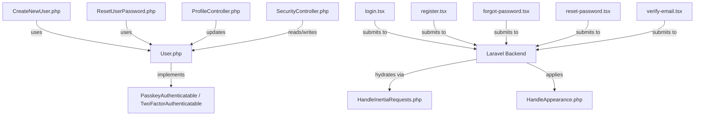

# Key Features

<cite>
**Referenced Files in This Document**
- [User.php](file://app/Models/User.php)
- [CreateNewUser.php](file://app/Actions/Fortify/CreateNewUser.php)
- [ResetUserPassword.php](file://app/Actions/Fortify/ResetUserPassword.php)
- [ProfileController.php](file://app/Http/Controllers/Settings/ProfileController.php)
- [SecurityController.php](file://app/Http/Controllers/Settings/SecurityController.php)
- [login.tsx](file://resources/js/pages/auth/login.tsx)
- [register.tsx](file://resources/js/pages/auth/register.tsx)
- [forgot-password.tsx](file://resources/js/pages/auth/forgot-password.tsx)
- [reset-password.tsx](file://resources/js/pages/auth/reset-password.tsx)
- [verify-email.tsx](file://resources/js/pages/auth/verify-email.tsx)
- [manage-two-factor.tsx](file://resources/js/components/manage-two-factor.tsx)
- [two-factor-setup-modal.tsx](file://resources/js/components/two-factor-setup-modal.tsx)
- [two-factor-recovery-codes.tsx](file://resources/js/components/two-factor-recovery-codes.tsx)
- [manage-passkeys.tsx](file://resources/js/components/manage-passkeys.tsx)
- [passkey-register.tsx](file://resources/js/components/passkey-register.tsx)
- [passkey-verify.tsx](file://resources/js/components/passkey-verify.tsx)
- [appearance-tabs.tsx](file://resources/js/components/appearance-tabs.tsx)
- [dashboard.tsx](file://resources/js/pages/dashboard.tsx)
- [welcome.tsx](file://resources/js/pages/welcome.tsx)
- [hero.blade.php](file://resources/views/components/hero.blade.php)
- [features.blade.php](file://resources/views/components/features.blade.php)
- [testimonials.blade.php](file://resources/views/components/testimonials.blade.php)
- [pricing.blade.php](file://resources/views/components/pricing.blade.php)
- [contact.blade.php](file://resources/views/components/contact.blade.php)
- [app-layout.tsx](file://resources/js/layouts/app-layout.tsx)
- [auth-layout.tsx](file://resources/js/layouts/auth-layout.tsx)
- [app-shell.tsx](file://resources/js/components/app-shell.tsx)
- [app-header.tsx](file://resources/js/components/app-header.tsx)
- [app-sidebar.tsx](file://resources/js/components/app-sidebar.tsx)
- [nav-main.tsx](file://resources/js/components/nav-main.tsx)
- [nav-user.tsx](file://resources/js/components/nav-user.tsx)
- [sonner.tsx](file://resources/js/components/ui/sonner.tsx)
- [use-appearance.tsx](file://resources/js/hooks/use-appearance.tsx)
- [HandleAppearance.php](file://app/Http/Middleware/HandleAppearance.php)
- [HandleInertiaRequests.php](file://app/Http/Middleware/HandleInertiaRequests.php)
- [fortify.php](file://config/fortify.php)
- [auth.php](file://config/auth.php)
- [0001_01_01_000000_create_users_table.php](file://database/migrations/0001_01_01_000000_create_users_table.php)
- [2025_08_14_170933_add_two_factor_columns_to_users_table.php](file://database/migrations/2025_08_14_170933_add_two_factor_columns_to_users_table.php)
- [2024_01_01_000000_create_passkeys_table.php](file://database/migrations/2024_01_01_000000_create_passkeys_table.php)
</cite>

## Table of Contents
1. [Introduction](#introduction)
2. [Project Structure](#project-structure)
3. [Core Components](#core-components)
4. [Architecture Overview](#architecture-overview)
5. [Detailed Component Analysis](#detailed-component-analysis)
6. [Dependency Analysis](#dependency-analysis)
7. [Performance Considerations](#performance-considerations)
8. [Troubleshooting Guide](#troubleshooting-guide)
9. [Conclusion](#conclusion)
10. [Appendices](#appendices)

## Introduction
This document presents SmartExam's key features and capabilities with a focus on modern authentication, user management, responsive dashboard, and the landing page. It explains how traditional login/register, email verification, password reset, two-factor authentication, and passkey/WebAuthn support integrate with the application architecture. It also covers profile editing, security settings, appearance preferences, and account deletion, along with the dashboard's theme switching, navigation system, and toast notifications. Finally, it documents the landing page's modular components and contact form processing.

## Project Structure
SmartExam follows a layered architecture combining Laravel backend services with an Inertia-powered React frontend. Authentication and user actions are handled via Laravel Fortify and custom actions/controllers, while the frontend renders pages and components using TypeScript/JSX and Tailwind CSS.

**Diagram sources**
- [User.php:32-52](file://app/Models/User.php#L32-L52)
- [CreateNewUser.php:20-32](file://app/Actions/Fortify/CreateNewUser.php#L20-L32)
- [ResetUserPassword.php:19-28](file://app/Actions/Fortify/ResetUserPassword.php#L19-L28)
- [ProfileController.php:20-61](file://app/Http/Controllers/Settings/ProfileController.php#L20-L61)
- [SecurityController.php:19-72](file://app/Http/Controllers/Settings/SecurityController.php#L19-L72)
- [login.tsx:24-120](file://resources/js/pages/auth/login.tsx#L24-L120)
- [register.tsx:16-115](file://resources/js/pages/auth/register.tsx#L16-L115)
- [forgot-password.tsx:12-64](file://resources/js/pages/auth/forgot-password.tsx#L12-L64)
- [reset-password.tsx:16-91](file://resources/js/pages/auth/reset-password.tsx#L16-L91)
- [verify-email.tsx:9-40](file://resources/js/pages/auth/verify-email.tsx#L9-L40)
- [appearance-tabs.tsx](file://resources/js/components/appearance-tabs.tsx)
- [manage-passkeys.tsx](file://resources/js/components/manage-passkeys.tsx)
- [manage-two-factor.tsx](file://resources/js/components/manage-two-factor.tsx)
- [app-layout.tsx](file://resources/js/layouts/app-layout.tsx)
- [auth-layout.tsx](file://resources/js/layouts/auth-layout.tsx)
- [sonner.tsx](file://resources/js/components/ui/sonner.tsx)
- [use-appearance.tsx](file://resources/js/hooks/use-appearance.tsx)
- [HandleAppearance.php](file://app/Http/Middleware/HandleAppearance.php)
- [HandleInertiaRequests.php](file://app/Http/Middleware/HandleInertiaRequests.php)
- [fortify.php](file://config/fortify.php)
- [auth.php](file://config/auth.php)
- [0001_01_01_000000_create_users_table.php](file://database/migrations/0001_01_01_000000_create_users_table.php)
- [2025_08_14_170933_add_two_factor_columns_to_users_table.php](file://database/migrations/2025_08_14_170933_add_two_factor_columns_to_users_table.php)
- [2024_01_01_000000_create_passkeys_table.php](file://database/migrations/2024_01_01_000000_create_passkeys_table.php)

**Section sources**
- [User.php:32-52](file://app/Models/User.php#L32-L52)
- [CreateNewUser.php:20-32](file://app/Actions/Fortify/CreateNewUser.php#L20-L32)
- [ResetUserPassword.php:19-28](file://app/Actions/Fortify/ResetUserPassword.php#L19-L28)
- [ProfileController.php:20-61](file://app/Http/Controllers/Settings/ProfileController.php#L20-L61)
- [SecurityController.php:19-72](file://app/Http/Controllers/Settings/SecurityController.php#L19-L72)
- [login.tsx:24-120](file://resources/js/pages/auth/login.tsx#L24-L120)
- [register.tsx:16-115](file://resources/js/pages/auth/register.tsx#L16-L115)
- [forgot-password.tsx:12-64](file://resources/js/pages/auth/forgot-password.tsx#L12-L64)
- [reset-password.tsx:16-91](file://resources/js/pages/auth/reset-password.tsx#L16-L91)
- [verify-email.tsx:9-40](file://resources/js/pages/auth/verify-email.tsx#L9-L40)
- [app-layout.tsx](file://resources/js/layouts/app-layout.tsx)
- [auth-layout.tsx](file://resources/js/layouts/auth-layout.tsx)
- [sonner.tsx](file://resources/js/components/ui/sonner.tsx)
- [use-appearance.tsx](file://resources/js/hooks/use-appearance.tsx)
- [HandleAppearance.php](file://app/Http/Middleware/HandleAppearance.php)
- [HandleInertiaRequests.php](file://app/Http/Middleware/HandleInertiaRequests.php)
- [fortify.php](file://config/fortify.php)
- [auth.php](file://config/auth.php)

## Core Components
- Modern Authentication System: Built on Laravel Fortify with custom actions for user creation and password reset, supporting traditional credentials, email verification, password reset, two-factor authentication, and passkey/WebAuthn.
- User Management: Profile editing, security settings, appearance preferences, and account deletion via dedicated controllers and requests.
- Responsive Dashboard: Theme switching (light/dark mode), navigation system, and toast notifications integrated through middleware, hooks, and UI components.
- Landing Page: Modular Blade components (hero, features, testimonials, pricing, contact) rendered within a shared layout.

**Section sources**
- [User.php:32-52](file://app/Models/User.php#L32-L52)
- [CreateNewUser.php:20-32](file://app/Actions/Fortify/CreateNewUser.php#L20-L32)
- [ResetUserPassword.php:19-28](file://app/Actions/Fortify/ResetUserPassword.php#L19-L28)
- [ProfileController.php:20-61](file://app/Http/Controllers/Settings/ProfileController.php#L20-L61)
- [SecurityController.php:19-72](file://app/Http/Controllers/Settings/SecurityController.php#L19-L72)
- [login.tsx:24-120](file://resources/js/pages/auth/login.tsx#L24-L120)
- [register.tsx:16-115](file://resources/js/pages/auth/register.tsx#L16-L115)
- [forgot-password.tsx:12-64](file://resources/js/pages/auth/forgot-password.tsx#L12-L64)
- [reset-password.tsx:16-91](file://resources/js/pages/auth/reset-password.tsx#L16-L91)
- [verify-email.tsx:9-40](file://resources/js/pages/auth/verify-email.tsx#L9-L40)
- [appearance-tabs.tsx](file://resources/js/components/appearance-tabs.tsx)
- [dashboard.tsx](file://resources/js/pages/dashboard.tsx)
- [welcome.tsx](file://resources/js/pages/welcome.tsx)
- [hero.blade.php](file://resources/views/components/hero.blade.php)
- [features.blade.php](file://resources/views/components/features.blade.php)
- [testimonials.blade.php](file://resources/views/components/testimonials.blade.php)
- [pricing.blade.php](file://resources/views/components/pricing.blade.php)
- [contact.blade.php](file://resources/views/components/contact.blade.php)
- [app-layout.tsx](file://resources/js/layouts/app-layout.tsx)
- [auth-layout.tsx](file://resources/js/layouts/auth-layout.tsx)
- [sonner.tsx](file://resources/js/components/ui/sonner.tsx)
- [use-appearance.tsx](file://resources/js/hooks/use-appearance.tsx)
- [HandleAppearance.php](file://app/Http/Middleware/HandleAppearance.php)
- [HandleInertiaRequests.php](file://app/Http/Middleware/HandleInertiaRequests.php)

## Architecture Overview
The system integrates Laravel Fortify for authentication services with Inertia rendering for a single-page feel. Middleware handles appearance preferences and inertia-specific request hydration. The User model implements passkey and two-factor traits, enabling advanced authentication features.

**Diagram sources**
- [login.tsx:33-111](file://resources/js/pages/auth/login.tsx#L33-L111)
- [CreateNewUser.php:20-32](file://app/Actions/Fortify/CreateNewUser.php#L20-L32)
- [ResetUserPassword.php:19-28](file://app/Actions/Fortify/ResetUserPassword.php#L19-L28)
- [User.php:32-52](file://app/Models/User.php#L32-L52)

## Detailed Component Analysis

### Modern Authentication System
- Traditional Login/Register: Pages collect credentials, submit via Inertia forms, validated by Laravel backend and Fortify actions. Registration enforces password rules and creates a user record.
- Email Verification: Users receive a verification link; resend option is available on the verification page.
- Password Reset: Forgot password sends a reset link; reset page validates and updates the password.
- Two-Factor Authentication: Managed via dedicated components and controller props, with optional confirmation and recovery codes display.
- Passkey/WebAuthn: Verified via a dedicated component and managed through passkey components and controller data.

**Diagram sources**
- [login.tsx:24-120](file://resources/js/pages/auth/login.tsx#L24-L120)
- [register.tsx:16-115](file://resources/js/pages/auth/register.tsx#L16-L115)
- [forgot-password.tsx:12-64](file://resources/js/pages/auth/forgot-password.tsx#L12-L64)
- [reset-password.tsx:16-91](file://resources/js/pages/auth/reset-password.tsx#L16-L91)
- [verify-email.tsx:9-40](file://resources/js/pages/auth/verify-email.tsx#L9-L40)
- [SecurityController.php:19-72](file://app/Http/Controllers/Settings/SecurityController.php#L19-L72)
- [ProfileController.php:20-61](file://app/Http/Controllers/Settings/ProfileController.php#L20-L61)
- [CreateNewUser.php:20-32](file://app/Actions/Fortify/CreateNewUser.php#L20-L32)
- [ResetUserPassword.php:19-28](file://app/Actions/Fortify/ResetUserPassword.php#L19-L28)
- [User.php:32-52](file://app/Models/User.php#L32-L52)

**Section sources**
- [login.tsx:24-120](file://resources/js/pages/auth/login.tsx#L24-L120)
- [register.tsx:16-115](file://resources/js/pages/auth/register.tsx#L16-L115)
- [forgot-password.tsx:12-64](file://resources/js/pages/auth/forgot-password.tsx#L12-L64)
- [reset-password.tsx:16-91](file://resources/js/pages/auth/reset-password.tsx#L16-L91)
- [verify-email.tsx:9-40](file://resources/js/pages/auth/verify-email.tsx#L9-L40)
- [SecurityController.php:19-72](file://app/Http/Controllers/Settings/SecurityController.php#L19-L72)
- [ProfileController.php:20-61](file://app/Http/Controllers/Settings/ProfileController.php#L20-L61)
- [CreateNewUser.php:20-32](file://app/Actions/Fortify/CreateNewUser.php#L20-L32)
- [ResetUserPassword.php:19-28](file://app/Actions/Fortify/ResetUserPassword.php#L19-L28)
- [User.php:32-52](file://app/Models/User.php#L32-L52)

### User Management Features
- Profile Editing: Edit page renders with verification status; updates persist and trigger a success toast via Inertia flash.
- Security Settings: Displays two-factor and passkey management state, password rules, and recovery options.
- Appearance Preferences: Tabs component and hook enable light/dark mode switching persisted in user preferences.
- Account Deletion: Securely logs out, invalidates session, deletes the user, and redirects to home.

**Diagram sources**
- [ProfileController.php:20-61](file://app/Http/Controllers/Settings/ProfileController.php#L20-L61)
- [SecurityController.php:19-72](file://app/Http/Controllers/Settings/SecurityController.php#L19-L72)
- [appearance-tabs.tsx](file://resources/js/components/appearance-tabs.tsx)
- [use-appearance.tsx](file://resources/js/hooks/use-appearance.tsx)

**Section sources**
- [ProfileController.php:20-61](file://app/Http/Controllers/Settings/ProfileController.php#L20-L61)
- [SecurityController.php:19-72](file://app/Http/Controllers/Settings/SecurityController.php#L19-L72)
- [appearance-tabs.tsx](file://resources/js/components/appearance-tabs.tsx)
- [use-appearance.tsx](file://resources/js/hooks/use-appearance.tsx)

### Responsive Dashboard Interface
- Theme Switching: The appearance tabs component and hook coordinate with middleware to hydrate appearance preferences and apply theme changes.
- Navigation System: Shell, header, sidebar, and navigation components provide a cohesive layout with main and user menus.
- Toast Notifications: Sonner toast component displays server-initiated toasts via Inertia flash messages.

**Diagram sources**
- [appearance-tabs.tsx](file://resources/js/components/appearance-tabs.tsx)
- [use-appearance.tsx](file://resources/js/hooks/use-appearance.tsx)
- [HandleAppearance.php](file://app/Http/Middleware/HandleAppearance.php)
- [app-layout.tsx](file://resources/js/layouts/app-layout.tsx)
- [app-shell.tsx](file://resources/js/components/app-shell.tsx)
- [app-header.tsx](file://resources/js/components/app-header.tsx)
- [app-sidebar.tsx](file://resources/js/components/app-sidebar.tsx)
- [nav-main.tsx](file://resources/js/components/nav-main.tsx)
- [nav-user.tsx](file://resources/js/components/nav-user.tsx)
- [sonner.tsx](file://resources/js/components/ui/sonner.tsx)

**Section sources**
- [appearance-tabs.tsx](file://resources/js/components/appearance-tabs.tsx)
- [use-appearance.tsx](file://resources/js/hooks/use-appearance.tsx)
- [HandleAppearance.php](file://app/Http/Middleware/HandleAppearance.php)
- [app-layout.tsx](file://resources/js/layouts/app-layout.tsx)
- [app-shell.tsx](file://resources/js/components/app-shell.tsx)
- [app-header.tsx](file://resources/js/components/app-header.tsx)
- [app-sidebar.tsx](file://resources/js/components/app-sidebar.tsx)
- [nav-main.tsx](file://resources/js/components/nav-main.tsx)
- [nav-user.tsx](file://resources/js/components/nav-user.tsx)
- [sonner.tsx](file://resources/js/components/ui/sonner.tsx)

### Landing Page with Modular Components
- Hero, Features, Testimonials, Pricing, Contact: Blade components assemble the landing page content within a shared layout.
- Contact Form Processing: The contact component integrates with backend routes to process submissions and handle responses.

**Diagram sources**
- [welcome.tsx](file://resources/js/pages/welcome.tsx)
- [app-layout.tsx](file://resources/js/layouts/app-layout.tsx)
- [hero.blade.php](file://resources/views/components/hero.blade.php)
- [features.blade.php](file://resources/views/components/features.blade.php)
- [testimonials.blade.php](file://resources/views/components/testimonials.blade.php)
- [pricing.blade.php](file://resources/views/components/pricing.blade.php)
- [contact.blade.php](file://resources/views/components/contact.blade.php)

**Section sources**
- [welcome.tsx](file://resources/js/pages/welcome.tsx)
- [app-layout.tsx](file://resources/js/layouts/app-layout.tsx)
- [hero.blade.php](file://resources/views/components/hero.blade.php)
- [features.blade.php](file://resources/views/components/features.blade.php)
- [testimonials.blade.php](file://resources/views/components/testimonials.blade.php)
- [pricing.blade.php](file://resources/views/components/pricing.blade.php)
- [contact.blade.php](file://resources/views/components/contact.blade.php)

## Dependency Analysis
The authentication and settings subsystems rely on Laravel Fortify for core behaviors, with custom actions and controllers extending or integrating Fortify contracts. The frontend communicates with the backend via Inertia forms and routes, while middleware ensures consistent appearance and request hydration.

**Diagram sources**
- [User.php:32-52](file://app/Models/User.php#L32-L52)
- [CreateNewUser.php:20-32](file://app/Actions/Fortify/CreateNewUser.php#L20-L32)
- [ResetUserPassword.php:19-28](file://app/Actions/Fortify/ResetUserPassword.php#L19-L28)
- [ProfileController.php:20-61](file://app/Http/Controllers/Settings/ProfileController.php#L20-L61)
- [SecurityController.php:19-72](file://app/Http/Controllers/Settings/SecurityController.php#L19-L72)
- [login.tsx:33-111](file://resources/js/pages/auth/login.tsx#L33-L111)
- [register.tsx:20-112](file://resources/js/pages/auth/register.tsx#L20-L112)
- [forgot-password.tsx:24-55](file://resources/js/pages/auth/forgot-password.tsx#L24-L55)
- [reset-password.tsx:21-88](file://resources/js/pages/auth/reset-password.tsx#L21-L88)
- [verify-email.tsx:21-37](file://resources/js/pages/auth/verify-email.tsx#L21-L37)
- [HandleInertiaRequests.php](file://app/Http/Middleware/HandleInertiaRequests.php)
- [HandleAppearance.php](file://app/Http/Middleware/HandleAppearance.php)

**Section sources**
- [User.php:32-52](file://app/Models/User.php#L32-L52)
- [CreateNewUser.php:20-32](file://app/Actions/Fortify/CreateNewUser.php#L20-L32)
- [ResetUserPassword.php:19-28](file://app/Actions/Fortify/ResetUserPassword.php#L19-L28)
- [ProfileController.php:20-61](file://app/Http/Controllers/Settings/ProfileController.php#L20-L61)
- [SecurityController.php:19-72](file://app/Http/Controllers/Settings/SecurityController.php#L19-L72)
- [login.tsx:33-111](file://resources/js/pages/auth/login.tsx#L33-L111)
- [register.tsx:20-112](file://resources/js/pages/auth/register.tsx#L20-L112)
- [forgot-password.tsx:24-55](file://resources/js/pages/auth/forgot-password.tsx#L24-L55)
- [reset-password.tsx:21-88](file://resources/js/pages/auth/reset-password.tsx#L21-L88)
- [verify-email.tsx:21-37](file://resources/js/pages/auth/verify-email.tsx#L21-L37)
- [HandleInertiaRequests.php](file://app/Http/Middleware/HandleInertiaRequests.php)
- [HandleAppearance.php](file://app/Http/Middleware/HandleAppearance.php)

## Performance Considerations
- Minimize unnecessary re-renders by leveraging Inertia form helpers and avoiding deep object mutations in React components.
- Use server-side validation to prevent redundant client-side checks and reduce network overhead.
- Cache frequently accessed user preferences (e.g., appearance) to avoid repeated hydration.
- Keep toast messages concise and scoped to improve perceived responsiveness.

## Troubleshooting Guide
- Authentication failures: Verify credential validation rules and ensure Fortify actions are properly wired to controllers.
- Email verification issues: Confirm notification dispatch and route availability for resending verification emails.
- Password reset errors: Validate token handling and ensure reset action applies password rules.
- Two-factor and passkey problems: Check feature flags and migration columns; ensure proper UI components render based on capability flags.
- Dashboard appearance not applying: Confirm middleware hydration and hook usage for theme persistence.

**Section sources**
- [login.tsx:24-120](file://resources/js/pages/auth/login.tsx#L24-L120)
- [verify-email.tsx:9-40](file://resources/js/pages/auth/verify-email.tsx#L9-L40)
- [reset-password.tsx:16-91](file://resources/js/pages/auth/reset-password.tsx#L16-L91)
- [SecurityController.php:19-72](file://app/Http/Controllers/Settings/SecurityController.php#L19-L72)
- [HandleAppearance.php](file://app/Http/Middleware/HandleAppearance.php)

## Conclusion
SmartExam delivers a modern, secure, and user-friendly experience by combining Laravel Fortify with an Inertia-powered React frontend. Its authentication system supports traditional and advanced methods, while user management, dashboard theming, and a modular landing page provide a cohesive product experience.

## Appendices
- Feature Flags and Migrations: Two-factor and passkey features are gated by configuration and enabled via database columns and passkeys table.
- Layouts and Routing: Auth and app layouts wrap pages, while routes connect frontend forms to backend endpoints.

**Section sources**
- [2025_08_14_170933_add_two_factor_columns_to_users_table.php](file://database/migrations/2025_08_14_170933_add_two_factor_columns_to_users_table.php)
- [2024_01_01_000000_create_passkeys_table.php](file://database/migrations/2024_01_01_000000_create_passkeys_table.php)
- [fortify.php](file://config/fortify.php)
- [auth.php](file://config/auth.php)