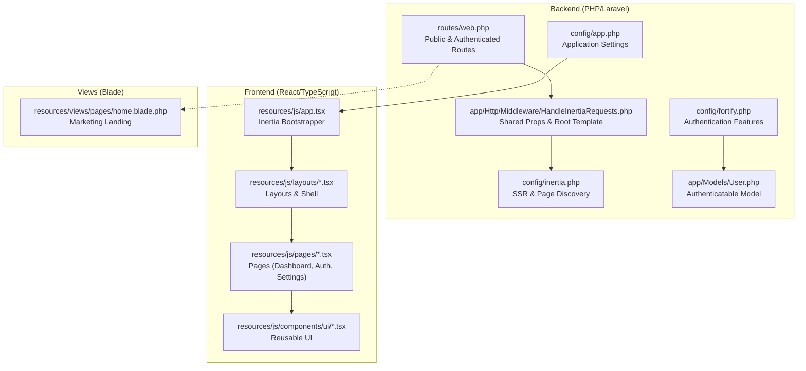
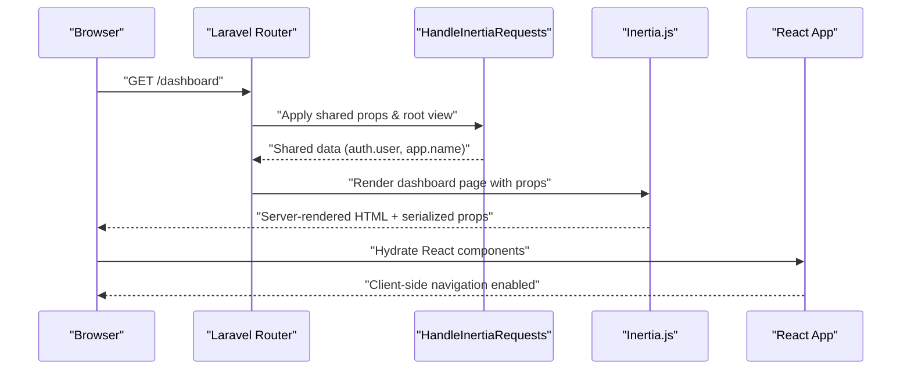
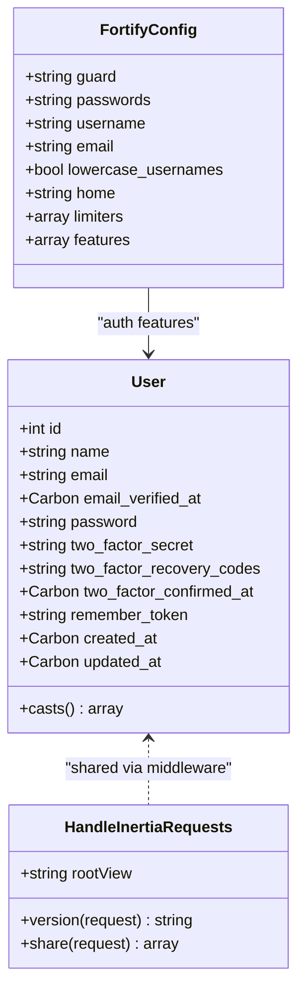
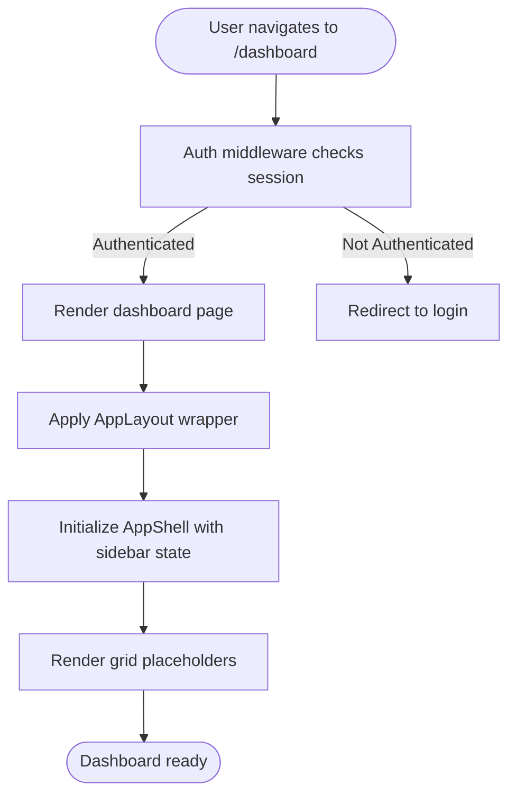
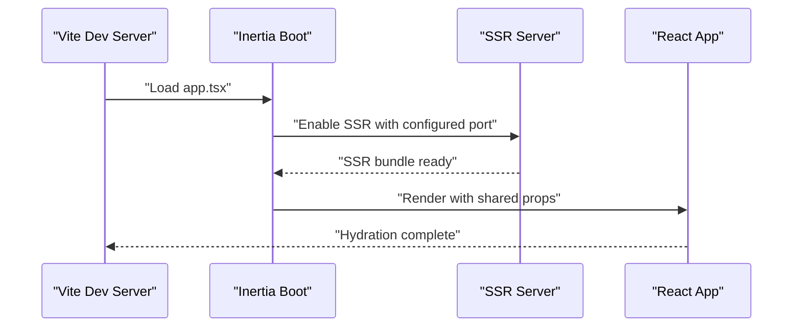
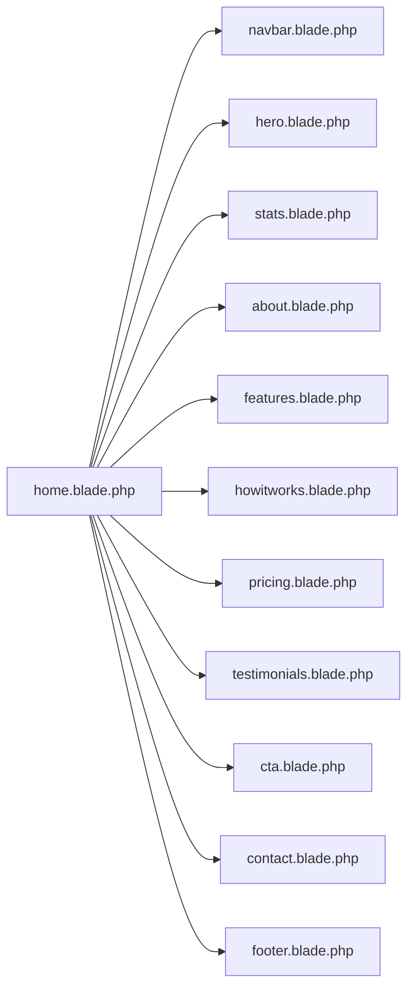
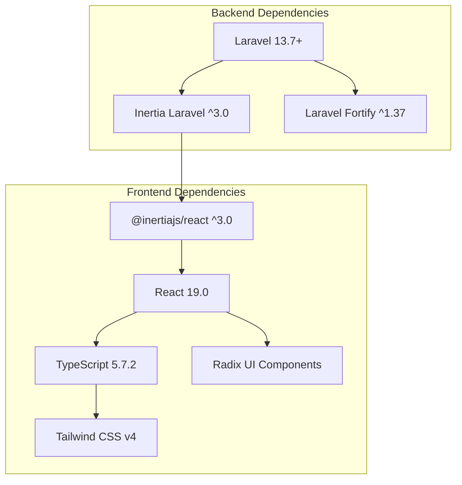

# Project Overview

<cite>
**Referenced Files in This Document**
- [composer.json](file://composer.json)
- [package.json](file://package.json)
- [config/app.php](file://config/app.php)
- [config/inertia.php](file://config/inertia.php)
- [config/fortify.php](file://config/fortify.php)
- [app/Http/Middleware/HandleInertiaRequests.php](file://app/Http/Middleware/HandleInertiaRequests.php)
- [app/Models/User.php](file://app/Models/User.php)
- [resources/js/app.tsx](file://resources/js/app.tsx)
- [resources/js/layouts/app-layout.tsx](file://resources/js/layouts/app-layout.tsx)
- [resources/js/components/app-shell.tsx](file://resources/js/components/app-shell.tsx)
- [resources/js/pages/dashboard.tsx](file://resources/js/pages/dashboard.tsx)
- [resources/js/pages/auth/login.tsx](file://resources/js/pages/auth/login.tsx)
- [resources/js/pages/auth/register.tsx](file://resources/js/pages/auth/register.tsx)
- [resources/views/pages/home.blade.php](file://resources/views/pages/home.blade.php)
- [routes/web.php](file://routes/web.php)
</cite>

## Table of Contents
1. [Introduction](#introduction)
2. [Project Structure](#project-structure)
3. [Core Components](#core-components)
4. [Architecture Overview](#architecture-overview)
5. [Detailed Component Analysis](#detailed-component-analysis)
6. [Dependency Analysis](#dependency-analysis)
7. [Performance Considerations](#performance-considerations)
8. [Troubleshooting Guide](#troubleshooting-guide)
9. [Conclusion](#conclusion)

## Introduction
SmartExam is an integrated exam management platform designed to streamline the end-to-end lifecycle of assessments. It combines a modern PHP backend built on Laravel 13.7+ with a dynamic React 19.0 frontend powered by TypeScript 5.7.2 and Inertia.js 3.0. This full-stack architecture enables server-rendered pages for SEO and performance, while delivering a responsive, interactive user experience through client-side routing and state management.

Key goals:
- Provide a secure, scalable foundation for exam administration
- Deliver a seamless user experience with fast navigation and real-time feedback
- Support advanced authentication including passkeys, two-factor authentication, and email verification
- Enable efficient onboarding and management of users, roles, and assessment workflows

Target audience:
- Educational institutions and training organizations
- Administrators managing exam schedules and user accounts
- Instructors and proctors requiring robust assessment tools
- Learners accessing practice exams and tracking progress

Main value propositions:
- Unified dashboard for centralized exam oversight
- Secure authentication with modern biometric and multi-factor options
- Modular UI components for consistent, accessible interfaces
- Configurable routing and layouts for flexible deployment scenarios

## Project Structure
The project follows a layered architecture with clear separation between backend services, frontend presentation, and shared UI components. The backend exposes RESTful endpoints and renders Blade templates, while the frontend consumes these endpoints via Inertia.js to render React pages with shared layouts and components.

**Diagram sources**
- [routes/web.php:1-29](file://routes/web.php#L1-L29)
- [app/Http/Middleware/HandleInertiaRequests.php:1-48](file://app/Http/Middleware/HandleInertiaRequests.php#L1-L48)
- [config/inertia.php:1-71](file://config/inertia.php#L1-L71)
- [config/fortify.php:1-192](file://config/fortify.php#L1-L192)
- [app/Models/User.php:1-53](file://app/Models/User.php#L1-L53)
- [config/app.php:1-127](file://config/app.php#L1-L127)
- [resources/js/app.tsx:1-41](file://resources/js/app.tsx#L1-L41)
- [resources/js/layouts/app-layout.tsx:1-17](file://resources/js/layouts/app-layout.tsx#L1-L17)
- [resources/js/components/app-shell.tsx:1-22](file://resources/js/components/app-shell.tsx#L1-L22)
- [resources/js/pages/dashboard.tsx:1-37](file://resources/js/pages/dashboard.tsx#L1-L37)
- [resources/views/pages/home.blade.php:1-21](file://resources/views/pages/home.blade.php#L1-L21)

**Section sources**
- [routes/web.php:1-29](file://routes/web.php#L1-L29)
- [config/inertia.php:1-71](file://config/inertia.php#L1-L71)
- [config/fortify.php:1-192](file://config/fortify.php#L1-L192)
- [app/Http/Middleware/HandleInertiaRequests.php:1-48](file://app/Http/Middleware/HandleInertiaRequests.php#L1-L48)
- [app/Models/User.php:1-53](file://app/Models/User.php#L1-L53)
- [config/app.php:1-127](file://config/app.php#L1-L127)
- [resources/js/app.tsx:1-41](file://resources/js/app.tsx#L1-L41)
- [resources/js/layouts/app-layout.tsx:1-17](file://resources/js/layouts/app-layout.tsx#L1-L17)
- [resources/js/components/app-shell.tsx:1-22](file://resources/js/components/app-shell.tsx#L1-L22)
- [resources/js/pages/dashboard.tsx:1-37](file://resources/js/pages/dashboard.tsx#L1-L37)
- [resources/views/pages/home.blade.php:1-21](file://resources/views/pages/home.blade.php#L1-L21)

## Core Components
- Laravel 13.7+: Full-stack PHP framework providing routing, middleware, authentication, and service container. It manages application configuration, environment variables, and integrates with Inertia.js for seamless SSR and client-side navigation.
- React 19.0 + TypeScript 5.7.2: Modern frontend library with type safety, enabling component-driven UI development and strong developer ergonomics.
- Inertia.js 3.0: Bridges Laravel and React by rendering React pages server-side and hydrating them client-side, preserving server-side benefits like SEO and SSR while enabling SPA-like navigation.
- Blade Templates: Server-rendered marketing and static pages, complementing the React-driven authenticated areas.
- Fortify: Provides configurable authentication features including registration, password reset, email verification, two-factor authentication, and passkeys.

Common use cases:
- New user registration and email verification
- Secure login with optional two-factor authentication and passkeys
- Access to the authenticated dashboard after successful authentication
- Navigation between authenticated pages with shared layouts and breadcrumbs

**Section sources**
- [composer.json:11-19](file://composer.json#L11-L19)
- [package.json:31-66](file://package.json#L31-L66)
- [config/fortify.php:169-189](file://config/fortify.php#L169-L189)
- [resources/js/pages/auth/register.tsx:1-121](file://resources/js/pages/auth/register.tsx#L1-L121)
- [resources/js/pages/auth/login.tsx:1-126](file://resources/js/pages/auth/login.tsx#L1-L126)
- [routes/web.php:24-26](file://routes/web.php#L24-L26)
- [resources/js/pages/dashboard.tsx:1-37](file://resources/js/pages/dashboard.tsx#L1-L37)

## Architecture Overview
The system employs a hybrid SSR/SPA architecture. Laravel handles routing, middleware, and authentication, while Inertia.js renders React pages server-side initially and then hydrates them client-side. Shared props (like user context and application name) are injected via middleware, and layouts are applied conditionally based on the page route.

**Diagram sources**
- [routes/web.php:24-26](file://routes/web.php#L24-L26)
- [app/Http/Middleware/HandleInertiaRequests.php:36-46](file://app/Http/Middleware/HandleInertiaRequests.php#L36-L46)
- [resources/js/app.tsx:11-37](file://resources/js/app.tsx#L11-L37)

**Section sources**
- [routes/web.php:1-29](file://routes/web.php#L1-L29)
- [app/Http/Middleware/HandleInertiaRequests.php:17-46](file://app/Http/Middleware/HandleInertiaRequests.php#L17-L46)
- [config/inertia.php:18-23](file://config/inertia.php#L18-L23)
- [resources/js/app.tsx:11-37](file://resources/js/app.tsx#L11-L37)

## Detailed Component Analysis

### Authentication and User Management
SmartExam leverages Laravel Fortify to provide a comprehensive authentication suite. The configuration enables registration, password reset, email verification, two-factor authentication, and passkeys. The User model implements both passkey and two-factor capabilities, ensuring secure and flexible sign-in options.

**Diagram sources**
- [app/Models/User.php:17-52](file://app/Models/User.php#L17-L52)
- [app/Http/Middleware/HandleInertiaRequests.php:8-46](file://app/Http/Middleware/HandleInertiaRequests.php#L8-L46)
- [config/fortify.php:18-189](file://config/fortify.php#L18-L189)

Practical examples:
- User registration with password validation rules and email verification
- Login with optional two-factor challenge and passkey verification
- Password reset initiated from the login page and completed via email link

**Section sources**
- [config/fortify.php:169-189](file://config/fortify.php#L169-L189)
- [app/Models/User.php:32-52](file://app/Models/User.php#L32-L52)
- [resources/js/pages/auth/register.tsx:16-115](file://resources/js/pages/auth/register.tsx#L16-L115)
- [resources/js/pages/auth/login.tsx:24-120](file://resources/js/pages/auth/login.tsx#L24-L120)

### Dashboard and Layout System
The dashboard serves as the central hub for authenticated users. It uses a grid-based layout with placeholder patterns to illustrate content areas and integrates breadcrumbs for navigation context. The layout system applies a shared shell with sidebar provider and conditional open state persisted via cookies.

**Diagram sources**
- [routes/web.php:24-26](file://routes/web.php#L24-L26)
- [resources/js/pages/dashboard.tsx:5-36](file://resources/js/pages/dashboard.tsx#L5-L36)
- [resources/js/layouts/app-layout.tsx:4-16](file://resources/js/layouts/app-layout.tsx#L4-L16)
- [resources/js/components/app-shell.tsx:11-21](file://resources/js/components/app-shell.tsx#L11-L21)
- [app/Http/Middleware/HandleInertiaRequests.php:40-45](file://app/Http/Middleware/HandleInertiaRequests.php#L40-L45)

**Section sources**
- [routes/web.php:24-26](file://routes/web.php#L24-L26)
- [resources/js/pages/dashboard.tsx:1-37](file://resources/js/pages/dashboard.tsx#L1-L37)
- [resources/js/layouts/app-layout.tsx:1-17](file://resources/js/layouts/app-layout.tsx#L1-L17)
- [resources/js/components/app-shell.tsx:1-22](file://resources/js/components/app-shell.tsx#L1-L22)
- [app/Http/Middleware/HandleInertiaRequests.php:36-46](file://app/Http/Middleware/HandleInertiaRequests.php#L36-L46)

### Frontend Bootstrapping and SSR
The React application is bootstrapped with Inertia.js, which sets the page title, applies layouts based on route prefixes, and initializes theme preferences. SSR is enabled and configured to run on a dedicated port, allowing server-rendered HTML to be delivered for improved performance and SEO.

**Diagram sources**
- [resources/js/app.tsx:11-37](file://resources/js/app.tsx#L11-L37)
- [config/inertia.php:18-23](file://config/inertia.php#L18-L23)

**Section sources**
- [resources/js/app.tsx:1-41](file://resources/js/app.tsx#L1-L41)
- [config/inertia.php:18-23](file://config/inertia.php#L18-L23)

### Marketing Landing Page
The marketing landing page is rendered server-side using Blade templates, aggregating reusable components for navigation, hero, features, testimonials, and contact sections. This complements the React-powered authenticated areas with a performant, SEO-friendly homepage.

**Diagram sources**
- [resources/views/pages/home.blade.php:1-21](file://resources/views/pages/home.blade.php#L1-L21)

**Section sources**
- [resources/views/pages/home.blade.php:1-21](file://resources/views/pages/home.blade.php#L1-L21)

## Dependency Analysis
The project’s dependencies reflect a modern full-stack ecosystem. Laravel 13.7+ provides the backend foundation, Inertia.js bridges server and client, and React 19.0 with TypeScript deliver a type-safe frontend. Fortify adds robust authentication features, while Vite and Tailwind CSS handle asset bundling and styling.

**Diagram sources**
- [composer.json:11-19](file://composer.json#L11-L19)
- [package.json:31-66](file://package.json#L31-L66)

**Section sources**
- [composer.json:11-19](file://composer.json#L11-L19)
- [package.json:31-66](file://package.json#L31-L66)

## Performance Considerations
- Server-Side Rendering: Enabling SSR improves initial page load performance and SEO. Configure the SSR port appropriately and ensure the SSR server is reachable during development and production.
- Asset Versioning: Inertia’s asset versioning helps prevent stale caches. Keep the version strategy aligned with your build pipeline.
- Conditional Layouts: Applying layouts only when necessary reduces unnecessary overhead in unauthenticated contexts.
- Theme Initialization: Initializing theme preferences early ensures consistent rendering without flicker.

## Troubleshooting Guide
- Authentication redirects: Verify the home path and middleware configuration to ensure users are redirected correctly after login or password reset.
- SSR port conflicts: If the SSR server fails to start, check the configured port and ensure it is not in use.
- Shared props: Confirm that shared props (like user context) are being injected by the middleware and accessible in React components.
- Layout application: Ensure layout conditions match route prefixes to avoid incorrect layout rendering.

**Section sources**
- [config/fortify.php:76](file://config/fortify.php#L76)
- [config/inertia.php:18-23](file://config/inertia.php#L18-L23)
- [app/Http/Middleware/HandleInertiaRequests.php:36-46](file://app/Http/Middleware/HandleInertiaRequests.php#L36-L46)
- [resources/js/app.tsx:13-24](file://resources/js/app.tsx#L13-L24)

## Conclusion
SmartExam delivers a modern, secure, and scalable exam management platform by combining Laravel’s robust backend capabilities with React’s dynamic frontend. The integration of Inertia.js enables a smooth hybrid architecture that supports SSR, responsive navigation, and consistent user experiences. With comprehensive authentication features, modular UI components, and a clear separation of concerns, the platform is well-positioned to serve educational institutions and training organizations effectively.