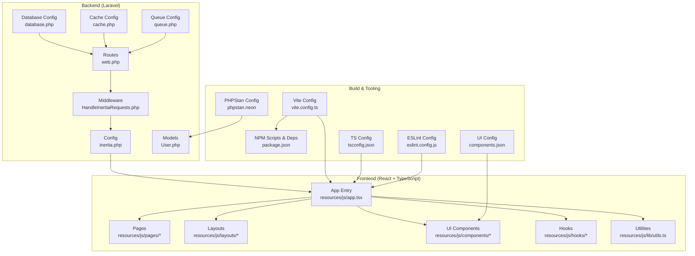
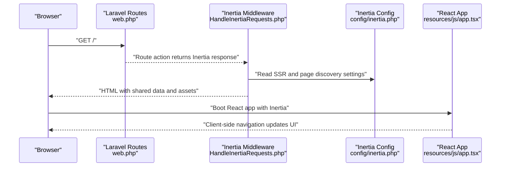
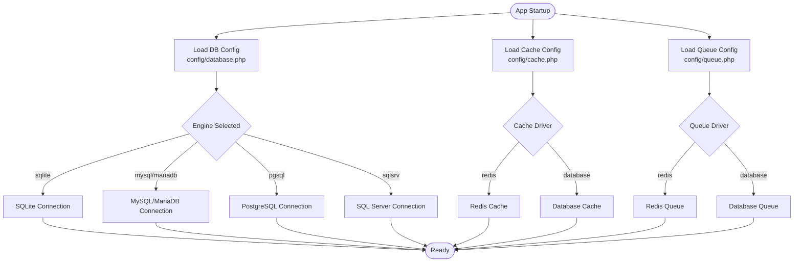
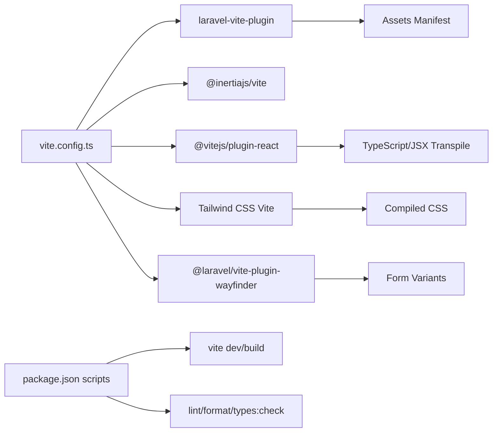
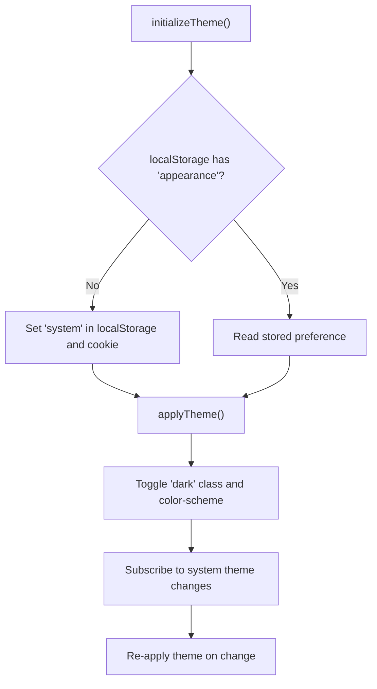
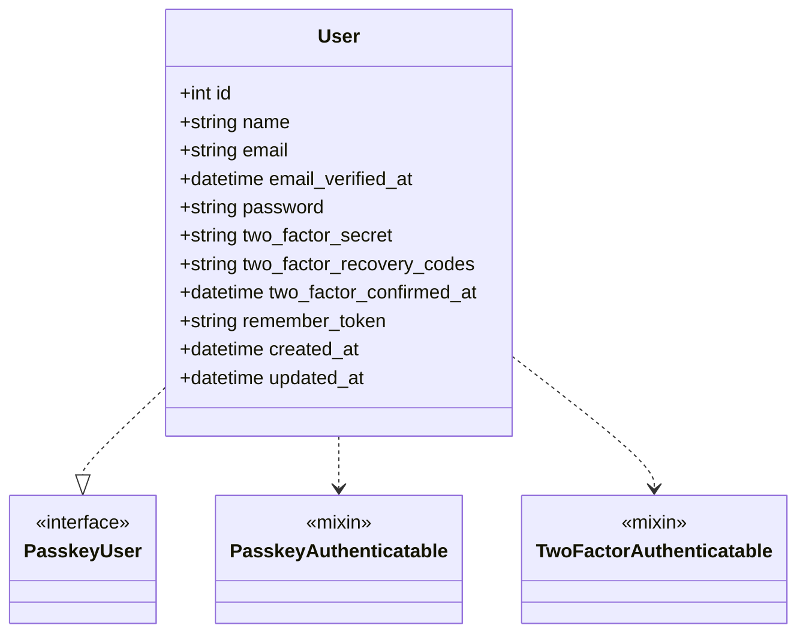
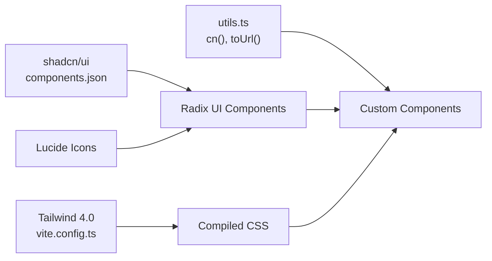

# Technology Stack

<cite>
**Referenced Files in This Document**
- [package.json](file://package.json)
- [vite.config.ts](file://vite.config.ts)
- [composer.json](file://composer.json)
- [config/inertia.php](file://config/inertia.php)
- [app/Http/Middleware/HandleInertiaRequests.php](file://app/Http/Middleware/HandleInertiaRequests.php)
- [resources/js/app.tsx](file://resources/js/app.tsx)
- [config/database.php](file://config/database.php)
- [config/cache.php](file://config/cache.php)
- [config/queue.php](file://config/queue.php)
- [tsconfig.json](file://tsconfig.json)
- [eslint.config.js](file://eslint.config.js)
- [phpstan.neon](file://phpstan.neon)
- [components.json](file://components.json)
- [resources/js/hooks/use-appearance.tsx](file://resources/js/hooks/use-appearance.tsx)
- [resources/js/lib/utils.ts](file://resources/js/lib/utils.ts)
- [routes/web.php](file://routes/web.php)
- [app/Models/User.php](file://app/Models/User.php)
</cite>

## Table of Contents
1. [Introduction](#introduction)
2. [Project Structure](#project-structure)
3. [Core Components](#core-components)
4. [Architecture Overview](#architecture-overview)
5. [Detailed Component Analysis](#detailed-component-analysis)
6. [Dependency Analysis](#dependency-analysis)
7. [Performance Considerations](#performance-considerations)
8. [Troubleshooting Guide](#troubleshooting-guide)
9. [Conclusion](#conclusion)

## Introduction
This document explains the SmartExam technology stack and how its components work together to deliver a modern full-stack application. The backend is powered by Laravel 13.7+ with Inertia.js 3.0 for seamless React integration, while the frontend is built with React 19.0, TypeScript 5.7.2, and a curated set of UI primitives. The build system leverages Vite 5.0 with Laravel Vite Plugin and a dedicated asset pipeline. The data layer supports SQLite, MySQL, and PostgreSQL with Redis-backed caching and queue management. Development tooling includes ESLint, Prettier, and PHPStan to maintain quality and consistency.

## Project Structure
SmartExam follows a layered full-stack structure:
- Backend (PHP/Laravel): Controllers, middleware, models, configuration, and routing.
- Frontend (TypeScript/React): Pages, layouts, components, hooks, and shared utilities.
- Build and Tooling: Vite configuration, scripts, and developer tooling configs.



**Diagram sources**
- [routes/web.php:1-26](file://routes/web.php#L1-L26)
- [app/Http/Middleware/HandleInertiaRequests.php:1-48](file://app/Http/Middleware/HandleInertiaRequests.php#L1-L48)
- [config/inertia.php:1-71](file://config/inertia.php#L1-L71)
- [resources/js/app.tsx:1-41](file://resources/js/app.tsx#L1-L41)
- [vite.config.ts:1-32](file://vite.config.ts#L1-L32)
- [package.json:1-77](file://package.json#L1-L77)
- [tsconfig.json:1-122](file://tsconfig.json#L1-L122)
- [eslint.config.js:1-130](file://eslint.config.js#L1-L130)
- [phpstan.neon:1-14](file://phpstan.neon#L1-L14)
- [components.json:1-22](file://components.json#L1-L22)
- [config/database.php:1-185](file://config/database.php#L1-L185)
- [config/cache.php:1-137](file://config/cache.php#L1-L137)
- [config/queue.php:1-130](file://config/queue.php#L1-L130)
- [app/Models/User.php:1-53](file://app/Models/User.php#L1-L53)

**Section sources**
- [routes/web.php:1-26](file://routes/web.php#L1-L26)
- [app/Http/Middleware/HandleInertiaRequests.php:1-48](file://app/Http/Middleware/HandleInertiaRequests.php#L1-L48)
- [config/inertia.php:1-71](file://config/inertia.php#L1-L71)
- [resources/js/app.tsx:1-41](file://resources/js/app.tsx#L1-L41)
- [vite.config.ts:1-32](file://vite.config.ts#L1-L32)
- [package.json:1-77](file://package.json#L1-L77)
- [tsconfig.json:1-122](file://tsconfig.json#L1-L122)
- [eslint.config.js:1-130](file://eslint.config.js#L1-L130)
- [phpstan.neon:1-14](file://phpstan.neon#L1-L14)
- [components.json:1-22](file://components.json#L1-L22)
- [config/database.php:1-185](file://config/database.php#L1-L185)
- [config/cache.php:1-137](file://config/cache.php#L1-L137)
- [config/queue.php:1-130](file://config/queue.php#L1-L130)
- [app/Models/User.php:1-53](file://app/Models/User.php#L1-L53)

## Core Components
- Laravel 13.7+: Full-stack PHP framework providing routing, middleware, Eloquent ORM, queues, caching, and configuration.
- Inertia.js 3.0: Bridges Laravel and React by rendering Blade templates on the server and React pages on the client.
- React 19.0 + TypeScript 5.7.2: Modern frontend with strong typing and component-driven architecture.
- Vite 5.0 + Laravel Vite Plugin: Fast build toolchain with hot module replacement and optimized production builds.
- Database: SQLite (default), MySQL, MariaDB, PostgreSQL, SQL Server with flexible configuration.
- Caching: Redis and database-backed cache stores.
- Queues: Redis, database, SQS, Beanstalkd, and sync drivers.
- UI Toolkit: Tailwind CSS 4.0, shadcn/ui (Radix UI-based), and custom component library.
- Developer Tools: ESLint, Prettier, PHPStan, and automated CI checks.

**Section sources**
- [composer.json:11-18](file://composer.json#L11-L18)
- [package.json:31-66](file://package.json#L31-L66)
- [vite.config.ts:1-32](file://vite.config.ts#L1-L32)
- [config/database.php:20-116](file://config/database.php#L20-L116)
- [config/cache.php:18-108](file://config/cache.php#L18-L108)
- [config/queue.php:16-92](file://config/queue.php#L16-L92)
- [components.json:1-22](file://components.json#L1-L22)
- [eslint.config.js:1-130](file://eslint.config.js#L1-L130)
- [phpstan.neon:1-14](file://phpstan.neon#L1-L14)

## Architecture Overview
SmartExam uses a full-stack MVC pattern with a React SPA fronted by Laravel. Inertia.js coordinates navigation and data sharing between server and client. Vite manages assets and development ergonomics. Redis powers caching and queues, while the database supports multiple engines.

```mermaid
graph TB
Browser["Browser"]
Laravel["Laravel Backend<br/>routes/web.php"]
InertiaMW["Inertia Middleware<br/>HandleInertiaRequests.php"]
InertiaCfg["Inertia Config<br/>config/inertia.php"]
ReactApp["React App<br/>resources/js/app.tsx"]
ViteDev["Vite Dev Server<br/>vite.config.ts"]
DB["Database<br/>config/database.php"]
Redis["Redis Cache/Queue<br/>config/cache.php<br/>config/queue.php"]
Browser --> Laravel
Laravel --> InertiaMW
InertiaMW --> InertiaCfg
InertiaMW --> ReactApp
Browser <- --> ViteDev
ReactApp --> DB
ReactApp --> Redis
Laravel --> DB
Laravel --> Redis
```

**Diagram sources**
- [routes/web.php:1-26](file://routes/web.php#L1-L26)
- [app/Http/Middleware/HandleInertiaRequests.php:1-48](file://app/Http/Middleware/HandleInertiaRequests.php#L1-L48)
- [config/inertia.php:1-71](file://config/inertia.php#L1-L71)
- [resources/js/app.tsx:1-41](file://resources/js/app.tsx#L1-L41)
- [vite.config.ts:1-32](file://vite.config.ts#L1-L32)
- [config/database.php:1-185](file://config/database.php#L1-L185)
- [config/cache.php:1-137](file://config/cache.php#L1-L137)
- [config/queue.php:1-130](file://config/queue.php#L1-L130)

## Detailed Component Analysis

### Laravel Backend
- Routing: Defines homepage, contact form submission, and authenticated dashboard routes using Inertia responses.
- Middleware: Centralizes shared data (application name, authenticated user, sidebar state) and sets the root template for Inertia.
- Configuration: Inertia SSR enabled, page discovery paths configured, and testing settings enforced.



**Diagram sources**
- [routes/web.php:5-23](file://routes/web.php#L5-L23)
- [app/Http/Middleware/HandleInertiaRequests.php:17-46](file://app/Http/Middleware/HandleInertiaRequests.php#L17-L46)
- [config/inertia.php:18-51](file://config/inertia.php#L18-L51)
- [resources/js/app.tsx:11-37](file://resources/js/app.tsx#L11-L37)

**Section sources**
- [routes/web.php:1-26](file://routes/web.php#L1-L26)
- [app/Http/Middleware/HandleInertiaRequests.php:1-48](file://app/Http/Middleware/HandleInertiaRequests.php#L1-L48)
- [config/inertia.php:1-71](file://config/inertia.php#L1-L71)
- [resources/js/app.tsx:1-41](file://resources/js/app.tsx#L1-L41)

### Database Layer
- Engines: SQLite (default), MySQL/MariaDB, PostgreSQL, SQL Server, with environment-driven configuration.
- Redis: Dedicated cache and queue connections with configurable prefixes and retry/backoff policies.
- Cache: Multiple stores including database, file, Redis, DynamoDB, and failover combinations.
- Queue: Multiple drivers including database, Redis, SQS, Beanstalkd, and failover/batching support.



**Diagram sources**
- [config/database.php:20-182](file://config/database.php#L20-L182)
- [config/cache.php:18-108](file://config/cache.php#L18-L108)
- [config/queue.php:16-92](file://config/queue.php#L16-L92)

**Section sources**
- [config/database.php:1-185](file://config/database.php#L1-L185)
- [config/cache.php:1-137](file://config/cache.php#L1-L137)
- [config/queue.php:1-130](file://config/queue.php#L1-L130)

### Frontend Framework and Build System
- Vite 5.0: Plugins include Laravel Vite Plugin, Inertia plugin, React with Babel compiler, Tailwind CSS, and Wayfinder for form variants.
- Asset Pipeline: Laravel Vite Plugin manages manifest and asset URLs; fonts served via Bunny CDN.
- TypeScript: Strict mode, ESNext target, bundler module resolution, and JSX emit for React.
- UI Toolkit: Tailwind 4.0 with Lightning CSS engine; shadcn/ui configured with Radix UI components and Lucide icons.



**Diagram sources**
- [vite.config.ts:1-32](file://vite.config.ts#L1-L32)
- [package.json:5-14](file://package.json#L5-L14)

**Section sources**
- [vite.config.ts:1-32](file://vite.config.ts#L1-L32)
- [package.json:1-77](file://package.json#L1-L77)
- [tsconfig.json:1-122](file://tsconfig.json#L1-L122)
- [components.json:1-22](file://components.json#L1-L22)

### State Management Patterns
- Appearance Management: A custom hook integrates React’s useSyncExternalStore with localStorage and cookies to persist light/dark/system preferences across SSR and CSR.
- Shared Data: Inertia middleware shares application-wide data (name, auth.user, sidebarOpen) with the client on each request.



**Diagram sources**
- [resources/js/hooks/use-appearance.tsx:73-88](file://resources/js/hooks/use-appearance.tsx#L73-L88)
- [resources/js/hooks/use-appearance.tsx:44-53](file://resources/js/hooks/use-appearance.tsx#L44-L53)

**Section sources**
- [resources/js/hooks/use-appearance.tsx:1-116](file://resources/js/hooks/use-appearance.tsx#L1-L116)
- [app/Http/Middleware/HandleInertiaRequests.php:36-46](file://app/Http/Middleware/HandleInertiaRequests.php#L36-L46)

### Authentication and Security Model
- Laravel Fortify: Provides registration, login, password resets, email verification, and two-factor authentication scaffolding.
- Passkeys: Implements WebAuthn passkey authentication via Laravel Fortify’s PasskeyUser contract.
- Two-Factor Authentication: Integrated with Laravel Fortify’s TwoFactorAuthenticatable trait.



**Diagram sources**
- [app/Models/User.php:32-35](file://app/Models/User.php#L32-L35)

**Section sources**
- [app/Models/User.php:1-53](file://app/Models/User.php#L1-L53)
- [composer.json:14-16](file://composer.json#L14-L16)

### UI Components and Styling
- Tailwind CSS 4.0: Enabled via Vite plugin with Lightning CSS engine for performance.
- shadcn/ui: Configured with Radix UI components and Lucide icons; TSX enabled and aliases mapped to resources/js.
- Utilities: cn() composes Tailwind classes with clsx and tailwind-merge; toUrl() normalizes Inertia links.



**Diagram sources**
- [vite.config.ts:3, 63](file://vite.config.ts#L3,L63)
- [components.json:1-22](file://components.json#L1-L22)
- [resources/js/lib/utils.ts:1-13](file://resources/js/lib/utils.ts#L1-L13)

**Section sources**
- [vite.config.ts:1-32](file://vite.config.ts#L1-L32)
- [components.json:1-22](file://components.json#L1-L22)
- [resources/js/lib/utils.ts:1-13](file://resources/js/lib/utils.ts#L1-L13)

## Dependency Analysis
SmartExam’s dependencies are organized by responsibility:
- Backend: Laravel core, Inertia Laravel, Fortify, Chisel, Wayfinder.
- Frontend: Inertia React, React 19, Radix UI primitives, Tailwind 4, TypeScript, Vite plugins.
- Tooling: ESLint flat config, Prettier, TypeScript ESLint, PHPStan via Larastan.

```mermaid
graph TB
subgraph "Backend Dependencies"
Laravel["laravel/framework ^13.7"]
InertiaL["inertiajs/inertia-laravel ^3.0"]
Fortify["laravel/fortify ^1.37"]
Chisel["laravel/chisel ^0.1"]
Wayfinder["laravel/wayfinder ^0.1"]
end
subgraph "Frontend Dependencies"
InertiaR["@inertiajs/react ^3.0"]
React19["react ^19.0", "react-dom ^19.0"]
Radix["Radix UI packages"]
Tailwind["tailwindcss ^4.0"]
Typescript["typescript ^5.7"]
Vite["vite ^8.0"]
end
subgraph "Tooling"
ESLint["eslint + plugins"]
Prettier["prettier"]
PHPStan["larastan/phpstan"]
end
Laravel --> InertiaL
Laravel --> Fortify
Laravel --> Wayfinder
InertiaL --> InertiaR
InertiaR --> React19
React19 --> Radix
Tailwind --> Vite
Typescript --> Vite
ESLint --> Prettier
Laravel --> PHPStan
```

**Diagram sources**
- [composer.json:11-29](file://composer.json#L11-L29)
- [package.json:15-66](file://package.json#L15-L66)
- [eslint.config.js:1-130](file://eslint.config.js#L1-L130)
- [phpstan.neon:1-14](file://phpstan.neon#L1-L14)

**Section sources**
- [composer.json:1-120](file://composer.json#L1-L120)
- [package.json:1-77](file://package.json#L1-L77)
- [eslint.config.js:1-130](file://eslint.config.js#L1-L130)
- [phpstan.neon:1-14](file://phpstan.neon#L1-L14)

## Performance Considerations
- Vite with React Compiler: Optimized transpilation and fast HMR for development.
- Tailwind 4.0 + Lightning CSS: Faster CSS processing and smaller bundles.
- Redis: Low-latency caching and queuing; tune retry/backoff and connection pooling.
- Database: Prefer prepared statements, proper indexing, and connection pooling for MySQL/PG.
- Inertia SSR: Optional SSR endpoint can improve initial load; ensure minimal payload and lazy-load non-critical assets.

## Troubleshooting Guide
- Inertia SSR not rendering:
  - Verify SSR enabled and port in Inertia config.
  - Confirm middleware root view matches Blade template.
- Asset pipeline issues:
  - Clear Vite cache and rebuild; ensure Laravel Vite Plugin input entries are correct.
- TypeScript errors:
  - Run type check script; review tsconfig strictness and module resolution.
- Linting/formatting failures:
  - Use lint and format scripts; ensure ESLint/Prettier configs align with project settings.
- PHPStan errors:
  - Review level and included paths; ensure vendor autoload is up to date.

**Section sources**
- [config/inertia.php:18-23](file://config/inertia.php#L18-L23)
- [app/Http/Middleware/HandleInertiaRequests.php:17](file://app/Http/Middleware/HandleInertiaRequests.php#L17)
- [vite.config.ts:11-19](file://vite.config.ts#L11-L19)
- [tsconfig.json:86-114](file://tsconfig.json#L86-L114)
- [eslint.config.js:1-130](file://eslint.config.js#L1-L130)
- [phpstan.neon:5-14](file://phpstan.neon#L5-L14)

## Conclusion
SmartExam’s stack combines Laravel’s robust backend capabilities with React and TypeScript for a modern, type-safe frontend. Inertia.js streamlines the integration, while Vite delivers a fast build and dev experience. The database and caching layer are flexible and scalable, and the UI toolkit ensures consistent, accessible components. Tooling like ESLint, Prettier, and PHPStan maintains code quality across the stack.