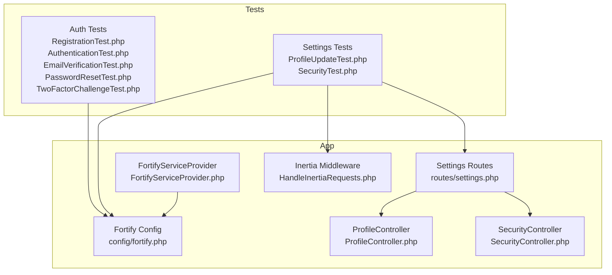
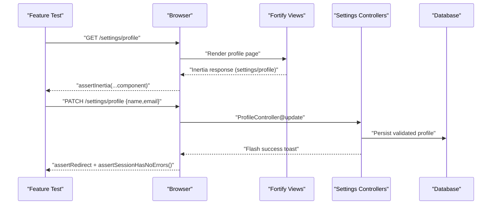
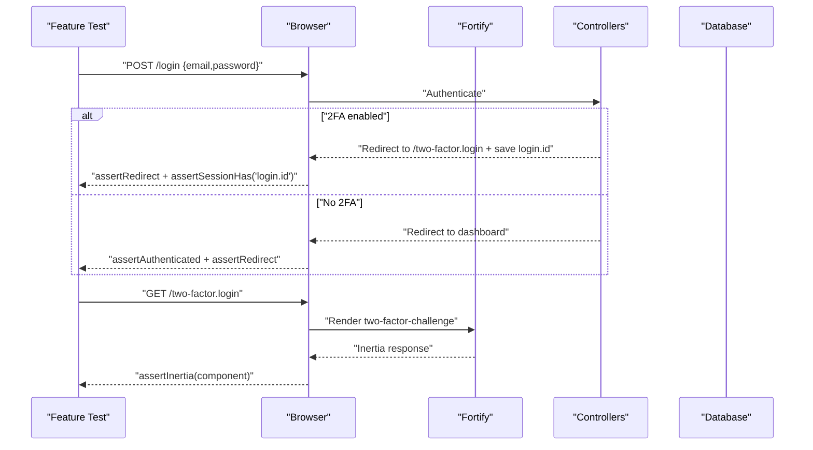
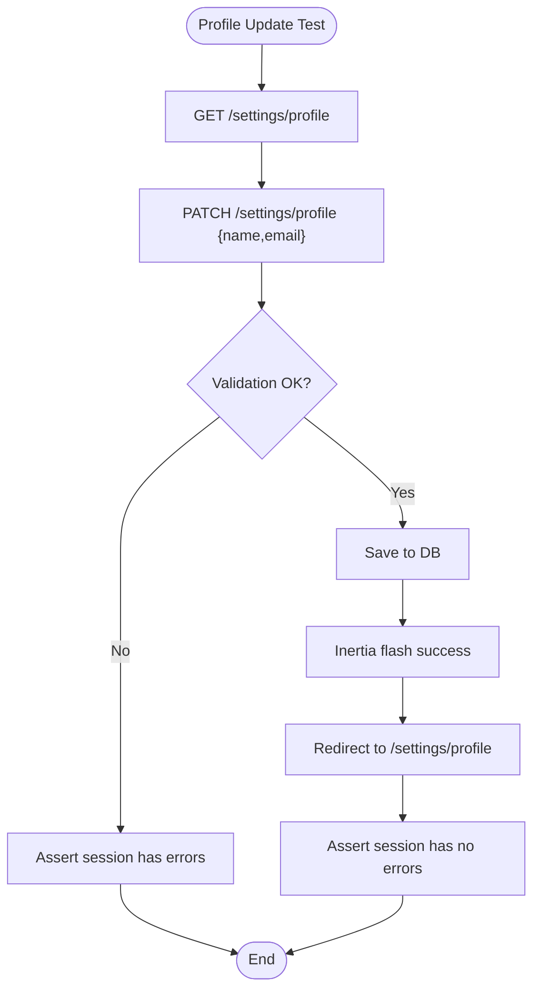
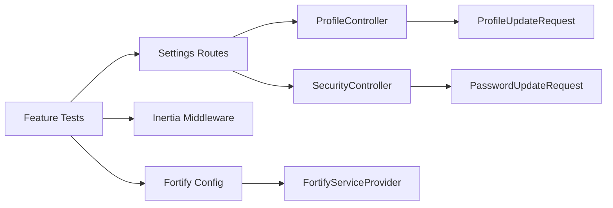

# Feature Testing

<cite>
**Referenced Files in This Document**
- [TestCase.php](file://tests/TestCase.php)
- [RegistrationTest.php](file://tests/Feature/Auth/RegistrationTest.php)
- [AuthenticationTest.php](file://tests/Feature/Auth/AuthenticationTest.php)
- [EmailVerificationTest.php](file://tests/Feature/Auth/EmailVerificationTest.php)
- [PasswordResetTest.php](file://tests/Feature/Auth/PasswordResetTest.php)
- [TwoFactorChallengeTest.php](file://tests/Feature/Auth/TwoFactorChallengeTest.php)
- [ProfileUpdateTest.php](file://tests/Feature/Settings/ProfileUpdateTest.php)
- [SecurityTest.php](file://tests/Feature/Settings/SecurityTest.php)
- [fortify.php](file://config/fortify.php)
- [HandleInertiaRequests.php](file://app/Http/Middleware/HandleInertiaRequests.php)
- [ProfileController.php](file://app/Http/Controllers/Settings/ProfileController.php)
- [SecurityController.php](file://app/Http/Controllers/Settings/SecurityController.php)
- [settings.php](file://routes/settings.php)
- [ProfileUpdateRequest.php](file://app/Http/Requests/Settings/ProfileUpdateRequest.php)
- [PasswordUpdateRequest.php](file://app/Http/Requests/Settings/PasswordUpdateRequest.php)
- [PasswordValidationRules.php](file://app/Concerns/PasswordValidationRules.php)
- [ProfileValidationRules.php](file://app/Concerns/ProfileValidationRules.php)
- [FortifyServiceProvider.php](file://app/Providers/FortifyServiceProvider.php)
</cite>

## Table of Contents
1. [Introduction](#introduction)
2. [Project Structure](#project-structure)
3. [Core Components](#core-components)
4. [Architecture Overview](#architecture-overview)
5. [Detailed Component Analysis](#detailed-component-analysis)
6. [Dependency Analysis](#dependency-analysis)
7. [Performance Considerations](#performance-considerations)
8. [Troubleshooting Guide](#troubleshooting-guide)
9. [Conclusion](#conclusion)
10. [Appendices](#appendices)

## Introduction
This document provides comprehensive feature testing guidance for SmartExam’s end-to-end functionality. It focuses on authentication flows (registration, login, email verification, password reset, and two-factor authentication), settings management (profile updates, security changes, and appearance preferences), and testing patterns for Inertia.js responses, redirects, and flash messages. It also covers database interactions, session management, and state persistence across feature tests.

## Project Structure
SmartExam organizes feature tests under the tests/Feature directory, grouped by domain (Auth, Settings). The application integrates Laravel Fortify for authentication features and Inertia.js for server-rendered React/Vue pages. Configuration for Fortify controls which features are enabled, and middleware ensures shared data and Inertia rendering.

**Diagram sources**
- [RegistrationTest.php:1-40](file://tests/Feature/Auth/RegistrationTest.php#L1-L40)
- [AuthenticationTest.php:1-93](file://tests/Feature/Auth/AuthenticationTest.php#L1-L93)
- [EmailVerificationTest.php:1-120](file://tests/Feature/Auth/EmailVerificationTest.php#L1-L120)
- [PasswordResetTest.php:1-96](file://tests/Feature/Auth/PasswordResetTest.php#L1-L96)
- [TwoFactorChallengeTest.php:1-50](file://tests/Feature/Auth/TwoFactorChallengeTest.php#L1-L50)
- [ProfileUpdateTest.php:1-100](file://tests/Feature/Settings/ProfileUpdateTest.php#L1-L100)
- [SecurityTest.php:1-131](file://tests/Feature/Settings/SecurityTest.php#L1-L131)
- [fortify.php:1-192](file://config/fortify.php#L1-L192)
- [HandleInertiaRequests.php:1-48](file://app/Http/Middleware/HandleInertiaRequests.php#L1-L48)
- [settings.php:1-41](file://routes/settings.php#L1-L41)
- [ProfileController.php:1-63](file://app/Http/Controllers/Settings/ProfileController.php#L1-L63)
- [SecurityController.php:1-73](file://app/Http/Controllers/Settings/SecurityController.php#L1-L73)
- [FortifyServiceProvider.php:1-118](file://app/Providers/FortifyServiceProvider.php#L1-L118)

**Section sources**
- [RegistrationTest.php:1-40](file://tests/Feature/Auth/RegistrationTest.php#L1-L40)
- [AuthenticationTest.php:1-93](file://tests/Feature/Auth/AuthenticationTest.php#L1-L93)
- [EmailVerificationTest.php:1-120](file://tests/Feature/Auth/EmailVerificationTest.php#L1-L120)
- [PasswordResetTest.php:1-96](file://tests/Feature/Auth/PasswordResetTest.php#L1-L96)
- [TwoFactorChallengeTest.php:1-50](file://tests/Feature/Auth/TwoFactorChallengeTest.php#L1-L50)
- [ProfileUpdateTest.php:1-100](file://tests/Feature/Settings/ProfileUpdateTest.php#L1-L100)
- [SecurityTest.php:1-131](file://tests/Feature/Settings/SecurityTest.php#L1-L131)
- [fortify.php:1-192](file://config/fortify.php#L1-L192)
- [HandleInertiaRequests.php:1-48](file://app/Http/Middleware/HandleInertiaRequests.php#L1-L48)
- [settings.php:1-41](file://routes/settings.php#L1-L41)
- [ProfileController.php:1-63](file://app/Http/Controllers/Settings/ProfileController.php#L1-L63)
- [SecurityController.php:1-73](file://app/Http/Controllers/Settings/SecurityController.php#L1-L73)
- [FortifyServiceProvider.php:1-118](file://app/Providers/FortifyServiceProvider.php#L1-L118)

## Core Components
- Test base class with Fortify feature gating to skip tests when features are disabled.
- Authentication feature tests for registration, login, email verification, password reset, and two-factor challenge.
- Settings feature tests for profile updates, account deletion, and security changes (password and two-factor/passkeys).
- Controllers and requests that drive Inertia responses, validation, and redirects.
- Fortify configuration enabling/disabling features and rate limiting.
- Inertia middleware sharing application-wide data and root template.

Key testing capabilities demonstrated:
- Rendering Inertia pages and asserting components.
- Submitting forms via HTTP verbs and validating redirects.
- Flash message assertions via Inertia flash.
- Session assertions for authentication state and rate limiting.
- Database assertions for persisted changes.

**Section sources**
- [TestCase.php:1-17](file://tests/TestCase.php#L1-L17)
- [RegistrationTest.php:1-40](file://tests/Feature/Auth/RegistrationTest.php#L1-L40)
- [AuthenticationTest.php:1-93](file://tests/Feature/Auth/AuthenticationTest.php#L1-L93)
- [EmailVerificationTest.php:1-120](file://tests/Feature/Auth/EmailVerificationTest.php#L1-L120)
- [PasswordResetTest.php:1-96](file://tests/Feature/Auth/PasswordResetTest.php#L1-L96)
- [TwoFactorChallengeTest.php:1-50](file://tests/Feature/Auth/TwoFactorChallengeTest.php#L1-L50)
- [ProfileUpdateTest.php:1-100](file://tests/Feature/Settings/ProfileUpdateTest.php#L1-L100)
- [SecurityTest.php:1-131](file://tests/Feature/Settings/SecurityTest.php#L1-L131)
- [ProfileController.php:1-63](file://app/Http/Controllers/Settings/ProfileController.php#L1-L63)
- [SecurityController.php:1-73](file://app/Http/Controllers/Settings/SecurityController.php#L1-L73)
- [ProfileUpdateRequest.php:1-23](file://app/Http/Requests/Settings/ProfileUpdateRequest.php#L1-L23)
- [PasswordUpdateRequest.php:1-26](file://app/Http/Requests/Settings/PasswordUpdateRequest.php#L1-L26)
- [PasswordValidationRules.php:1-30](file://app/Concerns/PasswordValidationRules.php#L1-L30)
- [ProfileValidationRules.php:1-52](file://app/Concerns/ProfileValidationRules.php#L1-L52)
- [fortify.php:1-192](file://config/fortify.php#L1-L192)
- [HandleInertiaRequests.php:1-48](file://app/Http/Middleware/HandleInertiaRequests.php#L1-L48)

## Architecture Overview
The authentication and settings flows integrate Fortify-managed views and controllers with Inertia.js rendering. Feature tests validate:
- Route-driven Inertia renders and component assertions.
- Request validation and redirect behavior.
- Session state transitions (authenticated, guest, verified).
- Database changes and rate-limit enforcement.

**Diagram sources**
- [settings.php:10-15](file://routes/settings.php#L10-L15)
- [ProfileController.php:20-44](file://app/Http/Controllers/Settings/ProfileController.php#L20-L44)
- [ProfileUpdateRequest.php:1-23](file://app/Http/Requests/Settings/ProfileUpdateRequest.php#L1-L23)
- [HandleInertiaRequests.php:36-46](file://app/Http/Middleware/HandleInertiaRequests.php#L36-L46)

**Section sources**
- [settings.php:10-15](file://routes/settings.php#L10-L15)
- [ProfileController.php:20-44](file://app/Http/Controllers/Settings/ProfileController.php#L20-L44)
- [ProfileUpdateRequest.php:1-23](file://app/Http/Requests/Settings/ProfileUpdateRequest.php#L1-L23)
- [HandleInertiaRequests.php:36-46](file://app/Http/Middleware/HandleInertiaRequests.php#L36-L46)

## Detailed Component Analysis

### Authentication Feature Testing
This section documents end-to-end flows and validation scenarios for authentication.

- Registration
  - Renders registration page and creates authenticated users.
  - Validates redirect to dashboard after successful registration.
  - Uses Fortify feature gating to skip when registration is disabled.

- Login
  - Renders login page and authenticates users.
  - Verifies redirect to dashboard and guest/logout behavior.
  - Tests rate limiting via Laravel RateLimiter.

- Email Verification
  - Renders verification prompt for unverified users.
  - Validates event dispatch and redirect after successful verification.
  - Handles invalid hash and invalid user ID scenarios.
  - Ensures verified users are redirected appropriately.

- Password Reset
  - Renders reset-request and reset-form pages.
  - Sends notifications and validates token-based reset.
  - Asserts session errors for invalid tokens.

- Two-Factor Challenge
  - Renders two-factor challenge page for users with 2FA enabled.
  - Redirects unauthenticated users to login.
  - Uses Inertia assertions to verify component rendering.

**Diagram sources**
- [AuthenticationTest.php:35-54](file://tests/Feature/Auth/AuthenticationTest.php#L35-L54)
- [TwoFactorChallengeTest.php:29-48](file://tests/Feature/Auth/TwoFactorChallengeTest.php#L29-L48)
- [FortifyServiceProvider.php:83-85](file://app/Providers/FortifyServiceProvider.php#L83-L85)

**Section sources**
- [RegistrationTest.php:1-40](file://tests/Feature/Auth/RegistrationTest.php#L1-L40)
- [AuthenticationTest.php:1-93](file://tests/Feature/Auth/AuthenticationTest.php#L1-L93)
- [EmailVerificationTest.php:1-120](file://tests/Feature/Auth/EmailVerificationTest.php#L1-L120)
- [PasswordResetTest.php:1-96](file://tests/Feature/Auth/PasswordResetTest.php#L1-L96)
- [TwoFactorChallengeTest.php:1-50](file://tests/Feature/Auth/TwoFactorChallengeTest.php#L1-L50)
- [FortifyServiceProvider.php:56-89](file://app/Providers/FortifyServiceProvider.php#L56-L89)

### Settings Management Feature Testing
This section covers profile updates, security changes, and appearance preferences.

- Profile Updates
  - Renders profile edit page and updates user information.
  - Preserves verification status when email is unchanged.
  - Deletes user accounts after confirming current password.
  - Asserts flash messages and redirects via Inertia flash.

- Security Changes
  - Renders security settings with feature flags for 2FA and passkeys.
  - Requires password confirmation when enabled.
  - Updates passwords with validation and redirects.
  - Disables 2FA/passkeys UI when features are turned off.

- Appearance Preferences
  - Tests Inertia route for appearance settings page.

**Diagram sources**
- [ProfileUpdateTest.php:13-44](file://tests/Feature/Settings/ProfileUpdateTest.php#L13-L44)
- [ProfileController.php:31-44](file://app/Http/Controllers/Settings/ProfileController.php#L31-L44)

**Section sources**
- [ProfileUpdateTest.php:1-100](file://tests/Feature/Settings/ProfileUpdateTest.php#L1-L100)
- [SecurityTest.php:1-131](file://tests/Feature/Settings/SecurityTest.php#L1-L131)
- [ProfileController.php:1-63](file://app/Http/Controllers/Settings/ProfileController.php#L1-L63)
- [SecurityController.php:1-73](file://app/Http/Controllers/Settings/SecurityController.php#L1-L73)
- [settings.php:10-31](file://routes/settings.php#L10-L31)

### Inertia.js Responses, Redirects, and Flash Messages
- Inertia assertions verify component rendering and props.
- Controllers use Inertia::flash to set toast notifications.
- Tests assert redirects and session state transitions.

Examples to replicate in tests:
- Assert Inertia component and props for settings pages.
- Assert flash messages via Inertia flash keys.
- Assert redirects to named routes and verify no session errors.

**Section sources**
- [TwoFactorChallengeTest.php:43-47](file://tests/Feature/Auth/TwoFactorChallengeTest.php#L43-L47)
- [SecurityTest.php:37-45](file://tests/Feature/Settings/SecurityTest.php#L37-L45)
- [ProfileController.php:41-43](file://app/Http/Controllers/Settings/ProfileController.php#L41-L43)
- [SecurityController.php:68-70](file://app/Http/Controllers/Settings/SecurityController.php#L68-L70)

### Database Interactions, Session Management, and State Persistence
- RefreshDatabase trait resets the database between tests.
- Factories create users with various states (verified, unverified, with 2FA).
- Session assertions verify authentication state and saved identifiers.
- Rate limiting tests simulate throttled attempts and assert Too Many Requests responses.

Recommendations:
- Use actingAs for authenticated requests.
- Use withSession to simulate password confirmation state.
- Assert session keys for login.id and rate limit contexts.

**Section sources**
- [AuthenticationTest.php:79-91](file://tests/Feature/Auth/AuthenticationTest.php#L79-L91)
- [EmailVerificationTest.php:37-49](file://tests/Feature/Auth/EmailVerificationTest.php#L37-L49)
- [SecurityTest.php:48-65](file://tests/Feature/Settings/SecurityTest.php#L48-L65)
- [FortifyServiceProvider.php:98-115](file://app/Providers/FortifyServiceProvider.php#L98-L115)

## Dependency Analysis
The feature tests depend on:
- Fortify configuration to enable/disable features and define rate limits.
- Inertia middleware to share application data and render templates.
- Controllers and requests to enforce validation and handle redirects.
- Routes to group authenticated and verified endpoints.

**Diagram sources**
- [fortify.php:169-189](file://config/fortify.php#L169-L189)
- [HandleInertiaRequests.php:36-46](file://app/Http/Middleware/HandleInertiaRequests.php#L36-L46)
- [settings.php:10-31](file://routes/settings.php#L10-L31)
- [ProfileController.php:31-39](file://app/Http/Controllers/Settings/ProfileController.php#L31-L39)
- [SecurityController.php:62-70](file://app/Http/Controllers/Settings/SecurityController.php#L62-L70)
- [ProfileUpdateRequest.php:18-21](file://app/Http/Requests/Settings/ProfileUpdateRequest.php#L18-L21)
- [PasswordUpdateRequest.php:18-24](file://app/Http/Requests/Settings/PasswordUpdateRequest.php#L18-L24)
- [FortifyServiceProvider.php:54-90](file://app/Providers/FortifyServiceProvider.php#L54-L90)

**Section sources**
- [fortify.php:1-192](file://config/fortify.php#L1-L192)
- [HandleInertiaRequests.php:1-48](file://app/Http/Middleware/HandleInertiaRequests.php#L1-L48)
- [settings.php:1-41](file://routes/settings.php#L1-L41)
- [ProfileController.php:1-63](file://app/Http/Controllers/Settings/ProfileController.php#L1-L63)
- [SecurityController.php:1-73](file://app/Http/Controllers/Settings/SecurityController.php#L1-L73)
- [ProfileUpdateRequest.php:1-23](file://app/Http/Requests/Settings/ProfileUpdateRequest.php#L1-L23)
- [PasswordUpdateRequest.php:1-26](file://app/Http/Requests/Settings/PasswordUpdateRequest.php#L1-L26)
- [FortifyServiceProvider.php:1-118](file://app/Providers/FortifyServiceProvider.php#L1-L118)

## Performance Considerations
- Use RefreshDatabase to keep tests isolated and fast.
- Leverage RateLimiter configurations to simulate throttling without external services.
- Keep Inertia assertions minimal to reduce overhead in UI-focused tests.
- Prefer factory states (verified, withTwoFactor) to avoid repeated setup.

## Troubleshooting Guide
Common issues and resolutions:
- Feature disabled: Use skipUnlessFortifyHas to skip tests when features are off.
- 2FA enabled unexpectedly: Configure Fortify features and ensure login redirects to two-factor challenge.
- Email verification events not firing: Use URL::temporarySignedRoute and assert event dispatches.
- Password reset token invalid: Assert session errors for invalid tokens.
- Inertia component mismatch: Verify component names and props in controller renders.
- Rate limit exceeded: Simulate prior increments and assert Too Many Requests responses.

**Section sources**
- [TestCase.php:10-15](file://tests/TestCase.php#L10-L15)
- [AuthenticationTest.php:35-54](file://tests/Feature/Auth/AuthenticationTest.php#L35-L54)
- [EmailVerificationTest.php:37-49](file://tests/Feature/Auth/EmailVerificationTest.php#L37-L49)
- [PasswordResetTest.php:82-94](file://tests/Feature/Auth/PasswordResetTest.php#L82-L94)
- [SecurityTest.php:48-65](file://tests/Feature/Settings/SecurityTest.php#L48-L65)

## Conclusion
SmartExam’s feature tests comprehensively validate authentication and settings workflows. They demonstrate robust patterns for Inertia.js rendering, form submissions, validation, redirects, flash messaging, database persistence, session management, and rate limiting. Following the outlined approaches ensures reliable, maintainable feature coverage across the application.

## Appendices
- Validation traits used by requests:
  - PasswordValidationRules: enforces current password and new password rules.
  - ProfileValidationRules: enforces name and email uniqueness rules.

**Section sources**
- [PasswordValidationRules.php:1-30](file://app/Concerns/PasswordValidationRules.php#L1-L30)
- [ProfileValidationRules.php:1-52](file://app/Concerns/ProfileValidationRules.php#L1-L52)