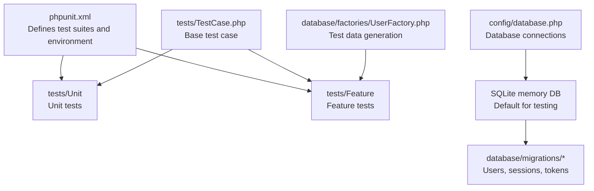
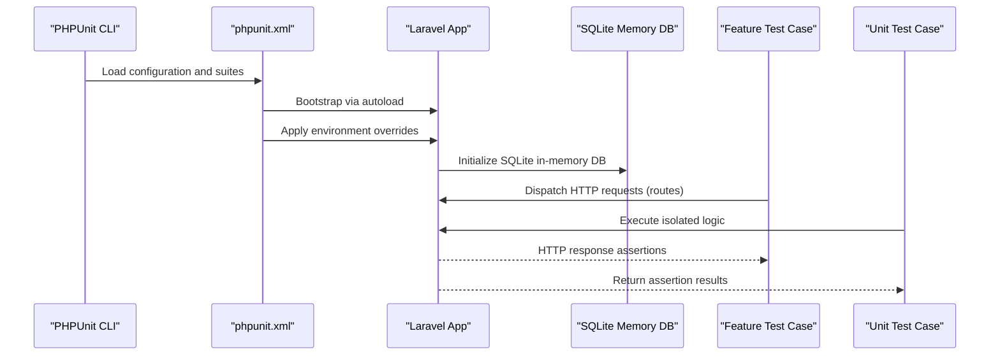
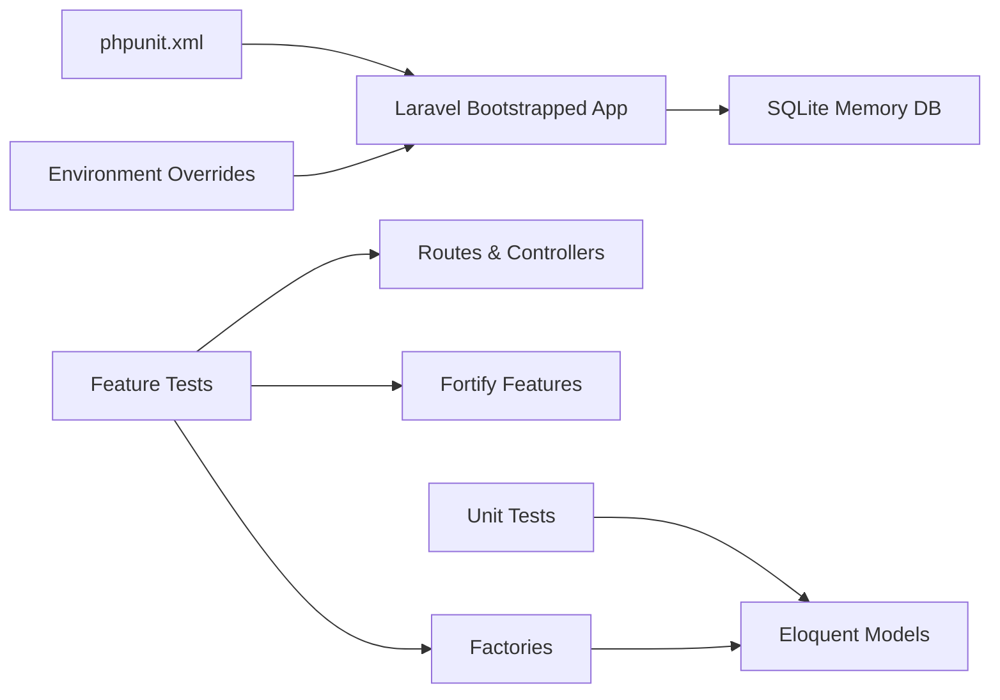
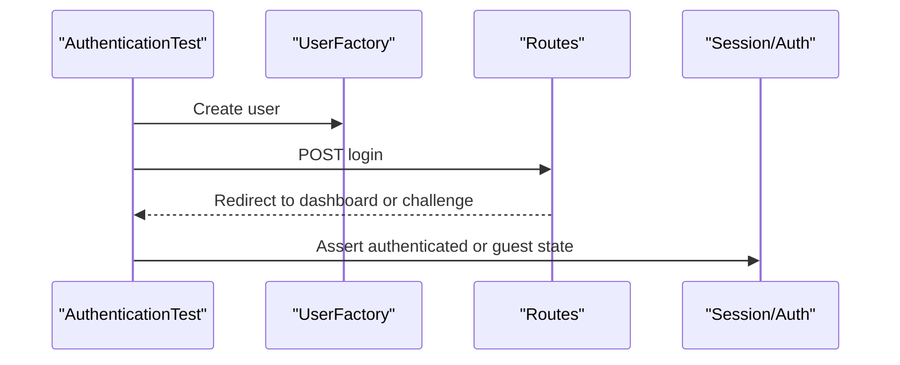
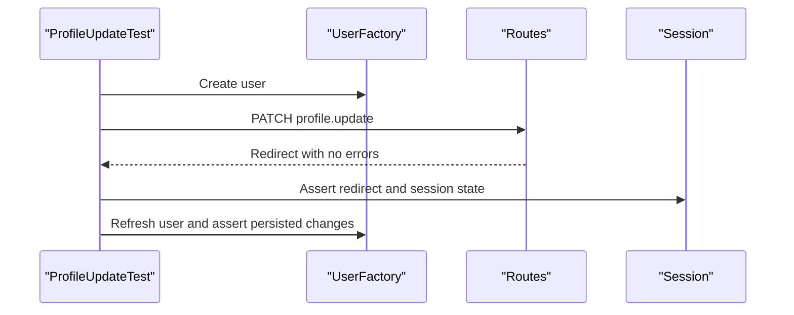

# Test Organization & Setup

<cite>
**Referenced Files in This Document**
- [phpunit.xml](file://phpunit.xml)
- [TestCase.php](file://tests/TestCase.php)
- [composer.json](file://composer.json)
- [ExampleTest.php (Feature)](file://tests/Feature/ExampleTest.php)
- [ExampleTest.php (Unit)](file://tests/Unit/ExampleTest.php)
- [AuthenticationTest.php](file://tests/Feature/Auth/AuthenticationTest.php)
- [ProfileUpdateTest.php](file://tests/Feature/Settings/ProfileUpdateTest.php)
- [database.php](file://config/database.php)
- [UserFactory.php](file://database/factories/UserFactory.php)
- [0001_01_01_000000_create_users_table.php](file://database/migrations/0001_01_01_000000_create_users_table.php)
- [fortify.php](file://config/fortify.php)
</cite>

## Table of Contents
1. [Introduction](#introduction)
2. [Project Structure](#project-structure)
3. [Core Components](#core-components)
4. [Architecture Overview](#architecture-overview)
5. [Detailed Component Analysis](#detailed-component-analysis)
6. [Dependency Analysis](#dependency-analysis)
7. [Performance Considerations](#performance-considerations)
8. [Troubleshooting Guide](#troubleshooting-guide)
9. [Conclusion](#conclusion)
10. [Appendices](#appendices)

## Introduction
This document explains how SmartExam organizes and runs tests using PHPUnit. It covers the test suite structure, base test case setup, separation between unit and feature tests, database configuration for testing, environment variables, test data factories, and practical guidance for extending the base test class and integrating with CI/CD. It also outlines recommended execution commands and considerations for parallelization.

## Project Structure
SmartExam follows Laravel’s conventional test layout with separate directories for unit and feature tests, and a shared base test case class. PHPUnit discovers suites automatically via the configuration.

**Diagram sources**
- [phpunit.xml:7-14](file://phpunit.xml#L7-L14)
- [TestCase.php:8-16](file://tests/TestCase.php#L8-L16)
- [database.php:20](file://config/database.php#L20)
- [0001_01_01_000000_create_users_table.php:12-48](file://database/migrations/0001_01_01_000000_create_users_table.php#L12-L48)
- [UserFactory.php:25-39](file://database/factories/UserFactory.php#L25-L39)

**Section sources**
- [phpunit.xml:7-14](file://phpunit.xml#L7-L14)
- [tests/Feature/ExampleTest.php:8-10](file://tests/Feature/ExampleTest.php#L8-L10)
- [tests/Unit/ExampleTest.php:8-10](file://tests/Unit/ExampleTest.php#L8-L10)
- [tests/TestCase.php:8-16](file://tests/TestCase.php#L8-L16)

## Core Components
- PHPUnit configuration
  - Defines two test suites: Unit and Feature.
  - Includes application source for coverage.
  - Sets environment variables for testing, including SQLite in-memory database and array-backed caches and sessions.
- Base test case
  - Extends Laravel’s base test case.
  - Provides a helper to conditionally skip tests when specific Fortify features are disabled.
- Test suites
  - Feature tests use database refresh traits and often act as authenticated users.
  - Unit tests focus on isolated logic and may also use database refresh for deterministic state.

Key behaviors:
- Environment overrides ensure fast, isolated tests with minimal external dependencies.
- Feature tests commonly rely on factories and route helpers to simulate real user journeys.

**Section sources**
- [phpunit.xml:20-35](file://phpunit.xml#L20-L35)
- [tests/TestCase.php:8-16](file://tests/TestCase.php#L8-L16)
- [tests/Feature/ExampleTest.php:8-10](file://tests/Feature/ExampleTest.php#L8-L10)
- [tests/Unit/ExampleTest.php:8-10](file://tests/Unit/ExampleTest.php#L8-L10)

## Architecture Overview
The test runtime is orchestrated by PHPUnit, which boots the Laravel application via Composer autoload and applies environment overrides. Feature tests typically hit routes and assert HTTP responses, while unit tests assert pure logic. Factories supply deterministic test data.

**Diagram sources**
- [phpunit.xml:4](file://phpunit.xml#L4)
- [phpunit.xml:20-35](file://phpunit.xml#L20-L35)
- [database.php:20](file://config/database.php#L20)

## Detailed Component Analysis

### PHPUnit Configuration and Test Suites
- Test suites
  - Unit: tests/Unit
  - Feature: tests/Feature
- Source inclusion for coverage
- Environment overrides for testing
  - APP_ENV set to testing
  - BCRYPT_ROUNDS reduced for speed
  - CACHE_STORE, QUEUE_CONNECTION, MAIL_MAILER, SESSION_DRIVER optimized for tests
  - DB_CONNECTION set to sqlite with DB_DATABASE as :memory:
  - PULSE_ENABLED, TELESCOPE_ENABLED, NIGHTWATCH_ENABLED disabled

Best practices derived from configuration:
- Keep tests fast and isolated by using in-memory SQLite and array-backed stores.
- Reduce cryptographic work with lower bcrypt rounds in tests.

**Section sources**
- [phpunit.xml:7-14](file://phpunit.xml#L7-L14)
- [phpunit.xml:15-19](file://phpunit.xml#L15-L19)
- [phpunit.xml:20-35](file://phpunit.xml#L20-L35)

### Base TestCase Extension
- Purpose: Provide shared behavior across tests.
- Helper method: skipUnlessFortifyHas(feature, message) checks Fortify feature enablement and marks tests as skipped when disabled.

Usage pattern:
- Call the helper at the start of tests that require optional Fortify features (e.g., two-factor authentication).

**Section sources**
- [tests/TestCase.php:8-16](file://tests/TestCase.php#L8-L16)
- [tests/Feature/Auth/AuthenticationTest.php:37-42](file://tests/Feature/Auth/AuthenticationTest.php#L37-L42)

### Feature vs Unit Test Separation
- Feature tests
  - Located under tests/Feature.
  - Often use RefreshDatabase to reset the database between tests.
  - Exercise HTTP routes and assert redirects, session state, and guest/authenticated states.
  - Examples include authentication flows and profile update scenarios.
- Unit tests
  - Located under tests/Unit.
  - May also use RefreshDatabase for deterministic state when interacting with models.
  - Focus on isolated logic verification.

Examples:
- Feature example validates a route response.
- Unit example asserts basic boolean logic.

**Section sources**
- [tests/Feature/ExampleTest.php:8-10](file://tests/Feature/ExampleTest.php#L8-L10)
- [tests/Feature/ExampleTest.php:12-17](file://tests/Feature/ExampleTest.php#L12-L17)
- [tests/Unit/ExampleTest.php:8-10](file://tests/Unit/ExampleTest.php#L8-L10)
- [tests/Unit/ExampleTest.php:12-15](file://tests/Unit/ExampleTest.php#L12-L15)

### Test Directory Structure and Naming Conventions
- tests/
  - tests/Feature/Auth/*.php for authentication-related feature tests
  - tests/Feature/Settings/*.php for settings-related feature tests
  - tests/Feature/*.php for top-level feature tests
  - tests/Unit/*.php for unit tests
  - tests/TestCase.php for the base test class

Naming convention indicators:
- Feature tests typically include “Test” suffix and reside under Feature/.
- Unit tests typically include “Test” suffix and reside under Unit/.

**Section sources**
- [tests/Feature/Auth/AuthenticationTest.php:1-93](file://tests/Feature/Auth/AuthenticationTest.php#L1-L93)
- [tests/Feature/Settings/ProfileUpdateTest.php:1-100](file://tests/Feature/Settings/ProfileUpdateTest.php#L1-L100)
- [tests/Feature/ExampleTest.php:1-19](file://tests/Feature/ExampleTest.php#L1-L19)
- [tests/Unit/ExampleTest.php:1-17](file://tests/Unit/ExampleTest.php#L1-L17)

### Test Database Setup and Environment Configuration
- Default database connection for testing
  - DB_CONNECTION=sqlite
  - DB_DATABASE=:memory:
- Application defaults
  - config/database.php sets default connection from environment and defines sqlite connection parameters.
- Migrations
  - Users, sessions, and password reset tokens tables are created by the initial migration.
- Factories
  - UserFactory generates realistic test users with hashed passwords and optional two-factor attributes.

Recommended setup steps:
- Ensure the application is booted with testing environment.
- Run database migrations to create schema in the in-memory database.
- Use factories to seed test data deterministically.

**Section sources**
- [phpunit.xml:26-28](file://phpunit.xml#L26-L28)
- [database.php:20](file://config/database.php#L20)
- [database.php:35-45](file://config/database.php#L35-L45)
- [0001_01_01_000000_create_users_table.php:12-48](file://database/migrations/0001_01_01_000000_create_users_table.php#L12-L48)
- [UserFactory.php:25-39](file://database/factories/UserFactory.php#L25-L39)

### Test Data Management with Factories
- UserFactory
  - Generates default user state with verified email and a stable password hash.
  - Provides modifiers like unverified() and withTwoFactor() to tailor test fixtures.
- Usage in tests
  - Feature tests create users via factories and exercise authentication and profile flows.

Guidelines:
- Prefer factories for deterministic, repeatable test data.
- Use modifiers to simulate edge cases (e.g., unverified emails, two-factor enabled).

**Section sources**
- [UserFactory.php:44-49](file://database/factories/UserFactory.php#L44-L49)
- [UserFactory.php:54-63](file://database/factories/UserFactory.php#L54-L63)
- [tests/Feature/Auth/AuthenticationTest.php:24-33](file://tests/Feature/Auth/AuthenticationTest.php#L24-L33)
- [tests/Feature/Settings/ProfileUpdateTest.php:15-44](file://tests/Feature/Settings/ProfileUpdateTest.php#L15-L44)

### Extending the Base TestCase Class
To add shared behavior:
- Extend the existing base class in your test files.
- Add helper methods for common assertions or setup routines.
- Use skipUnlessFortifyHas to gate tests requiring optional features.

Example patterns:
- Conditional skipping based on Fortify feature flags.
- Shared setup logic for authenticated sessions or specialized factories.

**Section sources**
- [tests/TestCase.php:8-16](file://tests/TestCase.php#L8-L16)
- [tests/Feature/Auth/AuthenticationTest.php:37-42](file://tests/Feature/Auth/AuthenticationTest.php#L37-L42)

### Test Execution Commands and CI/CD Integration
- Local execution
  - PHPUnit discovers suites defined in phpunit.xml.
  - Composer script “test” orchestrates linting, type checking, and test execution.
- CI/CD integration patterns
  - Use the Composer “test” script to standardize local and CI runs.
  - Cache Composer and npm dependencies to accelerate pipelines.
  - Run PHPUnit with parallelization options when supported by your runner.

Note: The repository does not include GitHub Actions workflows. To integrate CI/CD, define workflows that:
- Install dependencies (Composer and npm)
- Prepare the environment (generate keys, migrate)
- Execute the Composer “test” script
- Publish artifacts or reports as needed

**Section sources**
- [composer.json:72-77](file://composer.json#L72-L77)
- [phpunit.xml:7-14](file://phpunit.xml#L7-L14)

## Dependency Analysis
The test runtime depends on PHPUnit configuration, Laravel bootstrapping, and environment overrides. Feature tests depend on routes, controllers, and Fortify features. Factories depend on Eloquent models and hashing utilities.

**Diagram sources**
- [phpunit.xml:4](file://phpunit.xml#L4)
- [phpunit.xml:20-35](file://phpunit.xml#L20-L35)
- [database.php:20](file://config/database.php#L20)
- [UserFactory.php:25-39](file://database/factories/UserFactory.php#L25-L39)
- [fortify.php:169-189](file://config/fortify.php#L169-L189)

**Section sources**
- [phpunit.xml:4](file://phpunit.xml#L4)
- [phpunit.xml:20-35](file://phpunit.xml#L20-L35)
- [UserFactory.php:25-39](file://database/factories/UserFactory.php#L25-L39)
- [fortify.php:169-189](file://config/fortify.php#L169-L189)

## Performance Considerations
- Use SQLite in-memory database for fast test runs.
- Keep cache, session, and queue drivers as array-backed to avoid external dependencies.
- Reduce BCRYPT_ROUNDS to minimize hashing overhead in tests.
- Use RefreshDatabase judiciously; it ensures clean state but can slow tests if overused.
- Prefer factories for lightweight, deterministic data creation.

[No sources needed since this section provides general guidance]

## Troubleshooting Guide
Common issues and resolutions:
- Tests failing due to missing schema
  - Ensure migrations are run before tests. The in-memory database requires schema initialization.
- Skipping tests when Fortify features are disabled
  - Use skipUnlessFortifyHas to conditionally skip tests that rely on optional features.
- Authentication and session assertions
  - Use actingAs to simulate logged-in users in feature tests.
- Rate limiting and two-factor flows
  - Configure Fortify features appropriately and leverage factory modifiers for two-factor scenarios.

**Section sources**
- [tests/Feature/Auth/AuthenticationTest.php:37-42](file://tests/Feature/Auth/AuthenticationTest.php#L37-L42)
- [tests/Feature/Settings/ProfileUpdateTest.php:15-44](file://tests/Feature/Settings/ProfileUpdateTest.php#L15-L44)
- [UserFactory.php:54-63](file://database/factories/UserFactory.php#L54-L63)

## Conclusion
SmartExam’s test setup emphasizes speed and isolation through an in-memory SQLite database, array-backed caches and sessions, and environment overrides. The base TestCase centralizes shared behavior and conditional feature gating. Feature and unit tests are cleanly separated, with factories providing reliable test data. Following the documented patterns ensures maintainable, fast, and robust test suites suitable for local development and CI/CD pipelines.

[No sources needed since this section summarizes without analyzing specific files]

## Appendices

### Appendix A: Example Test Flows

#### Authentication Feature Test Flow

**Diagram sources**
- [tests/Feature/Auth/AuthenticationTest.php:22-33](file://tests/Feature/Auth/AuthenticationTest.php#L22-L33)
- [tests/Feature/Auth/AuthenticationTest.php:35-54](file://tests/Feature/Auth/AuthenticationTest.php#L35-L54)
- [UserFactory.php:25-39](file://database/factories/UserFactory.php#L25-L39)

#### Profile Update Feature Test Flow

**Diagram sources**
- [tests/Feature/Settings/ProfileUpdateTest.php:24-44](file://tests/Feature/Settings/ProfileUpdateTest.php#L24-L44)
- [tests/Feature/Settings/ProfileUpdateTest.php:64-80](file://tests/Feature/Settings/ProfileUpdateTest.php#L64-L80)
- [UserFactory.php:25-39](file://database/factories/UserFactory.php#L25-L39)

### Appendix B: Environment Variables for Testing
- APP_ENV: testing
- BCRYPT_ROUNDS: 4
- CACHE_STORE: array
- QUEUE_CONNECTION: sync
- MAIL_MAILER: array
- SESSION_DRIVER: array
- DB_CONNECTION: sqlite
- DB_DATABASE: :memory:
- PULSE_ENABLED: false
- TELESCOPE_ENABLED: false
- NIGHTWATCH_ENABLED: false

These values are defined in the PHPUnit configuration and override defaults for fast, isolated test execution.

**Section sources**
- [phpunit.xml:20-35](file://phpunit.xml#L20-L35)