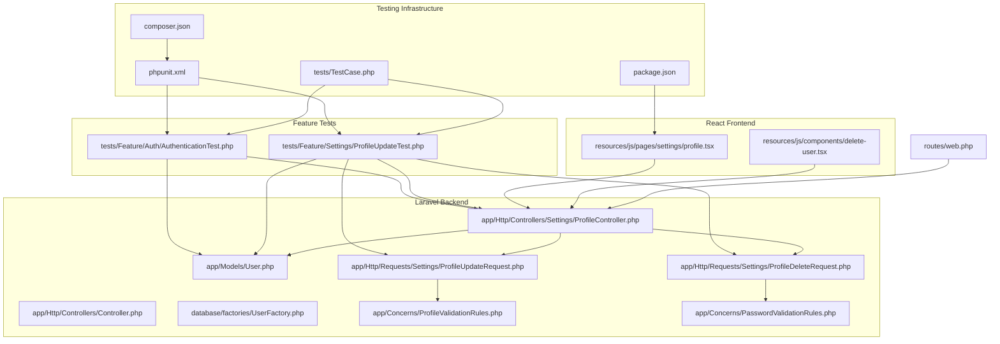
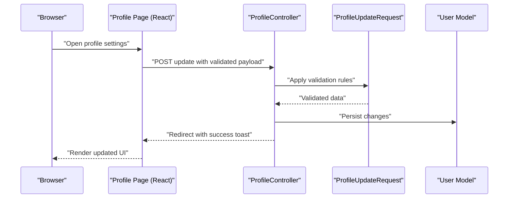
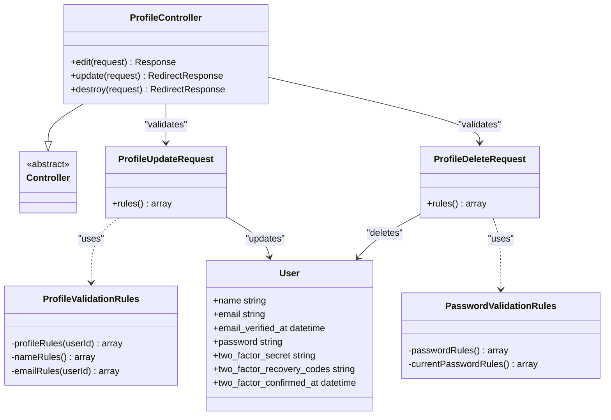
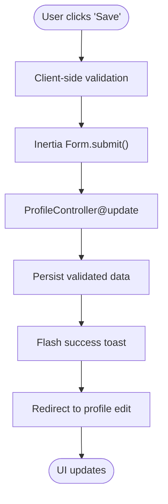
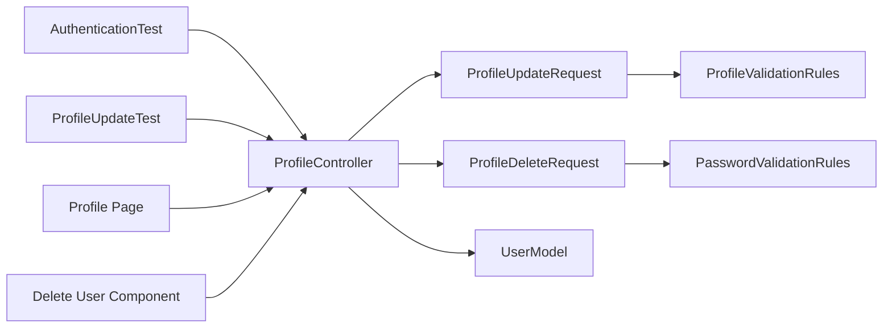

# Testing Best Practices

<cite>
**Referenced Files in This Document**
- [phpunit.xml](file://phpunit.xml)
- [composer.json](file://composer.json)
- [package.json](file://package.json)
- [tests/TestCase.php](file://tests/TestCase.php)
- [tests/Feature/Auth/AuthenticationTest.php](file://tests/Feature/Auth/AuthenticationTest.php)
- [tests/Feature/Settings/ProfileUpdateTest.php](file://tests/Feature/Settings/ProfileUpdateTest.php)
- [app/Http/Controllers/Controller.php](file://app/Http/Controllers/Controller.php)
- [app/Http/Controllers/Settings/ProfileController.php](file://app/Http/Controllers/Settings/ProfileController.php)
- [app/Models/User.php](file://app/Models/User.php)
- [database/factories/UserFactory.php](file://database/factories/UserFactory.php)
- [app/Concerns/ProfileValidationRules.php](file://app/Concerns/ProfileValidationRules.php)
- [app/Concerns/PasswordValidationRules.php](file://app/Concerns/PasswordValidationRules.php)
- [app/Http/Requests/Settings/ProfileUpdateRequest.php](file://app/Http/Requests/Settings/ProfileUpdateRequest.php)
- [app/Http/Requests/Settings/ProfileDeleteRequest.php](file://app/Http/Requests/Settings/ProfileDeleteRequest.php)
- [resources/js/pages/settings/profile.tsx](file://resources/js/pages/settings/profile.tsx)
- [resources/js/components/delete-user.tsx](file://resources/js/components/delete-user.tsx)
- [routes/web.php](file://routes/web.php)
</cite>

## Table of Contents
1. [Introduction](#introduction)
2. [Project Structure](#project-structure)
3. [Core Components](#core-components)
4. [Architecture Overview](#architecture-overview)
5. [Detailed Component Analysis](#detailed-component-analysis)
6. [Dependency Analysis](#dependency-analysis)
7. [Performance Considerations](#performance-considerations)
8. [Troubleshooting Guide](#troubleshooting-guide)
9. [Conclusion](#conclusion)
10. [Appendices](#appendices)

## Introduction
This document establishes comprehensive testing best practices for the SmartExam development team. It defines code quality standards for tests, naming conventions, and organizational principles. It documents testing patterns for Laravel controllers and form requests, React components and pages, and API endpoints. It explains mocking strategies, test data management via factories, and database transaction handling. It also covers assertion patterns, readability, maintainability, performance optimization, and continuous integration workflows.

## Project Structure
The repository organizes tests into unit and feature suites, with shared base test infrastructure and Laravel-specific configurations. The frontend uses Vite and React with TypeScript, and Inertia for page rendering.

**Diagram sources**
- [phpunit.xml:1-37](file://phpunit.xml#L1-L37)
- [composer.json:1-120](file://composer.json#L1-L120)
- [package.json:1-77](file://package.json#L1-L77)
- [tests/TestCase.php:1-17](file://tests/TestCase.php#L1-L17)
- [tests/Feature/Auth/AuthenticationTest.php:1-93](file://tests/Feature/Auth/AuthenticationTest.php#L1-L93)
- [tests/Feature/Settings/ProfileUpdateTest.php:1-100](file://tests/Feature/Settings/ProfileUpdateTest.php#L1-L100)
- [app/Http/Controllers/Controller.php:1-9](file://app/Http/Controllers/Controller.php#L1-L9)
- [app/Http/Controllers/Settings/ProfileController.php:1-63](file://app/Http/Controllers/Settings/ProfileController.php#L1-L63)
- [app/Models/User.php:1-53](file://app/Models/User.php#L1-L53)
- [database/factories/UserFactory.php:1-65](file://database/factories/UserFactory.php#L1-L65)
- [app/Http/Requests/Settings/ProfileUpdateRequest.php:1-23](file://app/Http/Requests/Settings/ProfileUpdateRequest.php#L1-L23)
- [app/Http/Requests/Settings/ProfileDeleteRequest.php:1-25](file://app/Http/Requests/Settings/ProfileDeleteRequest.php#L1-L25)
- [app/Concerns/ProfileValidationRules.php:1-52](file://app/Concerns/ProfileValidationRules.php#L1-L52)
- [app/Concerns/PasswordValidationRules.php:1-30](file://app/Concerns/PasswordValidationRules.php#L1-L30)
- [resources/js/pages/settings/profile.tsx:1-149](file://resources/js/pages/settings/profile.tsx#L1-L149)
- [resources/js/components/delete-user.tsx:1-121](file://resources/js/components/delete-user.tsx#L1-L121)
- [routes/web.php:1-26](file://routes/web.php#L1-L26)

**Section sources**
- [phpunit.xml:1-37](file://phpunit.xml#L1-L37)
- [composer.json:1-120](file://composer.json#L1-L120)
- [package.json:1-77](file://package.json#L1-L77)

## Core Components
- Test base class: Provides shared helpers such as skipping tests when specific Fortify features are disabled.
- Feature tests: Exercise end-to-end scenarios for authentication and profile management.
- Factories: Generate realistic test data for models like User.
- Form requests and validation traits: Centralize validation logic for requests.
- Controllers: Encapsulate business logic for profile updates, deletions, and rendering.
- Frontend pages and components: Render forms and trigger actions via Inertia.

Key implementation references:
- Shared test base: [tests/TestCase.php:1-17](file://tests/TestCase.php#L1-L17)
- Authentication feature tests: [tests/Feature/Auth/AuthenticationTest.php:1-93](file://tests/Feature/Auth/AuthenticationTest.php#L1-L93)
- Profile feature tests: [tests/Feature/Settings/ProfileUpdateTest.php:1-100](file://tests/Feature/Settings/ProfileUpdateTest.php#L1-L100)
- User factory: [database/factories/UserFactory.php:1-65](file://database/factories/UserFactory.php#L1-L65)
- Profile update request: [app/Http/Requests/Settings/ProfileUpdateRequest.php:1-23](file://app/Http/Requests/Settings/ProfileUpdateRequest.php#L1-L23)
- Profile delete request: [app/Http/Requests/Settings/ProfileDeleteRequest.php:1-25](file://app/Http/Requests/Settings/ProfileDeleteRequest.php#L1-L25)
- Profile validation rules: [app/Concerns/ProfileValidationRules.php:1-52](file://app/Concerns/ProfileValidationRules.php#L1-L52)
- Password validation rules: [app/Concerns/PasswordValidationRules.php:1-30](file://app/Concerns/PasswordValidationRules.php#L1-L30)
- Profile controller: [app/Http/Controllers/Settings/ProfileController.php:1-63](file://app/Http/Controllers/Settings/ProfileController.php#L1-L63)
- User model: [app/Models/User.php:1-53](file://app/Models/User.php#L1-L53)
- Profile page: [resources/js/pages/settings/profile.tsx:1-149](file://resources/js/pages/settings/profile.tsx#L1-L149)
- Delete user component: [resources/js/components/delete-user.tsx:1-121](file://resources/js/components/delete-user.tsx#L1-L121)

**Section sources**
- [tests/TestCase.php:1-17](file://tests/TestCase.php#L1-L17)
- [tests/Feature/Auth/AuthenticationTest.php:1-93](file://tests/Feature/Auth/AuthenticationTest.php#L1-L93)
- [tests/Feature/Settings/ProfileUpdateTest.php:1-100](file://tests/Feature/Settings/ProfileUpdateTest.php#L1-L100)
- [database/factories/UserFactory.php:1-65](file://database/factories/UserFactory.php#L1-L65)
- [app/Http/Requests/Settings/ProfileUpdateRequest.php:1-23](file://app/Http/Requests/Settings/ProfileUpdateRequest.php#L1-L23)
- [app/Http/Requests/Settings/ProfileDeleteRequest.php:1-25](file://app/Http/Requests/Settings/ProfileDeleteRequest.php#L1-L25)
- [app/Concerns/ProfileValidationRules.php:1-52](file://app/Concerns/ProfileValidationRules.php#L1-L52)
- [app/Concerns/PasswordValidationRules.php:1-30](file://app/Concerns/PasswordValidationRules.php#L1-L30)
- [app/Http/Controllers/Settings/ProfileController.php:1-63](file://app/Http/Controllers/Settings/ProfileController.php#L1-L63)
- [app/Models/User.php:1-53](file://app/Models/User.php#L1-L53)
- [resources/js/pages/settings/profile.tsx:1-149](file://resources/js/pages/settings/profile.tsx#L1-L149)
- [resources/js/components/delete-user.tsx:1-121](file://resources/js/components/delete-user.tsx#L1-L121)

## Architecture Overview
This testing architecture integrates backend Laravel tests with frontend React tests. Feature tests simulate user journeys through routes and controllers, while frontend tests validate UI interactions and form submissions.

**Diagram sources**
- [resources/js/pages/settings/profile.tsx:1-149](file://resources/js/pages/settings/profile.tsx#L1-L149)
- [app/Http/Controllers/Settings/ProfileController.php:1-63](file://app/Http/Controllers/Settings/ProfileController.php#L1-L63)
- [app/Http/Requests/Settings/ProfileUpdateRequest.php:1-23](file://app/Http/Requests/Settings/ProfileUpdateRequest.php#L1-L23)
- [app/Models/User.php:1-53](file://app/Models/User.php#L1-L53)

## Detailed Component Analysis

### Laravel Feature Tests
- Organization: Separate suites for Unit and Feature; feature tests use RefreshDatabase to isolate state.
- Naming conventions: Descriptive method names indicating scenario and expected outcome.
- Assertions: Prefer response assertions and authentication helpers to verify behavior.
- Conditional features: Use shared helper to skip tests when optional features are disabled.

Recommended patterns:
- Use factories to create minimal, valid entities per test.
- Assert redirects and session states after mutations.
- Verify guest/authenticated states explicitly.

References:
- Base test helper: [tests/TestCase.php:1-17](file://tests/TestCase.php#L1-L17)
- Authentication tests: [tests/Feature/Auth/AuthenticationTest.php:1-93](file://tests/Feature/Auth/AuthenticationTest.php#L1-L93)
- Profile update tests: [tests/Feature/Settings/ProfileUpdateTest.php:1-100](file://tests/Feature/Settings/ProfileUpdateTest.php#L1-L100)

**Section sources**
- [tests/TestCase.php:1-17](file://tests/TestCase.php#L1-L17)
- [tests/Feature/Auth/AuthenticationTest.php:1-93](file://tests/Feature/Auth/AuthenticationTest.php#L1-L93)
- [tests/Feature/Settings/ProfileUpdateTest.php:1-100](file://tests/Feature/Settings/ProfileUpdateTest.php#L1-L100)

### Controllers and Form Requests
- Controllers encapsulate presentation and persistence logic, delegating validation to form requests.
- Form requests centralize validation rules and reuse validation traits for consistency.
- Use Inertia rendering for server-rendered pages and client-side navigation.

References:
- Base controller: [app/Http/Controllers/Controller.php:1-9](file://app/Http/Controllers/Controller.php#L1-L9)
- Profile controller: [app/Http/Controllers/Settings/ProfileController.php:1-63](file://app/Http/Controllers/Settings/ProfileController.php#L1-L63)
- Profile update request: [app/Http/Requests/Settings/ProfileUpdateRequest.php:1-23](file://app/Http/Requests/Settings/ProfileUpdateRequest.php#L1-L23)
- Profile delete request: [app/Http/Requests/Settings/ProfileDeleteRequest.php:1-25](file://app/Http/Requests/Settings/ProfileDeleteRequest.php#L1-L25)
- Validation traits: [app/Concerns/ProfileValidationRules.php:1-52](file://app/Concerns/ProfileValidationRules.php#L1-L52), [app/Concerns/PasswordValidationRules.php:1-30](file://app/Concerns/PasswordValidationRules.php#L1-L30)

**Diagram sources**
- [app/Http/Controllers/Controller.php:1-9](file://app/Http/Controllers/Controller.php#L1-L9)
- [app/Http/Controllers/Settings/ProfileController.php:1-63](file://app/Http/Controllers/Settings/ProfileController.php#L1-L63)
- [app/Http/Requests/Settings/ProfileUpdateRequest.php:1-23](file://app/Http/Requests/Settings/ProfileUpdateRequest.php#L1-L23)
- [app/Http/Requests/Settings/ProfileDeleteRequest.php:1-25](file://app/Http/Requests/Settings/ProfileDeleteRequest.php#L1-L25)
- [app/Concerns/ProfileValidationRules.php:1-52](file://app/Concerns/ProfileValidationRules.php#L1-L52)
- [app/Concerns/PasswordValidationRules.php:1-30](file://app/Concerns/PasswordValidationRules.php#L1-L30)
- [app/Models/User.php:1-53](file://app/Models/User.php#L1-L53)

**Section sources**
- [app/Http/Controllers/Settings/ProfileController.php:1-63](file://app/Http/Controllers/Settings/ProfileController.php#L1-L63)
- [app/Http/Requests/Settings/ProfileUpdateRequest.php:1-23](file://app/Http/Requests/Settings/ProfileUpdateRequest.php#L1-L23)
- [app/Http/Requests/Settings/ProfileDeleteRequest.php:1-25](file://app/Http/Requests/Settings/ProfileDeleteRequest.php#L1-L25)
- [app/Concerns/ProfileValidationRules.php:1-52](file://app/Concerns/ProfileValidationRules.php#L1-L52)
- [app/Concerns/PasswordValidationRules.php:1-30](file://app/Concerns/PasswordValidationRules.php#L1-L30)
- [app/Models/User.php:1-53](file://app/Models/User.php#L1-L53)

### React Components and Pages
- Pages bind to controller actions via Inertia forms and submit data to backend routes.
- Components encapsulate UI logic and user interactions, including destructive actions.
- Use data-test attributes to facilitate reliable UI automation and manual QA.

References:
- Profile page: [resources/js/pages/settings/profile.tsx:1-149](file://resources/js/pages/settings/profile.tsx#L1-L149)
- Delete user component: [resources/js/components/delete-user.tsx:1-121](file://resources/js/components/delete-user.tsx#L1-L121)

**Diagram sources**
- [resources/js/pages/settings/profile.tsx:1-149](file://resources/js/pages/settings/profile.tsx#L1-L149)
- [app/Http/Controllers/Settings/ProfileController.php:1-63](file://app/Http/Controllers/Settings/ProfileController.php#L1-L63)

**Section sources**
- [resources/js/pages/settings/profile.tsx:1-149](file://resources/js/pages/settings/profile.tsx#L1-L149)
- [resources/js/components/delete-user.tsx:1-121](file://resources/js/components/delete-user.tsx#L1-L121)

### API Endpoints and Routes
- Web routes define entry points for backend interactions.
- Inertia routes render pages and handle form submissions seamlessly.

References:
- Web routes: [routes/web.php:1-26](file://routes/web.php#L1-L26)

**Section sources**
- [routes/web.php:1-26](file://routes/web.php#L1-L26)

## Dependency Analysis
Testing dependencies span backend and frontend layers, with explicit coupling to controllers, requests, and models.

**Diagram sources**
- [tests/Feature/Auth/AuthenticationTest.php:1-93](file://tests/Feature/Auth/AuthenticationTest.php#L1-L93)
- [tests/Feature/Settings/ProfileUpdateTest.php:1-100](file://tests/Feature/Settings/ProfileUpdateTest.php#L1-L100)
- [app/Http/Controllers/Settings/ProfileController.php:1-63](file://app/Http/Controllers/Settings/ProfileController.php#L1-L63)
- [app/Http/Requests/Settings/ProfileUpdateRequest.php:1-23](file://app/Http/Requests/Settings/ProfileUpdateRequest.php#L1-L23)
- [app/Http/Requests/Settings/ProfileDeleteRequest.php:1-25](file://app/Http/Requests/Settings/ProfileDeleteRequest.php#L1-L25)
- [app/Concerns/ProfileValidationRules.php:1-52](file://app/Concerns/ProfileValidationRules.php#L1-L52)
- [app/Concerns/PasswordValidationRules.php:1-30](file://app/Concerns/PasswordValidationRules.php#L1-L30)
- [app/Models/User.php:1-53](file://app/Models/User.php#L1-L53)
- [resources/js/pages/settings/profile.tsx:1-149](file://resources/js/pages/settings/profile.tsx#L1-L149)
- [resources/js/components/delete-user.tsx:1-121](file://resources/js/components/delete-user.tsx#L1-L121)

**Section sources**
- [tests/Feature/Auth/AuthenticationTest.php:1-93](file://tests/Feature/Auth/AuthenticationTest.php#L1-L93)
- [tests/Feature/Settings/ProfileUpdateTest.php:1-100](file://tests/Feature/Settings/ProfileUpdateTest.php#L1-L100)
- [app/Http/Controllers/Settings/ProfileController.php:1-63](file://app/Http/Controllers/Settings/ProfileController.php#L1-L63)
- [app/Http/Requests/Settings/ProfileUpdateRequest.php:1-23](file://app/Http/Requests/Settings/ProfileUpdateRequest.php#L1-L23)
- [app/Http/Requests/Settings/ProfileDeleteRequest.php:1-25](file://app/Http/Requests/Settings/ProfileDeleteRequest.php#L1-L25)
- [app/Concerns/ProfileValidationRules.php:1-52](file://app/Concerns/ProfileValidationRules.php#L1-L52)
- [app/Concerns/PasswordValidationRules.php:1-30](file://app/Concerns/PasswordValidationRules.php#L1-L30)
- [app/Models/User.php:1-53](file://app/Models/User.php#L1-L53)
- [resources/js/pages/settings/profile.tsx:1-149](file://resources/js/pages/settings/profile.tsx#L1-L149)
- [resources/js/components/delete-user.tsx:1-121](file://resources/js/components/delete-user.tsx#L1-L121)

## Performance Considerations
- Use SQLite in-memory database for fast test runs and automatic cleanup.
- Keep tests isolated with RefreshDatabase to avoid cross-test interference.
- Minimize external service calls; stub or fake services when appropriate.
- Prefer targeted factories and minimal payloads to reduce overhead.
- Run unit and feature tests in parallel where supported by the test runner.

Practical references:
- Database configuration for tests: [phpunit.xml:20-35](file://phpunit.xml#L20-L35)
- Test suite configuration: [phpunit.xml:7-14](file://phpunit.xml#L7-L14)
- Composer scripts for local testing: [composer.json:72-77](file://composer.json#L72-L77)

**Section sources**
- [phpunit.xml:20-35](file://phpunit.xml#L20-L35)
- [phpunit.xml:7-14](file://phpunit.xml#L7-L14)
- [composer.json:72-77](file://composer.json#L72-L77)

## Troubleshooting Guide
Common issues and resolutions:
- Skipping tests conditionally: Use the shared helper to skip when optional features are disabled.
- Database state leakage: Ensure RefreshDatabase is used in feature tests.
- Assertion failures: Prefer response assertions and authentication helpers; assert redirects and session states explicitly.
- Validation errors: Confirm form requests and validation traits are applied consistently.

References:
- Conditional skip helper: [tests/TestCase.php:1-17](file://tests/TestCase.php#L1-L17)
- Authentication test patterns: [tests/Feature/Auth/AuthenticationTest.php:1-93](file://tests/Feature/Auth/AuthenticationTest.php#L1-L93)
- Profile update test patterns: [tests/Feature/Settings/ProfileUpdateTest.php:1-100](file://tests/Feature/Settings/ProfileUpdateTest.php#L1-L100)

**Section sources**
- [tests/TestCase.php:1-17](file://tests/TestCase.php#L1-L17)
- [tests/Feature/Auth/AuthenticationTest.php:1-93](file://tests/Feature/Auth/AuthenticationTest.php#L1-L93)
- [tests/Feature/Settings/ProfileUpdateTest.php:1-100](file://tests/Feature/Settings/ProfileUpdateTest.php#L1-L100)

## Conclusion
By adhering to these testing best practices—organizing tests by feature, validating both backend and frontend behavior, managing test data with factories, and asserting outcomes clearly—you can build a robust, maintainable, and performant test suite. Integrate these patterns with CI workflows to ensure reliability across environments.

## Appendices

### Code Quality Standards for Tests
- Readability: Use descriptive method names and clear variable names.
- Maintainability: Keep tests focused; extract reusable helpers into the base test class.
- Reliability: Assert multiple related outcomes (redirects, session state, model changes).
- Isolation: Use RefreshDatabase and factories to prevent flaky tests.

### Naming Conventions
- Feature test classes: Feature namespace with descriptive names.
- Test methods: Descriptive verbs indicating scenario and expected outcome.
- Fixtures and factories: Singular nouns for models, plural for collections.

### Test Organization Principles
- Group tests by feature area (e.g., Auth, Settings).
- Place shared helpers in the base test class.
- Keep feature tests close to the controllers and models they exercise.

### Testing Patterns
- Controllers and Requests: Validate inputs via form requests; assert persisted changes and redirects.
- React Components: Bind to controller actions; assert UI updates and error messages.
- End-to-end: Simulate user journeys from route to controller to view.

### Mocking Strategies
- Use fakes for external services; avoid real network calls.
- Stub rate limiting and time-sensitive logic when necessary.
- Replace heavy dependencies with lightweight doubles.

### Test Data Management
- Use factories to generate realistic entities.
- Apply states (e.g., verified/unverified, with two-factor) to tailor scenarios.
- Keep factories centralized and composable.

### Database Transaction Handling
- Use RefreshDatabase per test to rollback changes.
- Avoid long transactions; keep tests short and deterministic.

### Effective Assertion Patterns
- Assert response status, redirects, and session flashes.
- Verify model changes and timestamps.
- Confirm UI state and accessibility attributes.

### Continuous Integration Testing Workflows
- Local scripts to lint, type-check, and run tests.
- CI pipeline to execute the same commands consistently.

References:
- Composer scripts: [composer.json:62-77](file://composer.json#L62-L77)
- NPM scripts: [package.json:5-14](file://package.json#L5-L14)

**Section sources**
- [composer.json:62-77](file://composer.json#L62-L77)
- [package.json:5-14](file://package.json#L5-L14)