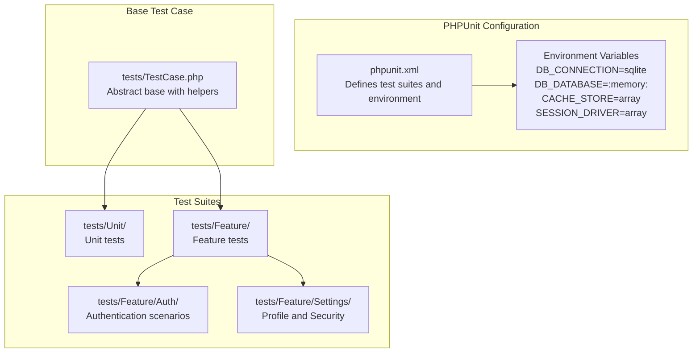
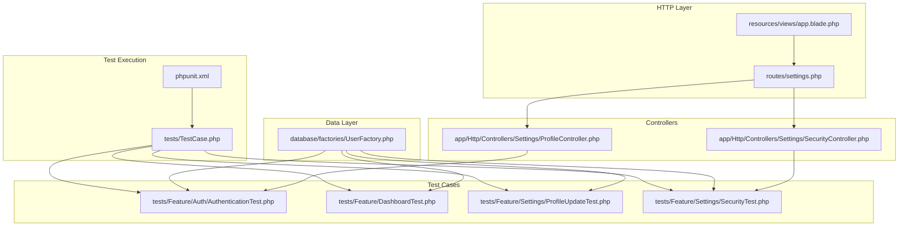
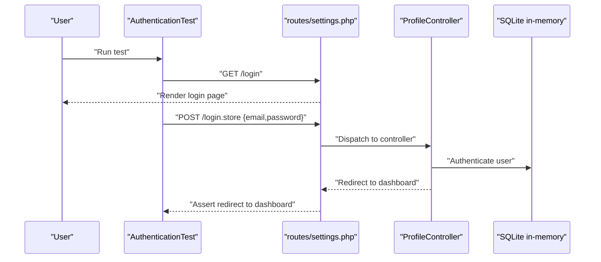
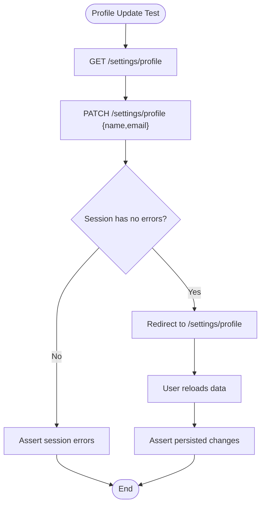
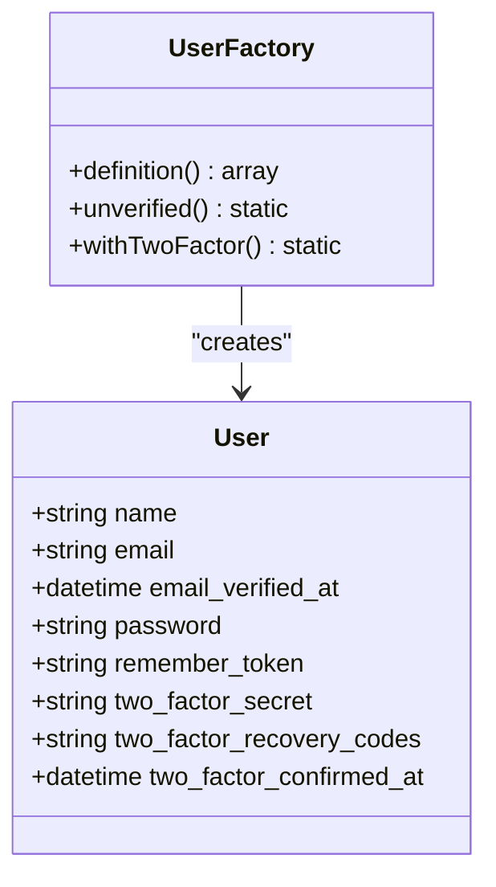
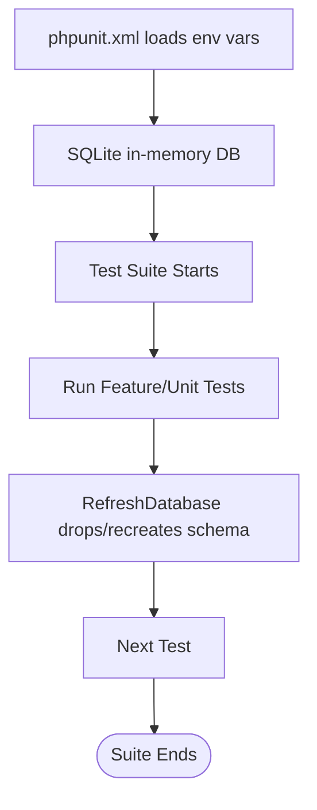
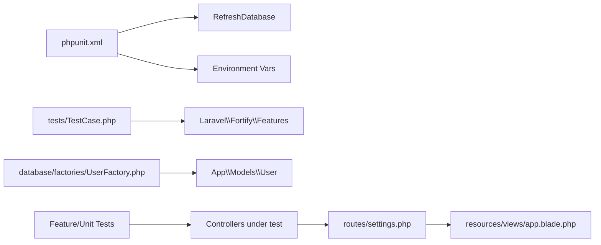

# Testing Strategy

<cite>
**Referenced Files in This Document**
- [phpunit.xml](file://phpunit.xml)
- [composer.json](file://composer.json)
- [TestCase.php](file://tests/TestCase.php)
- [AuthenticationTest.php](file://tests/Feature/Auth/AuthenticationTest.php)
- [DashboardTest.php](file://tests/Feature/DashboardTest.php)
- [ProfileUpdateTest.php](file://tests/Feature/Settings/ProfileUpdateTest.php)
- [SecurityTest.php](file://tests/Feature/Settings/SecurityTest.php)
- [ExampleTest.php](file://tests/Unit/ExampleTest.php)
- [UserFactory.php](file://database/factories/UserFactory.php)
- [ProfileController.php](file://app/Http/Controllers/Settings/ProfileController.php)
- [SecurityController.php](file://app/Http/Controllers/Settings/SecurityController.php)
- [settings.php](file://routes/settings.php)
- [app.blade.php](file://resources/views/app.blade.php)
</cite>

## Table of Contents
1. [Introduction](#introduction)
2. [Project Structure](#project-structure)
3. [Core Components](#core-components)
4. [Architecture Overview](#architecture-overview)
5. [Detailed Component Analysis](#detailed-component-analysis)
6. [Dependency Analysis](#dependency-analysis)
7. [Performance Considerations](#performance-considerations)
8. [Troubleshooting Guide](#troubleshooting-guide)
9. [Conclusion](#conclusion)
10. [Appendices](#appendices)

## Introduction
This document defines a comprehensive testing strategy for the SmartExam web application. It covers PHPUnit test suites, test case organization, authentication testing, settings management validation, user interaction scenarios, test data generation via factories, database setup and cleanup, best practices for Laravel controllers and Inertia-driven React components, integration testing patterns, mocking external dependencies, continuous integration workflows, and code coverage expectations.

## Project Structure
The testing structure follows Laravel conventions with separate Unit and Feature test suites. The configuration initializes a fast SQLite in-memory database for tests and disables background queues and telemetry to keep tests deterministic and fast.

**Diagram sources**
- [phpunit.xml:1-37](file://phpunit.xml#L1-L37)
- [TestCase.php:1-17](file://tests/TestCase.php#L1-L17)

**Section sources**
- [phpunit.xml:1-37](file://phpunit.xml#L1-L37)
- [composer.json:1-120](file://composer.json#L1-L120)

## Core Components
- Test Suites
  - Unit tests validate isolated logic without persistence or HTTP.
  - Feature tests validate end-to-end user journeys and controller behavior.
- Base Test Case
  - Provides a helper to skip tests when specific Fortify features are disabled.
- Factories
  - Eloquent factories generate realistic test users and optional two-factor configurations.
- Controllers Under Test
  - ProfileController and SecurityController render Inertia pages and handle updates.
- Routes
  - Settings routes define authentication and verification middleware and named endpoints used by tests.

**Section sources**
- [TestCase.php:8-16](file://tests/TestCase.php#L8-L16)
- [UserFactory.php:1-65](file://database/factories/UserFactory.php#L1-L65)
- [ProfileController.php:1-63](file://app/Http/Controllers/Settings/ProfileController.php#L1-L63)
- [SecurityController.php:1-73](file://app/Http/Controllers/Settings/SecurityController.php#L1-L73)
- [settings.php:1-41](file://routes/settings.php#L1-L41)

## Architecture Overview
The testing architecture emphasizes separation of concerns:
- Feature tests simulate real user interactions against routes and controllers.
- Factories supply deterministic test data.
- Environment isolation ensures tests run quickly and predictably.

**Diagram sources**
- [phpunit.xml:1-37](file://phpunit.xml#L1-L37)
- [TestCase.php:1-17](file://tests/TestCase.php#L1-L17)
- [UserFactory.php:1-65](file://database/factories/UserFactory.php#L1-L65)
- [settings.php:1-41](file://routes/settings.php#L1-L41)
- [app.blade.php:1-49](file://resources/views/app.blade.php#L1-L49)
- [ProfileController.php:1-63](file://app/Http/Controllers/Settings/ProfileController.php#L1-L63)
- [SecurityController.php:1-73](file://app/Http/Controllers/Settings/SecurityController.php#L1-L73)
- [AuthenticationTest.php:1-93](file://tests/Feature/Auth/AuthenticationTest.php#L1-L93)
- [DashboardTest.php:1-28](file://tests/Feature/DashboardTest.php#L1-L28)
- [ProfileUpdateTest.php:1-100](file://tests/Feature/Settings/ProfileUpdateTest.php#L1-L100)
- [SecurityTest.php:1-131](file://tests/Feature/Settings/SecurityTest.php#L1-L131)

## Detailed Component Analysis

### Authentication Testing
Key scenarios validated:
- Login screen rendering and successful authentication.
- Two-factor authentication redirection when enabled.
- Invalid credentials lead to guest state.
- Logout redirects to home and clears session.
- Rate limiting triggers for excessive attempts.

**Diagram sources**
- [AuthenticationTest.php:15-33](file://tests/Feature/Auth/AuthenticationTest.php#L15-L33)
- [settings.php:10-15](file://routes/settings.php#L10-L15)
- [ProfileController.php:18-26](file://app/Http/Controllers/Settings/ProfileController.php#L18-L26)

**Section sources**
- [AuthenticationTest.php:15-91](file://tests/Feature/Auth/AuthenticationTest.php#L15-L91)
- [settings.php:10-15](file://routes/settings.php#L10-L15)

### Settings Management Validation
Profile updates:
- Rendering profile edit page.
- Updating name and email with proper validation and session flash messages.
- Email verification status preserved when email unchanged.
- Account deletion requires correct password and cleans up session.

Security settings:
- Rendering security page with Inertia assertions.
- Conditional rendering when Fortify features are disabled.
- Password update with validation and hashing.
- Password confirmation requirement enforced when enabled.

**Diagram sources**
- [ProfileUpdateTest.php:13-44](file://tests/Feature/Settings/ProfileUpdateTest.php#L13-L44)
- [ProfileController.php:20-44](file://app/Http/Controllers/Settings/ProfileController.php#L20-L44)

**Section sources**
- [ProfileUpdateTest.php:13-98](file://tests/Feature/Settings/ProfileUpdateTest.php#L13-L98)
- [SecurityTest.php:16-129](file://tests/Feature/Settings/SecurityTest.php#L16-L129)
- [ProfileController.php:18-61](file://app/Http/Controllers/Settings/ProfileController.php#L18-L61)
- [SecurityController.php:18-71](file://app/Http/Controllers/Settings/SecurityController.php#L18-L71)

### Test Data Generation Using Factories
- UserFactory generates verified users with a seeded password hash.
- Optional two-factor state can be attached to users for 2FA-enabled scenarios.
- Unverified state supported for email verification tests.

**Diagram sources**
- [UserFactory.php:13-64](file://database/factories/UserFactory.php#L13-L64)

**Section sources**
- [UserFactory.php:25-63](file://database/factories/UserFactory.php#L25-L63)

### Test Database Setup and Cleanup
- phpunit.xml sets DB_CONNECTION=sqlite and DB_DATABASE=:memory: for in-memory database per suite.
- RefreshDatabase trait resets schema and seeds between tests.
- Environment variables disable caches, queues, and telemetry for determinism.

**Diagram sources**
- [phpunit.xml:20-35](file://phpunit.xml#L20-L35)

**Section sources**
- [phpunit.xml:20-35](file://phpunit.xml#L20-L35)

### Best Practices for Laravel Controllers and Inertia Components
- Controllers return Inertia::render for SPA pages and Inertia::flash for toast notifications.
- Use route names consistently across tests to avoid brittle path changes.
- Apply middleware constraints (auth, verified) in routes to ensure tests mirror production behavior.
- Keep controller logic thin; delegate heavy logic to services or policies for easier unit testing.

**Section sources**
- [ProfileController.php:20-61](file://app/Http/Controllers/Settings/ProfileController.php#L20-L61)
- [SecurityController.php:18-71](file://app/Http/Controllers/Settings/SecurityController.php#L18-L71)
- [settings.php:10-31](file://routes/settings.php#L10-L31)

### Writing Effective Tests
- Feature tests assert HTTP responses, redirects, and Inertia component props.
- Use actingAs to simulate authenticated sessions.
- Assert session state (flash messages, errors) after form submissions.
- Validate database changes via model refresh and assertions.

**Section sources**
- [AuthenticationTest.php:22-33](file://tests/Feature/Auth/AuthenticationTest.php#L22-L33)
- [ProfileUpdateTest.php:24-44](file://tests/Feature/Settings/ProfileUpdateTest.php#L24-L44)
- [SecurityTest.php:93-111](file://tests/Feature/Settings/SecurityTest.php#L93-L111)

### Mocking External Dependencies
- Use Mockery to stub external services or third-party integrations.
- For rate limiting, mock the underlying limiter to simulate throttling conditions.
- For mailers, queues, and caches, rely on array or sync drivers via environment variables.

**Section sources**
- [phpunit.xml:20-35](file://phpunit.xml#L20-L35)

### Continuous Integration Testing and Coverage
- Composer scripts orchestrate linting, type checking, and test execution.
- CI should run the test command and enforce minimum coverage thresholds.
- Recommended coverage targets: 80%+ overall, with critical paths above 90%.

**Section sources**
- [composer.json:72-77](file://composer.json#L72-L77)

## Dependency Analysis
The test suite depends on:
- PHPUnit for test execution and assertions.
- Laravel’s testing traits (RefreshDatabase) and base TestCase.
- Eloquent factories for deterministic data creation.
- Fortify features toggled via configuration to conditionally enable/disable tests.

**Diagram sources**
- [phpunit.xml:1-37](file://phpunit.xml#L1-L37)
- [TestCase.php:6-15](file://tests/TestCase.php#L6-L15)
- [UserFactory.php:1-65](file://database/factories/UserFactory.php#L1-L65)
- [settings.php:1-41](file://routes/settings.php#L1-L41)
- [app.blade.php:1-49](file://resources/views/app.blade.php#L1-L49)

**Section sources**
- [phpunit.xml:1-37](file://phpunit.xml#L1-L37)
- [TestCase.php:8-16](file://tests/TestCase.php#L8-L16)
- [UserFactory.php:1-65](file://database/factories/UserFactory.php#L1-L65)
- [settings.php:1-41](file://routes/settings.php#L1-L41)

## Performance Considerations
- SQLite in-memory database minimizes I/O overhead.
- Array cache and session drivers reduce external dependencies.
- Sync queue driver avoids background processing during tests.
- RefreshDatabase resets schema per test; keep tests focused to minimize teardown cost.

[No sources needed since this section provides general guidance]

## Troubleshooting Guide
Common issues and resolutions:
- Tests failing due to missing Fortify features: Use the base test case helper to skip tests when features are disabled.
- Rate limit failures: Adjust limiter increments in tests or configure rate-limiting thresholds.
- Session flashes not visible: Ensure Inertia flash is asserted after redirects.
- Two-factor scenarios: Enable Fortify two-factor features in tests before asserting redirects.

**Section sources**
- [TestCase.php:10-15](file://tests/TestCase.php#L10-L15)
- [AuthenticationTest.php:35-54](file://tests/Feature/Auth/AuthenticationTest.php#L35-L54)
- [SecurityTest.php:16-46](file://tests/Feature/Settings/SecurityTest.php#L16-L46)

## Conclusion
The SmartExam testing strategy leverages Laravel’s robust testing ecosystem with clear separation between unit and feature tests, deterministic database environments, and factories for realistic data. By validating authentication flows, settings management, and Inertia-driven UI behavior, teams can maintain confidence in changes while keeping CI fast and reliable.

[No sources needed since this section summarizes without analyzing specific files]

## Appendices

### Test Case Organization Examples
- Feature tests grouped by domain (Auth, Settings, Dashboard).
- Unit tests for isolated logic.
- Base TestCase extended by all tests for shared helpers.

**Section sources**
- [AuthenticationTest.php:1-93](file://tests/Feature/Auth/AuthenticationTest.php#L1-L93)
- [ProfileUpdateTest.php:1-100](file://tests/Feature/Settings/ProfileUpdateTest.php#L1-L100)
- [SecurityTest.php:1-131](file://tests/Feature/Settings/SecurityTest.php#L1-L131)
- [DashboardTest.php:1-28](file://tests/Feature/DashboardTest.php#L1-L28)
- [ExampleTest.php:1-17](file://tests/Unit/ExampleTest.php#L1-L17)

### Controller Interaction Patterns
- GET renders Inertia pages with computed props.
- PATCH/PUT/DELETE submit forms and redirect with flash messages.
- Middleware constraints enforced by routes ensure accurate testing.

**Section sources**
- [ProfileController.php:20-61](file://app/Http/Controllers/Settings/ProfileController.php#L20-L61)
- [SecurityController.php:18-71](file://app/Http/Controllers/Settings/SecurityController.php#L18-L71)
- [settings.php:10-31](file://routes/settings.php#L10-L31)