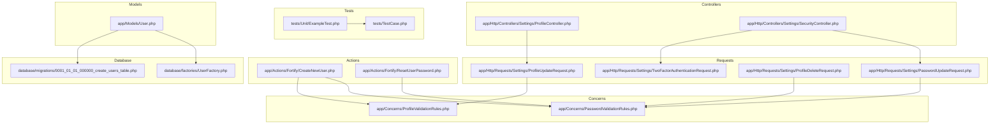
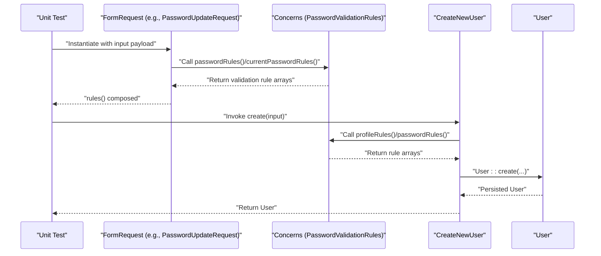
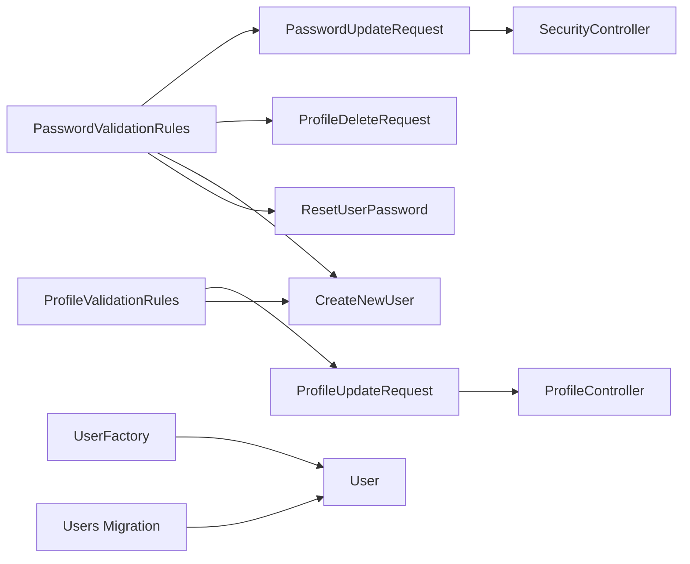

# Unit Testing

<cite>
**Referenced Files in This Document**
- [tests/TestCase.php](file://tests/TestCase.php)
- [tests/Unit/ExampleTest.php](file://tests/Unit/ExampleTest.php)
- [app/Concerns/PasswordValidationRules.php](file://app/Concerns/PasswordValidationRules.php)
- [app/Concerns/ProfileValidationRules.php](file://app/Concerns/ProfileValidationRules.php)
- [app/Http/Requests/Settings/PasswordUpdateRequest.php](file://app/Http/Requests/Settings/PasswordUpdateRequest.php)
- [app/Http/Requests/Settings/ProfileUpdateRequest.php](file://app/Http/Requests/Settings/ProfileUpdateRequest.php)
- [app/Http/Requests/Settings/ProfileDeleteRequest.php](file://app/Http/Requests/Settings/ProfileDeleteRequest.php)
- [app/Http/Requests/Settings/TwoFactorAuthenticationRequest.php](file://app/Http/Requests/Settings/TwoFactorAuthenticationRequest.php)
- [app/Models/User.php](file://app/Models/User.php)
- [app/Actions/Fortify/CreateNewUser.php](file://app/Actions/Fortify/CreateNewUser.php)
- [app/Actions/Fortify/ResetUserPassword.php](file://app/Actions/Fortify/ResetUserPassword.php)
- [app/Http/Controllers/Settings/ProfileController.php](file://app/Http/Controllers/Settings/ProfileController.php)
- [app/Http/Controllers/Settings/SecurityController.php](file://app/Http/Controllers/Settings/SecurityController.php)
- [database/factories/UserFactory.php](file://database/factories/UserFactory.php)
- [database/migrations/0001_01_01_000000_create_users_table.php](file://database/migrations/0001_01_01_000000_create_users_table.php)
- [phpunit.xml](file://phpunit.xml)
</cite>

## Table of Contents
1. [Introduction](#introduction)
2. [Project Structure](#project-structure)
3. [Core Components](#core-components)
4. [Architecture Overview](#architecture-overview)
5. [Detailed Component Analysis](#detailed-component-analysis)
6. [Dependency Analysis](#dependency-analysis)
7. [Performance Considerations](#performance-considerations)
8. [Troubleshooting Guide](#troubleshooting-guide)
9. [Conclusion](#conclusion)
10. [Appendices](#appendices)

## Introduction
This document provides comprehensive unit testing guidance for SmartExam’s backend built with Laravel. It focuses on isolated component testing for classes, methods, and functions without external dependencies. It covers testing Laravel models, request validation classes, utility functions, traits, concerns, and helper functions. It also includes examples of mocking external services, testing business logic in isolation, validating data transformations, and best practices for assertions and test data preparation.

## Project Structure
SmartExam organizes unit tests under the tests/Unit directory and shares a base TestCase for bootstrapping. Validation logic is centralized in Concerns traits and reused by FormRequest classes. Business logic resides in Actions and Controllers, while Eloquent models define data structures and casting. Factories and migrations support deterministic test data creation.

**Diagram sources**
- [tests/Unit/ExampleTest.php:1-17](file://tests/Unit/ExampleTest.php#L1-L17)
- [tests/TestCase.php:1-17](file://tests/TestCase.php#L1-L17)
- [app/Concerns/PasswordValidationRules.php:1-30](file://app/Concerns/PasswordValidationRules.php#L1-L30)
- [app/Concerns/ProfileValidationRules.php:1-52](file://app/Concerns/ProfileValidationRules.php#L1-L52)
- [app/Http/Requests/Settings/PasswordUpdateRequest.php:1-26](file://app/Http/Requests/Settings/PasswordUpdateRequest.php#L1-L26)
- [app/Http/Requests/Settings/ProfileUpdateRequest.php:1-23](file://app/Http/Requests/Settings/ProfileUpdateRequest.php#L1-L23)
- [app/Http/Requests/Settings/ProfileDeleteRequest.php:1-25](file://app/Http/Requests/Settings/ProfileDeleteRequest.php#L1-L25)
- [app/Http/Requests/Settings/TwoFactorAuthenticationRequest.php:1-23](file://app/Http/Requests/Settings/TwoFactorAuthenticationRequest.php#L1-L23)
- [app/Actions/Fortify/CreateNewUser.php:1-34](file://app/Actions/Fortify/CreateNewUser.php#L1-L34)
- [app/Actions/Fortify/ResetUserPassword.php:1-30](file://app/Actions/Fortify/ResetUserPassword.php#L1-L30)
- [app/Models/User.php:1-53](file://app/Models/User.php#L1-L53)
- [app/Http/Controllers/Settings/ProfileController.php:1-63](file://app/Http/Controllers/Settings/ProfileController.php#L1-L63)
- [app/Http/Controllers/Settings/SecurityController.php:1-73](file://app/Http/Controllers/Settings/SecurityController.php#L1-L73)
- [database/factories/UserFactory.php:1-65](file://database/factories/UserFactory.php#L1-L65)
- [database/migrations/0001_01_01_000000_create_users_table.php:1-50](file://database/migrations/0001_01_01_000000_create_users_table.php#L1-L50)

**Section sources**
- [tests/Unit/ExampleTest.php:1-17](file://tests/Unit/ExampleTest.php#L1-L17)
- [tests/TestCase.php:1-17](file://tests/TestCase.php#L1-L17)
- [phpunit.xml](file://phpunit.xml)

## Core Components
This section outlines the primary units suitable for isolated unit testing and how to approach them.

- Concerns and Traits
  - PasswordValidationRules: Provides reusable password validation rule arrays and current password checks.
  - ProfileValidationRules: Provides reusable profile validation rule arrays for name and email, including uniqueness constraints with optional ignore for updates.
  - These are ideal for unit tests because they encapsulate pure logic and do not rely on external services.

- Request Validation Classes
  - PasswordUpdateRequest, ProfileUpdateRequest, ProfileDeleteRequest, TwoFactorAuthenticationRequest: Extend FormRequest and reuse Concerns for rules. They are excellent candidates for unit tests focused on validation rule composition and request resolution behavior.

- Actions (Business Logic)
  - CreateNewUser: Validates input using Concerns and creates a User record. Good for unit tests verifying validation and creation logic.
  - ResetUserPassword: Validates and resets a user’s password. Suitable for unit tests around validation and persistence.

- Model
  - User: Defines fillable and hidden attributes, notifications, and authentication traits. Ideal for unit tests around casting, attributes, and factory-backed data.

- Controllers
  - ProfileController and SecurityController: Exercise request validation via type-hints and perform model updates. Good for unit tests simulating validated requests and asserting model changes.

- Factories and Migrations
  - UserFactory: Produces deterministic user records for tests.
  - Users migration: Defines schema for tests to run against.

**Section sources**
- [app/Concerns/PasswordValidationRules.php:1-30](file://app/Concerns/PasswordValidationRules.php#L1-L30)
- [app/Concerns/ProfileValidationRules.php:1-52](file://app/Concerns/ProfileValidationRules.php#L1-L52)
- [app/Http/Requests/Settings/PasswordUpdateRequest.php:1-26](file://app/Http/Requests/Settings/PasswordUpdateRequest.php#L1-L26)
- [app/Http/Requests/Settings/ProfileUpdateRequest.php:1-23](file://app/Http/Requests/Settings/ProfileUpdateRequest.php#L1-L23)
- [app/Http/Requests/Settings/ProfileDeleteRequest.php:1-25](file://app/Http/Requests/Settings/ProfileDeleteRequest.php#L1-L25)
- [app/Http/Requests/Settings/TwoFactorAuthenticationRequest.php:1-23](file://app/Http/Requests/Settings/TwoFactorAuthenticationRequest.php#L1-L23)
- [app/Actions/Fortify/CreateNewUser.php:1-34](file://app/Actions/Fortify/CreateNewUser.php#L1-L34)
- [app/Actions/Fortify/ResetUserPassword.php:1-30](file://app/Actions/Fortify/ResetUserPassword.php#L1-L30)
- [app/Models/User.php:1-53](file://app/Models/User.php#L1-L53)
- [app/Http/Controllers/Settings/ProfileController.php:1-63](file://app/Http/Controllers/Settings/ProfileController.php#L1-L63)
- [app/Http/Controllers/Settings/SecurityController.php:1-73](file://app/Http/Controllers/Settings/SecurityController.php#L1-L73)
- [database/factories/UserFactory.php:1-65](file://database/factories/UserFactory.php#L1-L65)
- [database/migrations/0001_01_01_000000_create_users_table.php:1-50](file://database/migrations/0001_01_01_000000_create_users_table.php#L1-L50)

## Architecture Overview
The unit testing architecture centers on isolating logic in Concerns and Actions, validating it via FormRequest classes, and asserting outcomes on models and controllers. Tests should avoid database writes by leveraging factories and mocks where appropriate.

**Diagram sources**
- [app/Http/Requests/Settings/PasswordUpdateRequest.php:1-26](file://app/Http/Requests/Settings/PasswordUpdateRequest.php#L1-L26)
- [app/Concerns/PasswordValidationRules.php:1-30](file://app/Concerns/PasswordValidationRules.php#L1-L30)
- [app/Actions/Fortify/CreateNewUser.php:1-34](file://app/Actions/Fortify/CreateNewUser.php#L1-L34)
- [app/Models/User.php:1-53](file://app/Models/User.php#L1-L53)

## Detailed Component Analysis

### PasswordValidationRules (Trait)
Purpose:
- Encapsulates password and current password validation rule arrays.
- Pure logic returning arrays; no external dependencies.

Testing approach:
- Instantiate the trait via a minimal class or mock the trait methods.
- Assert returned arrays match expected keys and values.
- Verify rule composition for different contexts (e.g., confirmation vs. current password).

Best practices:
- Keep assertions simple and deterministic.
- Use data providers to test variations of rule arrays.

**Section sources**
- [app/Concerns/PasswordValidationRules.php:1-30](file://app/Concerns/PasswordValidationRules.php#L1-L30)

### ProfileValidationRules (Trait)
Purpose:
- Encapsulates profile validation rules for name and email.
- Handles uniqueness constraints with optional ignore for existing users.

Testing approach:
- Provide inputs with and without userId to assert unique rule behavior.
- Validate rule arrays for name and email separately.
- Mock the User model reference implicitly via Rule::unique.

Best practices:
- Use factories to create existing users when testing ignore logic.
- Assert presence of unique rule and ignore clause.

**Section sources**
- [app/Concerns/ProfileValidationRules.php:1-52](file://app/Concerns/ProfileValidationRules.php#L1-L52)

### FormRequest Classes
Purpose:
- Compose validation rules by delegating to Concerns.
- Enforce validation during controller actions.

Testing approach:
- Create request instances with controlled input payloads.
- Assert rules() returns expected arrays.
- Simulate request resolution and validation outcomes.

Examples:
- PasswordUpdateRequest: Assert password and current password rules are merged.
- ProfileUpdateRequest: Assert profileRules($userId) is applied.
- ProfileDeleteRequest: Assert current password rule is enforced.
- TwoFactorAuthenticationRequest: Assert empty rules but state interactions via traits.

**Section sources**
- [app/Http/Requests/Settings/PasswordUpdateRequest.php:1-26](file://app/Http/Requests/Settings/PasswordUpdateRequest.php#L1-L26)
- [app/Http/Requests/Settings/ProfileUpdateRequest.php:1-23](file://app/Http/Requests/Settings/ProfileUpdateRequest.php#L1-L23)
- [app/Http/Requests/Settings/ProfileDeleteRequest.php:1-25](file://app/Http/Requests/Settings/ProfileDeleteRequest.php#L1-L25)
- [app/Http/Requests/Settings/TwoFactorAuthenticationRequest.php:1-23](file://app/Http/Requests/Settings/TwoFactorAuthenticationRequest.php#L1-L23)

### CreateNewUser (Action)
Purpose:
- Validates combined profile and password rules.
- Creates a User record.

Testing approach:
- Provide input arrays aligned with profileRules and passwordRules.
- Assert validation passes and User::create is invoked with expected attributes.
- Optionally mock Validator to force failures and assert exceptions.

Assertions:
- Confirm returned User has expected attributes.
- Verify save/update behavior indirectly via model assertions.

**Section sources**
- [app/Actions/Fortify/CreateNewUser.php:1-34](file://app/Actions/Fortify/CreateNewUser.php#L1-L34)
- [app/Concerns/PasswordValidationRules.php:1-30](file://app/Concerns/PasswordValidationRules.php#L1-L30)
- [app/Concerns/ProfileValidationRules.php:1-52](file://app/Concerns/ProfileValidationRules.php#L1-L52)
- [app/Models/User.php:1-53](file://app/Models/User.php#L1-L53)

### ResetUserPassword (Action)
Purpose:
- Validates new password and applies it to a given User.

Testing approach:
- Provide user instance and input payload.
- Assert validation passes and user is forceFilled and saved.
- Optionally stub save() to isolate persistence.

**Section sources**
- [app/Actions/Fortify/ResetUserPassword.php:1-30](file://app/Actions/Fortify/ResetUserPassword.php#L1-L30)
- [app/Concerns/PasswordValidationRules.php:1-30](file://app/Concerns/PasswordValidationRules.php#L1-L30)

### User Model
Purpose:
- Defines fillable and hidden attributes, casting, and authentication traits.

Testing approach:
- Use factories to create users and assert fillable/hidden attributes.
- Verify casting behavior for timestamps and hashed password.
- Validate model relationships and traits integration.

**Section sources**
- [app/Models/User.php:1-53](file://app/Models/User.php#L1-L53)
- [database/factories/UserFactory.php:1-65](file://database/factories/UserFactory.php#L1-L65)
- [database/migrations/0001_01_01_000000_create_users_table.php:1-50](file://database/migrations/0001_01_01_000000_create_users_table.php#L1-L50)

### Controllers (ProfileController, SecurityController)
Purpose:
- Apply request validation via type-hinted FormRequests.
- Perform model updates and response rendering.

Testing approach:
- Mock request objects to simulate validated input.
- Assert model fill/save and conditional logic (e.g., email verification reset).
- For SecurityController, assert feature-gated properties and password rules string.

**Section sources**
- [app/Http/Controllers/Settings/ProfileController.php:1-63](file://app/Http/Controllers/Settings/ProfileController.php#L1-L63)
- [app/Http/Controllers/Settings/SecurityController.php:1-73](file://app/Http/Controllers/Settings/SecurityController.php#L1-L73)
- [app/Http/Requests/Settings/ProfileUpdateRequest.php:1-23](file://app/Http/Requests/Settings/ProfileUpdateRequest.php#L1-L23)
- [app/Http/Requests/Settings/PasswordUpdateRequest.php:1-26](file://app/Http/Requests/Settings/PasswordUpdateRequest.php#L1-L26)

## Dependency Analysis
Key dependencies and coupling for unit testing:

- Concerns to Requests: Requests depend on Concerns for rule composition. Unit tests can stub Concerns methods to isolate validation logic.
- Requests to Actions: Actions depend on Concerns and Eloquent. Unit tests can mock Validator and User to isolate business logic.
- Controllers to Requests: Controllers depend on validated requests. Unit tests can mock requests to simulate successful validation.
- Model to Factory/Migration: Models rely on factories for deterministic data and migrations for schema. Unit tests can leverage factories and RefreshDatabase.

**Diagram sources**
- [app/Concerns/PasswordValidationRules.php:1-30](file://app/Concerns/PasswordValidationRules.php#L1-L30)
- [app/Concerns/ProfileValidationRules.php:1-52](file://app/Concerns/ProfileValidationRules.php#L1-L52)
- [app/Http/Requests/Settings/PasswordUpdateRequest.php:1-26](file://app/Http/Requests/Settings/PasswordUpdateRequest.php#L1-L26)
- [app/Http/Requests/Settings/ProfileUpdateRequest.php:1-23](file://app/Http/Requests/Settings/ProfileUpdateRequest.php#L1-L23)
- [app/Http/Requests/Settings/ProfileDeleteRequest.php:1-25](file://app/Http/Requests/Settings/ProfileDeleteRequest.php#L1-L25)
- [app/Actions/Fortify/CreateNewUser.php:1-34](file://app/Actions/Fortify/CreateNewUser.php#L1-L34)
- [app/Actions/Fortify/ResetUserPassword.php:1-30](file://app/Actions/Fortify/ResetUserPassword.php#L1-L30)
- [app/Http/Controllers/Settings/ProfileController.php:1-63](file://app/Http/Controllers/Settings/ProfileController.php#L1-L63)
- [app/Http/Controllers/Settings/SecurityController.php:1-73](file://app/Http/Controllers/Settings/SecurityController.php#L1-L73)
- [database/factories/UserFactory.php:1-65](file://database/factories/UserFactory.php#L1-L65)
- [database/migrations/0001_01_01_000000_create_users_table.php:1-50](file://database/migrations/0001_01_01_01_000000_create_users_table.php#L1-L50)

**Section sources**
- [app/Concerns/PasswordValidationRules.php:1-30](file://app/Concerns/PasswordValidationRules.php#L1-L30)
- [app/Concerns/ProfileValidationRules.php:1-52](file://app/Concerns/ProfileValidationRules.php#L1-L52)
- [app/Http/Requests/Settings/PasswordUpdateRequest.php:1-26](file://app/Http/Requests/Settings/PasswordUpdateRequest.php#L1-L26)
- [app/Http/Requests/Settings/ProfileUpdateRequest.php:1-23](file://app/Http/Requests/Settings/ProfileUpdateRequest.php#L1-L23)
- [app/Http/Requests/Settings/ProfileDeleteRequest.php:1-25](file://app/Http/Requests/Settings/ProfileDeleteRequest.php#L1-L25)
- [app/Actions/Fortify/CreateNewUser.php:1-34](file://app/Actions/Fortify/CreateNewUser.php#L1-L34)
- [app/Actions/Fortify/ResetUserPassword.php:1-30](file://app/Actions/Fortify/ResetUserPassword.php#L1-L30)
- [app/Http/Controllers/Settings/ProfileController.php:1-63](file://app/Http/Controllers/Settings/ProfileController.php#L1-L63)
- [app/Http/Controllers/Settings/SecurityController.php:1-73](file://app/Http/Controllers/Settings/SecurityController.php#L1-L73)
- [database/factories/UserFactory.php:1-65](file://database/factories/UserFactory.php#L1-L65)
- [database/migrations/0001_01_01_000000_create_users_table.php:1-50](file://database/migrations/0001_01_01_000000_create_users_table.php#L1-L50)

## Performance Considerations
- Prefer in-memory SQLite for unit tests when applicable to reduce overhead.
- Use RefreshDatabase sparingly; keep heavy database operations in feature tests.
- Mock external services (e.g., validators, third-party APIs) to avoid flaky tests.
- Keep unit tests fast by minimizing I/O and relying on factories for deterministic data.

## Troubleshooting Guide
Common issues and resolutions:
- Validation failures in unit tests:
  - Ensure Concerns methods are called correctly and rule arrays are merged as expected.
  - Use data providers to cover edge cases (missing fields, invalid formats).
- Model attribute mismatches:
  - Verify fillable/hidden attributes and casting in the model.
  - Use factories to align test data with schema expectations.
- Feature-gated logic:
  - Some controllers conditionally render properties based on feature flags. Mock or configure feature flags in tests to ensure deterministic behavior.
- Assertion strategies:
  - Favor explicit assertions over implicit ones (e.g., assertArrayHasKey over relying on array shape).
  - For rule arrays, assert exact keys and values to prevent regressions.

**Section sources**
- [tests/TestCase.php:1-17](file://tests/TestCase.php#L1-L17)
- [app/Http/Controllers/Settings/SecurityController.php:1-73](file://app/Http/Controllers/Settings/SecurityController.php#L1-L73)

## Conclusion
SmartExam’s architecture cleanly separates validation logic into Concerns, composes it in FormRequest classes, and executes business logic in Actions and Controllers. For unit testing, focus on:
- Isolating Concerns and Actions behind mocks or stubs.
- Validating rule compositions and transformations.
- Using factories and migrations to prepare deterministic test data.
- Employing targeted assertions and data providers to cover edge cases.

## Appendices

### Best Practices for Unit Tests
- Keep tests small and focused on a single behavior.
- Use descriptive test names that reflect intent.
- Leverage data providers for varied inputs.
- Mock external dependencies to ensure determinism.
- Use factories for model creation and schema alignment.

### Assertion Strategies
- For rule arrays: assert exact keys and values.
- For model attributes: assert fillable and hidden behavior.
- For Actions: assert method calls and return values.
- For Controllers: assert response types and model changes.

### Test Data Preparation
- Use factories to create users and related entities.
- Apply migration files to ensure schema consistency.
- Use RefreshDatabase trait judiciously to reset state between tests.

**Section sources**
- [tests/Unit/ExampleTest.php:1-17](file://tests/Unit/ExampleTest.php#L1-L17)
- [tests/TestCase.php:1-17](file://tests/TestCase.php#L1-L17)
- [database/factories/UserFactory.php:1-65](file://database/factories/UserFactory.php#L1-L65)
- [database/migrations/0001_01_01_000000_create_users_table.php:1-50](file://database/migrations/0001_01_01_000000_create_users_table.php#L1-L50)