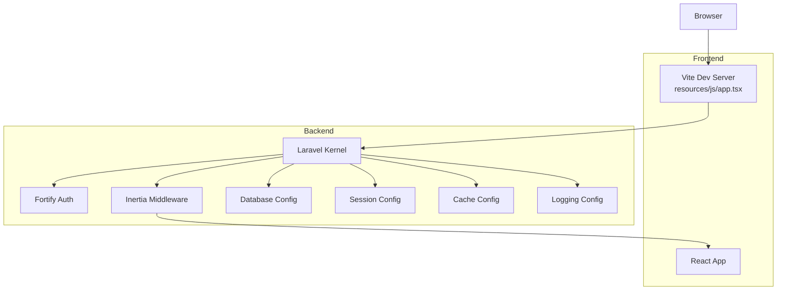
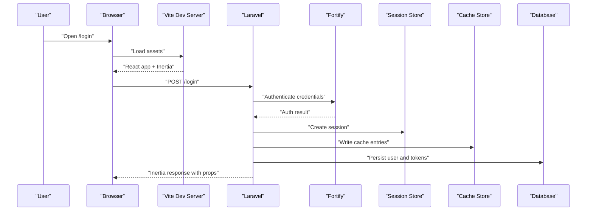
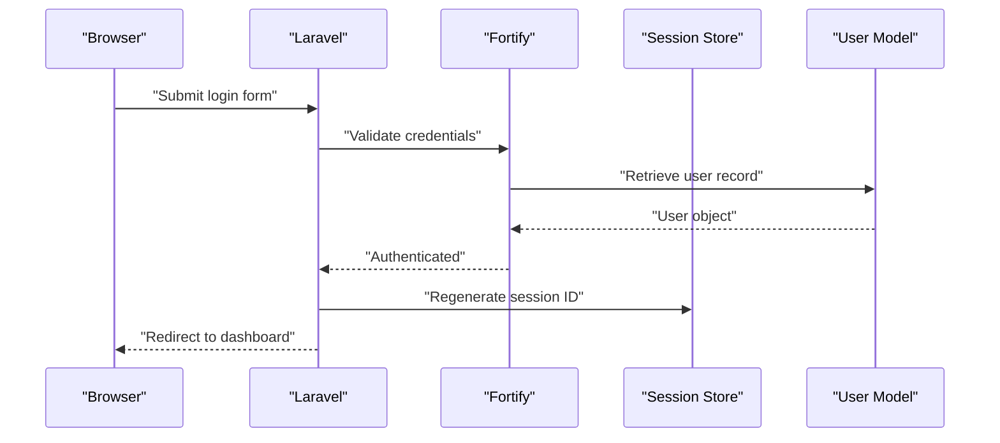
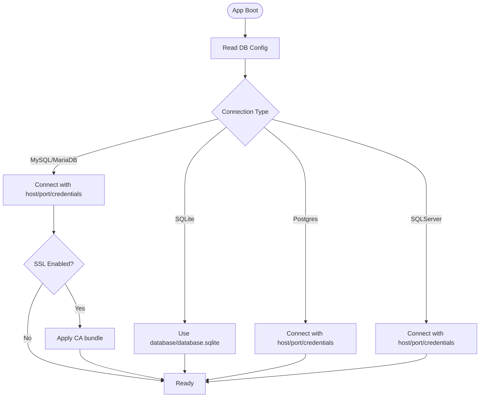
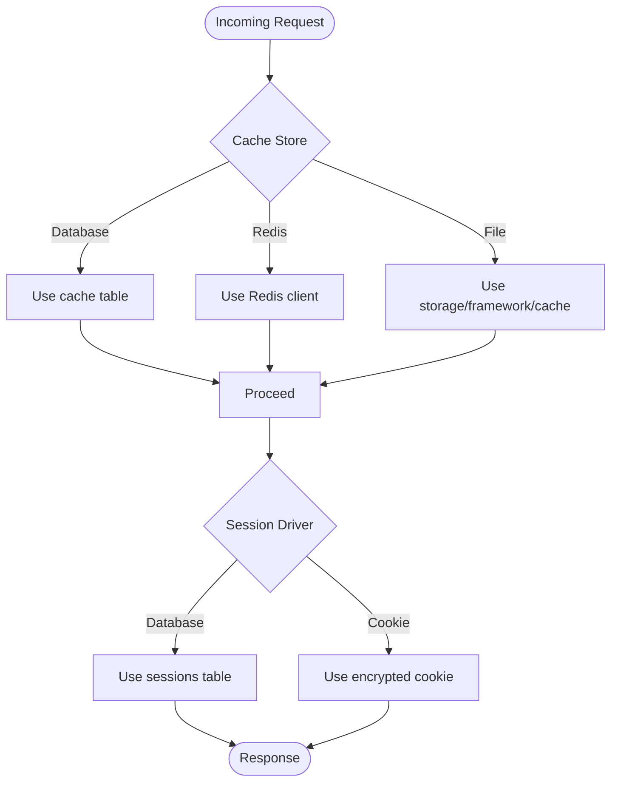
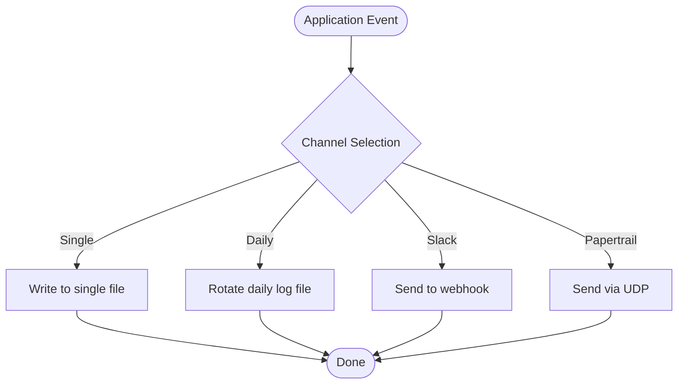
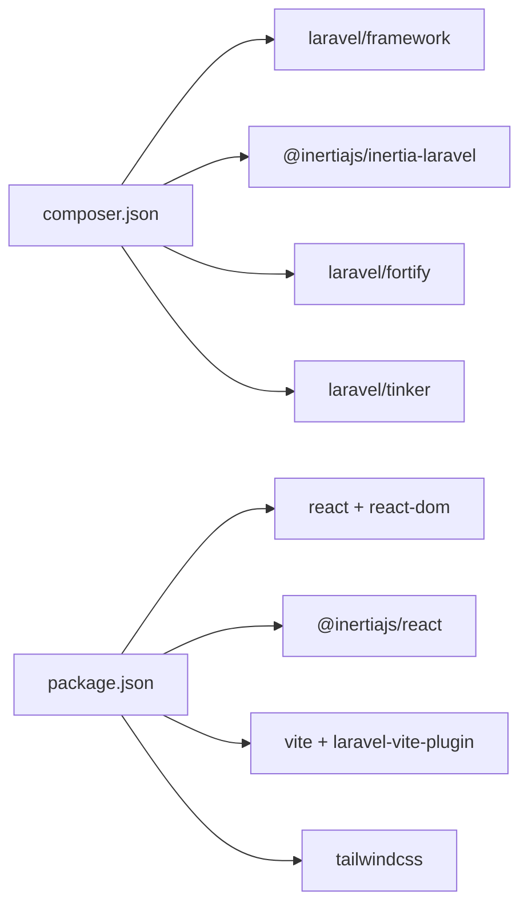

# Troubleshooting & FAQ

<cite>
**Referenced Files in This Document**
- [composer.json](file://composer.json)
- [package.json](file://package.json)
- [vite.config.ts](file://vite.config.ts)
- [app.tsx](file://resources/js/app.tsx)
- [app.php](file://config/app.php)
- [database.php](file://config/database.php)
- [session.php](file://config/session.php)
- [cache.php](file://config/cache.php)
- [logging.php](file://config/logging.php)
- [fortify.php](file://config/fortify.php)
- [HandleInertiaRequests.php](file://app/Http/Middleware/HandleInertiaRequests.php)
- [HandleAppearance.php](file://app/Http/Middleware/HandleAppearance.php)
- [User.php](file://app/Models/User.php)
- [ProfileController.php](file://app/Http/Controllers/Settings/ProfileController.php)
- [SecurityController.php](file://app/Http/Controllers/Settings/SecurityController.php)
- [web.php](file://routes/web.php)
- [settings.php](file://routes/settings.php)
</cite>

## Table of Contents
1. [Introduction](#introduction)
2. [Project Structure](#project-structure)
3. [Core Components](#core-components)
4. [Architecture Overview](#architecture-overview)
5. [Detailed Component Analysis](#detailed-component-analysis)
6. [Dependency Analysis](#dependency-analysis)
7. [Performance Considerations](#performance-considerations)
8. [Troubleshooting Guide](#troubleshooting-guide)
9. [Conclusion](#conclusion)
10. [Appendices](#appendices)

## Introduction
This document provides a comprehensive troubleshooting guide and FAQ for the SmartExam web application. It focuses on diagnosing and resolving common issues related to authentication, database connectivity, sessions, frontend builds, performance, caching, error handling, and environment-specific deployment concerns. It also includes practical debugging techniques using built-in tools and log analysis.

## Project Structure
SmartExam is a Laravel application with an Inertia.js React frontend. The backend is configured with Laravel Fortify for authentication, Inertia for SSR-like rendering, and Vite for asset bundling. Key configuration files control environment behavior, database connections, sessions, caching, logging, and authentication features.

**Diagram sources**
- [vite.config.ts:1-32](file://vite.config.ts#L1-L32)
- [app.tsx:1-41](file://resources/js/app.tsx#L1-L41)
- [app.php:1-127](file://config/app.php#L1-L127)
- [database.php:1-185](file://config/database.php#L1-L185)
- [session.php:1-234](file://config/session.php#L1-L234)
- [cache.php:1-137](file://config/cache.php#L1-L137)
- [logging.php:1-133](file://config/logging.php#L1-L133)
- [HandleInertiaRequests.php:1-48](file://app/Http/Middleware/HandleInertiaRequests.php#L1-L48)

**Section sources**
- [composer.json:1-120](file://composer.json#L1-L120)
- [package.json:1-77](file://package.json#L1-L77)
- [vite.config.ts:1-32](file://vite.config.ts#L1-L32)
- [app.tsx:1-41](file://resources/js/app.tsx#L1-L41)
- [app.php:1-127](file://config/app.php#L1-L127)
- [database.php:1-185](file://config/database.php#L1-L185)
- [session.php:1-234](file://config/session.php#L1-L234)
- [cache.php:1-137](file://config/cache.php#L1-L137)
- [logging.php:1-133](file://config/logging.php#L1-L133)
- [HandleInertiaRequests.php:1-48](file://app/Http/Middleware/HandleInertiaRequests.php#L1-L48)

## Core Components
- Authentication and Security
  - Fortify configuration enables registration, password resets, email verification, two-factor authentication, and passkeys.
  - User model integrates passkeys and two-factor authentication traits.
  - Security controller exposes endpoints for managing passkeys and two-factor settings.
- Sessions and Cookies
  - Session driver defaults to database with configurable lifetime, cookie policies, and SameSite behavior.
- Caching
  - Default cache store is database with support for file, Redis, DynamoDB, and Octane.
- Logging
  - Stack-based logging with daily rotation and Slack/Papertrail integrations.
- Frontend Build
  - Vite plugin pipeline with React compiler, TailwindCSS, and Inertia integration.

**Section sources**
- [fortify.php:1-192](file://config/fortify.php#L1-L192)
- [User.php:1-53](file://app/Models/User.php#L1-L53)
- [SecurityController.php:1-73](file://app/Http/Controllers/Settings/SecurityController.php#L1-L73)
- [session.php:1-234](file://config/session.php#L1-L234)
- [cache.php:1-137](file://config/cache.php#L1-L137)
- [logging.php:1-133](file://config/logging.php#L1-L133)
- [vite.config.ts:1-32](file://vite.config.ts#L1-L32)

## Architecture Overview
The application follows a classic Laravel MVC pattern with Inertia rendering the React frontend. Authentication is handled by Fortify, sessions are persisted via the configured driver, and caching is centralized through the cache store. Logging is configured for local and remote observability.

**Diagram sources**
- [app.tsx:1-41](file://resources/js/app.tsx#L1-L41)
- [fortify.php:1-192](file://config/fortify.php#L1-L192)
- [session.php:1-234](file://config/session.php#L1-L234)
- [cache.php:1-137](file://config/cache.php#L1-L137)
- [database.php:1-185](file://config/database.php#L1-L185)

## Detailed Component Analysis

### Authentication and Session Flow
- Fortify manages login, password reset, email verification, two-factor, and passkeys.
- Session configuration controls lifetime, cookie attributes, and storage backend.
- Inertia middleware shares application-wide data and bootstraps the React app.

**Diagram sources**
- [fortify.php:1-192](file://config/fortify.php#L1-L192)
- [session.php:1-234](file://config/session.php#L1-L234)
- [User.php:1-53](file://app/Models/User.php#L1-L53)

**Section sources**
- [fortify.php:1-192](file://config/fortify.php#L1-L192)
- [session.php:1-234](file://config/session.php#L1-L234)
- [HandleInertiaRequests.php:1-48](file://app/Http/Middleware/HandleInertiaRequests.php#L1-L48)

### Database Connectivity
- Default connection is SQLite for local development; MySQL/MariaDB/Postgres/SQLServer are supported.
- SSL/TLS options for MySQL/MariaDB via PDO attributes.
- Redis is configured for cache and session backends.

**Diagram sources**
- [database.php:1-185](file://config/database.php#L1-L185)

**Section sources**
- [database.php:1-185](file://config/database.php#L1-L185)

### Caching and Sessions
- Cache store defaults to database with optional Redis and file fallbacks.
- Session driver defaults to database with configurable cookie policy and lifetime.

**Diagram sources**
- [cache.php:1-137](file://config/cache.php#L1-L137)
- [session.php:1-234](file://config/session.php#L1-L234)

**Section sources**
- [cache.php:1-137](file://config/cache.php#L1-L137)
- [session.php:1-234](file://config/session.php#L1-L234)

### Logging and Monitoring
- Default stack includes a primary channel; daily rotation and Slack/Papertrail integrations are available.
- Use the log files under storage/logs for diagnosing runtime issues.

**Diagram sources**
- [logging.php:1-133](file://config/logging.php#L1-L133)

**Section sources**
- [logging.php:1-133](file://config/logging.php#L1-L133)

## Dependency Analysis
- Backend dependencies include Laravel framework, Inertia for Laravel, Fortify for authentication, and Tinker for REPL.
- Frontend dependencies include React, Inertia for React, TailwindCSS, and Vite for dev/build.

**Diagram sources**
- [composer.json:1-120](file://composer.json#L1-L120)
- [package.json:1-77](file://package.json#L1-L77)

**Section sources**
- [composer.json:1-120](file://composer.json#L1-L120)
- [package.json:1-77](file://package.json#L1-L77)

## Performance Considerations
- Use database-backed cache and sessions for distributed environments.
- Enable Redis for cache and session locking to reduce contention.
- Monitor slow queries and optimize migrations and indexes.
- Minimize payload sizes by avoiding unnecessary shared data in Inertia middleware.
- Use production-ready logging levels and avoid excessive debug output.

[No sources needed since this section provides general guidance]

## Troubleshooting Guide

### Authentication Problems
Common symptoms:
- Login fails or redirects endlessly.
- Password reset emails not received.
- Two-factor or passkey enrollment issues.

Checklist:
- Verify Fortify features are enabled and routes are registered.
- Confirm the default guard and password broker are correct.
- Ensure email verification is configured if enabled.
- Validate passkeys relying party ID and allowed origins align with app URL.
- Check rate limiting keys for login, two-factor, and passkeys.

Debugging steps:
- Inspect authentication routes and middleware groups.
- Review session lifetime and cookie attributes.
- Confirm database connections for users, sessions, and cache tables.
- Use browser developer tools to capture failed XHR/Fetch requests and network tab errors.

**Section sources**
- [fortify.php:1-192](file://config/fortify.php#L1-L192)
- [User.php:1-53](file://app/Models/User.php#L1-L53)
- [web.php:1-26](file://routes/web.php#L1-L26)
- [settings.php:1-41](file://routes/settings.php#L1-L41)
- [session.php:1-234](file://config/session.php#L1-L234)
- [database.php:1-185](file://config/database.php#L1-L185)

### Database Connectivity
Symptoms:
- Application crashes on startup with database errors.
- Migrations fail or tables missing.
- Slow queries or timeouts.

Checklist:
- Confirm DB_CONNECTION matches your environment (sqlite/mysql/pgsql/sqlsrv).
- Validate credentials, host, port, and charset/collation.
- For MySQL/MariaDB, ensure SSL CA bundle path is correct if enabled.
- Ensure cache and sessions tables exist and are migrated.

Debugging steps:
- Run migrations and cache table creation.
- Test PDO connection with minimal script.
- Check Redis connectivity if using Redis for cache/session.

**Section sources**
- [database.php:1-185](file://config/database.php#L1-L185)
- [database/migrations](file://database/migrations)

### Session Issues
Symptoms:
- Users logged out unexpectedly.
- Session fixation or concurrency issues.
- Cross-site cookie errors.

Checklist:
- Adjust SESSION_LIFETIME and expire_on_close as needed.
- Verify SESSION_SAME_SITE and secure cookie settings.
- Ensure SESSION_DOMAIN and path are appropriate for subdomains.
- Confirm database session table exists and is writable.

Debugging steps:
- Clear stale sessions and regenerate tokens after logout.
- Inspect browser cookies and SameSite behavior.
- Review session store configuration and Redis availability.

**Section sources**
- [session.php:1-234](file://config/session.php#L1-L234)
- [ProfileController.php:1-63](file://app/Http/Controllers/Settings/ProfileController.php#L1-L63)

### Frontend Build Errors
Symptoms:
- Vite dev server fails to start.
- Build errors for TypeScript or React components.
- Assets not loading in production.

Checklist:
- Ensure Node.js and npm/pnpm versions satisfy dependencies.
- Run npm install and rebuild assets.
- Verify Vite plugin order and entry points.
- Confirm Tailwind and Inertia plugins are configured.

Debugging steps:
- Use Vite’s dev server logs and error overlay.
- Check TypeScript compilation and ESLint/Prettier checks.
- Validate asset manifest and public path in production.

**Section sources**
- [package.json:1-77](file://package.json#L1-L77)
- [vite.config.ts:1-32](file://vite.config.ts#L1-L32)
- [app.tsx:1-41](file://resources/js/app.tsx#L1-L41)

### Performance Troubleshooting
Symptoms:
- High memory usage.
- Slow page loads.
- Frequent cache misses.

Checklist:
- Switch cache/store to Redis for production.
- Tune session and cache TTLs.
- Reduce shared data in Inertia middleware.
- Enable production logging level and disable debug.

Debugging steps:
- Monitor memory and CPU via OS tools.
- Profile frontend bundles and chunk sizes.
- Analyze slow log entries and query plans.

**Section sources**
- [cache.php:1-137](file://config/cache.php#L1-L137)
- [session.php:1-234](file://config/session.php#L1-L234)
- [logging.php:1-133](file://config/logging.php#L1-L133)
- [HandleInertiaRequests.php:1-48](file://app/Http/Middleware/HandleInertiaRequests.php#L1-L48)

### Caching Issues
Symptoms:
- Stale data or inconsistent state.
- Cache lock failures or deadlocks.
- Memory pressure from large cache payloads.

Checklist:
- Choose Redis or database cache depending on environment.
- Set CACHE_PREFIX to avoid cross-app collisions.
- Configure failover cache stores for resilience.

Debugging steps:
- Clear cache selectively and re-run affected flows.
- Inspect cache keys and TTLs.
- Monitor Redis metrics and memory usage.

**Section sources**
- [cache.php:1-137](file://config/cache.php#L1-L137)

### Error Handling and Exception Management
Symptoms:
- Generic error pages instead of helpful messages.
- Missing stack traces in production.
- Uncaught exceptions in queues or jobs.

Checklist:
- Set APP_DEBUG appropriately for development vs production.
- Configure LOG_CHANNEL and levels.
- Use dedicated channels for deprecations and stderr.

Debugging steps:
- Tail logs in storage/logs and external sinks.
- Reproduce with minimal request and enable verbose logging.
- Add structured context to logs for correlation.

**Section sources**
- [app.php:1-127](file://config/app.php#L1-L127)
- [logging.php:1-133](file://config/logging.php#L1-L133)

### Monitoring Approaches
- Local: Daily rotating logs in storage/logs.
- Remote: Slack, Papertrail, or custom syslog handlers.
- Metrics: Integrate with external APM or OS-level monitoring.

**Section sources**
- [logging.php:1-133](file://config/logging.php#L1-L133)

### Environment-Specific Problems
- Development vs Production differences:
  - APP_ENV and APP_DEBUG toggles.
  - Asset building and public path handling.
  - Queue workers and pail logs.
- Dependency conflicts:
  - Align PHP and Node versions with composer and package constraints.
  - Prefer stable versions and resolve peer dependency mismatches.

**Section sources**
- [composer.json:1-120](file://composer.json#L1-L120)
- [package.json:1-77](file://package.json#L1-L77)
- [app.php:1-127](file://config/app.php#L1-L127)

### Frequently Asked Questions

Q: How do I enable two-factor authentication?
- Ensure the feature is enabled in Fortify and routes are registered.
- Verify the two-factor middleware and state validation in security routes.

**Section sources**
- [fortify.php:1-192](file://config/fortify.php#L1-L192)
- [settings.php:1-41](file://routes/settings.php#L1-L41)

Q: Why am I seeing passkey enrollment errors?
- Confirm relying party ID and allowed origins match the app URL.
- Ensure the well-known endpoint is reachable and returns correct routes.

**Section sources**
- [fortify.php:1-192](file://config/fortify.php#L1-L192)
- [settings.php:33-41](file://routes/settings.php#L33-L41)

Q: How do I fix session expiration issues?
- Increase SESSION_LIFETIME or enable expire_on_close as needed.
- Verify cookie SameSite and secure flags for HTTPS deployments.

**Section sources**
- [session.php:1-234](file://config/session.php#L1-L234)

Q: My frontend assets are not loading in production.
- Rebuild assets with Vite and ensure public path is correct.
- Verify Tailwind and Inertia plugin configurations.

**Section sources**
- [vite.config.ts:1-32](file://vite.config.ts#L1-L32)
- [app.tsx:1-41](file://resources/js/app.tsx#L1-L41)

Q: How do I monitor application logs?
- Configure LOG_CHANNEL and use daily, stderr, or external sinks.
- Use pail for real-time log viewing during development.

**Section sources**
- [logging.php:1-133](file://config/logging.php#L1-L133)
- [composer.json:20-30](file://composer.json#L20-L30)

Q: Can I customize the appearance theme?
- Use the appearance middleware to propagate theme preference from cookies.
- Initialize theme on app load and persist user preferences.

**Section sources**
- [HandleAppearance.php:1-24](file://app/Http/Middleware/HandleAppearance.php#L1-L24)
- [app.tsx:1-41](file://resources/js/app.tsx#L1-L41)

Q: How do I add new authentication features?
- Extend Fortify features in configuration and ensure routes are included.
- Keep user model traits aligned with enabled features.

**Section sources**
- [fortify.php:1-192](file://config/fortify.php#L1-L192)
- [User.php:1-53](file://app/Models/User.php#L1-L53)

Q: What scripts are available for development and CI?
- Use dev, lint, types:check, and test scripts defined in package.json and composer.json.
- CI can run combined checks via ci:check.

**Section sources**
- [package.json:1-77](file://package.json#L1-L77)
- [composer.json:43-96](file://composer.json#L43-L96)

## Conclusion
By aligning configuration with environment needs, validating database and session stores, and leveraging logging and frontend tooling, most issues in SmartExam can be diagnosed and resolved quickly. Use the provided debugging techniques and checklists to streamline troubleshooting and maintain a robust deployment pipeline.

[No sources needed since this section summarizes without analyzing specific files]

## Appendices

### Quick Fix Reference
- Authentication: Verify Fortify features and routes; check rate limits.
- Database: Confirm connection type and credentials; ensure cache/session tables exist.
- Sessions: Adjust lifetime and cookie policies; validate domain/path/SameSite.
- Frontend: Rebuild assets; validate Vite and plugin configuration.
- Logging: Set appropriate channel and level; rotate logs; integrate external sinks.

[No sources needed since this section provides general guidance]