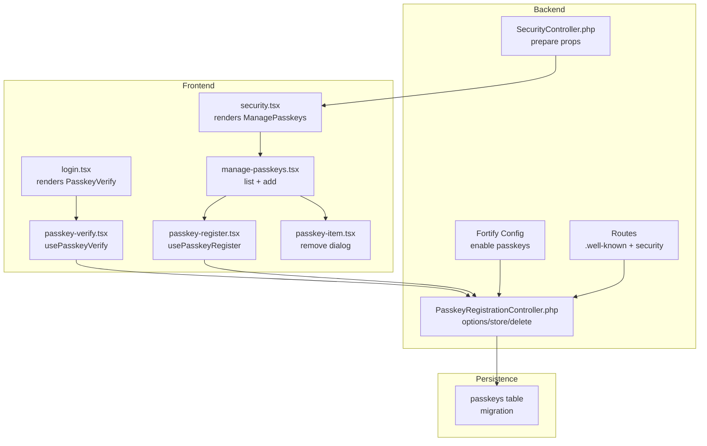
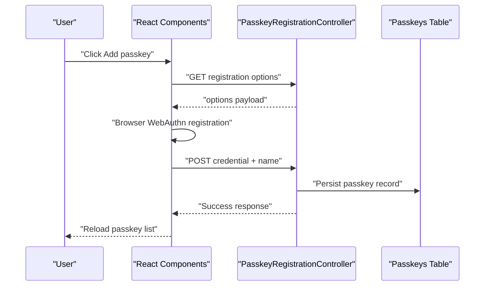
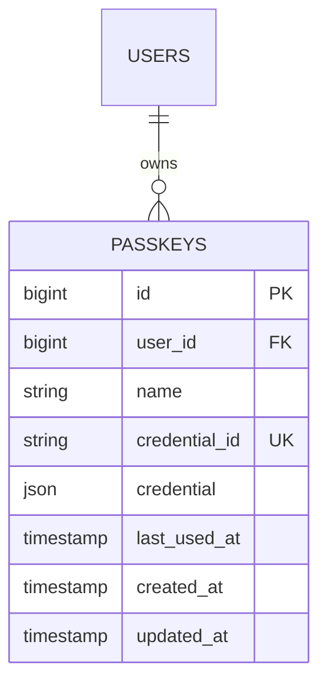
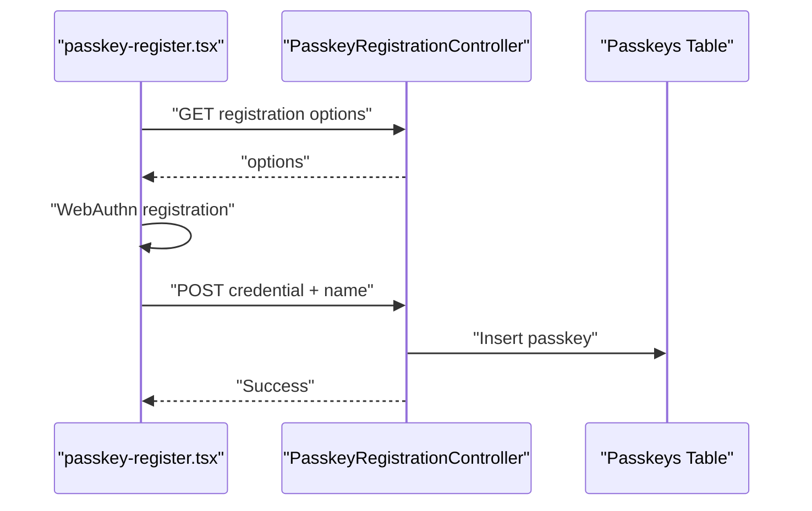
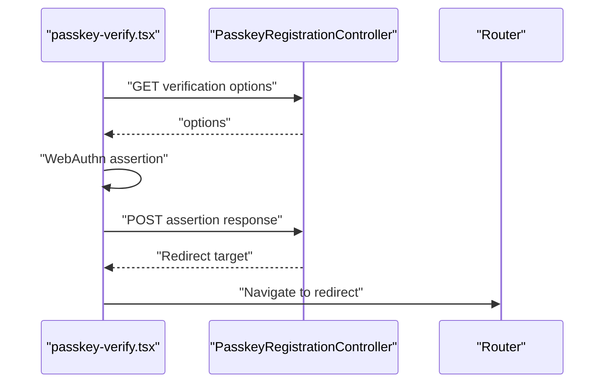
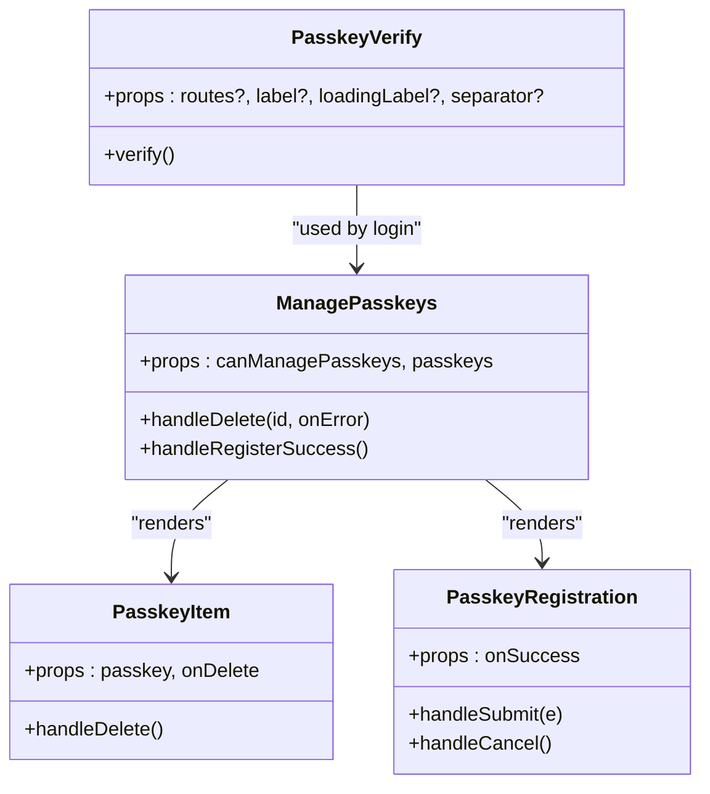
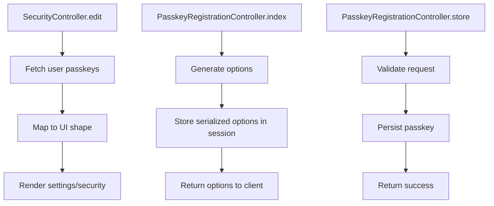
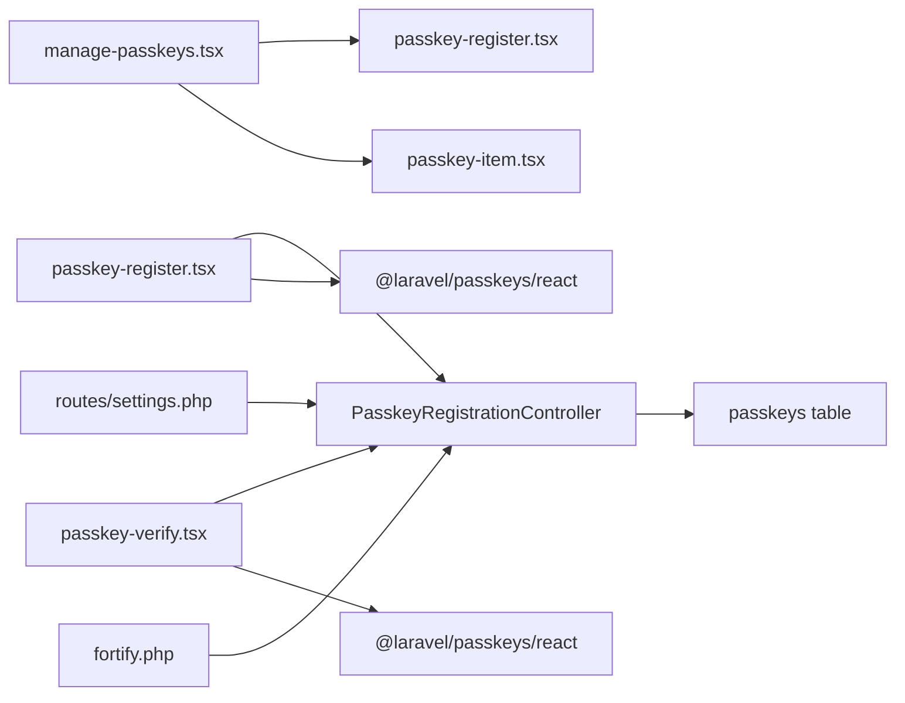

# Passkey Management

<cite>
**Referenced Files in This Document**
- [2024_01_01_000000_create_passkeys_table.php](file://database/migrations/2024_01_01_000000_create_passkeys_table.php)
- [PasskeyRegistrationController.php](file://vendor/laravel/passkeys/src/Htpp/Controllers/PasskeyRegistrationController.php)
- [SecurityController.php](file://app/Http/Controllers/Settings/SecurityController.php)
- [passkey-register.tsx](file://resources/js/components/passkey-register.tsx)
- [passkey-verify.tsx](file://resources/js/components/passkey-verify.tsx)
- [passkey-item.tsx](file://resources/js/components/passkey-item.tsx)
- [manage-passkeys.tsx](file://resources/js/components/manage-passkeys.tsx)
- [security.tsx](file://resources/js/pages/settings/security.tsx)
- [login.tsx](file://resources/js/pages/auth/login.tsx)
- [fortify.php](file://config/fortify.php)
- [settings.php](file://routes/settings.php)
- [web.php](file://routes/web.php)
- [auth.ts](file://resources/js/types/auth.ts)
- [chisel-paths.php](file://chisel-paths.php)
</cite>

## Table of Contents
1. [Introduction](#introduction)
2. [Project Structure](#project-structure)
3. [Core Components](#core-components)
4. [Architecture Overview](#architecture-overview)
5. [Detailed Component Analysis](#detailed-component-analysis)
6. [Dependency Analysis](#dependency-analysis)
7. [Performance Considerations](#performance-considerations)
8. [Troubleshooting Guide](#troubleshooting-guide)
9. [Conclusion](#conclusion)
10. [Appendices](#appendices)

## Introduction
This document describes the passkey/WebAuthn management system implemented in the application. It covers the database schema for storing passkeys, the end-to-end registration and verification workflows, the frontend components for managing passkeys, and the backend integration via Laravel Passkeys. It also outlines browser compatibility, security considerations, and fallback procedures alongside traditional authentication methods.

## Project Structure
The passkey system spans frontend React components, backend controllers, configuration, and database migrations. The frontend components integrate with the @laravel/passkeys React hooks to orchestrate WebAuthn flows. Backend controllers handle generating registration options, storing passkeys, and deleting them. Configuration in Fortify enables passkeys and sets relying party and timeout parameters. The database stores passkey metadata and credentials.

**Diagram sources**
- [login.tsx:24-31](file://resources/js/pages/auth/login.tsx#L24-L31)
- [security.tsx:138-143](file://resources/js/pages/settings/security.tsx#L138-L143)
- [passkey-verify.tsx:20-36](file://resources/js/components/passkey-verify.tsx#L20-L36)
- [passkey-register.tsx:12-34](file://resources/js/components/passkey-register.tsx#L12-L34)
- [manage-passkeys.tsx:28-69](file://resources/js/components/manage-passkeys.tsx#L28-L69)
- [SecurityController.php:19-56](file://app/Http/Controllers/Settings/SecurityController.php#L19-L56)
- [PasskeyRegistrationController.php:24-85](file://vendor/laravel/passkeys/src/Http/Controllers/PasskeyRegistrationController.php#L24-L85)
- [fortify.php:150-155](file://config/fortify.php#L150-L155)
- [settings.php:33-39](file://routes/settings.php#L33-L39)
- [2024_01_01_000000_create_passkeys_table.php:14-24](file://database/migrations/2024_01_01_000000_create_passkeys_table.php#L14-L24)

**Section sources**
- [login.tsx:24-31](file://resources/js/pages/auth/login.tsx#L24-L31)
- [security.tsx:138-143](file://resources/js/pages/settings/security.tsx#L138-L143)
- [passkey-verify.tsx:20-36](file://resources/js/components/passkey-verify.tsx#L20-L36)
- [passkey-register.tsx:12-34](file://resources/js/components/passkey-register.tsx#L12-L34)
- [manage-passkeys.tsx:28-69](file://resources/js/components/manage-passkeys.tsx#L28-L69)
- [SecurityController.php:19-56](file://app/Http/Controllers/Settings/SecurityController.php#L19-L56)
- [PasskeyRegistrationController.php:24-85](file://vendor/laravel/passkeys/src/Http/Controllers/PasskeyRegistrationController.php#L24-L85)
- [fortify.php:150-155](file://config/fortify.php#L150-L155)
- [settings.php:33-39](file://routes/settings.php#L33-L39)
- [2024_01_01_000000_create_passkeys_table.php:14-24](file://database/migrations/2024_01_01_000000_create_passkeys_table.php#L14-L24)

## Core Components
- Passkey database schema: Defines the passkeys table with foreign key to users, unique credential identifiers, JSON credential storage, timestamps, and indices.
- Frontend passkey registration component: Provides a form to name a passkey and triggers the registration flow using @laravel/passkeys React hooks.
- Frontend passkey verification component: Integrates WebAuthn verification into login flows with support for custom route endpoints.
- Frontend passkey management component: Lists existing passkeys, supports deletion via a confirmation dialog, and renders the registration form.
- Backend passkey registration controller: Generates registration options, validates requests, and persists passkeys after successful attestation.
- Security settings controller: Prepares passkey data for the settings page and exposes capability flags.
- Fortify configuration: Enables passkeys feature and configures relying party ID, allowed origins, user handle secret, and timeout.
- Routes: Exposes .well-known endpoints and binds passkey-related UI to the security settings page.

**Section sources**
- [2024_01_01_000000_create_passkeys_table.php:14-24](file://database/migrations/2024_01_01_000000_create_passkeys_table.php#L14-L24)
- [passkey-register.tsx:12-34](file://resources/js/components/passkey-register.tsx#L12-L34)
- [passkey-verify.tsx:20-36](file://resources/js/components/passkey-verify.tsx#L20-L36)
- [manage-passkeys.tsx:28-69](file://resources/js/components/manage-passkeys.tsx#L28-L69)
- [PasskeyRegistrationController.php:29-63](file://vendor/laravel/passkeys/src/Http/Controllers/PasskeyRegistrationController.php#L29-L63)
- [SecurityController.php:19-56](file://app/Http/Controllers/Settings/SecurityController.php#L19-L56)
- [fortify.php:150-155](file://config/fortify.php#L150-L155)
- [settings.php:33-39](file://routes/settings.php#L33-L39)

## Architecture Overview
The passkey system integrates React components with Laravel backend controllers and Fortify configuration. Registration and verification leverage @laravel/passkeys React hooks that communicate with backend endpoints to exchange WebAuthn options and credentials.

**Diagram sources**
- [passkey-register.tsx:28-34](file://resources/js/components/passkey-register.tsx#L28-L34)
- [PasskeyRegistrationController.php:29-43](file://vendor/laravel/passkeys/src/Http/Controllers/PasskeyRegistrationController.php#L29-L43)
- [PasskeyRegistrationController.php:48-63](file://vendor/laravel/passkeys/src/Http/Controllers/PasskeyRegistrationController.php#L48-L63)
- [2024_01_01_000000_create_passkeys_table.php:14-24](file://database/migrations/2024_01_01_000000_create_passkeys_table.php#L14-L24)

## Detailed Component Analysis

### Database Schema: Passkeys
The passkeys table stores per-user passkey records with:
- user_id: foreign key to users
- name: human-readable identifier for the passkey
- credential_id: unique identifier for the credential
- credential: JSON blob containing the credential data
- last_used_at: optional timestamp of last use
- timestamps: created_at and updated_at

**Diagram sources**
- [2024_01_01_000000_create_passkeys_table.php:14-24](file://database/migrations/2024_01_01_000000_create_passkeys_table.php#L14-L24)

**Section sources**
- [2024_01_01_000000_create_passkeys_table.php:14-24](file://database/migrations/2024_01_01_000000_create_passkeys_table.php#L14-L24)

### Passkey Registration Workflow
The registration flow is handled by the frontend registration component and backend controller:
- The component detects browser support and prompts for a passkey name.
- It invokes the registration hook to fetch options from the backend.
- The backend generates and returns WebAuthn registration options, storing serialized options in the session.
- After successful attestation, the component submits the credential and name to the backend.
- The backend validates the request and stores the passkey in the database.

**Diagram sources**
- [passkey-register.tsx:28-34](file://resources/js/components/passkey-register.tsx#L28-L34)
- [PasskeyRegistrationController.php:29-43](file://vendor/laravel/passkeys/src/Http/Controllers/PasskeyRegistrationController.php#L29-L43)
- [PasskeyRegistrationController.php:48-63](file://vendor/laravel/passkeys/src/Http/Controllers/PasskeyRegistrationController.php#L48-L63)
- [2024_01_01_000000_create_passkeys_table.php:14-24](file://database/migrations/2024_01_01_000000_create_passkeys_table.php#L14-L24)

**Section sources**
- [passkey-register.tsx:12-44](file://resources/js/components/passkey-register.tsx#L12-L44)
- [PasskeyRegistrationController.php:29-63](file://vendor/laravel/passkeys/src/Http/Controllers/PasskeyRegistrationController.php#L29-L63)

### Passkey Verification Workflow
The verification component integrates into login pages:
- It checks browser support and triggers the verification hook.
- It optionally accepts custom routes for options and submission endpoints.
- On success, it navigates to the dashboard or a redirect target returned by the backend.

**Diagram sources**
- [passkey-verify.tsx:26-36](file://resources/js/components/passkey-verify.tsx#L26-L36)
- [PasskeyRegistrationController.php:29-43](file://vendor/laravel/passkeys/src/Http/Controllers/PasskeyRegistrationController.php#L29-L43)
- [login.tsx:30](file://resources/js/pages/auth/login.tsx#L30)

**Section sources**
- [passkey-verify.tsx:20-36](file://resources/js/components/passkey-verify.tsx#L20-L36)
- [login.tsx:24-31](file://resources/js/pages/auth/login.tsx#L24-L31)

### Frontend Components for Passkey Management
- ManagePasskeys: Renders the passkey list and registration form; handles deletion via router.delete and reloads the page on success.
- PasskeyItem: Displays passkey details, including authenticator type, creation date, and last used date; opens a confirmation dialog to remove the passkey.
- PasskeyRegistration: Handles passkey name input, browser support detection, and triggers registration via the React hook.
- PasskeyVerify: Integrates into login pages to offer passkey-based authentication with customizable labels and routes.

**Diagram sources**
- [manage-passkeys.tsx:28-69](file://resources/js/components/manage-passkeys.tsx#L28-L69)
- [passkey-item.tsx:20-26](file://resources/js/components/passkey-item.tsx#L20-L26)
- [passkey-register.tsx:12-49](file://resources/js/components/passkey-register.tsx#L12-L49)
- [passkey-verify.tsx:20-36](file://resources/js/components/passkey-verify.tsx#L20-L36)

**Section sources**
- [manage-passkeys.tsx:28-69](file://resources/js/components/manage-passkeys.tsx#L28-L69)
- [passkey-item.tsx:20-93](file://resources/js/components/passkey-item.tsx#L20-L93)
- [passkey-register.tsx:12-100](file://resources/js/components/passkey-register.tsx#L12-L100)
- [passkey-verify.tsx:20-74](file://resources/js/components/passkey-verify.tsx#L20-L74)

### Backend Controllers and Data Flow
- SecurityController prepares passkey data for the settings page, including capability flags and formatted timestamps.
- PasskeyRegistrationController handles:
  - Generating registration options and storing them in the session
  - Storing passkeys after successful registration
  - Deleting passkeys with authorization checks

**Diagram sources**
- [SecurityController.php:19-56](file://app/Http/Controllers/Settings/SecurityController.php#L19-L56)
- [PasskeyRegistrationController.php:29-63](file://vendor/laravel/passkeys/src/Http/Controllers/PasskeyRegistrationController.php#L29-L63)

**Section sources**
- [SecurityController.php:19-56](file://app/Http/Controllers/Settings/SecurityController.php#L19-L56)
- [PasskeyRegistrationController.php:29-84](file://vendor/laravel/passkeys/src/Http/Controllers/PasskeyRegistrationController.php#L29-L84)

### Configuration and Routes
- Fortify configuration enables passkeys, sets relying party ID, allowed origins, user handle secret, and timeout.
- Routes expose .well-known endpoints for passkey discovery and bind the security settings page for passkey management.

**Section sources**
- [fortify.php:150-155](file://config/fortify.php#L150-L155)
- [settings.php:33-39](file://routes/settings.php#L33-L39)
- [web.php:25](file://routes/web.php#L25)

## Dependency Analysis
The frontend components depend on @laravel/passkeys React hooks and Inertia for navigation. The backend controllers depend on Laravel Passkeys actions and the WebAuthn support library. The database migration defines the persistence layer for passkeys.

**Diagram sources**
- [passkey-register.tsx:1](file://resources/js/components/passkey-register.tsx#L1)
- [passkey-verify.tsx:3](file://resources/js/components/passkey-verify.tsx#L3)
- [manage-passkeys.tsx:1](file://resources/js/components/manage-passkeys.tsx#L1)
- [passkey-item.tsx:1](file://resources/js/components/passkey-item.tsx#L1)
- [PasskeyRegistrationController.php:13-22](file://vendor/laravel/passkeys/src/Http/Controllers/PasskeyRegistrationController.php#L13-L22)
- [fortify.php:150-155](file://config/fortify.php#L150-L155)
- [settings.php:33-39](file://routes/settings.php#L33-L39)

**Section sources**
- [passkey-register.tsx:1](file://resources/js/components/passkey-register.tsx#L1)
- [passkey-verify.tsx:3](file://resources/js/components/passkey-verify.tsx#L3)
- [manage-passkeys.tsx:1](file://resources/js/components/manage-passkeys.tsx#L1)
- [passkey-item.tsx:1](file://resources/js/components/passkey-item.tsx#L1)
- [PasskeyRegistrationController.php:13-22](file://vendor/laravel/passkeys/src/Http/Controllers/PasskeyRegistrationController.php#L13-L22)
- [fortify.php:150-155](file://config/fortify.php#L150-L155)
- [settings.php:33-39](file://routes/settings.php#L33-L39)

## Performance Considerations
- Minimize round-trips by reusing generated registration options stored in the session.
- Defer passkey operations until after initial page load to avoid blocking render.
- Use browser-native WebAuthn APIs to reduce client-side processing overhead.
- Keep passkey lists paginated or virtualized if large numbers of passkeys are expected.

## Troubleshooting Guide
Common issues and resolutions:
- Browser not supported: The registration and verification components check support and display appropriate messages. Ensure the environment variable for user handle secret is set if relying on defaults.
- Authentication failures: Verify relying party ID matches the site origin and allowed origins include the deployment URL.
- Session option mismatch: Ensure the session contains the expected registration options before submitting credentials.
- Authorization errors on deletion: Confirm the logged-in user owns the passkey being removed.

**Section sources**
- [passkey-register.tsx:51-57](file://resources/js/components/passkey-register.tsx#L51-L57)
- [passkey-verify.tsx:38-40](file://resources/js/components/passkey-verify.tsx#L38-L40)
- [fortify.php:150-155](file://config/fortify.php#L150-L155)
- [PasskeyRegistrationController.php:72-84](file://vendor/laravel/passkeys/src/Http/Controllers/PasskeyRegistrationController.php#L72-L84)

## Conclusion
The passkey/WebAuthn system integrates seamlessly with the existing authentication infrastructure. The frontend components provide a user-friendly interface for registration, verification, and management, while the backend controllers and Fortify configuration ensure secure and standards-compliant operation. The database schema supports efficient storage and retrieval of passkey credentials.

## Appendices

### A. Passkey Enrollment Example
- Navigate to the security settings page.
- Click “Add passkey”.
- Enter a descriptive name for the passkey.
- Complete the browser prompt to register the passkey.
- The passkey appears in the list after successful enrollment.

**Section sources**
- [security.tsx:138-143](file://resources/js/pages/settings/security.tsx#L138-L143)
- [manage-passkeys.tsx:68](file://resources/js/components/manage-passkeys.tsx#L68)
- [passkey-register.tsx:36-44](file://resources/js/components/passkey-register.tsx#L36-L44)

### B. Passkey Authentication Example
- On the login page, click the “Sign in with a passkey” button.
- Complete the browser prompt to authenticate.
- On success, the user is redirected to the dashboard.

**Section sources**
- [login.tsx:30](file://resources/js/pages/auth/login.tsx#L30)
- [passkey-verify.tsx:33-35](file://resources/js/components/passkey-verify.tsx#L33-L35)

### C. Passkey Removal Procedure
- Open the security settings page.
- Locate the passkey to remove.
- Click the remove action in the item’s dialog.
- Confirm removal; the passkey is deleted from the database.

**Section sources**
- [manage-passkeys.tsx:31-36](file://resources/js/components/manage-passkeys.tsx#L31-L36)
- [passkey-item.tsx:23-26](file://resources/js/components/passkey-item.tsx#L23-L26)
- [PasskeyRegistrationController.php:68-84](file://vendor/laravel/passkeys/src/Http/Controllers/PasskeyRegistrationController.php#L68-L84)

### D. Relationship to Traditional Authentication Methods
- Passkeys complement traditional password-based login and two-factor authentication.
- Users can maintain passwords and 2FA alongside passkeys.
- The security settings page consolidates controls for all authentication methods.

**Section sources**
- [security.tsx:130-143](file://resources/js/pages/settings/security.tsx#L130-L143)
- [fortify.php:184-188](file://config/fortify.php#L184-L188)

### E. Backup Options and Fallback Procedures
- Maintain backup recovery codes for two-factor authentication.
- Continue using passwords as a fallback when passkeys are unavailable.
- Ensure .well-known endpoints are accessible for passkey discovery.

**Section sources**
- [settings.php:34-39](file://routes/settings.php#L34-L39)
- [fortify.php:178-188](file://config/fortify.php#L178-L188)

### F. Browser Compatibility and Security Considerations
- Browser support: The components check for passkey support and gracefully handle unsupported environments.
- Security: Relying party ID and allowed origins must match the deployment domain; user handle secret should be strong and stable.
- Timeout: Configure appropriate timeouts for WebAuthn operations.

**Section sources**
- [passkey-register.tsx:51-57](file://resources/js/components/passkey-register.tsx#L51-L57)
- [passkey-verify.tsx:38-40](file://resources/js/components/passkey-verify.tsx#L38-L40)
- [fortify.php:150-155](file://config/fortify.php#L150-L155)