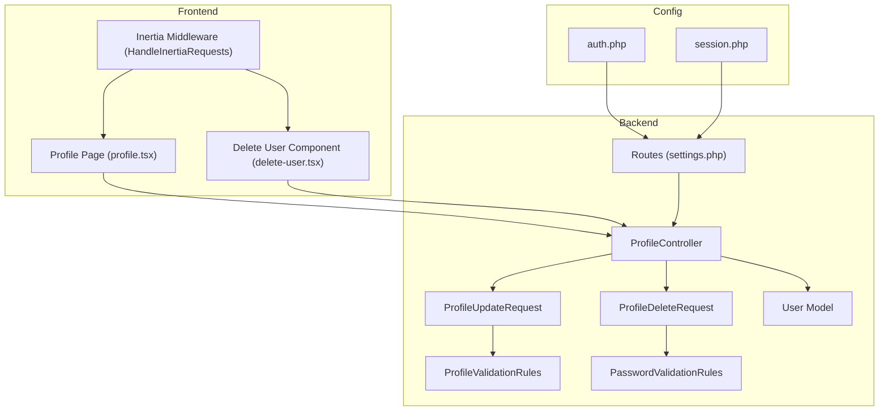
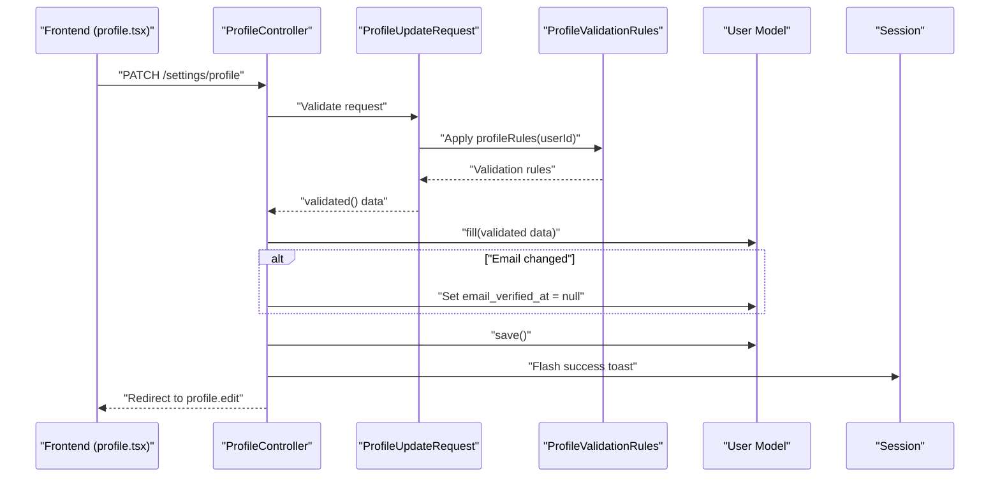
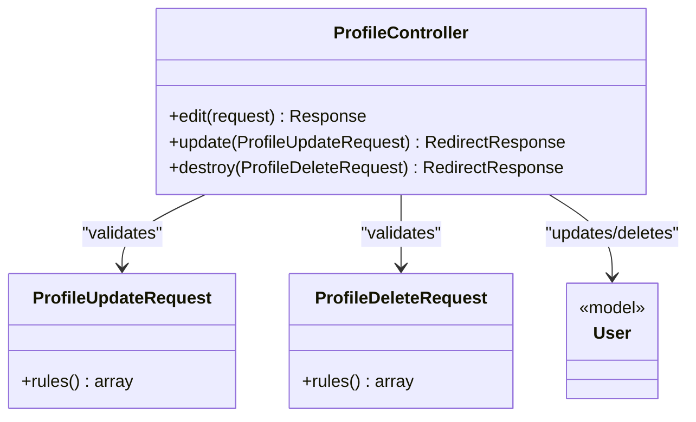
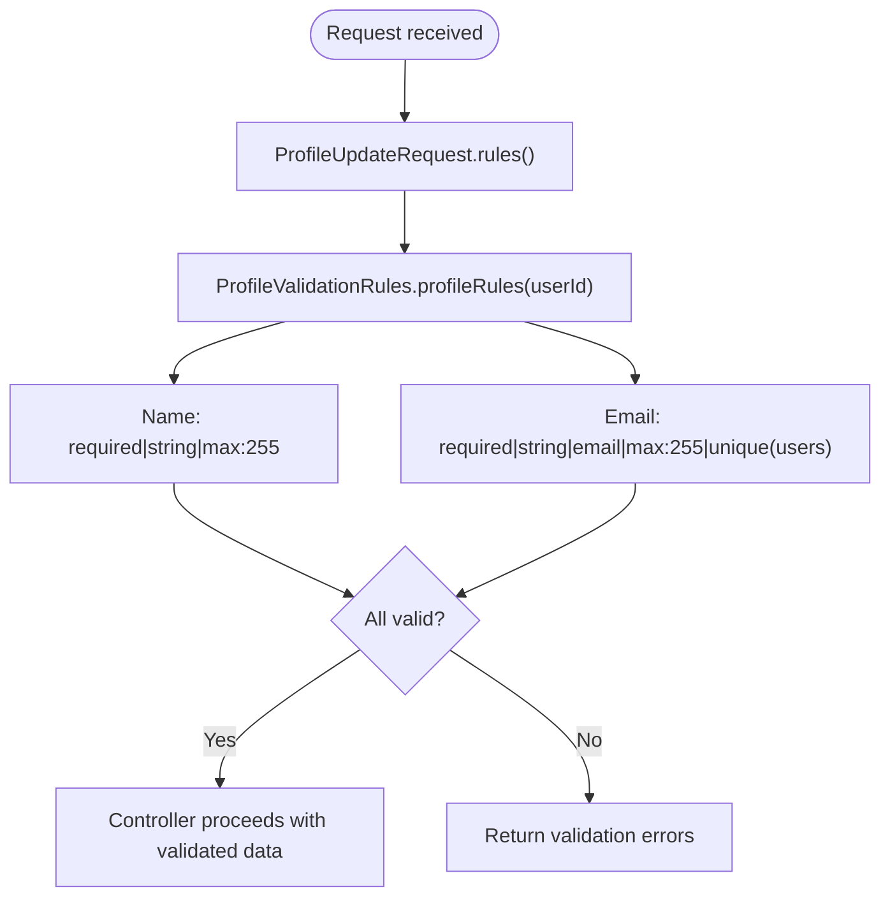
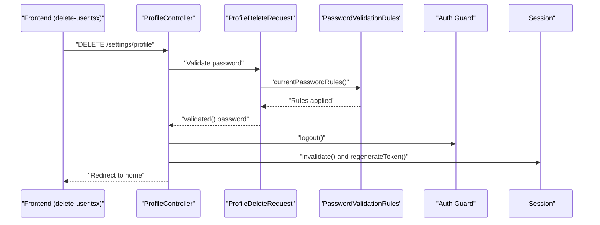
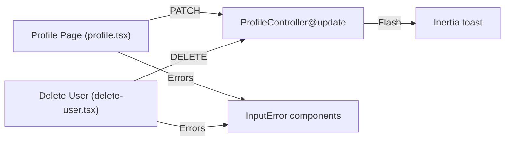
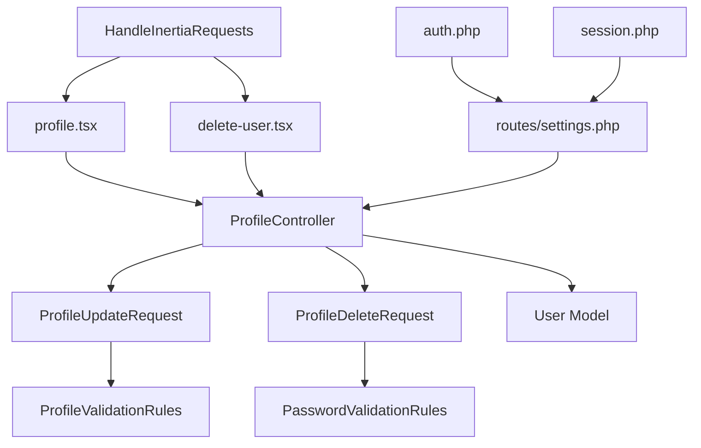

# Profile Management

<cite>
**Referenced Files in This Document**
- [ProfileController.php](file://app/Http/Controllers/Settings/ProfileController.php)
- [ProfileUpdateRequest.php](file://app/Http/Requests/Settings/ProfileUpdateRequest.php)
- [ProfileDeleteRequest.php](file://app/Http/Requests/Settings/ProfileDeleteRequest.php)
- [ProfileValidationRules.php](file://app/Concerns/ProfileValidationRules.php)
- [PasswordValidationRules.php](file://app/Concerns/PasswordValidationRules.php)
- [User.php](file://app/Models/User.php)
- [settings.php](file://routes/settings.php)
- [profile.tsx](file://resources/js/pages/settings/profile.tsx)
- [delete-user.tsx](file://resources/js/components/delete-user.tsx)
- [HandleInertiaRequests.php](file://app/Http/Middleware/HandleInertiaRequests.php)
- [auth.php](file://config/auth.php)
- [session.php](file://config/session.php)
- [ProfileUpdateTest.php](file://tests/Feature/Settings/ProfileUpdateTest.php)
</cite>

## Table of Contents
1. [Introduction](#introduction)
2. [Project Structure](#project-structure)
3. [Core Components](#core-components)
4. [Architecture Overview](#architecture-overview)
5. [Detailed Component Analysis](#detailed-component-analysis)
6. [Dependency Analysis](#dependency-analysis)
7. [Performance Considerations](#performance-considerations)
8. [Troubleshooting Guide](#troubleshooting-guide)
9. [Conclusion](#conclusion)

## Introduction
This document provides comprehensive documentation for the profile management functionality. It covers the ProfileController implementation, profile update and deletion operations, validation rules, authorization checks, data sanitization, and integration with the User model and session management. It also includes examples of profile modification, validation error handling, and user permission checks, along with security considerations.

## Project Structure
The profile management feature spans backend controllers and requests, frontend pages and components, routing, and configuration. The key elements include:
- Backend controller and form requests for profile updates and deletions
- Validation traits for profile and password rules
- User model with fillable and hidden attributes
- Frontend pages and components for rendering and submitting forms
- Routing with authentication and verification middleware
- Shared data via Inertia middleware

**Diagram sources**
- [ProfileController.php:15-62](file://app/Http/Controllers/Settings/ProfileController.php#L15-L62)
- [ProfileUpdateRequest.php:9-22](file://app/Http/Requests/Settings/ProfileUpdateRequest.php#L9-L22)
- [ProfileDeleteRequest.php:9-24](file://app/Http/Requests/Settings/ProfileDeleteRequest.php#L9-L24)
- [ProfileValidationRules.php:9-51](file://app/Concerns/ProfileValidationRules.php#L9-L51)
- [PasswordValidationRules.php:8-29](file://app/Concerns/PasswordValidationRules.php#L8-L29)
- [User.php:32-52](file://app/Models/User.php#L32-L52)
- [settings.php:10-31](file://routes/settings.php#L10-L31)
- [profile.tsx:22-139](file://resources/js/pages/settings/profile.tsx#L22-L139)
- [delete-user.tsx:19-120](file://resources/js/components/delete-user.tsx#L19-L120)
- [HandleInertiaRequests.php:8-47](file://app/Http/Middleware/HandleInertiaRequests.php#L8-L47)
- [auth.php:5-117](file://config/auth.php#L5-L117)
- [session.php:5-233](file://config/session.php#L5-L233)

**Section sources**
- [settings.php:10-31](file://routes/settings.php#L10-L31)
- [HandleInertiaRequests.php:36-46](file://app/Http/Middleware/HandleInertiaRequests.php#L36-L46)

## Core Components
- ProfileController: Handles GET/EDIT, PATCH/UPDATE, and DELETE/DESTROY actions for profile management.
- ProfileUpdateRequest: Validates profile update payload using shared validation rules.
- ProfileDeleteRequest: Validates password confirmation for account deletion using shared password rules.
- ProfileValidationRules: Provides reusable validation rules for name and email.
- PasswordValidationRules: Provides reusable validation rules for password confirmation.
- User Model: Defines fillable and hidden attributes and data casting.
- Frontend Pages and Components: Render forms, handle submission, and display validation errors.
- Routes: Apply authentication and verification middleware for profile operations.
- Inertia Middleware: Shares authentication state and app-wide data with frontend.

**Section sources**
- [ProfileController.php:20-61](file://app/Http/Controllers/Settings/ProfileController.php#L20-L61)
- [ProfileUpdateRequest.php:18-21](file://app/Http/Requests/Settings/ProfileUpdateRequest.php#L18-L21)
- [ProfileDeleteRequest.php:18-23](file://app/Http/Requests/Settings/ProfileDeleteRequest.php#L18-L23)
- [ProfileValidationRules.php:16-50](file://app/Concerns/ProfileValidationRules.php#L16-L50)
- [PasswordValidationRules.php:15-28](file://app/Concerns/PasswordValidationRules.php#L15-L28)
- [User.php:30-51](file://app/Models/User.php#L30-L51)
- [profile.tsx:48-133](file://resources/js/pages/settings/profile.tsx#L48-L133)
- [delete-user.tsx:57-114](file://resources/js/components/delete-user.tsx#L57-L114)
- [settings.php:10-31](file://routes/settings.php#L10-L31)
- [HandleInertiaRequests.php:36-46](file://app/Http/Middleware/HandleInertiaRequests.php#L36-L46)

## Architecture Overview
The profile management flow integrates frontend and backend components with strict validation and authorization policies.

**Diagram sources**
- [profile.tsx:48-53](file://resources/js/pages/settings/profile.tsx#L48-L53)
- [ProfileController.php:31-44](file://app/Http/Controllers/Settings/ProfileController.php#L31-L44)
- [ProfileUpdateRequest.php:18-21](file://app/Http/Requests/Settings/ProfileUpdateRequest.php#L18-L21)
- [ProfileValidationRules.php:16-22](file://app/Concerns/ProfileValidationRules.php#L16-L22)
- [User.php:30-31](file://app/Models/User.php#L30-L31)

## Detailed Component Analysis

### ProfileController
Responsibilities:
- Edit profile page rendering with Inertia.
- Update profile with validation, dirty-checking for email, and save.
- Destroy profile with logout, deletion, and session invalidation.

Key behaviors:
- Uses MustVerifyEmail check to conditionally render email verification UI.
- On email change, clears email verification timestamp.
- Flash success toast via Inertia.
- Logout and invalidate session on account deletion.

**Diagram sources**
- [ProfileController.php:15-62](file://app/Http/Controllers/Settings/ProfileController.php#L15-L62)
- [ProfileUpdateRequest.php:9-22](file://app/Http/Requests/Settings/ProfileUpdateRequest.php#L9-L22)
- [ProfileDeleteRequest.php:9-24](file://app/Http/Requests/Settings/ProfileDeleteRequest.php#L9-L24)
- [User.php:32-52](file://app/Models/User.php#L32-L52)

**Section sources**
- [ProfileController.php:20-61](file://app/Http/Controllers/Settings/ProfileController.php#L20-L61)

### ProfileUpdateRequest and Validation Rules
- Applies profileRules with the current user ID to enforce uniqueness against existing records.
- Delegates validation to ProfileValidationRules trait.

Validation rules summary:
- Name: required, string, max length constraint.
- Email: required, string, email format, max length constraint, unique rule bound to user ID.

**Diagram sources**
- [ProfileUpdateRequest.php:18-21](file://app/Http/Requests/Settings/ProfileUpdateRequest.php#L18-L21)
- [ProfileValidationRules.php:16-50](file://app/Concerns/ProfileValidationRules.php#L16-L50)

**Section sources**
- [ProfileUpdateRequest.php:18-21](file://app/Http/Requests/Settings/ProfileUpdateRequest.php#L18-L21)
- [ProfileValidationRules.php:16-50](file://app/Concerns/ProfileValidationRules.php#L16-L50)

### ProfileDeleteRequest and Authorization
- Requires current password confirmation using PasswordValidationRules.
- Enforces "current_password" rule to ensure the user knows their password before deletion.

Authorization and flow:
- Route requires "auth" and "verified" middleware for deletion endpoint.
- Frontend triggers deletion via a modal dialog with password input.

**Diagram sources**
- [delete-user.tsx:57-114](file://resources/js/components/delete-user.tsx#L57-L114)
- [ProfileController.php:49-61](file://app/Http/Controllers/Settings/ProfileController.php#L49-L61)
- [ProfileDeleteRequest.php:18-23](file://app/Http/Requests/Settings/ProfileDeleteRequest.php#L18-L23)
- [PasswordValidationRules.php:25-28](file://app/Concerns/PasswordValidationRules.php#L25-L28)
- [settings.php:17-18](file://routes/settings.php#L17-L18)

**Section sources**
- [ProfileDeleteRequest.php:18-23](file://app/Http/Requests/Settings/ProfileDeleteRequest.php#L18-L23)
- [PasswordValidationRules.php:25-28](file://app/Concerns/PasswordValidationRules.php#L25-L28)
- [settings.php:17-18](file://routes/settings.php#L17-L18)

### Frontend Integration and User Experience
- Profile page renders a form bound to the controller action and preserves scroll position on submit.
- Displays per-field validation errors and optional email verification messaging.
- Delete user component presents a confirmation dialog with password field and error handling.

**Diagram sources**
- [profile.tsx:48-133](file://resources/js/pages/settings/profile.tsx#L48-L133)
- [delete-user.tsx:57-114](file://resources/js/components/delete-user.tsx#L57-L114)
- [ProfileController.php:41-43](file://app/Http/Controllers/Settings/ProfileController.php#L41-L43)

**Section sources**
- [profile.tsx:48-133](file://resources/js/pages/settings/profile.tsx#L48-L133)
- [delete-user.tsx:57-114](file://resources/js/components/delete-user.tsx#L57-L114)

### Data Validation and Sanitization
- Validation occurs at the request level using FormRequest and shared traits.
- Unique email validation respects the current user ID to avoid self-locking.
- No manual sanitization is performed; Laravel validation handles basic sanitization and type coercion.

**Section sources**
- [ProfileValidationRules.php:16-50](file://app/Concerns/ProfileValidationRules.php#L16-L50)
- [ProfileUpdateRequest.php:18-21](file://app/Http/Requests/Settings/ProfileUpdateRequest.php#L18-L21)

### Security Considerations
- Authentication: All profile routes require "auth" middleware.
- Email verification: Deletion route requires "verified" middleware.
- Password confirmation: Account deletion requires "current_password" validation.
- Session management: Logout, session invalidation, and CSRF token regeneration after deletion.
- Frontend: Password inputs use appropriate autocomplete attributes and focus management on errors.

**Section sources**
- [settings.php:10-31](file://routes/settings.php#L10-L31)
- [PasswordValidationRules.php:25-28](file://app/Concerns/PasswordValidationRules.php#L25-L28)
- [ProfileController.php:53-58](file://app/Http/Controllers/Settings/ProfileController.php#L53-L58)
- [session.php:21-233](file://config/session.php#L21-L233)

## Dependency Analysis
- Controller depends on FormRequest classes for validation.
- FormRequest classes depend on shared validation traits.
- Controller operates on the User model and interacts with the session.
- Frontend components depend on controller action bindings and route helpers.
- Routes define middleware dependencies for authentication and verification.
- Inertia middleware shares authentication state with the frontend.

**Diagram sources**
- [ProfileController.php:15-62](file://app/Http/Controllers/Settings/ProfileController.php#L15-L62)
- [ProfileUpdateRequest.php:9-22](file://app/Http/Requests/Settings/ProfileUpdateRequest.php#L9-L22)
- [ProfileDeleteRequest.php:9-24](file://app/Http/Requests/Settings/ProfileDeleteRequest.php#L9-L24)
- [ProfileValidationRules.php:9-51](file://app/Concerns/ProfileValidationRules.php#L9-L51)
- [PasswordValidationRules.php:8-29](file://app/Concerns/PasswordValidationRules.php#L8-L29)
- [User.php:32-52](file://app/Models/User.php#L32-L52)
- [profile.tsx:22-139](file://resources/js/pages/settings/profile.tsx#L22-L139)
- [delete-user.tsx:19-120](file://resources/js/components/delete-user.tsx#L19-L120)
- [settings.php:10-31](file://routes/settings.php#L10-L31)
- [HandleInertiaRequests.php:36-46](file://app/Http/Middleware/HandleInertiaRequests.php#L36-L46)
- [auth.php:5-117](file://config/auth.php#L5-L117)
- [session.php:5-233](file://config/session.php#L5-L233)

**Section sources**
- [settings.php:10-31](file://routes/settings.php#L10-L31)
- [HandleInertiaRequests.php:36-46](file://app/Http/Middleware/HandleInertiaRequests.php#L36-L46)

## Performance Considerations
- Minimal overhead: Validation runs at the request boundary; controller performs a single save operation.
- Dirty checking: Email verification timestamp is only reset when email changes, avoiding unnecessary writes.
- Frontend: Preserve scroll and minimal re-rendering improve perceived performance.

[No sources needed since this section provides general guidance]

## Troubleshooting Guide
Common scenarios and resolutions:
- Validation errors on profile update:
  - Verify name and email constraints; ensure email is unique.
  - Check that the user ID is passed to the unique rule.
- Email verification state:
  - Changing email resets verification timestamp; unchanged email preserves verification state.
- Account deletion failures:
  - Ensure "current_password" matches the user's password.
  - Confirm route middleware "auth" and "verified" are satisfied.
- Session and logout:
  - After deletion, user is logged out and session is invalidated; redirect to home.

**Section sources**
- [ProfileUpdateTest.php:24-62](file://tests/Feature/Settings/ProfileUpdateTest.php#L24-L62)
- [ProfileUpdateTest.php:64-98](file://tests/Feature/Settings/ProfileUpdateTest.php#L64-L98)
- [ProfileController.php:35-39](file://app/Http/Controllers/Settings/ProfileController.php#L35-L39)
- [ProfileController.php:53-58](file://app/Http/Controllers/Settings/ProfileController.php#L53-L58)

## Conclusion
The profile management feature is built around a clean separation of concerns: validation in dedicated request classes, business logic in the controller, and a cohesive frontend experience. Robust validation rules, strict authorization, and secure session handling ensure reliability and safety. The modular design enables easy maintenance and extension while preserving a smooth user experience.