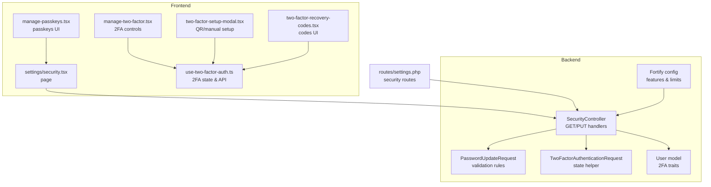
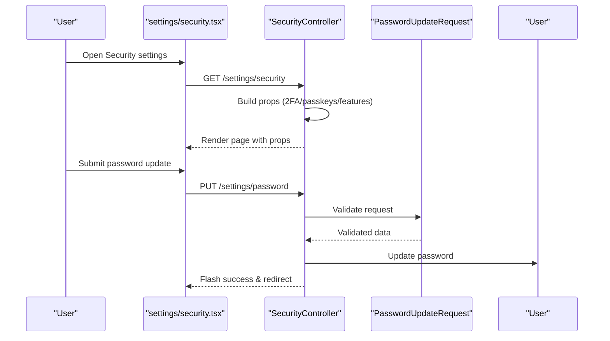
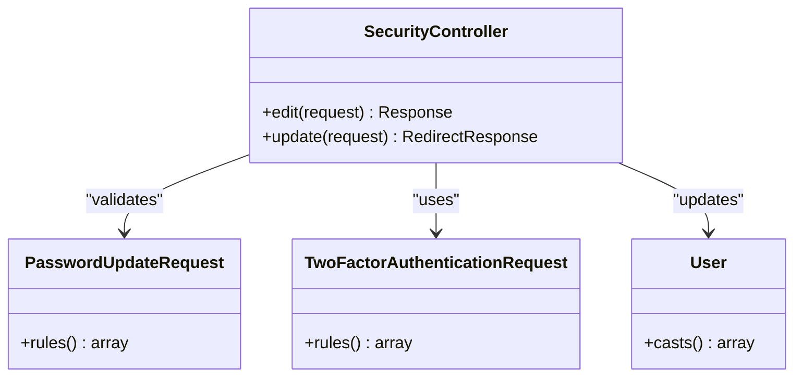
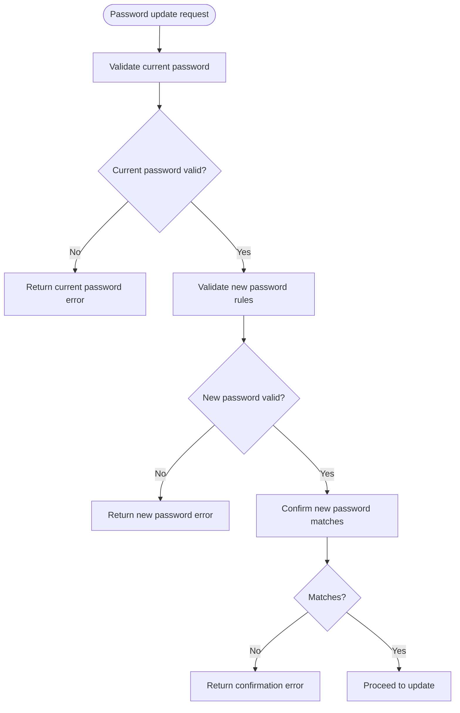
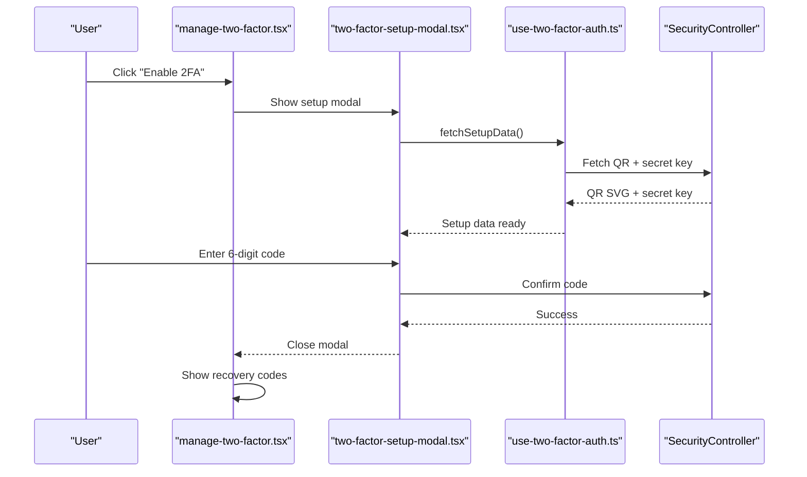
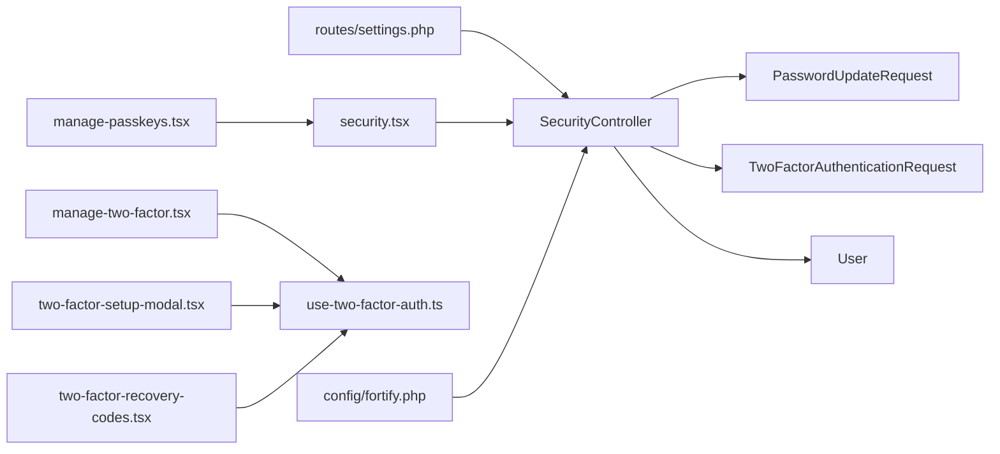

# Security Settings

<cite>
**Referenced Files in This Document**
- [SecurityController.php](file://app/Http/Controllers/Settings/SecurityController.php)
- [PasswordUpdateRequest.php](file://app/Http/Requests/Settings/PasswordUpdateRequest.php)
- [TwoFactorAuthenticationRequest.php](file://app/Http/Requests/Settings/TwoFactorAuthenticationRequest.php)
- [PasswordValidationRules.php](file://app/Concerns/PasswordValidationRules.php)
- [User.php](file://app/Models/User.php)
- [security.tsx](file://resources/js/pages/settings/security.tsx)
- [manage-two-factor.tsx](file://resources/js/components/manage-two-factor.tsx)
- [two-factor-setup-modal.tsx](file://resources/js/components/two-factor-setup-modal.tsx)
- [two-factor-recovery-codes.tsx](file://resources/js/components/two-factor-recovery-codes.tsx)
- [manage-passkeys.tsx](file://resources/js/components/manage-passkeys.tsx)
- [use-two-factor-auth.ts](file://resources/js/hooks/use-two-factor-auth.ts)
- [settings.php](file://routes/settings.php)
- [fortify.php](file://config/fortify.php)
- [SecurityTest.php](file://tests/Feature/Settings/SecurityTest.php)
</cite>

## Table of Contents
1. [Introduction](#introduction)
2. [Project Structure](#project-structure)
3. [Core Components](#core-components)
4. [Architecture Overview](#architecture-overview)
5. [Detailed Component Analysis](#detailed-component-analysis)
6. [Dependency Analysis](#dependency-analysis)
7. [Performance Considerations](#performance-considerations)
8. [Troubleshooting Guide](#troubleshooting-guide)
9. [Conclusion](#conclusion)

## Introduction
This document explains the security settings management implementation in the SmartExam web application. It covers the SecurityController, password update workflow, two-factor authentication (2FA) setup and management, passkey management, and recovery code handling. It also documents validation classes, security requirements, rate limiting, and session invalidation practices during security changes.

## Project Structure
Security-related functionality spans backend controllers and requests, frontend pages and components, configuration, and tests:
- Backend: controller, form requests, model, configuration
- Frontend: settings page, 2FA management UI, passkey management UI, hooks for 2FA state
- Routing: security routes with throttling and optional password confirmation
- Tests: feature tests validating rendering, password updates, and 2FA availability

**Diagram sources**
- [SecurityController.php:14-72](file://app/Http/Controllers/Settings/SecurityController.php#L14-L72)
- [PasswordUpdateRequest.php:9-25](file://app/Http/Requests/Settings/PasswordUpdateRequest.php#L9-L25)
- [TwoFactorAuthenticationRequest.php:9-22](file://app/Http/Requests/Settings/TwoFactorAuthenticationRequest.php#L9-L22)
- [User.php:32-51](file://app/Models/User.php#L32-L51)
- [security.tsx:24-146](file://resources/js/pages/settings/security.tsx#L24-L146)
- [manage-two-factor.tsx:17-126](file://resources/js/components/manage-two-factor.tsx#L17-L126)
- [two-factor-setup-modal.tsx:244-351](file://resources/js/components/two-factor-setup-modal.tsx#L244-L351)
- [two-factor-recovery-codes.tsx:21-164](file://resources/js/components/two-factor-recovery-codes.tsx#L21-L164)
- [manage-passkeys.tsx:28-71](file://resources/js/components/manage-passkeys.tsx#L28-L71)
- [use-two-factor-auth.ts:22-111](file://resources/js/hooks/use-two-factor-auth.ts#L22-L111)
- [settings.php:20-28](file://routes/settings.php#L20-L28)
- [fortify.php:169-189](file://config/fortify.php#L169-L189)

**Section sources**
- [SecurityController.php:14-72](file://app/Http/Controllers/Settings/SecurityController.php#L14-L72)
- [security.tsx:24-146](file://resources/js/pages/settings/security.tsx#L24-L146)
- [settings.php:20-28](file://routes/settings.php#L20-L28)

## Core Components
- SecurityController: renders the security settings page and handles password updates. It integrates with Fortify features for 2FA and passkeys and ensures 2FA state validity.
- PasswordUpdateRequest: validates current and new password fields using shared password validation rules.
- TwoFactorAuthenticationRequest: provides 2FA state helpers via a trait and intentionally returns no explicit rules (state validation occurs elsewhere).
- User model: includes Fortify traits for passkey and 2FA support and casts for sensitive fields.
- Frontend page and components: render password update forms, 2FA enable/disable flows, QR/manual setup, and recovery codes display.

**Section sources**
- [SecurityController.php:19-71](file://app/Http/Controllers/Settings/SecurityController.php#L19-L71)
- [PasswordUpdateRequest.php:18-24](file://app/Http/Requests/Settings/PasswordUpdateRequest.php#L18-L24)
- [TwoFactorAuthenticationRequest.php:18-21](file://app/Http/Requests/Settings/TwoFactorAuthenticationRequest.php#L18-L21)
- [User.php:35-51](file://app/Models/User.php#L35-L51)
- [security.tsx:41-127](file://resources/js/pages/settings/security.tsx#L41-L127)

## Architecture Overview
The security settings feature is structured around a controller action that prepares props for the frontend, a dedicated password update endpoint, and optional 2FA and passkey management handled by frontend components and hooks.

**Diagram sources**
- [SecurityController.php:19-71](file://app/Http/Controllers/Settings/SecurityController.php#L19-L71)
- [PasswordUpdateRequest.php:18-24](file://app/Http/Requests/Settings/PasswordUpdateRequest.php#L18-L24)
- [User.php:42-51](file://app/Models/User.php#L42-L51)
- [security.tsx:41-127](file://resources/js/pages/settings/security.tsx#L41-L127)

## Detailed Component Analysis

### SecurityController
Responsibilities:
- Renders the security settings page with feature flags and props for 2FA and passkeys.
- Handles password updates by validating input and updating the user’s password.
- Integrates with Fortify features to conditionally show 2FA and passkey management UI.

Key behaviors:
- Builds props including password rules, 2FA state flags, and passkey metadata.
- Ensures 2FA state is valid before rendering.
- On password update, flashes a success toast and redirects back to the security page.

**Diagram sources**
- [SecurityController.php:14-72](file://app/Http/Controllers/Settings/SecurityController.php#L14-L72)
- [PasswordUpdateRequest.php:9-25](file://app/Http/Requests/Settings/PasswordUpdateRequest.php#L9-L25)
- [TwoFactorAuthenticationRequest.php:9-22](file://app/Http/Requests/Settings/TwoFactorAuthenticationRequest.php#L9-L22)
- [User.php:32-51](file://app/Models/User.php#L32-L51)

**Section sources**
- [SecurityController.php:19-71](file://app/Http/Controllers/Settings/SecurityController.php#L19-L71)

### PasswordUpdateRequest and PasswordValidationRules
Validation requirements:
- New password must satisfy strong password rules and confirmation.
- Current password must match the user’s existing password.

Implementation highlights:
- Uses a shared trait to centralize password and current password validation rules.
- Enforces confirmation of the new password.

**Diagram sources**
- [PasswordUpdateRequest.php:18-24](file://app/Http/Requests/Settings/PasswordUpdateRequest.php#L18-L24)
- [PasswordValidationRules.php:15-28](file://app/Concerns/PasswordValidationRules.php#L15-L28)

**Section sources**
- [PasswordUpdateRequest.php:18-24](file://app/Http/Requests/Settings/PasswordUpdateRequest.php#L18-L24)
- [PasswordValidationRules.php:15-28](file://app/Concerns/PasswordValidationRules.php#L15-L28)

### Two-Factor Authentication Management
End-to-end flow:
- Enable 2FA: Fetches QR code SVG and manual setup key, displays setup modal, optionally confirms the setup code, and reveals recovery codes.
- Disable 2FA: Clears 2FA state and recovery codes.
- Recovery codes: Allows viewing and regenerating codes securely.

Frontend components:
- ManageTwoFactor: Orchestrates enable/disable actions and renders the setup modal.
- TwoFactorSetupModal: Guides users through scanning the QR code or entering the manual key, then verifies the 6-digit code.
- TwoFactorRecoveryCodes: Controls visibility and regeneration of recovery codes.

**Diagram sources**
- [manage-two-factor.tsx:17-126](file://resources/js/components/manage-two-factor.tsx#L17-L126)
- [two-factor-setup-modal.tsx:244-351](file://resources/js/components/two-factor-setup-modal.tsx#L244-L351)
- [use-two-factor-auth.ts:22-111](file://resources/js/hooks/use-two-factor-auth.ts#L22-L111)
- [SecurityController.php:19-71](file://app/Http/Controllers/Settings/SecurityController.php#L19-L71)

**Section sources**
- [manage-two-factor.tsx:17-126](file://resources/js/components/manage-two-factor.tsx#L17-L126)
- [two-factor-setup-modal.tsx:244-351](file://resources/js/components/two-factor-setup-modal.tsx#L244-L351)
- [two-factor-recovery-codes.tsx:21-164](file://resources/js/components/two-factor-recovery-codes.tsx#L21-L164)
- [use-two-factor-auth.ts:22-111](file://resources/js/hooks/use-two-factor-auth.ts#L22-L111)

### Passkey Management
- The page conditionally renders passkey management UI based on Fortify features.
- ManagePasskeys lists registered passkeys and provides registration UI.
- Deletion uses an HTTP DELETE action with scroll preservation.

**Section sources**
- [security.tsx:130-143](file://resources/js/pages/settings/security.tsx#L130-L143)
- [manage-passkeys.tsx:28-71](file://resources/js/components/manage-passkeys.tsx#L28-L71)

## Dependency Analysis
- Controller depends on:
  - PasswordUpdateRequest for validation
  - TwoFactorAuthenticationRequest for 2FA state helpers
  - Fortify features for capability checks
  - User model for password updates and 2FA state
- Frontend components depend on:
  - use-two-factor-auth hook for fetching QR/setup keys and recovery codes
  - Inertia forms for submissions
- Routes enforce:
  - Authentication and email verification
  - Optional password confirmation for accessing security settings
  - Throttling for password updates

**Diagram sources**
- [settings.php:20-28](file://routes/settings.php#L20-L28)
- [SecurityController.php:19-71](file://app/Http/Controllers/Settings/SecurityController.php#L19-L71)
- [PasswordUpdateRequest.php:18-24](file://app/Http/Requests/Settings/PasswordUpdateRequest.php#L18-L24)
- [TwoFactorAuthenticationRequest.php:18-21](file://app/Http/Requests/Settings/TwoFactorAuthenticationRequest.php#L18-L21)
- [User.php:35-51](file://app/Models/User.php#L35-L51)
- [security.tsx:24-146](file://resources/js/pages/settings/security.tsx#L24-L146)
- [manage-two-factor.tsx:17-126](file://resources/js/components/manage-two-factor.tsx#L17-L126)
- [two-factor-setup-modal.tsx:244-351](file://resources/js/components/two-factor-setup-modal.tsx#L244-L351)
- [two-factor-recovery-codes.tsx:21-164](file://resources/js/components/two-factor-recovery-codes.tsx#L21-L164)
- [manage-passkeys.tsx:28-71](file://resources/js/components/manage-passkeys.tsx#L28-L71)
- [use-two-factor-auth.ts:22-111](file://resources/js/hooks/use-two-factor-auth.ts#L22-L111)
- [fortify.php:169-189](file://config/fortify.php#L169-L189)

**Section sources**
- [settings.php:20-28](file://routes/settings.php#L20-L28)
- [fortify.php:169-189](file://config/fortify.php#L169-L189)

## Performance Considerations
- Prefer client-side caching of 2FA setup data (QR and secret key) to avoid redundant network calls.
- Batch asynchronous fetches for setup data to reduce perceived latency.
- Keep recovery codes hidden by default to minimize DOM overhead until revealed.
- Use optimistic UI for quick feedback during enable/disable operations, with server-side reconciliation on failure.

## Troubleshooting Guide
Common issues and resolutions:
- Password update fails with current password error:
  - Ensure the provided current password matches the stored hash.
  - Verify the new password meets validation rules and confirmation.
- 2FA enable fails during code verification:
  - Confirm the 6-digit code matches the authenticator app’s current value.
  - Re-fetch setup data if the QR or secret key was stale.
- Recovery codes not visible:
  - Trigger a fetch to populate the list before toggling visibility.
  - Regenerate codes if previously used or compromised.
- Security page inaccessible:
  - If password confirmation is required, ensure the session confirms the password before accessing the page.

**Section sources**
- [SecurityTest.php:93-129](file://tests/Feature/Settings/SecurityTest.php#L93-L129)
- [two-factor-setup-modal.tsx:158-228](file://resources/js/components/two-factor-setup-modal.tsx#L158-L228)
- [two-factor-recovery-codes.tsx:30-51](file://resources/js/components/two-factor-recovery-codes.tsx#L30-L51)

## Conclusion
The security settings module provides a cohesive, validated, and user-friendly interface for managing passwords, 2FA, and passkeys. It leverages Laravel Fortify for feature flags and rate limiting, Inertia for responsive UI, and strict validation to maintain security. Adhering to the outlined best practices and workflows ensures robust protection of user accounts.