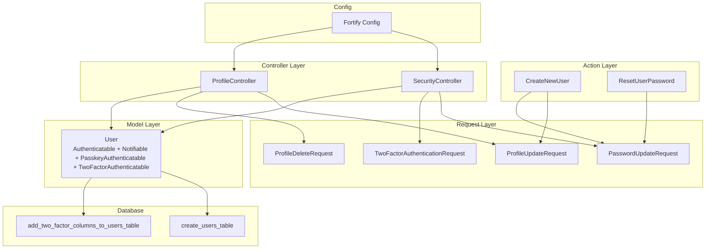
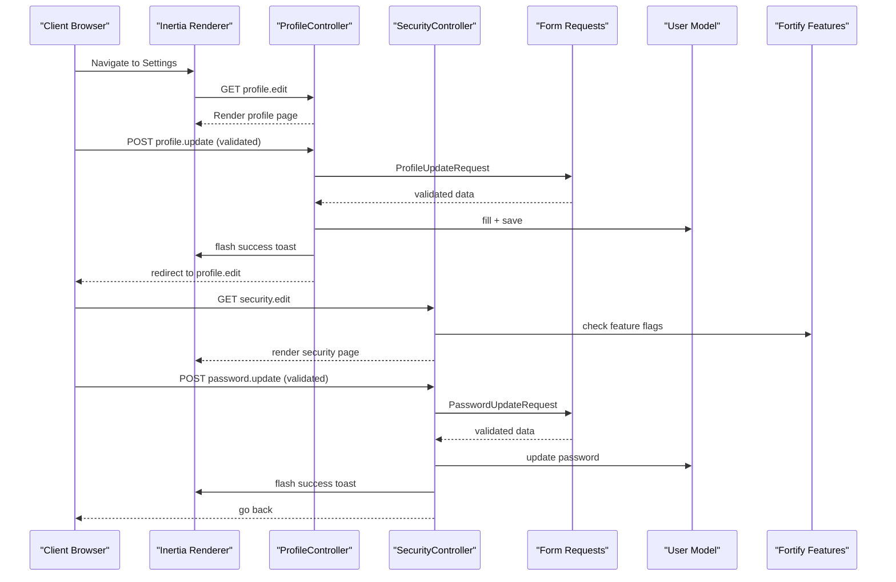
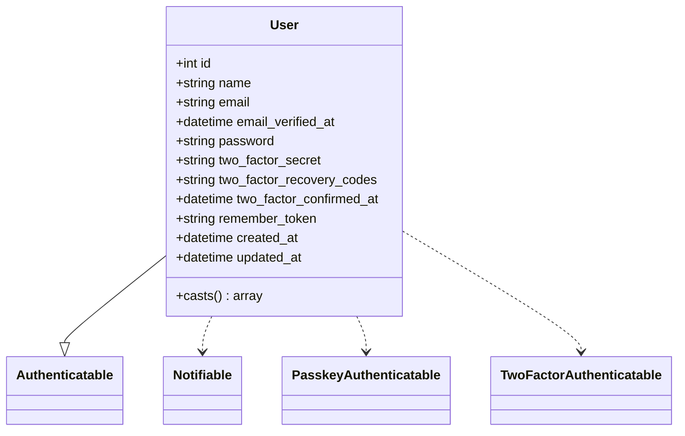
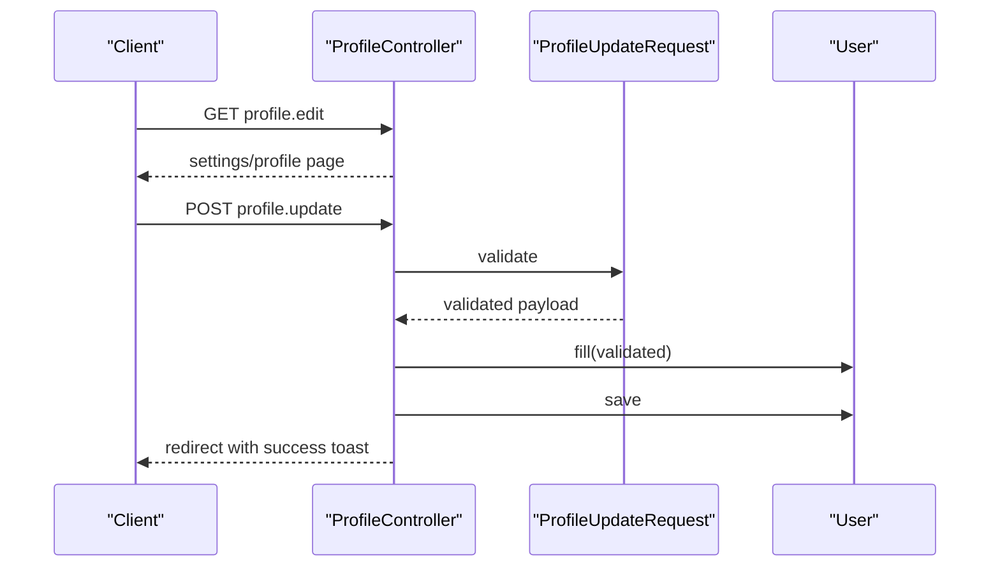
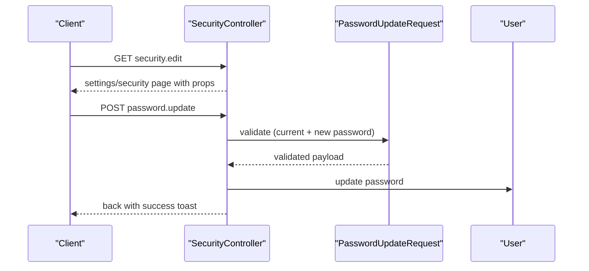
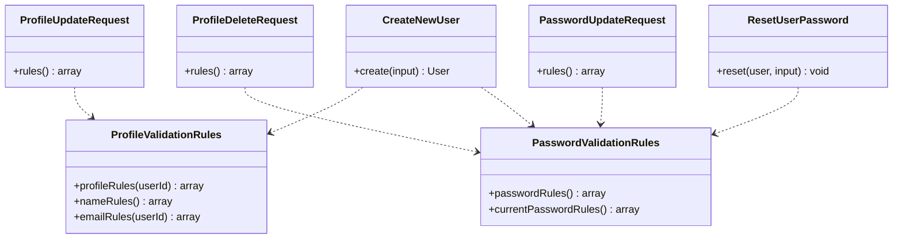
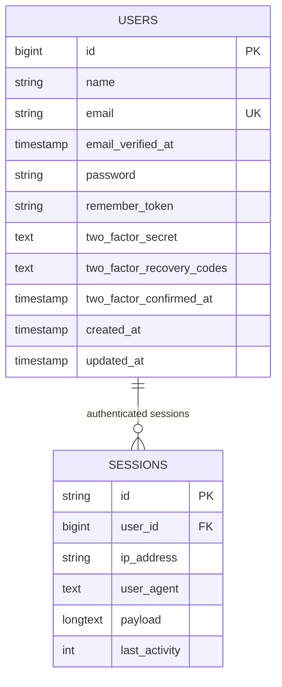
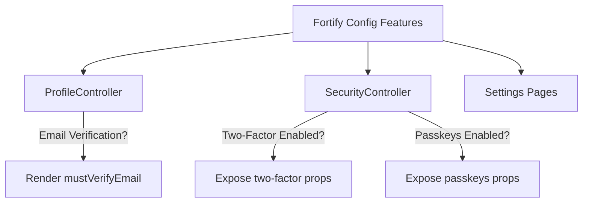
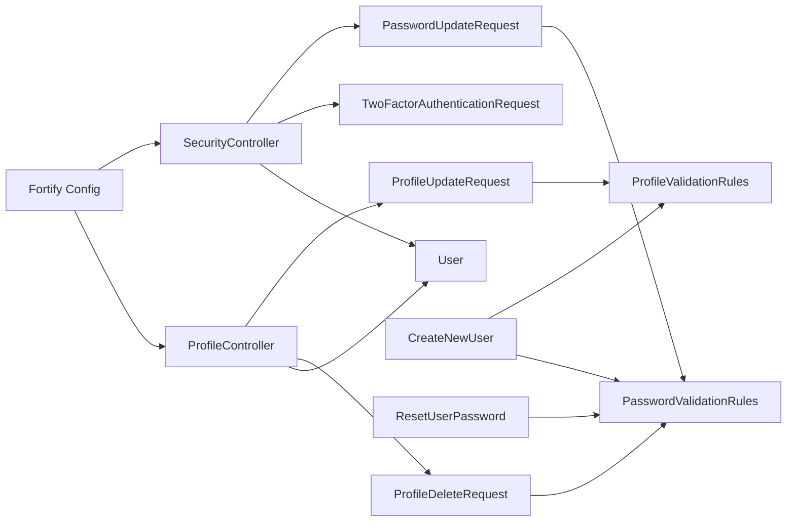

# User Management

<cite>
**Referenced Files in This Document**
- [User.php](file://app/Models/User.php)
- [ProfileController.php](file://app/Http/Controllers/Settings/ProfileController.php)
- [SecurityController.php](file://app/Http/Controllers/Settings/SecurityController.php)
- [ProfileUpdateRequest.php](file://app/Http/Requests/Settings/ProfileUpdateRequest.php)
- [ProfileDeleteRequest.php](file://app/Http/Requests/Settings/ProfileDeleteRequest.php)
- [PasswordUpdateRequest.php](file://app/Http/Requests/Settings/PasswordUpdateRequest.php)
- [TwoFactorAuthenticationRequest.php](file://app/Http/Requests/Settings/TwoFactorAuthenticationRequest.php)
- [PasswordValidationRules.php](file://app/Concerns/PasswordValidationRules.php)
- [ProfileValidationRules.php](file://app/Concerns/ProfileValidationRules.php)
- [CreateNewUser.php](file://app/Actions/Fortify/CreateNewUser.php)
- [ResetUserPassword.php](file://app/Actions/Fortify/ResetUserPassword.php)
- [create_users_table.php](file://database/migrations/0001_01_01_000000_create_users_table.php)
- [add_two_factor_columns_to_users_table.php](file://database/migrations/2025_08_14_170933_add_two_factor_columns_to_users_table.php)
- [fortify.php](file://config/fortify.php)
</cite>

## Table of Contents
1. [Introduction](#introduction)
2. [Project Structure](#project-structure)
3. [Core Components](#core-components)
4. [Architecture Overview](#architecture-overview)
5. [Detailed Component Analysis](#detailed-component-analysis)
6. [Dependency Analysis](#dependency-analysis)
7. [Performance Considerations](#performance-considerations)
8. [Troubleshooting Guide](#troubleshooting-guide)
9. [Conclusion](#conclusion)

## Introduction
This document describes the user management subsystem of the SmartExam web application. It covers the User model, authentication traits, profile management, security settings, and session management. It explains how profile updates, password changes, and account deletion are processed, along with validation rules, data sanitization, and integration with Laravel Fortify and Inertia. Examples of user data manipulation, permission checks, and controller flows are included to guide developers and administrators.

## Project Structure
The user management system spans several layers:
- Model layer: Eloquent model with authentication and security traits
- Request layer: Form requests encapsulating validation rules
- Action layer: Fortify actions for registration and password reset
- Controller layer: Settings controllers for profile and security operations
- Configuration: Fortify feature toggles and rate limiting
- Database: Migrations defining user schema and two-factor columns



**Diagram sources**
- [User.php:32-52](file://app/Models/User.php#L32-L52)
- [ProfileController.php:15-62](file://app/Http/Controllers/Settings/ProfileController.php#L15-L62)
- [SecurityController.php:14-72](file://app/Http/Controllers/Settings/SecurityController.php#L14-L72)
- [ProfileUpdateRequest.php:9-22](file://app/Http/Requests/Settings/ProfileUpdateRequest.php#L9-L22)
- [ProfileDeleteRequest.php:9-24](file://app/Http/Requests/Settings/ProfileDeleteRequest.php#L9-L24)
- [PasswordUpdateRequest.php:9-25](file://app/Http/Requests/Settings/PasswordUpdateRequest.php#L9-L25)
- [TwoFactorAuthenticationRequest.php:9-22](file://app/Http/Requests/Settings/TwoFactorAuthenticationRequest.php#L9-L22)
- [CreateNewUser.php:11-33](file://app/Actions/Fortify/CreateNewUser.php#L11-L33)
- [ResetUserPassword.php:10-29](file://app/Actions/Fortify/ResetUserPassword.php#L10-L29)
- [fortify.php:169-189](file://config/fortify.php#L169-L189)
- [create_users_table.php:14-37](file://database/migrations/0001_01_01_000000_create_users_table.php#L14-L37)
- [add_two_factor_columns_to_users_table.php:14-18](file://database/migrations/2025_08_14_170933_add_two_factor_columns_to_users_table.php#L14-L18)

**Section sources**
- [User.php:32-52](file://app/Models/User.php#L32-L52)
- [ProfileController.php:15-62](file://app/Http/Controllers/Settings/ProfileController.php#L15-L62)
- [SecurityController.php:14-72](file://app/Http/Controllers/Settings/SecurityController.php#L14-L72)
- [ProfileUpdateRequest.php:9-22](file://app/Http/Requests/Settings/ProfileUpdateRequest.php#L9-L22)
- [ProfileDeleteRequest.php:9-24](file://app/Http/Requests/Settings/ProfileDeleteRequest.php#L9-L24)
- [PasswordUpdateRequest.php:9-25](file://app/Http/Requests/Settings/PasswordUpdateRequest.php#L9-L25)
- [TwoFactorAuthenticationRequest.php:9-22](file://app/Http/Requests/Settings/TwoFactorAuthenticationRequest.php#L9-L22)
- [CreateNewUser.php:11-33](file://app/Actions/Fortify/CreateNewUser.php#L11-L33)
- [ResetUserPassword.php:10-29](file://app/Actions/Fortify/ResetUserPassword.php#L10-L29)
- [fortify.php:169-189](file://config/fortify.php#L169-L189)
- [create_users_table.php:14-37](file://database/migrations/0001_01_01_000000_create_users_table.php#L14-L37)
- [add_two_factor_columns_to_users_table.php:14-18](file://database/migrations/2025_08_14_170933_add_two_factor_columns_to_users_table.php#L14-L18)

## Core Components
- User model: Extends the framework's Authenticatable and integrates Fortify traits for passkeys and two-factor authentication. It defines fillable and hidden attributes and applies type casting for timestamps and hashed passwords.
- ProfileController: Handles profile editing, updating personal details, and account deletion with secure logout and session invalidation.
- SecurityController: Renders security settings, exposes password rules, and manages password updates. It also integrates two-factor authentication and passkey features via Fortify.
- Request validators: Encapsulate validation rules for profile updates, password changes, current password verification, and two-factor state handling.
- Fortify actions: Centralized logic for creating new users and resetting passwords with shared validation rules.
- Configuration: Fortify feature flags enable/disable registration, email verification, two-factor authentication, and passkeys.

Key capabilities:
- Profile updates with email ownership validation and re-verification handling
- Password updates with current password confirmation and strong password rules
- Account deletion requiring current password confirmation and secure session termination
- Two-factor authentication and passkey management through Fortify features
- Session and CSRF token invalidation after account deletion

**Section sources**
- [User.php:32-52](file://app/Models/User.php#L32-L52)
- [ProfileController.php:15-62](file://app/Http/Controllers/Settings/ProfileController.php#L15-L62)
- [SecurityController.php:14-72](file://app/Http/Controllers/Settings/SecurityController.php#L14-L72)
- [ProfileUpdateRequest.php:9-22](file://app/Http/Requests/Settings/ProfileUpdateRequest.php#L9-L22)
- [ProfileDeleteRequest.php:9-24](file://app/Http/Requests/Settings/ProfileDeleteRequest.php#L9-L24)
- [PasswordUpdateRequest.php:9-25](file://app/Http/Requests/Settings/PasswordUpdateRequest.php#L9-L25)
- [TwoFactorAuthenticationRequest.php:9-22](file://app/Http/Requests/Settings/TwoFactorAuthenticationRequest.php#L9-L22)
- [CreateNewUser.php:11-33](file://app/Actions/Fortify/CreateNewUser.php#L11-L33)
- [ResetUserPassword.php:10-29](file://app/Actions/Fortify/ResetUserPassword.php#L10-L29)
- [fortify.php:169-189](file://config/fortify.php#L169-L189)

## Architecture Overview
The user management architecture follows a layered pattern:
- Presentation: Inertia renders settings pages and flashes user feedback
- Controllers: Gatekeepers for user operations, enforcing validation and permissions
- Requests: Encapsulate validation rules and pre-process input
- Model: Persists validated data and enforces attribute visibility/casting
- Fortify: Provides authentication features (2FA, passkeys) and rate limiting
- Database: Stores user credentials, sessions, and two-factor metadata



**Diagram sources**
- [ProfileController.php:20-44](file://app/Http/Controllers/Settings/ProfileController.php#L20-L44)
- [SecurityController.php:19-71](file://app/Http/Controllers/Settings/SecurityController.php#L19-L71)
- [ProfileUpdateRequest.php:18-21](file://app/Http/Requests/Settings/ProfileUpdateRequest.php#L18-L21)
- [PasswordUpdateRequest.php:18-24](file://app/Http/Requests/Settings/PasswordUpdateRequest.php#L18-L24)
- [User.php:32-52](file://app/Models/User.php#L32-L52)
- [fortify.php:169-189](file://config/fortify.php#L169-L189)

## Detailed Component Analysis

### User Model
The User model extends the framework's Authenticatable and integrates Fortify traits for passkeys and two-factor authentication. It declares fillable attributes (name, email, password) and hides sensitive fields (password hash, two-factor secrets, remember token). Attribute casting ensures proper types for timestamps and hashed passwords.



**Diagram sources**
- [User.php:32-52](file://app/Models/User.php#L32-L52)

**Section sources**
- [User.php:32-52](file://app/Models/User.php#L32-L52)

### Profile Management
ProfileController provides three primary operations:
- Edit profile page rendering with email verification status and session status
- Update profile details with automatic email verification reset when email changes
- Delete account with logout, user deletion, and session/token invalidation



**Diagram sources**
- [ProfileController.php:20-44](file://app/Http/Controllers/Settings/ProfileController.php#L20-L44)
- [ProfileUpdateRequest.php:18-21](file://app/Http/Requests/Settings/ProfileUpdateRequest.php#L18-L21)
- [User.php:32-52](file://app/Models/User.php#L32-L52)

**Section sources**
- [ProfileController.php:15-62](file://app/Http/Controllers/Settings/ProfileController.php#L15-L62)
- [ProfileUpdateRequest.php:9-22](file://app/Http/Requests/Settings/ProfileUpdateRequest.php#L9-L22)

### Security Settings and Password Changes
SecurityController renders the security page, exposing feature flags for two-factor authentication and passkeys, and provides password update functionality with robust validation.



**Diagram sources**
- [SecurityController.php:19-71](file://app/Http/Controllers/Settings/SecurityController.php#L19-L71)
- [PasswordUpdateRequest.php:18-24](file://app/Http/Requests/Settings/PasswordUpdateRequest.php#L18-L24)
- [User.php:32-52](file://app/Models/User.php#L32-L52)

**Section sources**
- [SecurityController.php:14-72](file://app/Http/Controllers/Settings/SecurityController.php#L14-L72)
- [PasswordUpdateRequest.php:9-25](file://app/Http/Requests/Settings/PasswordUpdateRequest.php#L9-L25)

### Account Deletion
Account deletion requires current password confirmation, logs out the user, deletes the record, invalidates the session, regenerates CSRF tokens, and redirects to the home page.

```mermaid
flowchart TD
Start(["POST /profile") --> Validate["Validate current password"]
Validate --> Valid{"Valid?"}
Valid --> |No| Back["Redirect back with errors"]
Valid --> |Yes| Logout["Logout current session"]
Logout --> Delete["Delete user record"]
Delete --> Invalidate["Invalidate session"]
Invalidate --> Regenerate["Regenerate CSRF token"]
Regenerate --> Redirect["Redirect to '/'"]
Back --> End(["End"])
Redirect --> End
```

**Diagram sources**
- [ProfileController.php:49-61](file://app/Http/Controllers/Settings/ProfileController.php#L49-L61)
- [ProfileDeleteRequest.php:18-23](file://app/Http/Requests/Settings/ProfileDeleteRequest.php#L18-L23)

**Section sources**
- [ProfileController.php:49-61](file://app/Http/Controllers/Settings/ProfileController.php#L49-L61)
- [ProfileDeleteRequest.php:9-24](file://app/Http/Requests/Settings/ProfileDeleteRequest.php#L9-L24)

### Validation Rules and Data Sanitization
Validation rules are centralized in traits and reused across requests and actions:
- ProfileValidationRules: Enforces required name, email format, max length, and uniqueness (account for updates)
- PasswordValidationRules: Enforces required string, Fortify defaults, confirmation, and current password checks



**Diagram sources**
- [ProfileValidationRules.php:9-51](file://app/Concerns/ProfileValidationRules.php#L9-L51)
- [PasswordValidationRules.php:8-29](file://app/Concerns/PasswordValidationRules.php#L8-L29)
- [ProfileUpdateRequest.php:9-22](file://app/Http/Requests/Settings/ProfileUpdateRequest.php#L9-L22)
- [ProfileDeleteRequest.php:9-24](file://app/Http/Requests/Settings/ProfileDeleteRequest.php#L9-L24)
- [PasswordUpdateRequest.php:9-25](file://app/Http/Requests/Settings/PasswordUpdateRequest.php#L9-L25)
- [CreateNewUser.php:11-33](file://app/Actions/Fortify/CreateNewUser.php#L11-L33)
- [ResetUserPassword.php:10-29](file://app/Actions/Fortify/ResetUserPassword.php#L10-L29)

**Section sources**
- [ProfileValidationRules.php:9-51](file://app/Concerns/ProfileValidationRules.php#L9-L51)
- [PasswordValidationRules.php:8-29](file://app/Concerns/PasswordValidationRules.php#L8-L29)
- [ProfileUpdateRequest.php:18-21](file://app/Http/Requests/Settings/ProfileUpdateRequest.php#L18-L21)
- [ProfileDeleteRequest.php:18-23](file://app/Http/Requests/Settings/ProfileDeleteRequest.php#L18-L23)
- [PasswordUpdateRequest.php:18-24](file://app/Http/Requests/Settings/PasswordUpdateRequest.php#L18-L24)
- [CreateNewUser.php:22-25](file://app/Actions/Fortify/CreateNewUser.php#L22-L25)
- [ResetUserPassword.php:21-23](file://app/Actions/Fortify/ResetUserPassword.php#L21-L23)

### Authentication Tokens and Session Management
- Sessions: Managed by the framework with a dedicated sessions table storing payloads, user agents, IPs, and last activity timestamps
- CSRF and tokens: Automatically handled by the framework; after account deletion, tokens are regenerated
- Two-factor authentication: Columns for secret, recovery codes, and confirmation timestamp are stored in the users table
- Passkeys: Supported via Fortify passkeys feature with relying party configuration



**Diagram sources**
- [create_users_table.php:14-37](file://database/migrations/0001_01_01_000000_create_users_table.php#L14-L37)
- [add_two_factor_columns_to_users_table.php:14-18](file://database/migrations/2025_08_14_170933_add_two_factor_columns_to_users_table.php#L14-L18)

**Section sources**
- [create_users_table.php:14-37](file://database/migrations/0001_01_01_000000_create_users_table.php#L14-L37)
- [add_two_factor_columns_to_users_table.php:14-18](file://database/migrations/2025_08_14_170933_add_two_factor_columns_to_users_table.php#L14-L18)

### Integration with Fortify and Feature Flags
Fortify configuration enables/disables features such as registration, email verification, two-factor authentication, and passkeys. Controllers and views conditionally render features based on these flags.



**Diagram sources**
- [fortify.php:169-189](file://config/fortify.php#L169-L189)
- [SecurityController.php:19-56](file://app/Http/Controllers/Settings/SecurityController.php#L19-L56)
- [ProfileController.php:20-25](file://app/Http/Controllers/Settings/ProfileController.php#L20-L25)

**Section sources**
- [fortify.php:169-189](file://config/fortify.php#L169-L189)
- [SecurityController.php:19-56](file://app/Http/Controllers/Settings/SecurityController.php#L19-L56)
- [ProfileController.php:20-25](file://app/Http/Controllers/Settings/ProfileController.php#L20-L25)

## Dependency Analysis
The system exhibits low coupling and high cohesion:
- Controllers depend on request validators and the User model
- Validators are reusable across creation and update flows
- Fortify actions centralize validation logic for consistent enforcement
- Fortify configuration governs feature availability and behavior



**Diagram sources**
- [ProfileController.php:15-62](file://app/Http/Controllers/Settings/ProfileController.php#L15-L62)
- [SecurityController.php:14-72](file://app/Http/Controllers/Settings/SecurityController.php#L14-L72)
- [ProfileUpdateRequest.php:9-22](file://app/Http/Requests/Settings/ProfileUpdateRequest.php#L9-L22)
- [ProfileDeleteRequest.php:9-24](file://app/Http/Requests/Settings/ProfileDeleteRequest.php#L9-L24)
- [PasswordUpdateRequest.php:9-25](file://app/Http/Requests/Settings/PasswordUpdateRequest.php#L9-L25)
- [TwoFactorAuthenticationRequest.php:9-22](file://app/Http/Requests/Settings/TwoFactorAuthenticationRequest.php#L9-L22)
- [ProfileValidationRules.php:9-51](file://app/Concerns/ProfileValidationRules.php#L9-L51)
- [PasswordValidationRules.php:8-29](file://app/Concerns/PasswordValidationRules.php#L8-L29)
- [CreateNewUser.php:11-33](file://app/Actions/Fortify/CreateNewUser.php#L11-L33)
- [ResetUserPassword.php:10-29](file://app/Actions/Fortify/ResetUserPassword.php#L10-L29)
- [User.php:32-52](file://app/Models/User.php#L32-L52)
- [fortify.php:169-189](file://config/fortify.php#L169-L189)

**Section sources**
- [ProfileController.php:15-62](file://app/Http/Controllers/Settings/ProfileController.php#L15-L62)
- [SecurityController.php:14-72](file://app/Http/Controllers/Settings/SecurityController.php#L14-L72)
- [ProfileUpdateRequest.php:9-22](file://app/Http/Requests/Settings/ProfileUpdateRequest.php#L9-L22)
- [ProfileDeleteRequest.php:9-24](file://app/Http/Requests/Settings/ProfileDeleteRequest.php#L9-L24)
- [PasswordUpdateRequest.php:9-25](file://app/Http/Requests/Settings/PasswordUpdateRequest.php#L9-L25)
- [TwoFactorAuthenticationRequest.php:9-22](file://app/Http/Requests/Settings/TwoFactorAuthenticationRequest.php#L9-L22)
- [ProfileValidationRules.php:9-51](file://app/Concerns/ProfileValidationRules.php#L9-L51)
- [PasswordValidationRules.php:8-29](file://app/Concerns/PasswordValidationRules.php#L8-L29)
- [CreateNewUser.php:11-33](file://app/Actions/Fortify/CreateNewUser.php#L11-L33)
- [ResetUserPassword.php:10-29](file://app/Actions/Fortify/ResetUserPassword.php#L10-L29)
- [User.php:32-52](file://app/Models/User.php#L32-L52)
- [fortify.php:169-189](file://config/fortify.php#L169-L189)

## Performance Considerations
- Prefer batched saves when updating multiple attributes to minimize database round-trips
- Leverage database indexing on email for fast uniqueness checks and lookups
- Use pagination for passkey listings when collections grow large
- Keep validation rules concise to reduce request processing overhead
- Consider caching frequently accessed feature flags if dynamic toggling is not required

## Troubleshooting Guide
Common issues and resolutions:
- Profile update fails due to duplicate email: Ensure unique constraint validation passes; for updates, ignore the current user ID when checking uniqueness
- Password change rejected: Confirm current password matches and new password satisfies Fortify defaults and confirmation
- Two-factor state inconsistencies: Use the provided request trait to ensure state validity before rendering two-factor settings
- Account deletion not effective: Verify logout, deletion, session invalidation, and token regeneration occur in sequence

**Section sources**
- [ProfileValidationRules.php:39-50](file://app/Concerns/ProfileValidationRules.php#L39-L50)
- [PasswordValidationRules.php:15-28](file://app/Concerns/PasswordValidationRules.php#L15-L28)
- [TwoFactorAuthenticationRequest.php:11-21](file://app/Http/Requests/Settings/TwoFactorAuthenticationRequest.php#L11-L21)
- [ProfileController.php:49-61](file://app/Http/Controllers/Settings/ProfileController.php#L49-L61)

## Conclusion
The SmartExam user management system leverages Laravel's built-in authentication, Inertia for responsive UI, and Fortify for advanced security features. Validation rules are centralized for consistency, controllers enforce secure operations, and the database schema supports modern authentication needs including two-factor authentication and passkeys. Following the documented flows and validation rules ensures reliable, secure user data handling.