# User Model & Authentication

<cite>
**Referenced Files in This Document**
- [User.php](file://app/Models/User.php)
- [fortify.php](file://config/fortify.php)
- [auth.php](file://config/auth.php)
- [CreateNewUser.php](file://app/Actions/Fortify/CreateNewUser.php)
- [PasswordValidationRules.php](file://app/Concerns/PasswordValidationRules.php)
- [ProfileValidationRules.php](file://app/Concerns/ProfileValidationRules.php)
- [PasswordUpdateRequest.php](file://app/Http/Requests/Settings/PasswordUpdateRequest.php)
- [ProfileUpdateRequest.php](file://app/Http/Requests/Settings/ProfileUpdateRequest.php)
- [TwoFactorAuthenticationRequest.php](file://app/Http/Requests/Settings/TwoFactorAuthenticationRequest.php)
- [FortifyServiceProvider.php](file://app/Providers/FortifyServiceProvider.php)
- [0001_01_01_000000_create_users_table.php](file://database/migrations/0001_01_01_000000_create_users_table.php)
- [2025_08_14_170933_add_two_factor_columns_to_users_table.php](file://database/migrations/2025_08_14_170933_add_two_factor_columns_to_users_table.php)
- [UserFactory.php](file://database/factories/UserFactory.php)
- [login.tsx](file://resources/js/pages/auth/login.tsx)
- [register.tsx](file://resources/js/pages/auth/register.tsx)
- [manage-two-factor.tsx](file://resources/js/components/manage-two-factor.tsx)
</cite>

## Table of Contents
1. [Introduction](#introduction)
2. [Project Structure](#project-structure)
3. [Core Components](#core-components)
4. [Architecture Overview](#architecture-overview)
5. [Detailed Component Analysis](#detailed-component-analysis)
6. [Dependency Analysis](#dependency-analysis)
7. [Performance Considerations](#performance-considerations)
8. [Troubleshooting Guide](#troubleshooting-guide)
9. [Conclusion](#conclusion)

## Introduction
This document provides comprehensive documentation for the User model and authentication system in a Laravel application integrated with Laravel Fortify. It covers the User class implementation with Fortify traits for passkey and two-factor authentication, model properties and attribute casting, fillable and hidden attributes, authentication flow, password hashing, email verification, two-factor authentication integration, validation rules for passwords and profiles, and the relationship between user data and authentication tokens and sessions. Examples of user creation, authentication checks, and integration with the broader authentication system are included.

## Project Structure
The authentication system spans backend models, configuration, validation concerns, form requests, Fortify actions, and frontend pages. Key areas include:
- Model layer: User model with Fortify traits and attribute casting
- Configuration: Fortify and auth configurations enabling features
- Validation: Traits and form requests for password and profile rules
- Actions: Fortify action for user creation
- Migrations: Users table and two-factor columns
- Frontend: Login and registration pages integrating with authentication features

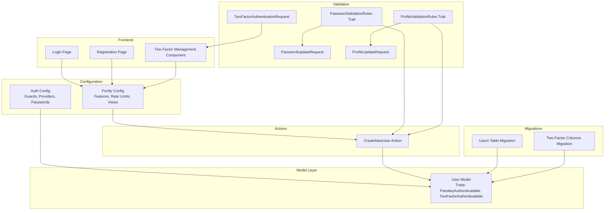

**Diagram sources**
- [User.php:32-52](file://app/Models/User.php#L32-L52)
- [fortify.php:5-192](file://config/fortify.php#L5-L192)
- [auth.php:1-118](file://config/auth.php#L1-L118)
- [CreateNewUser.php:11-34](file://app/Actions/Fortify/CreateNewUser.php#L11-L34)
- [PasswordValidationRules.php:8-30](file://app/Concerns/PasswordValidationRules.php#L8-L30)
- [ProfileValidationRules.php:9-52](file://app/Concerns/ProfileValidationRules.php#L9-L52)
- [PasswordUpdateRequest.php:9-26](file://app/Http/Requests/Settings/PasswordUpdateRequest.php#L9-L26)
- [ProfileUpdateRequest.php:9-23](file://app/Http/Requests/Settings/ProfileUpdateRequest.php#L9-L23)
- [TwoFactorAuthenticationRequest.php:9-23](file://app/Http/Requests/Settings/TwoFactorAuthenticationRequest.php#L9-L23)
- [0001_01_01_000000_create_users_table.php:7-50](file://database/migrations/0001_01_01_000000_create_users_table.php#L7-L50)
- [2025_08_14_170933_add_two_factor_columns_to_users_table.php:7-35](file://database/migrations/2025_08_14_170933_add_two_factor_columns_to_users_table.php#L7-L35)
- [login.tsx:1-126](file://resources/js/pages/auth/login.tsx#L1-L126)
- [register.tsx:1-121](file://resources/js/pages/auth/register.tsx#L1-L121)
- [manage-two-factor.tsx:1-127](file://resources/js/components/manage-two-factor.tsx#L1-L127)

**Section sources**
- [User.php:1-53](file://app/Models/User.php#L1-L53)
- [fortify.php:1-192](file://config/fortify.php#L1-L192)
- [auth.php:1-118](file://config/auth.php#L1-L118)
- [CreateNewUser.php:1-34](file://app/Actions/Fortify/CreateNewUser.php#L1-L34)
- [PasswordValidationRules.php:1-30](file://app/Concerns/PasswordValidationRules.php#L1-L30)
- [ProfileValidationRules.php:1-52](file://app/Concerns/ProfileValidationRules.php#L1-L52)
- [PasswordUpdateRequest.php:1-26](file://app/Http/Requests/Settings/PasswordUpdateRequest.php#L1-L26)
- [ProfileUpdateRequest.php:1-23](file://app/Http/Requests/Settings/ProfileUpdateRequest.php#L1-L23)
- [TwoFactorAuthenticationRequest.php:1-23](file://app/Http/Requests/Settings/TwoFactorAuthenticationRequest.php#L1-L23)
- [0001_01_01_000000_create_users_table.php:1-50](file://database/migrations/0001_01_01_000000_create_users_table.php#L1-L50)
- [2025_08_14_170933_add_two_factor_columns_to_users_table.php:1-35](file://database/migrations/2025_08_14_170933_add_two_factor_columns_to_users_table.php#L1-L35)
- [UserFactory.php:1-65](file://database/factories/UserFactory.php#L1-L65)
- [login.tsx:1-126](file://resources/js/pages/auth/login.tsx#L1-L126)
- [register.tsx:1-121](file://resources/js/pages/auth/register.tsx#L1-L121)
- [manage-two-factor.tsx:1-127](file://resources/js/components/manage-two-factor.tsx#L1-L127)

## Core Components
- User Model
  - Extends the base Authenticatable class and implements the PasskeyUser interface
  - Uses HasFactory, Notifiable, PasskeyAuthenticatable, and TwoFactorAuthenticatable traits
  - Properties include identification, credentials, timestamps, and two-factor fields
  - Attribute casting ensures proper types for verification timestamps and hashed passwords
  - Fillable fields: name, email, password
  - Hidden fields: password, two-factor secret, two-factor recovery codes, remember token

- Fortify Configuration
  - Guard: web
  - Password broker: users
  - Username/email: email
  - Home path after authentication: /dashboard
  - Rate limiters: login, two-factor, passkeys
  - Enabled features: registration, reset passwords, email verification, two-factor authentication, passkeys

- Auth Configuration
  - Default guard: web
  - Password broker: users
  - Provider: Eloquent model User
  - Password reset configuration with token table, expiry, and throttle

- Validation Rules
  - Password rules: required, string, default password policy, confirmed
  - Current password rules: required, string, current_password
  - Profile rules: name required and max length; email required, unique, validated format, max length

- Fortify Actions
  - CreateNewUser validates profile and password rules, then creates a new user record

- Migrations
  - Users table with name, email, email_verified_at, password, rememberToken, timestamps
  - Sessions table for session management
  - Two-factor columns added to users: two_factor_secret, two_factor_recovery_codes, two_factor_confirmed_at

**Section sources**
- [User.php:17-52](file://app/Models/User.php#L17-L52)
- [fortify.php:18-192](file://config/fortify.php#L18-L192)
- [auth.php:18-118](file://config/auth.php#L18-L118)
- [PasswordValidationRules.php:15-28](file://app/Concerns/PasswordValidationRules.php#L15-L28)
- [ProfileValidationRules.php:16-50](file://app/Concerns/ProfileValidationRules.php#L16-L50)
- [CreateNewUser.php:20-32](file://app/Actions/Fortify/CreateNewUser.php#L20-L32)
- [0001_01_01_000000_create_users_table.php:12-38](file://database/migrations/0001_01_01_000000_create_users_table.php#L12-L38)
- [2025_08_14_170933_add_two_factor_columns_to_users_table.php:12-32](file://database/migrations/2025_08_14_170933_add_two_factor_columns_to_users_table.php#L12-L32)

## Architecture Overview
The authentication architecture integrates Laravel's session-based guard with Fortify features for registration, password reset, email verification, two-factor authentication, and passkeys. The User model centralizes authentication logic through traits, while configuration files enable and tune each feature. Validation concerns and form requests enforce strong rules for user input. Frontend pages render views and submit forms to Fortify endpoints.

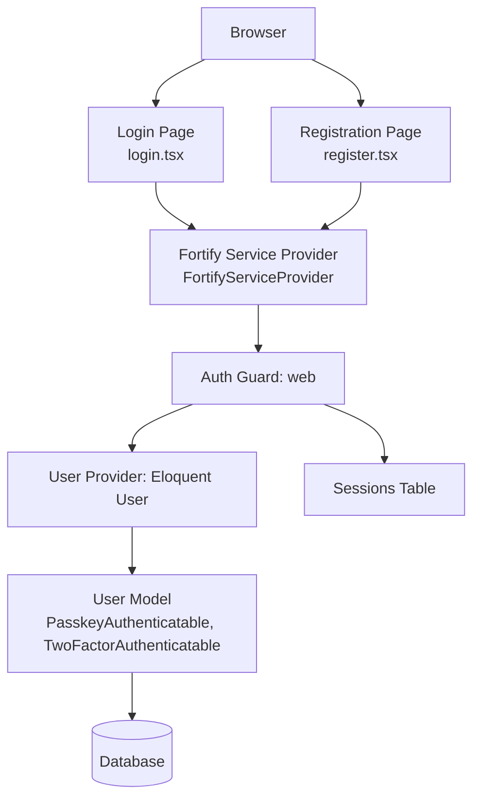

**Diagram sources**
- [login.tsx:1-126](file://resources/js/pages/auth/login.tsx#L1-L126)
- [register.tsx:1-121](file://resources/js/pages/auth/register.tsx#L1-L121)
- [FortifyServiceProvider.php:20-118](file://app/Providers/FortifyServiceProvider.php#L20-L118)
- [auth.php:40-74](file://config/auth.php#L40-L74)
- [User.php:32-35](file://app/Models/User.php#L32-L35)
- [0001_01_01_000000_create_users_table.php:30-37](file://database/migrations/0001_01_01_000000_create_users_table.php#L30-L37)

## Detailed Component Analysis

### User Model Implementation
The User model extends the base Authenticatable class and implements the PasskeyUser interface. It incorporates Fortify traits for passkey and two-factor authentication, ensuring seamless integration with modern authentication methods. Attribute casting guarantees correct types for timestamps and hashed passwords. Fillable and hidden attributes protect sensitive data exposure.

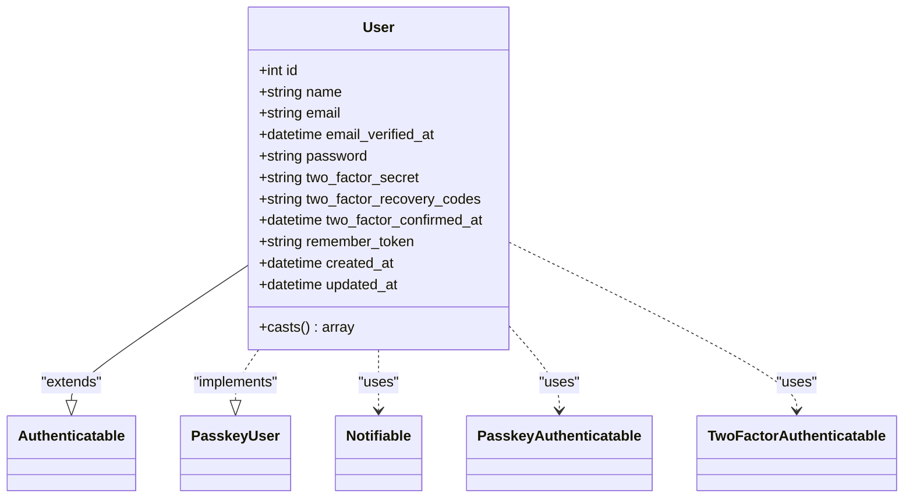

**Diagram sources**
- [User.php:32-52](file://app/Models/User.php#L32-L52)

**Section sources**
- [User.php:17-52](file://app/Models/User.php#L17-L52)

### Authentication Flow: Login and Registration
The login and registration flows leverage Fortify views and actions. The login page renders inputs for email, password, and remember me, while the registration page collects name, email, and password confirmation. Both pages integrate with Fortify endpoints and pass validation rules to the backend.

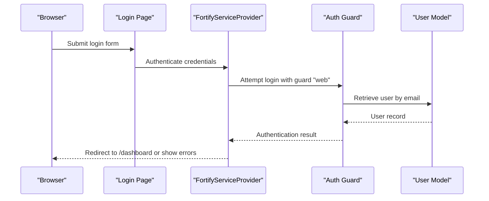

**Diagram sources**
- [login.tsx:24-120](file://resources/js/pages/auth/login.tsx#L24-L120)
- [FortifyServiceProvider.php:54-90](file://app/Providers/FortifyServiceProvider.php#L54-L90)
- [auth.php:40-45](file://config/auth.php#L40-L45)

**Section sources**
- [login.tsx:1-126](file://resources/js/pages/auth/login.tsx#L1-L126)
- [register.tsx:1-121](file://resources/js/pages/auth/register.tsx#L1-L121)
- [FortifyServiceProvider.php:54-90](file://app/Providers/FortifyServiceProvider.php#L54-L90)
- [auth.php:40-45](file://config/auth.php#L40-L45)

### Password Hashing and Validation
Password hashing is handled automatically through the model's attribute casting, ensuring secure storage. Validation rules enforce strong password policies and confirmation during registration and updates.

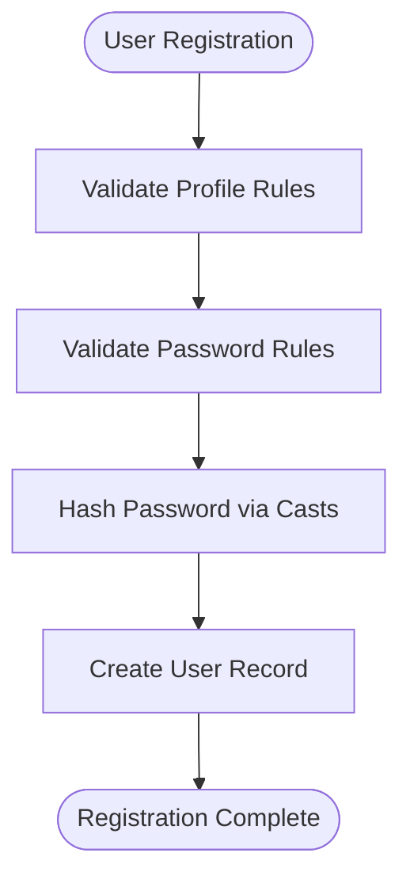

**Diagram sources**
- [CreateNewUser.php:20-32](file://app/Actions/Fortify/CreateNewUser.php#L20-L32)
- [PasswordValidationRules.php:15-18](file://app/Concerns/PasswordValidationRules.php#L15-L18)
- [User.php:42-51](file://app/Models/User.php#L42-L51)

**Section sources**
- [CreateNewUser.php:15-32](file://app/Actions/Fortify/CreateNewUser.php#L15-L32)
- [PasswordValidationRules.php:15-28](file://app/Concerns/PasswordValidationRules.php#L15-L28)
- [User.php:42-51](file://app/Models/User.php#L42-L51)

### Email Verification
Email verification is enabled through Fortify configuration. The system sends verification notifications and provides a dedicated view for verification, redirecting users upon completion.

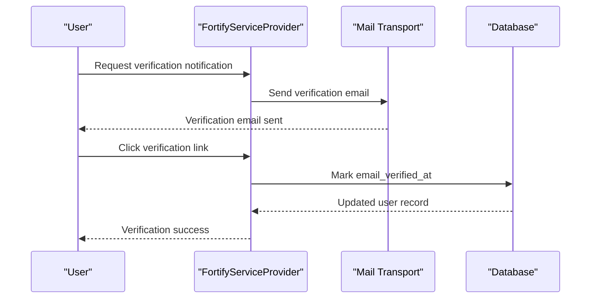

**Diagram sources**
- [fortify.php:174-176](file://config/fortify.php#L174-L176)
- [FortifyServiceProvider.php:71-75](file://app/Providers/FortifyServiceProvider.php#L71-L75)

**Section sources**
- [fortify.php:174-176](file://config/fortify.php#L174-L176)
- [FortifyServiceProvider.php:71-75](file://app/Providers/FortifyServiceProvider.php#L71-L75)

### Two-Factor Authentication Integration
Two-factor authentication is enabled with confirmation and password confirmation options. The User model includes fields for secrets, recovery codes, and confirmation timestamps. The frontend component manages enabling, disabling, and displaying recovery codes.

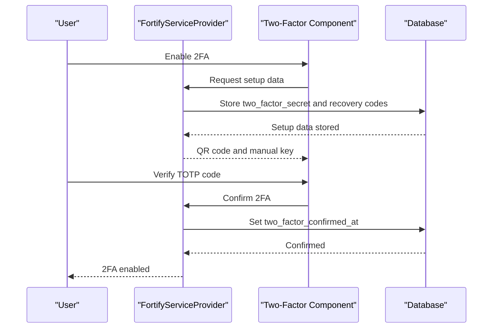

**Diagram sources**
- [fortify.php:178-183](file://config/fortify.php#L178-L183)
- [manage-two-factor.tsx:17-127](file://resources/js/components/manage-two-factor.tsx#L17-L127)
- [2025_08_14_170933_add_two_factor_columns_to_users_table.php:14-18](file://database/migrations/2025_08_14_170933_add_two_factor_columns_to_users_table.php#L14-L18)

**Section sources**
- [fortify.php:178-183](file://config/fortify.php#L178-L183)
- [manage-two-factor.tsx:17-127](file://resources/js/components/manage-two-factor.tsx#L17-L127)
- [2025_08_14_170933_add_two_factor_columns_to_users_table.php:12-32](file://database/migrations/2025_08_14_170933_add_two_factor_columns_to_users_table.php#L12-L32)

### Passkey Authentication
Passkey authentication is supported through Fortify configuration and a dedicated verification component in the login page. The relying party ID, allowed origins, and timeout are configurable.

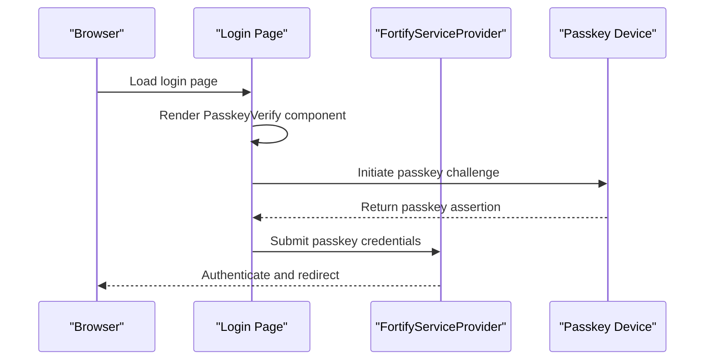

**Diagram sources**
- [login.tsx:29-31](file://resources/js/pages/auth/login.tsx#L29-L31)
- [fortify.php:150-155](file://config/fortify.php#L150-L155)
- [FortifyServiceProvider.php:109-115](file://app/Providers/FortifyServiceProvider.php#L109-L115)

**Section sources**
- [login.tsx:1-126](file://resources/js/pages/auth/login.tsx#L1-L126)
- [fortify.php:150-155](file://config/fortify.php#L150-L155)
- [FortifyServiceProvider.php:109-115](file://app/Providers/FortifyServiceProvider.php#L109-L115)

### Validation Rules for Passwords and Profiles
Password and profile validation rules are centralized in traits and form requests. Password rules enforce strong policies and confirmation, while profile rules ensure unique, valid email addresses and required name fields.

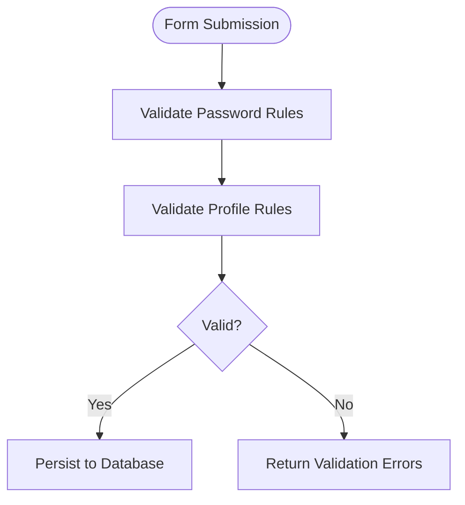

**Diagram sources**
- [PasswordValidationRules.php:15-18](file://app/Concerns/PasswordValidationRules.php#L15-L18)
- [ProfileValidationRules.php:16-50](file://app/Concerns/ProfileValidationRules.php#L16-L50)
- [PasswordUpdateRequest.php:18-24](file://app/Http/Requests/Settings/PasswordUpdateRequest.php#L18-L24)
- [ProfileUpdateRequest.php:18-22](file://app/Http/Requests/Settings/ProfileUpdateRequest.php#L18-L22)

**Section sources**
- [PasswordValidationRules.php:15-28](file://app/Concerns/PasswordValidationRules.php#L15-L28)
- [ProfileValidationRules.php:16-50](file://app/Concerns/ProfileValidationRules.php#L16-L50)
- [PasswordUpdateRequest.php:18-24](file://app/Http/Requests/Settings/PasswordUpdateRequest.php#L18-L24)
- [ProfileUpdateRequest.php:18-22](file://app/Http/Requests/Settings/ProfileUpdateRequest.php#L18-L22)

### Relationship Between User Data and Authentication Tokens, Sessions
The User model participates in session-based authentication via the web guard. Sessions are stored in the sessions table, enabling persistent login states. Password reset tokens are managed separately in the password_reset_tokens table. Two-factor data resides in the users table alongside user credentials.

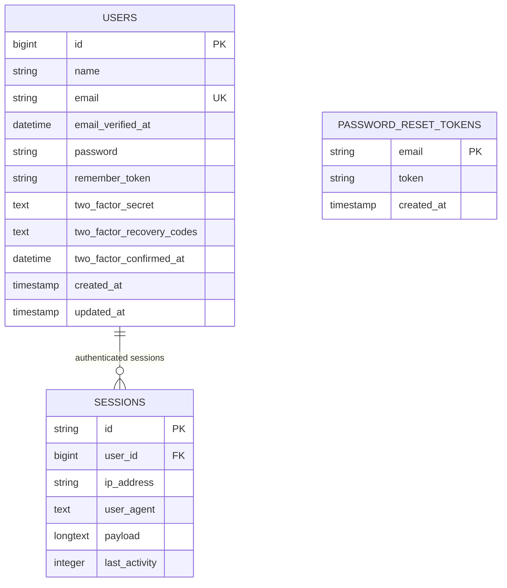

**Diagram sources**
- [0001_01_01_000000_create_users_table.php:14-37](file://database/migrations/0001_01_01_000000_create_users_table.php#L14-L37)
- [2025_08_14_170933_add_two_factor_columns_to_users_table.php:14-18](file://database/migrations/2025_08_14_170933_add_two_factor_columns_to_users_table.php#L14-L18)

**Section sources**
- [0001_01_01_000000_create_users_table.php:14-37](file://database/migrations/0001_01_01_000000_create_users_table.php#L14-L37)
- [2025_08_14_170933_add_two_factor_columns_to_users_table.php:14-18](file://database/migrations/2025_08_14_170933_add_two_factor_columns_to_users_table.php#L14-L18)

### Examples

#### User Creation
- Use the CreateNewUser action to validate profile and password rules, then persist the user record with hashed password.

**Section sources**
- [CreateNewUser.php:20-32](file://app/Actions/Fortify/CreateNewUser.php#L20-L32)
- [PasswordValidationRules.php:15-18](file://app/Concerns/PasswordValidationRules.php#L15-L18)
- [ProfileValidationRules.php:16-22](file://app/Concerns/ProfileValidationRules.php#L16-L22)

#### Authentication Checks
- The web guard authenticates users against the Eloquent User provider. Successful authentication redirects to the configured home path.

**Section sources**
- [auth.php:40-45](file://config/auth.php#L40-L45)
- [fortify.php:76](file://config/fortify.php#L76)

#### Integration with Authentication System
- Fortify actions and views are registered in the FortifyServiceProvider, configuring rate limits and view rendering for authentication features.

**Section sources**
- [FortifyServiceProvider.php:43-90](file://app/Providers/FortifyServiceProvider.php#L43-L90)
- [fortify.php:117-125](file://config/fortify.php#L117-L125)

## Dependency Analysis
The authentication system exhibits clear separation of concerns:
- Configuration files define feature sets and guards/providers
- Validation concerns encapsulate rule logic
- Fortify actions orchestrate user creation and password resets
- The User model centralizes authentication traits and attribute casting
- Migrations establish schema for users, sessions, and two-factor data
- Frontend pages render views and submit forms to Fortify endpoints

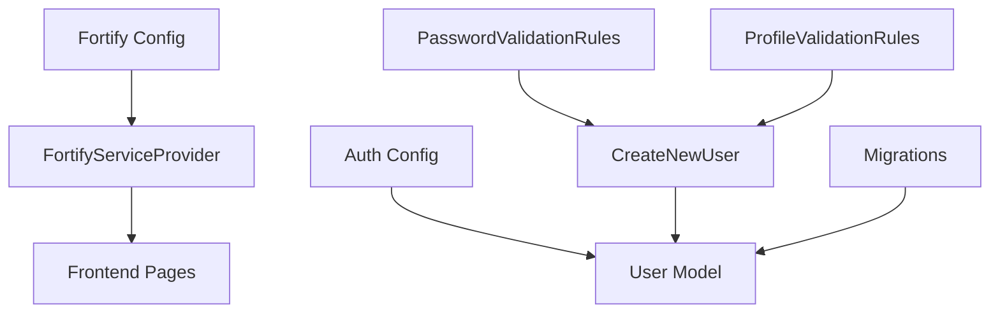

**Diagram sources**
- [fortify.php:5-192](file://config/fortify.php#L5-L192)
- [auth.php:1-118](file://config/auth.php#L1-L118)
- [PasswordValidationRules.php:8-30](file://app/Concerns/PasswordValidationRules.php#L8-L30)
- [ProfileValidationRules.php:9-52](file://app/Concerns/ProfileValidationRules.php#L9-L52)
- [CreateNewUser.php:11-34](file://app/Actions/Fortify/CreateNewUser.php#L11-L34)
- [User.php:32-52](file://app/Models/User.php#L32-L52)
- [0001_01_01_000000_create_users_table.php:7-50](file://database/migrations/0001_01_01_000000_create_users_table.php#L7-L50)
- [FortifyServiceProvider.php:20-118](file://app/Providers/FortifyServiceProvider.php#L20-L118)
- [login.tsx:1-126](file://resources/js/pages/auth/login.tsx#L1-L126)
- [register.tsx:1-121](file://resources/js/pages/auth/register.tsx#L1-L121)

**Section sources**
- [fortify.php:5-192](file://config/fortify.php#L5-L192)
- [auth.php:1-118](file://config/auth.php#L1-L118)
- [PasswordValidationRules.php:8-30](file://app/Concerns/PasswordValidationRules.php#L8-L30)
- [ProfileValidationRules.php:9-52](file://app/Concerns/ProfileValidationRules.php#L9-L52)
- [CreateNewUser.php:11-34](file://app/Actions/Fortify/CreateNewUser.php#L11-L34)
- [User.php:32-52](file://app/Models/User.php#L32-L52)
- [0001_01_01_000000_create_users_table.php:7-50](file://database/migrations/0001_01_01_000000_create_users_table.php#L7-L50)
- [FortifyServiceProvider.php:20-118](file://app/Providers/FortifyServiceProvider.php#L20-L118)
- [login.tsx:1-126](file://resources/js/pages/auth/login.tsx#L1-L126)
- [register.tsx:1-121](file://resources/js/pages/auth/register.tsx#L1-L121)

## Performance Considerations
- Rate limiting: Fortify applies rate limits for login, two-factor, and passkeys to mitigate brute force attacks
- Attribute casting: Using hashed casting for passwords reduces overhead and ensures secure storage
- Sessions: Efficient session table indexing improves lookup performance for authenticated users
- Validation: Centralized validation rules prevent redundant checks and improve maintainability

[No sources needed since this section provides general guidance]

## Troubleshooting Guide
Common issues and resolutions:
- Login throttling: Excessive failed attempts trigger rate limits; reduce attempts or adjust limiter configuration
- Email verification failures: Ensure email delivery configuration and verify the email_verified_at timestamp update
- Two-factor setup issues: Confirm two_factor_secret and recovery codes are properly stored and two_factor_confirmed_at is set post-confirmation
- Passkey authentication problems: Verify relying party ID, allowed origins, and passkey device compatibility

**Section sources**
- [FortifyServiceProvider.php:95-116](file://app/Providers/FortifyServiceProvider.php#L95-L116)
- [2025_08_14_170933_add_two_factor_columns_to_users_table.php:14-18](file://database/migrations/2025_08_14_170933_add_two_factor_columns_to_users_table.php#L14-L18)
- [fortify.php:150-155](file://config/fortify.php#L150-L155)

## Conclusion
The User model and authentication system integrate seamlessly with Laravel Fortify to provide robust, secure authentication. The model leverages traits for passkey and two-factor capabilities, while configuration files enable and tune features. Strong validation rules, session management, and rate limiting contribute to a secure and maintainable authentication architecture. The frontend pages align with backend capabilities, delivering a cohesive user experience.